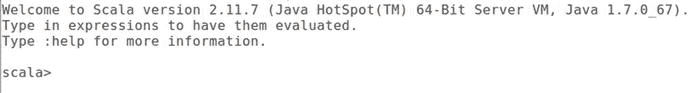

# Scala 编程

`Scala` 是最热门的现代编程语言之一。它是编程语言中的凯迪拉克。它不仅功能强大，而且语言优美。学习 `Scala` 将为你的职业生涯带来提升。

大数据应用程序可以用多种编程语言编写，包括 `Java`、`Python`、`C++`、`Scala` 等。`Hadoop` 本身是用 `Java` 编写的。大多数 `Hadoop` 应用程序是用 `Java` 编写的，但也支持其他编程语言。类似地，`Spark` 是用 `Scala` 编写的，但它支持多种编程语言，包括 `Scala`、`Java`、`Python` 和 `R`。

`Scala` 是开发大数据应用程序的优秀语言。它提供了诸多优势。首先，使用 `Scala` 可以显著提高开发者的生产力。其次，它能帮助开发者编写更健壮、缺陷更少的代码。第三，`Spark` 是用 `Scala` 编写的，因此 `Scala` 是开发 `Spark` 应用程序的自然之选。

本章将 `Scala` 作为一种通用编程语言来介绍。我的目标不是让你成为 `Scala` 专家，而是帮助你掌握足够多的 `Scala` 知识，以理解并用 `Scala` 编写 `Spark` 应用程序。本书中的示例代码均采用 `Scala`，因此了解 `Scala` 会使学习本书内容更加轻松。如果你已经了解 `Scala`，则可以放心跳过本章。

基于上述目标，本章涵盖了 `Scala` 编程的基础知识。为了有效使用 `Scala`，了解函数式编程至关重要，因此首先介绍函数式编程。本章最后以一个独立的 `Scala` 应用程序示例作为结束。

## 函数式编程 (FP)

函数式编程是一种以函数为构建块，并避免使用可变变量、循环和其他命令式控制结构的编程风格。它将计算视为数学函数的求值，其中函数的输出仅取决于函数的输入参数。程序由这样的函数组成。此外，在函数式编程语言中，函数是一等公民。

函数式编程近年来备受关注。甚至像 `C++`、`Java` 和 `Python` 这样的主流语言也增加了对函数式编程的支持。它变得流行起来有几个很好的理由。

首先，函数式编程能够极大提升开发者的生产力。与命令式语言相比，它让你能用更少的代码行数解决问题。例如，在 `Java` 中需要 100 行代码的任务，在 `Scala` 中可能只需要 10 或 20 行代码。因此，函数式编程可以将你的生产力提高五到十倍。

其次，函数式编程使得编写并发或多线程应用程序更加容易。随着多 CPU 或多核计算机的出现，编写多线程应用程序的能力变得非常重要。硬件制造商发现跟上摩尔定律越来越难，因此他们不再追求更快的处理器，而是开始增加更多的 CPU 和核心。如今多核计算机已变得普遍。应用程序需要充分利用所有核心。函数式编程语言使这项任务比命令式语言更容易完成。

第三，函数式编程有助于编写健壮的代码。它有助于避免常见的编程错误。此外，应用程序中的 bug 数量通常与代码行数成正比。由于函数式编程比命令式编程需要的代码行数少得多，因此代码中引入的 bug 也更少。

最后，函数式编程语言使得编写优雅的代码更加容易，这些代码易于阅读、理解和推理。编写得当的函数式代码看起来很美；它既不复杂也不混乱。你会从自己的代码中获得极大的快乐和满足感。

本节将讨论关键的函数式编程概念。

### 函数

函数是一段可执行的代码块。函数使程序员能够将大型程序分解为更小、更易于管理的部分。在函数式编程中，应用程序完全通过组合函数来构建。

尽管许多编程语言都支持函数的概念，但函数式编程语言将函数视为一等公民。此外，在函数式编程中，函数是可组合的，并且没有副作用。


#### 一等公民

函数式编程将函数视为**一等公民**。函数与变量或值具有相同的地位。它允许像使用变量一样使用函数。如果将函数式编程中的函数与 C 语言等命令式语言中的函数进行对比，就更容易理解这一概念。

命令式语言对变量和函数的处理方式不同。例如，C 语言不允许在一个函数内部定义另一个函数，也不允许将一个函数作为输入参数传递给另一个函数。

函数式编程允许将函数作为输入传递给另一个函数，也允许将函数作为返回值从另一个函数返回。函数可以定义在任何位置，包括在另一个函数内部。它可以像字符串字面量一样定义为匿名函数字面量，并作为输入传递给函数。

#### 可组合

函数式编程中的函数是可组合的。函数组合是一个数学和计算机科学概念，指的是将简单函数组合起来创建复杂函数。例如，两个可组合的函数可以组合起来创建第三个函数。考虑以下两个数学函数：

`f(x) = x*2`

`g(x) = x+2`

函数 `f` 接受一个数值输入，并返回该输入的两倍作为输出。函数 `g` 也接受一个数值输入，并返回该数值加二作为输出。

可以使用 `f` 和 `g` 组合成一个新函数，如下所示：

`h(x) = f(g(x)) = f(x+2) = (x+2)*2`

使用函数 `h` 等同于先用给定的输入调用函数 `g`，然后用函数 `g` 的输出调用函数 `f`。

函数可组合性是一种有用的技术，通过将复杂问题分解为一系列更简单的子问题来解决。然后可以为每个子问题编写函数，并在顶层函数中将它们组合在一起。

#### 无副作用

函数式编程中的函数没有副作用。函数返回的结果仅取决于函数的输入参数。函数的行为不会随时间改变。对于给定的输入，无论调用多少次，它每次都会返回相同的输出。换句话说，函数没有状态。它不依赖于任何全局变量，也不会更新任何全局变量。

无副作用的函数带来了许多好处。首先，它们可以以任意顺序组合。其次，代码易于推理。第三，使用此类函数更容易编写多线程应用程序。

#### 简单

函数式编程中的函数是简单的。一个函数只包含几行代码，并且只做一件事。简单的函数易于推理。因此，它能够实现鲁棒性和高质量。

简单、可组合的函数使得实现复杂算法时信心十足。函数式编程鼓励递归地将问题分解为子问题，直到可以用一个简单函数解决一个子问题。然后，这些简单函数可以被组装起来，形成一个解决复杂问题的函数。

### 不可变数据结构

函数式编程强调使用不可变数据结构。纯粹的函数式程序不使用任何可变数据结构或变量。换句话说，数据永远不会被原地修改，这与 C/C++、Java 和 Python 等命令式编程语言不同。没有函数式编程背景的人很难想象一个没有可变变量的程序。在实践中，使用不可变数据结构编写代码并不难。

不可变数据结构提供了许多好处。首先，它们减少了错误。使用不可变数据结构编写的代码易于推理。此外，函数式语言提供了允许编译器强制实现不可变性的结构。因此，许多错误在编译时就被捕获了。

其次，不可变数据结构使得编写多线程应用程序更加容易。编写一个利用所有核心的应用程序并非易事。竞态条件和数据损坏是多线程应用程序的常见问题。使用不可变数据结构有助于避免这些问题。

### 一切皆表达式

在函数式编程中，每个语句都是一个返回值的表达式。例如，Scala 中的 `if-else` 控制结构就是一个返回值的表达式。这种行为不同于命令式语言，在命令式语言中，你只能在 `if-else` 中将一组语句组合在一起。

这个特性对于编写没有可变变量的应用程序非常有用。

## Scala 基础

Scala 是一种混合编程语言，同时支持面向对象编程和函数式编程。它支持函数式编程概念，如不可变数据结构和函数作为一等公民。对于面向对象编程，它支持类、对象和特质等概念。它还支持封装、继承、多态以及其他重要的面向对象概念。

Scala 是一种静态类型语言。Scala 应用程序由 Scala 编译器编译。它是一种类型安全的语言，Scala 编译器在编译时强制实施类型安全性。这有助于减少应用程序中的错误数量。

最后，Scala 是一种基于 Java 虚拟机（JVM）的语言。Scala 编译器将 Scala 应用程序编译成 Java 字节码，该字节码可以在任何 JVM 上运行。在字节码级别，Scala 应用程序与 Java 应用程序无法区分。

由于 Scala 基于 JVM，它与 Java 可以无缝互操作。Java 应用程序可以轻松使用 Scala 库。更重要的是，Scala 应用程序可以使用任何 Java 库，而无需任何包装器或粘合代码。因此，Scala 应用程序受益于过去二十年间人们开发的大量现有 Java 代码库。

尽管 Scala 是一种混合型面向对象和函数式编程语言，但它强调函数式编程。这正是使其成为一门强大语言的原因。将 Scala 作为函数式编程语言来使用，将比仅仅将其作为另一种面向对象编程语言获得更大的收益。

完整地介绍 Scala 超出了本书的范围。详细阐述 Scala 需要一本厚书。相反，本书仅讨论编写 Spark 应用程序所需的基本构造。此外，我假设您有一定的编程经验，因此我不会讨论编程的基础知识。

Scala 是一门强大的语言。强大伴随着复杂性。有些人会被 Scala 吓倒，因为他们试图一次性学习所有语言特性。然而，您不需要了解 Scala 的每一个花哨功能就能有效使用它。一旦您学习了本章涵盖的基础知识，就可以高效地开始开发 Scala 应用程序。


  
### 入门指南  

学习编程语言的最佳方式就是动手编程。如果你在阅读本章时动手操作代码示例，就能更好地理解其中的内容。  

你可以用任何文本编辑器编写 Scala 代码，用 `scalac` 编译，再用 `scala` 运行。此外，还可以使用 Typesafe 提供的基于浏览器的 IDE，或者基于 Eclipse 的 Scala IDE、IntelliJ IDEA 或 NetBeans IDE。你可以从 [`www.scala-lang.org/download`](http://www.scala-lang.org/download) 下载 Scala 二进制文件和 Typesafe Activator。同一网站也提供了基于 Eclipse 的 Scala IDE、IntelliJ IDEA 或 NetBeans IDE 的下载链接。  

学习 Scala 最简单的方式是使用 Scala 解释器，它提供了一个用于编写 Scala 代码的交互式 shell。这是一个 REPL（读取、求值、打印、循环）工具。当你在 Scala shell 中输入一个表达式时，它会计算该表达式，将结果打印到控制台，然后等待下一个表达式。安装交互式 Scala shell 非常简单，只需下载 Scala 二进制文件并解压即可。Scala shell 名为 `scala`，位于 `bin` 目录中。在终端中输入 `scala` 即可启动它。  

`$ cd /path/to/scala-binaries`  

`$ bin/scala`  

此时，你应该会看到 Scala shell 提示符，如图 2-1 所示。  

  

图 2-1. Scala shell 提示符  

现在你可以输入任何 Scala 表达式。下面是一个示例。  

`scala> println("hello world")`  

按下 Enter 键后，Scala 解释器会执行你的代码并将结果打印到控制台。你可以使用这个 shell 来运行本章中的代码示例。  

现在让我们开始学习 Scala。  

### 基本类型  

与其他编程语言类似，Scala 预置了一系列基本类型以及对这些类型允许的操作。Scala 中的基本类型列表如表 2-1 所示。  

表 2-1. Scala 基本变量类型  

| 变量类型 | 描述 |
| --- | --- |
| `Byte` | 8 位有符号整数 |
| `Short` | 16 位有符号整数 |
| `Int` | 32 位有符号整数 |
| `Long` | 64 位有符号整数 |
| `Float` | 32 位单精度浮点数 |
| `Double` | 64 位双精度浮点数 |
| `Char` | 16 位无符号 Unicode 字符 |
| `String` | 由 `Char` 组成的序列 |
| `Boolean` | `true` 或 `false` |

请注意，Scala 没有原始类型。Scala 中的每个类型都实现为一个类。当 Scala 应用程序被编译为 Java 字节码时，编译器会自动尽可能将 Scala 类型转换为 Java 的原始类型，以优化应用程序性能。  

### 变量  

Scala 有两种类型的变量：可变变量和不可变变量。强烈不推荐使用可变变量。纯函数式程序永远不会使用可变变量。然而，有时使用可变变量可能使代码不那么复杂，因此 Scala 也支持可变变量，但应谨慎使用。  

可变变量使用关键字 `var` 声明；而不可变变量使用关键字 `val` 声明。  

`var` 类似于 C/C++ 和 Java 等命令式语言中的变量。创建后可以重新赋值。下面展示了创建和修改变量的语法。  

```
var x = 10
x = 20
```

`val` 在初始化后不能重新赋值。创建 `val` 的语法如下所示。  

```
val y = 10
```

如果在程序后面添加以下语句会发生什么？  

```
y = 20
```

编译器将生成错误。  

需要指出 Scala 编译器提供的几个便利之处。首先，语句末尾的分号是可选的。其次，编译器会尽可能推断类型。Scala 是一种静态类型语言，因此所有内容都有类型。不过，Scala 编译器并不强制开发者在能推断类型的情况下声明类型。因此，用 Scala 编码需要键入的内容更少，代码也更简洁。  

以下两条语句是等价的。  

```
val y: Int = 10;
val y = 10
```

### 函数  

如前所述，函数是一段可执行代码块，返回一个值。它在概念上类似于数学中的函数：接受输入并返回输出。  

Scala 将函数视为一等公民。函数可以像变量一样使用。它可以作为输入传递给另一个函数。它可以定义为匿名字面量，就像字符串字面量一样。它可以赋值给变量。它可以在另一个函数内部定义。它也可以作为输出从另一个函数返回。  

Scala 中的函数用关键字 `def` 定义。函数定义以函数名开头，后跟括号内用逗号分隔的输入参数及其类型。右括号后依次是冒号、函数输出类型、等号以及可选的花括号包裹的函数体。下面是一个示例。  

```
def add(firstInput: Int, secondInput: Int): Int = {
  val sum = firstInput + secondInput
  return sum
}
```

在上述示例中，函数名为 `add`。它接受两个输入参数，均为 `Int` 类型。它返回一个值，也是 `Int` 类型。该函数简单地将两个输入参数相加，并返回它们的和。  

Scala 允许同一函数的简洁版本，如下所示。  

```
def add(firstInput: Int, secondInput: Int) = firstInput + secondInput
```

第二个版本与第一个版本的功能完全相同。返回数据的类型被省略了，因为编译器可以从代码中推断出来。不过，建议不要省略函数的返回类型。  

这个版本也省略了花括号。只有当函数体包含多条语句时才需要花括号。  

此外，关键字 `return` 也被省略了，因为它是可选的。Scala 中的一切都是返回值的表达式。函数体中最后一个表达式（由最后一条语句表示）的结果将成为该函数的返回值。  

上面的代码片段只是 Scala 允许你编写简洁代码的一个例子。它消除了样板代码，从而提高了代码的可读性和可维护性。  

Scala 支持不同类型的函数。接下来让我们讨论它们。  

#### 方法  

方法是作为对象成员的函数。它的定义和工作方式与函数相同。唯一的区别是方法可以访问其所属对象的所有字段。  

#### 局部函数  

定义在另一个函数或方法内部的函数称为局部函数。它可以访问外部函数的变量和输入参数。局部函数仅在定义它的函数内可见。这是一个有用的特性，允许你在函数内对语句进行分组，而不会污染应用程序的命名空间。  


### 高阶方法

以函数作为输入参数的方法称为高阶方法。类似地，高阶函数是指将另一个函数作为输入的函数。高阶方法和函数有助于减少代码重复，此外，它们还能帮助你编写简洁的代码。

以下示例展示了一个简单的高阶函数。

```
def encode(n: Int, f: (Int) => Long): Long = {
  val x = n * 10
  f(x)
}
```

`encode`函数接收两个输入参数并返回一个`Long`值。第一个输入类型是`Int`，第二个输入是一个函数`f`，它接收一个`Int`作为输入并返回一个`Long`。`encode`函数的主体将第一个输入乘以 10，然后调用它接收到的那个函数。

在讨论 Scala 集合时，你将看到更多高阶方法的示例。

### 函数字面量

函数字面量是源代码中的未命名函数或匿名函数。它可以像字符串字面量一样在应用程序中使用，可以作为输入传递给高阶方法或函数，也可以赋值给变量。

函数字面量的定义方式是：输入参数放在圆括号中，后跟一个右箭头和函数体。函数体的主体可以用可选的花括号括起来。示例如下。

```
(x: Int) => {
               x + 100
             }
```

如果函数体只包含单个语句，则可以省略花括号。同一个函数字面量的简洁版本如下所示。

`(x: Int) => x + 100`

之前定义的高阶函数`encode`可以配合函数字面量使用，如下所示。

`val code = encode(10, (x: Int) => x + 100)`

### 闭包

函数字面量的主体通常只使用输入参数和函数字面量内部定义的局部变量。然而，Scala 允许函数字面量使用其环境中的变量。**闭包**是一种函数字面量，它使用了从其环境中捕获的非局部、非参数的变量。有时人们会互换使用函数字面量和闭包这两个术语，但从技术上讲，它们并不相同。

以下代码展示了一个闭包的示例。

```
def encodeWithSeed(num: Int, seed: Int): Long = {
  def encode(x: Int, func: (Int) => Int): Long = {
    val y = x + 1000
    func(y)
   }
   val result = encode(num, (n: Int) => (n * seed))
   result
}
```

在前面的代码中，局部函数`encode`将另一个函数作为其第二个参数。传递给`encode`的函数字面量使用了两个变量`n`和`seed`。变量`n`作为参数传递给了它；然而，`seed`并非作为参数传递的。传递给`encode`函数的函数字面量从其环境中捕获了变量`seed`并使用它。

## 类

类是面向对象编程中的一个概念。它提供了一种更高层次的编程抽象。在最基本的层面上，它是一种代码组织技术，允许你将数据及其所有操作捆绑在一起。从概念上讲，它代表了一个具有属性和行为的实体。

Scala 中的类与其他面向对象语言中的类类似。它由字段和方法组成。字段是用于存储数据的变量。方法包含可执行代码，它是定义在类内部的函数。方法可以访问类的所有字段。

类是运行时创建对象的模板或蓝图。对象是类的实例。类在源代码中定义，而对象在运行时存在。类使用关键字`class`定义。类的定义以类名开头，后跟括号内逗号分隔的类参数，然后是花括号内的字段和方法。

示例如下。

```
class Car(mk: String, ml: String, cr: String) {
  val make = mk
  val model = ml
  var color = cr
  def repaint(newColor: String) = {
    color = newColor
  }
}
```

使用关键字`new`创建类的实例。

```
val mustang = new Car("Ford", "Mustang", "Red")
val corvette = new Car("GM", "Corvette", "Black")
```

类通常用作可变数据结构。对象具有随时间变化的状态。因此，类可能包含使用`var`定义的字段。

由于 Scala 运行在 JVM 上，你无需显式删除对象。Java 的垃圾回收器会自动移除不再使用的对象。

## 单例对象

面向对象编程中常见的设计模式之一是定义一个只能实例化一次的类。只能实例化一次的类称为**单例**。Scala 提供了关键字`object`来定义单例类。

```
object DatabaseConnection {
  def open(name: String): Int = {
    ...
  }
  def read (streamId: Int): Array[Byte] = {
    ...
  }
  def close (): Unit = {
    ...
  }
}
```

## 样例类

样例类是带有`case`修饰符的类。示例如下。

```
case class Message(from: String, to: String, content: String)
```

Scala 为样例类提供了一些语法便利。首先，它创建了一个同名的工厂方法。因此，你可以在不使用关键字`new`的情况下创建样例类的实例。例如，以下代码是有效的。

`val request = Message("harry", "sam", "fight")`

其次，在样例类定义中指定的所有输入参数都会隐式地获得一个`val`前缀。换句话说，Scala 将样例类`Message`视为如下定义。

```
class Message(val from: String, val to: String, val content: String)
```

类参数前的`val`前缀将其转变为不可变的类字段。它变得可以从类外部访问。

第三，Scala 为样例类添加了这四个方法：`toString`、`hashCode`、`equals`和`copy`。这些方法使得使用样例类变得简单。

样例类对于创建不可变对象非常有用。此外，它们还支持模式匹配，这将在下一部分中描述。


好的，作为一名高级文档工程师和翻译员，我将严格按照您提供的注意事项和示例，将给定的英文文本翻译成中文。


### 模式匹配

模式匹配是一种 Scala 的概念，它看起来类似于其他语言中的 `switch` 语句。然而，它是一个比 `switch` 语句更强大的工具。它就像一把瑞士军刀，可以用来解决许多不同的问题。

模式匹配的一个简单用途是替代多级 `if-else` 语句。一个分支超过两个的 `if-else` 语句会变得难以阅读。在这种情况下使用模式匹配可以提高代码的可读性。

例如，考虑一个简单的函数，它接收一个表示颜色的字符串作为输入参数，如果输入字符串是 `"Red"` 则返回 1，`"Blue"` 返回 2，`"Green"` 返回 3，`"Yellow"` 返回 4，其他任何颜色则返回 0。

```
def colorToNumber(color: String): Int = {
  val num = color match {
    case "Red" => 1
    case "Blue" => 2
    case "Green" => 3
    case "Yellow" => 4
    case _ => 0
  }
  num
}
```

Scala 使用关键字 `match` 而不是 `switch`。每个可能的匹配前面都有关键字 `case`。如果一个 case 匹配，则会执行右箭头右侧的代码。下划线代表默认情况。如果前面的所有 case 都不匹配，则执行默认情况的代码。

前面展示的函数是一个简单的例子，但它有助于说明关于模式匹配的几个重要事项。首先，一旦找到匹配项，只会执行匹配 case 的代码。与 `switch` 语句不同，每个 case 的代码后面不需要 `break` 语句。代码执行不会“贯穿”到其余 case。

其次，每个右箭头右侧的代码是一个返回值的表达式。因此，模式匹配语句本身就是一个返回值的表达式。下面的例子更好地说明了这一点。

```
def f(x: Int, y: Int, operator: String): Double = {
  operator match {
    case "+" => x + y
    case "-" => x - y
    case "*" => x * y
    case "/" => x / y.toDouble
  }
}
val sum = f(10,20, "+")
val product = f(10, 20, "*")
```

### 操作符

Scala 为基础类型提供了一组丰富的操作符。然而，它没有内置的操作符。在 Scala 中，每个类型都是一个类，每个操作符都是一个方法。使用操作符等同于调用方法。考虑下面的例子。

```
val x = 10
val y = 20
val z = x + y
```

`+` 在 Scala 中不是内置操作符。它是在 `Int` 类中定义的一个方法。上述代码中的最后一条语句与下面的代码相同。

```
val z = x.+(y)
```

Scala 允许你使用操作符表示法来调用任何方法。

### 特质

特质代表了相关类的层次结构所支持的接口。它是一种抽象机制，有助于开发模块化、可重用和可扩展的代码。

从概念上讲，接口由一组方法定义。Java 中的接口只包含方法签名。每个继承接口的类都必须提供接口方法的实现。

Scala 特质类似于 Java 接口。然而，与 Java 接口不同，Scala 特质可以包含方法的实现。此外，Scala 特质还可以包含字段。一个类可以重用特质中实现的字段和方法。

特质看起来类似于抽象类。两者都可以包含字段和方法。关键区别在于，一个类只能继承自一个类，但可以继承自任意数量的特质。

下面展示了一个特质的例子。

```
trait Shape {
   def area(): Int
}
class Square(length: Int) extends Shape {
   def area = length * length
}
class Rectangle(length: Int, width: Int) extends Shape {
   def area = length * width
}
val square = new Square(10)
val area = square.area
```

### 元组

元组是一个用于存储两个或多个不同类型元素的容器。它是不可变的；一旦创建就无法修改。它具有轻量级的语法，如下所示。

```
val twoElements = ("10", true)
val threeElements =  ("10", "harry", true)
```

元组在你想要组合不相关元素的情况下非常有用。如果元素类型相同，你可以使用集合，例如数组或列表。如果元素类型不同，但相关，你可以将它们作为字段存储在一个类中。然而，在某些情况下，使用类可能有些“大材小用”。例如，你可能有一个返回多个值的函数。在这种情况下，元组可能更合适。

元组中的元素有一个从 1 开始的索引。下面的代码示例展示了访问元组中元素的语法。

```
val first = threeElements._1
val second = threeElements._2
val third = threeElements._3
```

### Option 类型

`Option` 是一种数据类型，用于指示某些数据的存在或不存在。它代表可选值。它可以是名为 `Some` 的 case 类的实例，也可以是名为 `None` 的单例对象。`Some` 的实例可以存储任何类型的数据。`None` 对象代表数据的缺失。

`Option` 数据类型用于那些可选地返回值的函数或方法。它返回 `Some(x)`（其中 `x` 是实际返回的值）或 `None` 对象（代表缺失值）。函数返回的可选值可以使用模式匹配来读取。

以下代码展示了示例用法。

```
def colorCode(color: String): Option[Int] = {
  color match {
    case "red" => Some(1)
    case "blue" => Some(2)
    case "green" => Some(3)
    case _ => None
  }
}
val code = colorCode("orange")
code match {
  case Some(c) => println("code for orange is: " + c)
  case None => println("code not defined for orange")
}
```

`Option` 数据类型有助于防止空指针异常。在许多语言中，`null` 被用来表示数据的缺失。例如，C/C++ 或 Java 中的一个函数可能被定义为返回一个整数。然而，如果对于给定的输入无法返回有效的整数，程序员可能会返回 `null`。如果调用方没有检查 `null` 而盲目地使用返回值，程序将会崩溃。Scala 中强类型检查和 `Option` 类型的结合防止了这类错误。

### 集合

集合是一种容器数据结构。它包含零个或多个元素。集合为处理数据提供了更高层次的抽象。它们支持声明式编程。凭借易于使用的接口，它们消除了手动迭代或循环处理所有元素的必要。

Scala 拥有一个丰富的集合库，其中包含许多不同类型的集合。此外，所有集合都公开了相同的接口。因此，一旦你熟悉了一个 Scala 集合，就可以轻松地使用其他集合类型。

Scala 集合可以大致分为三类：序列（Seq）、集（Set）和映射（Map）。本节介绍常用的 Scala 集合。


### 序列

序列表示按特定顺序排列的元素集合。由于元素具有明确的顺序，因此可以通过它们在集合中的位置进行访问。例如，你可以请求序列中的第 n 个元素。

#### 数组

`Array`（数组）是一个按索引排列的元素序列。数组中的所有元素类型相同。它是一种可变数据结构；你可以更新数组中的元素。但是，在数组创建后，你不能向其中添加元素。它的长度是固定的。

Scala 数组与其他语言中的数组类似。你可以以常量时间高效地访问数组中的任何元素。数组元素具有从零开始的索引。要获取或更新元素，请在括号中指定其索引。示例如下。

```
val arr = Array(10, 20, 30, 40)
arr(0) = 50
val first = arr(0)
```

数组的基本操作包括：
- 通过索引获取元素
- 使用索引更新元素

#### 列表

`List`（列表）是一个由相同类型元素组成的线性序列。与数组这种扁平数据结构不同，它是一种递归数据结构。此外，与数组不同，它是一种不可变数据结构；创建后不能被修改。`List` 是 Scala 及其他函数式语言中最常用的数据结构之一。

虽然可以通过索引访问列表中的元素，但它并不是一种按索引访问元素的高效数据结构。访问时间与元素在列表中的位置成正比。

以下代码展示了创建列表的几种方式。

```
val xs = List(10,20,30,40)
val ys = (1 to 100).toList
val zs = someArray.toList
```

列表的基本操作包括：
- 获取第一个元素。对于此操作，`List` 类提供了一个名为 `head` 的方法。
- 获取除第一个元素之外的所有元素。对于此操作，`List` 类提供了一个名为 `tail` 的方法。
- 检查列表是否为空。对于此操作，`List` 类提供了一个名为 `isEmpty` 的方法，如果列表为空，则返回 `true`。

#### 向量

`Vector`（向量）类是 `List` 和 `Array` 类的混合体。它结合了 `Array` 和 `List` 两者的性能特性。它提供常量时间的索引访问和常量时间的线性访问。它既允许快速的随机访问，也允许快速的函数式更新。

示例如下。

```
val v1 = Vector(0, 10, 20, 30, 40)
val v2 = v1 :+ 50
val v3 = v2 :+ 60
val v4 = v3(4)
val v5 = v3(5)
```

### 集合

`Set`（集合）是一个无序的不同元素的集合。它不包含重复项。此外，你不能通过索引访问元素，因为它没有索引。

示例如下。

```
val fruits = Set("apple", "orange", "pear", "banana")
```

集合支持两种基本操作。
- `contains`：如果集合包含作为输入传递给此方法的元素，则返回 `true`。
- `isEmpty`：如果集合为空，则返回 `true`。

### 映射

`Map`（映射）是键值对的集合。在其他语言中，它被称为字典、关联数组或哈希映射。它是一种通过键查找值的高效数据结构。不应将其与 Hadoop MapReduce 中的 map 混淆。那里的 map 指的是对集合执行的一种操作。

以下代码片段展示了如何创建和使用 `Map`。

```
val capitals = Map("USA" -> "Washington D.C.", "UK" -> "London", "India" -> "New Delhi")
val indiaCapital = capitals("India")
```

Scala 支持大量的集合类型。涵盖所有这些类型超出了本书的范围。然而，扎实掌握本节所介绍的内容将足以让你开始高效地使用 Scala。

### 集合类的高阶方法

Scala 集合的真正威力来自它们的高阶方法。高阶方法接受一个函数作为其输入参数。需要注意的是，高阶方法不会改变集合。

本节讨论一些最常用的高阶方法。示例中使用的是 `List` 集合，但所有 Scala 集合都支持这些高阶方法。

##### map

Scala 集合的 `map` 方法将其输入函数应用于集合中的所有元素，并返回另一个集合。返回集合中的元素数量与调用 `map` 的集合中的元素数量完全相同。但是，返回集合中的元素类型不必与原始集合中的元素类型相同。

示例如下。

```
val xs = List(1, 2, 3, 4)
val ys = xs.map((x: Int) => x * 10.0)
```

需要注意的是，在上面的示例中，`xs` 的类型是 `List[Int]`；而 `ys` 的类型是 `List[Double]`。

如果函数只接受一个参数，那么左括号和右括号可以分别替换为左花括号和右花括号。下面两个语句是等价的。

```
val ys = xs.map((x: Int) => x * 10.0)
val ys = xs.map{(x: Int) => x * 10.0}
```

如前所述，Scala 允许你使用操作符表示法调用任何方法。为了进一步提高可读性，上述代码也可以写成如下形式。

```
val ys = xs map {(x: Int) => x * 10.0}
```

Scala 可以根据集合类型推断传递给函数字面量的参数类型，因此你可以省略参数类型。下面两个语句是等价的。

```
val ys = xs map {(x: Int) => x * 10.0}
val ys = xs map {x => x * 10.0}
```

如果函数字面量的输入在其主体中只使用一次，则可以从函数字面量中省略右箭头及其左侧部分。你可以只编写函数字面量的主体。下面两个语句是等价的。

```
val ys = xs map {x => x * 10.0}
val ys = xs map {_ * 10.0}
```

下划线字符表示传递给 `map` 方法的函数字面量的输入。上述代码可以理解为将集合 `xs` 中的每个元素乘以 10。

总结一下，以下代码示例展示了同一语句的详细版本和简洁版本。

```
val ys = xs.map((x: Int) => x * 10.0)
val ys = xs map {_ * 10.0}
```

如你所见，Scala 使得编写简洁的代码变得更加容易，有时这些代码也更容易阅读。

##### flatMap

Scala 集合的 `flatMap` 方法类似于 `map`。它接受一个函数作为输入，将其应用于集合中的每个元素，然后返回另一个集合作为结果。但是，传递给 `flatMap` 的函数会为原始集合中的每个元素生成一个集合。因此，应用输入函数的结果是一个集合的集合。如果将相同的输入函数传递给 `map` 方法，它将返回一个集合的集合。而 `flatMap` 方法则返回一个扁平化后的集合。

以下示例说明了 `flatMap` 的用法。

```
val line = "Scala is fun"
val SingleSpace = " "
val words = line.split(SingleSpace)
val arrayOfChars = words flatMap {_.toList}
```

集合的 `toList` 方法会创建一个包含集合中所有元素的列表。它是将字符串、数组、集合或任何其他集合类型转换为列表的有用方法。

##### filter

`filter` 方法将谓词应用于集合中的每个元素，并返回仅由谓词返回 `true` 的那些元素组成的另一个集合。谓词是返回布尔值的函数。它返回 `true` 或 `false`。

```
val xs = (1 to 100).toList
val even = xs filter {_ %2 == 0}
```


### `foreach`

Scala 集合的`foreach`方法会对其输入函数应用于集合的每个元素，但不返回任何内容。它与`map`方法类似。两者唯一的区别在于`map`返回一个集合，而`foreach`不返回任何内容。这是一种因其副作用而使用的罕见方法。

```
val words = "Scala is fun".split(" ")
```

```
words.foreach(println)
```

### `reduce`

`reduce`方法返回单个值。顾名思义，它将集合缩减为单个值。`reduce`方法的输入函数每次接受两个输入并返回一个值。本质上，输入函数是一个二元运算符，它必须既是结合性的又是交换性的。

以下代码展示了一些示例。

```
val xs = List(2, 4, 6, 8, 10)
```

```
val sum  = xs reduce {(x,y) => x + y}
```

```
val product  = xs reduce {(x,y) => x * y}
```

```
val max = xs reduce {(x,y) => if (x > y) x else y}
```

```
val min = xs reduce {(x,y) => if (x < y) x else y}
```

另一个查找句子中最长单词的示例如下：

```
Val words = "Scala is fun" split(" ")
```

```
val longestWord = words reduce {(w1, w2) => if(w1.length > w2.length) w1 else w2}
```

请注意，Hadoop MapReduce 中的`map`和`reduce`操作与我们本节讨论的`map`和`reduce`方法类似。实际上，Hadoop MapReduce 从函数式编程中借鉴了这些概念。

## 独立 Scala 应用程序

到目前为止，您只看到了 Scala 代码的片段。在本节中，您将编写一个简单但完整的独立 Scala 应用程序，您可以编译并运行它。

独立 Scala 应用程序需要有一个包含名为`main`的方法的单例对象。这个`main`方法接受一个`Array[String]`类型的输入，并且不返回任何值。它是 Scala 应用程序的入口点。包含`main`方法的单例对象可以任意命名。

下面是一个打印“Hello World!”的 Scala 应用程序。

```
object HelloWorld {

    def main(args: Array[String]): Unit = {

      println("Hello World!")

    }

}
```

您可以将上述代码放入一个文件中，然后编译并运行它。Scala 源文件的扩展名为`.scala`。建议（但不是必须）将 Scala 源文件命名为该文件中定义的类或对象的名称。例如，您应该将上述代码放入名为`HelloWorld.scala`的文件中。

## 总结

Scala 是一种强大的基于 JVM 的静态类型语言，用于开发多线程和分布式应用程序。它结合了面向对象编程和函数式编程的最佳特性。此外，它还能与 Java 无缝互操作。您可以在 Scala 中使用任何 Java 库，反之亦然。

使用 Scala 的主要好处包括显著提高开发人员生产力和代码质量。此外，它使得开发健壮的多线程和分布式应用程序变得更加容易。

Spark 是用 Scala 编写的。这只是用 Scala 构建的众多流行分布式系统中的一个例子。

