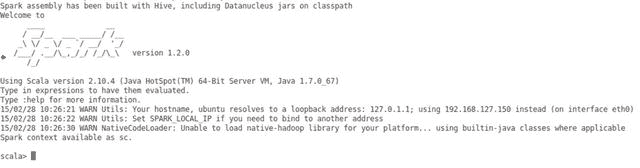

# 4. 使用 Spark Shell 进行交互式数据分析

Spark 呈指数级增长的原因之一在于其易用性。它不仅提供了多种语言的丰富表达性 API，还让上手变得非常简单。Spark 附带了一个名为 `Spark shell` 的命令行工具，它允许您以交互方式用 Scala 编写 Spark 应用程序。`Spark shell` 与第 2 章中讨论的 `Scala shell` 类似，事实上，它正是基于 `Scala shell` 构建的。

`Spark shell` 不仅为交互式数据分析提供了绝佳环境，也为学习 Spark 提供了便利。您可以在不到一分钟的时间内将其安装在本地开发机器上，然后开始尝试使用 Spark。

本章的目标是让您通过实践掌握第 3 章中介绍的概念。让我们使用 `Spark shell` 来操作并熟悉 Spark 的编程接口。

> **注意**：`Scala shell` 和 `Spark shell` 都是命令行 REPL（读取-求值-打印-循环）工具。REPL 支持交互式编程。它允许您输入表达式并立即求值。它读取一个表达式，对其进行求值，将结果打印在控制台上，然后等待下一个表达式。

## 入门指南

Spark 的入门非常简单。您只需三个简单的步骤即可开始编写 Spark 代码：下载、解压和运行。

### 下载

`Spark shell` 与 Spark 捆绑在一起。您可以从以下网站下载 Spark：

[`http://spark.apache.org/downloads.html`](http://spark.apache.org/downloads.html)

该下载网站提供了针对不同 Hadoop 版本和 Hadoop 发行版的预编译 Spark 二进制文件的链接。它还允许您下载 Spark 源代码并在本地机器上创建自定义构建。最简单、最快捷的方式是下载预编译的 Spark 二进制文件。出于学习目的，您可以下载针对任何 Hadoop 版本预编译的 Spark。请注意，使用 Spark 不需要安装 Hadoop。

### 解压

下载 Spark 二进制文件后，请在计算机上解压缩或解包这些文件。`Spark shell` 位于`bin`目录中。例如，如果您将文件解压到名为`SPARK_HOME`的目录中，则`spark-shell`可以在`SPARK_HOME/bin`下找到。在本章中，`SPARK_HOME`将作为您计算机上 Spark 主目录的引用。它指的是您解压 Spark 文件所在的目录。

Spark 可在 Linux、Mac OS 和 Windows 上运行。唯一的先决条件是在要运行 Spark 的系统上安装 Java。Java 应位于系统路径中，或者`JAVA_HOME`环境变量应指向 Java 安装目录。

`Spark shell` 的输出信息很详细。它会输出大量信息，如果您想了解 Spark 的内部机制，这些信息会很有用。您可以通过修改`SPARK_HOME/conf`目录下`log4j.properties`文件中的日志级别，将`INFO`更改为`WARN`，从而减少 Spark 的详细输出。具体步骤如下：

1. 将`SPARK_HOME/conf`目录下的`log4j.properties.template`文件重命名为`log4j.properties`
2. 使用任何文本编辑器打开`log4j.properties`文件，并找到这一行：`log4j.rootCategory=INFO, console`
3. 在`log4j.rootCategory`行中，将`INFO`替换为`WARN`。更改后，上述行看起来像这样：`log4j.rootCategory=WARN, console`
4. 保存文件。

### 运行

在 Linux 或 Mac 中，可以从终端启动 `Spark shell`。在 Windows 上，建议从 Windows PowerShell 启动。您可以使用以下命令序列来启动 `Spark shell`。

```
cd $SPARK_HOME
./bin/spark-shell
```

如果一切顺利，您应该会看到如图 4-1 所示的屏幕。



`图 4-1.` Spark shell 欢迎界面

`Spark shell` 会创建`SparkContext`类的一个实例，并将其作为`sc`提供。Scala 提示符表示 `Spark shell` 已准备好对您输入的任何表达式进行求值。由于 `Spark shell` 基于 `Scala shell`，您可以在`Scala>`提示符后输入任何 Scala 表达式。

## REPL 命令

除了 Scala 表达式之外，您还可以在 `Spark shell` 中输入 REPL 命令。这些不是编程代码，而是用于控制 REPL 环境的命令。REPL 命令以冒号开头。以下简要描述了常用命令：

* `:help` — 输入 `:help` 查看 `Spark shell` 支持的所有命令列表。
* `:quit` — 输入 `:quit` 退出 `Spark shell`。
* `:paste` — 输入 `:paste` 进入粘贴模式。粘贴模式允许您输入或粘贴多行代码块。当您想要复制多行代码块并将其粘贴到 `Spark shell` 中时，这非常有用。完成后按 Ctrl-D。`Spark shell` 会在您按 Ctrl-D 后对多行代码块进行求值。

## 将 Spark Shell 用作 Scala Shell

让我们尝试几个简单的 Scala 表达式，以便对 `Spark shell` 有个初步了解。

```scala
scala> 2+2
res0: Int = 4
```

第一行显示您输入的表达式。按回车键后，`Spark shell` 会对您输入的表达式进行求值，并将结果打印到控制台。第二行显示 `Spark shell` 打印的输出。它将表达式的结果返回给一个名为`res0`的变量，该变量的类型是`Int`。您可以创建自己的变量来存储表达式的结果，如下所示。

```scala
scala> val sum = 2 + 2
sum: Int = 4
```

在这个例子中，Scala 对等号右侧的表达式进行求值，并将其存储在变量`sum`中。然后它会打印变量`sum`的类型和值。请注意，Scala 根据您输入的表达式推断出了变量`sum`的类型。

到目前为止，您还没有真正进行任何 Spark 编程。您只是将 `Spark shell` 用作 `Scala shell`。由于您将使用 `Spark shell` 通过 Scala 编写数据处理代码，因此复习一下 Scala 知识会很有好处。

## 数字分析

让我们快速回顾一下第 3 章中讨论的一些概念。`RDD` 是 Spark 用于表示和处理数据的主要抽象。Spark 应用程序使用`RDD`类中定义的方法来处理或分析数据。`RDD`可以从 Scala 集合或数据源创建。创建`RDD`需要`SparkContext`类的实例。如本章前面所述，`Spark shell` 会自动创建`SparkContext`类的实例，并将其保存在名为`sc`的变量中。

在本节中，你将使用 `Spark shell` 来分析一个数字类型的`RDD`。你将从一个 Scala 集合中创建这个`RDD`。在实际应用程序中，你可能永远不会从 Scala 集合创建`RDD`；然而，能够从 Scala 集合创建`RDD`使得学习 Spark 变得简单。`SparkContext`类中的`parallelize`方法通常用于学习目的。无论`RDD`是从 Scala 集合、HDFS 中的文件还是任何其他 Hadoop 支持的存储系统创建的，`RDD`接口都是相同的。

首先，创建一个从 1 到 1000 的整数列表。

```scala
scala> val xs = (1 to 1000).toList
```

```scala
xs: List[Int] = List(1, 2, 3, 4, 5, 6, 7, 8, 9, 10, 11, 12, 13, 14, 15, 16, 17, 18, 19, 20,...
```

第一行显示你在`scala>`提示符后输入的代码。第二行显示 `Spark shell` 打印的输出。如果表达式的结果是一个大型集合，它只会打印前几个元素。

接下来，使用`SparkContext`的`parallelize`方法从你刚刚创建的 Scala 列表创建一个`RDD`。

```scala
scala> val xsRdd = sc.parallelize(xs)
```

```scala
xsRdd: org.apache.spark.rdd.RDD[Int] = ParallelCollectionRDD[52] at parallelize at <console>:19
```

现在，使用 Spark 过滤新创建的`RDD`中的偶数。

```scala
scala> val evenRdd = xsRdd.filter{ _ % 2 == 0}
```

```scala
evenRdd: org.apache.spark.rdd.RDD[Int] = FilteredRDD[53] at filter at <console>:21
```

请记住，`RDD`类的`filter`方法是一种转换。它是一种惰性操作，因此 Spark 不会立即应用你传递给`filter`方法的匿名函数。

`RDD`中经常使用的一个动作是`count`。它返回`RDD`中元素的数量。正如前一章所讨论的，动作会触发转换的计算。

```scala
scala> val count = evenRdd.count
```

```scala
count: Long = 500
```

让我们使用`first`动作检查`evenRdd`对象中的第一个数字。

```scala
scala> val first = evenRdd.first
```

```scala
first: Int = 2
```

接下来，让我们检查`evenRdd`对象中的前五个数字。

```scala
scala> val first5 = evenRdd.take(5)
```

```scala
first5: Array[Int] = Array(2, 4, 6, 8, 10)
```

看，使用 `Spark shell` 开始并实验 Spark API 是多么简单？

## 日志分析

现在，让我们使用 `Spark shell` 分析文件中的数据。你将分析由应用程序生成的事件日志文件。出于学习目的，你将使用一台机器的伪集群——你的笔记本电脑。为简单起见，你将使用本地文件系统上的一个文件作为数据源。这是一个简单的入门设置；然而，你将在本节中创建的代码在拥有数百个节点和分布式数据源的集群上将以完全相同的方式工作。这就是 Spark API 的妙处：Spark 应用程序可以轻松地从单台笔记本电脑上处理千字节的数据扩展到在大型集群上处理拍字节的数据，而无需更改任何代码。

为简单起见，你将在本节中分析一个伪造的日志文件。事件日志以空格分隔的文本格式存储。第一列表示事件被记录时的日期和时间。它不是真正的时间戳，而是存储递增的数字序列。真实的日志文件在这一列会有日期和时间戳。第二列存储事件的严重级别。可以是`DEBUG`、`INFO`、`WARN`或`ERROR`。第三列存储生成日志的模块或组件的名称。最后一列存储事件的描述。这是日志文件的典型格式，但这种格式有许多变体。例如，一些开发者为列选择了不同的顺序。有时，人们还会记录事件发生时正在执行应用程序代码的线程信息。

使用 Spark 分析数据集的第一步是从数据源创建一个`RDD`。与从 Scala 集合创建`RDD`类似，从数据源创建`RDD`需要`SparkContext`类的实例。

假设伪造的事件日志文件存储在`data`目录下。你可以使用其相对路径读取它。

```scala
scala> val rawLogs = sc.textFile("data/app.log")
```

```scala
rawLogs: org.apache.spark.rdd.RDD[String] = data/app.log MappedRDD[55] at textFile at <console>:17
```

确保文件路径有效，并且文件存在于你的机器上。如果你有不同的目录结构，或者你从不同的目录启动了 `Spark shell`，请对代码进行适当的修改。

`Spark shell` 在第二行打印的输出显示，Spark 已经创建了一个`String`类型的`RDD`。事件日志文件中的每一行都作为`String`存储在`rawLogs` `RDD`中。

请记住，此时 Spark 实际上还没有读取`app.log`文件。`textFile`方法是一种惰性操作。Spark 只记住了如何创建`rawLogs` `RDD`。当对`rawLogs` `RDD`或直接或间接从`rawLogs`创建的`RDD`调用动作时，它才会读取该文件。这意味着，即使你向`textFile`方法指定了错误的路径或文件名，Spark 也不会立即抛出异常。

如果你想分析存储在 HDFS 上的事件日志文件，你可以使用 HDFS 路径 URI 从该文件创建一个`RDD`。

```scala
scala> val rawLogs = sc.textFile("hdfs://...")
```

`textFile`方法接受一个可选的第二个输入参数，该参数指定返回的`RDD`中的最小分区数。如第 3 章所述，`RDD`是元素的分区集合。对于 HDFS 文件，Spark 为每个 HDFS 文件块创建一个分区。你可以请求更高的分区数。作业内的并行度取决于`RDD`分区的数量；更高的分区数会增加并行度。

让我们将每条日志行转换为小写，这样你就不必担心输入文件中的单词是大写还是小写。你还需要修剪每一行，以删除前导和尾随的空白。可以使用`map`方法将原始日志转换为小写并修剪后的日志。

```scala
scala> val logs = rawLogs.map {line => line.trim.toLowerCase()}
```

```scala
logs: org.apache.spark.rdd.RDD[String] = MappedRDD[56] at map at <console>:19
```

## 缓存与转换：Spark RDD 操作示例

由于事件日志数据将被多次查询，让我们缓存 `logs` RDD。

```
scala> logs.persist()
res18: logs.type = MappedRDD[56] at map at <console>:19
```

请记住，当调用 `persist` 方法时，Spark 不会立即将 RDD 物化或缓存到内存中。事实上，它甚至还没有从磁盘读取日志文件。所有这些操作都会在你调用第一个行动方法后发生。

让我们通过对 `logs` RDD 调用 `count` 行动来使其发生。

```
scala> val totalCount = logs.count()
totalCount: Long = 103
```

如果指定给 `textFile` 方法的文件路径不正确，你会得到一个异常，因为 Spark 无法找到该文件。

既然你只对错误级别的日志感兴趣，我们来过滤一下日志。

```
scala> val errorLogs = logs.filter{ line  =>
  val words = line.split(" ")
  val logLevel = words(1)
  logLevel == "error"
}
errorLogs: org.apache.spark.rdd.RDD[String] = FilteredRDD[57] at filter at <console>:21
```

这段代码首先将一行文本分割成单词数组。由于你知道第二列存储事件的严重级别，因此从数组中取出第二个元素，并检查它是否等于 `"error"`。RDD 的 `filter` 方法仅保留匿名函数返回 `true` 的那些元素。

相同代码的简洁版本如下所示。

```
scala> val errorLogs = logs.filter{_.split(" ")(1) == " error"}
errorLogs: org.apache.spark.rdd.RDD[String] = FilteredRDD[4] at filter at <console>:16
```

由于你创建了日志文件，所以你知道列之间是用空格分隔的。如果你不确定文件中的列是由单个空格、多个空格还是制表符分隔的，你可以使用正则表达式来分割列。

```
scala> val errorLogs = logs.filter{_.split("\\s+")(1) == "error"}
errorLogs: org.apache.spark.rdd.RDD[String] = FilteredRDD[5] at filter at <console>:16
```

现在让我们检查一下具有错误级别的日志数量。

```
scala> val errorCount = errorLogs.count()
errorCount: Long = 26
```

当你排查问题时，你想看到第一个错误，你可以使用行动方法 `first` 来获取它。

```
scala> val firstError = errorLogs.first()
firstError: String = 4 error module1 this is an error log
```

如果你想看到前三个错误，你可以使用 Spark 的 `take` 行动方法。

```
scala> val first3Errors = errorLogs.take(3)
first3Errors: Array[String] = Array(4 error module1 this is an error log, 8 error module2 this is an error log, 12 error module3 this is an error log)
```

假设出于某种原因，你想在日志文件中找到最长的日志行。你首先将 `logs` RDD 转换为另一个包含每行日志长度的 RDD。然后使用 `reduce` 行动方法在新 RDD 中找到最大值。

```
scala> val lengths = logs.map{line => line.size}
lengths: org.apache.spark.rdd.RDD[Int] = MappedRDD[6] at map at <console>:16

scala> val maxLen = lengths.reduce{ (a, b) => if (a > b) a else b }
maxLen: Int = 117
```

如果你想找到单词数最多的日志，可以使用以下代码。

```
scala> val wordCounts = logs map {line => line.split("""\s+""").size}
wordCounts: org.apache.spark.rdd.RDD[Int] = MappedRDD[7] at map at <console>:16

scala> val maxWords = wordCounts reduce{ (a, b) => if (a > b) a else b }
maxWords: Int = 20
```

这段代码将 `logs` RDD 转换为另一个包含每行单词数的 RDD。为此，它将每一行分割成单词数组，并获取数组的大小。下一步与前面的例子相同，它使用 `reduce` 方法在新 RDD 中找到最大元素。

如果你希望将错误日志保存到一个文件中，供另一个应用程序进一步处理，你可以使用 `saveAsTextFile` 方法。

```
scala> errorLogs.saveAsTextFile("data/error_logs")
```

注意，`saveAsTextFile` 方法的输入参数是一个目录名。对于每一个 RDD 分区，Spark 会在该目录下创建一个文件。

到目前为止，你一直在处理单行表达式。让我们编写一个多行函数。你将创建一个函数，该函数以事件日志作为输入并返回其严重级别。虽然 Spark Shell 允许你编写多行代码块，但它并非理想环境。你可以在任何文本编辑器中编写函数，然后将其复制到 Spark Shell 中。要将多行代码块复制并粘贴到 Spark Shell 中，你需要使用 `paste` 命令。

```
scala> :paste
// Entering paste mode (ctrl-D to finish)

def severity(log: String): String = {
  val columns = log.split("\\s+", 3)
  columns(1)
}

// Exiting paste mode, now interpreting.
severity: (log: String)String
```

`severity` 函数将一个事件日志分割成三个单词，并返回第二个单词，即日志的严重级别。请注意，Scala 中的数组索引从零开始。

现在，你使用这个函数来计算按严重级别分组的日志数量。

```
scala> val pairs = logs.map { log => (severity(log), 1)}
pairs: org.apache.spark.rdd.RDD[(String, Int)] = MappedRDD[3] at map at <console>:18

scala> val countBySeverityRdd = pairs.reduceByKey{(x,y) => x + y}
countBySeverityRdd: org.apache.spark.rdd.RDD[(String, Int)] = MapPartitionsRDD[6] at reduceByKey at <console>:25
```

上面的代码首先将 `logs` RDD 转换为一个键值对 RDD，其中键是日志的严重级别，值是 1。接下来，使用 `reduceByKey` 方法统计具有相同键的元素数量。请注意，`reduceByKey` 方法返回一个键值对 RDD。返回的 RDD 中，每个唯一的日志严重级别值对应一个条目。你可以使用 `collect` 方法从这个 RDD 中获取值。

```
scala> val countBySeverity= countBySeverityRdd.collect()
countBySeverity: Array[(String, Int)] = Array((warn,25), (info,27), (error,26), (debug,25))
```

你也可以将其保存到磁盘。

```
scala> countBySeverityRdd.saveAsTextFile("data/log-counts-text")
```

如前所述，`saveAsTextFile` 方法的输入参数是一个目录名。Spark 会在指定的目录中为每个 RDD 分区创建一个文件。

由于 `countBySeverityRdd` 是一个键值对 RDD，你也可以将其保存为 SequenceFiles。

```
scala> countBySeverityRdd.saveAsSequenceFile("data/log-counts-seq")
```

下面是一个稍微简洁的按严重级别统计日志数量的解决方案。

```
scala> val countBySeverityMap = pairs.countByKey()
```

这个例子使用了 `countByKey` 而不是 `reduceByKey` 方法。后者是一个通用方法，不仅可以用于计算计数，还可以用于求和、求积或对每个键的值进行任何自定义聚合。实际上，`countByKey` 内部使用了 `reduceByKey` 和 `collect`。

## 总结

Spark Shell 是一个命令行工具，允许你交互式地编写 Spark 代码。它使入门和学习 Spark 变得简单，也是使用 Spark 进行交互式数据分析的强大工具。

在本章中，你将前一章介绍的概念用于两个不同的任务。首先，你从 Scala 集合创建了一个 RDD，并使用 Spark 对其进行了分析。接着，你使用 Spark 分析了一个事件日志文件。

下一章将介绍开发一个完整的 Spark 应用程序。你将学习如何在集群上编写、编译和部署 Spark 应用程序。

