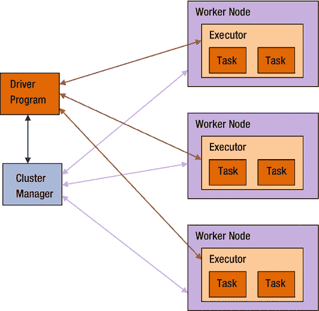

# 3. Spark Core

Spark 是大数据领域最活跃的开源项目。它已经变得比 Hadoop 更受欢迎。它被认为是我们在第一章中讨论的 Hadoop MapReduce 的继任者。Spark 的采用正在迅速增长。许多组织正在用 Spark 替换 MapReduce。

从概念上讲，Spark 看起来与 Hadoop MapReduce 相似；两者都旨在处理大数据。它们都能利用商用硬件以经济高效的方式处理大规模数据。然而，Spark 相比 Hadoop MapReduce 具有许多优势。这些将在本章后面详细讨论。

本章涵盖了 Spark Core，它是 Spark 生态系统的基础。它从 Spark Core 的概述开始，接着是 Spark 上运行的应用程序的高级架构和运行时视图。本章还讨论了 Spark Core 的编程接口。

## 概述

Spark 是一种内存集群计算框架，用于处理和分析大量数据。它提供了一种简单的编程接口，使应用程序开发人员能够轻松利用服务器集群中的 CPU、内存和存储资源来处理大型数据集。

### 关键特性

`Spark` 的关键特性包括以下内容：

*   易于使用
*   快速
*   通用
*   可扩展
*   容错

#### 易于使用

`Spark` 提供了比 MapReduce 更简单的编程模型。使用 `Spark` 开发分布式数据处理应用程序比使用 MapReduce 开发相同的应用程序要容易得多。

`Spark` 为开发大数据应用程序提供了丰富的应用程序编程接口（API）；它附带了 80 多个数据处理运算符。因此，`Spark` 提供的 API 比 Hadoop MapReduce 更具表现力，后者只提供两个运算符：`map` 和 `reduce`。Hadoop MapReduce 要求每个问题都被分解为一系列的 `map` 和 `reduce` 作业。仅用 `map` 和 `reduce` 很难表达非平凡的算法。`Spark` 提供的运算符使得在 `Spark` 中进行复杂数据处理比在 Hadoop MapReduce 中更容易。

此外，与需要大量样板代码的 Hadoop MapReduce 相比，`Spark` 可以让您编写更简洁的代码。在 Hadoop MapReduce 中需要 50 行代码的数据处理算法，在 `Spark` 中可以用不到 10 行代码实现。丰富且富有表现力的 API 与消除样板代码相结合，显著提高了开发人员生产力。与 MapReduce 相比，开发人员使用 `Spark` 的生产力可以提高五到十倍。

#### 速度飞快

`Spark` 的速度比 Hadoop MapReduce 快数个数量级。如果数据能放入内存，其速度可比 Hadoop MapReduce 快上百倍。即使数据无法完全放入内存，`Spark` 的速度也能比 Hadoop MapReduce 快十倍。

速度至关重要，尤其是在处理大规模数据集时。如果数据处理任务需要数天或数小时，会拖慢决策速度，降低数据的价值。如果同样的处理流程能提速 10 到 100 倍，就能打开许多新的可能性，使之前不可能实现的数据驱动应用成为可能。

`Spark` 比 Hadoop MapReduce 更快有两个原因。首先，它支持内存集群计算。其次，它实现了一个高级执行引擎。

`Spark` 的内存集群计算能力带来了数量级的性能提升。从内存读取数据与从硬盘读取数据的顺序读取吞吐量相差 100 倍。换句话说，从内存读取数据的速度比从磁盘读取快 100 倍。当应用读取和处理小数据集时，磁盘与内存的读取速度差异可能并不明显。然而，当应用读取和处理 TB 级数据时，I/O 延迟（将数据从磁盘加载到内存所需的时间）就会成为影响整体任务执行时间的显著因素。

`Spark` 允许应用将数据缓存在内存中进行处理。这使得应用能够最大限度地减少磁盘 I/O。基于 MapReduce 的数据处理流水线可能由一系列任务组成，每个任务从磁盘读取数据、处理数据，然后将结果写入磁盘。因此，使用 MapReduce 实现的复杂数据处理应用可能会多次从磁盘读取数据和写入数据。由于 `Spark` 允许将数据缓存在内存中，使用 `Spark` 实现的同一应用只需从磁盘读取一次数据。一旦数据缓存在内存中，后续的每次操作都可以直接对缓存数据进行。因此，`Spark` 使应用能够最大限度地减少 I/O 延迟，如前所述，这可能是影响整体任务执行时间的重要因素。

请注意，`Spark` 不会自动将输入数据缓存在内存中。一个常见的误解是，如果输入数据无法放入内存，就不能使用 `Spark`。这是不正确的。`Spark` 可以在集群总内存可能只有 100 GB 的情况下处理 TB 级的数据。由应用决定哪些数据应该被缓存，以及在数据处理流水线的哪个环节进行缓存。事实上，如果数据处理应用只对数据进行一次遍历，则根本不需要缓存数据。

`Spark` 比 Hadoop MapReduce 更快的第二个原因是它拥有一个高级的任务执行引擎。`Spark` 和 MapReduce 都会将任务转换为由多个阶段组成的有向无环图（DAG）。如果你不熟悉图论，图是由边连接的顶点集合。有向图是边具有方向的图。无环图是没有图环的图。因此，DAG 是没有有向环的有向图。换句话说，你无法从 DAG 中的某个顶点出发，沿着一系列有向边最终回到同一个顶点。第 11 章 会对图进行更详细的介绍。

Hadoop MapReduce 为每个任务创建恰好包含两个预定义阶段——Map 和 Reduce——的 DAG。使用 MapReduce 实现的复杂数据处理算法可能需要拆分为多个按顺序执行的任务。这种设计阻止了 Hadoop MapReduce 进行任何优化。

相比之下，`Spark` 不强制开发者将复杂的数据处理算法拆分为多个任务。`Spark` 中的 DAG 可以包含任意数量的阶段。一个简单的任务可能只有一个阶段，而一个复杂的任务可能包含多个阶段。这使得 `Spark` 能够进行 MapReduce 无法实现的优化。`Spark` 在一次运行中执行多阶段的复杂任务。由于它了解所有阶段，因此可以对它们进行优化。例如，它最大限度地减少了磁盘 I/O 和数据混洗（shuffle），后者涉及通过跨网络移动数据，会增加应用执行时间。

#### 用途广泛

`Spark` 为不同类型的数据处理任务提供了一个统一的集成平台。它可以用于批处理、交互式分析、流处理、机器学习和图计算。相比之下，Hadoop MapReduce 仅设计用于批处理。因此，使用 MapReduce 的开发者必须使用不同的框架来处理流处理和图计算。

针对不同类型的数据处理任务使用不同的框架会带来许多挑战。首先，开发者必须学习多个框架，每个框架都有不同的接口。这降低了开发者的生产力。其次，每个框架可能独立运行。因此，数据可能需要复制到多个位置。同样，代码也可能需要在多个位置重复。例如，如果你想用 MapReduce 处理历史数据，并用 Storm（一个流处理框架）以完全相同的方式处理流式数据，你就必须维护两份相同的代码——一份在 Hadoop MapReduce 中，另一份在 Storm 中。使用多个框架的第三个问题是会带来运维上的麻烦。你需要为每个框架设置和管理一个单独的集群。管理多个集群比管理单个集群困难得多。

`Spark` 预先集成了用于批处理、交互式分析、流处理、机器学习和图计算的一系列库。使用 `Spark`，你可以通过单一框架构建涉及不同类型数据处理任务的处理流水线。无需学习多个框架，也无需为不同类型的数据处理任务部署单独的集群。因此，`Spark` 有助于降低运维复杂性，并避免代码和数据的重复。

有趣的是，许多最初使用 MapReduce 作为执行引擎的热门应用和库，要么正在迁移到 `Spark`，要么正在添加对 `Spark` 的支持。例如，最初构建在 Hadoop MapReduce 之上的机器学习库 Apache Mahout 正在迁移到 `Spark`。2014 年 4 月，Mahout 开发者告别了 MapReduce，并停止接受新的基于 MapReduce 的机器学习算法。

同样，Hive（第 1 章 中讨论过）的开发者正在开发一个运行在 `Spark` 上的版本。提供用于构建数据处理流水线的脚本语言的 Pig，也已添加了对 `Spark` 作为执行引擎的支持。用于在 Hadoop 上构建数据应用的应用开发平台 Cascading，也在添加对 `Spark` 的支持。

#### 可扩展性强

`Spark` 是可扩展的。只需向集群中添加更多节点，即可增加 `Spark` 集群的数据处理能力。你可以从一个小的集群开始，随着数据集的增长，再增加计算能力。因此，`Spark` 允许你以经济的方式进行扩展。

此外，`Spark` 使此功能自动对应用可用。当你向 `Spark` 集群添加节点时，无需更改代码。

#### 容错性高

`Spark` 具有容错性。在一个由数百个节点组成的集群中，任何一天发生节点故障的概率都很高。硬盘可能崩溃，或者其他硬件问题可能导致节点无法使用。`Spark` 会自动处理集群中节点的故障。节点故障可能会降低性能，但不会导致应用崩溃。

由于 `Spark` 能自动处理节点故障，应用开发者无需在其应用中处理此类故障。这简化了应用程序代码。

### 理想应用场景

如前一节所述，`Spark` 是一个通用框架；它可用于多种大数据应用。然而，它特别适用于对速度要求极高的大数据场景。这类应用的典型例子包括支持交互式分析的应用以及使用迭代数据处理算法的应用。

#### 迭代算法

迭代算法是指对同一数据集进行多次重复处理的数据处理算法。使用迭代算法的应用包括机器学习和图处理应用。这些应用对同一数据执行同一算法的数十次或数百次迭代。`Spark` 是此类应用的理想选择。

迭代算法在 `Spark` 上运行速度快的原因在于其内存计算能力。由于 `Spark` 允许应用将数据缓存到内存中，即使迭代算法运行 100 次，也只需在第一次迭代时从磁盘读取数据。后续迭代则直接从内存读取数据。由于从内存读取数据的速度比从磁盘快 100 倍，此类应用在 `Spark` 上的运行速度可提升数个数量级。

#### 交互式分析

交互式数据分析涉及以交互方式探索数据集。例如，在启动可能运行数小时的长时间批处理作业之前，先对非常大的数据集进行概要分析就非常有用。同样，业务分析师可能希望使用 BI 或数据可视化工具交互地分析数据。在这种情况下，用户会对同一数据运行多个查询。`Spark` 为交互式分析大型数据集提供了理想平台。

`Spark` 之所以适合交互式分析，同样归功于其内存计算能力。应用可以将需要交互分析的数据缓存到内存中。第一个查询从磁盘读取数据，但后续查询则从内存中读取缓存数据。对内存数据的查询执行速度比磁盘数据快数个数量级。一个从磁盘读取数据需要超过一小时的查询，如果对内存中缓存的数据运行，可能只需几秒。

### 高层架构

一个 `Spark` 应用涉及五个关键实体：驱动程序、集群管理器、工作节点、执行器与任务（参见图 3-1）。



**图 3-1.** `Spark` 高层架构

### 工作节点

工作节点为 `Spark` 应用提供 CPU、内存和存储资源。工作节点以分布式进程的形式在集群节点上运行 `Spark` 应用。

### 集群管理器

`Spark` 使用集群管理器来获取执行作业所需的集群资源。顾名思义，集群管理器管理跨工作节点集群的计算资源。它在不同应用之间提供集群资源的底层调度。它允许多个应用共享集群资源并运行在同一工作节点上。

`Spark` 目前支持三种集群管理器：`standalone`、`Mesos` 和 `YARN`。`Mesos` 和 `YARN` 允许你在同一工作节点上同时运行 `Spark` 和 Hadoop 应用。这些集群管理器将在第 10 章中详细讨论。

### 驱动程序

驱动程序是一个将 `Spark` 作为库使用的应用。它提供 `Spark` 在工作节点上执行的数据处理代码。驱动程序可以在 `Spark` 集群上启动一个或多个作业。

### 执行器

执行器是一个 JVM（Java 虚拟机）进程，由 `Spark` 在每个工作节点上为应用创建。它在多个线程中并发执行应用代码。它也可以将数据缓存在内存或磁盘中。

执行器的生命周期与其所创建的应用相同。当 `Spark` 应用终止时，为其创建的所有执行器也会终止。

### 任务

任务是 `Spark` 发送给执行器的最小工作单元。它由工作节点上执行器中的一个线程执行。每个任务执行一些计算，要么将结果返回给驱动程序，要么为 shuffle 操作对输出进行分区。

`Spark` 为每个数据分区创建一个任务。一个执行器并发运行一个或多个任务。并行度由分区数量决定。分区越多，意味着并行处理数据的任务越多。

## 应用执行

本节简要描述数据处理代码是如何在 `Spark` 集群上执行的。

### 术语说明

首先定义几个术语：

*   **Shuffle（数据混洗）**。Shuffle 在集群节点之间重新分配数据。这是一个昂贵的操作，因为它涉及通过网络移动数据。请注意，shuffle 并非随机重新分配数据；它根据某些条件将数据元素分组到桶中。每个桶形成一个新的分区。
*   **作业（Job）**。作业是 `Spark` 为返回结果给驱动程序而执行的一组计算。本质上，它是在 `Spark` 集群上执行数据处理算法。一个应用可以启动多个作业。作业的具体执行方式将在本章后续部分介绍。
*   **阶段（Stage）**。阶段是一组任务的集合。`Spark` 将作业拆分为由阶段构成的有向无环图（DAG）。一个阶段可能依赖于另一个阶段。例如，一个作业可能被拆分为阶段 0 和阶段 1 两个阶段，其中阶段 1 必须等到阶段 0 完成后才能开始。`Spark` 使用 shuffle 边界将任务分组到阶段中。不需要 shuffle 的任务被分到同一个阶段。需要对其输入数据进行 shuffle 的任务则开始一个新阶段。

### 应用工作原理

明确了这些定义之后，我现在可以描述 `Spark` 应用如何跨集群节点并行处理数据了。当 `Spark` 应用运行时，`Spark` 会连接到集群管理器并在工作节点上获取执行器。如前所述，`Spark` 应用将数据处理算法作为作业提交。`Spark` 将作业拆分为由阶段构成的有向无环图（DAG）。然后，它利用集群管理器提供的底层调度器，在这些执行器上调度阶段的执行。执行器并行运行 `Spark` 提交的任务。

每个 `Spark` 应用在工作节点上都拥有自己的一组执行器。这种设计带来了几个好处。首先，来自不同应用的任务彼此隔离，因为它们运行在不同的 JVM 进程中。一个应用的异常任务不会导致另一个 `Spark` 应用崩溃。其次，任务调度变得更加容易。`Spark` 一次只需调度属于一个应用的任务，无需处理同时运行的多个应用的任务调度复杂性。

然而，这种设计也存在一个缺点。由于应用在独立的 JVM 进程中运行，它们无法轻易共享数据。即使它们运行在同一工作节点上，不将数据写入磁盘就无法共享数据。如前所述，从磁盘读写数据是昂贵的操作。因此，通过磁盘共享数据的应用将面临性能问题。

### 数据源

`Spark` 本质上是一个利用节点集群处理大型数据集的**计算**框架。与数据库不同，它不提供存储系统，而是与外部存储系统协同工作。通常，它与存储大量数据的分布式存储系统配合使用。

`Spark` 支持多种数据源。你的 `Spark` 应用程序处理的数据可以来自 HDFS、HBase、Cassandra、Amazon S3 或任何其他 Hadoop 支持的数据源。任何能与 Hadoop 配合使用的数据源都可以与 `Spark` 内核一起使用。`Spark` 的库之一 Spark SQL 使得 `Spark` 能够支持更多的数据源。第 7 章将介绍 Spark SQL。

与 Hadoop 支持的数据源的兼容性非常重要。组织在 Hadoop 上进行了大量投资。大量的数据存储在 HDFS 和其他 Hadoop 支持的存储系统中。`Spark` 不要求你将数据从这些源迁移或复制到另一个存储系统。因此，从 Hadoop MapReduce 迁移到 `Spark` 并非一项更换式操作。这使得从 Hadoop MapReduce 切换到 `Spark` 变得容易。如果你有现有的运行 MapReduce 作业的 Hadoop 集群，你可以在同一个集群上并行运行 `Spark` 应用程序。你可以将现有的 MapReduce 作业转换为 `Spark` 作业。或者，如果你对现有的 MapReduce 应用程序感到满意，并且不想改动它们，你可以将 `Spark` 用于新的应用程序。

虽然 `Spark` 内核内置了对 Hadoop 兼容存储系统的支持，但也很容易添加对其他数据源的支持。例如，人们已经为 Cassandra、MongoDB、CouchDB 和其他流行的数据源创建了 `Spark` 连接器。

`Spark` 也支持本地文件系统。`Spark` 应用程序可以从本地文件系统读取输入，并将输出存储到本地文件系统。尽管如果数据可以从本地文件读取并在单台计算机上处理时并不需要使用 `Spark`，但此功能对于初始应用程序开发和调试非常有用。它也使学习 `Spark` 变得容易。

## 应用程序编程接口（API）

`Spark` 以库的形式将其集群计算能力提供给应用程序。这个库是用 Scala 编写的，但它提供了多种语言的应用程序编程接口（API）。在撰写本书时，`Spark` API 支持 Scala、Java、Python 和 R 语言。你可以使用其中任何一种语言开发 `Spark` 应用程序。对 Clojure 等其他语言的非官方支持也是可用的。

`Spark` API 由两个重要的抽象组成：`SparkContext` 和弹性分布式数据集（RDDs）。应用程序使用这两个抽象与 `Spark` 交互。这些抽象允许应用程序连接到 `Spark` 集群并使用集群资源。下一节将讨论每个抽象，然后更详细地介绍 RDDs。

### SparkContext

`SparkContext` 是 Spark 库中定义的一个类。它是 Spark 库的主要入口点。它代表与 Spark 集群的连接。创建 Spark API 提供的其他重要对象也需要用到它。

Spark 应用程序必须创建一个 `SparkContext` 类的实例。目前，一个应用程序只能有一个活跃的 `SparkContext` 实例。要创建另一个实例，它必须首先停止当前活跃的实例。

`SparkContext` 类提供了多个构造函数。最简单的一个不接收任何参数。可以如下所示创建 `SparkContext` 类的实例。

```
val sc = new SparkContext()
```

在这种情况下，`SparkContext` 从系统属性中获取配置设置，例如 Spark master 的地址、应用程序名称和其他设置。你也可以通过使用 `SparkConf` 的实例以编程方式向 `SparkContext` 提供配置参数，`SparkConf` 也是在 Spark 库中定义的一个类。它可以用来设置各种 Spark 配置参数，如下所示。

```
val config = new SparkConf().setMaster("spark://host:port").setAppName("big app")
val sc = new SparkContext(config)
```

除了提供明确的方法来配置常用参数（如 Spark master 的地址）之外，`SparkConf` 还提供了一种使用键值对设置任何参数的通用方法。你可以提供给 `SparkContext` 和 `SparkConf` 的输入参数将在第 4 章中更详细地介绍。

前面创建的变量 `sc` 将在本章其余部分的示例中使用。

### 弹性分布式数据集（RDD）

RDD 代表一个可以并行操作的分区数据元素集合。它是 Spark 中主要的数据抽象机制。它在 Spark 库中被定义为一个抽象类。

从概念上讲，`RDD` 类似于 Scala 集合，不同之处在于它代表一个分布式数据集，并且支持惰性操作。惰性操作将在本章后面详细讨论。

以下各节简要描述了 `RDD` 的关键特征。

#### 不可变性

`RDD` 是一个不可变的数据结构。一旦创建，就无法在原地修改。基本上，一个修改 `RDD` 的操作会返回一个新的 `RDD`。

#### 分区性

`RDD` 表示的数据被分割成多个分区。这些分区通常分布在节点集群中。但是，当 Spark 在单台机器上运行时，所有分区都在那台机器上。

请注意，`RDD` 分区与数据集的物理分区之间存在映射关系。`RDD` 为存储在分布式数据源中的数据提供了一种抽象，这些数据源通常将数据分区并分布在节点集群中。例如，HDFS 将数据存储在分区或块中，这些分区或块分布在计算机集群中。默认情况下，`RDD` 分区与 HDFS 文件分区之间存在一对一的映射关系。其他分布式数据源（如 Cassandra）也会对数据进行分区并分布在节点集群中。但是，多个 Cassandra 分区会被映射到单个 `RDD` 分区。

#### 容错性

`RDD` 被设计为具有容错性。`RDD` 表示分布在节点集群中的数据，而节点可能会发生故障。如前所述，节点发生故障的概率与集群中的节点数量成正比。集群越大，某一天某个节点发生故障的概率就越高。

`RDD` 会自动处理节点故障。当节点发生故障，并且存储在该节点上的分区变得不可访问时，Spark 会在另一个节点上重建丢失的 `RDD` 分区。Spark 会存储每个 `RDD` 的血统信息。使用这些血统信息，它可以在节点发生故障时恢复 `RDD` 的部分甚至整个 `RDD`。

#### 接口

重要的是要记住，`RDD` 是一个用于处理数据的接口。它在 Spark 库中被定义为一个抽象类。`RDD` 提供了一个统一的接口，用于处理来自各种数据源（如 HDFS、HBase、Cassandra 等）的数据。相同的接口也可用于处理跨节点集群存储在内存中的数据。

Spark 提供了具体的实现类来表示不同的数据源。具体的 `RDD` 实现类示例包括 `HadoopRDD`、`ParallelCollectionRDD`、`JdbcRDD` 和 `CassandraRDD`。它们都支持基础的 `RDD` 接口。

#### 强类型

`RDD` 类定义有一个类型参数。这允许 `RDD` 表示不同类型的数据。它是一个同质元素的分布式集合，元素的类型可以是 `Integer`、`Long`、`Float`、`String`，或者由应用程序开发人员定义的自定义类型。因此，应用程序总是处理某种类型的 `RDD`。它可以是 `Integer`、`Long`、`Float`、`Double`、`String` 或自定义类型的 `RDD`。

#### 内存计算

本章前面部分介绍了 Spark 的内存集群计算能力。`RDD` 类提供了实现内存集群计算的 API。Spark 允许将 `RDD` 缓存或持久化到内存中。如前所述，对缓存于内存中的 `RDD` 进行操作，其速度比操作未缓存的 `RDD` 要快数个数量级。

#### 创建 RDD

由于 `RDD` 是一个抽象类，因此无法直接创建 `RDD` 类的实例。`SparkContext` 类提供了工厂方法来创建具体实现类的实例。此外，也可以通过对一个已有的 `RDD` 应用转换操作来创建新的 `RDD`。如前所述，`RDD` 是不可变的。任何修改 `RDD` 的操作都会返回一个包含修改后数据的新 `RDD`。

本节简要介绍创建 `RDD` 的常用方法。在以下代码示例中，`sc` 是 `SparkContext` 类的一个实例。你在本章前面部分已学习了如何创建它。

##### parallelize

此方法从一个本地 Scala 集合创建一个 `RDD`。它会对 Scala 集合的元素进行分区和分布，并返回一个代表这些元素的 `RDD`。此方法通常不用于生产环境应用，但对于学习 Spark 很有用。

```
val xs = (1 to 10000).toList
val rdd = sc.parallelize(xs)
```

##### textFile

`textFile` 方法从文本文件创建一个 `RDD`。它可以读取存储在本地文件系统、HDFS、Amazon S3 或任何其他 Hadoop 支持的存储系统中的单个文件或目录下的多个文件。它返回一个字符串类型的 `RDD`，其中每个元素代表输入文件中的一行。

```
val rdd = sc.textFile("hdfs://namenode:9000/path/to/file-or-directory")
```

上述代码将从存储在 HDFS 上的一个文件或目录创建一个 `RDD`。

`textFile` 方法也可以读取压缩文件。此外，它支持使用通配符作为参数，以从目录中读取多个文件。示例如下。

```
val rdd = sc.textFile("hdfs://namenode:9000/path/to/directory/*.gz")
```

`textFile` 方法接受一个可选的第二个参数，该参数可用于指定分区数量。默认情况下，Spark 为每个文件块创建一个 `RDD` 分区。你可以指定更多的分区数量以提高并行度；但是，不允许设置少于文件块数量的分区数。

##### wholeTextFiles

此方法读取一个目录中的所有文本文件，并返回一个键值对类型的 `RDD`。返回的 `RDD` 中的每个键值对对应一个单独的文件。键部分存储文件路径，值部分存储文件内容。此方法同样可以读取存储在本地文件系统、HDFS、Amazon S3 或任何其他 Hadoop 支持的存储系统中的文件。

```
val rdd = sc.wholeTextFiles("path/to/my-data/*.txt")
```

##### sequenceFile

`sequenceFile` 方法从存储在本地文件系统、HDFS 或任何其他 Hadoop 支持的存储系统中的 SequenceFile 中读取键值对。它返回一个键值对类型的 `RDD`。调用此方法时，除了提供输入文件名，你还需要将键和值的数据类型指定为类型参数。

```
val rdd = sc.sequenceFile[String, String](path)
```

### RDD 操作

Spark 应用程序使用 `RDD` 类或其派生类中定义的方法来处理数据。这些方法也称为操作。由于 Scala 允许使用方法运算符表示法，`RDD` 方法有时也被称为运算符。

Spark 的妙处在于，同样的 `RDD` 方法可以用于处理大小从几个字节到数 PB 不等的数据。此外，Spark 应用程序可以使用相同的方法来处理存储在分布式存储系统或本地文件系统上的数据集。这种灵活性允许开发人员在单台机器上开发、调试和测试 Spark 应用程序，然后无需任何代码更改即可将其部署到大型集群上。

`RDD` 操作可以分为两种类型：转换操作和行动操作。转换操作创建一个新的 `RDD`。行动操作向驱动程序返回一个值。

#### 转换操作

`RDD` 的转换方法通过对源 `RDD` 执行计算来创建一个新的 `RDD`。本节讨论常用的 `RDD` 转换操作。

RDD 转换操作在概念上类似于 Scala 集合方法。关键区别在于，Scala 集合方法处理的是可以放入单台机器内存的数据，而 `RDD` 方法可以处理分布在一个节点集群上的数据。另一个重要区别是，RDD 转换操作是惰性的，而 Scala 集合方法是严格的。此主题将在本章后面部分更详细地讨论。

##### map

`map` 方法是一个高阶方法，它接受一个函数作为输入，并将其应用于源 `RDD` 中的每个元素，以创建一个新的 `RDD`。传递给 `map` 的输入函数必须接受一个输入参数并返回一个值。

```
val lines = sc.textFile("...")
val lengths = lines map { l => l.length}
```

##### filter

`filter` 方法是一个高阶方法，它接受一个布尔函数作为输入，并将其应用于源 `RDD` 中的每个元素，以创建一个新的 `RDD`。布尔函数接受一个输入并返回 `true` 或 `false`。`filter` 方法返回一个新的 `RDD`，该 `RDD` 仅包含那些输入布尔函数返回 `true` 的元素。因此，新 `RDD` 包含原始 `RDD` 中元素的子集。

```
val lines = sc.textFile("...")
val longLines = lines filter { l => l.length > 80}
```

##### flatMap

`flatMap` 方法是一个高阶方法，它接受一个输入函数，该函数为传递给它的每个输入元素返回一个序列。`flatMap` 方法通过展平这个序列集合来返回一个新的 `RDD`。

```
val lines = sc.textFile("...")
val words = lines flatMap { l => l.split(" ")}
```

##### mapPartitions

高阶方法 `mapPartitions` 允许你在分区级别处理数据。`mapPartitions` 不会一次向输入函数传递一个元素，而是以迭代器的形式传递一个分区。`mapPartitions` 方法的输入函数接受一个迭代器作为输入，并返回另一个迭代器作为输出。`mapPartitions` 方法通过将用户指定的函数应用于源 `RDD` 的每个分区来返回一个新的 `RDD`。

```
val lines = sc.textFile("...")
val lengths = lines mapPartitions { iter => iter.map { l => l.length}}
```

##### union

`union` 方法接受一个 `RDD` 作为输入，并返回一个新的 `RDD`，该 `RDD` 包含源 `RDD` 和作为输入传递的 `RDD` 中元素的并集。

```
val linesFile1 = sc.textFile("...")
val linesFile2 = sc.textFile("...")
val linesFromBothFiles = linesFile1.union(linesFile2)
```

##### intersection

`intersection` 方法接受一个 `RDD` 作为输入，并返回一个新的 `RDD`，该 `RDD` 包含源 `RDD` 和作为输入传递的 `RDD` 中元素的交集。

```
val linesFile1 = sc.textFile("...")
val linesFile2 = sc.textFile("...")
val linesPresentInBothFiles = linesFile1.intersection(linesFile2)
```

这是另一个示例。

```
val mammals = sc.parallelize(List("Lion", "Dolphin", "Whale"))
val aquatics = sc.parallelize(List("Shark", "Dolphin", "Whale"))
val aquaticMammals = mammals.intersection(aquatics)
```

##### subtract

`subtract` 方法接受一个 `RDD` 作为输入，并返回一个新的 `RDD`，该 `RDD` 包含存在于源 `RDD` 中但不存在于输入 `RDD` 中的元素。

```
val linesFile1 = sc.textFile("...")
val linesFile2 = sc.textFile("...")
val linesInFile1Only = linesFile1.subtract(linesFile2)
```

这是另一个示例。

```
val mammals = sc.parallelize(List("Lion", "Dolphin", "Whale"))
val aquatics = sc.parallelize(List("Shark", "Dolphin", "Whale"))
val fishes = aquatics.subtract(mammals)
```

##### distinct

`RDD` 的 `distinct` 方法返回一个包含源 RDD 中独特元素的新 RDD。

```
val numbers = sc.parallelize(List(1, 2, 3, 4, 3, 2, 1))
val uniqueNumbers = numbers.distinct
```

##### cartesian

`RDD` 的 `cartesian` 方法接受一个 RDD 作为输入，并返回一个包含两个 RDD 中所有元素笛卡尔积的 RDD。它返回一个有序对的 RDD，其中第一个元素来自源 RDD，第二个元素来自输入 RDD。返回 RDD 中的元素数量等于源 RDD 和输入 RDD 长度的乘积。

该方法类似于 SQL 中的交叉连接操作。

```
val numbers = sc.parallelize(List(1, 2, 3, 4))
val alphabets = sc.parallelize(List("a", "b", "c", "d"))
val cartesianProduct = numbers.cartesian(alphabets)
```

##### zip

`zip` 方法接受一个 RDD 作为输入，并返回一个成对 RDD，其中一对中的第一个元素来自源 RDD，第二个元素来自输入 RDD。与 `cartesian` 方法不同，`zip` 返回的 RDD 与源 RDD 具有相同数量的元素。源 RDD 和输入 RDD 必须具有相同的长度。此外，假设两个 RDD 具有相同数量的分区以及每个分区中相同数量的元素。

```
val numbers = sc.parallelize(List(1, 2, 3, 4))
val alphabets = sc.parallelize(List("a", "b", "c", "d"))
val zippedPairs = numbers.zip(alphabets)
```

##### zipWithIndex

`zipWithIndex` 方法将源 RDD 的元素与其索引进行压缩，并返回一个成对 RDD。

```
val alphabets = sc.parallelize(List("a", "b", "c", "d"))
val alphabetsWithIndex = alphabets.zipWithIndex
```

##### groupBy

高阶 `groupBy` 方法根据用户指定的标准对 RDD 的元素进行分组。它接受一个函数作为输入，该函数为源 RDD 中的每个元素生成一个键。它将此函数应用于源 RDD 中的所有元素，并返回一个成对 RDD。在每个返回的对中，第一个项是一个键，第二个项是由 `groupBy` 方法的输入函数映射到该键的元素集合。

请注意，`groupBy` 方法是一个代价高昂的操作，因为它可能会进行数据混洗。

考虑一个存储客户姓名、年龄、性别和邮政编码的 CSV 文件。以下代码按邮政编码对客户进行分组。

```
case class Customer(name: String, age: Int, gender: String, zip: String)
val lines = sc.textFile("...")
val customers = lines map { l =>
                val a = l.split(",")
                Customer(a(0), a(1).toInt, a(2), a(3))
              }
val groupByZip = customers.groupBy { c => c.zip }
```

# RDD 转换操作

## `keyBy`

`keyBy` 方法类似于 `groupBy` 方法。它是一个高阶方法，接受一个函数作为输入，该函数为源 RDD 中的任何给定元素返回一个键。`keyBy` 方法将此函数应用于源 RDD 中的所有元素，并返回一个成对 RDD。在每个返回的对中，第一个项是一个键，第二个项是由 `keyBy` 方法的输入函数映射到该键的元素。`keyBy` 返回的 RDD 将与源 RDD 具有相同数量的元素。

`groupBy` 和 `keyBy` 之间的区别在于，在前一种情况下，返回对中的第二个项是元素的集合，而在后一种情况下，它是一个单独的元素。

```scala
case class Person(name: String, age: Int, gender: String, zip: String)
val lines = sc.textFile("...")
val people = lines map { l => {
                val a = l.split(",")
                Person(a(0), a(1).toInt, a(2), a(3))
              }
            }
val keyedByZip = people.keyBy { p => p.zip}
```

## `sortBy`

高阶 `sortBy` 方法返回一个包含来自源 RDD 的已排序元素的 RDD。它接受两个输入参数。第一个输入是一个函数，为源 RDD 中的每个元素生成一个键。第二个参数允许您指定升序或降序排序。

```scala
val numbers = sc.parallelize(List(3, 2, 4, 1, 5))
val sorted = numbers.sortBy(x => x, true)
```

这是另一个示例：

```scala
case class Person(name: String, age: Int, gender: String, zip: String)
val lines = sc.textFile("...")
val people = lines map { l => {
                val a = l.split(",")
                Person(a(0), a(1).toInt, a(2), a(3))
              }
            }
val sortedByAge = people.sortBy( p => p.age, true)
```

## `pipe`

`pipe` 方法允许您在分叉进程中执行外部程序。它将外部程序的输出捕获为字符串，并返回一个字符串的 RDD。

## `randomSplit`

`randomSplit` 方法将源 RDD 分割成一个 RDD 数组。它接受分割的权重作为输入。

```scala
val numbers = sc.parallelize((1 to 100).toList)
val splits = numbers.randomSplit(Array(0.6, 0.2, 0.2))
```

## `coalesce`

`coalesce` 方法减少 RDD 中的分区数量。它接受一个整数输入，并返回一个具有指定数量分区的新 RDD。

```scala
val numbers = sc.parallelize((1 to 100).toList)
val numbersWithOnePartition = numbers.coalesce(1)
```

应谨慎使用 `coalesce` 方法，因为减少分区数量会降低 Spark 应用程序的并行度。它通常用于合并具有少量元素的分区。例如，在过滤操作之后，RDD 可能有太多稀疏分区。在这种情况下，减少分区可能会带来性能提升。

## `repartition`

`repartition` 方法接受一个整数作为输入，并返回一个具有指定数量分区的 RDD。它对于增加并行度很有用。它会重新分配数据，因此这是一个代价高昂的操作。

`coalesce` 和 `repartition` 方法看起来很相似，但第一个用于减少 RDD 中的分区数，而第二个用于增加 RDD 中的分区数。

```scala
val numbers = sc.parallelize((1 to 100).toList)
val numbersWithOnePartition = numbers.repartition(4)
```

## `sample`

`sample` 方法返回源 RDD 的一个采样子集。它接受三个输入参数。第一个参数指定替换策略。第二个参数指定样本大小与源 RDD 大小的比率。第三个参数是可选的，指定采样的随机种子。

```scala
val numbers = sc.parallelize((1 to 100).toList)
val sampleNumbers = numbers.sample(true, 0.2)
```

## 键值对 RDD 上的转换

除了前面章节描述的转换之外，键值对 RDD 还支持一些其他转换。仅适用于键值对 RDD 的常用转换将简要描述如下。

### `keys`

`keys` 方法返回仅在源 RDD 中键的 RDD。

```scala
val kvRdd = sc.parallelize(List(("a", 1), ("b", 2), ("c", 3)))
val keysRdd = kvRdd.keys
```

### `values`

`values` 方法返回仅在源 RDD 中值的 RDD。

```scala
val kvRdd = sc.parallelize(List(("a", 1), ("b", 2), ("c", 3)))
val valuesRdd = kvRdd.values
```

### `mapValues`

`mapValues` 方法是一个高阶方法，它接受一个函数作为输入，并将其应用于源 RDD 中的每个值。它返回一个键值对 RDD。它类似于 `map` 方法，只是它将输入函数仅应用于源 RDD 中的每个值，因此键不会改变。返回的 RDD 与源 RDD 具有相同的键。

```scala
val kvRdd = sc.parallelize(List(("a", 1), ("b", 2), ("c", 3)))
val valuesDoubled = kvRdd mapValues { x => 2*x}
```

### `join`

`join` 方法接收一个键值对类型的 RDD 作为输入，并在源 RDD 与输入 RDD 上执行内连接。它返回一个键值对类型的 RDD，其中每对中的第一个元素是同时在源 RDD 和输入 RDD 中存在的键，第二个元素是一个元组，包含了源 RDD 和输入 RDD 中对应此键的值。

```scala
val pairRdd1 = sc.parallelize(List(("a", 1), ("b",2), ("c",3)))
val pairRdd2 = sc.parallelize(List(("b", "second"), ("c","third"), ("d","fourth")))
val joinRdd = pairRdd1.join(pairRdd2)
```

### `leftOuterJoin`

`leftOuterJoin` 方法接收一个键值对类型的 RDD 作为输入，并在源 RDD 与输入 RDD 上执行左外连接。它返回一个键值对类型的 RDD，其中每对中的第一个元素是源 RDD 中的键，第二个元素是一个元组，包含了源 RDD 中的值以及输入 RDD 中的可选值。来自输入 RDD 的可选值使用 `Option` 类型表示。

```scala
val pairRdd1 = sc.parallelize(List(("a", 1), ("b",2), ("c",3)))
val pairRdd2 = sc.parallelize(List(("b", "second"), ("c","third"), ("d","fourth")))
val leftOuterJoinRdd = pairRdd1.leftOuterJoin(pairRdd2)
```

### `rightOuterJoin`

`rightOuterJoin` 方法接收一个键值对类型的 RDD 作为输入，并在源 RDD 与输入 RDD 上执行右外连接。它返回一个键值对类型的 RDD，其中每对中的第一个元素是输入 RDD 中的键，第二个元素是一个元组，包含了源 RDD 中的可选值以及输入 RDD 中的值。来自源 RDD 的可选值使用 `Option` 类型表示。

```scala
val pairRdd1 = sc.parallelize(List(("a", 1), ("b",2), ("c",3)))
val pairRdd2 = sc.parallelize(List(("b", "second"), ("c","third"), ("d","fourth")))
val rightOuterJoinRdd = pairRdd1.rightOuterJoin(pairRdd2)
```

### `fullOuterJoin`

`fullOuterJoin` 方法接收一个键值对类型的 RDD 作为输入，并在源 RDD 与输入 RDD 上执行全外连接。它返回一个键值对类型的 RDD。

```scala
val pairRdd1 = sc.parallelize(List(("a", 1), ("b",2), ("c",3)))
val pairRdd2 = sc.parallelize(List(("b", "second"), ("c","third"), ("d","fourth")))
val fullOuterJoinRdd = pairRdd1.fullOuterJoin(pairRdd2)
```

### `sampleByKey`

`sampleByKey` 方法返回源 RDD 中按键采样的一个子集。它接收每个键的采样率作为输入，并返回源 RDD 的一个样本。

```scala
val pairRdd = sc.parallelize(List(("a", 1), ("b",2), ("a", 11),("b",22),("a", 111), ("b",222)))
val sampleRdd = pairRdd.sampleByKey(true, Map("a"-> 0.1, "b"->0.2))
```

### `subtractByKey`

`subtractByKey` 方法接收一个键值对类型的 RDD 作为输入，并返回一个仅包含那些存在于源 RDD 但不存在于输入 RDD 中的键的键值对 RDD。

```scala
val pairRdd1 = sc.parallelize(List(("a", 1), ("b",2), ("c",3)))
val pairRdd2 = sc.parallelize(List(("b", "second"), ("c","third"), ("d","fourth")))
val resultRdd = pairRdd1.subtractByKey(pairRdd2)
```

### `groupByKey`

`groupByKey` 方法返回一个键值对类型的 RDD，其中每对中的第一个元素是源 RDD 中的一个键，第二个元素是该键对应的所有值的集合。它类似于我们之前见过的 `groupBy` 方法。区别在于 `groupBy` 是一个高阶方法，它接收一个函数作为输入，该函数为源 RDD 中的每个元素返回一个键。而 `groupByKey` 方法作用于一个键值对类型的 RDD，因此不需要输入键生成函数。

```scala
val pairRdd = sc.parallelize(List(("a", 1), ("b",2), ("c",3), ("a", 11), ("b",22), ("a",111)))
val groupedRdd = pairRdd.groupByKey()
```

应避免使用 `groupByKey` 方法。这是一个昂贵的操作，因为它可能会进行数据混洗。对于大多数使用场景，有更好的替代方案。

### `reduceByKey`

高阶方法 `reduceByKey` 接收一个结合性的二元运算符作为输入，并使用指定的二元运算符将具有相同键的值归约为单个值。

二元运算符接收两个值作为输入，并返回一个值作为输出。结合性运算符无论操作数的分组方式如何，都返回相同的结果。

`reduceByKey` 方法可用于按键聚合值。例如，它可以用于计算映射到同一个键的所有值的总和、乘积、最小值或最大值。

```scala
val pairRdd = sc.parallelize(List(("a", 1), ("b",2), ("c",3), ("a", 11), ("b",22), ("a",111)))
val sumByKeyRdd = pairRdd.reduceByKey((x,y) => x+y)
val minByKeyRdd = pairRdd.reduceByKey((x,y) => if (x < y) x else y)
```

对于基于键的聚合或合并，`reduceByKey` 方法是比 `groupByKey` 更好的选择。

# Actions

Actions 是那些向驱动程序（driver program）返回值的 RDD 方法。本节讨论常用的 RDD Actions。

## `collect`

`collect` 方法以数组形式返回源 RDD 中的元素。应谨慎使用此方法，因为它会将数据从所有工作节点移动到驱动程序。如果在非常大的 RDD 上调用此方法，可能会导致驱动程序崩溃。

```scala
val rdd = sc.parallelize((1 to 10000).toList)
val filteredRdd = rdd filter { x => (x % 1000) == 0 }
val filterResult = filteredRdd.collect
```

## `count`

`count` 方法返回源 RDD 中元素的计数。

```scala
val rdd = sc.parallelize((1 to 10000).toList)
val total = rdd.count
```

## `countByValue`

`countByValue` 方法返回源 RDD 中每个唯一元素的计数。它返回一个 `Map` 类的实例，其中包含每个唯一元素及其计数作为键值对。

```scala
val rdd = sc.parallelize(List(1, 2, 3, 4, 1, 2, 3, 1, 2, 1))
val counts = rdd.countByValue
```

## `first`

`first` 方法返回源 RDD 中的第一个元素。

```scala
val rdd = sc.parallelize(List(10, 5, 3, 1))
val firstElement = rdd.first
```

## `max`

`max` 方法返回 RDD 中的最大元素。

```scala
val rdd = sc.parallelize(List(2, 5, 3, 1))
val maxElement = rdd.max
```

## `min`

`min` 方法返回 RDD 中的最小元素。

```scala
val rdd = sc.parallelize(List(2, 5, 3, 1))
val minElement = rdd.min
```

## `take`

`take` 方法接收一个整数 N 作为输入，并返回一个包含源 RDD 中前 N 个元素的数组。

```scala
val rdd = sc.parallelize(List(2, 5, 3, 1, 50, 100))
val first3 = rdd.take(3)
```

## `takeOrdered`

`takeOrdered` 方法接收一个整数 N 作为输入，并返回一个包含源 RDD 中最小的 N 个元素的数组。

```scala
val rdd = sc.parallelize(List(2, 5, 3, 1, 50, 100))
val smallest3 = rdd.takeOrdered(3)
```

## `top`

`top` 方法接收一个整数 N 作为输入，并返回一个包含源 RDD 中最大的 N 个元素的数组。

```scala
val rdd = sc.parallelize(List(2, 5, 3, 1, 50, 100))
val largest3 = rdd.top(3)
```

## `fold`

高阶方法 `fold` 使用指定的中性零值和一个结合性二元运算符来聚合源 RDD 中的元素。它首先聚合每个 RDD 分区内的元素，然后聚合来自每个分区的结果。

中性零值取决于 RDD 类型和聚合操作。例如，如果你想对整数型 RDD 中的所有元素求和，中性零值应为 0。相反，如果你想计算整数型 RDD 中所有元素的乘积，中性零值应为 1。

```scala
val numbersRdd = sc.parallelize(List(2, 5, 3, 1))
val sum = numbersRdd.fold(0) ((partialSum, x) => partialSum + x)
val product = numbersRdd.fold(1) ((partialProduct, x) => partialProduct * x)
```

## `reduce`

高阶方法 `reduce` 使用一个结合性和交换性的二元运算符来聚合源 RDD 的元素。它类似于 `fold` 方法；但是，它不需要中性零值。

```scala
val numbersRdd = sc.parallelize(List(2, 5, 3, 1))
val sum = numbersRdd.reduce ((x, y) => x + y)
val product = numbersRdd.reduce((x, y) => x * y)
```

### 针对键值对 RDD 的操作

键值对的 RDD 支持一些额外的操作行为，下文将对这些操作进行简要说明。

#### `countByKey`

`countByKey` 方法用于统计源 RDD 中每个唯一键出现的次数。它会返回一个包含键-计数对的 `Map` 对象。

```scala
val pairRdd = sc.parallelize(List(("a", 1), ("b", 2), ("c", 3), ("a", 11), ("b", 22), ("a", 1)))
val countOfEachKey = pairRdd.countByKey
```

#### `lookup`

`lookup` 方法接收一个键作为输入参数，并返回源 RDD 中映射到该键的所有值所组成的序列。

```scala
val pairRdd = sc.parallelize(List(("a", 1), ("b", 2), ("c", 3), ("a", 11), ("b", 22), ("a", 1)))
val values = pairRdd.lookup("a")
```

### 针对数值类型 RDD 的操作

包含 `Integer`、`Long`、`Float` 或 `Double` 类型数据元素的 RDD，支持一些额外的操作行为，这些操作对统计分析非常有用。下文将简要介绍这类操作中常用的几个。

#### `mean`

`mean` 方法返回源 RDD 中元素的平均值。

```scala
val numbersRdd = sc.parallelize(List(2, 5, 3, 1))
val mean = numbersRdd.mean
```

#### `stdev`

`stdev` 方法返回源 RDD 中元素的标准差。

```scala
val numbersRdd = sc.parallelize(List(2, 5, 3, 1))
val stdev = numbersRdd.stdev
```

#### `sum`

`sum` 方法返回源 RDD 中元素的总和。

```scala
val numbersRdd = sc.parallelize(List(2, 5, 3, 1))
val sum = numbersRdd.sum
```

#### `variance`

`variance` 方法返回源 RDD 中元素的方差。

```scala
val numbersRdd = sc.parallelize(List(2, 5, 3, 1))
val variance = numbersRdd.variance
```

### 保存 RDD

通常，数据处理完成后，结果会被保存到磁盘上。Spark 允许应用程序开发者将 `RDD` 保存到任何 Hadoop 支持的存储系统中。保存到磁盘的 `RDD` 可以被其他 Spark 或 MapReduce 应用程序使用。

本节将介绍常用的将 `RDD` 保存到文件中的 RDD 方法。

#### `saveAsTextFile`

`saveAsTextFile` 方法将源 `RDD` 的元素保存到任何 Hadoop 支持的文件系统中的指定目录下。每个 RDD 元素会被转换为其字符串表示形式，并作为一行文本进行存储。

```scala
val numbersRdd = sc.parallelize((1 to 10000).toList)
val filteredRdd = numbersRdd filter { x => x % 1000 == 0}
filteredRdd.saveAsTextFile("numbers-as-text")
```

#### `saveAsObjectFile`

`saveAsObjectFile` 方法将源 `RDD` 的元素作为序列化的 Java 对象保存到指定目录下。

```scala
val numbersRdd = sc.parallelize((1 to 10000).toList)
val filteredRdd = numbersRdd filter { x => x % 1000 == 0}
filteredRdd.saveAsObjectFile("numbers-as-object")
```

#### `saveAsSequenceFile`

`saveAsSequenceFile` 方法以 `SequenceFile` 格式保存键值对类型的 `RDD`。键值对类型的 `RDD` 也可以使用 `saveAsTextFile` 方法以文本格式进行保存。

```scala
val pairs = (1 to 10000).toList map {x => (x, x*2)}
val pairsRdd = sc.parallelize(pairs)
val filteredPairsRdd = pairsRdd filter { case (x, y) => x % 1000 == 0 }
filteredPairsRdd.saveAsSequenceFile("pairs-as-sequence")
filteredPairsRdd.saveAsTextFile("pairs-as-text")
```

请注意，上述所有方法都将目录名作为输入参数，并为指定目录中的每个 RDD 分区创建一个文件。这种设计既高效又具备容错性。由于每个分区都存储在单独的文件中，Spark 会启动多个任务并行执行，以将 `RDD` 写入文件系统。这也有助于使文件写入过程具备容错性。如果某个用于将分区写入文件的任务失败，Spark 会创建另一个任务，重新写入失败任务所创建的文件。

## 惰性操作

`RDD` 的创建和转换方法都是惰性操作。当应用程序调用一个返回 `RDD` 的方法时，Spark 并不会立即执行任何计算。例如，当你使用 `SparkContext` 的 `textFile` 方法从 HDFS 读取文件时，Spark 并不会立即从磁盘读取该文件。同样，返回新 `RDD` 的 `RDD` 转换操作也是惰性计算的。Spark 仅仅会跟踪应用于 `RDD` 上的转换操作。

让我们考虑以下示例代码。

```scala
val lines = sc.textFile("...")
val errorLines = lines filter { l => l.contains("ERROR")}
val warningLines = lines filter { l => l.contains("WARN")}
```

即使你向 `textFile` 方法传递一个包含 100 TB 数据的文件，这三行代码看起来也会执行得非常快。原因是 `textFile` 方法在你调用它时，并不会真正地读取文件。同样地，`filter` 方法也不会立即遍历源 `RDD` 中的所有元素。

Spark 仅仅记录了一个 `RDD` 是如何创建的，以及对其应用了哪些转换操作来创建子 `RDD`。因此，它维护了每个 `RDD` 的血统信息。当需要时，Spark 会使用这些血统信息来构造或重建 `RDD`。

如果 `RDD` 的创建和转换都是惰性操作，那么 Spark 究竟在何时才真正读取数据并执行转换计算呢？下一节将回答这个问题。

### 动作触发计算

当应用程序调用 `RDD` 的动作方法或将 `RDD` 保存到存储系统时，`RDD` 的转换操作才会被真正计算。将 `RDD` 保存到存储系统被认为是一种动作，即使它不会向驱动程序返回值。

当应用程序调用 `RDD` 的动作方法或保存 `RDD` 时，会触发 Spark 内部的一系列连锁反应。此时，Spark 会尝试创建被调用动作方法的那个 `RDD`。如果该 `RDD` 是从文件生成的，Spark 会将该文件读取到工作节点的内存中。如果它是通过另一个 `RDD` 的转换操作创建的子 `RDD`，那么 Spark 会首先尝试创建父 `RDD`。此过程会一直持续，直到 Spark 找到根 `RDD`。然后，Spark 会执行生成被调用动作方法的那个 `RDD` 所需的所有转换操作。最后，它执行计算以生成结果，并将结果返回给驱动程序。

惰性转换使得 Spark 能够高效地执行 `RDD` 计算。通过将计算延迟到应用程序需要某个动作的结果时，Spark 可以优化 `RDD` 操作。它会将操作进行管线化，并避免不必要的网络数据传输。

## 缓存

除了将数据存储在内存中，缓存 `RDD` 还扮演着另一个重要角色。如前所述，`RDD` 要么通过从存储系统读取数据来创建，要么通过对现有 `RDD` 应用转换操作来创建。默认情况下，当调用 `RDD` 的行动方法时，Spark 会从其父 `RDD` 创建该 `RDD`，这可能需要创建父 `RDD`，依此类推。此过程一直持续到 Spark 到达根 `RDD`，这是 Spark 通过从存储系统读取数据创建的。每次调用行动方法时都会发生这种情况。因此，默认情况下，每次调用行动方法时，Spark 都会遍历 `RDD` 的血统树，并计算所有转换以获得调用了其行动方法的 `RDD`。

请看下面的示例。

```scala
val logs = sc.textFile("path/to/log-files")
val errorLogs = logs filter { l => l.contains("ERROR")}
val warningLogs = logs filter { l => l.contains("WARN")}
val errorCount = errorLogs.count
val warningCount =  warningLogs.count
```

尽管上述代码只调用了一次 `textFile` 方法，但因为调用了两次行动方法 `count`，日志文件会从磁盘读取两次。第一次读取发生在调用 `errorLogs.count` 时，第二次则是在调用 `warningLogs.count` 时。这只是一个简单的例子。实际的应用中可能会有更多对不同转换和行动的调用。

当一个 `RDD` 被缓存时，Spark 会计算到该点为止的所有转换，并为该 `RDD` 创建一个检查点。更准确地说，这发生在首次对缓存 `RDD` 调用行动时。与转换方法类似，缓存也是惰性的。

当应用缓存一个 `RDD` 时，Spark 不会立即计算该 `RDD` 并将其存储在内存中。它会在首次对缓存的 `RDD` 调用行动时，才将 `RDD` 具体化到内存中。因此，缓存 `RDD` 后调用的第一个行动并不会从缓存中受益。只有后续的行动才能受益于缓存。由于后续调用行动方法时不再需要从存储系统开始读取数据，它们通常执行得更快。因此，只对数据进行一次处理的应用不会从缓存中受益。只有多次迭代相同数据的应用才能从 `RDD` 缓存中受益。

当一个应用将 `RDD` 缓存到内存中时，Spark 会将其存储在每台工作节点上的执行器内存中。每个执行器在其内存中存储它计算出的 `RDD` 分区。

### `RDD` 缓存方法

`RDD` 类提供了两种方法来缓存 `RDD`：`cache` 和 `persist`。

#### `cache`

`cache` 方法将 `RDD` 存储在集群中各执行器的内存中。它本质上将 `RDD` 具体化到内存中。

前面展示的示例可以通过 `cache` 方法进行优化，如下所示。

```scala
val logs = sc.textFile("path/to/log-files")
val errorsAndWarnings = logs filter { l => l.contains("ERROR") || l.contains("WARN")}
errorsAndWarnings.cache()
val errorLogs = errorsAndWarnings filter { l => l.contains("ERROR")}
val warningLogs = errorsAndWarnings filter { l => l.contains("WARN")}
val errorCount = errorLogs.count
val warningCount =  warningLogs.count
```

#### `persist`

`persist` 方法是 `cache` 方法的通用版本。它允许将 `RDD` 存储在内存、磁盘或两者中。它可选地接受一个存储级别作为输入参数。如果调用 `persist` 时不带任何参数，其行为与 `cache` 方法相同。

```scala
val lines = sc.textFile("...")
lines.persist()
```

`persist` 方法支持以下常见的存储选项：

- `MEMORY_ONLY`：当应用使用 `MEMORY_ONLY` 标志调用 `persist` 方法时，Spark 使用反序列化的 Java 对象将 `RDD` 分区存储在工作节点的内存中。如果某个 `RDD` 分区无法完全放入工作节点的内存，则在需要时动态计算它。示例：`val lines = sc.textFile("..."); lines.persist(MEMORY_ONLY)`
- `DISK_ONLY`：如果使用 `DISK_ONLY` 标志调用 `persist`，Spark 会将 `RDD` 分区具体化并存储在每个工作节点的本地文件系统中。此选项可用于持久化中间 `RDD`，以便后续行动不必从根 `RDD` 开始计算。
- `MEMORY_AND_DISK`：在此情况下，Spark 会尽可能多地将 `RDD` 分区存储在内存中，并将剩余的分区存储在磁盘上。
- `MEMORY_ONLY_SER`：在此情况下，Spark 将 `RDD` 分区作为序列化的 Java 对象存储在内存中。序列化的 Java 对象消耗更少的内存，但读取时对 CPU 的消耗更大。此选项允许在内存消耗和 CPU 利用率之间进行权衡。
- `MEMORY_AND_DISK_SER`：Spark 会尽可能多地将 `RDD` 分区作为序列化的 Java 对象存储在内存中。剩余的分区则保存到磁盘上。

### `RDD` 缓存具有容错性

容错性在分布式环境中非常重要。前面你已经了解到，当节点发生故障时，Spark 会自动将计算任务移动到另一个节点。Spark 的 `RDD` 缓存机制同样具有容错性。

如果一个存储了缓存 `RDD` 分区的节点发生故障，Spark 应用不会崩溃。Spark 会自动在另一个节点上重新创建并缓存存储在该故障节点上的分区。Spark 使用 `RDD` 的血统信息来重新计算丢失的缓存分区。

### 缓存内存管理

Spark 使用 LRU（最近最少使用）算法自动管理缓存内存。它会在需要时从缓存内存中移除旧的 `RDD` 分区。此外，`RDD` API 还包含一个名为 `unpersist()` 的方法。应用可以调用此方法手动从内存中移除 `RDD` 分区。

## Spark 作业

`RDD` 操作，包括转换、行动和缓存方法，构成了 Spark 应用的基础。本质上，`RDD` 描述了 Spark 编程模型。现在我们已经介绍了编程模型，接下来将讨论这一切如何在 Spark 应用中协同工作。

一个作业是 Spark 为了将行动的结果返回给驱动程序而执行的一组计算。一个应用可以启动一个或多个作业。它通过调用 `RDD` 的行动方法来启动一个作业。因此，一个行动方法会触发一个作业。如果为未被缓存或不是缓存 `RDD` 后裔的 `RDD` 调用行动，作业将从存储系统读取数据开始。然而，如果为已被缓存或属于缓存 `RDD` 后裔的 `RDD` 调用行动，则作业从该 `RDD` 或其祖先 `RDD` 被缓存的位置开始。接着，Spark 应用所需的转换来创建调用了其行动方法的 `RDD`。最后，它执行该行动指定的计算。当结果返回给驱动程序时，作业即完成。

当应用调用 `RDD` 的行动方法时，Spark 会创建一个任务阶段的 DAG。它使用 Shuffle 边界将任务分组到各个阶段中。不需要 Shuffle 的任务被分组到同一个阶段。一个需要对其输入数据进行 Shuffle 的任务会开始一个新的阶段。

一个阶段可以有一个或多个任务。Spark 将任务提交给执行器，执行器并行运行这些任务。任务基于数据本地性被调度到节点上。如果某个节点在处理任务时发生故障，Spark 会将任务重新提交给另一个节点。

## 共享变量

Spark 采用无共享架构。数据被分区存储到集群的各个节点上，每个节点都拥有自己的 CPU、内存和存储资源。不存在可供任务共享的全局内存空间。驱动程序与作业任务通过消息来共享数据。

例如，如果一个 `RDD` 运算符的函数参数引用了驱动程序中的变量，Spark 会将该变量的一个副本连同任务一起发送给执行器。每个任务都会获得该变量的一个独立副本，并将其作为只读变量使用。任务对该变量所做的任何更新都仅限于本地，这些更改不会传回给驱动程序。此外，Spark 会在每个阶段开始时将该变量发送到工作节点。

对于某些应用而言，这种默认行为可能效率低下。在一个用例中，驱动程序与作业中的任务共享一个大型查找表，而该作业涉及多个阶段。默认情况下，Spark 会自动将任务所引用的驱动程序变量发送给每个执行器；但这个过程在每个阶段都会发生。因此，如果查找表包含 100 MB 数据，而作业涉及十个阶段，Spark 就会将同样的 100 MB 数据向每个工作节点发送十次。

另一个用例涉及在不同节点上运行的每个任务中更新全局变量的能力。默认情况下，任务对变量所做的更新不会传回给驱动程序。

针对这些用例，Spark 支持共享变量的概念。

### 广播变量

广播变量使 Spark 应用程序能够优化驱动程序与执行作业的任务之间的数据共享。Spark 只向工作节点发送一次广播变量，并以反序列化后的形式将其作为只读变量缓存到执行器内存中。此外，它还使用一种更高效的算法来分发广播变量。

请注意，如果作业包含多个阶段，并且各阶段的任务引用了相同的驱动程序变量，那么广播变量就非常有用。如果你不想因为在运行每个任务之前必须反序列化变量而影响性能，广播变量也同样适用。默认情况下，Spark 会以序列化形式将发送的变量缓存到执行器内存中，并在运行每个任务之前对其进行反序列化。

`SparkContext` 类提供了一个名为 `broadcast` 的方法，用于创建广播变量。该方法接收要广播的变量作为参数，并返回一个 `Broadcast` 类的实例。任务必须使用 `Broadcast` 对象的 `value` 方法来访问广播变量。

考虑一个我们需要从电子商务交易中生成交易明细的应用。在现实应用中，会有一个主客户表、一个主商品表和一个交易表。为了简化示例，我们在代码中直接使用简单的数据结构创建输入数据。

```
case class Transaction(id: Long, custId: Int, itemId: Int)
case class TransactionDetail(id: Long, custName: String, itemName: String)
val customerMap = Map(1 -> "Tom", 2 -> "Harry")
val itemMap = Map(1 -> "Razor", 2 -> "Blade")
val transactions = sc.parallelize(List(Transaction(1, 1, 1), Transaction(2, 1, 2)))
val bcCustomerMap = sc.broadcast(customerMap)
val bcItemMap = sc.broadcast(itemMap)
val transactionDetails = transactions.map{t => TransactionDetail(
                            t.id, bcCustomerMap.value(t.custId), bcItemMap.value(t.itemId))}
transactionDetails.collect
```

使用广播变量使我们能够实现客户、商品和交易数据集之间的高效连接。我们本可以使用 RDD API 中的连接运算符，但那会通过网络混洗（shuffle）客户、商品和交易数据。通过使用广播变量，我们指示 Spark 只向每个节点发送一次客户和商品数据，并用简单的 `map` 操作替代了昂贵的连接操作。

### 累加器

累加器是一种只能累加的变量，可由不同节点上运行的任务更新，并由驱动程序读取。它可以用来实现计数器和聚合操作。Spark 内置支持数值类型的累加器，并支持创建自定义累加器。

`SparkContext` 类提供了一个名为 `accumulator` 的方法，用于创建累加器变量。它接收两个参数。第一个参数是累加器的初始值，第二个参数（可选）是用于在 Spark UI 中显示的名称。它返回一个 `Accumulator` 类的实例，该类提供了用于操作累加器变量的运算符。任务只能使用 `add` 方法或 `+=` 运算符向累加器变量添加值。只有驱动程序才能使用累加器的 `value` 方法来读取其值。

假设有一个应用需要过滤掉客户表中无效的客户标识符并统计其数量。在现实应用中，我们会从磁盘读取输入数据，并将过滤后的数据写回另一个磁盘文件。为了简化示例，我们将跳过磁盘读写。

```
case class Customer(id: Long, name: String)
val customers = sc.parallelize(List(
                    Customer(1, "Tom"),
                    Customer(2, "Harry"),
                    Customer(-1, "Paul")))
val badIds = sc.accumulator(0, "Bad id accumulator")
val validCustomers = customers.filter(c => if (c.id < 0) {
                                            badIds += 1
                                            false
                                    } else true
                               )
val validCustomerIds = validCustomers.count
val invalidCustomerIds = badIds.value
```

使用累加器时应小心谨慎。在转换操作中对累加器的更新不能保证只执行一次。如果任务或阶段被重新执行，每个任务的更新将被应用多次。

此外，更新语句直到 RDD 行动方法被调用时才会执行。RDD 转换是惰性的；转换操作中的累加器更新不会立即执行。因此，如果驱动程序在调用行动方法之前使用了 `badIds` 的值，将会得到错误的值。

## 总结

Spark 是一个快速、可扩展、容错、通用、基于内存的集群计算框架。Spark 应用程序的速度最高可比基于 Hadoop MapReduce 的应用程序快 100 倍。

Spark 不仅比 MapReduce 更快，而且比 MapReduce 更易于使用。凭借在 Java、Python、Scala 和 R 中提供的富有表现力的 API，Spark 使得开发分布式大数据应用更加容易。使用 Spark，开发者的生产效率可以提高五到十倍。

此外，Spark 为各种数据处理任务提供了一个统一的平台。它是一个通用框架，可用于广泛的大数据应用。对于交互式数据分析和使用迭代算法的应用来说，它是一个理想的平台。

Spark 的编程模型基于一种称为 RDD 的抽象。从概念上讲，RDD 看起来类似于 Scala 集合。它将数据表示为一个分区集合，分布在整个集群的节点上，并提供用于处理数据的函数式方法。