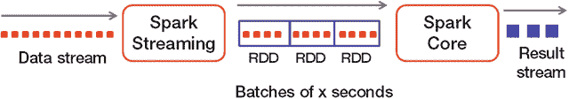
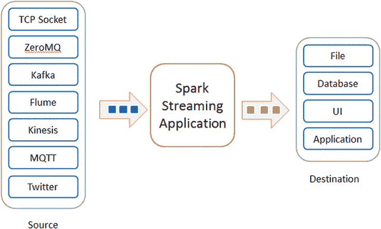
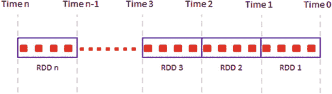
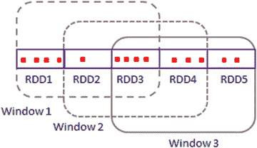
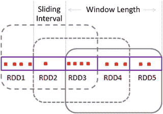

# 6. Spark Streaming

对历史数据的批处理是 Hadoop 和 Spark 等大数据技术的首批用例之一。在批处理中，数据会被收集一段时间，然后成批处理。批处理系统处理的数据时间范围从数小时到数年，具体取决于需求。例如，一些组织运行夜间批处理作业，处理由各种系统全天收集的数据。

批处理系统具有高延迟。根据数据量，处理一个批次可能需要几分钟到几小时。一些组织运行的夜间批处理作业在数百台机器的集群上运行 6 到 12 个小时。因此，您需要等待很长时间才能看到批处理应用程序生成的结果。此外，由于数据并非立即处理，数据收集时间与批处理结果可用时间之间的差距甚至更长。对于某些类别的应用程序，这种时间差距是可以接受的。

然而，有时数据需要在收集时立即处理和分析。例如，电子商务系统中的欺诈检测必须实时进行。同样，网络入侵或安全漏洞检测也必须是实时的。另一个例子是数据中心中的应用程序或设备故障检测。为防止长时间停机，必须立即处理数据。

实时数据流处理的挑战之一是在实时或近实时的情况下处理高速数据。运行在单台机器上的数据流处理应用程序无法处理高速数据。分布式流处理框架解决了这个问题。

本章介绍了 Spark Streaming。介绍之后，将详细讨论 Spark Streaming 提供的应用程序编程接口。在本章末尾，您将使用 Spark Streaming 开发一个应用程序。

## 介绍 Spark Streaming

Spark Streaming 是一个分布式数据流处理框架。它使开发用于近实时处理实时数据流的分布式应用程序变得容易。它不仅提供了简单的编程模型，还使应用程序能够处理高速流数据。它还允许将数据流和历史数据结合起来进行处理。

### Spark Streaming 是 Spark 的一个附加组件

Spark Streaming 是运行在 Spark 之上的一个 Spark 库。它扩展了 Spark 以进行数据流处理。它提供了用于处理流数据的高级抽象，但在底层，它使用 Spark（参见图 6-1）。


图 6-1. Spark Streaming 运行在 Spark 核心之上

由于 Spark Streaming 运行在 Spark 之上，它提供了一个可扩展、容错且高吞吐量的分布式流处理平台。它继承了 Spark 核心的所有特性和优势。通过向 Spark 集群添加更多节点，可以轻松增加 Spark Streaming 应用程序的处理能力。

此外，Spark Streaming 可以与其他 Spark 库（如 Spark SQL、MLlib、Spark ML 和 GraphX）一起使用。可以使用 SQL 分析数据流。可以将机器学习算法应用于数据流。同样，可以将图处理算法应用于流数据。因此，Spark Streaming 使得完整的 Spark 堆栈能力可用于处理数据流。


### 高层架构

Spark Streaming 以微批次（micro-batches）的方式处理数据流。它将数据流划分为固定时间间隔的极小型批次。每个微批次中的数据存储为一个 `RDD`，然后通过 Spark 核心进行处理（见图 6-2）。任何 RDD 操作均可应用于 Spark Streaming 创建的 RDD。RDD 操作的结果以批次形式输出。



图 6-2. 从数据流到微批次

### 数据流来源

Spark Streaming 支持多种数据流来源，包括 TCP 套接字、Twitter、Kafka、Flume、Kinesis、ZeroMQ 和 MQTT。它也可用于将文件作为流进行处理。此外，您还可以扩展它以处理来自自定义流式数据源的数据。

Spark Streaming 内置支持的流式数据源可分为两类：基础数据源和高级数据源。

-   基础数据流源包括 TCP 套接字、Akka Actor 和文件。Spark Streaming 包含了处理这些数据源所需的库。需要处理来自基础数据源的数据流的 Spark Streaming 应用程序只需链接 Spark Streaming 库即可。
-   高级数据流源包括 Kafka、Flume、Kinesis、MQTT、ZeroMQ 和 Twitter。处理这些数据源的数据流所需的库并未包含在 Spark Streaming 中，而是作为外部库提供。需要处理来自高级数据源的流数据的 Spark Streaming 应用程序不仅需要链接 Spark Streaming 库，还必须链接该数据源对应的外部库。

### 接收器

一个 `Receiver` 从流式数据源接收数据并将其存储在内存中。Spark Streaming 会为每个数据流在一个工作节点上创建并运行一个 `Receiver`。一个应用程序可以连接多个数据流，以并行处理数据流。

### 数据去向

处理数据流得到的结果可以通过几种不同的方式使用（见图 6-3）。结果可以被馈送到另一个应用程序，该应用程序可能会执行某些操作或仅将其显示出来。例如，一个 Spark Streaming 应用程序可能将结果馈送到一个持续更新的仪表盘应用程序。同样地，在欺诈检测应用程序中，结果可能会触发一笔交易的取消。结果也可以存储在诸如文件或数据库之类的存储系统中。



图 6-3. 流数据源与数据去向

## 应用程序编程接口（API）

Spark Streaming 库使用 Scala 编写，但它提供了多语言的应用程序编程接口（API）。在撰写本书时，Spark Streaming API 支持 Scala、Java 和 Python。

Spark Streaming API 包含两个核心抽象概念：`StreamingContext` 和离散化流。Spark Streaming 应用程序使用这两个抽象概念来处理数据流。

本节将详细介绍 `StreamingContext` 和离散化流。讨论这些抽象概念支持的各种操作以及如何创建它们。同时，也会讨论 Spark Streaming 应用程序的基本结构。

### StreamingContext

`StreamingContext` 是 Spark Streaming 库中定义的一个类，它是进入 Spark Streaming 库的主要入口点。它允许 Spark Streaming 应用程序连接到 Spark 集群。它还提供了创建 Spark Streaming 提供的数据流抽象实例的方法。

每个 Spark Streaming 应用程序都必须创建该类的实例。

#### 创建 StreamingContext 实例

创建 `StreamingContext` 实例与创建 `SparkContext` 实例类似。它可以使用创建 `SparkContext` 类实例所需的相同参数来创建。不过，它还需要一个额外的参数，该参数指定将数据流分割成微批次的时间间隔。

```
import org.apache.spark._
import org.apache.spark.streaming._
val config = new SparkConf().setMaster("spark://host:port").setAppName("big streaming app")
val batchInterval = 10
val ssc = new StreamingContext(conf, Seconds(batchInterval))
```

或者，如果您已经有一个 `SparkContext` 类的实例，可以使用它来创建 `StreamingContext` 类的实例。

```
import org.apache.spark._
import org.apache.spark.streaming._
val config = new SparkConf().setMaster("spark://host:port").setAppName("big streaming app")
val sc = new SparkContext(conf)
...
...
val batchInterval = 10
val ssc = new StreamingContext(sc, Seconds(batchInterval))
```

`StreamingContext` 构造函数的第二个参数使用时间作为单位来指定微批次的大小。数据流被分割成该时间长度的批次，每个批次作为一个 `RDD` 处理。前面的示例指定了批处理时长为 10 秒。Spark Streaming 每 10 秒从流式源创建一个新的 `RDD`。

批次大小可以小到 500 毫秒。批次大小的上限由应用程序的延迟要求和可用内存决定。为 Spark Streaming 应用程序创建的执行器必须有足够的内存来存储接收到的数据，以保证良好的性能。

在本章的其他示例中，您将使用变量 `ssc`。为避免在每个示例中重复前面的代码片段，我们假设 `ssc` 变量已在程序开头定义，如前所示。

`StreamingContext` 类定义了用于创建代表不同类型数据流的类实例的方法。这些将在后续章节详细讨论。接下来简要描述 `StreamingContext` 类中其他常用的方法。

#### 启动流式计算

`start` 方法开始流式计算。在 Spark Streaming 应用程序中，只有在 `StreamingContext` 类的实例上调用了 `start` 方法后，才会真正开始执行操作。一个 Spark Streaming 应用程序在调用 `start` 方法后开始接收数据。

```
ssc.start()
```


#### 检查点操作

`StreamingContext`类中定义的`checkpoint`方法用于指示 Spark Streaming 定期对数据进行检查点操作。它接收一个目录名称作为参数。对于生产环境应用，检查点目录应位于容错存储系统上，例如 HDFS。

```
ssc.checkpoint("path-to-checkpoint-directory")
```

如果 Spark Streaming 应用程序需要从驱动程序故障中恢复，或者它执行了有状态转换，那么必须调用此方法。Spark Streaming 应用程序处理的数据在概念上是一个永无止境的连续数据序列。如果在接收到部分数据后但尚未处理时，运行驱动程序程序的机器崩溃，则存在数据丢失的可能性。理想情况下，Spark Streaming 应用程序应能够从故障中恢复而不丢失数据。为了实现此功能，Spark Streaming 要求应用程序对元数据进行检查点操作。

此外，当应用程序对数据流执行有状态转换时，需要进行数据检查点操作。有状态转换是一种将数据流中多个批次的数据进行组合的操作。由有状态转换生成的 RDD 依赖于数据流中的先前批次。因此，由有状态转换生成的 RDD 的依赖链会随时间增长。在发生故障时，Spark Streaming 会使用其依赖链重建 RDD。随着依赖链的增长，恢复时间也会增加。为了防止恢复时间过长，Spark Streaming 会对有状态转换的中间 RDD 进行检查点操作。因此，Spark Streaming 要求应用程序在使用有状态转换之前调用`checkpoint`方法。Spark Streaming 支持的有状态转换将在本章后面讨论。

#### 停止流计算

顾名思义，`stop`方法会停止流计算。默认情况下，它也会停止`SparkContext`。此方法接受一个可选参数，可用于仅停止`StreamingContext`，以便`SparkContext`可以用于创建另一个`StreamingContext`实例。

```
ssc.stop(true)
```

#### 等待流计算完成

`StreamingContext`类中的`awaitTermination`方法使应用程序线程等待流计算停止。其语法如下：

```
ssc.awaitTermination()
```

如果驱动程序应用程序是多线程的，并且`start`方法并非由主应用程序线程调用，而是由另一个线程调用，那么需要`awaitTermination`方法。`StreamingContext`类中的`start`方法是一个阻塞方法；它在流计算完成或停止之前不会返回。在单线程驱动程序中，主线程将等待，直到`start`方法返回。但是，如果`start`方法是从另一个线程调用的，则可以通过调用`awaitTermination`来防止主线程过早退出。

### Spark Streaming 应用程序的基本结构

让我们使用到目前为止讨论的类和方法来创建一个 Spark Streaming 应用程序的骨架。它展示了基本结构，尚未包含任何处理逻辑。随着本章内容的深入，您将看到不同类型流处理的代码片段。您可以将这些片段添加到此骨架中，以获得一个完整、可运行的 Spark Streaming 应用程序。

```
import org.apache.spark._
import org.apache.spark.streaming._

object StreamProcessingApp {
  def main(args: Array[String]): Unit = {
      val interval = args(0).toInt
      val conf = new SparkConf()
      val ssc = new StreamingContext(conf, Seconds(interval))
      // 在此添加您应用程序特定的数据流处理逻辑
      ...
      ...
      ...
      ssc.start()
      ssc.awaitTermination()
  }
}
```

### 离散化流（DStream）

离散化流（DStream）是 Spark Streaming 为处理数据流提供的主要抽象。它表示一个数据流，并定义了可以在数据流上执行的操作。

`DStream`在 Spark Streaming 库中被定义为一个抽象类。它定义了处理数据流的接口。Spark Streaming 提供了实现`DStream`接口的具体类，用于处理来自各种来源的流数据。我在此处泛泛地使用术语`DStream`来指代抽象类以及实现`DStream`类所定义接口的类。

Spark Streaming 将`DStream`实现为一系列 RDD（见图 6-4）。它将`DStream`操作转换为对底层 RDD 的操作。



图 6-4. `DStream`是一个永无止境的 RDD 序列

由于`DStream`是 RDD 的序列，它继承了 RDD 的关键特性。它是不可变的、分区的且容错的。

### 创建 DStream

`DStream`可以从流数据源创建，也可以通过应用转换从现有的`DStream`创建。由于`DStream`是一个抽象类，您不能直接创建`DStream`类的实例。Spark Streaming 库提供了工厂方法，用于创建实现`DStream`定义接口的具体类的实例。

#### 基础数据源

用于从基础数据源创建`DStream`的工厂方法是内置的。Spark Streaming 应用程序只需链接 Spark Streaming 库即可使用这些方法。`StreamingContext`类定义了用于从基础数据源创建`DStream`的方法。接下来简要介绍从基础数据源创建`DStream`的常用方法。

##### socketTextStream

`socketTextStream`方法创建一个`DStream`，该`DStream`表示通过 TCP 套接字连接接收的流数据。它接收三个输入参数。第一个参数是数据源的主机名。第二个参数是用于接收数据的端口。第三个参数是可选的，指定接收数据的存储级别。

```
val lines = ssc.socketTextStream("localhost", 9999)
```

默认的存储级别是`StorageLevel.MEMORY_AND_DISK_SER_2`，它会将接收到的数据首先存储在内存中，如果可用内存不足以存储所有接收到的数据，则会溢出到磁盘。此外，它还会对接收到的数据进行反序列化，并使用 Spark 的序列化格式重新序列化。因此，这种存储级别会产生数据序列化的开销，但会减少与 JVM 垃圾回收相关的问题。为了容错，接收到的数据也会被复制。

您可以通过显式提供第三个参数来更改接收数据的存储级别。例如，如果您的 Spark Streaming 应用程序的批处理间隔只有几秒钟，您可以通过使用`StorageLevel.MEMORY_ONLY`存储级别来提高应用程序性能。

```
val lines = ssc.socketTextStream("localhost", 9999, StorageLevel.MEMORY_ONLY)
```

##### textFileStream

`textFileStream`方法创建一个`DStream`，该`DStream`监视 Hadoop 兼容的文件系统以查找新文件，并将它们作为文本文件读取。它接收要监视的目录名作为输入。文件必须通过从同一文件系统中的另一个位置移动到监视目录来写入。例如，在 Linux 系统上，应使用`mv`命令将文件写入监视目录。

```
val lines = ssc.textFileStream("input_directory")
```

##### actorStream

`actorStream`方法使用用户实现的 Akka Actor 接收器创建一个`DStream`。


### 高级数据源

用于从诸如 Kafka、Flume 或 Twitter 这类高级数据源创建 DStream 的工厂方法并非内置于 Spark Streaming 中，而是通过额外的工具类提供。要处理来自高级数据源的数据流，应用程序需要执行以下步骤：

-   导入该数据源对应的工具类，并使用该类提供的工厂方法创建一个 `DStream`。
-   链接包含该数据源工具类的库。
-   创建一个包含所有应用程序依赖项的超级 JAR 包，并将应用程序部署在 Spark 集群上。

例如，要处理来自 Twitter 的推文，应用程序必须导入 `TwitterUtils` 类，并使用其 `createStream` 方法创建一个用于接收 Twitter 推文的 DStream。

```
import org.apache.spark.streaming.twitter._

val tweets = TwitterUtils.createStream(ssc, None)
```

### 处理数据流

应用程序通过使用 DStream 及相关类中定义的方法来处理数据流。DStream 支持两种类型的操作：转换操作和输出操作。转换可以进一步分为基础转换、聚合转换、键值对转换和特殊转换。

与 RDD 转换类似，DStream 转换是惰性计算的。调用转换操作时不会立即执行任何计算。输出操作会触发 DStream 转换操作的执行。如果 DStream 上没有输出操作，即使对该 DStream 调用了转换，Spark Streaming 也不会进行任何处理。

#### 基础转换

转换操作将一个用户定义的函数应用于 DStream 中的每个元素，并返回一个新的 DStream。DStream 转换与 RDD 转换类似。实际上，Spark Streaming 将 DStream 转换方法调用转换为对底层 RDD 的转换方法调用。Spark 核心引擎负责计算 RDD 转换。

接下来简要介绍常用的 DStream 转换。

##### map

`map` 方法接受一个函数作为参数，并将其应用于源 DStream 中的每个元素，以创建一个新的 DStream。它返回一个新的 DStream。

例如，假设你有一个应用程序在本地主机上运行，并在 TCP 端口 9999 上发送文本行流。以下代码片段展示了如何从输入文本行流创建一个包含每行长度的流。

```
val lines = ssc.socketTextStream("localhost", 9999)
val lengths = lines map {line => line.length}
```

##### flatMap

`flatMap` 方法返回一个新的 DStream，该 DStream 是通过应用用户提供的函数创建的，该函数为源 DStream 中的每个元素返回 0 个或多个元素。

以下代码片段展示了如何从输入行流创建一个单词流。

```
val lines = ssc.socketTextStream("localhost", 9999)
val words = lines flatMap {line => line.split(" ")}
```

##### filter

`filter` 方法返回一个新的 DStream，该 DStream 仅包含源 `DStream` 中那些用户提供的输入函数返回 `true` 的元素。

以下代码片段从输入行流中移除空行。

```
val lines = ssc.socketTextStream("localhost", 9999)
val nonBlankLines = lines filter {line => line.length > 0}
```

##### repartition

`repartition` 方法返回一个新的 DStream，其中每个 RDD 都具有指定数量的分区。它允许你将输入数据流分布到多台机器上进行处理。它用于改变处理并行度。更多的分区会增加并行度，而更少的分区会降低并行度。

```
val inputStream = ssc.socketTextStream("localhost", 9999)
inputStream.repartition(10)
```

##### union

`union` 方法返回一个新的 DStream，该 DStream 包含源 `DStream` 中的元素与作为此方法输入提供的 DStream 中的元素的并集。

```
val stream1 = ...
val stream2 = ...
val combinedStream = stream1.union(stream2)
```

#### 聚合转换

本节描述的转换对 `DStream` 的底层 RDD 执行聚合操作。

##### count

`count` 方法返回一个包含单元素 RDD 的 DStream。返回的 DStream 中的每个 RDD 都包含源 DStream 中对应 RDD 的元素数量。

```
val inputStream = ssc.socketTextStream("localhost", 9999)
val countsPerRdd = inputStream.count()
```

##### reduce

`reduce` 方法通过对源 DStream 中每个 RDD 的元素进行归约，返回一个包含单元素 RDD 的 DStream。它接受一个用户提供的归约函数作为参数。

```
val lines = ssc.socketTextStream("localhost", 9999)
val words = lines flatMap {line => line.split(" ")}
val longestWords = words reduce { (w1, w2) => if(w1.length > w2.length) w1 else w2}
```

##### countByValue

`countByValue` 方法返回一个包含键值对的 DStream，其中键值对中的键是批次间隔内的一个不同元素，值是其计数。因此，返回的 DStream 中的每个 RDD 都包含了源 DStream 中对应 RDD 的每个不同元素的计数。

```
val lines = ssc.socketTextStream("localhost", 9999)
val words = lines flatMap {line => line.split(" ")}
val wordCounts = words.countByValue()
```


#### 仅适用于键值对 DStream 的转换操作

除了所有类型 DStream 都支持的转换操作外，键值对 DStream 还支持若干其他转换。下文简要介绍键值对 DStream 上常用的转换操作。

##### `cogroup`

对`(K, Seq[V])`和`(K, Seq[W])`类型的 DStream 调用`cogroup`方法时，会返回一个`(K, Seq[V], Seq[W])`类型的 DStream。该方法对传入参数中的 DStream 的 RDD 与源 DStream 中的 RDD 执行`cogroup`操作。

```
val lines1 = ssc.socketTextStream("localhost", 9999)
val words1 = lines1 flatMap {line => line.split(" ")}
val wordLenPairs1 = words1 map {w => (w.length, w)}
val wordsByLen1 = wordLenPairs1.groupByKey
val lines2 = ssc.socketTextStream("localhost", 9998)
val words2 = lines2 flatMap {line => line.split(" ")}
val wordLenPairs2 = words2 map {w => (w.length, w)}
val wordsByLen2 = wordLenPairs2.groupByKey
val wordsGroupedByLen = wordsByLen1.cogroup(wordsByLen2)
```

此示例使用`cogroup`方法从两个 DStream 中找出长度相同的单词。

#### `join`

`join`方法以键值对 DStream 作为参数，返回一个源 DStream 与输入 DStream 的内连接结果。对`(K, V)`和`(K, W)`类型的 DStream 调用时，返回`(K, (V, W))`类型的 DStream。

```
val lines1 = ssc.socketTextStream("localhost", 9999)
val words1 = lines1 flatMap {line => line.split(" ")}
val wordLenPairs1 = words1 map {w => (w.length, w)}
val lines2 = ssc.socketTextStream("localhost", 9998)
val words2 = lines2 flatMap {line => line.split(" ")}
val wordLenPairs2 = words2 map {w => (w.length, w)}
val wordsSameLength = wordLenPairs1.join(wordLenPairs2)
```

此示例创建了两个文本行 DStream，然后将其拆分为单词 DStream。接着创建键值对 DStream，其中键是单词长度，值是单词本身。最后，对这两个 DStream 执行连接操作。

左外连接、右外连接和全外连接操作同样可用。如果类型为`(K, V)`的键值对 DStream 与类型为`(K, W)`的另一个 DStream 进行连接，全外连接将返回`(K, (Option[V], Option[W]))`类型的 DStream，左外连接返回`(K, (V, Option[W]))`类型的 DStream，右外连接返回`(K, (Option[V], W))`类型的 DStream。

```
val leftOuterJoinDS = wordLenPairs1.leftOuterJoin(wordLenPairs2)
val rightOuterJoinDS = wordLenPairs1.rightOuterJoin(wordLenPairs2)
val fullOuterJoinDS = wordLenPairs1.fullOuterJoin(wordLenPairs2)
```

##### `groupByKey`

`groupByKey`方法按键对 DStream 中每个 RDD 内的元素进行分组。通过对源`DStream`中的每个 RDD 应用`groupByKey`，返回一个新的`DStream`。

```
val lines = ssc.socketTextStream("localhost", 9999)
val words = lines flatMap {line => line.split(" ")}
val wordLenPairs = words map {w => (w.length, w)}
val wordsByLen = wordLenPairs.groupByKey
```

##### `reduceByKey`

`reduceByKey`方法返回一个新的键值对 DStream，其中每个键的值由用户提供的 reduce 函数对源 DStream 中该键在 RDD 内的所有值进行规约得到。

以下示例统计每个 DStream 微批次中单词出现的次数。

```
val lines = ssc.socketTextStream("localhost", 9999)
val words = lines flatMap {line => line.split(" ")}
val wordPairs = words map { word =>  (word, 1)}
val wordCounts = wordPairs.reduceByKey(_ + _)
```

#### 特殊转换

到目前为止讨论的转换允许您对 DStream 中的元素指定操作。在底层，DStream 会将这些操作转换为 RDD 操作。接下来的两个转换则偏离了这一模型。

##### `transform`

`transform`方法通过对源 DStream 中的每个 RDD 应用一个`RDD => RDD`函数，返回一个新的 DStream。它接受一个以 RDD 为参数并返回 RDD 的函数作为参数。因此，它让您能够直接访问 DStream 底层的 RDD。

此方法允许您使用 RDD API 中提供但 DStream API 中没有对应操作的方法。例如，`sortBy`是 RDD API 中的一个转换操作，但 DStream API 中没有。如果您想对 DStream 中每个 RDD 内的元素进行排序，可以使用`transform`方法，如下例所示。

```
val lines = ssc.socketTextStream("localhost", 9999)
val words = lines.flatMap{line => line.split(" ")}
val sorted = words.transform{rdd => rdd.sortBy((w)=> w)}
```

`transform`方法也适用于对数据流应用机器学习和图计算算法。机器学习和图处理库提供了在 RDD 级别操作的类和方法。在`transform`方法内部，您可以使用这些库提供的 API。

##### `updateStateByKey`

`updateStateByKey`方法允许您为键值对 DStream 中的每个键创建和更新状态。您可以使用此方法来维护 DStream 中每个不同键的任何信息。

例如，您可以使用`updateStateByKey`方法持续统计 DStream 中每个不同单词的出现次数，如下例所示。

```
// 设置上下文以定期对 DStream 操作进行 checkpoint，实现驱动容错
ssc.checkpoint("checkpoint")
val lines = ssc.socketTextStream("localhost", 9999)
val words = lines.flatMap{line => line.split(" ")}
val wordPairs = words.map{word => (word, 1)}

// 创建一个类型为 (xs: Seq[Int], prevState: Option[Int]) => Option[Int] 的函数
val updateState = (xs: Seq[Int], prevState: Option[Int]) => {
  prevState match {
    case Some(prevCount) => Some(prevCount + xs.sum)
    case None => Some(xs.sum)
  }
}

val runningCount = wordPairs.updateStateByKey(updateState)
```

Spark Streaming 库提供了`updateStateByKey`方法的多个重载变体。最简单的版本接受一个类型为`(Seq[V], Option[S]) => Option[S]`的函数作为参数。这个用户提供的函数接受两个参数：第一个参数是 DStream RDD 中某个键的新值序列，第二个参数是该键的先前状态，包装在`Option`数据类型中。用户提供的函数使用新值和键的先前状态来更新键的状态，并返回包装在`Option`数据类型中的新状态。如果更新函数对某个键返回`None`，Spark Streaming 将停止维护该键的状态。

`updateStateByKey`方法返回一个键值对 DStream，其中对中的值是键的当前状态。

### 输出操作

输出操作是可用于将 DStream 数据发送到输出目标的 DStream 方法。输出目标可以是文件、数据库或其他应用程序。输出操作按照应用程序调用它们的顺序依次执行。


#### 保存到文件系统

以下简要介绍将 DStream 保存到文件系统时常用的 DStream 输出操作。

##### `saveAsTextFiles`

`saveAsTextFiles`方法可将 DStream 保存到文件中。它会为每个 DStream RDD 生成一个目录。在每个目录中，它会为每个 RDD 分区生成一个文件。因此，`saveAsTextFiles`方法会创建多个目录，每个目录包含一个或多个文件。每个 DStream RDD 的目录名称使用当前时间戳以及用户提供的前缀和可选后缀生成。

```
val lines = ssc.socketTextStream("localhost", 9999)
val words = lines flatMap {line => line.split(" ")}
val wordPairs = words map { word =>  (word, 1)}
val wordCounts = wordPairs.reduceByKey(_ + _)
wordCounts.saveAsTextFiles("word-counts")
```

##### `saveAsObjectFiles`

`saveAsObjectFiles`方法将 DStream 元素作为序列化对象保存到二进制 SequenceFile 中。与`saveAsTextFile`方法类似，它会将每个 DStream RDD 的数据存储到单独的目录中，并为每个 RDD 分区创建一个文件。每个 DStream RDD 的目录名称使用当前时间戳以及用户提供的前缀和可选后缀生成。

```
val lines = ssc.socketTextStream("localhost", 9999)
val words = lines flatMap {line => line.split(" ")}
val longWords = words filter { word =>  word.length > 3}
longWords.saveAsObjectFiles("long-words")
```

##### `saveAsHadoopFiles`

`saveAsHadoopFiles`方法可用于键值对类型的 DStream。它将源`DStream`中的每个 RDD 保存为 Hadoop 文件。

##### `saveAsNewAPIHadoopFiles`

与`saveAsHadoopFiles`方法类似，`saveAsNewAPIHadoopFiles`方法将键值对 DStream 中的每个 RDD 保存为 Hadoop 文件。

#### 在控制台显示

`DStream`类提供了`print`方法，用于在运行驱动程序（driver program）的机器控制台上显示 DStream 内容。

##### `print`

顾名思义，`print`方法会在运行驱动程序的机器上打印源 DStream 中每个 RDD 的元素。默认情况下，它会显示每个 RDD 中的前十个元素。该方法的重载版本允许你指定要打印的元素数量。

```
val ssc = new StreamingContext(conf, Seconds(interval))
val lines = ssc.socketTextStream("localhost", 9999)
val words = lines flatMap {line => line.split(" ")}
val longWords = words filter { word =>  word.length > 3}
longWords.print(5)
```

#### 保存到数据库

`DStream`类中的`foreachRDD`方法可用于将处理 DStream 后得到的结果保存到数据库中。

##### `foreachRDD`

`foreachRDD`方法类似于前面讨论过的`transform`方法。它允许你访问 DStream 中的 RDD。`transform`和`foreachRDD`的主要区别在于，`transform`返回一个新的`DStream`，而`foreachRDD`不返回任何值。

`foreachRDD`方法是一个高阶方法，它接受一个类型为`RDD => Unit`的函数作为参数。它会将此函数应用于源 DStream 中的每个 RDD。该函数内部可以使用所有 RDD 操作。需要重点注意的是，`foreachRDD`方法在驱动节点上执行；然而，在`foreachRDD`内部调用的 RDD 转换和动作则在工作节点上执行。

将 DStream 保存到数据库时，需要注意两点。首先，创建数据库连接是一项昂贵的操作。建议不要频繁地打开和关闭数据库连接。理想情况下，应重复使用一个数据库连接来存储尽可能多的元素，以分摊创建连接的成本。其次，数据库连接通常无法序列化并从主节点发送到工作节点。由于 DStream 在工作节点上处理，数据库连接应在工作节点上创建。

可以使用 RDD 的`foreachPartition`动作，通过同一个数据库连接存储多个 DStream 元素。由于 DStream 的`foreachRDD`方法允许你使用所有 RDD 操作，你可以在`foreachRDD`内部调用 RDD 的`foreachPartition`方法。在`foreachPartition`内部，你可以打开一个数据库连接，并使用该连接存储源 RDD 分区中的所有元素。你还可以通过使用连接池库来进一步优化，而不是直接打开和关闭物理连接。

以下代码片段实现了前面描述的将 DStream 保存到数据库的方法。它假设应用程序使用了诸如 HikariCP 或 BoneCP 等连接池库。连接池库被封装在一个延迟初始化的单例对象`ConnectionPool`中，该对象管理数据库连接池。

```
resultDStream.foreachRDD { rdd =>
  rdd.foreachPartition { iterator =>
    val dbConnection = ConnectionPool.getConnection()
    val statement = dbConnection.createStatement()
    iterator.foreach { element =>
      val result = statement.executeUpdate("...")
      // 检查结果
      ...
    }
    statement.close()
    // 将连接返回给连接池
    dbConnection.close()
  }
}
```

你可以做的另一项优化是批量写入数据库。也就是说，不是为每个元素发送一次数据库写入操作，而是可以将一个 RDD 分区的所有插入操作进行批处理，每个 RDD 分区只向数据库发送一次批量更新。

`foreachRDD`方法不仅可用于将 DStream 保存到数据库，还可用于在驱动节点上以自定义格式显示 DStream 中的元素。

### 窗口操作

窗口操作是一种 DStream 操作，应用于数据流中的滑动窗口。连续的窗口包含一个或多个重叠的 RDD（见图 6-5）。窗口操作是一种有状态的 DStream 操作，它结合了多个批次的数据。



*图 6-5. DStream 窗口*

窗口操作需要两个参数：窗口长度和滑动间隔（见图 6-6）。窗口长度参数指定了窗口操作应用的时间跨度。滑动间隔指定了执行窗口操作的时间间隔。也就是说，窗口操作以此时间间隔生成新的 RDD。



*图 6-6. DStream 窗口*

窗口长度和滑动间隔这两个参数都必须是 DStream 批处理间隔的整数倍。

下面简要介绍窗口操作中常用的 DStream 方法。

#### `window`

`window`方法返回一个由滑动 RDD 组成的 DStream。它接受两个参数：窗口持续时间和滑动间隔。返回的`DStream`中的每个 RDD 都包含来自源 DStream 中指定持续时间内的元素，并在指定的时间间隔生成一个新的 RDD。返回的 DStream 中连续的 RDD 包含重叠的数据元素。

```
val lines = ssc.socketTextStream("localhost", 9999)
val words = lines flatMap {line => line.split(" ")}
val windowLen = 30
val slidingInterval = 10
val window = words.window(Seconds(windowLen), Seconds(slidingInterval))
val longestWord = window reduce { (word1, word2) =>
  if (word1.length > word2.length) word1 else word2
}
longestWord.print()
```


#### `countByWindow`

`countByWindow`方法返回一个 DStream，其中包含单元素 RDD。每个返回的 DStream RDD 中的单个元素是指定持续时间的滑动窗口中元素的计数。它接受两个参数：窗口持续时间和滑动间隔。

```scala
ssc.checkpoint("checkpoint")
val lines = ssc.socketTextStream("localhost", 9999)
val words = lines flatMap {line => line.split(" ")}
val windowLen = 30
val slidingInterval = 10
val countByWindow = words.countByWindow(Seconds(windowLen), Seconds(slidingInterval))
countByWindow.print()
```

#### `countByValueAndWindow`

`countByValueAndWindow`方法返回一个 DStream，其中包含指定时间间隔滑动的滑动窗口内每个不同元素的计数。

```scala
ssc.checkpoint("checkpoint")
val lines = ssc.socketTextStream("localhost", 9999)
val words = lines flatMap {line => line.split(" ")}
val windowLen = 30
val slidingInterval = 10
val countByValueAndWindow = words.countByValueAndWindow(Seconds(windowLen), Seconds(slidingInterval))
countByValueAndWindow.print()
```

#### `reduceByWindow`

`reduceByWindow`方法返回一个包含单元素 RDD 的 DStream。返回的`DStream`中的每个 RDD 是通过在滑动窗口内的 DStream 元素上应用用户提供的 reduce 函数生成的。`reduceByWindow`方法接受三个参数：reduce 函数、窗口持续时间和滑动间隔。

用户提供的 reduce 函数必须为类型`(T, T) => T`。它接受两个类型为`T`的参数，并返回一个类型为`T`的单值。该函数应用于窗口内的所有元素，以生成单个值。它可用于聚合每个滑动窗口内的元素。

```scala
ssc.checkpoint("checkpoint")
val lines = ssc.socketTextStream("localhost", 9999)
val words = lines flatMap {line => line.split(" ")}
val numbers = words map {x => x.toInt}
val windowLen = 30
val slidingInterval = 10
val sumLast30Seconds = numbers.reduceByWindow({(n1, n2) => n1+n2},
                                 Seconds(windowLen), Seconds(slidingInterval))
sumLast30Seconds.print()
```

#### `reduceByKeyAndWindow`

`reduceByKeyAndWindow`操作仅适用于键值对类型的 DStream。它与`reduceByWindow`类似，区别在于它对键值对类型的 DStream 执行相同的操作。它将用户提供的 reduce 函数应用于滑动 DStream 窗口中的键值对，以便为窗口内的每个不同键生成单个键值对。

```scala
ssc.checkpoint("checkpoint")
val lines = ssc.socketTextStream("localhost", 9999)
val words = lines flatMap {line => line.split(" ")}
val wordPairs = words map {word => (word, 1)}
val windowLen = 30
val slidingInterval = 10
val wordCountLast30Seconds = wordPairs.reduceByKeyAndWindow((count1: Int, count2: Int) =>
                                count1 + count2, Seconds(windowLen), Seconds(slidingInterval))
wordCountLast30Seconds.print()
```

在窗口操作中，每个新窗口会与前一个窗口重叠。它会向之前的窗口添加一些元素，并移除一些元素。例如，如果窗口持续时间为 60 秒，滑动间隔为 10 秒，则每个新窗口会从上一个窗口中移除 10 秒的数据，并添加 10 秒的新数据。连续的窗口共享 40 秒的数据。对每个窗口在其 60 秒持续时间内执行完整聚合是低效的。一种更高效的方法是将新 10 秒数据的聚合结果加到前一个窗口的结果上，并移除不再包含在新窗口中的 10 秒数据的聚合结果。

Spark Streaming 为`reduceByKeyAndWindow`操作提供了一种高效变体，该变体通过使用前一个窗口的 reduce 结果来增量更新滑动窗口。它需要一个额外的逆 reduce 函数作为参数。该变体对进入窗口的新值进行 reduce，并使用逆 reduce 函数移除离开窗口的值的贡献。

```scala
ssc.checkpoint("checkpoint")
val lines = ssc.socketTextStream("localhost", 9999)
val words = lines flatMap {line => line.split(" ")}
val wordPairs = words map {word => (word, 1)}
val windowLen = 30
val slidingInterval = 10
def add(x: Int, y: Int): Int = x + y
def subtract(x: Int, y: Int): Int = x - y
val wordCountLast30Seconds = wordPairs.reduceByKeyAndWindow(add, subtract,
                              Seconds(windowLen), Seconds(slidingInterval))
wordCountLast30Seconds.print()
```


## 完整的 Spark Streaming 应用

至此，您已掌握了 Spark Streaming API 提供的关键类和方法。利用前面讨论的内容，您应该能够构建一个分布式流数据处理应用。

在本节中，让我们开发一个完整的 Spark Streaming 应用，以便您了解前面各节讨论的类和方法是如何在应用中协同工作的。您将创建一个显示 Twitter 热门话题标签的应用。

符号 `#` 被称为话题标签（hashtag）。它用于标记推文中的某个主题。人们在单词前添加话题标签符号，以便对推文进行分类。一条推文可能包含零个或多个带有话题标签的单词。

Twitter 通过一个流式 API 提供对其全局推文流的访问。您可以在 Twitter 网站上了解此 API，网址为 [`https://dev.twitter.com/streaming/overview`](https://dev.twitter.com/streaming/overview)。

要通过 Twitter 的流式 API 获取推文，您需要创建一个 Twitter 账户并注册您的应用。一个应用需要四项认证信息才能连接到 Twitter 的流式 API：消费者密钥（consumer key）、消费者密钥密文（consumer secret）、访问令牌（access token）和访问令牌密文（access token secret）。您可以从 Twitter 获取这些信息。如果您有 Twitter 账户，请登录或创建一个新账户。登录后，请在 [`https://apps.twitter.com`](https://apps.twitter.com/) 注册您的应用，以获取所有认证凭证。

让我们创建一个 Spark Streaming 应用，用于追踪带有话题标签的单词，并显示那些正在流行或越来越受欢迎的单词。应用源代码如下所示，随后是代码解释。

```
import org.apache.spark._
import org.apache.spark.streaming._
import org.apache.spark.streaming.twitter._
import twitter4j.Status

object TrendingHashTags {
  def main(args: Array[String]): Unit = {
    if (args.length < 8) {
      System.err.println("Usage: TrendingHashTags <consumer key> <consumer secret> " +
        "<access token> <access token secret> " +
        "<language> <batch interval> <min-threshold> <show-count> " +
        "[<filters>]")
      System.exit(1)
    }

    val Array(consumerKey, consumerSecret, accessToken, accessTokenSecret,
      lang, batchInterval, minThreshold, showCount ) = args.take(8)
    val filters = args.takeRight(args.length - 8)

    System.setProperty("twitter4j.oauth.consumerKey", consumerKey)
    System.setProperty("twitter4j.oauth.consumerSecret", consumerSecret)
    System.setProperty("twitter4j.oauth.accessToken", accessToken)
    System.setProperty("twitter4j.oauth.accessTokenSecret", accessTokenSecret)

    val conf = new SparkConf().setAppName("TrendingHashTags")
    val ssc = new StreamingContext(conf, Seconds(batchInterval.toInt))

    ssc.checkpoint("checkpoint")

    val tweets = TwitterUtils.createStream(ssc, None, filters)
    val tweetsFilteredByLang = tweets.filter{tweet => tweet.getLang() == lang}
    val statuses = tweetsFilteredByLang.map{ tweet => tweet.getText()}
    val words = statuses.flatMap{status => status.split("""\s+""")}
    val hashTags = words.filter{word => word.startsWith("#")}
    val hashTagPairs = hashTags.map{hashtag => (hashtag, 1)}
    val tagsWithCounts = hashTagPairs.updateStateByKey(
      (counts: Seq[Int], prevCount: Option[Int]) =>
        prevCount.map{c  => c + counts.sum}.orElse{Some(counts.sum)}
    )
    val topHashTags = tagsWithCounts.filter{ case(t, c) =>
      c > minThreshold.toInt
    }
    val sortedTopHashTags = topHashTags.transform{ rdd =>
      rdd.sortBy({case(w, c) => c}, false)
    }

    sortedTopHashTags.print(showCount.toInt)

    ssc.start()
    ssc.awaitTermination()
  }
}
```

让我们逐步解析代码。

`import org.apache.spark._`

`import org.apache.spark.streaming._`

这两个导入语句用于导入 Spark Streaming 库中定义的类和函数。

`import org.apache.spark.streaming.twitter._`

Twitter 是数据流的高级源；因此，需要使用显式导入来引用 Spark Streaming 提供的 Twitter 工具库中定义的类。

`import twitter4j.Status`


## 使用 Spark 进行 Twitter 流处理

Spark Streaming 提供的与 Twitter 相关的工具类使用了开源的 Twitter4J 库。Twitter4J 使得与 Twitter API 的集成变得简单。由于你将使用 Twitter4J 库中的 `Status` 类，我们在此导入它。

```
object TrendingHashTags {
  def main(args: Array[String]): Unit = {
    if (args.length < 8) {
      System.err.println("Usage: TrendingHashTags <consumer key> <consumer secret> " +
        "<access token> <access token secret> " +
        "<language> <batch interval> <min threshold> <show-count> " +
        "[<filters>]")
      System.exit(1)
    }
    ...
    ...
  }
}
```

这是一个 Scala 应用程序的基本框架。你创建一个单例对象并定义一个接受字符串数组作为参数的 `main` 方法。该数组包含传递给应用程序的命令行参数。

应用程序检查是否提供了最少数量的命令行参数；否则，它会打印一条显示所需参数的消息并退出。应用程序至少需要八个参数。前四个参数是应用程序连接到 Twitter 流式 API 所需的 Twitter 凭证。第五个参数用于按语言过滤推文。第六个参数是以秒为单位的批处理间隔，用于创建 DStream RDD。每个 `DStream` RDD 将包含该时间段内的推文。第七个参数是根据数量过滤话题标签的阈值。第八个参数控制将在控制台上显示多少个话题标签。

剩余的可选参数将传递给 Twitter 的流式 API，以将接收到的推文限制为仅匹配指定关键词的推文。推文的文本和几个推文元数据字段会被用于匹配。如果关键词用双引号括起来，则只有包含所有关键词的推文会发送到应用程序；否则，任何包含列表中任一关键词的推文都会被发送。例如，`"android ios iphone"` 将查找推文中是否同时包含这三个词。这些词在推文中不必相邻。

```
val Array(consumerKey, consumerSecret, accessToken, accessTokenSecret,
  lang, batchInterval, minThreshold, showCount ) = args.take(8)
```

上述代码片段将必需参数提取到局部变量中，这些变量将在程序的其余部分中使用。这是一种在单个表达式中提取多个命令行参数的简洁方式。

```
val filters = args.takeRight(args.length - 8)
```

剩余的可选参数被提取为一个过滤器关键词数组。

```
System.setProperty("twitter4j.oauth.consumerKey", consumerKey)
System.setProperty("twitter4j.oauth.consumerSecret", consumerSecret)
System.setProperty("twitter4j.oauth.accessToken", accessToken)
System.setProperty("twitter4j.oauth.accessTokenSecret", accessTokenSecret)
```

这些行通过系统属性将认证凭证传递给 Twitter4J 库。你设置系统属性，这些属性稍后会被 Twitter4J 库读取。

```
val conf = new SparkConf().setAppName("TrendingHashTags")
```

创建 `SparkConf` 类的一个实例，并为应用程序设置名称。Spark 监控 UI 将显示你在此处指定的名称。

```
val ssc = new StreamingContext(conf, Seconds(batchInterval.toInt))
```

创建 `StreamingContext` 类的一个实例。在这里，你指定批处理间隔，即使用此 `StreamingContext` 实例创建的 DStream 中每个 RDD 的持续时间。数据流将按照传递给 `StreamingContext` 构造函数的第二个参数指定的时间间隔进行拆分。

```
ssc.checkpoint("checkpoint")
```

为了追踪热门话题标签，将使用有状态转换。因此，设置上下文以在指定位置定期对 DStream 操作进行检查点。在生产应用程序中，此路径应指向可靠的文件系统，例如 HDFS。

```
val tweets = TwitterUtils.createStream(ssc, None, filters)
```

使用 `TwitterUtils` 对象中的工厂方法 `createStream` 创建一个代表推文流的 `DStream`。`filters` 变量将推文限制为仅匹配过滤器数组中的关键词。

```
val tweetsFilteredByLang = tweets.filter{tweet => tweet.getLang() == lang}
```

将推文过滤为仅匹配命令行参数中指定语言的推文。向 `filter` 转换方法提供一个函数字面量，然后在此函数字面量中使用 Twitter4J API 检查推文的语言。Twitter4J 的 `Status` 类中的 `getLang` 方法返回状态文本的语言（如果可用）。请注意，此方法不能保证返回正确的语言。

```
val statuses = tweetsFilteredByLang.map{ tweet => tweet.getText()}
```

使用 `map` 转换创建一个状态文本的 `DStream`。

```
val words = statuses.flatMap{status => status.split("""\s+""")}
```

将状态文本拆分为单词，从而从状态文本的 DStream 创建单词的 DStream。

```
val hashTags = words.filter{word => word.startsWith("#")}
```

由于你感兴趣的是话题标签，从单词的 DStream 中过滤出话题标签。`filter` 方法将返回话题标签的 DStream。

```
val hashTagPairs = hashTags.map{hashtag => (hashtag, 1)}
```

接下来，从上一步创建的话题标签 DStream 中创建一个键值对的 DStream。这一步是必需的，因为你将使用一个仅对键值对 DStream 可用的 DStream 转换。

```
val tagsWithCounts = hashTagPairs.updateStateByKey(
  (counts: Seq[Int], prevCount: Option[Int]) =>
    prevCount.map{c  => c + counts.sum}.orElse{Some(counts.sum)})
```

这是推文处理逻辑的核心。使用 `updateStateByKey` 方法来追踪推文流中每个不同话题标签的计数。向 `updateStateByKey` 方法传递一个函数字面量。此函数字面量通过将当前 RDD 中出现的次数添加到之前的累计计数中来更新每个不同话题标签的计数。第一次调用此函数时，没有之前的计数，因此它只返回一个话题标签在当前 RDD 中出现的次数。返回值被包装在 `Option` 数据类型中。`updateStateByKey` 方法返回一个键值对的 `DStream`，其中对中的键是一个不同的话题标签，值是从应用程序开始处理 Twitter 流以来的累计计数。

```
val topHashTags = tagsWithCounts.filter{ case(t, c) =>
  c > minThreshold.toInt
}
```

接下来，过滤 `DStream`，仅保留那些计数大于作为命令行参数传递给应用程序的最小阈值的标签。

```
val sortedTopHashTags = topHashTags.transform{ rdd =>
  rdd.sortBy({case(w, c) => c}, false)
}
```

这里你使用 `DStream` 的 `transform` 方法按计数对标签-计数对的 `DStream` 进行排序。请注意，DStream API 本身不提供对 `DStream` 中的元素进行排序的方法。因此，你利用 RDD API 提供的 `sortBy` 方法。`transform` 方法返回一个按计数排序的标签-计数对的 `DStream`。

```
sortedTopHashTags.print(showCount.toInt)
```

接下来，打印指定数量的热门话题标签及其计数。请注意，每次为 `sortedTopHashTags DStream` 生成新的 RDD 时，都会执行此打印语句。将根据你在创建 `StreamingContext` 实例时指定的批处理间隔生成新的 RDD。应用程序将按这些间隔打印热门话题标签。

```
ssc.start()
```

最后，启动流式计算。在此之前不会进行任何处理。应用程序在调用 `start` 方法后开始接收和处理推文。

```
ssc.awaitTermination()
```


等待流计算停止。当应用程序抛出异常或用户中断应用程序时，流计算将停止。否则，应用程序将持续运行。

## 总结

`Spark Streaming` 是一个扩展 `Spark` 以处理实时数据流的库。它运行在 `Spark` 之上，并提供了一个更高级别的 API 来处理数据流。它将 `Spark` 转变为一个分布式流数据处理框架。

`Spark Streaming` 中的主要抽象是 `DStream`，它将数据流表示为一串永无止境的 `RDD` 序列。`Spark Streaming` 采用微批处理架构，将数据流按指定时间间隔拆分成多个微批次。

除了 `Spark` 核心为微批次提供的所有操作外，`Spark Streaming` 还提供了对这些微批次的窗口操作。它还允许应用程序为键值对 `DStream` 中的每个不同键维护状态信息。

