# 8. 使用 Spark 进行机器学习

人们对机器学习的兴趣正在飞速增长。近年来，由于几个原因，它获得了很大的发展势头。第一个原因是硬件和算法的性能提升。机器学习是计算密集型的。随着多 CPU 和多核机器的普及以及高效算法的出现，在合理时间内完成机器学习计算已变得可行。第二个原因是机器学习软件已变得免费可用。现在任何人都可以下载许多高质量的、开源的机器学习软件。第三个原因是 MOOCs（大规模开放在线课程）极大地提高了人们对机器学习的认识。这些课程普及了使用机器学习所需的知识。机器学习技能不再局限于少数拥有统计学博士学位的人。现在任何人都可以学习和应用机器学习技术。

机器学习已嵌入我们日常使用的许多应用程序中。苹果、谷歌、Facebook、推特、领英、亚马逊、微软等众多公司都在其许多产品中后台使用了机器学习。机器学习应用的例子包括无人驾驶汽车、动作感应游戏主机、医疗诊断、电子邮件垃圾邮件过滤、图像识别、语音识别、欺诈检测以及电影、歌曲和图书推荐。

本章介绍了机器学习核心概念，然后讨论了 Spark 提供的机器学习库。机器学习是一个广泛的话题；它本身可以成为一本书的主题。事实上，已经有多本关于它的书籍问世。详细涵盖它超出了本书的范围；下一节将介绍基本概念，以便你能够理解本章的其余内容。如果你熟悉机器学习，可以跳过下一节。

## 机器学习简介

机器学习是一门训练系统从数据中学习并采取行动的科学。驱动基于机器学习的系统行为的逻辑并非显式编写，而是从数据中习得。

一个简单的类比是婴儿通过观察他人学习说话。婴儿天生不具备语言能力，但通过观察他人学会了理解和发音。同样，在机器学习中，我们通过数据训练系统，而非显式编程其行为。

具体来说，机器学习算法推断数据集中不同变量之间的模式和关系，然后利用这些知识进行泛化，使其超越训练数据集。换言之，机器学习算法学习如何根据数据进行预测。

接下来，我们介绍机器学习领域常用的一些术语。

### 特征

特征代表观测对象的属性或特性，也称为变量。更精确地说，特征代表自变量。

在表格数据集中，行代表观测对象，列代表特征。例如，考虑一个包含用户画像的表格数据集，其中包括`age`（年龄）、`gender`（性别）、`profession`（职业）、`city`（城市）和`income`（收入）等字段。在机器学习语境下，该数据集中每个字段都是一个特征。每行包含一个用户画像的条目就是一个观测对象。

特征也被统称为维度。因此，高维度数据集意味着拥有大量特征。

#### 类别特征

类别特征或变量是一种描述性特征。它只能取固定数量的离散值之一。它代表一个定性值，即名称或标签。

类别特征的值没有顺序关系。例如，在上述用户画像数据集中，`gender`（性别）就是一个类别特征，它只能取两个值之一，每个值都是一个标签。在同一数据集中，`profession`（职业）也是一个类别变量，但它可能取数百个值之一。

#### 数值特征

数值特征或变量是一种定量变量，可以取任意数值。它用数字描述可测量的量。数值特征的值具有数学上的顺序关系。例如，在上述用户画像数据集中，`income`（收入）就是一个数值特征。

数值特征可进一步分为离散特征和连续特征。离散数值特征只能取特定值。例如，房屋的卧室数量就是一个离散数值特征。连续数值特征可以在有限或无限区间内取任意值。温度就是连续数值特征的一个例子。

### 标签

标签是机器学习系统学习预测的变量，是数据集中的因变量。标签可分为两大类：类别标签和数值标签。

类别标签代表一个类或类别。例如，对于将新闻文章分类为政治、商业、科技、体育或娱乐等类别的机器学习应用，其文章类别就是一个类别标签。

数值标签是数值型因变量。例如，对于预测房价的机器学习应用，`price`（价格）就是一个数值标签。

### 模型

模型是一种用于捕获数据集中模式的数据结构。它估算数据集中因变量与自变量之间的关系，具备预测能力。给定自变量的值，它可以计算或预测因变量的值。例如，考虑一个预测公司季度销售额的应用。自变量包括销售人员数量、历史销售额、宏观经济状况及其他因素。通过机器学习，可以训练一个模型来预测这些因素任意组合下的季度销售额。

模型本质上是一个以特征为输入并输出值的数学函数。它可以通过多种方式在软件中表示，例如通过类的实例表示。本章后续将看到几个具体示例。

模型与机器学习算法构成了机器学习系统的核心。机器学习算法用数据训练模型；它使模型拟合数据集，从而使模型能够预测新观测对象的标签。

训练模型是计算密集型任务，而使用模型则不那么耗费计算资源。模型通常保存到磁盘，以便将来无需再次执行计算密集型训练步骤即可使用。序列化后的模型还可以与其他应用程序共享。例如，一个机器学习系统可能包含两个应用，一个负责训练模型，另一个负责使用模型。

### 训练数据

机器学习算法用于训练模型的数据称为训练数据或训练集。它通常是历史数据或已知数据。例如，垃圾邮件过滤算法使用已知的垃圾邮件和非垃圾邮件集合。

训练数据可分为两类：标记数据和未标记数据。

#### 标记数据

标记数据集中的每个观测对象都有标签。数据集中有一列包含标签。例如，过去十年售出房屋的数据库对于预测房价的机器学习应用而言就是一个标记数据集。此处的标签是房价，对于过去售出的房屋其值是已知的。同样，垃圾邮件过滤应用使用大量电子邮件数据集进行训练，其中部分标记为垃圾邮件，其余标记为非垃圾邮件。

#### 未标记数据

未标记数据集没有可用作标签的列。例如，考虑一个电子商务网站的交易数据库。它记录了通过该网站进行的所有在线购买行为。该数据库中没有一列指示交易是正常还是欺诈。因此，对于欺诈检测目的而言，这是一个未标记数据集。

### 测试数据

用于评估模型预测性能的数据称为测试数据或测试集。模型训练完成后，在应用于新数据之前，应先在已知数据集上测试其预测能力。

测试数据应在训练模型之前预留。在训练阶段绝对不能使用测试数据；它不应用于训练或优化模型。实际上，它不应以任何方式影响训练阶段；在训练期间甚至不要查看测试数据。由此推论，模型不应使用训练数据集进行测试。模型在训练集的观测对象上会表现良好，而应在未用于训练的数据上进行测试。

通常，在训练模型之前，会保留一小部分数据集用于测试。具体百分比取决于多种因素，如数据集规模和自变量数量。经验法则是使用 80%的数据进行训练，保留 20%作为测试数据。

### 机器学习应用

机器学习广泛应用于不同领域的各类任务。大量应用都使用了机器学习，且这一数量与日俱增。机器学习任务大致可分为以下几类：

- 分类
- 回归
- 聚类
- 异常检测
- 推荐
- 降维

#### 分类

解决分类问题的目标是预测一个观测值所属的类别或种类。一个类别由一个标签表示。训练数据集中观测值的标签是已知的，目标是训练一个模型，使其能够为新的无标签观测值预测标签。从数学角度看，在分类任务中，模型预测的是一个`分类变量`的值。

分类在众多领域都是一项常见任务。例如，垃圾邮件过滤就是一个分类任务。垃圾邮件过滤系统的目标是将一封电子邮件分类为垃圾邮件或非垃圾邮件。同样，肿瘤诊断也可视为一个分类问题。肿瘤可以是良性的，也可以是癌性的。此处的目标是预测肿瘤是良性还是癌性。分类任务的另一个例子是确定借款人的信用风险。利用个人收入、未偿债务和净资产等信息，可以为个人分配一个信用评级。

机器学习可用于`二分类`和`多分类`。上一段描述了几个二分类的例子。在二分类中，数据集中的观测值可分为两个互斥的类别。每个观测值或样本要么是正例，要么是负例。

在多分类中，数据集中的观测值可分为两个以上的类别。例如，手写邮政编码识别就是一个包含十个类别的多分类问题。在这种情况下，目标是检测一个手写字符是否是 0-9 之间的某个数字。每个数字代表一个类别。同样，图像识别也是一个多分类任务，具有许多应用。一个著名的应用是自动驾驶或无人驾驶汽车。另一个应用是 Xbox Kinect360，它利用机器学习来推断身体部位和位置。

#### 回归

解决回归问题的目标是为一个无标签观测值预测一个`数值型标签`。训练数据集中观测值的数值标签是已知的，然后训练一个模型来预测新观测值的标签。

回归任务的例子包括房屋估价、资产交易和预测。在房屋估价中，房屋的价值是模型预测的数值变量。在资产交易中，回归技术用于预测股票、债券或货币等资产的价值。同样，销售或库存预测也是一个回归任务。

#### 聚类

在聚类中，数据集被分割成指定数量的簇或分段。同一簇中的元素彼此之间的相似度要高于与其他簇中元素的相似度。簇的数量取决于应用场景。例如，一家保险公司可能会将其客户分为三个簇：低风险、中风险和高风险。另一方面，某个应用可能出于研究目的，将社交网络上的用户划分为 10 个社区。

有些人觉得聚类与分类相似得令人困惑。它们是不同的。在分类任务中，机器学习算法使用带标签的数据集来训练模型。而聚类则用于无标签数据集。此外，尽管聚类算法将数据集分割成指定数量的簇，但它不会为任何簇分配标签。用户必须自行确定每个簇代表什么。

一个常见的聚类示例是客户细分。组织将聚类作为一种数据驱动技术来创建客户细分群体，从而可以针对不同群体实施不同的营销计划。

#### 异常检测

在异常检测中，目标是找出数据集中的异常值。其基本假设是异常值代表了一个异常的观测。异常检测算法用于无标签数据。

异常检测在不同领域有许多应用。在制造业中，它用于自动发现缺陷产品。在数据中心，它用于检测故障系统。网站用它来检测欺诈。另一个常见用例是检测安全攻击。与安全攻击相关的网络流量不同于正常的网络流量。同样，机器上的黑客活动也会与正常的用户活动不同。

#### 推荐

推荐系统的目标是向用户推荐产品。它通过用户过去的行为来学习用户偏好。用户对不同的产品进行评分，随着时间的推移，推荐系统会学习该用户的偏好。在某些情况下，用户可能不会明确地对产品评分，而是通过购买、点击、浏览、点赞或分享等行为提供隐式反馈。

推荐系统是机器学习的著名例子之一。它正被嵌入到越来越多的应用程序中。推荐系统用于推荐文章、电影、电视剧、歌曲、书籍和其他产品。例如，Netflix 使用推荐系统向其订阅者推荐电影和节目。同样，Spotify、Pandora 和 Apple 也使用推荐系统向其订阅者推荐歌曲。

构建推荐系统的两种常用技术是`协同过滤`和`基于内容的推荐`。在协同过滤中，产品的属性或用户偏好不会被显式编程。该算法假设用户偏好和产品存在潜在特征，它会从不同用户对不同产品的评分中自动学习这些特征。输入数据集是表格格式，每行仅包含用户 ID、产品 ID 和评分。协同过滤仅从这三个字段学习潜在的用户和产品特征。它会学习具有相似偏好的用户以及具有相似属性的产品。然后，训练好的模型可用于向用户推荐产品。推荐给用户的产品是那些具有相似偏好的其他用户评分高的产品。

基于内容的推荐系统使用显式指定的产品属性来确定产品相似性并进行推荐。例如，一部电影具有类型、主演、导演和发行年份等属性。在基于内容的系统中，电影数据库中的每部电影都将记录这些属性。对于主要观看喜剧电影的用户，基于内容的系统将推荐类型为喜剧的电影。

#### 降维

降维是一种降低训练机器学习系统成本和时间的实用技术。机器学习是一项计算密集型任务。计算复杂度和成本会随着数据集中特征或维度的数量增加而增加。降维的目标是在不显著影响模型预测性能的前提下，减少数据集中的特征数量。

一个数据集可能有非常多的维度，以至于将其用于机器学习成本过高、不切实际。例如，一个数据集可能有数千个特征。使用此数据集训练系统可能需要数天或数周的时间。借助降维技术，可以在更合理的时间内训练一个机器学习系统。

降维背后的基本思想是，数据集可能包含多个预测能力很低或为零的特征。降维算法会自动从数据集中消除这些特征。仅使用预测能力最强的特征进行机器学习。因此，降维技术降低了机器学习的计算复杂度和成本。

### 机器学习算法

机器学习算法利用数据来训练模型。训练模型的过程也称为用数据拟合模型。换句话说，机器学习算法在训练数据集上拟合一个模型。

根据训练数据类型的不同，机器学习算法大致可分为两类：监督学习和无监督学习。

### 监督机器学习算法

监督机器学习算法使用带标签的数据集来训练模型。它只能用于带标签的训练数据集。

训练数据集中的每个观测值都有一组特征和一个标签。因变量（也称为响应变量）代表标签。自变量（也称为解释变量或预测变量）代表特征。监督机器学习算法从数据中学习，以估计或逼近一个响应变量与一个或多个预测变量之间的关系。

训练数据集中的标签可以手动生成，也可以从其他系统获取。例如，在垃圾邮件过滤中，会收集大量电子邮件样本并手动标记为垃圾邮件或非垃圾邮件。另一方面，在销售预测中，标签是历史销售数据，可以从销售数据库中获取。

监督机器学习算法大致可分为两类：回归算法和分类算法。

#### 回归算法

回归算法使用具有数值标签的数据集来训练模型。然后，训练好的模型可以预测新的未标记观测值的数值标签。

根据预测变量和响应变量的数量，回归任务可分为三类：简单回归、多重回归和多元回归。简单回归涉及一个响应变量和一个预测变量。多重回归涉及一个响应变量和多个预测变量。多元回归涉及多个响应变量和多个预测变量。

用于回归任务的常用监督机器学习算法包括线性回归、决策树和树的集成。

##### 线性回归

线性回归算法使用训练数据拟合一个带有系数的线性模型。线性模型是一组系数和解释变量的线性组合。该算法根据训练数据估计未知系数（也称为模型参数）。拟合的系数使训练数据集中预测标签与实际观测标签之差的平方和最小化。

下面是一个线性模型的简单示例。

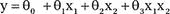

在这个等式中，`y` 是标签或因变量，`x[1]` 和 `x[2]` 是特征或自变量。训练集中每个观测值的 `y`、`x[1]` 和 `x[2]` 都是已知的。线性回归算法利用训练集中的观测值来估计 `θ[0]`、`θ[1]`、`θ[2]` 和 `θ[3]` 的值。已知 `θ[0]`、`θ[1]`、`θ[2]` 和 `θ[3]` 的值后，对于任何 `x[1]` 和 `x[2]` 的值，都可以计算出 `y` 的值。

图 8-1 展示了一个线性回归函数的图形表示。

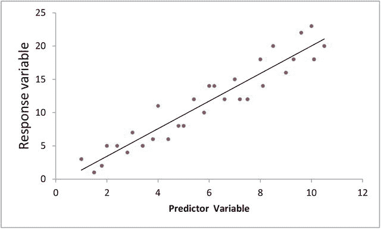

图 8-1.

线性回归

线性回归是最简单、最古老的机器学习算法之一。它经过了深入的研究，并广泛应用于许多领域。它用于预测、规划和资产估值应用。例如，它可以用于预测销售额。它可以用于预测数据中心环境中的系统使用情况。它也可以用于确定房屋的价值。

##### 保序回归

保序回归算法在训练数据集上拟合一个非递减函数。它在保证训练后的模型必须是一个非递减函数的约束下，找到对训练数据集的最佳最小二乘拟合。最小二乘函数使训练数据集中预测标签和实际标签之差的平方和最小化。与线性回归不同，保序回归算法不假设目标函数具有任何形式，例如线性。

图 8-2 中的图表比较了使用保序回归算法训练的模型与使用线性回归算法训练的模型。

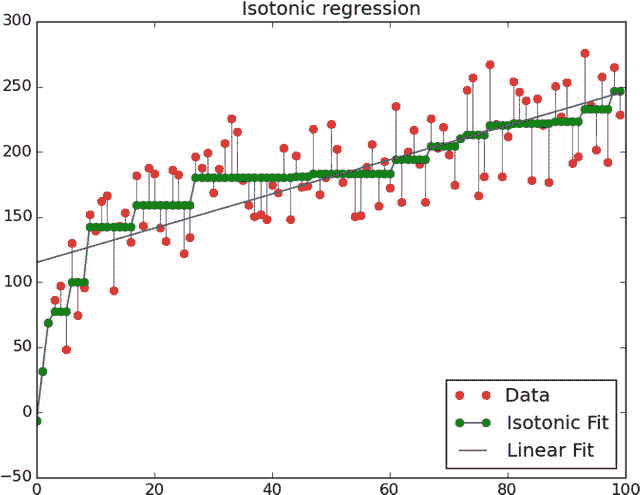

图 8-2.

保序拟合（© Nelle Varoquaux 和 Alexandre Gramfort。经许可使用。）

#### 决策树

决策树算法从训练数据集中推断出一组决策规则。本质上，它创建了一棵可用于预测观测值数值标签的决策树（见图 8-3）。

树是节点和边的分层集合。与图不同，树中没有环路。非叶子节点称为内部节点或分裂节点。叶子节点称为终端节点。

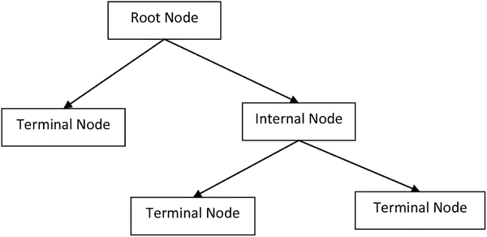

图 8-3.

决策树

在决策树中，每个内部节点测试一个特征或预测变量的值。使用这些测试，训练数据集中的观测值被分割成多个区域。叶子节点代表一个区域，并存储属于该区域的所有观测值的平均值。

给定一个新的未标记观测值，决策树模型从根节点开始，根据内部节点评估观测值特征。它沿着树向下遍历，直到到达一个终端节点。匹配的终端节点中存储的值将作为预测标签返回。因此，决策树模型在概念上实现了分层的 if-else 语句。它对特征执行一系列测试来预测标签。

决策树可用于回归和分类任务。“分类算法”部分描述了如何将决策树用于分类任务。

与其他更复杂的机器学习算法相比，决策树算法有许多优点。首先，由决策树训练的模型易于理解和解释。其次，它可以轻松处理分类和数值特征。第三，它需要很少的数据准备。例如，与其他算法不同，它不需要特征缩放。

#### 集成方法

尽管决策树算法有许多优点，但它也存在一个重大缺点：决策树的预测精度不如使用更复杂算法训练的模型。为了解决这个问题，可以使用一组决策树，而不是单一的决策树。

将多个模型组合起来以生成更强大模型的机器学习算法被称为集成学习算法。由集成学习算法训练的模型会结合多个基础模型的预测结果，从而提升其泛化能力和预测精度，使其优于单一模型。在分类和回归任务中，集成学习算法是最顶尖的算法之一。

常用的集成算法包括随机森林和梯度提升树。这两种算法都训练了一组决策树，但在树的生长过程中使用了不同的技术。

- `GBT` 由于一次只训练一棵树，因此训练模型可能需要更长时间。此外，如果在集成中使用大量树，它容易过拟合。然而，`GBT` 集成中的每棵树可以很浅，这使得训练速度更快。
- **梯度提升树**。梯度提升树（`GBTs`）算法也训练一组决策树。但是，它会顺序地训练每一棵决策树。它利用先前训练的树的信息来优化每一棵新树。因此，随着每一棵新树的加入，模型会变得更好。
- 对于回归任务，随机森林模型接收一个输入特征向量，并从集成中的每棵决策树获取一个预测结果。它计算所有树返回的数值标签的平均值，并将该平均值作为其预测结果。
- **随机森林**。随机森林算法使用数据的随机样本，独立地训练集成中的每一棵决策树。此外，每棵决策树在训练时只使用特征的一个子集。集成中树的数量通常有数百棵。随机森林创建的集成模型，其预测性能优于单一的决策树模型。

# 分类算法

## 分类算法
分类算法训练能够预测类别值的模型。训练数据集中的因变量或响应变量是一个类别变量。换句话说，标签是一个类别变量。

由分类算法训练的模型可以是二分类器、多分类器或多标签分类器。

二分类器将观测数据分为两类：正类或负类。预测标签只有两个类别。

多分类器预测的标签可以有多个类别。例如，多分类器可用于对动物图像进行分类。此示例中的标签可以是猫、狗、仓鼠、狮子或其他动物。

多标签分类器可以对同一个观测数据输出多个标签。例如，一个对新闻文章进行分类的分类器，对于一篇同时涉及体育和商业的文章，可以输出多个标签。

用于分类任务的常用监督机器学习算法包括以下几种：
- 逻辑回归
- 支持向量机（`SVM`）
- 朴素贝叶斯
- 决策树
- 集成方法
- 神经网络

## 逻辑回归
逻辑回归算法训练一个可用于分类任务的线性模型。具体来说，生成的模型可用于预测事件发生的概率。

逻辑回归使用逻辑函数或 Sigmoid 函数来模拟未标记观测数据可能标签的概率。逻辑函数的一个示例如下所示。

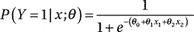

在上面的方程中，`x[1]`、`x[2]`和`x[3]`代表预测变量，`Y`代表观测数据的类别。逻辑回归算法使用训练数据集来估计`q[0]`、`q[1]`和`q[2]`的值。在学习了`q[0]`、`q[1]`和`q[2]`的值之后，可以使用上述方程来计算给定观测数据属于某个标签类别的概率。

逻辑函数的图形表示（也称为 Sigmoid 函数）如图 8-4 所示。

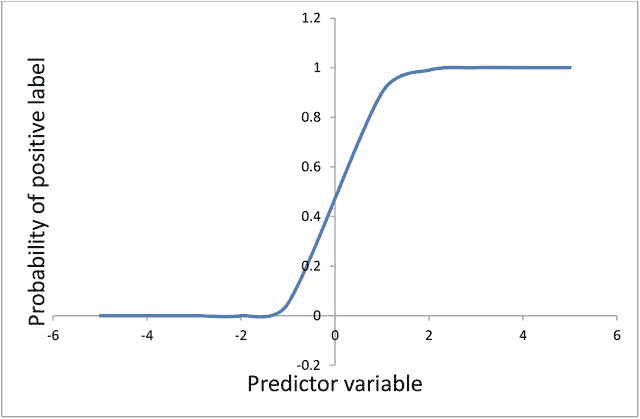
图 8-4. 逻辑回归曲线

## 支持向量机（`SVM`）
支持向量机（`SVM`）算法训练一个最优分类器。从概念上讲，它从训练数据集中学习一个最优超平面（见图 8-5）来对数据集进行分类。它找到能够最好地分离一个类别与另一个类别训练观测数据的最佳超平面。支持向量是那些最接近分离超平面的特征向量。

最佳超平面是在两个类别的观测数据之间具有最大间隔的那个超平面。在此上下文中，间隔是指能干净地分离训练集中观测数据的“板状”宽度。换句话说，分离超平面与来自两个类别的最近特征向量之间的间隔是最大的。图 8-5 中的示意图说明了这一点。

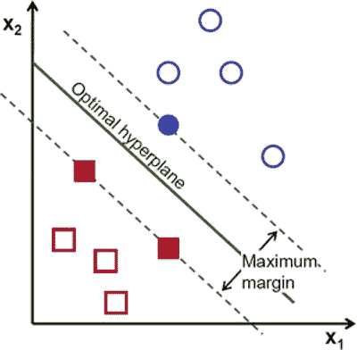
图 8-5. `SVM` 分类器（来源：`docs.opencv.org/2.4/doc/tutorials/ml/introduction_to_svm/introduction_to_svm.html`）

`SVM` 可以作为基于核的方法使用。基于核的方法隐式地将特征向量映射到一个更高维的空间，在这个空间中更容易找到用于分类观测数据的最优超平面（见图 8-6）。例如，在二维空间中可能很难找到一个能分离正例和负例的超平面。然而，如果将相同的数据映射到三维或更高维空间，就可能更容易找到一个能干净分离正负观测数据的超平面。下一张图展示了这种方法。

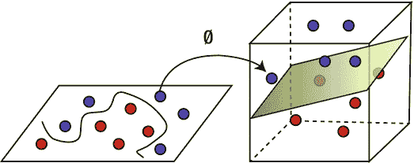
图 8-6. 核方法

基于核的方法使用一个核函数，这是一种相似度函数。该核函数将两个观测数据作为输入，并输出它们的相似度。

`SVM` 是一种强大的算法，但相比于一些不那么复杂的分类算法，它的计算量也更大。`SVM` 的优点之一是它在线性不可分的数据集上表现良好。

## 朴素贝叶斯
朴素贝叶斯算法使用贝叶斯定理来训练分类器。由朴素贝叶斯算法训练的模型是一个概率分类器。对于给定的观测数据，它会计算一组类别上的概率分布。

贝叶斯定理描述了事件的条件概率或后验概率。贝叶斯定理的数学公式如下所示。

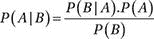

在上面的方程中，`A` 和 `B` 是事件。`P(A|B)` 是在已知 `B` 发生的条件下 `A` 的后验概率或条件概率。`P(B|A)` 是在已知 `A` 发生的条件下 `B` 的后验概率。`P(A)` 和 `P(B)` 分别是 `A` 和 `B` 的先验概率。

朴素贝叶斯算法假设所有特征或预测变量是独立的。这就是它被称为“朴素”的原因。理论上，朴素贝叶斯算法只应在预测变量统计独立时使用；然而，在实践中，即使不满足独立性假设，它也能很好地工作。

朴素贝叶斯特别适用于高维数据集。尽管它是一种简单的算法，但其表现往往优于更复杂的分类算法。

## 决策树
决策树算法已在回归算法章节中介绍过。如前所述，决策树可用于回归和分类任务。该算法在这两种情况下工作方式相同，唯有一点不同——终端（叶）节点中存储的值。

对于回归任务，每个终端节点存储一个数值；而对于分类任务，每个终端节点存储一个类别标签。多个叶节点可能具有相同的类别标签。为了预测一个观测值的标签，决策树模型从决策树的根节点开始，根据内部节点对特征进行测试，直到到达一个叶节点。该叶节点的值即为预测标签。

## 集成算法
集成算法已在回归算法章节中介绍过。诸如随机森林和梯度提升树等集成算法也可用于分类任务。

使用随机森林预测类别标签的逻辑在分类任务中有所不同。随机森林模型从其集成的决策树中收集预测结果，并输出被最多数量树预测的类别标签作为其预测结果。

## 神经网络
神经网络算法的灵感源于生物神经网络。它们试图模仿大脑。分类任务中常用的神经网络算法是前馈神经网络。由前馈神经网络算法训练得到的分类器也被称为多层感知机分类器。

多层感知机分类器由相互连接的节点组成（见图 8-7）。一个节点也被称为一个单元。这些相互连接的节点网络被划分为多个层。

第一层由分类器的输入组成。它表示一个观测值的特征。因此，第一层中的节点数量与输入特征的数量相同。

输入层之后是一个或多个隐藏层。具有两个或更多隐藏层的神经网络被称为深度神经网络。近期重新流行的深度学习算法，便是训练具有多个隐藏层的模型。

隐藏层可由任意数量的节点或单元组成。通常，隐藏层中节点越多，预测性能越好。隐藏层中的每个节点接收来自前一层所有节点的输入，并使用激活函数产生一个输出值。

通常使用的激活函数是逻辑（Sigmoid）函数。因此，没有隐藏层的单层前馈神经网络等同于逻辑回归模型。

最后一层，也称为输出单元，代表标签类别。输出层中的节点数量取决于标签类别的数量。一个二分类器在输出层中有一个节点。一个 `k` 类分类器将有 `k` 个输出节点。

在前馈神经网络中，输入数据仅从输入层通过隐藏层向前流向输出层。不存在循环。

图 8-7 中的图表展示了一个前馈神经网络。

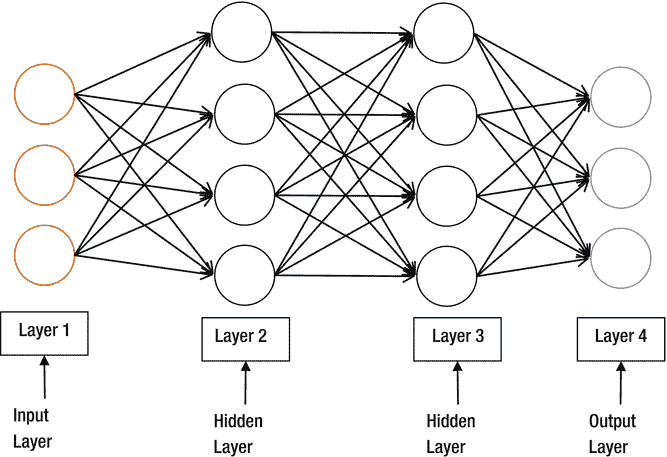
图 8-7. 神经网络

前馈神经网络算法使用一种称为反向传播的技术来训练模型。在训练阶段，预测误差被反馈回网络。算法利用此信息调整连接节点的边的权重，以最小化预测误差。此过程重复进行，直到预测误差收敛到小于预定义阈值。

通常，在大多数情况下，一个隐藏层的神经网络就足够了。如果使用多于一个隐藏层，建议每个隐藏层具有相同数量的节点。

神经网络更适合对非线性可分的数据进行分类。图 8-8 展示了一个涉及非线性数据的分类任务示例。

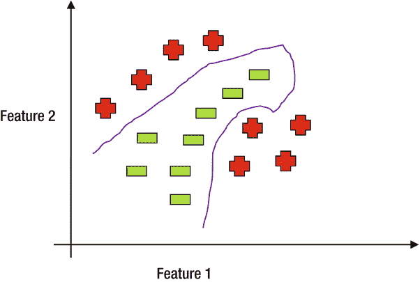
图 8-8. 非线性分类器

神经网络有一些缺点。它们难以解释。很难解释隐藏层中的节点代表什么。此外，与逻辑回归等更简单的分类算法相比，神经网络算法的计算强度更高。

# 无监督机器学习算法

当数据集未标记时，使用无监督机器学习算法。它从未标记的数据集中推断结论。通常，其目标是找出未标记数据中的隐藏结构。无监督机器学习算法通常用于聚类、异常检测和降维。

常用的无监督机器学习算法列表包括 `k` 均值、主成分分析和奇异值分解（`SVD`）。

## `k` 均值
`k-means` 算法在数据集中找出分组或聚类。它是一种迭代算法，将数据划分为 `k` 个互斥的聚类，其中 `k` 是用户指定的数字。

`k-means` 算法使用称为“簇内平方和”的准则来将观测值分配给聚类。它迭代地找到聚类中心，并将观测值分配给聚类，以使簇内平方和最小化。

数据应被分割成的聚类数量作为参数传递给 `k-means` 算法。

## 主成分分析（`PCA`）
`PCA` 用于降维。它是一种统计方法，用于将大量可能相关的变量缩减为一组更少的不相关变量，这些变量被称为主成分。主成分的数量小于或等于原始变量的数量。

`PCA` 的目标是找到能够解释数据集中最大变异量的最少数量变量。第一主成分是具有最大方差的变量。第二主成分是具有第二大方差的变量，并且在统计上与第一主成分独立。类似地，第三主成分是具有第三大方差的变量，并且与前两个主成分正交。后续每个主成分都遵循这一规律。因此，每个主成分在与其前面的主成分不相关的约束下，具有尽可能大的方差。

## 奇异值分解（`SVD`）
奇异值分解（`SVD`）是可用于 `PCA` 的方法之一。它是一种使用更少维度寻找数据集最佳近似的数值方法。通过矩阵分解，它在保留重要信息的同时，将高维数据集转换为低维数据集。换句话说，`SVD` 识别并排序那些解释数据集中大部分变异的统计独立维度。因此，它将大量相关变量缩减为一组更少的不相关变量。

# 超参数

如前所述，机器学习算法在数据集上拟合模型。在此过程中，它学习模型参数。然而，机器学习算法也需要一些输入参数，这些参数决定了训练时间和训练后模型的预测有效性。这些并非直接学习而是作为输入提供给学习算法的参数，被称为超参数。在后续涵盖 `MLlib` 和 `Spark ML` 的部分中会给出示例。

# 模型评估

在模型部署用于处理新数据之前，在测试数据集上对其进行评估至关重要。预测效果或模型质量可以通过几种不同的指标进行评估。

通常，评估指标取决于机器学习任务。线性回归、分类、聚类和推荐系统使用不同的评估指标。

一个简单的模型评估指标是准确率。它定义为模型正确预测的标签百分比。例如，如果一个测试数据集有 100 个观测值，并且模型正确预测了其中 90 个观测值的标签，那么它的准确率就是 90%。

然而，准确率可能是一个具有误导性的指标。例如，考虑一个肿瘤数据库，其中每一行都包含恶性或良性肿瘤的数据。在机器学习中，恶性肿瘤被视为正样本，良性肿瘤被视为负样本。假设我们训练一个模型来预测肿瘤是恶性的（阳性）还是非癌性的良性的（阴性）。如果它的准确率达到 90%，这是一个好模型吗？

这取决于测试数据集。如果测试数据集包含 50%的正样本和 50%的负样本，那么我们的模型表现良好。但是，如果测试数据集只有 1%的正样本和 99%的负样本，那么我们的模型就毫无价值了。在不使用机器学习的情况下，我们可以生成一个更好的模型；一个总是将样本分类为负样本的简单模型将具有 99%的准确率。因此，即使它错误地对所有正样本进行了分类，它的准确率也比我们训练的模型要高。

用于评估分类器或分类模型的两个常用指标是曲线下面积和 `F` 值。

## 曲线下面积（`AUC`）
曲线下面积（`AUC`），也称为 `ROC` 曲线下面积，是通常用于评估二分类器的指标（见图 8-9）。它表示模型正确预测随机正样本或负样本标签的时间比例。它可以通过绘制模型预测的真正例率与假正例率的曲线图来表示。最佳分类器具有最大的曲线下面积。

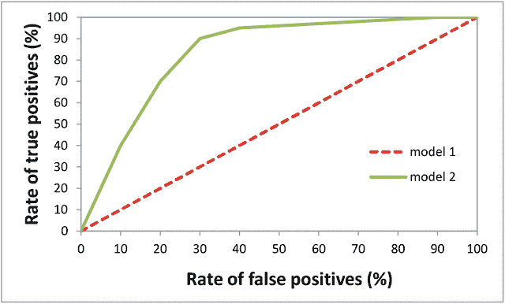
图 8-9. 曲线下面积

一个仅随机猜测观测值标签的模型，其 `AUC` 得分大约为 0.5。`AUC` 得分为 0.5 的模型被认为毫无价值。完美模型的 `AUC` 得分为 1.0，它预测的假正例和假负例均为零。

## `F` 值
`F` 值，也称为 `F` 分数或 `F1` 分数，是评估分类器的另一个常用指标。在定义 `F` 值之前，我们先定义另外两个术语——召回率和精确率。

召回率是模型正确分类的正样本所占的比例。计算召回率的公式如下。
`召回率 = TP / (TP + FN)`，其中 `TP` = 真正例，`FN` = 假负例

精确率是指模型所有预测为正类的样本中，真正正例所占的比例。它使用以下公式计算。
`精确率 = TP / (TP + FP)`，其中 `TP` = 真正例，`FP` = 假正例

模型的 `F` 值是模型召回率和精确率的调和平均数。计算模型 `F` 值的公式如下所示。
`F 值 = 2 * (精确率 * 召回率) / (精确率 + 召回率)`

模型的 `F` 值取值范围在 0 到 1 之间。最佳模型的 `F` 值等于 1，而 `F` 分数为 0 的模型是最差的。

## 均方根误差（`RMSE`）
`RMSE` 指标通常用于评估由回归算法生成的模型。一个相关的指标是均方误差（`MSE`）。在回归算法的上下文中，误差是观测值的实际数值标签与预测数值标签之间的差异。顾名思义，`MSE` 是误差平方的均值。它的数学计算方式是将每个观测值的误差进行平方，然后计算这些误差平方的均值。而 `RMSE` 的数学计算方式是对 `MSE` 取平方根。

`RMSE` 和 `MSE` 表示训练误差。它们表明模型对训练集的拟合程度。它们捕捉了观测到的标签与模型预测的标签之间的差异。

具有较低 `MSE` 或 `RMSE` 的模型比具有较高 `MSE` 或 `RMSE` 的模型拟合得更好。

# 机器学习高级步骤

这是在深入介绍 Spark 机器学习库具体细节之前的最后一部分。它涵盖了机器学习任务中的典型步骤。

这些高级步骤通常取决于机器学习任务的类型，而与机器学习算法关系不大。对于给定的任务，相同的步骤可以应用于不同的机器学习算法。

一个监督式机器学习任务通常包含以下高级步骤。
- 将数据拆分为训练集、验证集和测试集。
- 选择用于训练模型的特征。
- 使用监督式机器学习算法在训练数据集上拟合模型。
- 使用验证数据集调整超参数。
- 在测试数据集上评估模型。
- 将模型应用于新数据。

一个非监督式机器学习任务通常包含以下高级步骤。
- 选择特征变量。
- 使用非监督式机器学习算法拟合模型。
- 使用正确的评估指标评估模型。
- 使用模型。

# Spark 机器学习库

Spark 提供了两个机器学习库：`MLlib` 和 `Spark ML`（也称为 `Pipelines API`）。这些库能够在大数据集上进行高性能的机器学习。与只能在单台机器数据集上使用的机器学习库不同，`MLlib` 和 `Spark ML` 都是可扩展的。它们使得利用多节点集群进行机器学习成为可能。此外，由于 Spark 允许应用程序将数据集缓存在内存中，因此使用 `Spark ML` 或 `MLlib` 构建的机器学习应用程序运行速度很快。

`MLlib` 是 Spark 附带的第一个机器学习库，它比 `Spark ML` 更加成熟。这两个库都提供了比核心 Spark API 更高级别的机器学习抽象（见图 8-10）。

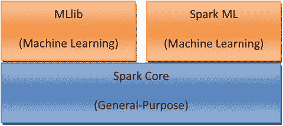
图 8-10. `MLlib` 和 `Spark ML` 运行在 Spark 之上

# `MLlib` 概述

`MLlib` 扩展了 Spark 以支持机器学习和统计分析。它为机器学习和统计分析提供了比 Spark 核心 API 更高级别的 API。它预装了用于各种机器学习任务的常用机器学习算法。它还包括用于不同统计分析的统计工具。

## 与其他 Spark 库的集成
`MLlib` 与其他 Spark 库（如 Spark Streaming 和 Spark SQL）集成（见图 8-11）。它可以用于批处理和流式数据。

使用 Spark SQL 提供的 `DataFrame` API，数据准备步骤（如数据清洗和特征工程）变得更加容易。通常，原始数据不能直接用于机器学习算法。需要从原始数据中提取特征。

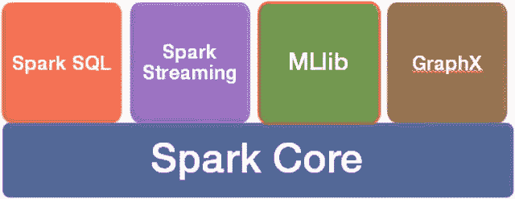
图 8-11. `MLlib` 与其他 Spark 库协同工作

## 统计工具
`MLlib` 提供了用于常见统计分析的类和函数。它支持汇总统计、相关性分析、分层抽样、假设检验、随机数据生成和核密度估计。

## 机器学习算法
`MLlib` 可用于常见的机器学习任务，例如回归、分类、聚类、异常检测、降维和推荐。`MLlib` 自带捆绑的算法列表正在不断增长。本节列出了撰写本书时 `MLlib` 内置的算法。

### 回归与分类
- 线性回归
- 逻辑回归
- 支持向量机
- 朴素贝叶斯
- 决策树
- 随机森林
- 梯度提升树
- 等温回归

### 聚类
- `K` 均值
- 流式 `K` 均值
- 高斯混合模型
- 幂迭代聚类（`PIC`）
- 潜在狄利克雷分配（`LDA`）

### 降维
- 主成分分析（`PCA`）
- 奇异值分解（`SVD`）

### 特征提取与转换
- `TF-IDF`
- `Word2Vec`
- 标准缩放器
- 归一化器
- 卡方特征选择
- 元素乘积

### 频繁模式挖掘
- `FP-增长`
- 关联规则
- `PrefixSpan`

### 推荐
- 基于交替最小二乘法的协同过滤（`ALS`）

# MLlib API

MLlib 库可用于使用 Scala、Java、Python 或 R 开发的应用程序。本节介绍 Scala 版本的 MLlib API。MLlib 提供的类和单例对象位于 `org.apache.spark.mllib` 包下。

你可以在 Spark REPL 中尝试本节展示的代码示例。让我们从终端启动 Spark shell。

```shell
path/to/SPARK_HOME/bin/spark-shell --master local[*]
```

## 数据类型

MLlib 的主要数据抽象是 `Vector`、`LabeledPoint` 和 `Rating`。MLlib 中的机器学习算法和统计工具作用于由这些抽象表示的数据。

### Vector

`Vector` 类型表示一个基于零索引（索引类型为 `Int`）的 `Double` 类型值的有索引集合。它通常用于表示数据集中观测值的特征。从概念上讲，长度为 n 的 `Vector` 表示具有 n 个特征的观测值。换言之，它表示 n 维空间中的一个元素。

不应将 MLlib 提供的 `Vector` 类型与 Scala 集合库中的 `Vector` 类型混淆。它们是不同的。MLlib 的 `Vector` 类型实现了线性代数中数值向量的概念。应用程序必须导入 [`org.apache.spark.mllib.linalg.Vector`](https://spark.apache.org/docs/1.1.1/api/scala/org/apache/spark/mllib/linalg/Vector.html) 才能使用 MLlib 提供的 `Vector` 特征（trait）。

MLlib 库支持两种类型的向量：稠密向量和稀疏向量。MLlib 的 `Vector` 类型被定义为一个特征（trait），因此应用程序不能直接创建 `Vector` 的实例。相反，它应该使用 MLlib 提供的工厂方法来创建 `DenseVector` 或 `SparseVector` 类的实例。这两个类实现了 `Vector` 特征（trait）。用于创建 `DenseVector` 或 `SparseVector` 类实例的工厂方法定义在 `Vectors` 对象中。

#### DenseVector

`DenseVector` 类的实例在每个索引位置存储一个 `Double` 类型的值。它由一个数组支持。如果数据集中没有太多零值，通常会使用稠密向量。创建方法如下所示。

```scala
import org.apache.spark.mllib.linalg._
val denseVector = Vectors.dense(1.0, 0.0, 3.0)
```

`dense` 方法根据作为参数提供给它的值创建 `DenseVector` 类的一个实例。`dense` 方法的一个变体接受一个 `Double` 类型的 `Array` 作为参数，并返回 `DenseVector` 类的一个实例。

#### SparseVector

`SparseVector` 类表示一个稀疏向量，它只存储非零值。对于具有许多零值的大型数据集，它是一种高效的数据类型。`SparseVector` 类的实例由两个数组支持；一个存储非零值的索引，另一个存储非零值。

创建稀疏向量的方法如下所示。

```scala
import org.apache.spark.mllib.linalg._
val sparseVector = Vectors.sparse(10, Array(3, 6), Array(100.0, 200.0))
```

`sparse` 方法返回 `SparseVector` 类的一个实例。`sparse` 方法的第一个参数是稀疏向量的长度。第二个参数是一个指定非零条目索引的数组。第三个参数是一个指定值的数组。索引数组和值数组必须具有相同的长度。

或者，可以通过指定其长度以及非零条目及其位置来创建稀疏向量，如下所示。

```scala
import org.apache.spark.mllib.linalg._
val sparseVector = Vectors.sparse(10, Seq((3, 100.0), (6, 200.0)))
```

### LabeledPoint

`LabeledPoint` 类型表示带标签数据集中的一个观测值。它同时包含观测值的标签（因变量）和特征（自变量）。标签存储为 `Double` 类型值，特征存储为 `Vector` 类型。

由 `LabeledPoint` 组成的 `RDD` 是 MLlib 用于表示带标签数据集的主要抽象。MLlib 提供的回归和分类算法仅作用于 `LabeledPoint` 的 `RDD`。因此，在用于训练模型之前，必须将数据集转换为 `LabeledPoint` 的 `RDD`。

由于 `LabeledPoint` 中的标签字段是 `Double` 类型，它可以表示数值和类别标签。当与回归算法一起使用时，`LabeledPoint` 中的标签存储一个数值。对于二分类，标签必须为 0 或 1。0 表示负标签，1 表示正标签。对于多分类，标签存储观测值的基于零的类别索引。

创建 `LabeledPoint` 的方法如下所示。

```scala
import org.apache.spark.mllib.linalg.Vectors
import org.apache.spark.mllib.regression.LabeledPoint
val positive = LabeledPoint(1.0, Vectors.dense(10.0, 30.0, 20.0))
val negative = LabeledPoint(0.0, Vectors.sparse(3, Array(0, 2), Array(200.0, 300.0)))
```

这段代码创建了两个 `LabeledPoint`。第一个 `LabeledPoint` 表示一个具有三个特征的正观测值。第二个 `LabeledPoint` 表示一个具有三个特征的负观测值。

### Rating

`Rating` 类型用于推荐算法。它表示用户对产品或项目的评分。在用于训练推荐模型之前，必须将训练数据集转换为 `Rating` 的 `RDD`。

`Rating` 被定义为一个包含三个字段的样例类（case class）。第一个字段名为 `user`，类型为 `Int`。它表示用户标识符。第二个字段名为 `product`，类型也是 `Int`。它表示产品或项目标识符。第三个字段名为 `rating`，类型为 `Double`。

创建 `Rating` 实例的方法如下所示。

```scala
import org.apache.spark.mllib.recommendation._
val rating = Rating(100, 10, 3.0)
```

这段代码创建了 `Rating` 类的一个实例。该实例表示标识符为 100 的用户对标识符为 10 的产品的评分 3.0。

## 算法与模型

本节简要介绍 MLlib 用于表示机器学习算法和模型的抽象概念。

MLlib 中的模型通过类来表示。MLlib 提供了不同的类，用于表示通过不同机器学习算法训练得到的模型。

类似地，机器学习算法也通过类来表示。MLlib 通常还会为每个机器学习算法类提供一个同名的伴生单例对象。使用代表机器学习算法的单例对象来训练模型更为便捷。

训练和使用模型通常涉及两个关键方法：`train` 和 `predict`。`train` 方法由代表机器学习算法的单例对象提供，它使用给定的数据集训练模型，并返回一个特定于该算法的模型类实例。`predict` 方法由代表模型的类提供，它为一组给定的特征返回一个标签。

Spark 预置了可用于实验 MLlib API 的样本数据集。为简单起见，这些示例都使用了这些样本数据集。

部分数据文件采用 LIBSVM 格式。每一行存储一个观测值。第一列是标签，其后是特征，特征表示为 `offset:value`，其中 offset 是特征向量中的索引，value 是特征的值。

MLlib 库提供了一些辅助函数，用于从包含 LIBSVM 格式标注数据的文件中创建 `RDD[LabeledPoint]`。这些方法由 `MLUtils` 对象提供，该对象位于 `org.apache.spark.mllib.util` 包中。

### 回归算法

代表不同回归算法的 MLlib 类列表包括 `LinearRegressionWithSGD`、`RidgeRegressionWithSGD`、`LassoWithSGD`、`ElasticNetRegression`、`IsotonicRegression`、`DecisionTree`、`GradientBoostedTrees` 和 `RandomForest`。MLlib 还提供了同名的伴生单例对象。这些类和对象提供了训练回归模型的方法。

本节介绍单例对象用于训练模型的方法。

#### train

回归算法对象的 `train` 方法，使用作为输入提供的数据集来训练或拟合线性回归模型。它接受一个 `RDD[LabeledPoints]` 作为参数，并返回一个特定于该算法的回归模型。例如，`LinearRegressionWithSGD` 对象中的 `train` 方法返回一个 `LinearRegressionModel` 类的实例。类似地，`DecisionTree` 对象中的 `train` 方法返回一个 `DecisionTreeModel` 类的实例。

`train` 方法还接受一些额外的特定于算法的超参数作为参数。例如，`RidgeRegressionWithSGD` 对象中的 `train` 方法接受以下参数：梯度下降的迭代次数、每次梯度下降迭代的步长、正则化参数、每次迭代使用的数据比例以及初始权重集。类似地，`GradientBoostedTrees` 对象中的 `train` 方法接受一个提升策略作为参数。

以下示例演示了如何使用 `LinearRegressionWithSGD` 训练模型。你可以用类似的方式使用其他回归算法。

```scala
import org.apache.spark.mllib.linalg.Vectors

import org.apache.spark.mllib.regression.LabeledPoint

import org.apache.spark.mllib.regression.LinearRegressionWithSGD

// 从文本文件创建一个 RDD

val lines = sc.textFile("data/mllib/ridge-data/lpsa.data")

lines: org.apache.spark.rdd.RDD[String] = MapPartitionsRDD[1] at textFile at <console>:24

// 将原始数据集转换为 RDD of LabeledPoint

val labeledPoints = lines.map { line =>
                      // 将每一行分割为标签和特征
                      val Array(rawLabel, rawFeatures) = line.split(’,’)
                      // 提取单个特征并将其转换为 Double 类型
                      val features = rawFeatures.split(’ ’).map(_.toDouble)
                      // 为每个输入行创建一个 LabeledPoint
                      LabeledPoint(rawLabel.toDouble, Vectors.dense(features))
                    }

labeledPoints: org.apache.spark.rdd.RDD[org.apache.spark.mllib.regression.LabeledPoint] = MapPartitionsRDD[2] at map at <console>:26

// 缓存数据集，因为训练步骤是迭代的。

labeledPoints.cache

val numIterations = 100

// 训练模型

val lrModel = LinearRegressionWithSGD.train(labeledPoints, numIterations)

lrModel: org.apache.spark.mllib.regression.LinearRegressionModel = org.apache.spark.mllib.regression.LinearRegressionModel: intercept = 0.0, numFeatures = 8

// 检查模型参数

val intercept = lrModel.intercept

intercept: Double = 0.0

val weights = lrModel.weights

weights: org.apache.spark.mllib.linalg.Vector = [0.5808575763272221,0.1893000148294698,0.2803086929991066,0.11108341817778758,0.4010473965597894,-0.5603061626684255,-0.5804740464000983,0.8742741176970946]
```

此模型将在介绍回归模型的小节中使用。

## `trainRegressor`

`trainRegressor`方法由基于树的算法（如`DecisionTree`和`RandomForest`）的单例对象提供。它使用输入的数据集训练或拟合一个非线性回归模型。该方法接受一个`LabeledPoint`类型的 RDD 和算法特定的超参数作为参数。例如，在`RandomForest`中，它接受的参数包括：树的数量、树的最大深度、最大分箱数、自助法随机种子、分类特征以及每个节点分裂时考虑的特征数量。

`trainRegressor`方法返回一个算法特定的非线性回归模型。例如，`DecisionTree`对象中的`trainRegressor`方法返回`DecisionTreeModel`类的一个实例。类似地，`RandomForest`对象中的`trainRegressor`方法返回`RandomForestModel`类的一个实例。

以下示例演示了如何使用`RandomForest`训练模型。我们将使用之前用于训练`LinearRegressionWithSGD`模型的相同数据集。

```scala
import org.apache.spark.mllib.linalg.Vectors
import org.apache.spark.mllib.regression.LabeledPoint
import org.apache.spark.mllib.tree.RandomForest

val lines = sc.textFile("data/mllib/ridge-data/lpsa.data")
// 将原始数据集转换为 LabeledPoint 类型的 RDD
val labeledPoints = lines.map { line =>
  // 将每行数据分割为标签和特征
  val Array(rawLabel, rawFeatures) = line.split(',')
  // 提取各个特征并转换为 Double 类型
  val features = rawFeatures.split(' ').map(_.toDouble)
  // 为每行输入创建一个 LabeledPoint
  LabeledPoint(rawLabel.toDouble, Vectors.dense(features))
}
// 缓存数据集，因为训练步骤是迭代的
labeledPoints.cache

// 初始化 RandomForest 算法的超参数
/*
  categoricalFeaturesInfo 输入是一个存储分类特征基数的 Map。
  Map 条目 (n -> k) 表示特征 n 是一个分类特征，有 k 个类别，从 0 开始索引：{0, 1, ..., k-1}。
*/
val categoricalFeaturesInfo = Map[Int, Int]()  // 所有特征都是连续型的
// numTrees 指定随机森林中树的数量
val numTrees = 3 // 实际应用中请使用更大的值
/*
  featureSubsetStrategy 指定在每个节点进行分裂时考虑的特征数量。
  MLlib 支持："auto", "all", "sqrt", "log2", "onethird"。
  如果指定为 "auto"，算法会根据 numTrees 选择值：如果 numTrees == 1，则 featureSubsetStrategy 设为 "all"；否则设为 "onethird"。
*/
val featureSubsetStrategy = "auto"
/*
  impurity 指定用于信息增益计算的准则。
  支持的值："variance"
*/
val impurity = "variance"
/*
  maxDepth 指定树的最大深度。深度 0 表示 1 个叶节点；深度 1 表示 1 个内部节点 + 2 个叶节点。
  建议值：4
*/
val maxDepth = 4
/*
  maxBins 指定用于分割特征的最大分箱数。
  建议值：100
*/
val maxBins = 32

// 训练模型
val rfModel = RandomForest.trainRegressor(labeledPoints, categoricalFeaturesInfo,
  numTrees, featureSubsetStrategy, impurity, maxDepth, maxBins)
```

`rfModel: org.apache.spark.mllib.tree.model.RandomForestModel = TreeEnsembleModel regressor with 3 trees`

### 回归模型

表示回归模型的类包括：`LinearRegressionModel`、`RidgeRegressionModel`、`LassoModel`、`IsotonicRegressionModel`、`DecisionTreeModel`、`GradientBoostedTreesModel`和`RandomForestModel`。这些类的实例由上一节提到的对象中的`train`或`trainRegressor`方法返回。

下面简要介绍这些类中常用的方法。

#### `predict`

回归模型的`predict`方法为给定的特征集返回一个数值标签。它接受一个`Vector`作为参数，返回一个`Double`类型的值。

`predict`方法的一个变体接受`Vector`的 RDD 作为参数，并返回`Double`的 RDD。因此，它既可以用于预测单个观测的标签，也可以用于预测数据集的标签。

以下代码片段使用了之前训练的`LinearRegressionModel`类的一个实例。它计算了模型的均方误差。

```scala
// 获取训练集中每个观测的实际标签和预测标签
val observedAndPredictedLabels = labeledPoints.map { observation =>
  val predictedLabel = lrModel.predict(observation.features)
  (observation.label, predictedLabel)
}
```

`observedAndPredictedLabels: org.apache.spark.rdd.RDD[(Double, Double)] = MapPartitionsRDD[161] at map at <console>:32`

```scala
// 计算每个观测的预测值与实际值之差的平方
val squaredErrors = observedAndPredictedLabels.map{case(actual, predicted) =>
  math.pow((actual - predicted), 2)
}
```

`squaredErrors: org.apache.spark.rdd.RDD[Double] = MapPartitionsRDD[162] at map at <console>:34`

```scala
// 计算均方误差的均值
val meanSquaredError = squaredErrors.mean()
```

`meanSquaredError: Double = 6.207597210613578`

在前面的示例中使用了`LinearRegressionModel`类的一个实例。同样，你也可以使用`DecisionTreeModel`、`RandomForestModel`和其他模型类的实例。

#### `save`

`save`方法将训练好的模型持久化到磁盘。它接受一个`SparkContext`和路径作为参数，将源模型保存到指定路径。保存的模型之后可以使用`load`方法读取。

```scala
lrModel.save(sc, "models/lr-model")
```

#### `load`

`load`方法定义在配套的模型对象中。它从一个先前保存的模型生成一个模型实例。该方法接受`SparkContext`和已保存模型的路径作为参数，并返回一个模型类的实例。

```scala
import org.apache.spark.mllib.regression.LinearRegressionModel

val savedLRModel = LinearRegressionModel.load(sc, "models/lr-model")
```

`savedLRModel: org.apache.spark.mllib.regression.LinearRegressionModel = org.apache.spark.mllib.regression.LinearRegressionModel: intercept = 0.0, numFeatures = 8`

```scala
// 检查模型参数
val intercept = savedLRModel.intercept
```

`intercept: Double = 0.0`

```scala
val weights = savedLRModel.weights
```

`weights: org.apache.spark.mllib.linalg.Vector = [0.5808575763272221,0.1893000148294698,0.2803086929991066,0.11108341817778758,0.4010473965597894,-0.5603061626684255,-0.5804740464000983,0.8742741176970946]`

#### `toPMML`

`toPMML` 方法将模型导出为预测模型标记语言（PMML）格式。PMML 是一种基于 XML 的格式，用于描述和序列化机器学习算法生成的模型，使不同应用程序能够共享模型。通过 PMML，您可以在一个应用程序中训练模型，并在另一个应用程序中使用它。

`toPMML` 方法有多个变体。这些变体允许您将模型导出为字符串、`OutputStream`、本地文件或分布式文件系统。

以下示例展示了如何将 PMML 格式的模型导出为字符串。

```scala
val lrModelPMML = lrModel.toPMML
lrModelPMML: String =
"<?xml version="1.0" encoding="UTF-8" standalone="yes"?>
<PMML ExternalRef"> http://www.dmg.org/PMML-4_2 ">
    <Header description="linear regression">
        <Application name="Apache Spark MLlib" version="1.5.2"/>
        <Timestamp>2015-11-21T09:51:52</Timestamp>
    </Header>
    <DataDictionary numberOfFields="9">
        <DataField name="field_0" optype="continuous" dataType="double"/>
        <DataField name="field_1" optype="continuous" dataType="double"/>
        <DataField name="field_2" optype="continuous" dataType="double"/>
        <DataField name="field_3" optype="continuous" dataType="double"/>
        <DataField name="field_4" optype="continuous" dataType="double"/>
        <DataField name="field_5" optype="continuous" dataType="double"/>
        ...
```

### 分类算法

MLlib 中代表不同分类算法的类包括 `LogisticRegressionWithSGD`、`LogisticRegressionWithLBFGS`、`SVMWithSGD`、`NaiveBayes`、`DecisionTree`、`GradientBoostedTrees` 和 `RandomForest`。MLlib 还提供了同名伴生单例对象。这些类和对象提供了训练分类模型（也称为分类器）的方法。

本节简要描述代表分类算法的单例对象所提供的用于训练模型的方法。

#### `train`

分类对象的 `train` 方法通过输入的数据集训练或拟合分类模型。它接受一个 `RDD[LabeledPoint]` 作为参数，并返回特定于算法的分类模型。例如，`LogisticRegressionWithSGD` 对象的 `train` 方法返回 `LogisticRegressionModel` 类的实例。类似地，`NaiveBayes` 对象的 `train` 方法返回 `NaiveBayesModel` 类的实例。

除了 `RDD[LabeledPoint]` 外，`train` 方法还接受特定于算法的超参数作为参数。例如，`NaiveBayes` 对象的 `train` 方法接受平滑参数作为参数。类似地，`SVMWithSGD` 对象的 `train` 方法接受梯度下降迭代次数、每次梯度下降迭代的步长、正则化参数、每次迭代使用的数据比例以及初始权重集作为参数。

以下示例使用 `SVMWithSGD` 训练模型。您可以用类似的方式使用代表其他分类算法的单例对象。

```scala
import org.apache.spark.mllib.linalg.Vectors
import org.apache.spark.mllib.regression.LabeledPoint
import org.apache.spark.mllib.classification.SVMWithSGD
import org.apache.spark.mllib.util.MLUtils

// 从 LIBSVM 格式的文件中加载二分类标签数据
val labeledPoints = MLUtils.loadLibSVMFile(sc, "data/mllib/sample_libsvm_data.txt")
labeledPoints: org.apache.spark.rdd.RDD[org.apache.spark.mllib.regression.LabeledPoint] = MapPartitionsRDD[6] at map at MLUtils.scala:112

// 将数据拆分为训练集（60%）、验证集（20%）和测试集（20%）
val Array(trainingData, validationData, testData) = labeledPoints.randomSplit(Array(0.6, 0.2, 0.2))
trainingData: org.apache.spark.rdd.RDD[org.apache.spark.mllib.regression.LabeledPoint] = MapPartitionsRDD[7] at randomSplit at <console>:27
validationData: org.apache.spark.rdd.RDD[org.apache.spark.mllib.regression.LabeledPoint] = MapPartitionsRDD[8] at randomSplit at <console>:27
testData: org.apache.spark.rdd.RDD[org.apache.spark.mllib.regression.LabeledPoint] = MapPartitionsRDD[9] at randomSplit at <console>:27

// 将训练数据持久化到内存以加速训练步骤
trainingData.cache()
val numIterations = 100

// 在训练数据集上拟合 SVM 模型
val svmModel = SVMWithSGD.train(trainingData, numIterations)
svmModel: org.apache.spark.mllib.classification.SVMModel = org.apache.spark.mllib.classification.SVMModel: intercept = 0.0, numFeatures = 692, numClasses = 2, threshold = 0.0
```

#### `trainClassifier`

`trainClassifier` 方法由代表基于树的算法（例如 `DecisionTree` 和 `RandomForest`）的单例对象提供。它通过输入的数据集拟合非线性模型或分类器。与 `trainRegressor` 类似，它接受一个 `RDD[LabeledPoint]` 和特定于算法的超参数作为参数，并返回特定于算法的模型。

### 分类模型

表示分类模型的类包括 `LogisticRegressionModel`、`NaiveBayesModel`、`SVMModel`、`DecisionTreeModel`、`GradientBoostedTreesModel` 和 `RandomForestModel`。这些类的实例由相应分类算法的 `train` 或 `trainClassifier` 方法返回。下面简要介绍这些类中常用的方法。

# 聚类算法

MLlib 中表示不同聚类算法的类列表包括 `KMeans`、`StreamingKMeans`、`GaussianMixture`、`LDA` 和 `PowerIterationClustering`。MLlib 还提供了同名配套单例对象。

下面简要介绍用于训练聚类模型的方法。

## train

`train` 方法由与聚类相关的单例对象提供。它接受一个 `Vector` 类型 `RDD` 和算法特定的超参数作为参数，并返回一个算法特定的聚类模型。

超参数参数和返回的模型类型取决于聚类算法。例如，`KMeans` 对象中 `train` 方法接受的超参数包括：聚类的数量、每次运行的最大迭代次数、并行运行的次数、初始化模式以及用于聚类初始化的随机种子值。它返回一个 `KMeansModel` 类的实例。

以下示例代码使用 `KMeans` 对象来训练一个 `KMeansModel`。

```scala
import org.apache.spark.mllib.clustering.KMeans
import org.apache.spark.mllib.linalg.Vectors

// 加载数据
val lines = sc.textFile("data/mllib/kmeans_data.txt")
// 将每个文本行转换为 Double 数组
val arraysOfDoubles = lines.map{line => line.split(' ').map(_.toDouble)}
// 将解析后的数据转换为 RDD[Vector]
val vectors = arraysOfDoubles.map{a => Vectors.dense(a)}.cache()
val numClusters = 2
val numIterations = 20
// 训练一个 KMeansModel
val kMeansModel = KMeans.train(vectors, numClusters, numIterations)
```

## run

`run` 方法由与聚类相关的类提供。与 `train` 方法类似，它接受一个 `Vector` 类型的 `RDD` 作为参数，并返回一个算法特定的模型。例如，`PowerIterationClustering` 类中的 `run` 方法返回一个 `PowerIterationClusteringModel` 类的实例。

以下示例代码使用 `KMeans` 类的实例来训练一个 `KMeansModel`。

```scala
import org.apache.spark.mllib.clustering.KMeans
import org.apache.spark.mllib.linalg.Vectors

// 加载数据
val lines = sc.textFile("data/mllib/kmeans_data.txt")
// 将每个文本行转换为 Double 数组
val arraysOfDoubles = lines.map{line => line.split(' ').map(_.toDouble)}
// 将解析后的数据转换为 RDD[Vector]
val vectors = arraysOfDoubles.map{a => Vectors.dense(a)}.cache()
val numClusters = 2
val numIterations = 20
// 创建 KMeans 类的实例并设置超参数
val kMeans = new KMeans().setMaxIterations(numIterations).setK(numClusters)
// 训练一个 KMeansModel
val kMeansModel = kMeans.run(vectors)
```

# 聚类模型

表示聚类模型的类包括 `KMeansModel`、`GaussianMixtureModel`、`PowerIterationClusteringModel`、`StreamingKMeansModel` 和 `DistributedLDAModel`。这些类的实例由聚类算法相关对象的 `train` 方法和聚类算法相关类的 `run` 方法返回。

接下来简要描述 `KMeansModel` 类中常用的方法。

## predict

`predict` 方法返回给定观测值的聚类索引。它接收一个 `Vector` 作为参数，并返回一个 `Int` 类型的值。

以下示例代码使用之前训练好的 `KMeansModel` 来确定几个观测值的聚类索引。

```scala
val obs1 = Vectors.dense(0.0, 0.0, 0.0)
val obs2 = Vectors.dense(9.0, 9.0, 9.0)
val clusterIndex1 = kMeansModel.predict(obs1)
clusterIndex1: Int = 1
val clusterIndex2 = kMeansModel.predict(obs2)
clusterIndex2: Int = 0
```

`predict` 方法的一个变体将观测值列表映射到其聚类索引。它接收一个 `Vector` 类型的 `RDD` 作为参数，并返回一个 `Int` 类型的 `RDD`。

以下示例代码计算了我们之前用于训练 `KMeansModel` 的所有训练数据的聚类索引。

```scala
val clusterIndicesRDD = kMeansModel.predict(vectors)
val clusterIndices = clusterIndicesRDD.collect()
clusterIndices: Array[Int] = Array(1, 1, 1, 0, 0, 0)
```

## computeCost

`computeCost` 方法返回观测值到其最近聚类中心的平方距离之和。它可用于评估 KMeans 模型。

```scala
// Compute Within Set Sum of Squared Errors
val WSSSE = kMeansModel.computeCost(vectors)
WSSSE: Double = 0.11999999999994547
```

## save

`save` 方法将训练好的聚类模型持久化到磁盘。它接收一个 `SparkContext` 和路径作为参数，并将源模型保存到指定路径。之后可以使用 `load` 方法读取已保存的模型。

```scala
kMeansModel.save(sc, "models/kmean")
```

## load

`load` 方法在伴生模型对象中定义。它从先前保存的模型生成一个模型实例。它接收一个 `SparkContext` 和已保存模型的路径作为参数，并返回一个聚类模型的实例。

```scala
import org.apache.spark.mllib.clustering.KMeansModel
val savedKMeansModel = KMeansModel.load(sc, "models/kmean")
```

## toPMML

`toPMML` 方法以 PMML 格式导出训练好的聚类模型。该方法的多个变体可用于将模型导出到字符串、`OutputStream`、本地文件或分布式文件系统。

```scala
val kMeansModelPMML = kMeansModel.toPMML()
kMeansModelPMML: String =
"<?xml version="1.0" encoding="UTF-8" standalone="yes"?>
<PMML ExternalRef"> http://www.dmg.org/PMML-4_2 ">
    <Header description="k-means clustering">
        <Application name="Apache Spark MLlib" version="1.5.2"/>
        <Timestamp>2015-11-22T08:14:43</Timestamp>
    </Header>
    <DataDictionary numberOfFields="3">
        <DataField name="field_0" optype="continuous" dataType="double"/>
        <DataField name="field_1" optype="continuous" dataType="double"/>
        <DataField name="field_2" optype="continuous" dataType="double"/>
    </DataDictionary>
    <ClusteringModel modelName="k-means" functionName="clustering" modelClass="centerBased" numberOfClusters="2">
        <MiningSchema>
            <MiningField name="field_0" usageType="active"/>
            ...
```

# 推荐算法

MLlib 支持协同过滤，该技术从仅包含用户标识符、产品标识符和评分的数据集中学习描述用户和产品的潜在特征。在 MLlib 中，可以使用 ALS（交替最小二乘）算法开发基于协同过滤的推荐系统。MLlib 提供了一个名为 `ALS` 的类，它实现了交替最小二乘矩阵分解。它还提供了一个同名的伴生单例对象。

MLlib 同时支持显式评分和隐式反馈。当用户对产品进行明确评分时，会得到显式评分。例如，用户在 Netflix 上对电影和节目进行评分。类似地，用户在 iTunes、Spotify、Pandora 和其他音乐服务上对歌曲进行评分。然而，有时没有显式评分，但可以根据用户活动确定隐式偏好。例如，用户购买产品传达了用户对该产品的隐式反馈。类似地，用户通过点击“喜欢”或“分享”按钮来提供对产品的隐式反馈。

接下来简要描述 `ALS` 对象提供的用于训练推荐模型的方法。

## train

`ALS` 对象的 `train` 方法使用 `Rating` 类型的 `RDD` 来训练或拟合一个 `MatrixFactorizationModel` 模型。它接收一个 `Rating` 类型的 `RDD` 和 ALS 特定的超参数作为参数，并返回 `MatrixFactorizationModel` 类的一个实例。ALS 的超参数包括潜在特征数量、迭代次数、正则化因子、并行度级别和随机种子。后三个参数是可选的。

以下示例代码使用显式评分和 `ALS` 对象来训练一个推荐模型。

```scala
import org.apache.spark.mllib.recommendation.ALS
import org.apache.spark.mllib.recommendation.Rating

// Create a RDD[String] from a dataset
val lines = sc.textFile("data/mllib/als/test.data")

// Transform each text line into a Rating
val ratings = lines.map {line =>
                      val Array(user, item, rate) = line.split(',')
                      Rating(user.toInt, item.toInt, rate.toDouble)
              }

val rank = 10
val numIterations = 10

// Train a MatrixFactorizationModel
val mfModel = ALS.train(ratings, rank, numIterations, 0.01)
```

# 支持向量机（SVM）模型

## predict

`predict` 方法针对给定的特征集返回类别或分类标签。它接受一个 `Vector` 作为参数，并返回一个 `Double` 类型的值。

以下示例使用了先前训练的 `SVMModel` 类的实例，它为测试数据集中的每个观测值生成一个预测标签。我们稍后将用它来评估模型。

```scala
// 获取测试集中每个观测值的实际标签和预测标签
val predictedAndActualLabels   = testData.map { observation =>
  val predictedLabel = svmModel.predict(observation.features)
  (predictedLabel, observation.label)
}
predictedAndActualLabels: org.apache.spark.rdd.RDD[(Double, Double)] = MapPartitionsRDD[213]
val fivePredAndActLabel = predictedAndActualLabels.take(5)
fivePredAndActLabel: Array[(Double, Double)] = Array((1.0,1.0), (0.0,0.0), (1.0,1.0), (1.0,1.0), (1.0,1.0))
```

请注意，你为 `fivePredAndActLabel` 得到的键值对可能与上述示例中显示的不同。原因在于输入数据集是被随机分割为训练集、验证集和测试集的。每次调用 `randomSplit` 时，它可能在 `testData` 中返回不同的观测值。需要关注的重点是预测标签是否与观测到的或实际的标签相同。

`predict` 方法的一个变体接受一个 `RDD[Vector]` 作为参数，并返回一个 `RDD[Double]`。

```scala
val predictedLabels = svmModel.predict(testData.map(_.features))
predictedLabels: org.apache.spark.rdd.RDD[Double] = MapPartitionsRDD[215] at mapPartitions at GeneralizedLinearAlgorithm.scala:69
val fivePredictedLabels = predictedLabels.take(5)
fivePredictedLabels: Array[Double] = Array(1.0, 0.0, 1.0, 1.0, 1.0)
```

如前所述，你得到的结果可能与上述示例中显示的不同。

## save

`save` 方法将训练好的模型持久化到磁盘。它接受一个 `SparkContext` 和路径作为参数，并将源模型保存到指定路径。保存的模型稍后可以通过 `load` 方法读取。

```scala
svmModel.save(sc, "models/svm-model")
```

## load

`load` 方法定义在配套的模型对象中。它从一个先前保存的模型生成一个模型实例。它接受一个 `SparkContext` 和已保存模型的路径作为参数，并返回一个模型实例。

```scala
import org.apache.spark.mllib.classification.SVMModel
val savedSVMModel = SVMModel.load(sc, "models/svm-model")
```

## toPMML

`toPMML` 方法以 PMML 格式导出训练好的模型。它有多个变体，可以将模型导出为字符串、`OutputStream`、本地文件或分布式文件系统。

```scala
val svmModelPMML = model.toPMML
svmModelPMML: String =
"<?xml version="1.0" encoding="UTF-8" standalone="yes"?>
<PMML ExternalRef"> http://www.dmg.org/PMML-4_2 ">
    <Header description="linear SVM">
        <Application name="Apache Spark MLlib" version="1.5.2"/>
        <Timestamp>2015-11-21T17:45:09</Timestamp>
    </Header>
    <DataDictionary numberOfFields="693">
        <DataField name="field_0" optype="continuous" dataType="double"/>
        <DataField name="field_1" optype="continuous" dataType="double"/>
        <DataField name="field_2" optype="continuous" dataType="double"/>
        <DataField name="field_3" optype="continuous" dataType="double"/>
        <DataField name="field_4" optype="continuous" dataType="double"/>
        <DataField name="field_5" optype="continuous" dataType="double"/>
        ...
```

## trainImplicit

当仅有用户对产品的隐式反馈可用时，可以使用 `trainImplicit` 方法。与 `train` 方法类似，它接收一个 `Rating` 类型的 `RDD` 和 `ALS` 特定的超参数作为参数，并返回 `MatrixFactorizationModel` 类的一个实例。

以下代码片段使用隐式反馈和 `ALS` 对象来训练一个推荐模型。

```
val rank = 10
val numIterations = 10
val alpha = 0.01
val lambda = 0.01

// Train a MatrixFactorizationModel
val mfModel = ALS.trainImplicit(feedback, rank, numIterations, lambda, alpha)
```

### 推荐模型

推荐模型由 `MatrixFactorizationModel` 类的一个实例表示。MLlib 还提供了一个同名的伴生对象。接下来简要描述常用的方法。

#### predict

`MatrixFactorizationModel` 类中的 `predict` 方法返回给定用户和产品的评分。它接收一个用户 ID 和产品 ID（均为 `Int` 类型）作为参数，并返回一个评分（`Double` 类型）。

```
val userId = 1
val prodId = 1
val predictedRating = mfModel.predict(userId, prodId)
predictedRating: Double = 4.997277769473439
```

`predict` 方法的一个变体接收一个由用户 ID 和产品 ID 对组成的 `RDD`，并返回一个 `Rating` 类型的 `RDD`。因此，它可用于预测单个用户-产品对的评分，或一系列用户-产品对的评分。

```
// Create a RDD of user-product pairs
val usersProducts = ratings.map { case Rating(user, product, rate) => (user, product) }

// Generate predictions for all the user-product pairs
val predictions = mfModel.predict(usersProducts)

// Check the first five predictions
val firstFivePredictions = predictions.take(5)
firstFivePredictions: Array[org.apache.spark.mllib.recommendation.Rating] = Array(Rating(4,4,4.9959530008728334), Rating(4,1,1.000928540744371), Rating(4,2,4.9959530008728334), Rating(4,3,1.000928540744371), Rating(1,4,1.0006636186423625))
```

#### `recommendProducts`

`recommendProducts` 方法用于为指定用户推荐指定数量的产品。它接受用户 ID 和推荐产品数量作为参数，并返回一个 `Rating` 对象的数组。每个 `Rating` 对象包含给定的用户 ID、产品 ID 以及预测的评分。返回的数组按评分降序排列。高评分表示强推荐。

```
val userId = 1
val numProducts = 3
val recommendedProducts = mfModel.recommendProducts(userId, numProducts)
// recommendedProducts: Array[org.apache.spark.mllib.recommendation.Rating] = Array(Rating(1,1,4.997277769473439), Rating(1,3,4.997277769473439), Rating(1,4,1.0006636186423625))
```

#### `recommendProductsForUsers`

`recommendProductsForUsers` 方法用于为所有用户推荐指定数量的热门产品。它接受推荐产品数量作为参数，并返回一个包含用户及其对应的热门推荐产品的 RDD。

```
val numProducts = 2
val recommendedProductsForAllUsers = mfModel.recommendProductsForUsers(numProducts)
val rpFor4Users = recommendedProductsForAllUsers.take(4)
// rpFor4Users: Array[(Int, Array[org.apache.spark.mllib.recommendation.Rating])] = Array((1,Array(Rating(1,1,4.997277769473439), Rating(1,3,4.997277769473439))), (2,Array(Rating(2,1,4.997277769473439), Rating(2,3,4.997277769473439))), (3,Array(Rating(3,4,4.9959530008728334), Rating(3,2,4.9959530008728334))), (4,Array(Rating(4,4,4.9959530008728334), Rating(4,2,4.9959530008728334))))
```

#### `recommendUsers`

`recommendUsers` 方法用于为指定产品推荐指定数量的用户。该方法返回一个最可能对给定产品感兴趣的用户列表。它接受产品 ID 和推荐用户数量作为参数，并返回一个 `Rating` 对象的数组。每个 `Rating` 对象包含用户 ID、给定的产品 ID 以及评分字段中的分数。数组按评分降序排列。

```
val productId = 2
val numUsers = 3
val recommendedUsers = mfModel.recommendUsers(productId, numUsers)
// recommendedUsers: Array[org.apache.spark.mllib.recommendation.Rating] = Array(Rating(4,2,4.9959530008728334), Rating(3,2,4.9959530008728334), Rating(1,2,1.0006636186423625))
```

#### `recommendUsersForProducts`

`recommendUsersForProducts` 方法用于为所有产品推荐指定数量的用户。它接受推荐用户数量作为参数，并返回一个包含产品及其对应的热门推荐用户的 RDD。

```
val numUsers = 2
val recommendedUsersForAllProducts = mfModel.recommendUsersForProducts(numUsers)
val ruFor4Products = recommendedUsersForAllProducts.take(4)
// ruFor4Products: Array[(Int, Array[org.apache.spark.mllib.recommendation.Rating])] = Array((1,Array(Rating(1,1,4.997277769473439), Rating(2,1,4.997277769473439))), (2,Array(Rating(4,2,4.9959530008728334), Rating(3,2,4.9959530008728334))), (3,Array(Rating(1,3,4.997277769473439), Rating(2,3,4.997277769473439))), (4,Array(Rating(4,4,4.9959530008728334), Rating(3,4,4.9959530008728334))))
```

#### `save`

`save` 方法用于将 `MatrixFactorizationModel` 持久化到磁盘。它接受一个 `SparkContext` 和路径作为参数，并将源模型保存到指定路径。保存的模型稍后可以通过 `load` 方法读取。

```
mfModel.save(sc, "models/mf-model")
```

#### `load`

`load` 方法定义在 `MatrixFactorizationModel` 对象中，可用于从文件中读取之前保存的模型。它接受一个 `SparkContext` 和保存模型的路径作为参数，并返回一个 `MatrixFactorizationModel` 类的实例。

```
import org.apache.spark.mllib.recommendation.MatrixFactorizationModel
val savedMfModel = MatrixFactorizationModel.load(sc, "models/mf-model")
```

# 模型评估

如前所述，在将机器学习模型用于新数据之前对其进行评估是一个重要步骤。我们还讨论了一些常用于评估模型有效性的定量指标。幸运的是，我们不需要手动计算这些指标。

MLlib 预置了一些类，可以轻松评估模型。这些类位于 `org.apache.spark.mllib.evaluation` 包中。与模型评估相关的类列表包括：`BinaryClassificationMetrics`、`MulticlassMetrics`、`MultilabelMetrics`、`RankingMetrics` 和 `RegressionMetrics`。

## 回归指标

`RegressionMetrics` 类可用于评估由回归算法生成的模型。它提供计算均方误差、均方根误差、平均绝对误差、R2 等指标的方法。

以下示例演示了如何使用 `RegressionMetrics` 类的实例来评估通过回归算法训练的模型。

```scala
import org.apache.spark.mllib.linalg.Vectors
import org.apache.spark.mllib.regression.LabeledPoint
import org.apache.spark.mllib.regression.LinearRegressionWithSGD
import org.apache.spark.mllib.evaluation.RegressionMetrics

// 从文本文件创建一个 RDD
val lines = sc.textFile("data/mllib/ridge-data/lpsa.data")

// 将原始数据集转换为 LabeledPoint 的 RDD
val labeledPoints = lines.map { line =>
  // 将每行拆分为标签和特征
  val Array(rawLabel, rawFeatures) = line.split(',')
  // 提取单个特征并将其转换为 Double 类型
  val features = rawFeatures.split(' ').map(_.toDouble)
  // 为每行输入创建一个 LabeledPoint
  LabeledPoint(rawLabel.toDouble, Vectors.dense(features))
}

// 缓存数据集
labeledPoints.cache

val numIterations = 100

// 训练模型
val lrModel = LinearRegressionWithSGD.train(labeledPoints, numIterations)

// 创建实际标签和预测标签的 RDD
val observedAndPredictedLabels = labeledPoints.map { observation =>
  val predictedLabel = lrModel.predict(observation.features)
  (observation.label, predictedLabel)
}

// 创建 RegressionMetrics 类的实例
val regressionMetrics = new RegressionMetrics(observedAndPredictedLabels)

// 检查各种评估指标
val mse = regressionMetrics.meanSquaredError
// mse: Double = 6.207597210613578

val rmse = regressionMetrics.rootMeanSquaredError
// rmse: Double = 2.491505009148803

val mae = regressionMetrics.meanAbsoluteError
// mae: Double = 2.3439822940073354
```

## 二分类指标

`BinaryClassificationMetrics` 类可用于评估二分类器。它提供了计算接收者操作特征（`ROC`）曲线、`ROC` 曲线下面积（`AUC`）以及其他指标的方法。

以下示例演示如何使用 `BinaryClassificationMetrics` 类的实例来评估二分类器。

```scala
import org.apache.spark.mllib.linalg.Vectors
import org.apache.spark.mllib.regression.LabeledPoint
import org.apache.spark.mllib.classification.SVMWithSGD
import org.apache.spark.mllib.util.MLUtils
import org.apache.spark.mllib.evaluation.BinaryClassificationMetrics

// Load binary labeled data from a file in LIBSVM format
val labeledPoints = MLUtils.loadLibSVMFile(sc, "data/mllib/sample_libsvm_data.txt")

// Split data into training (80%) and test (20%) set.
val Array(trainingData, testData) = labeledPoints.randomSplit(Array(0.8, 0.2))

// Persist the training data in memory to speed up the training step
trainingData.cache()

val numIterations = 100

// Fit a SVM model on the training dataset
val svmModel = SVMWithSGD.train(trainingData, numIterations)

// Clear the prediction threshold so that the model returns probabilities
svmModel.clearThreshold

// get actual and predicted label for each observation in the test set
val predictedAndActualLabels   = testData.map { observation =>
  val predictedLabel = svmModel.predict(observation.features)
  (predictedLabel, observation.label)
}

// Create an instance of the BinaryClassificationMetrics class
val metrics = new BinaryClassificationMetrics(predictedAndActualLabels)

// Get area under curve
val auROC = metrics.areaUnderROC()
auROC: Double = 1.0
```

## 多类分类指标

`MulticlassMetrics` 类可用于评估多类或多名义分类器。在多类分类任务中，标签不是二元的。一个观测值可以取多个可能标签中的一个。例如，一个识别动物图像的模型就是多类分类器。一张图像可能具有“猫”、“狗”、“狮子”、“大象”或其他标签。

为了评估多名义分类器，`MulticlassMetrics` 类提供了计算精确率、召回率、F 值以及其他指标的方法。

我们将在本章后面展示一个使用 `MulticlassMetrics` 类的示例。

## 多标签分类指标

`MultilabelMetrics` 类可用于评估多标签分类器。在多标签分类任务中，一个观测值可以有多个标签。多标签数据集与多类数据集之间的区别在于，在多标签分类任务中标签不是互斥的，而在多类分类任务中标签是互斥的。多类分类任务中的一个观测值只能取多个标签中的一个。

多标签分类器的一个例子是，一个将动物分类为不同类别（如哺乳动物、爬行动物、鱼类、鸟类、水生动物、陆生动物或两栖动物）的模型。一种动物可能属于两个类别；鲸鱼既是哺乳动物又是水生动物。

## 推荐指标

`RankingMetrics` 类可用于评估推荐模型。它提供了量化推荐模型预测有效性的方法。

`RankingMetrics` 类支持的指标包括平均准确率均值（`MAP`）、归一化折损累计增益（`NDCG`）以及前 k 个结果的准确率（`Precision at k`）。您可以在 Kalervo Järvelin 和 Jaana Kekäläinen 发表的论文《"IR evaluation methods for retrieving highly relevant documents"》中阅读这些指标的详细信息。

# 一个 MLlib 应用示例

在本节中，我们将使用 MLlib API 开发一个监督式机器学习应用。

## 数据集

我们将使用位于[`https://archive.ics.uci.edu/ml/datasets/Iris`](https://archive.ics.uci.edu/ml/datasets/Iris)的鸢尾花（Iris）数据集。该数据集是机器学习中用于测试分类算法的广泛使用的数据集。

Iris 数据集有 150 行或观测值。每行包含鸢尾花的萼片长度、萼片宽度、花瓣长度、花瓣宽度和物种。该数据集包含三种鸢尾花（Setosa、Virginica 和 Versicolor）各 50 个样本。

虽然 Iris 数据集很小，但您可以使用相同的代码来训练具有大型数据集的模型。MLlib 可以轻松扩展，可用于训练包含数十亿观测值的数据集模型。

## 目标

鸢尾花的物种可以根据其萼片和花瓣的长度和宽度来确定。不同的鸢尾花物种具有不同长度和宽度的花瓣和萼片。我们的目标是训练一个多名义分类器，该分类器能够根据给定的萼片长度、萼片宽度、花瓣长度和花瓣宽度预测鸢尾花的物种。

我们将使用鸢尾花的萼片长度、萼片宽度、花瓣长度和花瓣宽度作为特征。植物所属的物种是标签或类别。

## 代码

让我们从终端启动 Spark shell。Spark shell 可方便地以交互方式训练和使用分类器。

```bash
path/to/spark/bin/spark-shell --master local[*]
```

接下来，我们从数据集中创建一个 RDD。

```scala
val lines = sc.textFile("/path/to/iris.data")
```

机器学习算法需要对数据集进行多次遍历，因此我们将 RDD 缓存到内存中。

```scala
lines.persist()
```

为了移除数据集中的空行，我们对其进行过滤。

```scala
val nonEmpty = lines.filter(_.nonEmpty)
```

接着，我们提取特征和标签。数据采用 CSV 格式，因此我们拆分每一行。

```scala
val parsed = nonEmpty map {_.split(",")}
```

MLlib 算法对 `LabeledPoint` 类型的 RDD 进行操作，所以我们需要将 `parsed` 转换为 `LabeledPoint` 的 RDD。你可能还记得，`LabeledPoint` 中的特征和标签字段都是 `Double` 类型。然而，输入数据集的特征和标签都以字符串形式存在。幸运的是，特征是存储为字符串的数值，因此将特征转换为 `Double` 值很简单。但是，标签是字母字符串，需要转换为数值标签。为了将物种名称转换为 `Double` 类型的值，我们将使用 `Map` 数据结构将物种名称映射到数字。我们找出数据集中物种列的唯一值，并为每个物种分配一个从 0 开始的索引。

```scala
val distinctSpecies = parsed.map{a => a(4)}.distinct.collect
```

```scala
val textToNumeric = distinctSpecies.zipWithIndex.toMap
```

现在，我们准备从 `parsed` 创建一个 `LabeledPoint` 的 RDD。

```scala
import org.apache.spark.mllib.regression.LabeledPoint
```

```scala
import org.apache.spark.mllib.linalg.{Vector, Vectors}
```

```scala
val labeledPoints = parsed.map{a =>
             LabeledPoint(textToNumeric(a(4)),
               Vectors.dense(a(0).toDouble, a(1).toDouble, a(2).toDouble, a(3).toDouble))}
```

接下来，我们将数据集拆分为训练数据和测试数据。我们将使用 80% 的数据来训练模型，20% 的数据来测试模型。

```scala
val dataSplits = labeledPoints.randomSplit(Array(0.8, 0.2))
```

```scala
val trainingData = dataSplits(0)
```

```scala
val testData = dataSplits(1)
```

现在我们准备训练模型。在此步骤中，您可以使用任何分类算法。我们将使用 `NaiveBayes` 算法。

```scala
import org.apache.spark.mllib.classification.NaiveBayes
```

```scala
val model = NaiveBayes.train(trainingData)
```

这里训练好的模型可用于对鸢尾花进行分类。给定鸢尾花的特征，它可以预测或说出其物种。

如您所见，训练模型很简单；只需调用您要使用的算法的 `train` 方法即可。困难的部分是获取数据并将其转换为机器学习算法可以使用的格式。对于这个示例以及大多数机器学习应用来说，情况都是如此。通常，数据科学家会将大量的时间和精力花费在数据整理或数据清洗活动上。

接下来，让我们在测试数据集上评估我们的模型。评估模型的第一步是让它预测测试数据集中每个观察值的标签。

```scala
val predictionsAndLabels = testData.map{d => (model.predict(d.features), d.label)}
```

上述代码创建了一个包含实际标签和预测标签的 RDD。有了这些信息，我们可以计算各种模型评估指标。例如，我们可以通过将正确预测的数量除以测试数据集中的观察值数量来计算模型的准确率。或者，我们可以使用 `MulticlassMetrics` 类来查找模型的精确率、召回率和 F 值。

```scala
import org.apache.spark.mllib.evaluation.MulticlassMetrics
```

```scala
val metrics = new MulticlassMetrics(predictionsAndLabels)
```

```scala
val recall = metrics.recall
```

```scala
recall: Double = 0.9117647058823529
```

```scala
val precision = metrics.precision
```

```scala
precision: Double = 0.9117647058823529
```

```scala
val fMeasure = metrics.fMeasure
```

```scala
fMeasure: Double = 0.9117647058823529
```

# Spark ML

Spark ML 是另一个运行在 Spark 之上的机器学习库。相对于 MLlib 来说，它是一个较新的库。它从 Apache Spark 1.2 版本开始可用。它也被称为 Spark 机器学习流水线 API。

与 MLlib 相比，Spark ML 为创建机器学习工作流或流水线提供了更高级的抽象。它使用户能够快速组装和调优机器学习流水线。它可以轻松创建用于训练模型、使用交叉验证调优模型以及使用不同指标评估模型的流水线。

MLlib 库提供的许多类和单例对象，Spark ML 库也提供了。事实上，与机器学习算法和模型相关的类和对象在两个库中具有相同的名称。Spark ML 库提供的类和单例对象可以在 `org.apache.spark.ml` 包下找到。

通常，机器学习任务包含以下步骤：

1. 读取数据。
2. 预处理或准备数据以进行处理。
3. 提取特征。
4. 拆分数据用于训练、验证和测试。
5. 使用训练数据集训练模型。
6. 使用交叉验证技术调优模型。
7. 在测试数据集上评估模型。
8. 部署模型。

每个步骤代表机器学习流水线中的一个阶段。Spark ML 为这些阶段提供了抽象。与 MLlib 相比，使用 Spark ML 更容易将上述步骤组装成机器学习流水线。

Spark ML 引入的关键抽象包括 `Transformer`、`Estimator`、`Pipeline`、`Parameter Grid`、`CrossValidator` 和 `Evaluator`。我们将在本节中简要介绍这些抽象。下一节将展示具体的示例。它还展示了它们在机器学习应用中的使用方式。

## ML 数据集

Spark ML 使用 `DataFrame` 作为主要的数据抽象。与 MLlib 不同，Spark ML 提供的机器学习算法和模型对 `DataFrame` 进行操作。

如第 7 章所述，`DataFrame` API 为表示结构化数据提供了比 RDD API 更高级的抽象。它支持灵活的 schema，允许不同数据类型的命名列。例如，一个 `DataFrame` 可以有存储原始数据、特征向量、实际标签和预测标签的不同列。此外，`DataFrame` API 支持多种数据源。

与 RDD API 相比，`DataFrame` API 也使数据预处理和特征提取或特征工程更容易。在模型能够拟合数据集之前，通常需要进行数据清洗和特征工程。这些活动构成了机器学习任务中的大部分工作。`DataFrame` API 可以轻松地从现有列生成新列，并将其添加到源 `DataFrame` 中。

### 转换器

`Transformer` 从现有的 `DataFrame` 生成一个新的 `DataFrame`。它实现了一个名为 `transform` 的方法，该方法接收一个 `DataFrame` 作为输入，并通过向输入的 `DataFrame` 追加一个或多个新列来返回一个新的 `DataFrame`。`DataFrame` 是一种不可变的数据结构，因此转换器不会修改输入的 `DataFrame`。相反，它会返回一个新的 `DataFrame`，其中包含输入 `DataFrame` 中的列和新列。

Spark ML 提供了两种类型的转换器：特征转换器和机器学习模型。

#### 特征转换器

特征转换器通过对输入数据集中的一列应用转换来创建一个或多个新列，并返回一个包含追加的新列的新 `DataFrame`。例如，如果输入数据集包含一个存储句子的列，可以使用特征转换器将句子拆分为单词，并创建一个存储单词数组的新列。

### 模型

模型代表一个机器学习模型。它接收一个 `DataFrame` 作为输入，并输出一个新的 `DataFrame`，其中包含针对每个输入特征 `Vector` 的预测标签。输入数据集必须包含一个存储特征 `Vector` 的列。模型读取包含特征 `Vector` 的列，为每个特征 `Vector` 预测一个标签，并返回一个新的 `DataFrame`，其中预测标签作为新列追加。

### 估计器

`Estimator` 在训练数据集上训练或拟合一个机器学习模型。它代表一个机器学习算法。它实现了一个名为 `fit` 的方法，该方法接收一个 `DataFrame` 作为参数，并返回一个机器学习模型。

`Estimator` 的一个例子是 `LinearRegression` 类。它的 `fit` 方法返回一个 `LinearRegressionModel` 类的实例。

### 流水线

`Pipeline` 按照指定的顺序连接多个转换器和估计器，形成一个机器学习工作流。从概念上讲，它将机器学习工作流中的数据预处理、特征提取和模型训练步骤串联在一起。

`Pipeline` 由一系列阶段组成，每个阶段要么是一个 `Transformer`，要么是一个 `Estimator`。它按照指定的顺序运行这些阶段。

`Pipeline` 本身也是一个 `Estimator`。它实现了一个 `fit` 方法，该方法接收一个 `DataFrame` 作为参数，并将其依次传递到流水线的各个阶段。输入的 `DataFrame` 在每个阶段都会被转换。`fit` 方法返回一个 `PipelineModel`，它是一个 `Transformer`。

`Pipeline` 的 `fit` 方法按照创建 `Pipeline` 时指定的顺序，依次调用每个 `Transformer` 的 `transform` 方法和每个 `Estimator` 的 `fit` 方法。每个 `Transformer` 接收一个 `DataFrame` 作为输入，并返回一个新的 `DataFrame`，该 `DataFrame` 成为 `Pipeline` 中下一个阶段的输入。如果一个阶段是一个 `Estimator`，则会调用其 `fit` 方法来训练一个模型。返回的模型（也是一个 `Transformer`）用于转换上一阶段的输出，以产生下一阶段的输入。

### PipelineModel

`PipelineModel` 代表一个拟合好的流水线。它由 `Pipeline` 的 `fit` 方法生成。它具有与生成它的 `Pipeline` 相同的阶段，只是其中的 `Estimator` 被这些估计器训练出的模型所替代。换句话说，所有 `Estimator` 都被替换成了 `Transformer`。

与 `Pipeline`（它是一个 `Estimator`）不同，`PipelineModel` 是一个 `Transformer`。它可以应用于数据集，为每个观测值生成预测。实际上，`PipelineModel` 是一个 `Transformer` 序列。当使用 `DataFrame` 调用 `PipelineModel` 的 `transform` 方法时，它会依次调用每个 `Transformer` 的 `transform` 方法。每个 `Transformer` 的 `transform` 方法输出一个新的 `DataFrame`，该 `DataFrame` 成为序列中下一个 `Transformer` 的输入。

### 评估器

`Evaluator` 评估模型的预测性能或有效性。它提供了一个名为 `evaluate` 的方法，该方法接收一个 `DataFrame` 作为输入，并返回一个标量指标。传递给 `evaluate` 方法的 `DataFrame` 必须包含名为 `label` 和 `prediction` 的列。

### 网格搜索

机器学习模型的性能或质量取决于模型训练期间提供给机器学习算法的超参数。例如，使用逻辑回归算法训练的模型的效果取决于步长和梯度下降迭代次数。

遗憾的是，很难为训练最佳模型选择正确的超参数组合。寻找最佳超参数的技术之一是在超参数空间上进行网格搜索。在网格搜索中，使用来自超参数空间指定子集的每一种超参数组合来训练模型。

例如，考虑一个需要两个实值超参数 `p1` 和 `p2` 的训练算法。与其猜测 `p1` 和 `p2` 的最佳值，我们可以对 `p1` 值 0.01、0.1 和 1，以及 `p2` 值 20、40 和 60 进行网格搜索。这会得到 `p1` 和 `p2` 的九种不同组合。使用每种 `p1` 和 `p2` 的组合训练并评估一个模型。选择能够训练出最佳评估指标模型的组合。

网格搜索代价高昂，但它是比猜测每个超参数的最优值更好的超参数调优方法。通常，这是找到一个性能良好模型的必要步骤。

### CrossValidator

`CrossValidator` 为机器学习任务寻找训练最佳模型的最佳超参数值组合。它需要一个 `Estimator`、一个 `Evaluator` 和一个超参数网格。

`CrossValidator` 使用 k 折交叉验证和网格搜索进行超参数和模型调优。它将训练数据集分成 k 折，其中 k 是由用户指定的数字。例如，如果 k 是 10，那么一个 `CrossValidator` 将从输入数据集中生成 10 对训练和测试数据集。在每一对中，90%的数据保留用于训练，剩余 10%留出用于测试。

接下来，它从用户指定的不同超参数集合中生成所有超参数组合。对于每种组合，它使用 `Estimator` 用训练数据集训练一个模型，并使用 `Evaluator` 在测试数据集上评估生成的模型。它对所有 k 对训练和测试数据集重复此步骤，并计算每对指定评估指标的平均值。

产生具有最佳平均评估指标模型的超参数被选为最佳超参数。最后，`CrossValidator` 使用最佳超参数在整个数据集上训练一个模型。

请注意，使用 `CrossValidator` 可能非常昂贵，因为它会尝试指定参数网格中的每一种超参数组合。然而，这是一种选择最佳超参数值的成熟方法。在统计上，它比启发式的手动调节方法更好。

### 一个 Spark ML 应用示例

在本节中，我们将使用 Spark ML API 开发一个监督式机器学习应用。

#### 数据集

我们将使用来自[`https://archive.ics.uci.edu/ml/datasets/Sentiment+Labelled+Sentences`](https://archive.ics.uci.edu/ml/datasets/Sentiment+Labelled+Sentences)的情感标注句子数据集。该数据集是为 Dimitrios Kotzias、Misha Denil、Nando de Freitas 和 Padhraic Smyth 在 KDD 2015 上发表的论文《利用深层特征从群体标签到个体标签》创建的。如果您想尝试本节中展示的代码，请将此数据集下载到您的计算机。

该数据集包含来自三个网站（imdb.com、amazon.com 和 yelp.com）的评论样本。它包含从每个网站随机选择的 500 条正面评论和 500 条负面评论。负面情感的评论标记为 0，正面评论标记为 1。评论与其标签之间用制表符分隔。

为简单起见，我们将仅使用来自 imdb.com 的评论。这些评论位于 `imdb_labelled.txt` 文件中。

#### 目标

我们的目标是训练一个预测模型，用于预测一个句子是正面情感还是负面情感。更具体地说，我们将使用 `imdb_labelled.txt` 文件中的数据集来训练和评估一个二元分类器。

# 代码

我们将使用 Spark Shell 交互式地开发一个机器学习工作流。首先，从终端启动 Spark Shell。

```
/path/to/spark/bin/spark-shell --master local[*]
```

我们从已下载的数据集中创建一个 RDD。请确保为输入文件指定了计算机上的正确路径。

```scala
val lines = sc.textFile("/path/to/imdb_labelled.txt")
```

如前所述，机器学习算法会对数据集进行多次遍历，因此我们可以通过将输入数据集缓存在内存中来加快运行速度。

```scala
lines.persist()
```

为了将数据实际存入内存，我们需要调用一个行动操作。

```scala
lines.count()
```

```
res1: Long = 1000
```

由于行动操作会触发计算（这需要从磁盘读取数据），因此上一步也有助于验证是否为 `SparkContext` 的 `textFile` 方法提供了正确的文件路径。

原始格式的数据不能直接用于机器学习算法，因此我们需要进行特征提取或特征工程。作为特征工程过程的第一步，我们将每条评论的文本和标签进行拆分。如前所述，评论文本和标签之间用制表符分隔。

```scala
val columns = lines.map{_.split("\\t")}
```

```
columns: org.apache.spark.rdd.RDD[Array[String]] = MapPartitionsRDD[2] at map at <console>:23
```

上述代码生成一个由 `String` 数组组成的 `RDD`。每个数组的第一个元素是一个句子，第二个元素是其标签。我们可以查看一个条目，如下所示。

```scala
columns.first
```

```
res2: Array[String] = Array("A very, very, very slow-moving, aimless movie about a distressed, drifting young man.  ", 0)
```

与基于 RDD 的 `MLlib` 不同，`Spark ML` 基于 `DataFrame` 进行操作。因此，我们创建一个 `DataFrame`。

```scala
import sqlContext.implicits._
case class Review(text: String, label: Double)
val reviews = columns.map{a => Review(a(0),a(1).toDouble)}.toDF()
```

```
reviews: org.apache.spark.sql.DataFrame = [text: string, label: double]
```

导入语句是隐式地将 `RDD` 转换为 `DataFrame` 所必需的。我们创建了 `Review` 样例类来定义数据集的模式。首先，我们从字符串数组的 `RDD` 中创建一个 `Reviews` 的 `RDD`。然后，我们调用 `toDF` 方法，该方法会从一个 `RDD` 创建 `DataFrame`。

接下来，作为正确性检查，我们验证一下模式，并找出正面和负面评论的数量。

```scala
reviews.printSchema
```

```
root
 |-- text: string (nullable = true)
 |-- label: double (nullable = false)
```

```scala
reviews.groupBy("label").count.show
```

```
+-----+-----+
|label|count|
+-----+-----+
|  1.0|  500|
|  0.0|  500|
+-----+-----+
```

为了评估训练模型的质量或性能，我们需要一个测试数据集。因此，我们将保留一部分数据集用于模型测试。

```scala
val Array(trainingData, testData) = reviews.randomSplit(Array(0.8, 0.2))
trainingData.count
testData.count
```

数据尚未转换为机器学习算法可用的格式。我们需要为数据集中的每个句子创建一个特征向量。`Spark ML` 提供了转换器来帮助完成此任务。

```scala
import org.apache.spark.ml.feature.Tokenizer
val tokenizer = new Tokenizer()
 .setInputCol("text")
 .setOutputCol("words")
```

请注意，如果你想将此代码片段复制并粘贴到 `Spark Shell` 中，则必须使用 `:paste` `REPL` 命令。

`Tokenizer` 是一个转换器，它可以将输入字符串转换为小写，并使用空格作为分隔符将其拆分为单词。这里创建的 `tokenizer` 以 `DataFrame` 作为输入（该 `DataFrame` 应有一个名为 `"text"` 的列），并输出一个新的 `DataFrame`，该 `DataFrame` 将包含输入 `DataFrame` 中的所有列以及一个名为 `"words"` 的新列。对于 `"text"` 列中的每个句子，`"words"` 列将其单词存储在一个数组中。

我们可以检查 `tokenizer` 的 `transform` 方法将输出的 `DataFrame` 的模式，如下所示。

```scala
val tokenizedData = tokenizer.transform(trainingData)
```

```
tokenizedData: org.apache.spark.sql.DataFrame = [text: string, label: double, words: array<string>]
```

接下来，我们创建一个特征向量来表示一个句子。

```scala
import org.apache.spark.ml.feature.HashingTF

val hashingTF = new HashingTF()
  .setNumFeatures(1000)
  .setInputCol(tokenizer.getOutputCol)
  .setOutputCol("features")
```

`HashingTF` 是一个转换器，用于将单词序列转换为固定长度的特征向量。它通过哈希函数将一组词项映射到它们的词频。

上述代码首先创建了一个 `HashingTF` 类的实例。接着，它设定了特征数量、用于生成特征向量的输入 `DataFrame` 列名，以及将包含 `HashingTF` 生成的特征向量的新列名。

我们可以检查 `hashingTF` 的 `transform` 方法将输出的 `DataFrame` 的模式，如下所示。

```scala
val hashedData = hashingTF.transform(tokenizedData)
// hashedData: org.apache.spark.sql.DataFrame = [text: string, label: double, words: array<string>, features: vector]
```

现在，我们已经具备了将原始数据转换为机器学习算法可用的格式所需的转换器。`hashingTF` 的 `transform` 方法生成的 `DataFrame` 将包含一个名为 `"label"` 的列（用于存储每个标签，类型为 `Double`），以及一个名为 `"features"` 的列（用于存储每个观测的特征，类型为 `Vector`）。

接下来，我们需要一个估计器来在训练数据集上拟合模型。在这个例子中，我们将使用 `Spark ML` 库提供的 `LogisticRegression` 类。它位于 `org.apache.spark.ml.classification` 包下。

```scala
import org.apache.spark.ml.classification.LogisticRegression

val lr = new LogisticRegression()
  .setMaxIter(10)
  .setRegParam(0.01)
```

这段代码创建了一个 `LogisticRegression` 类的实例，并设置了最大迭代次数和正则化参数。这里我们试图猜测最大迭代次数和正则化参数的最佳值，它们是逻辑回归算法的超参数。稍后我们将展示如何找到这些参数的最优值。

现在，我们已经拥有了组装机器学习流水线所需的所有部件。

```scala
import org.apache.spark.ml.Pipeline

val pipeline = new Pipeline()
  .setStages(Array(tokenizer, hashingTF, lr))
```

这段代码创建了一个包含三个阶段的 `Pipeline` 类实例。前两个阶段是转换器，第三个阶段是估计器。`pipeline` 对象将首先使用指定的转换器将包含原始数据的 `DataFrame` 转换为包含特征向量的 `DataFrame`。最后，它将使用指定的估计器在训练数据集上训练或拟合模型。

现在，我们准备训练模型。

```scala
val pipeLineModel = pipeline.fit(trainingData)
```

让我们评估生成的模型在训练数据集和测试数据集上的表现。为此，我们首先获取训练数据集和测试数据集中每个观测的预测结果。

```scala
val testPredictions = pipeLineModel.transform(testData)
// testPredictions: org.apache.spark.sql.DataFrame = [text: string, label: double, words: array<string>, features: vector, rawPrediction: vector, probability: vector, prediction: double]

val trainingPredictions = pipeLineModel.transform(trainingData)
// trainingPredictions: org.apache.spark.sql.DataFrame = [text: string, label: double, words: array<string>, features: vector, rawPrediction: vector, probability: vector, prediction: double]
```

请注意，`pipeLineModel` 对象的 `transform` 方法创建了一个包含三个额外列的 `DataFrame`：`rawPrediction`、`probability` 和 `prediction`。

我们将使用一个二元分类评估器来评估我们的模型。它需要两个输入列：`rawPrediction` 和 `label`。

```scala
import org.apache.spark.ml.evaluation.BinaryClassificationEvaluator

val evaluator = new BinaryClassificationEvaluator()
```

现在，让我们以 ROC 曲线下面积作为指标来评估模型。

```scala
import org.apache.spark.ml.param.ParamMap

val evaluatorParamMap = ParamMap(evaluator.metricName -> "areaUnderROC")

val aucTraining = evaluator.evaluate(trainingPredictions, evaluatorParamMap)
// aucTraining: Double = 0.9999758519725919

val aucTest = evaluator.evaluate(testPredictions, evaluatorParamMap)
// aucTest: Double = 0.6984384037015618
```

我们的模型在训练数据集上的 `AUC` 分数接近 1.0，在测试数据集上为 0.69。如前所述，分数越接近 1.0 表示模型越完美，分数越接近 0.50 表示模型毫无价值。我们的模型在训练数据集上表现非常好，但在测试数据集上表现不佳。一个模型在其训练所用的数据集上总是表现良好。模型的真实性能体现在它对未见过的测试数据集的表现如何。这就是为什么我们要保留一部分数据集用于测试的原因。

提升模型性能的一种方法是调整其超参数。`Spark ML` 提供了一个 `CrossValidator` 类来帮助完成此任务。它需要一个参数网格，以便通过 k 折交叉验证进行网格搜索，从而找到最佳超参数。

让我们构建一个参数网格，用于 `CrossValidator` 类的实例。

```scala
import org.apache.spark.ml.tuning.ParamGridBuilder

val paramGrid = new ParamGridBuilder()
  .addGrid(hashingTF.numFeatures, Array(10000, 100000))
  .addGrid(lr.regParam, Array(0.01, 0.1, 1.0))
  .addGrid(lr.maxIter, Array(20, 30))
  .build()

// paramGrid: Array[org.apache.spark.ml.param.ParamMap] =
// Array({
//   logreg_0427de6fa5fc-maxIter: 20,
//   hashingTF_24e660c4963c-numFeatures: 10000,
//   logreg_0427de6fa5fc-regParam: 0.01
// }, {
//   logreg_0427de6fa5fc-maxIter: 20,
//   hashingTF_24e660c4963c-numFeatures: 100000,
//   logreg_0427de6fa5fc-regParam: 0.01
// }, {
//   logreg_0427de6fa5fc-maxIter: 20,
//   hashingTF_24e660c4963c-numFeatures: 10000,
//   logreg_0427de6fa5fc-regParam: 0.1
// },...
```

这段代码创建了一个参数网格，其中包含两个特征数量值、三个正则化参数值和两个最大迭代次数值。它可以用于在 12 种不同的超参数值组合上进行网格搜索。您可以指定更多选项，但训练模型将花费更长时间，因为网格搜索是一种暴力方法，会尝试参数网格中的所有不同组合。如前所述，使用 `CrossValidator` 进行网格搜索可能会在 `CPU` 时间上开销很大。

现在，我们拥有了调优机器学习流水线中转换器和估计器超参数所需的所有部件。

```scala
import org.apache.spark.ml.tuning.CrossValidator

val crossValidator = new CrossValidator()
  .setEstimator(pipeline)
  .setEstimatorParamMaps(paramGrid)
  .setNumFolds(10)
  .setEvaluator(evaluator)

val crossValidatorModel = crossValidator.fit(trainingData)
```

`CrossValidator` 类中的 `fit` 方法返回一个 `CrossValidatorModel` 类的实例。与其他模型类类似，它可以用作一个 `Transformer`，为给定的特征向量预测标签。

让我们评估这个模型在测试数据集上的性能。

```scala
val newPredictions = crossValidatorModel.transform(testData)
// newPredictions: org.apache.spark.sql.DataFrame = [text: string, label: double, words: array<string>, features: vector, rawPrediction: vector, probability: vector, prediction: double]

val newAucTest = evaluator.evaluate(newPredictions, evaluatorParamMap)
// newAucTest: Double = 0.8182764603817234
```

如您所见，新模型的性能比之前的模型提升了 11%。

最后，让我们找到由 `crossValidator` 生成的最佳模型。

```scala
val bestModel = crossValidatorModel.bestModel
```

您可以使用这个模型来分类新的评论。

## 摘要

机器学习是构建回归、分类、聚类、异常检测和推荐系统的有效技术。它涉及在历史数据上训练或拟合模型，并使用训练好的模型对新数据进行预测。

Spark 提供了两个用于大规模机器学习的库：`MLlib` 和 `Spark ML`。这两个库都为机器学习任务提供了比核心 `RDD API` 更高级别的 API。在底层，两者都使用 Spark 核心 API。`MLlib` 是 Spark 附带的第一个机器学习库。`Spark ML` 从 Spark 1.2 版本开始可用。

`Spark ML` 为开发机器学习流水线或工作流提供了比 `MLlib` 更高级别的抽象。与 `MLlib` 相比，它使得构建机器学习流水线、使用 k 折交叉验证和网格搜索寻找最佳模型以及评估模型变得更加容易。

