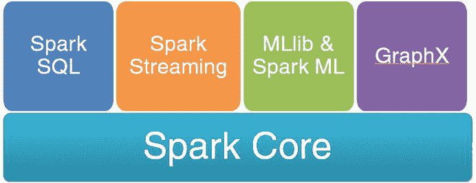

# 7. Spark SQL

易用性是 `Spark` 流行起来的原因之一。它为处理大数据提供了一种比 `Hadoop MapReduce` 更简单的编程模型。然而，精通 `Spark` 核心 API 所支持语言的人数远少于熟悉广为人知的 `SQL` 的人数。

`SQL` 是一种用于处理数据的 ANSI/ISO 标准语言。它不仅规定了存储、修改和检索数据的接口，还规定了用于分析数据的接口。`SQL` 是一种声明式语言。与 `Scala`、`Java` 和 `Python` 等通用编程语言相比，它更易于学习和使用。然而，对于数据处理来说，它却是一种强大的语言。因此，`SQL` 已成为数据分析的主力工具。

`HiveQL` 是一种类似 SQL 的语言，在 `Hadoop` 世界中广泛使用。它是 `Hadoop MapReduce` 的首选接口之一。相比于编写使用底层 `Hadoop MapReduce` API 的 `Java` 程序，人们更倾向于使用 `HiveQL` 来处理数据。

本章涵盖 `Spark SQL`，它将 `SQL` 和 `HiveQL` 的简洁性和强大功能带到了 `Spark` 中。本章详细介绍了 `Spark SQL` 及其 API，并以两个详细的示例结尾。

## 介绍 Spark SQL

`Spark SQL` 是一个运行于 `Spark` 之上的 `Spark` 库。它为处理结构化数据提供了一个比 `Spark` 核心 API 更高级的抽象。结构化数据包括存储在数据库、NoSQL 数据存储、`Parquet`、`ORC`、`Avro`、`JSON`、`CSV` 或任何其他结构化格式中的数据。

`Spark SQL` 不仅仅是向 `Spark` 提供 SQL 接口。它的设计目标更广泛，包括使 `Spark` 更易于使用、提高开发人员生产力以及使 `Spark` 应用程序运行得更快。

`Spark SQL` 可以作为库用于在 `Scala`、`Java`、`Python` 或 `R` 中开发数据处理应用程序。它支持多种查询语言，包括 `SQL`、`HiveQL` 和语言集成查询。此外，它还可以仅使用 `SQL`/`HiveQL` 进行交互式分析。在这两种情况下，它都在内部使用 `Spark` 核心 API 在 `Spark` 集群上执行查询。

### 与其他 Spark 库的集成

`Spark SQL` 与其他 `Spark` 库（如 `Spark Streaming`、`Spark ML` 和 `GraphX`）无缝集成（见图 7-1）。它不仅可以用于历史数据的交互式和批处理，还可以与 `Spark Streaming` 一起用于实时数据流处理。类似地，它可以与 `MLlib` 和 `Spark ML` 一起用于机器学习应用。例如，`Spark SQL` 可以用于机器学习应用中的特征工程。



图 7-1. 关键的 Spark 库

### 易用性

`Spark SQL` 使得 `Spark` 比 `Spark` 核心 API 更易于使用。它为处理结构化数据提供了更高级别的 API 和抽象。例如，`Spark SQL` API 提供了用于选择列、过滤行、聚合列、连接数据集以及其他常见数据处理和分析任务的函数。

使用 `Spark SQL` 的一个好处是它能提高生产力。与使用 `Spark` 核心 API 相比，它使您能够用更少的代码处理结构化数据。常见的数据处理和分析任务只需几行 `Spark SQL` 代码即可实现。

### 数据源

`Spark SQL` 支持多种数据源。它可用于处理存储在文件、NoSQL 数据存储或数据库中的数据。文件可以位于 `HDFS`、`S3` 或本地文件系统上。`Spark SQL` 支持的文件格式包括 `CSV`、`JSON`、`Parquet`、`ORC` 和 `Avro`。

`Spark SQL` 支持多种关系型数据库和 NoSQL 数据存储。`Spark SQL` 支持的关系型数据库包括 `PostgreSQL`、`MySQL`、`H2`、`Oracle`、`DB2`、`MS SQL Server` 以及其他提供 JDBC 连接的数据库。可与 `Spark SQL` 一起使用的 NoSQL 数据存储包括 `HBase`、`Cassandra`、`Elasticsearch`、`Druid` 以及其他 NoSQL 数据存储。可与 `Spark SQL` 一起使用的数据源列表还在不断增长。

### 数据处理接口

`Spark SQL` 提供了三种数据处理接口：`SQL`、`HiveQL` 和语言集成查询。它将使用这些接口编写的查询转换为 `Spark` 核心 API 调用。

如前所述，`SQL` 和 `HiveQL` 都是更高级别的声明式语言。在声明式语言中，你只需指定你想要什么。它们更易于学习和使用。因此，它们作为数据处理和分析的首选语言而广受欢迎。

然而，并非所有程序员都熟悉 `SQL` 或 `HiveQL`。`Spark SQL` 并非强迫这些程序员学习另一种语言，而是在 `Scala`、`Java`、`Python` 和 `R` 中支持语言集成查询。通过语言集成查询，`Spark SQL` 将数据处理能力添加到宿主语言中；程序员可以使用原生的宿主语言语法来处理和分析数据。

此外，语言集成查询消除了 `SQL` 与 `Spark` 支持的其他编程语言之间的阻抗失配问题。它允许程序员使用 `SQL` 查询数据，并在 `Scala`、`Java`、`Python` 或 `R` 中处理结果。

语言集成查询的另一个好处是它能减少错误。当使用 `SQL` 查询数据时，查询被指定为字符串。编译器无法检测字符串内部的错误。因此，查询字符串中的错误只有在运行时抛出异常时才会被发现。而通过使用等效的语言集成查询，可以消除其中的一些错误。

### Hive 互操作性

`Spark SQL` 与 `Hive` 兼容。它不仅支持 `HiveQL`，还能访问 `Hive` 元存储、`SerDes` 和 `UDF`。因此，如果您已有 `Hive` 部署，您可以同时使用 `Spark SQL` 和 `Hive`。您无需迁移数据或对现有的 `Hive` 元存储进行任何更改。

您也可以用 `Spark SQL` 替换 `Hive` 以获得更好的性能。由于 `Spark SQL` 支持 `HiveQL` 和 `Hive` 元存储，现有的 `Hive` 工作负载可以轻松迁移到 `Spark SQL`。`HiveQL` 查询在 `Spark SQL` 上运行比在 `Hive` 上快得多。

从 1.4.0 版本开始，`Spark SQL` 支持多个版本的 `Hive`。它可以配置为读取使用不同 `Hive` 版本创建的 `Hive` 元存储。

请注意，使用 `Spark SQL` 并不需要 `Hive`。您可以在有或没有 `Hive` 的情况下使用 `Spark SQL`。它内置了 `HiveQL` 解析器。此外，如果您没有现有的 `Hive` 元存储，`Spark SQL` 会创建一个。

## 性能

`Spark SQL` 通过结合多种技术来提高数据处理应用程序的运行速度，这些技术包括减少磁盘 I/O、内存列式缓存、查询优化和代码生成。

### 减少磁盘 I/O

磁盘 I/O 速度很慢。它可能是查询执行时间的重要因素。因此，`Spark SQL` 会尽可能减少磁盘 I/O。例如，根据数据源的不同，它在读取数据时可以跳过不需要的分区、行或列。


### 分区

读取整个数据集来分析其中一小部分数据是低效的。例如，一个查询可能包含过滤子句，能在后续处理之前剔除大量数据。因此，大量 I/O 浪费在了应用程序从未使用的数据上。通过对数据集进行分区可以避免这种情况。

分区是提升读取性能的成熟技术。分区后的数据集被分割成水平切片。数据可以根据一个或多个列进行分区。使用分区数据集时，`Spark SQL` 会跳过应用程序从未使用的分区。

### 列式存储

结构化数据集采用表格格式，按行和列组织。

一个数据集可能包含大量列。然而，分析型应用程序通常只处理数据集中的一小部分列。即便如此，如果数据以面向行的存储格式保存，所有列仍必须从磁盘读取。读取所有列既浪费资源又会拖慢应用程序。`Spark SQL` 支持列式存储格式，例如 `Parquet`，这类格式允许只读取查询中使用的列。

### 内存列式缓存

`Spark SQL` 允许应用程序以内存列式格式缓存来自任何数据源的数据。例如，你可以使用 `Spark SQL` 将 `CSV` 或 `Avro` 文件以列式格式缓存到内存中。

当应用程序使用 `Spark SQL` 在内存中缓存数据时，它仅缓存所需的列。此外，`Spark SQL` 会压缩缓存的列，以最小化内存使用和 `JVM` 垃圾回收压力。使用列式格式进行缓存，使得 `Spark SQL` 能够应用高效的压缩技术，例如游程编码、增量编码和字典编码。

### 跳过行

如果数据源维护了数据集的统计信息，`Spark SQL` 会加以利用。例如，如第 1 章所述，诸如 `Parquet` 和 `ORC` 等序列化格式会在行组或行块中存储每列的最小值和最大值。利用这些信息，`Spark SQL` 可以跳过某些行块的读取。

### 谓词下推

如果数据源支持，`Spark SQL` 还会通过使用谓词下推来减少磁盘 I/O。例如，如果你使用 `Spark SQL` 从关系型数据库中读取数据，然后对其应用某些过滤操作，`Spark SQL` 会将过滤操作下推到数据库层面。`Spark SQL` 不会读取整个表再执行过滤操作，而是要求数据库本地执行过滤操作。由于数据库通常会对数据建立索引，因此本地过滤比在应用层进行过滤要快得多。

### 查询优化

与数据库系统类似，`Spark SQL` 在执行查询前会对其进行优化。当收到一个查询执行请求时，它会生成一个优化的物理查询计划。`Spark SQL` 自带一个名为 `Catalyst` 的查询优化器，它同时支持基于规则和基于成本的优化。它甚至可以对跨函数进行优化。

`Spark SQL` 优化通过其 `DataFrame` API 提交的 SQL/HiveQL 以及语言集成查询。它们共享同一个查询优化器和执行管线。因此，从性能角度来看，无论你使用 SQL、HiveQL 还是 `DataFrame` API，它们都会经历相同的优化步骤。关于 `DataFrame` API 的详细介绍将在本章后续部分给出。

`Catalyst` 将查询执行分为四个阶段：分析、逻辑优化、物理规划以及代码生成：

-   分析阶段从一个未解析的逻辑计划开始，并输出一个逻辑计划。未解析的逻辑计划包含未解析的属性。例如，一个未解析的属性可能是一个尚未知道数据类型或来源表的列。`Spark SQL` 使用规则和目录来解析查询表达式中的未绑定属性。`Spark SQL` 目录对象追踪所有数据源中的列和表。
-   在逻辑优化阶段，`Spark SQL` 对分析阶段生成的逻辑计划应用基于规则的优化。基于规则的优化包括常量折叠、谓词下推、投影修剪、空值传播、布尔表达式简化以及其他优化。
-   下一阶段是物理规划阶段。在此阶段，`Spark SQL` 使用成本模型选择一个最优的物理计划。它接收逻辑优化阶段生成的优化后的逻辑计划作为输入。然后，利用规则生成一个或多个可由 `Spark` 执行引擎执行的物理计划。接着，计算这些计划的成本，并选择一个最优计划来执行。此外，它还会执行基于规则的物理优化，例如将投影或过滤流水线化成一个 `Spark` 操作。它还会将逻辑计划中的操作下推到支持谓词或投影下推的数据源中。即使是低效的逻辑计划，`Spark SQL` 也能生成优化的物理计划。
-   最后一个阶段是代码生成阶段，在此阶段，`Spark SQL` 将查询的某些部分直接编译成 Java 字节码。它使用一种特殊的 Scala 语言特性，将代表 SQL 表达式的树转换为 Scala AST（抽象语法树），然后在运行时将其馈送给 Scala 编译器以生成字节码。这样，就避免了在运行时使用 Scala 解析器。这加快了查询执行速度。生成的代码性能通常与手工调优的 Scala 或 Java 程序一样快，甚至更快。

代码生成的一个好处是，你可以用任何支持的语言编写 `Spark SQL` 应用程序，而无需担心性能问题。例如，Python 应用程序通常比 Java 或 Scala 应用程序运行得慢。然而，用 Python 编写的 `Spark SQL` 应用程序处理数据的速度与用 Scala 编写的应用程序一样快。

## 应用实例

凭借其易于使用的统一接口、高性能执行引擎以及对多种数据源的支持，`Spark SQL` 可用于各种数据处理和分析任务。交互式数据分析只是 `Spark SQL` 的一个应用场景。本节将讨论 `Spark SQL` 的其他一些常见应用。


### ETL（提取-转换-加载）

ETL 是从一个或多个源读取数据、对数据应用某些转换、然后写入另一个数据源的过程。从概念上讲，它包含三个步骤：提取、转换和加载。这些步骤不必是顺序执行的；应用无需提取所有数据后才进入转换步骤。一旦提取了部分数据，就可以并行运行这三个步骤。

提取步骤涉及从一个或多个业务系统读取数据。数据源可以是数据库、API 或文件。源数据库可以是关系数据库或 NoSQL 数据存储。文件可以是 CSV、JSON、XML、Parquet、ORC、Avro、Protocol Buffers 或其他格式。

转换步骤涉及使用某些规则清理和修改源数据。例如，可以丢弃包含无效数据的行，或者用某个值填充包含空值的列。转换可能包括：连接两列、将一列拆分为多列、对一列进行编码、将一列从一种编码转换为另一种编码，或应用其他转换以使数据为目标系统做好准备。

加载步骤将数据写入目标数据源。目标可以是数据库或文件。

通常，ETL 用于数据仓库。数据从多个不同的业务系统中收集，经过清理、转换并存储到数据仓库中。然而，ETL 并非数据仓库独有。例如，它可用于实现两个不同系统之间的数据共享。它可用于将数据从一种格式转换为另一种格式。同样，将数据从遗留系统迁移到新系统也是一个 ETL 过程。

`Spark SQL` 是开发 ETL 应用的一个出色工具。凭借其对多种数据源的支持以及分布式高性能计算引擎，它可以轻松开发出快速的 ETL 应用。只需几行代码就能完成数据从一个数据源到另一个数据源的迁移。

### 数据虚拟化

`Spark SQL` 提供了处理来自多种数据源的数据的统一抽象。它可用于使用 SQL、`HiveQL` 或用 Scala、Java、Python 或 R 编写的语言集成查询来处理或分析来自任何受支持数据源的数据。

因此，`Spark SQL` 可以用作集成异构数据源的数据虚拟化系统。可以用相同的接口处理来自文件、符合 JDBC 标准的数据库或 NoSQL 数据存储的数据。你甚至可以在不同数据源之间执行连接操作。例如，`Spark SQL` 允许你连接一个 Parquet 文件和一个 PostgreSQL 表。

### 分布式 JDBC/ODBC SQL 查询引擎

如前所述，`Spark SQL` 有两种使用方式。首先，它可以作为库使用。在此模式下，数据处理任务可以在 Scala、Java、Python 或 R 应用中表达为 SQL、`HiveQL` 或语言集成查询。

其次，`Spark SQL` 可以用作分布式 SQL 查询引擎。它预置了一个 Thrift/JDBC/ODBC 服务器。客户端应用可以连接到该服务器，并使用 Thrift、JDBC 或 ODBC 接口提交 SQL/`HiveQL` 查询。

`Spark SQL` 附带了一个名为 `Beeline` 的命令行客户端，可用于提交 `HiveQL` 查询；不过，只要应用支持 JDBC/ODBC，就可以向 Spark JDBC/ODBC 服务器发送查询。例如，你可以将其与图形化 SQL 客户端（如 `SQuirrel`）一起使用。同样，也可以从 BI 和数据可视化工具（如 `Tableau`、`Zoomdata` 和 `Qlik`）向其发起查询。

Thrift JDBC/ODBC 服务器提供了两大好处。首先，它允许非程序员使用 Spark。他们只需使用 SQL/`HiveQL` 就能处理和分析数据。其次，它使多个用户轻松共享一个 Spark 集群。

`Spark SQL` JDBC/ODBC 服务器看起来像一个数据库；但是，与数据库不同，它没有内置的存储引擎。它只是一个分布式 SQL 查询引擎，底层使用 Spark，并且可以与多种数据源一起使用。

### 数据仓库

传统的数据仓库本质上是一个用于存储和分析大量数据的数据库。它由三个紧密集成的组件组成：数据表、系统表和 SQL 查询引擎。顾名思义，数据表用于存储用户数据。系统表存储关于数据表中数据的元数据。数据表和系统表都使用底层操作系统的文件系统以文件形式存储。SQL 查询引擎提供用于存储和分析数据表中数据的 SQL 接口。这三个组件通常作为专有软件或设备打包在一起。

`Spark SQL` 可用于构建开源数据仓库解决方案。正如前一节所述，它预置了一个分布式 SQL 查询引擎，可以与各种开源存储系统（如 `HDFS`）配对使用。因此，它支持模块化架构，允许用户在数据仓库栈中混搭不同的组件。例如，数据可以使用列式格式（如 Parquet 或 ORC 文件格式）存储在 `HDFS` 或 `S3` 中。类似地，查询引擎可以是 `Spark SQL`、`Hive`、`Impala`、`Presto` 或 `Apache Drill`。

基于 `Spark SQL` 的数据仓库解决方案比专有数据仓库解决方案更具可扩展性、经济性和灵活性。通过向 Spark 集群添加更多节点，可以轻松增加存储和处理能力。所有软件组件都是开源的，并在商用硬件上运行，因此经济实惠。最后，由于其同时支持读时模式和写时模式，因此非常灵活。

写时模式系统要求在存储数据之前定义模式。这类系统的例子包括传统数据库。这些系统要求用户在存储数据之前创建数据模型。写时模式系统的优点在于它们提供高效的存储并允许快速的交互式查询。`Spark SQL` 通过列式格式（如 Parquet 和 ORC）支持写时模式。结合使用 `HDFS`、列式文件格式和 `Spark SQL` 可以构建高性能的数据仓库解决方案。

尽管写时模式系统能够实现快速查询，但它们也有一些缺点。首先，写时模式系统要求在存储数据之前对数据进行建模。数据建模并非易事。它需要预先规划和充分理解数据。其次，在写时模式系统中，数据摄取速度较慢。第三，一旦存储了大量数据，模式就很难更改。例如，在拥有 TB 级数据的数据库中添加新列或更改列类型可能是一项挑战。最后，很难在写时模式系统中存储非结构化、半结构化或多结构化数据。

读时模式系统解决了上述问题。它允许以原始格式存储数据。在读取数据时才对数据应用模式。因此，数据可以随时流入读时模式系统。用户可以以原生格式存储数据，而无需担心数据将如何被查询。在查询时，用户可以根据需求对已存储的数据应用不同的模式。读时模式不仅带来了敏捷性，还允许处理复杂且不断变化的数据。

读时模式系统的一个缺点是查询速度比在写时模式系统中存储的数据上执行的查询要慢。通常，读时模式方法用于探索性分析或 ETL（提取-转换-加载）工作负载。

由于 `Spark SQL` 同时支持读时模式和写时模式，它可以用于探索性分析、ETL 以及高性能分析。因此，用 `Spark SQL` 构建的数据仓库解决方案比专有数据仓库解决方案提供了更多的灵活性。


## 应用程序编程接口（API）

Spark SQL 库提供了多种语言的应用程序编程接口（API）。在编写本书时，它支持 Scala、Java、Python 和 R。它还允许你在应用程序中嵌入 SQL/HiveQL。你甚至可以在 SQL/HiveQL 和原生语言 API 之间来回切换。

本节将介绍 Spark SQL API。它将讨论 Spark SQL 库提供的关键类和方法。在描述这些类及其方法时，我会使用简单的示例来演示如何使用它们。本章后面将展示一个更详细的、使用真实数据集的分析示例。

### 核心抽象

Spark SQL API 包含三个核心抽象：`SQLContext`、`HiveContext` 和 `DataFrame`。一个 Spark SQL 应用程序使用这些抽象来处理数据。

#### SQLContext

`SQLContext` 是 Spark SQL 库的主要入口点。它是 Spark SQL 库中定义的一个类。一个 Spark SQL 应用程序必须创建 `SQLContext` 或 `HiveContext` 类的实例。

`SQLContext` 用于创建 Spark SQL 库提供的其他类的实例。它也是执行 SQL 查询所必需的。

##### 创建 SQLContext 实例

创建 `SQLContext` 类的实例需要 `SparkContext` 类的实例。应用程序可以按如下所示创建 `SQLContext` 类的实例。

```
import org.apache.spark._
import org.apache.spark.sql._
val config = new SparkConf().setAppName("My Spark SQL app")
val sc = new SparkContext(config)
val sqlContext = new SQLContext(sc)
```

我将在本章的其他示例中使用变量 `sqlContext`。与其在每个示例中都重复前面的代码片段，不如假设变量 `sqlContext` 已按前面所示，在程序开始时创建好了。

请注意，在 Spark shell 中，你不需要创建 `SQLContext` 类的实例。原因在 `HiveContext` 部分会解释。所以，如果你使用的是 Spark shell，可以跳过与创建 `SparkConf`、`SparkContext` 和 `SQLContext` 实例相关的步骤。

##### 以编程方式执行 SQL 查询

`SQLContext` 类提供了一个名为 `sql` 的方法，该方法使用 Spark 执行 SQL 查询。它接受一条 SQL 语句作为参数，并将结果作为 `DataFrame` 类的实例返回。

```
val resultSet = sqlContext.sql("SELECT count(1) FROM my_table")
```

#### HiveContext

`HiveContext` 是 Spark SQL 库的另一个入口点。它扩展了 `SQLContext` 类，用于处理存储在 Hive 中的数据。它还提供了一个 HiveQL 解析器。一个 Spark SQL 应用程序必须创建此类或 `SQLContext` 类的实例。

`HiveContext` 提供了 `SQLContext` 功能的超集。`HiveContext` 自带的解析器比 `SQLContext` 解析器更强大。它可以执行 HiveQL 和 SQL 查询。它可以读取 Hive 表中的数据。它还允许应用程序访问 Hive UDF（用户自定义函数）。

请注意，使用 `HiveContext` 并不要求必须安装 Hive。即使你没有安装 Hive，也可以使用 `HiveContext`。实际上，建议始终使用 `HiveContext`，因为它提供了比 `SQLContext` 类更完善的解析器。

如果你想处理 Hive 表或在任何数据源上执行 HiveQL 查询，则必须创建 `HiveContext` 类的实例。处理 Hive 元存储中定义的表时，这也是必需的。此外，如果你想处理现有的 Hive 表，请将你的 `hive-site.xml` 文件添加到 Spark 的 classpath 中，因为 `HiveContext` 会从 `hive-site.xml` 文件中读取 Hive 配置。

如果 `HiveContext` 在 classpath 中未找到 `hive-site.xml` 文件，它会在当前目录中创建 `metastore_db` 和 `warehouse` 目录。因此，如果你从不同的目录启动 Spark SQL 应用程序，最终可能会得到这些目录的多个副本。为了避免这种情况，如果你使用 `HiveContext`，建议将 `hive-site.xml` 文件添加到 Spark 的 `conf` 目录中。

下面是一个简洁的 `hive-site.xml` 文件示例。

```
<?xml version="1.0"?>
<?xml-stylesheet type="text/xsl" href="configuration.xsl"?>
<configuration>
  <property>
    <name>hive.metastore.warehouse.dir</name>
    <value>/path/to/hive/warehouse</value>
    <description>
      用于存储表的本地或 HDFS 目录。
    </description>
  </property>
  <property>
    <name>javax.jdo.option.ConnectionURL</name>
    <value>jdbc:derby:;databaseName=/path/to/hive/metastore_db;create=true</value>
    <description>
      JDBC 连接 URL。
    </description>
  </property>
</configuration>
```

##### 创建 HiveContext 实例

与 `SQLContext` 类似，`HiveContext` 需要一个 `SparkContext`。应用程序必须首先创建一个 `SparkContext` 类的实例，然后使用它来创建 `HiveContext` 类的实例，如下所示。

```
import org.apache.spark._
import org.apache.spark.sql._
val config = new SparkConf().setAppName("My Spark SQL app")
val sc = new SparkContext(config)
val hiveContext = new HiveContext(sc)
```

Spark shell 会自动创建 `HiveContext` 类的一个实例，并将其放入名为 `sqlContext` 的变量中。因此，在 Spark shell 中不需要创建 `SQLContext` 或 `HiveContext` 的实例。

##### 以编程方式执行 HiveQL 查询

`HiveContext` 类提供了一个名为 `sql` 的方法，用于执行 HiveQL 查询。它接受一条 HiveQL 语句作为参数，并将结果作为 `DataFrame` 返回。

```
val resultSet = hiveContext.sql("SELECT count(1) FROM my_hive_table")
```

#### DataFrame

`DataFrame` 是 Spark SQL 的主要数据抽象。它表示一个按命名列组织的分布式行集合。其灵感来源于 R 语言和 Python 中的 DataFrames。从概念上讲，它类似于关系数据库中的表。

`DataFrame` 是 Spark SQL 库中定义的一个类。它提供了多种用于处理和分析结构化数据的方法。例如，它提供了用于选择列、过滤行、聚合列、连接表、采样数据以及其他常见数据处理任务的方法。

与 RDD 不同，`DataFrame` 能感知模式（schema）。RDD 是 opaque 元素的分区集合，而 DataFrame 知道数据集中各列的名称和类型。因此，`DataFrame` 类能够提供丰富的特定领域语言（DSL）用于数据处理。

DataFrame API 比 RDD API 更易于理解和使用。但是，如果需要，DataFrame 也可以作为 RDD 进行操作。可以很容易地从 DataFrame 创建 RDD。因此，完整的 RDD 接口也可用于处理 DataFrame 所表示的数据。

DataFrame 可以注册为一个临时表，该表可以使用 SQL 或 HiveQL 进行查询。临时表仅在注册它的应用程序运行期间可用。

#### Row

`Row` 是 Spark SQL 中用于表示一行数据的抽象。从概念上讲，它等同于关系数据库中的元组或表中的一行。

Spark SQL 提供了工厂方法来创建 `Row` 对象。下面是一个示例。

```
import org.apache.spark.sql._
val row1 = Row("Barack Obama", "President", "United States")
val row2 = Row("David Cameron", "Prime Minister", "United Kingdom")
```

可以使用列的顺序号来获取 `Row` 对象中某列的值。下面是一些示例。

```
val presidentName = row1.getString(0)
val country = row1.getString(2)
```

在接下来的几节中，你将看到更多示例。


## 创建 DataFrame

可以通过两种方式创建`DataFrame`。第一种是从数据源创建。Spark SQL 提供了从多种数据源创建`DataFrame`的构建方法。部分数据源具有内置支持，其他则需依赖外部库。第二种是从`RDD`创建`DataFrame`。

### 从 RDD 创建 DataFrame

Spark SQL 提供了两种从`RDD`创建`DataFrame`的方法：`toDF`和`createDataFrame`。

#### toDF

Spark SQL 提供了一种名为`toDF`的隐式转换方法，该方法从一个由样例类（case class）表示的对象`RDD`创建`DataFrame`。使用此技术时，Spark SQL 会推断数据集的模式（schema）。

`toDF`方法并未在`RDD`类中定义，但可通过隐式转换使用。要使用`toDF`将`RDD`转换为`DataFrame`，需要导入定义在`implicits`对象中的隐式方法，如下所示。

```
val sqlContext = new org.apache.spark.sql.SQLContext(sc)
```

```
import sqlContext.implicits._
```

例如，假设有一个包含公司员工信息的 CSV 文件。文件中的每一行包含员工的姓名、年龄和性别。以下代码展示了如何使用`toDF`方法从`RDD`创建`DataFrame`。

```
import org.apache.spark._
import org.apache.spark.sql._
val config = new SparkConf().setAppName("My Spark SQL app")
val sc = new SparkContext(config)
val sqlContext = new SQLContext(sc)
import sqlContext.implicits._
case class Employee(name: String, age: Int, gender: String)
val rowsRDD = sc.textFile("path/to/employees.csv")
val employeesRDD = rowsRDD.map{row => row.split(",")}
                          .map{cols => Employee(cols(0), cols(1).trim.toInt, cols(2))}
val employeesDF = employeesRDD.toDF()
```

#### createDataFrame

`SQLContext`和`HiveContext`类都提供了一个名为`createDataFrame`的方法，该方法从`Row`对象的`RDD`创建`DataFrame`。`createDataFrame`方法接受两个参数：一个`Row`类型的`RDD`和一个模式（schema），并返回一个`DataFrame`。

数据集的模式可以通过`StructType`的实例来指定，`StructType`本身也是一个样例类。`StructType`对象包含一系列`StructField`对象。`StructField`同样被定义为一个样例类。它用于指定列的名称和数据类型，并可选地指定该列是否允许包含空值及其元数据。

`org.apache.spark.sql.types`包定义了 Spark SQL 支持的各种数据类型，以及`StructType`和`StructField`。你需要导入此包才能使用`createDataFrame`方法。

我们考虑与上一节相同的例子。假设你有一个包含公司员工信息的 CSV 文件。文件中的每一行包含员工的姓名、年龄和性别。这次你将使用`createDataFrame`方法从`RDD`创建`DataFrame`。

```
import org.apache.spark._
import org.apache.spark.sql._
import org.apache.spark.sql.types._
val config = new SparkConf().setAppName("My Spark SQL app")
val sc = new SparkContext(config)
val sqlContext = new SQLContext(sc)
val linesRDD = sc.textFile("path/to/employees.csv")
val rowsRDD = linesRDD.map{row => row.split(",")}
                      .map{cols => Row(cols(0), cols(1).trim.toInt, cols(2))}
val schema = StructType(List(
                 StructField("name", StringType, false),
                 StructField("age", IntegerType, false),
                 StructField("gender", StringType, false)
               )
             )
val employeesDF = sqlContext.createDataFrame(rowsRDD,schema)
```

`toDF`和`createDataFrame`方法的关键区别在于：前者推断数据集的模式，而后者要求你指定模式。因此，`toDF`方法看起来更容易使用；然而，`createDataFrame`方法为你提供了灵活性。

`createDataFrame`方法不要求你对数据集的模式进行硬编码。你可以在运行时创建不同的`StructType`对象。例如，你可以将模式信息传递到一个配置文件中。因此，同一个应用程序可以处理不同的数据集而无需重新编译。

### 从数据源创建 DataFrame

Spark SQL 提供了一个统一的接口，用于从多种数据源创建`DataFrame`。例如，同一个 API 可用于从 MySQL、PostgreSQL、Oracle 或 Cassandra 表创建`DataFrame`。同样地，同一个 API 也可用于从本地文件系统、HDFS 或 S3 上的 Parquet、JSON、ORC 或 CSV 文件创建`DataFrame`。

Spark SQL 对部分常用的数据源提供内置支持。这些数据源包括 Parquet、JSON、Hive 以及兼容 JDBC 的数据库。其他数据源则需要使用外部包。

Spark SQL 提供了一个名为`DataFrameReader`的类，该类定义了从数据源读取数据的接口。它允许你指定读取数据的不同选项。通过其构建方法，你可以指定格式、分区以及其他数据源特定的选项。`SQLContext`和`HiveContext`类都提供了一个名为`read`的工厂方法，该方法返回一个`DataFrameReader`类的实例。

以下示例展示了如何从不同的数据源创建`DataFrame`。

```
import org.apache.spark._
import org.apache.spark.sql._
val config = new SparkConf().setAppName("My Spark SQL app")
val sc = new SparkContext(config)
val sqlContext = new org.apache.spark.sql.hive.HiveContext (sc)

// 从 parquet 文件创建 DataFrame
val parquetDF = sqlContext.read
                          .format("org.apache.spark.sql.parquet")
                          .load("path/to/Parquet-file-or-directory")

// 从 JSON 文件创建 DataFrame
val jsonDF = sqlContext.read
                       .format("org.apache.spark.sql.json")
                       .load("path/to/JSON-file-or-directory")

// 从 Postgres 数据库中的表创建 DataFrame
val jdbcDF = sqlContext.read
               .format("org.apache.spark.sql.jdbc")
               .options(Map(
                  "url" -> "jdbc:postgresql://host:port/database?user=<USER>&password=<PASS>",
                  "dbtable" -> "schema-name.table-name"))
               .load()

// 从 Hive 表创建 DataFrame
val hiveDF = sqlContext.read
                       .table("hive-table-name")
```

与创建`RDD`的方法类似，创建`DataFrame`的方法也是惰性（lazy）的。例如，`load`方法是惰性的。当你调用`load`方法时，并不会读取数据。只有触发一个动作（action）时，才会从数据源进行读取。

除了前面展示的用于从各种数据源创建`DataFrame`的通用方法之外，Spark SQL 还提供了一些专门的方法，用于从它提供内置支持的数据源创建`DataFrame`。这些数据源包括 Parquet、ORC、JSON、Hive 以及兼容 JDBC 的数据库。


#### JSON

`DataFrameReader`类提供了一个名为`json`的方法，用于读取 JSON 数据集。它接受一个路径作为参数，并返回一个`DataFrame`。该路径可以是单个 JSON 文件的名称，也可以是包含多个 JSON 文件的目录名称。

```
val jsonDF = sqlContext.read.json("path/to/JSON-file-or-directory")
```

Spark SQL 可以从任何支持 Hadoop 的存储系统上存储的 JSON 数据集创建`DataFrame`；JSON 文件可以位于本地文件系统、HDFS 或 Amazon S3 上。

```
val jsonHdfsDF = sqlContext.read.json("hdfs://NAME_NODE/path/to/data.json")
```

```
val jsonS3DF = sqlContext.read.json("s3a://BUCKET_NAME/FOLDER_NAME/data.json")
```

输入的 JSON 文件必须每行包含一个 JSON 对象。如果 JSON 文件包含多行 JSON 对象，Spark SQL 将无法读取。

Spark SQL 会自动推断 JSON 数据集的模式（schema）。它会扫描整个数据集一次来确定模式。如果你已知模式，可以通过指定模式来避免额外的扫描，从而加快`DataFrame`的创建步骤。例如，假设你有一个包含用户对象的 JSON 文件，每个对象有三个字段：用户的`name`、`age`和`gender`。你可以按如下方式从该 JSON 文件创建一个`DataFrame`。

```
import org.apache.spark.sql.types._

val userSchema = StructType(List(
                     StructField("name", StringType, false),
                     StructField("age", IntegerType, false),
                     StructField("gender", StringType, false)
                   ))
```

```
val userDF = sqlContext.read
                       .schema(userSchema)
                       .json("path/to/user.json")
```

#### Parquet

`DataFrameReader`类提供了一个名为`parquet`的方法，用于读取 Parquet 文件。它接受一个或多个 Parquet 文件的路径作为参数，并返回一个`DataFrame`。

```
val parquetDF = sqlContext.read.parquet("path/to/parquet-file-or-directory")
```

Spark SQL 可以从任何支持 Hadoop 的存储系统（包括本地文件系统、HDFS 和 Amazon S3）上存储的 Parquet 文件创建`DataFrame`。

```
val parquetHdfsDF = sqlContext.read.parquet("hdfs://NAME_NODE/path/to/data.parquet")
```

```
val parquetS3DF = sqlContext.read.parquet("s3a://BUCKET_NAME/FOLDER_NAME/data.parquet")
```

#### ORC

`DataFrameReader`类提供了一个名为`orc`的方法，用于读取以 ORC 文件格式存储的数据集。它接受一个路径作为参数，并返回一个`DataFrame`。

```
val orcDF = hiveContext.read.orc("path/to/orc-file-or-directory")
```

与 JSON 和 Parquet 数据集类似，可以从任何支持 Hadoop 的存储系统（包括本地文件系统、HDFS 和 Amazon S3）读取 ORC 格式的数据集。

```
val orcHdfsDF = sqlContext.read.orc("hdfs://NAME_NODE/path/to/data.orc")
```

```
val orcS3DF = sqlContext.read.orc("s3a://BUCKET_NAME/FOLDER_NAME/data.orc")
```

#### Hive

你可以通过两种方式从 Hive 表创建`DataFrame`。首先，你可以使用`DataFrameReader`类中定义的`table`方法。它接受 Hive 元存储中一个表的名称，并返回一个`DataFrame`。

```
val hiveDF = hiveContext.read.table("hive-table-name")
```

通常，在 Spark SQL API 中，“表”指的是其元数据持久化存储在 Hive 元存储中的数据集。

其次，你可以使用`HiveContext`类中的`sql`方法从 Hive 表创建`DataFrame`。

```
val hiveDF = hiveContext.sql("SELECT col_a, col_b, col_c from hive-table")
```

需要使用`HiveContext`类的实例来处理 Hive 表。此外，如果你已有现有的 Hive 部署，请将 Hive 环境中的`hive-site.xml`文件复制到 Spark 的`conf`目录下。`hive-site.xml`文件存储了 Hive 的配置信息。例如，它有一个名为`hive.metastore.warehouse.dir`的配置属性，指定了 Hive 为托管表存储数据的目录。另一个重要的配置属性是`javax.jdo.option.ConnectionURL`，指定了如何连接到 Hive 元存储服务器。

### JDBC 兼容数据库

`DataFrameReader`类中定义的`jdbc`方法可以从任何兼容 JDBC 的数据库（包括 MySQL、PostgreSQL、H2、Oracle、SQL Server、SAP Hana 和 DB2）创建`DataFrame`。`DataFrameReader`类提供了多个重载的`jdbc`方法变体。最简单的一个接受三个参数：数据库的 JDBC URL、表名和连接属性。连接属性指定了连接参数，例如用户名和密码。

示例如下。

```
val jdbcUrl = "jdbc:mysql://host:port/database"
```

```
val tableName = "table-name"
```

```
val connectionProperties = new java.util.Properties
connectionProperties.setProperty("user", "database-user-name")
connectionProperties.setProperty("password", "database-user-password")
```

```
val jdbcDF = hiveContext.read
                        .jdbc(jdbcUrl, tableName, connectionProperties)
```

`jdbc`方法的一个变体允许你指定一个谓词（predicate）来读取表中的数据子集。谓词参数是一个字符串数组，其中每个字符串指定了`WHERE`子句中的一个条件。

假设你有一个用户资料的数据库表，每一行存储用户的`name`、`age`、`gender`、`city`、`state`和`country`。以下示例展示了如何创建一个仅代表德国用户的`DataFrame`。

```
val predicates = Array("country='Germany'")
```

```
val usersGermanyDF = hiveContext.read
                        .jdbc(jdbcUrl, tableName, predicates, connectionProperties)
```

## 使用 SQL/HiveQL 以编程方式处理数据

`HiveContext`类中的`sql`方法允许你使用 HiveQL 语句处理数据集，而`SQLContext`类中的`sql`方法允许你使用 SQL 语句处理数据集。SQL/HiveQL 语句中引用的表必须在 Hive 元存储中有条目。如果你没有现有的 Hive 部署，可以使用`DataFrame`类提供的`registerTempTable`方法创建一个临时表。我将在下一节更详细地讨论这个方法。示例如下。

```
import org.apache.spark.sql.types._

val userSchema = StructType(List(
                     StructField("name", StringType, false),
                     StructField("age", IntegerType, false),
                     StructField("gender", StringType, false)
                   ))
```

```
val userDF = sqlContext.read
                       .schema(userSchema)
                       .json("path/to/user.json")
```

```
userDF.registerTempTable("user")
```

```
val cntDF = hiveContext.sql("SELECT count(1) from user")
```

```
val cntByGenderDF = hiveContext.sql(
                      "SELECT gender, count(1) as cnt FROM user GROUP BY gender ORDER BY cnt")
```

`sql`方法返回的结果是一个`DataFrame`，它提供了用于在控制台显示返回结果或将其保存到数据源的方法。下一节将详细介绍`DataFrame` API。


### 使用 DataFrame API 处理数据

上一节讨论了在 `SQLContext` 和 `HiveContext` 类中使用 `sql` 方法，通过嵌入式 SQL 或 HiveQL 语句处理数据集的方法。DataFrame API 提供了另一种处理数据集的方式。

DataFrame API 包含五种类型的操作，本节将对此进行讨论。由于示例中会使用 DataFrame，我们先创建几个。

我将使用 Spark shell，以便你能够跟随操作。第一步，在终端中启动 Spark shell。

```
$ cd SPARK_HOME
$ ./bin/spark-shell --master local[*]
```

进入 Spark shell 后，创建几个 DataFrame。

```
case class Customer(cId: Long, name: String, age: Int, gender: String)
val customers = List(Customer(1, "James", 21, "M"),
                     Customer(2, "Liz", 25, "F"),
                     Customer(3, "John", 31, "M"),
                     Customer(4, "Jennifer", 45, "F"),
                     Customer(5, "Robert", 41, "M"),
                     Customer(6, "Sandra", 45, "F"))
val customerDF = sc.parallelize(customers).toDF()

case class Product(pId: Long, name: String, price: Double, cost: Double)
val products = List(Product(1, "iPhone", 600, 400),
                    Product(2, "Galaxy", 500, 400),
                    Product(3, "iPad", 400, 300),
                    Product(4, "Kindle", 200, 100),
                    Product(5, "MacBook", 1200, 900),
                    Product(6, "Dell", 500, 400))
val productDF = sc.parallelize(products).toDF()

case class Home(city: String, size: Int, lotSize: Int,
                bedrooms: Int, bathrooms: Int, price: Int)
val homes = List(Home("San Francisco", 1500, 4000, 3, 2, 1500000),
                 Home("Palo Alto", 1800, 3000, 4, 2, 1800000),
                 Home("Mountain View", 2000, 4000, 4, 2, 1500000),
                 Home("Sunnyvale", 2400, 5000, 4, 3, 1600000),
                 Home("San Jose", 3000, 6000, 4, 3, 1400000),
                 Home("Fremont", 3000, 7000, 4, 3, 1500000),
                 Home("Pleasanton", 3300, 8000, 4, 3, 1400000),
                 Home("Berkeley", 1400, 3000, 3, 3, 1100000),
                 Home("Oakland", 2200, 6000, 4, 3, 1100000),
                 Home("Emeryville", 2500, 5000, 4, 3, 1200000))
val homeDF = sc.parallelize(homes).toDF
```

并非每个示例都要重新创建 DataFrame，这里就用已经创建好的其中一个。此外，为简洁起见，仅对部分示例展示 Spark shell 打印的结果。

如前所述，Spark shell 会自动创建一个 `SparkContext` 类的实例，并将其作为 `sc` 提供。它还会创建一个 `HiveContext` 类的实例，并将其存储在一个名为 `sqlContext` 的变量中。因此，你无需在 Spark shell 中自行创建 `SparkContext`、`SQLContext` 或 `HiveContext` 的实例。

### 基本操作

本节描述 `DataFrame` 类提供的常用基本操作。

#### cache

`cache` 方法使用列式格式将源 `DataFrame` 存储在内存中。它只扫描必要的列，并以压缩的内存列式格式进行存储。Spark SQL 会根据数据统计信息，自动为每一列选择压缩编解码器。

```
customerDF.cache()
```

可以使用 `SQLContext` 或 `HiveContext` 类中的 `setConf` 方法调整缓存功能。两个用于缓存的配置参数是 `spark.sql.inMemoryColumnarStorage.compressed` 和 `spark.sql.inMemoryColumnarStorage.batchSize`。默认情况下，压缩是开启的，列式缓存的批处理大小为 10,000。

```
sqlContext.setConf("spark.sql.inMemoryColumnarStorage.compressed", "true")
sqlContext.setConf("spark.sql.inMemoryColumnarStorage.batchSize", "10000")
```

#### columns

`columns` 方法以字符串数组的形式返回源 `DataFrame` 中所有列的名称。

```
val cols = customerDF.columns
cols: Array[String] = Array(cId, name, age, gender)
```

#### dtypes

`dtypes` 方法以元组数组的形式返回源 `DataFrame` 中所有列的数据类型。元组的第一个元素是列的名称，第二个元素是该列的数据类型。

```
val columnsWithTypes = customerDF.dtypes
columnsWithTypes: Array[(String, String)] = Array((cId,LongType), (name,StringType), (age,IntegerType), (gender,StringType))
```

#### explain

`explain` 方法在控制台上打印物理执行计划。它对于调试非常有用。

```
customerDF.explain()
== Physical Plan ==
InMemoryColumnarTableScan [cId#0L,name#1,age#2,gender#3], (InMemoryRelation [cId#0L,name#1,age#2,gender#3], true, 10000, StorageLevel(true, true, false, true, 1), (Scan PhysicalRDD[cId#0L,name#1,age#2,gender#3]), None)
```

`explain` 方法的一个变体接受一个布尔值参数，如果参数为 true，则同时打印逻辑执行计划和物理执行计划。

#### persist

`persist` 方法将源 `DataFrame` 缓存在内存中。

```
customerDF.persist
```

与 `RDD` 类中的 `persist` 方法类似，`DataFrame` 类中的 `persist` 方法变体允许你指定持久化 DataFrame 的存储级别。

#### printSchema

`printSchema` 方法以树形格式在控制台上打印源 `DataFrame` 的模式。

```
customerDF.printSchema()
root
 |-- cId: long (nullable = false)
 |-- name: string (nullable = true)
 |-- age: integer (nullable = false)
 |-- gender: string (nullable = true)
```

#### registerTempTable

`registerTempTable` 方法在 Hive 元存储中创建一个临时表。它接受一个表名作为参数。

临时表可以使用 `SQLContext` 或 `HiveContext` 中的 `sql` 方法进行查询。该临时表仅在创建它的应用程序的生命周期内可用。

```
customerDF.registerTempTable("customer")
val countDF = sqlContext.sql("SELECT count(1) AS cnt FROM customer")
countDF: org.apache.spark.sql.DataFrame = [cnt: bigint]
```

请注意，`sql` 方法返回一个 DataFrame。接下来我们讨论一下如何查看或检索 DataFrame 的内容。

#### toDF

`toDF` 方法允许你重命名源 `DataFrame` 中的列。它将列的新名称作为参数，并返回一个新的 DataFrame。

```
val resultDF = sqlContext.sql("SELECT count(1) from customer")
resultDF: org.apache.spark.sql.DataFrame = [_c0: bigint]
val countDF = resultDF.toDF("cnt")
countDF: org.apache.spark.sql.DataFrame = [cnt: bigint]
```

### 语言集成查询方法

本节描述 `DataFrame` 类中常用的语言集成查询方法。

#### agg

`agg` 方法对源 `DataFrame` 中的一个或多个列执行指定的聚合操作，并将结果作为一个新的 DataFrame 返回。

```
val aggregates = productDF.agg(max("price"), min("price"), count("name"))
aggregates: org.apache.spark.sql.DataFrame = [max(price): double, min(price): double, count(name): bigint]
aggregates.show
+----------+----------+-----------+
|max(price)|min(price)|count(name)|
+----------+----------+-----------+
|    1200.0|     200.0|          6|
+----------+----------+-----------+
```

我们稍后讨论一下 `show` 方法。本质上，它用于在控制台上显示 DataFrame 的内容。


#### `apply`

`apply`方法接受一个列名作为参数，并返回源`DataFrame`中的指定列，该列是`Column`类的一个实例。`Column`类提供了用于操作`DataFrame`中列的操作符。

```
val priceColumn = productDF.apply("price")
```

```
priceColumn: org.apache.spark.sql.Column = price
```

```
val discountedPriceColumn = priceColumn * 0.5
```

```
discountedPriceColumn: org.apache.spark.sql.Column = (price * 0.5)
```

Scala 提供了语法糖，允许你使用`productDF("price")`来代替`productDF.apply("price")`。它会自动将`productDF("price")`转换为`productDF.apply("price")`。因此，前面的代码可以重写如下所示。

```
val priceColumn = productDF("price")
```

```
val discountedPriceColumn = priceColumn * 0.5
```

`Column`类的实例通常用作某些`DataFrame`方法或 Spark SQL 库中定义的函数的输入。让我们回顾一下之前讨论过的一个例子。

```
val aggregates = productDF.agg(max("price"), min("price"), count("name"))
```

它是下面这条语句的简洁版本。

```
val aggregates = productDF.agg(max(productDF("price")), min(productDF("price")),
                               count(productDF("name")))
```

为了方便起见，表达式`productDF("price")`也可以写成`$"price"`。因此，以下两个表达式是等价的。

```
val aggregates = productDF.agg(max($"price"), min($"price"), count($"name"))
```

```
val aggregates = productDF.agg(max(productDF("price")), min(productDF("price")),
                               count(productDF("name")))
```

如果某个方法或函数期望一个`Column`类的实例作为参数，你可以使用`$"..."`表示法来选择`DataFrame`中的列。

总之，以下三条语句是等价的。

```
val aggregates = productDF.agg(max(productDF("price")), min(productDF("price")),
                               count(productDF("name")))
```

```
val aggregates = productDF.agg(max("price"), min("price"), count("name"))
```

```
val aggregates = productDF.agg(max($"price"), min($"price"), count($"name"))
```

#### `cube`

`cube`方法接受一个或多个列名作为参数，并返回一个用于多维分析的立方体。它对于生成交叉表报告非常有用。

假设你有一个数据集，它沿着三个维度跟踪销售情况：时间、产品和国家。`cube`方法允许你生成感兴趣的所有可能维度组合的聚合。

```
case class SalesSummary(date: String, product: String, country: String, revenue: Double)

val sales = List(SalesSummary("01/01/2015", "iPhone", "USA", 40000),
                 SalesSummary("01/02/2015", "iPhone", "USA", 30000),
                 SalesSummary("01/01/2015", "iPhone", "China", 10000),
                 SalesSummary("01/02/2015", "iPhone", "China", 5000),
                 SalesSummary("01/01/2015", "S6", "USA", 20000),
                 SalesSummary("01/02/2015", "S6", "USA", 10000),
                 SalesSummary("01/01/2015", "S6", "China", 9000),
                 SalesSummary("01/02/2015", "S6", "China", 6000))

val salesDF = sc.parallelize(sales).toDF()

val salesCubeDF = salesDF.cube($"date", $"product", $"country").sum("revenue")
```

```
salesCubeDF: org.apache.spark.sql.DataFrame = [date: string, product: string, country: string, sum(revenue): double]
```

```
salesCubeDF.withColumnRenamed("sum(revenue)", "total").show(30)
+----------+-------+-------+--------+
|      date|product|country|   total|
+----------+-------+-------+--------+
|01/01/2015|   null|    USA| 60000.0|
|01/02/2015|     S6|   null| 16000.0|
|01/01/2015| iPhone|   null| 50000.0|
|01/01/2015|     S6|  China|  9000.0|
|      null|   null|  China| 30000.0|
|01/02/2015|     S6|    USA| 10000.0|
|01/02/2015|   null|   null| 51000.0|
|01/02/2015| iPhone|  China|  5000.0|
|01/01/2015| iPhone|    USA| 40000.0|
|01/01/2015|   null|  China| 19000.0|
|01/02/2015|   null|    USA| 40000.0|
|      null| iPhone|  China| 15000.0|
|01/02/2015|     S6|  China|  6000.0|
|01/01/2015| iPhone|  China| 10000.0|
|01/02/2015|   null|  China| 11000.0|
|      null| iPhone|   null| 85000.0|
|      null| iPhone|    USA| 70000.0|
|      null|     S6|   null| 45000.0|
|      null|     S6|    USA| 30000.0|
|01/01/2015|     S6|   null| 29000.0|
|      null|   null|   null|130000.0|
|01/02/2015| iPhone|   null| 35000.0|
|01/01/2015|     S6|    USA| 20000.0|
|      null|   null|    USA|100000.0|
|01/01/2015|   null|   null| 79000.0|
|      null|     S6|  China| 15000.0|
|01/02/2015| iPhone|    USA| 30000.0|
+----------+-------+-------+--------+
```

如果你想查找所有产品在 USA 的总销售额，可以使用以下表达式。

```
salesCubeDF.filter("product IS null AND date IS null AND country='USA'").show
+----+-------+-------+------------+
|date|product|country|sum(revenue)|
+----+-------+-------+------------+
|null|   null|    USA|    100000.0|
+----+-------+-------+------------+
```

如果你想了解产品在美国的销售小计，可以使用以下表达式。

```
salesCubeDF.filter("date IS null AND product IS NOT null AND country='USA'").show
+----+-------+-------+------------+
|date|product|country|sum(revenue)|
+----+-------+-------+------------+
|null| iPhone|    USA|     70000.0|
|null|     S6|    USA|     30000.0|
+----+-------+-------+------------+
```

#### `distinct`

`distinct`方法返回一个新的`DataFrame`，其中仅包含源`DataFrame`中的唯一行。

```
val dfWithoutDuplicates = customerDF.distinct
```

#### `explode`

`explode`方法使用用户提供的函数从一列生成零行或多行。它接受三个参数。第一个参数是输入列，第二个参数是输出列，第三个参数是用户提供的函数，该函数为输入列中的每个值生成输出列的一个或多个值。

例如，考虑一个包含电子邮件正文文本列的数据集。假设你想将电子邮件内容拆分成单个单词，并且希望电子邮件中的每个单词占一行。

```
case class Email(sender: String, recepient: String, subject: String, body: String)

val emails = List(Email("James", "Mary", "back", "just got back from vacation"),
                  Email("John", "Jessica", "money", "make million dollars"),
                  Email("Tim", "Kevin", "report", "send me sales report ASAP"))

val emailDF = sc.parallelize(emails).toDF()

val wordDF = emailDF.explode("body", "word") { body: String => body.split(" ")}
```

```
wordDF.show
+------+---------+-------+--------------------+--------+
|sender|recepient|subject|                body|    word|
+------+---------+-------+--------------------+--------+
| James|     Mary|   back|just got back fro...|    just|
| James|     Mary|   back|just got back fro...|     got|
| James|     Mary|   back|just got back fro...|    back|
| James|     Mary|   back|just got back fro...|    from|
| James|     Mary|   back|just got back fro...|vacation|
|  John|  Jessica|  money|make million dollars|    make|
|  John|  Jessica|  money|make million dollars| million|
|  John|  Jessica|  money|make million dollars| dollars|
|   Tim|    Kevin| report|send me sales rep...|    send|
|   Tim|    Kevin| report|send me sales rep...|      me|
|   Tim|    Kevin| report|send me sales rep...|   sales|
|   Tim|    Kevin| report|send me sales rep...|  report|
|   Tim|    Kevin| report|send me sales rep...|    ASAP|
+------+---------+-------+--------------------+--------+
```


#### `filter`

`filter`方法使用作为参数提供的 SQL 表达式过滤源`DataFrame`中的行，并返回一个仅包含过滤后行的新`DataFrame`。SQL 表达式可以作为字符串参数传递。

```
val filteredDF = customerDF.filter("age > 25")
filteredDF: org.apache.spark.sql.DataFrame = [cId: bigint, name: string, age: int, gender: string]
filteredDF.show
+---+--------+---+------+
|cId|    name|age|gender|
+---+--------+---+------+
|  3|    John| 31|     M|
|  4|Jennifer| 45|     F|
|  5|  Robert| 41|     M|
|  6|  Sandra| 45|     F|
+---+--------+---+------+
```

`filter`方法的一种变体允许使用`Column`类型指定过滤条件。

```
val filteredDF = customerDF.filter($"age" > 25)
```

如前所述，上述代码是以下代码的简写形式。

```
val filteredDF = customerDF.filter(customerDF("age") > 25)
```

#### `groupBy`

`groupBy`方法使用作为参数提供的列对源`DataFrame`中的行进行分组，并可以对返回的分组数据执行聚合操作。

```
val countByGender = customerDF.groupBy("gender").count
countByGender: org.apache.spark.sql.DataFrame = [gender: string, count: bigint]
countByGender.show
+------+-----+
|gender|count|
+------+-----+
|     F|    3|
|     M|    3|
+------+-----+

val revenueByProductDF = salesDF.groupBy("product").sum("revenue")
revenueByProductDF: org.apache.spark.sql.DataFrame = [product: string, sum(revenue): double]
revenueByProductDF.show
+-------+------------+
|product|sum(revenue)|
+-------+------------+
| iPhone|     85000.0|
|     S6|     45000.0|
+-------+------------+
```

#### `intersect`

`intersect`方法接受一个`DataFrame`作为参数，并返回一个新的`DataFrame`，该`DataFrame`仅包含输入`DataFrame`和源`DataFrame`中都存在的行。

```
val customers2 = List(Customer(11, "Jackson", 21, "M"),
                     Customer(12, "Emma", 25, "F"),
                     Customer(13, "Olivia", 31, "F"),
                     Customer(4, "Jennifer", 45, "F"),
                     Customer(5, "Robert", 41, "M"),
                     Customer(6, "Sandra", 45, "F"))
val customer2DF = sc.parallelize(customers2).toDF()
val commonCustomersDF = customerDF.intersect(customer2DF)
commonCustomersDF.show
+---+--------+---+------+
|cId|    name|age|gender|
+---+--------+---+------+
|  6|  Sandra| 45|     F|
|  4|Jennifer| 45|     F|
|  5|  Robert| 41|     M|
+---+--------+---+------+
```

#### `join`

`join`方法对源`DataFrame`与另一个`DataFrame`执行 SQL 连接操作。它接受三个参数：一个`DataFrame`、一个连接表达式和一个连接类型。

```
case class Transaction(tId: Long, custId: Long, prodId: Long, date: String, city: String)
val transactions = List(Transaction(1, 5, 3, "01/01/2015", "San Francisco"),
                        Transaction(2, 6, 1, "01/02/2015", "San Jose"),
                        Transaction(3, 1, 6, "01/01/2015", "Boston"),
                        Transaction(4, 200, 400, "01/02/2015", "Palo Alto"),
                        Transaction(6, 100, 100, "01/02/2015", "Mountain View"))
val transactionDF = sc.parallelize(transactions).toDF()
val innerDF = transactionDF.join(customerDF, $"custId" === $"cId", "inner")
innerDF.show
+---+------+------+----------+-------------+---+------+---+------+
|tId|custId|prodId|      date|          city|cId|  name|age|gender|
+---+------+------+----------+-------------+---+------+---+------+
|  1|     5|     3|01/01/2015|San Francisco|  5|Robert| 41|     M|
|  2|     6|     1|01/02/2015|     San Jose|  6|Sandra| 45|     F|
|  3|     1|     6|01/01/2015|       Boston|  1| James| 21|     M|
+---+------+------+----------+-------------+---+------+---+------+

val outerDF = transactionDF.join(customerDF, $"custId" === $"cId", "outer")
outerDF.show
+----+------+------+----------+-------------+----+--------+----+------+
| tId|custId|prodId|      date|          city| cId|    name| age|gender|
+----+------+------+----------+-------------+----+--------+----+------+
|   6|   100|   100|01/02/2015|Mountain View|null|    null|null|  null|
|   4|   200|   400|01/02/2015|    Palo Alto|null|    null|null|  null|
|   3|     1|     6|01/01/2015|       Boston|   1|   James|  21|     M|
|null|  null|  null|      null|         null|   2|     Liz|  25|     F|
|null|  null|  null|      null|         null|   3|    John|  31|     M|
|null|  null|  null|      null|         null|   4|Jennifer|  45|     F|
|   1|     5|     3|01/01/2015|San Francisco|   5|  Robert|  41|     M|
|   2|     6|     1|01/02/2015|     San Jose|   6|  Sandra|  45|     F|
+----+------+------+----------+-------------+----+--------+----+------+

val leftOuterDF = transactionDF.join(customerDF, $"custId" === $"cId", "left_outer")
leftOuterDF.show
+---+------+------+----------+-------------+----+------+----+------+
|tId|custId|prodId|      date|          city| cId|  name| age|gender|
+---+------+------+----------+-------------+----+------+----+------+
|  1|     5|     3|01/01/2015|San Francisco|   5|Robert|  41|     M|
|  2|     6|     1|01/02/2015|     San Jose|   6|Sandra|  45|     F|
|  3|     1|     6|01/01/2015|       Boston|   1| James|  21|     M|
|  4|   200|   400|01/02/2015|    Palo Alto|null|  null|null|  null|
|  6|   100|   100|01/02/2015|Mountain View|null|  null|null|  null|
+---+------+------+----------+-------------+----+------+----+------+

val rightOuterDF = transactionDF.join(customerDF, $"custId" === $"cId", "right_outer")
rightOuterDF.show
+----+------+------+----------+-------------+---+--------+---+------+
| tId|custId|prodId|      date|          city|cId|    name|age|gender|
+----+------+------+----------+-------------+---+--------+---+------+
|   3|     1|     6|01/01/2015|       Boston|  1|   James| 21|     M|
|null|  null|  null|      null|         null|  2|     Liz| 25|     F|
|null|  null|  null|      null|         null|  3|    John| 31|     M|
|null|  null|  null|      null|         null|  4|Jennifer| 45|     F|
|   1|     5|     3|01/01/2015|San Francisco|  5|  Robert| 41|     M|
|   2|     6|     1|01/02/2015|     San Jose|  6|  Sandra| 45|     F|
+----+------+------+----------+-------------+---+--------+---+------+
```

#### `limit`

`limit`方法返回一个包含源`DataFrame`中指定行数的新`DataFrame`。

```
val fiveCustomerDF = customerDF.limit(5)
fiveCustomer.show
+---+--------+---+------+
|cId|    name|age|gender|
+---+--------+---+------+
|  1|   James| 21|     M|
|  2|     Liz| 25|     F|
|  3|    John| 31|     M|
|  4|Jennifer| 45|     F|
|  5|  Robert| 41|     M|
+---+--------+---+------+
```

#### `orderBy`

`orderBy`方法返回一个按指定列排序的`DataFrame`，它接受一个或多个列名作为参数。

```
val sortedDF = customerDF.orderBy("name")
sortedDF.show
+---+--------+---+------+
|cId|    name|age|gender|
+---+--------+---+------+
|  1|   James| 21|     M|
|  4|Jennifer| 45|     F|
|  3|    John| 31|     M|
|  2|     Liz| 25|     F|
|  5|  Robert| 41|     M|
|  6|  Sandra| 45|     F|
+---+--------+---+------+
```

默认情况下，`orderBy`方法按升序排序。你可以使用`Column`表达式显式指定排序顺序，如下所示。

```
val sortedByAgeNameDF = customerDF.sort($"age".desc, $"name".asc)
sortedByAgeNameDF.show
+---+--------+---+------+
|cId|    name|age|gender|
+---+--------+---+------+
|  4|Jennifer| 45|     F|
|  6|  Sandra| 45|     F|
|  5|  Robert| 41|     M|
|  3|    John| 31|     M|
|  2|     Liz| 25|     F|
|  1|   James| 21|     M|
+---+--------+---+------+
```


#### `randomSplit`

`randomSplit`方法将源`DataFrame`分割成多个`DataFrame`。它接受一个权重数组作为参数，并返回一个`DataFrame`数组。这对于机器学习非常有用，当需要将原始数据集拆分为训练集、验证集和测试集时。

```
val dfArray = homeDF.randomSplit(Array(0.6, 0.2, 0.2))
```

```
dfArray(0).count
```

```
dfArray(1).count
```

```
dfArray(2).count
```

#### `rollup`

`rollup`方法接受一个或多个列名作为参数，并返回一个多维的汇总结果。它对于沿层级维度（如地理位置或时间）进行子聚合非常有用。

假设你有一个按城市、州和国家跟踪年度销售额的数据集。`rollup`方法可用于计算总计以及按城市、州和国家的分类汇总。

```
case class SalesByCity(year: Int, city: String, state: String,
                       country: String, revenue: Double)

val salesByCity = List(SalesByCity(2014, "Boston", "MA", "USA", 2000),
                       SalesByCity(2015, "Boston", "MA", "USA", 3000),
                       SalesByCity(2014, "Cambridge", "MA", "USA", 2000),
                       SalesByCity(2015, "Cambridge", "MA", "USA", 3000),
                       SalesByCity(2014, "Palo Alto", "CA", "USA", 4000),
                       SalesByCity(2015, "Palo Alto", "CA", "USA", 6000),
                       SalesByCity(2014, "Pune", "MH", "India", 1000),
                       SalesByCity(2015, "Pune", "MH", "India", 1000),
                       SalesByCity(2015, "Mumbai", "MH", "India", 1000),
                       SalesByCity(2014, "Mumbai", "MH", "India", 2000))

val salesByCityDF = sc.parallelize(salesByCity).toDF()

val rollup = salesByCityDF.rollup($"country", $"state", $"city").sum("revenue")

rollup.show
```

```
+-------+-----+---------+------------+
|country|state|     city|sum(revenue)|
+-------+-----+---------+------------+
|  India|   MH|   Mumbai|      3000.0|
|    USA|   MA|Cambridge|      5000.0|
|  India|   MH|     Pune|      2000.0|
|    USA|   MA|   Boston|      5000.0|
|    USA|   MA|     null|     10000.0|
|    USA| null|     null|     20000.0|
|    USA|   CA|     null|     10000.0|
|   null| null|     null|     25000.0|
|  India|   MH|     null|      5000.0|
|    USA|   CA|Palo Alto|     10000.0|
|  India| null|     null|      5000.0|
+-------+-----+---------+------------+
```

#### `sample`

`sample`方法返回一个包含源`DataFrame`中指定比例行的`DataFrame`。它接受两个参数：第一个参数是一个布尔值，指示是否进行有放回抽样；第二个参数指定应返回的行的比例。

```
val sampleDF = homeDF.sample(true, 0.10)
```

#### `select`

`select`方法返回一个仅包含源`DataFrame`中指定列的`DataFrame`。

```
val namesAgeDF = customerDF.select("name", "age")

namesAgeDF.show
```

```
+--------+---+
|    name|age|
+--------+---+
|   James| 21|
|     Liz| 25|
|    John| 31|
|Jennifer| 45|
|  Robert| 41|
|  Sandra| 45|
+--------+---+
```

`select`方法的一个变体允许将一个或多个`Column`表达式作为参数。

```
val newAgeDF = customerDF.select($"name", $"age" + 10)

newAgeDF.show
```

```
+--------+----------+
|    name|(age + 10)|
+--------+----------+
|   James|        31|
|     Liz|        35|
|    John|        41|
|Jennifer|        55|
|  Robert|        51|
|  Sandra|        55|
+--------+----------+
```

#### `selectExpr`

`selectExpr`方法接受一个或多个 SQL 表达式作为参数，并返回通过执行指定的 SQL 表达式生成的`DataFrame`。

```
val newCustomerDF = customerDF.selectExpr("name", "age + 10  AS new_age",
                                          "IF(gender = 'M', true, false) AS male")

newCustomerDF.show
```

```
+--------+-------+-----+
|    name|new_age| male|
+--------+-------+-----+
|   James|     31| true|
|     Liz|     35|false|
|    John|     41| true|
|Jennifer|     55|false|
|  Robert|     51| true|
|  Sandra|     55|false|
+--------+-------+-----+
```

#### `withColumn`

`withColumn`方法向源`DataFrame`添加新列或替换现有列，并返回一个新的`DataFrame`。它接受两个参数：第一个参数是新列的名称，第二个参数是用于生成新列值的表达式。

```
val newProductDF = productDF.withColumn("profit", $"price" - $"cost")

newProductDF.show
```

```
+---+-------+------+-----+------+
|pId|   name| price| cost|profit|
+---+-------+------+-----+------+
|  1| iPhone| 600.0|400.0| 200.0|
|  2| Galaxy| 500.0|400.0| 100.0|
|  3|   iPad| 400.0|300.0| 100.0|
|  4| Kindle| 200.0|100.0| 100.0|
|  5|MacBook|1200.0|900.0| 300.0|
|  6|   Dell| 500.0|400.0| 100.0|
+---+-------+------+-----+------+
```

## RDD 操作

`DataFrame`类支持常用的 RDD 操作，例如`map`、`flatMap`、`foreach`、`foreachPartition`、`mapPartition`、`coalesce`和`repartition`。这些方法的工作方式与它们在`RDD`类中的同名操作类似。

此外，如果你需要访问`DataFrame`类中没有的其他 RDD 方法，可以从`DataFrame`中获取一个`RDD`。本节讨论从`DataFrame`生成`RDD`的常用技术。

### `rdd`

`rdd`在`DataFrame`类中被定义为一个惰性值（`lazy val`）。它将源`DataFrame`表示为`Row`实例的`RDD`。

如前所述，`Row`表示源`DataFrame`中的一个关系元组。它允许按字段序数进行泛型访问和原生基本类型访问。

示例如下。

```
val rdd = customerDF.rdd
rdd: org.apache.spark.rdd.RDD[org.apache.spark.sql.Row] = MapPartitionsRDD[405] at rdd at <console>:27

val firstRow = rdd.first
firstRow: org.apache.spark.sql.Row = [1,James,21,M]

val name = firstRow.getString(1)
name: String = James

val age = firstRow.getInt(2)
age: Int = 21
```

`Row`中的字段也可以使用 Scala 模式匹配进行提取。

```
import org.apache.spark.sql.Row

val rdd = customerDF.rdd
rdd: org.apache.spark.rdd.RDD[org.apache.spark.sql.Row] = MapPartitionsRDD[113] at rdd at <console>:28

val nameAndAge = rdd.map {
                   case Row(cId: Long, name: String, age: Int, gender: String) => (name, age)
                 }
nameAndAge: org.apache.spark.rdd.RDD[(String, Int)] = MapPartitionsRDD[114] at map at <console>:30

nameAndAge.collect
res79: Array[(String, Int)] = Array((James,21), (Liz,25), (John,31), (Jennifer,45), (Robert,41), (Sandra,45))
```

### `toJSON`

`toJSON`方法从源`DataFrame`生成一个包含 JSON 字符串的`RDD`。返回的`RDD`中每个元素都是一个 JSON 对象。

```
val jsonRDD = customerDF.toJSON
jsonRDD: org.apache.spark.rdd.RDD[String] = MapPartitionsRDD[408] at toJSON at <console>:28

jsonRDD.collect
res80: Array[String] = Array({"cId":1,"name":"James","age":21,"gender":"M"}, {"cId":2,"name":"Liz","age":25,"gender":"F"}, {"cId":3,"name":"John","age":31,"gender":"M"}, {"cId":4,"name":"Jennifer","age":45,"gender":"F"}, {"cId":5,"name":"Robert","age":41,"gender":"M"}, {"cId":6,"name":"Sandra","age":45,"gender":"F"})
```


## Actions

与 RDD 的 action 操作类似，`DataFrame` 类中的 action 方法会将结果返回给 Driver 程序。本节将介绍 `DataFrame` 类中常用的 action 方法。

### `collect`

`collect` 方法将 `DataFrame` 中的数据以 `Row` 数组的形式返回。

```
val result = customerDF.collect
result: Array[org.apache.spark.sql.Row] = Array([1,James,21,M], [2,Liz,25,F], [3,John,31,M], [4,Jennifer,45,F], [5,Robert,41,M], [6,Sandra,45,F])
```

### `count`

`count` 方法返回源 `DataFrame` 中的行数。

```
val count = customerDF.count
count: Long = 6
```

### `describe`

`describe` 方法可用于探索性数据分析。它返回源 `DataFrame` 中数值列的汇总统计信息，包括最小值（min）、最大值（max）、计数（count）、平均值（mean）和标准差（standard deviation）。该方法接受一个或多个列名作为参数。

```
val summaryStatsDF = productDF.describe("price", "cost")
summaryStatsDF: org.apache.spark.sql.DataFrame = [summary: string, price: string, cost: string]
summaryStatsDF.show
+-------+------------------+------------------+
|summary|             price|              cost|
+-------+------------------+------------------+
|  count|                 6|                 6|
|   mean| 566.6666666666666| 416.6666666666667|
| stddev|309.12061651652357|240.94720491334928|
|    min|             200.0|             100.0|
|    max|            1200.0|             900.0|
+-------+------------------+------------------+
```

### `first`

`first` 方法返回源 `DataFrame` 中的第一行。

```
val first = customerDF.first
first: org.apache.spark.sql.Row = [1,James,21,M]
```

### `show`

`show` 方法以表格形式在 Driver 控制台上显示源 `DataFrame` 的行。它可以选择接受一个整数 N 作为参数，并显示前 N 行。如果未提供参数，则默认显示前 20 行。

```
customerDF.show(2)
+---+-----+---+------+
|cId| name|age|gender|
+---+-----+---+------+
|  1|James| 21|     M|
|  2|  Liz| 25|     F|
+---+-----+---+------+
only showing top 2 rows
```

### `take`

`take` 方法接受一个整数 N 作为参数，并从源 `DataFrame` 中返回前 N 行，以 `Row` 数组的形式呈现。

```
val first2Rows = customerDF.take(2)
first2Rows: Array[org.apache.spark.sql.Row] = Array([1,James,21,M], [2,Liz,25,F])
```

## Output Operations

输出操作会将 `DataFrame` 保存到存储系统中。在 1.4 版本之前，`DataFrame` 包含多种用于将 `DataFrame` 保存到各种存储系统的方法。从 1.4 版本开始，这些方法已被 `write` 方法取代。

### `write`

`write` 方法返回一个 `DataFrameWriter` 类的实例，该类提供了将 `DataFrame` 的内容保存到数据源的方法。下一节将详细介绍 `DataFrameWriter` 类。

## 保存 DataFrame

Spark SQL 提供了统一的接口，用于将 `DataFrame` 保存到各种数据源。该接口可用于将数据写入关系型数据库、NoSQL 数据存储以及多种文件格式。

`DataFrameWriter` 类定义了将数据写入数据源的接口。通过其构建器方法（builder methods），您可以指定保存数据的不同选项。例如，您可以指定格式、分区方式以及如何处理已有数据。

以下示例展示了如何将 `DataFrame` 保存到不同的存储系统。

```
// save a DataFrame in JSON format
customerDF.write
  .format("org.apache.spark.sql.json")
  .save("path/to/output-directory")

// save a DataFrame in Parquet format
homeDF.write
  .format("org.apache.spark.sql.parquet")
  .partitionBy("city")
  .save("path/to/output-directory")

// save a DataFrame in ORC file format
homeDF.write
  .format("orc")
  .partitionBy("city")
  .save("path/to/output-directory")

// save a DataFrame as a Postgres database table
df.write
  .format("org.apache.spark.sql.jdbc")
  .options(Map(
     "url" -> "jdbc:postgresql://host:port/database?user=<USER>&password=<PASS>",
     "dbtable" -> "schema-name.table-name"))
   .save()

// save a DataFrame to a Hive table
df.write.saveAsTable("hive-table-name")
```

您可以将 `DataFrame` 以 Parquet、JSON、ORC 或 CSV 格式保存到任何支持 Hadoop 的存储系统中，包括本地文件系统、HDFS 或 Amazon S3。

如果数据源支持分区布局，`DataFrameWriter` 类会通过 `partitionBy` 方法提供支持。它会根据指定的列对行进行分区，并为指定列中的每个唯一值创建一个单独的子目录。分区布局可以在查询时启用分区剪枝（partition pruning）。当在谓词中引用分区列时，未来通过 Spark SQL 的查询将能够跳过大量的磁盘 I/O 操作。

考虑以下示例：

```
homeDF.write
  .format("parquet")
  .partitionBy("city")
  .save("homes")
```

上述代码会根据 `city` 列对行进行分区。将为 `city` 的每个唯一值创建一个子目录。例如，将在 `homes` 目录下创建名为 `city=Berkeley`、`city=Fremont`、`city=Oakland` 等的子目录。

以下代码将只读取名为 `city=Berkeley` 的子目录，并跳过 `homes` 目录下的所有其他子目录。对于一个包含数百个城市数据的大型数据集，这可以将应用程序性能提升数个数量级。

```
val newHomesDF = sqlContext.read.format("parquet").load("homes")
newHomesDF.registerTempTable("homes")
val homesInBerkeley = sqlContext.sql("SELECT * FROM homes WHERE city = 'Berkeley'")
```

保存 `DataFrame` 时，如果目标路径或表已存在，Spark SQL 默认会抛出异常。您可以通过调用 `DataFrameWriter` 类中的 `mode` 方法来更改此行为。它接受一个参数，用于指定目标路径或表已存在时的行为。`mode` 方法支持以下选项：

*   `error`（默认）：如果目标路径/表已存在，则抛出异常。
*   `append`：如果目标路径/表已存在，则追加到现有数据。
*   `overwrite`：如果目标路径/表已存在，则覆盖现有数据。
*   `ignore`：如果目标路径/表已存在，则忽略该操作。

以下是一些示例：

```
customerDF.write
  .format("parquet")
  .mode("overwrite")
  .save("path/to/output-directory")

customerDF.write
  .mode("append")
  .saveAsTable("hive-table-name")
```

除了此处展示的用于将数据写入数据源的方法外，`DataFrameWriter` 类还提供了专门的方法，用于将数据写入其内置支持的数据源。这些数据源包括 Parquet、ORC、JSON、Hive 以及兼容 JDBC 的数据库。

### `json`

`json` 方法以 JSON 格式保存 `DataFrame` 的内容。它接受一个路径作为参数，该路径可以位于本地文件系统、HDFS 或 S3 上。

```
customerDF.write.json("path/to/directory")
```

### `parquet`

`parquet` 方法以 Parquet 格式保存 `DataFrame` 的内容。它接受一个路径作为参数，并将 `DataFrame` 保存到指定路径。

```
customerDF.write.parquet("path/to/directory")
```

### `orc`

`orc` 方法以 ORC 文件格式保存 `DataFrame`。与 `json` 和 `parquet` 方法类似，它接受一个路径作为参数。

```
customerDF.write.orc("path/to/directory")
```

### `hive`

`saveAsTable` 方法将 `DataFrame` 的内容保存为 Hive 表。它会把 `DataFrame` 保存到文件，并将元数据注册为 Hive 元存储（metastore）中的表。

```
customerDF.write.saveAsTable("hive-table-name")
```


### JDBC 兼容数据库

`jdbc` 方法使用 JDBC 接口将 DataFrame 保存到数据库。它接受三个参数：数据库的 JDBC URL、表名和连接属性。连接属性用于指定用户名和密码等连接参数。

```
val jdbcUrl ="jdbc:mysql://host:port/database"

val tableName = "table-name"

val connectionProperties = new java.util.Properties

connectionProperties.setProperty("user","database-user-name")

connectionProperties.setProperty("password"," database-user-password")

customerDF.write.jdbc(jdbcUrl, tableName, connectionProperties)
```

## 内置函数

Spark SQL 提供了全面的内置函数列表，这些函数经过优化以实现快速执行。它使用代码生成技术实现了这些函数。内置函数可以通过 DataFrame API 和 SQL 接口来使用。

要从 DataFrame API 使用 Spark 的内置函数，你需要在源代码中添加以下导入语句。

```scala
import org.apache.spark.sql.functions._
```

内置函数可分为以下几类：聚合、集合、日期/时间、数学、字符串、窗口和其他函数。

### 聚合函数

聚合函数可用于对列执行聚合操作。内置的聚合函数包括 `approxCountDistinct`、`avg`、`count`、`countDistinct`、`first`、`last`、`max`、`mean`、`min`、`sum` 和 `sumDistinct`。

下面的示例说明了如何使用内置函数。

```scala
val minPrice = homeDF.select(min($"price"))

minPrice.show

+----------+
|min(price)|
+----------+
|   1100000|
+----------+
```

### 集合函数

集合函数对包含元素集合的列进行操作。内置的集合函数包括 `array_contains`、`explode`、`size` 和 `sort_array`。

### 日期/时间函数

日期/时间函数使得处理包含日期/时间值的列变得简单。这些函数可进一步细分为以下几类：转换、提取、算术和其他函数。

#### 转换函数

转换函数将日期/时间值从一种格式转换为另一种格式。例如，你可以使用 `unix_timestamp` 函数将 `yyyy-MM-dd HH:mm:ss` 格式的时间戳字符串转换为 Unix 纪元值。相反，`from_unixtime` 函数将 Unix 纪元值转换为字符串表示形式。Spark SQL 还提供了用于将时间戳从一个时区转换为另一个时区的函数。

内置的转换函数包括 `unix_timestamp`、`from_unixtime`、`to_date`、`quarter`、`day`、`dayofyear`、`weekofyear`、`from_utc_timestamp` 和 `to_utc_timestamp`。

#### 字段提取函数

字段提取函数允许你从日期/时间值中提取年、月、日、时、分和秒。内置的字段提取函数包括 `year`、`quarter`、`month`、`weekofyear`、`dayofyear`、`dayofmonth`、`hour`、`minute` 和 `second`。

#### 日期算术函数

算术函数允许你对包含日期的列执行算术运算。例如，你可以计算两个日期之间的差值、向日期添加天数或从日期中减去天数。内置的日期算术函数包括 `datediff`、`date_add`、`date_sub`、`add_months`、`last_day`、`next_day` 和 `months_between`。

#### 其他函数

除了前面提到的函数，Spark SQL 还提供了其他一些有用的日期和时间相关函数，例如 `current_date`、`current_timestamp`、`trunc`、`date_format`。

### 数学函数

数学函数对包含数值的列进行操作。Spark SQL 提供了大量的内置数学函数。示例包括 `abs`、`ceil`、`cos`、`exp`、`factorial`、`floor`、`hex`、`hypot`、`log`、`log10`、`pow`、`round`、`shiftLeft`、`sin`、`sqrt`、`tan` 以及其他常用的数学函数。

### 字符串函数

Spark SQL 提供了多种内置函数来处理包含字符串值的列。例如，你可以分割、修剪字符串或更改其大小写。内置的字符串函数包括 `ascii`、`base64`、`concat`、`concat_ws`、`decode`、`encode`、`format_number`、`format_string`、`get_json_object`、`initcap`、`instr`、`length`、`levenshtein`、`locate`、`lower`、`lpad`、`ltrim`、`printf`、`regexp_extract`、`regexp_replace`、`repeat`、`reverse`、`rpad`、`rtrim`、`soundex`、`space`、`split`、`substring`、`substring_index`、`translate`、`trim`、`unbase64`、`upper` 以及其他常用的字符串函数。

### 窗口函数

Spark SQL 支持用于分析工作的窗口函数。窗口函数对与当前行相关的一组行执行计算。Spark SQL 提供的内置窗口函数包括 `cumeDist`、`denseRank`、`lag`、`lead`、`ntile`、`percentRank`、`rank` 和 `rowNumber`。

## UDF 和 UDAF

Spark SQL 允许使用用户自定义函数（UDF）和用户自定义聚合函数（UDAF）。UDF 和 UDAF 都对数据集执行自定义计算。UDF 一次处理一行，并为每一行返回一个值。UDAF 对多行分组应用自定义聚合操作。

UDF 和 UDAF 在向 Spark SQL 注册后，可以像内置函数一样使用。


## 交互式分析示例

如先前章节所见，Spark SQL 可以用作交互式数据分析工具。前面的章节使用了简单示例以方便理解，本节将展示如何在实际数据集上利用 Spark SQL 进行交互式数据分析。你可以使用语言集成查询或 SQL/HiveQL 进行分析，本节将演示如何交替使用这两种方式。

使用的数据集是 Yelp 挑战赛数据集，你可以从 [`www.yelp.com/dataset_challenge`](http://www.yelp.com/dataset_challenge) 下载。该数据集包含多个数据文件，示例中使用的是 `yelp_academic_dataset_business.json` 文件，其中包含了企业的相关信息。每行包含一个 JSON 对象，每个 JSON 对象记录了一家企业的名称、城市、州、评论数、平均评分、类别及其他属性。你可以在 Yelp 官网了解更多数据集详情。

如果终端尚未启动，请先启动 Spark Shell。

```
path/to/spark/bin/spark-shell --master local[*]
```

如之前所述，`--master` 参数指定了 Spark Shell 连接的 Spark 主节点。本节示例可在本地模式下运行 Spark。若拥有真实 Spark 集群，请将主节点 URL 参数指向你的 Spark 主节点，本节其余代码无需修改。

为便于阅读，部分示例代码语句被拆分为多行。但 Spark Shell 在按下回车键时会立即执行语句。对于多行代码语句，可以使用 Spark Shell 的粘贴模式（`:paste`），或者在单行内输入完整语句。

考虑以下示例：

```
biz.filter("...")
.select("...")
.show()
```

在 Spark Shell 中，请去掉换行输入，如下所示：

```
biz.filter("...").select("...").show()
```

再看另一个示例：

```
sqlContext.sql("SELECT x, count(y) as total FROM t
GROUP BY x
ORDER BY total")
.show(50)
```

在 Spark Shell 中，请去掉换行输入以上代码，如下所示：

```
sqlContext.sql("SELECT x, count(y) as total FROM t GROUP BY x ORDER BY total ").show(50)
```

现在让我们开始吧。

由于需要使用 Spark SQL 库中的一些类和函数，因此需要以下 `import` 语句：

```
import org.apache.spark.sql._
```

让我们从 Yelp 企业数据集创建一个 DataFrame：

```
val biz = sqlContext.read.json("path/to/yelp_academic_dataset_business.json")
```

上述语句等同于：

```
val biz = sqlContext.read.format("json").load("path/to/yelp_academic_dataset_business.json")
```

请确保指定了正确的文件路径。将 `"path/to"` 替换为你解压 Yelp 数据集的目录名称。如果 Spark SQL 在指定路径找不到文件，将会抛出异常。

Spark SQL 会一次性读取整个数据集以从 JSON 文件推断模式。让我们查看 Spark SQL 推断出的模式：

```
biz.printSchema()
```

部分输出如下：

```
root
|-- attributes: struct (nullable = true)
|    |-- Accepts Credit Cards: string (nullable = true)
|    |-- Ages Allowed: string (nullable = true)
|    |-- Alcohol: string (nullable = true)
...
...
...
|-- name: string (nullable = true)
|-- open: boolean (nullable = true)
|-- review_count: long (nullable = true)
|-- stars: double (nullable = true)
|-- city: string (nullable = true)
|-- state: string (nullable = true)
|-- type: string (nullable = true)
```

要使用 SQL/HiveQL 接口，需要将 `biz` DataFrame 注册为临时表：

```
biz.registerTempTable("biz")
```

现在你可以使用 DataFrame API 或 SQL/HiveQL 分析 Yelp 企业数据集。我将展示两种方式的代码，但仅显示 SQL/HiveQL 查询的输出。

由于需要多次查询数据，先将数据缓存到内存中。

语言集成查询

```
biz.cache()
```

SQL


```markdown

`sqlContext.cacheTable("biz")`

你也可以使用 `CACHE TABLE` 语句来缓存表，如下所示。

`sqlContext.sql("CACHE TABLE biz")`

请注意，与 RDD 缓存不同，当你使用 `CACHE TABLE` 语句时，Spark SQL 会立即缓存表。

由于本节的目标只是演示如何使用 Spark SQL 库进行交互式数据分析，此后的步骤没有特定的顺序。我选择了一些看似随机的查询。你可以按不同的顺序分析数据。在每个示例之前，我会说明目标，然后展示实现该目标的 Spark SQL 代码。

让我们来查找数据集中商家的数量。

**语言集成查询**

`val count = biz.count()`

**SQL**

`sqlContext.sql("SELECT count(1) as businesses FROM biz").show`

```
+----------+
|businesses|
+----------+
|     61184|
+----------+
```

接下来，让我们按州统计商家的数量。

**语言集成查询**

`val bizCountByState = biz.groupBy("state").count`

`bizCountByState.show(50)`

**SQL**

`sqlContext.sql("SELECT state, count(1) as businesses FROM biz GROUP BY state").show(50)`

```
+-----+----------+
|state|businesses|
+-----+----------+
|  XGL|         1|
|   NC|      4963|
|   NV|     16485|
|   AZ|     25230|
...
...
|  MLN|       123|
|  NTH|         1|
|   MN|         1|
+-----+----------+
```

接下来，让我们按州统计商家的数量，并按数量降序排序结果。

**语言集成查询**

`val resultDF = biz.groupBy("state").count`

`resultDF.orderBy($"count".desc).show(5)`

**SQL**

`sqlContext.sql("SELECT state, count(1) as businesses FROM biz GROUP BY state ORDER BY businesses DESC").show(5)`

```
+-----+-------------+
|state|businesses   |
+-----+-------------+
|   AZ|        25230|
|   NV|        16485|
|   NC|         4963|
|   QC|         3921|
|   PA|         3041|
+-----+-------------+
only showing top 5 rows
```

你也可以按如下方式编写语言集成查询版本：

`val resultDF = biz.groupBy("state").count`

`resultDF.orderBy(resultDF("count").desc).show(5)`

第一个和第二个版本之间的区别在于你如何在 `resultDF` DataFrame 中引用 count 列。你可以将 `$"count"` 视为 `resultDF("count")` 的快捷方式。如果某个方法或函数期望一个类型为 `Column` 的参数，你可以使用任何一种语法。

接下来，让我们查找五个五星评分的商家。

**语言集成查询**

`biz.filter(biz("stars") <=> 5.0)`
`.select("name","stars", "review_count", "city",  "state")`
`.show(5)`

上述代码首先使用 `filter` 方法来筛选平均评分为 5.0 的商家。`<=>` 运算符执行对 null 值安全的相等性测试。筛选商家后，它选择了感兴趣的列的子集。最后，它在控制台上显示五个商家。

**SQL**

`sqlContext.sql("SELECT name, stars, review_count, city, state FROM biz WHERE stars=5.0").show(5)`

```
+--------------------+-----+------------+------------+-----+
|                name|stars|review_count|        city|state|
+--------------------+-----+------------+------------+-----+
|    Alteration World|  5.0|           5|    Carnegie|   PA|
|American Buyers D...|  5.0|           3|   Homestead|   PA|
|Hunan Wok Chinese...|  5.0|           4|West Mifflin|   PA|
|      Minerva Bakery|  5.0|           7|  McKeesport|   PA|
|                Vivo|  5.0|           3|    Bellevue|   PA|
+--------------------+-----+------------+------------+-----+
only showing top 5 rows
```

对于下一个示例，让我们查找内华达州三个五星评分的商家。

**语言集成查询**

`biz.filter($"stars" <=> 5.0 && $"state" <=> "NV")`
`.select("name","stars", "review_count", "city",  "state")`
`.show(3)`

**SQL**

`sqlContext.sql("SELECT name, stars, review_count, city, state FROM biz WHERE state = ’NV’ AND stars = 5.0").show(3)`

```
+--------------------+-----+------------+---------+-----+
|                name|stars|review_count|     city|state|
+--------------------+-----+------------+---------+-----+
|              Adiamo|  5.0|           4|Henderson|   NV|
|CD Young’s Profes...|  5.0|           8|Henderson|   NV|
|Liaisons Salon & Spa|  5.0|           5|Henderson|   NV|
+--------------------+-----+------------+---------+-----+
only showing top 3 rows
```

接下来，让我们查找每个州的评论总数。

**语言集成查询**

`biz.groupBy("state").sum("review_count").show()`

**SQL**

`sqlContext.sql("SELECT state, sum(review_count) as reviews FROM biz GROUP BY state").show()`

```
+-----+-------+
|state|reviews|
+-----+-------+
|  XGL|      3|
|   NC| 102495|
|   NV| 752904|
|   AZ| 636779|
...
...
|   QC|  54569|
|  KHL|      8|
|   RP|     75|
+-----+-------+
only showing top 20 rows
```

接下来，让我们按星级统计商家的数量。

**语言集成查询**

`biz.groupBy("stars").count.show()`

**SQL**

`sqlContext.sql("SELECT stars, count(1) as businesses FROM biz GROUP BY stars").show()`

```
+-----+----------+
|stars|businesses|
+-----+----------+
|  1.0|       637|
|  3.5|     13171|
|  4.5|      9542|
|  3.0|      8335|
|  1.5|      1095|
|  5.0|      7354|
|  2.5|      5211|
|  4.0|     13475|
|  2.0|      2364|
+-----+----------+
```

接下来，让我们按州查找每个商家的平均评论数。

**语言集成查询**

`val avgReviewsByState = biz.groupBy("state").avg("review_count")`

`avgReviewsByState.show()`

**SQL**

`sqlContext.sql("SELECT state, AVG(review_count) as avg_reviews FROM biz GROUP BY state").show()`

```
+-----+------------------+
|state|       avg_reviews|
+-----+------------------+
|  XGL|               3.0|
|   NC|20.651823493854522|
|   NV| 45.67206551410373|
|   AZ|25.238961553705906|
...
...
|   QC|13.917112981382301|
|  KHL|               8.0|
|   RP| 5.769230769230769|
+-----+------------------+
only showing top 20 rows
```

接下来，让我们查找按平均评论数排名的前五个州。

**语言集成查询**

`biz.groupBy("state")`
`.avg("review_count")`
`.withColumnRenamed("AVG(review_count)", "rc")`
`.orderBy($"rc".desc)`
`.selectExpr("state", "ROUND(rc) as avg_reviews")`
`.show(5)`

**SQL**

`sqlContext.sql("SELECT state, ROUND(AVG(review_count)) as avg_reviews FROM biz GROUP BY state ORDER BY avg_reviews DESC LIMIT 5").show()`

```
+-----+-----------+
|state|avg_reviews|
+-----+-----------+
|   NV|       46.0|
|   AZ|       25.0|
|   PA|       24.0|
|   NC|       21.0|
|   IL|       21.0|
+-----+-----------+
```

接下来，让我们按平均星级和评论数查找拉斯维加斯排名前 5 的商家。

**语言集成查询**

`biz.filter($"city" === "Las Vegas")`
`.sort($"stars".desc, $"review_count".desc)`
`.select($"name", $"stars", $"review_count")`
`.show(5)`

**SQL**

`sqlContext.sql("SELECT name, stars, review_count FROM biz WHERE city = ’Las Vegas’ ORDER BY stars DESC, review_count DESC LIMIT 5 ").show`

```
+--------------------+-----+------------+
|                name|stars|review_count|
+--------------------+-----+------------+
|      Art of Flavors|  5.0|         321|
|Free Vegas Club P...|  5.0|         285|
|Fabulous Eyebrow ...|  5.0|         244|
|Raiding The Rock ...|  5.0|         199|
|            Eco-Tint|  5.0|         193|
+--------------------+-----+------------+
```

接下来，让我们以 Parquet 格式写入数据。

`biz.write.mode("overwrite").parquet("path/to/yelp_business.parquet")`

你可以读取上一步创建的 Parquet 文件，如下所示。

`val ybDF = sqlContext.read.parquet("path/to/yelp_business.parquet")`

```


## 使用 Spark SQL JDBC 服务器进行交互式分析

本节展示了如何仅使用 SQL/HiveQL 来探索 Yelp 数据集，完全不使用 Scala。在此分析中，你将使用 Spark SQL Thrift/JDBC/ODBC 服务器和 Beeline 客户端。这两者都随 Spark 一起预装。

第一步是在终端中启动 Spark SQL Thrift/JDBC/ODBC 服务器。Spark 的 `sbin` 目录中包含一个用于启动它的脚本。

`path/to/spark/sbin/start-thriftserver.sh --master local[*]`

第二步是启动 Beeline，它是 Spark SQL Thrift/JDBC 服务器的一个 CLI（命令行界面）客户端。从概念上讲，它类似于 MySQL 的 `mysql` 客户端或 PostgreSQL 的 `psql` 客户端。它允许你输入 HiveQL 查询，将输入的查询发送到 Spark SQL Thrift/JDBC 服务器执行，并在控制台上显示结果。

Spark 的 `bin` 目录中包含一个用于启动 Beeline 的脚本。让我们打开另一个终端并启动 Beeline。

`path/to/spark/bin/beeline`

现在你应该进入 Beeline Shell，并看到 Beeline 提示符，如下所示。

`Beeline version 1.5.2 by Apache Hive`

`beeline>`

第三步是从 Beeline Shell 连接到 Spark SQL Thrift/JDBC 服务器。

`beeline>!connect jdbc:hive2://localhost:10000`

`connect` 命令需要一个 JDBC URL。Spark SQL Thrift/JDBC 服务器的默认 JDBC 端口是 10000。

Beeline 会要求输入用户名和密码。输入你用于登录系统的用户名和空密码。

`beeline> !connect jdbc:hive2://localhost:10000`

`scan complete in 26ms`

`Connecting to jdbc:hive2://localhost:10000`

`Enter username for jdbc:hive2://localhost:10000: your-user-name`

`Enter password for jdbc:hive2://localhost:10000:`

`Connected to: Spark SQL (version 1.5.2)`

`Driver: Spark Project Core (version 1.5.2)`

`Transaction isolation: TRANSACTION_REPEATABLE_READ`

`0: jdbc:hive2://localhost:10000>`

此时，Beeline 客户端和 Spark SQL 服务器之间已建立一个活动连接。

然而，Spark SQL 服务器还不知道 Yelp 数据集。让我们创建一个指向 Yelp 数据集的临时表。

```
0: jdbc:hive2://localhost:10000> CREATE TEMPORARY TABLE biz USING org.apache.spark.sql.json OPTIONS (path "path/to/yelp_academic_dataset_business.json");
```

请务必将 `path/to` 替换为你机器上解压 Yelp 数据集的目录路径。如果 Spark SQL 在指定路径找不到该文件，将会抛出异常。

`CREATE TEMPORARY TABLE` 命令在 Hive 元存储中创建一个外部临时表。临时表仅在 Spark SQL JDBC 服务器运行时存在。

现在你可以仅使用纯 SQL/HiveQL 查询来分析 Yelp 数据集。下面给出几个示例。

```
0: jdbc:hive2://localhost:10000> SHOW TABLES;

+------------+--------------+--+
| tableName  | isTemporary  |
+------------+--------------+--+
| biz        | true         |
+------------+--------------+--+
```

```
0: jdbc:hive2://localhost:10000> SELECT count(1) from biz;

+--------+--+
|  _c0   |
+--------+--+
| 61184  |
+--------+--+
```

```
0: jdbc:hive2://localhost:10000> SELECT state, count(1) as cnt FROM biz GROUP BY state ORDER BY cnt DESC LIMIT 5;

+--------+--------+--+
| state  |  cnt   |
+--------+--------+--+
| AZ     | 25230  |
| NV     | 16485  |
| NC     | 4963   |
| QC     | 3921   |
| PA     | 3041   |
+--------+--------+--+
5 rows selected (3.241 seconds)
```

```
0: jdbc:hive2://localhost:10000> SELECT state, count(1) as businesses, sum(review_count) as reviews FROM biz GROUP BY state ORDER BY businesses DESC LIMIT 5;

+--------+-------------+----------+--+
| state  | businesses  | reviews  |
+--------+-------------+----------+--+
| AZ     | 25230       | 636779   |
| NV     | 16485       | 752904   |
| NC     | 4963        | 102495   |
| QC     | 3921        | 54569    |
| PA     | 3041        | 72409    |
+--------+-------------+----------+--+
5 rows selected (1.293 seconds)
```

```
0: jdbc:hive2://localhost:10000> SELECT name, review_count, stars, city, state from biz WHERE stars = 5.0 ORDER BY review_count DESC LIMIT 5;

+----------------------------+---------------+--------+-------------+--------+--+
|            name            | review_count  | stars  |    city     | state  |
+----------------------------+---------------+--------+-------------+--------+--+
| Art of Flavors             | 321           | 5.0    | Las Vegas   | NV     |
| PNC Park                   | 306           | 5.0    | Pittsburgh  | PA     |
| Gaucho Parrilla Argentina  | 286           | 5.0    | Pittsburgh  | PA     |
| Free Vegas Club Passes     | 285           | 5.0    | Las Vegas   | NV     |
| Little Miss BBQ            | 267           | 5.0    | Phoenix     | AZ     |
+----------------------------+---------------+--------+-------------+--------+--+
5 rows selected (0.511 seconds)
```

## 总结

Spark SQL 是一个 Spark 库，它简化了对结构化数据的快速分析。它不仅仅为 Spark 提供了 SQL 接口，还提升了 Spark 的易用性、开发者生产力以及应用性能。

Spark SQL 为处理来自多种数据源的结构化数据提供了统一接口。它可以用于处理存储在本地文件系统、HDFS、S3、兼容 JDBC 的数据库以及 NoSQL 数据存储中的数据。它允许你使用 SQL、HiveQL 或 DataFrame API 处理来自这些数据源的数据。

Spark SQL 还提供了一个支持 Thrift、JDBC 和 ODBC 客户端的分布式 SQL 查询服务器。它允许你仅使用 SQL/HiveQL 进行交互式数据分析。Spark SQL Thrift/JDBC/ODBC 服务器可以与任何支持 JDBC 或 ODBC 接口的第三方 BI 或数据可视化应用程序一起使用。

