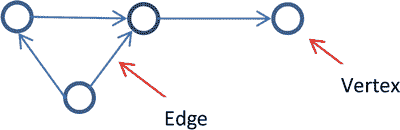
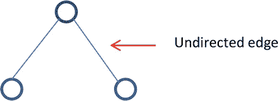
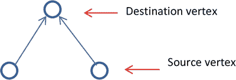
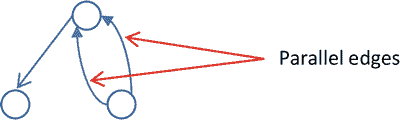
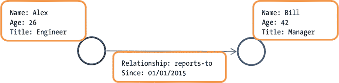
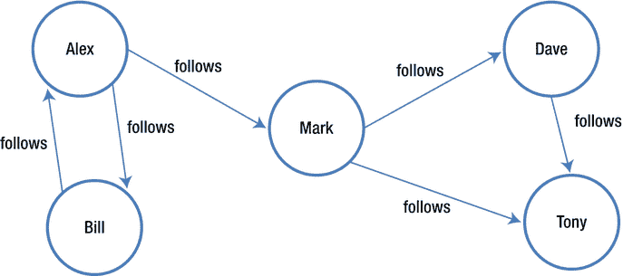
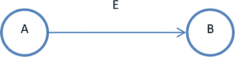
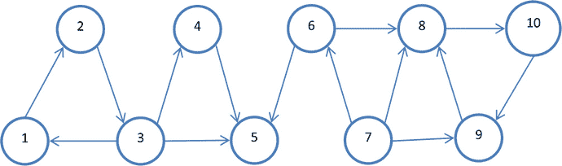
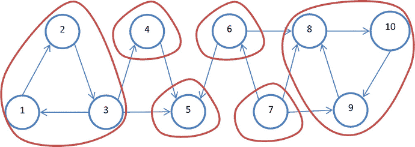

# 9. 使用 Spark 进行图处理

数据通常作为记录或行的集合进行存储和处理。它被表示为一个二维表格，数据被划分为行和列。然而，集合或表格并非表示数据的唯一方式。有时，图比集合能更好地表示数据。

图无处不在。它们遍布我们周围。例如，互联网是一个由互连的计算机、路由器和交换机组成的大型图。万维网是一个大型图。由超文本链接连接的网页构成了一个图。Facebook、LinkedIn 和 Twitter 等网站上的社交网络就是图。诸如机场、火车站和公交车站等交通枢纽也可以用图来表示。

对于面向图的数据，图提供了一种易于理解和直观的数据处理模型。此外，还有专门的图算法可用于处理面向图的数据。这些算法为不同的分析任务提供了高效的工具。

本章介绍 Spark 为高效处理大规模面向图的数据所提供的库。但首先，让我们介绍本章中使用的基本图相关术语。

## 图简介

图是一种由顶点和边组成的数据结构（见图 9-1）。顶点是图中的一个节点。边连接图中的两个顶点。通常，顶点代表一个实体，边代表两个实体之间的关系。从概念上讲，图相当于顶点集合和边集合。



图 9-1. 一个图

图可以是有向的或无向的。

### 无向图

无向图是一种边没有方向或朝向的图（见图 9-2）。无向图中的边没有源顶点或目标顶点。



图 9-2. 一个无向图

### 有向图

有向图是一种边具有方向或朝向的图（见图 9-3）。有向图中的边有源顶点和目标顶点。



图 9-3. 一个有向图

### 有向多重图

有向多重图是一种包含由两条或多条平行边连接的顶点对的有向图（见图 9-4）。有向多重图中的平行边是具有相同起始顶点和终止顶点的边。它们用于表示一对顶点之间的多重关系。



图 9-4. 一个有向多重图

### 属性图

属性图是一种有向多重图，其顶点和边都关联着数据（见图 9-5）。属性图中的每个顶点都有属性或特性。同样，每条边都有标签或属性。



图 9-5. 一个属性图

属性图为处理面向图的数据提供了丰富的抽象。它是使用图进行数据建模的最流行形式。

上图显示了一个属性图，表示一家公司中的两名员工及其关系。

属性图的另一个例子是表示 Twitter 上社交网络的图。用户具有 `name`、`age`、性别和位置等属性。此外，用户可以关注其他用户，也可能有粉丝。在表示 Twitter 上社交网络的图中，顶点代表用户，边代表“关注”关系。图 9-6 显示了一个简单的例子。



图 9-6. 一个社交网络图

现在你已经了解了基本的图相关术语。下一节将介绍 `GraphX`。

## GraphX 简介

`GraphX` 是一个分布式图分析框架。它是一个扩展 Spark 以进行大规模图处理的 Spark 库。它提供了比 Spark 核心 API 更高级别的图分析抽象。

`GraphX` 既提供基本的图算子，也提供实现图算法的高级算子，例如 `PageRank`、强连通分量和三角形计数。它还提供了 Google `Pregel` API 的实现。这些算子简化了图分析任务。

`GraphX` 允许将同一数据作为分布式图或分布式集合进行操作。它提供了类似于 `RDD API` 的集合算子，以及类似于专用图分析库的图算子。因此，它将集合和图统一为一流的可组合对象。

使用 `GraphX` 的一个关键好处是它提供了一个用于完整图分析工作流或流水线的集成平台。图分析流水线通常包括以下步骤：

1.  读取原始数据。
2.  预处理数据（例如，清洗数据）。
3.  提取顶点和边以创建属性图。
4.  切分子图。
5.  运行图算法。
6.  分析结果。
7.  用图的另一个切片重复步骤 5 和 6。

其中一些步骤涉及数据计算，一些涉及图计算。原始数据可能位于 XML 文件、数据库表、CSV 文件或其他一些格式中。通常，数据不干净，因此首先进行预处理。之后，提取顶点和边以构建属性图。然后使用图分析库处理该图或其切片。这是一个图计算步骤。预处理数据以及提取顶点和边是数据计算步骤。同样，分析图算法生成的结果是一个数据计算步骤。因此，图分析流水线同时包含数据计算和图计算步骤。

由于 `GraphX` 与 Spark 集成，`GraphX` 用户可以访问 `GraphX` 和 Spark API，包括 `RDD` 和 `DataFrame` API。`RDD` 和 `DataFrame` API 简化了数据计算步骤，而 `GraphX` API 简化了图分析步骤。因此，使用 `GraphX`，您可以在单个平台上实现完整的图分析流水线。

## GraphX API

`GraphX API` 提供了用于表示面向图的数据的数据类型和用于图分析的算子。它允许您使用同一数据的图视图或集合视图。

在撰写本书时，`GraphX` 处于 alpha 阶段，正在快速开发中。API 在未来的版本中可能会发生变化。

### 数据抽象

`GraphX` 为处理属性图提供的关键数据类型包括 `VertexRDD`、`Edge`、`EdgeRDD`、`EdgeTriplet` 和 `Graph`。

#### VertexRDD

`VertexRDD` 代表属性图中顶点的分布式集合。它提供了属性图中顶点的集合视图。`VertexRDD` 只为每个顶点存储一个条目。此外，它还对条目进行索引以实现快速连接。

每个顶点由一个键值对表示，其中键是唯一的 ID，值是与顶点关联的数据。键的数据类型是 `VertexId`，本质上是一个 64 位的 `Long`。值可以是任何类型。

`VertexRDD` 是一个泛型或参数化类；它需要一个类型参数。它被定义为 `VertexRDD[VD]`，其中类型参数 `VD` 指定了图中每个顶点关联的属性或特性的数据类型。例如，`VD` 可以是 `Int`、`Long`、`Double`、`String` 或用户定义的类型。因此，图中的顶点可以由 `VertexRDD[String]`、`VertexRDD[Int]` 或某种用户定义类型的 `VertexRDD` 来表示。

#### Edge

`Edge` 类抽象了属性图中的一条有向边。`Edge` 类的实例包含源顶点 ID、目标顶点 ID 和边属性。

`Edge` 也是一个需要类型参数的泛型类。该类型参数指定了边属性的数据类型。例如，一条边的属性可以是 `Int`、`Long`、`Double`、`String` 或用户定义的类型。

#### EdgeRDD

`EdgeRDD` 代表属性图中边的分布式集合。`EdgeRDD` 类根据边属性的数据类型进行参数化。

#### EdgeTriplet

`EdgeTriplet` 类的实例表示一条边及其所连接的两个顶点的组合（见图 9-7）。它存储了一条边的属性以及它所连接的两个顶点的属性。它还包含一条边的源顶点和目标顶点的唯一标识符。



图 9-7. 一个 EdgeTriplet

`EdgeTriplet` 的集合表示了属性图的一种表格视图。

#### EdgeContext

`EdgeContext` 类将 `EdgeTriplet` 与向边的源顶点和目标顶点发送消息的方法结合起来。

#### Graph

`Graph` 是 GraphX 用于表示属性图的抽象；`Graph` 类的实例代表一个属性图。与 RDD 类似，它是不可变的、分布式的且容错的。GraphX 使用顶点分区启发式算法在集群中分区和分布图。如果一台机器发生故障，它会在另一台机器上重新创建分区。

`Graph` 类将属性图和集合统一为可组合的一等对象。一个属性图在概念上等价于一对类型化的 RDD，其中一个 RDD 是顶点的分区集合，另一个是边的分区集合。实际上，`Graph` 类提供了将顶点和边作为 RDD 访问的途径。顶点或边的 RDD 可以像任何其他 RDD 一样进行操作。所有 RDD 方法都可用于转换或分析与顶点和边关联的数据。`Graph` 类还提供了通过图视图来转换和分析顶点和边的方法。因此，`Graph` 类的实例既可以作为一对集合来处理，也可以作为一个图来处理。

`Graph` 类不仅提供了修改顶点和边属性的方法，还提供了修改属性图结构的方法。由于 `Graph` 是一种不可变数据类型，任何修改属性或结构的运算符都会返回一个新的属性图。

最重要的是，`Graph` 类提供了一组丰富的运算符来处理和分析属性图。它既提供了基本的图运算符，也提供了可用于实现自定义图算法的高级运算符。它还具有内置的方法来实现图算法，例如 `PageRank`、强连通分量和三角形计数。

### 创建图

`Graph` 类的实例可以通过多种方式创建。GraphX 库提供了一个名为 `Graph` 的对象，该对象提供了从 RDD 构建图的工厂方法。例如，它提供了一个工厂方法，该方法从表示顶点和边的一对 RDD 创建 `Graph` 类的实例。它还提供了另一种方法，该方法从边的 RDD 创建图，并为边引用的顶点分配用户提供的默认值。

GraphX 库还提供了一个名为 `GraphLoader` 的对象，其中包含一个名为 `edgeListFile` 的方法。`edgeListFile` 方法从包含有向边列表的文件创建 `Graph` 类的实例。每行必须包含两个整数。默认情况下，第一个整数表示源顶点 ID，第二个整数表示目标顶点 ID。可以通过向 `edgeListFile` 方法传递一个布尔参数来反转默认方向。`edgeListFile` 方法会自动创建边引用的顶点。它将边和顶点的属性都设置为 1。

让我们创建一个属性图，表示类似于 Twitter 用户网络的社交网络。在这个属性图中，一个顶点代表一个用户，一条有向边代表“关注”关系。让我们保持图简单，以便于理解和操作。

您将要创建的属性图的视觉表示如图 9-8 所示。顶点中的数字代表顶点 ID。



图 9-8. 一个社交网络

您可以使用 Spark-shell 交互式地探索 GraphX API。首先，启动 Spark-shell。

```bash
/path/to/spark/bin/spark-shell
```

进入 Spark-shell 后，导入 GraphX 库。

```scala
import org.apache.spark.graphx._
```

接下来，创建一个 `case class` 来表示用户。每个用户将有两个属性或特性：`name` 和 `age`。

```scala
case class User(name: String, age: Int)
```

现在让我们创建一个 ID 和用户对的 RDD。

```scala
val users = List((1L, User("Alex", 26)), (2L, User("Bill", 42)), (3L, User("Carol", 18)),
(4L, User("Dave", 16)), (5L, User("Eve", 45)), (6L, User("Farell", 30)),
(7L, User("Garry", 32)), (8L, User("Harry", 36)), (9L, User("Ivan", 28)),
(10L, User("Jill", 48))
)
val usersRDD = sc.parallelize(users)
```

前面的代码创建了一个键值对的 RDD，其中键是唯一标识符，值是用户属性。该键代表一个顶点 ID。

接下来，让我们创建一个用户之间连接的 RDD。一个连接可以用 `Edge` 样例类的一个实例来表示。一条边可以有任意数量的属性；但是，为简单起见，为每条边分配一个 `Int` 类型的单一属性。

```scala
val follows = List(Edge(1L, 2L, 1), Edge(2L, 3L, 1), Edge(3L, 1L, 1), Edge(3L, 4L, 1),
Edge(3L, 5L, 1), Edge(4L, 5L, 1), Edge(6L, 5L, 1), Edge(7L, 6L, 1),
Edge(6L, 8L, 1), Edge(7L, 8L, 1), Edge(7L, 9L, 1), Edge(9L, 8L, 1),
Edge(8L, 10L, 1), Edge(10L, 9L, 1), Edge(1L, 11L, 1)
)
val followsRDD = sc.parallelize(follows)
```

在上面的代码片段中，`Edge` 的第一个参数是源顶点 ID。第二个参数是目标顶点 ID，最后一个参数是边属性。

请注意，有一条边连接了 ID 为 1 的顶点和 ID 为 11 的顶点。但是，ID 为 11 的顶点没有任何属性。GraphX 允许您通过创建一组默认属性来处理这种情况。它将把默认属性分配给那些没有被显式分配任何属性的顶点。

```scala
val defaultUser = User("NA", 0)
```

现在您拥有构建属性图所需的所有组件。

```scala
val socialGraph = Graph(usersRDD, followsRDD, defaultUser)
socialGraph: org.apache.spark.graphx.Graph[User,Int] = org.apache.spark.graphx.impl.GraphImpl@315576db
```

前面的代码片段中的 `Graph` 对象会从顶点和边的 RDD 创建一个 `Graph` 类的实例。

## Graph 属性

本节简要介绍如何查找属性图的有用信息。

你可以查找属性图中的边数或顶点数，如下所示。

```scala
val numEdges = socialGraph.numEdges
```

```
numEdges: Long = 15
```

```scala
val numVertices = socialGraph.numVertices
```

```
numVertices: Long = 11
```

查找属性图中顶点的度数也很容易。顶点的度数是指从该顶点出发或终止于该顶点的边的数量。

```scala
val inDegrees = socialGraph.inDegrees
```

```
inDegrees: org.apache.spark.graphx.VertexRDD[Int] = VertexRDDImpl[19] at RDD at VertexRDD.scala:57
```

```scala
inDegrees.collect
```

```
res0: Array[(org.apache.spark.graphx.VertexId, Int)] = Array((4,1), (8,3), (1,1), (9,2), (5,3), (6,1), (10,1), (2,1), (11,1), (3,1))
```

上述输出显示，ID 为 4 的顶点有一条入边；ID 为 8 的顶点有三条入边，以此类推。

```scala
val outDegrees = socialGraph.outDegrees
```

```
outDegrees: org.apache.spark.graphx.VertexRDD[Int] = VertexRDDImpl[23] at RDD at VertexRDD.scala:57
```

```scala
outDegrees.collect
```

```
res1: Array[(org.apache.spark.graphx.VertexId, Int)] = Array((4,1), (8,1), (1,2), (9,1), (6,2), (10,1), (2,1), (3,3), (7,3))
```

上述输出显示，ID 为 4 的顶点有一条出边；ID 为 8 的顶点有一条出边，以此类推。

```scala
val degrees = socialGraph.degrees
```

```
degrees: org.apache.spark.graphx.VertexRDD[Int] = VertexRDDImpl[27] at RDD at VertexRDD.scala:57
```

```scala
degrees.collect
```

```
res2: Array[(org.apache.spark.graphx.VertexId, Int)] = Array((4,2), (8,4), (1,3), (9,3), (5,3), (6,3), (10,2), (2,2), (11,1), (3,4), (7,3))
```

接下来的代码片段展示了如何获取属性图中顶点、边和三元组的集合视图。

```scala
val vertices = socialGraph.vertices
```

```
vertices: org.apache.spark.graphx.VertexRDD[User] = VertexRDDImpl[11] at RDD at VertexRDD.scala:57
```

```scala
val edges = socialGraph.edges
```

```
edges: org.apache.spark.graphx.EdgeRDD[Int] = EdgeRDDImpl[13] at RDD at Edge.scala:40
```

```scala
val triplets = socialGraph.triplets
```

```
triplets: org.apache.spark.rdd.RDD[org.apache.spark.graphx.EdgeTriplet[User,Int]] = MapPartitionsRDD[32] at mapPartitions at GraphImpl.scala:51
```

```scala
triplets.take(3)
```

```
res7: Array[org.apache.spark.graphx.EdgeTriplet[User,Int]] = Array(((1,User(Alex,26)),(2,User(Bill,42)),1), ((2,User(Bill,42)),(3,User(Carol,18)),1), ((3,User(Carol,18)),(1,User(Alex,26)),1))
```

属性图中三元组的集合视图允许你将图处理为一个包含源顶点、目标顶点和边属性的表。示例如下。

```scala
val follows = triplets.map{ t => t.srcAttr.name + " follows " + t.dstAttr.name}
```

```
follows: org.apache.spark.rdd.RDD[String] = MapPartitionsRDD[35] at map at <console>:40
```

```scala
follows.take(5)
```

```
res8: Array[String] = Array(Alex follows Bill, Bill follows Carol, Carol follows Alex, Carol follows Dave, Carol follows Eve)
```

## Graph 运算符

本节简要介绍 `Graph` 类中的关键方法。这些方法也被称为运算符。`Graph` 运算符可以分为以下几类：

-   属性变换
-   结构变换
-   连接
-   聚合
-   图并行计算
-   图算法

### 属性变换运算符

属性变换运算符允许你更改图中边或顶点的属性。请记住，`Graph` 是不可变的；一个变换运算符永远不会就地修改图。相反，它会返回一个具有修改后属性的新图。

#### mapVertices

`mapVertices` 方法对属性图中的每个顶点应用用户指定的变换。它是一个高阶方法，接受一个函数作为参数并返回一个新图。提供给 `mapVertices` 方法的函数接受一对顶点 ID 和顶点属性作为参数，并返回新的顶点属性。

下一个示例展示了如何使用 `mapVertices` 方法增加你之前创建的社交图中每个用户的年龄。

```scala
val updatedAges = socialGraph.mapVertices( (vertexId, user) =>
                    User(user.name, user.age + 1 ))
```

```
updatedAges: org.apache.spark.graphx.Graph[User,Int] =
org.apache.spark.graphx.impl.GraphImpl@1b8f47c6
```

```scala
socialGraph.vertices.take(5)
```

```
res9: Array[(org.apache.spark.graphx.VertexId, User)] = Array((4,User(Dave,16)), (8,User(Harry,36)), (1,User(Alex,26)), (9,User(Ivan,28)), (5,User(Eve,45)))
```

```scala
updatedAges.vertices.take(5)
```

```
res10: Array[(org.apache.spark.graphx.VertexId, User)] = Array((4,User(Dave,17)), (8,User(Harry,37)), (1,User(Alex,27)), (9,User(Ivan,29)), (5,User(Eve,46)))
```

#### mapEdges

`mapEdges` 方法对属性图中的每条边应用用户指定的变换。与 `mapVertices` 方法类似，它是一个高阶方法，接受一个函数作为参数并返回一个新图。提供给 `mapEdges` 方法的函数接受边的属性作为参数，并返回新的边属性。

下一个示例将每条边的标签从整数修改为字符串。

```scala
val followsGraph = socialGraph.mapEdges( (n) => "follows")
```

```
followsGraph: org.apache.spark.graphx.Graph[User,String] =
org.apache.spark.graphx.impl.GraphImpl@57be3dc2
```

```scala
socialGraph.edges.take(5)
```

```
res11: Array[org.apache.spark.graphx.Edge[Int]] = Array(Edge(1,2,1), Edge(2,3,1), Edge(3,1,1), Edge(3,4,1), Edge(3,5,1))
```

```scala
followsGraph.edges.take(5)
```

```
res12: Array[org.apache.spark.graphx.Edge[String]] = Array(Edge(1,2,follows), Edge(2,3,follows), Edge(3,1,follows), Edge(3,4,follows), Edge(3,5,follows))
```

#### mapTriplets

`mapTriplets` 方法对属性图中的每个三元组应用用户指定的变换。它是一个高阶方法，接受一个函数作为参数并返回一个新图。

`mapTriplets` 方法与 `mapEdges` 方法类似；两者都通过修改源图中每条边的属性来返回一个新图。但是，提供给 `mapTriplets` 方法的输入函数接受一个 `EdgeTriplet` 作为参数，而 `mapEdges` 方法的函数参数接受一个 `Edge` 作为参数。

示例社交图中的每条边都有一个整数属性，其值始终为 1。假设你希望根据源顶点和目标顶点更改边的标签。以下代码片段将年龄大于 30 的关注者的边标签更改为 2。

```scala
val weightedGraph = socialGraph.mapTriplets{ t =>
                                               if (t.srcAttr.age >= 30) t.attr = 2
                                               else t.attr
                                           }
```

```
weightedGraph: org.apache.spark.graphx.Graph[User,Int] = org.apache.spark.graphx.impl.GraphImpl@15c484a1
```

```scala
socialGraph.edges.take(10)
```

```
res15: Array[org.apache.spark.graphx.Edge[Int]] = Array(Edge(1,2,1), Edge(2,3,1), Edge(3,1,1), Edge(3,4,1), Edge(3,5,1), Edge(4,5,1), Edge(6,5,1), Edge(6,8,1), Edge(7,6,1), Edge(7,8,1))
```

```scala
weightedGraph.edges.take(10)
```

```
res16: Array[org.apache.spark.graphx.Edge[Int]] = Array(Edge(1,2,1), Edge(2,3,2), Edge(3,1,1), Edge(3,4,1), Edge(3,5,1), Edge(4,5,1), Edge(6,5,2), Edge(6,8,2), Edge(7,6,2), Edge(7,8,2))
```

### 结构变换运算符

此类别中的运算符返回一个与调用该运算符的图在结构上不同的图。从概念上讲，它们会改变图的结构或返回一个子图。但是，请记住，`Graph` 是不可变的；这些运算符会创建一个新图。

#### reverse

`reverse` 方法反转属性图中所有边的方向，并返回一个新的属性图。

以下代码片段反转了示例社交图中的“追随”关系。

```scala
val reverseGraph = socialGraph.reverse
```

```scala
reverseGraph.triplets.map{ t => t.srcAttr.name + " follows " + t.dstAttr.name}.take(10)
```

```
res21: Array[String] = Array(Alex follows Carol, Bill follows Alex, Carol follows Bill, Dave follows Carol, Eve follows Carol, Eve follows Dave, Eve follows Farell, Farell follows Garry, Harry follows Farell, Harry follows Garry)
```

```scala
socialGraph.triplets.map{ t => t.srcAttr.name + " follows " + t.dstAttr.name}.take(10)
```

```
res22: Array[String] = Array(Alex follows Bill, Bill follows Carol, Carol follows Alex, Carol follows Dave, Carol follows Eve, Dave follows Eve, Farell follows Eve, Farell follows Harry, Garry follows Farell, Garry follows Harry)
```

#### subgraph

`subgraph` 方法对每个顶点和边应用用户指定的过滤器，并返回源图的一个子图。从概念上讲，它类似于 RDD 的 `filter` 方法。

`subgraph` 方法接受两个谓词（返回布尔结果的函数）作为参数。第一个谓词接收一个 `EdgeTriplet` 作为参数。第二个谓词接收一对顶点 ID 和顶点属性作为参数。返回的子图仅包含满足这两个谓词的顶点和边。

以下代码片段创建了一个仅包含权重大于 1 的边的子图。

```scala
val subgraph = weightedGraph.subgraph( edgeTriplet => edgeTriplet.attr > 1,
                                      (vertexId, vertexProperty) => true)
```

```scala
subgraph.edges.take(10)
```

```
res23: Array[org.apache.spark.graphx.Edge[Int]] = Array(Edge(2,3,2), Edge(6,5,2), Edge(6,8,2), Edge(7,6,2), Edge(7,8,2), Edge(7,9,2), Edge(8,10,2), Edge(10,9,2))
```

```scala
weightedGraph.edges.take(10)
```

```
res24: Array[org.apache.spark.graphx.Edge[Int]] = Array(Edge(1,2,1), Edge(2,3,2), Edge(3,1,1), Edge(3,4,1), Edge(3,5,1), Edge(4,5,1), Edge(6,5,2), Edge(6,8,2), Edge(7,6,2), Edge(7,8,2))
```

##### `mask`

`mask` 方法接收一个图作为参数，并返回源图的一个子图，该子图包含输入图中的所有顶点和边。返回的图包含同时存在于输入图和源图中的顶点和边；然而，返回图中的顶点和边属性来自源图。

以下示例使用 `mask` 方法获取社交图的一个子图。这是一个人为构造的例子，假设你有一系列边，但不知道这些边所连接顶点或边的属性。

```scala
val femaleConnections = List(Edge(2L, 3L, 0), Edge(3L, 1L, 0), Edge(3L, 4L, 0),
                   Edge(3L, 5L, 0), Edge(4L, 5L, 0), Edge(6L, 5L, 0),
                   Edge(8L, 10L, 0), Edge(10L, 9L, 0)
                  )
```

```scala
val femaleConnectionsRDD = sc.parallelize(femaleConnections)
```

```scala
val femaleGraphMask = Graph.fromEdges(femaleConnectionsRDD, defaultUser)
```

```
femaleGraphMask: org.apache.spark.graphx.Graph[User,Int] = org.apache.spark.graphx.impl.GraphImpl@9df22e0
```

```scala
val femaleGraph = socialGraph.mask(femaleGraphMask)
```

```
femaleGraph: org.apache.spark.graphx.Graph[User,Int] = org.apache.spark.graphx.impl.GraphImpl@38c13d96
```

```scala
femaleGraphMask.triplets.take(10)
```

```
res31: Array[org.apache.spark.graphx.EdgeTriplet[User,Int]] = Array(((2,User(NA,0)),(3,User(NA,0)),0), ((3,User(NA,0)),(1,User(NA,0)),0), ((3,User(NA,0)),(4,User(NA,0)),0), ((3,User(NA,0)),(5,User(NA,0)),0), ((4,User(NA,0)),(5,User(NA,0)),0), ((6,User(NA,0)),(5,User(NA,0)),0), ((8,User(NA,0)),(10,User(NA,0)),0), ((10,User(NA,0)),(9,User(NA,0)),0))
```

```scala
femaleGraph.triplets.take(10)
```

```
res32: Array[org.apache.spark.graphx.EdgeTriplet[User,Int]] = Array(((2,User(Bill,42)),(3,User(Carol,18)),1), ((3,User(Carol,18)),(1,User(Alex,26)),1), ((3,User(Carol,18)),(4,User(Dave,16)),1), ((3,User(Carol,18)),(5,User(Eve,45)),1), ((8,User(Harry,36)),(10,User(Jill,48)),1), ((10,User(Jill,48)),(9,User(Ivan,28)),1))
```

##### `groupEdges`

`groupEdges` 方法是一个高阶方法，用于合并属性图中的平行边。它接收一个函数作为参数，并返回一个新的图。输入函数接收一对边属性作为参数，将它们合并，并返回一个新的属性。

以下示例代码通过合并连接相同顶点对的平行边来减小图的规模。

```scala
val multiEdges = List(Edge(1L, 2L, 100), Edge(1L, 2L, 200),
                      Edge(2L, 3L, 300), Edge(2L, 3L, 400),
                      Edge(3L, 1L, 200), Edge(3L, 1L, 300)
                  )
```

```scala
val multiEdgesRDD = sc.parallelize(multiEdges)
```

```scala
val defaultVertexProperty = 1
```

```scala
val multiEdgeGraph = Graph.fromEdges(multiEdgesRDD, defaultVertexProperty)
```

```scala
import org.apache.spark.graphx.PartitionStrategy._
```

```scala
val repartitionedGraph = multiEdgeGraph.partitionBy(CanonicalRandomVertexCut)
```

```scala
val singleEdgeGraph = repartitionedGraph.groupEdges((edge1, edge2) => edge1 + edge2)
```

```
singleEdgeGraph: org.apache.spark.graphx.Graph[Int,Int] = org.apache.spark.graphx.impl.GraphImpl@234a8efe
```

```scala
multiEdgeGraph.edges.collect
```

```
res44: Array[org.apache.spark.graphx.Edge[Int]] = Array(Edge(1,2,100), Edge(1,2,200), Edge(2,3,300), Edge(2,3,400), Edge(3,1,200), Edge(3,1,300))
```

```scala
singleEdgeGraph.edges.collect
```

```
res45: Array[org.apache.spark.graphx.Edge[Int]] = Array(Edge(3,1,500), Edge(1,2,300), Edge(2,3,700))
```

请注意，`groupEdges` 方法要求平行边位于同一个分区中。因此，必须在调用 `groupEdges` 之前调用 `partitionBy`；否则你将得到错误的结果。

`partitionBy` 方法根据用户指定的分区策略重新划分源图中的边。前面的示例使用了 `CanonicalRandomVertexCut`，该方法通过对源顶点和目标顶点 ID 进行哈希，将边分配到分区中。它能够将同一对顶点之间的所有边置于同一分区。

#### 连接运算符

连接运算符允许你更新图中顶点的现有属性，或为其添加新属性。

##### `joinVertices`

`joinVertices` 方法使用作为输入提供的顶点集合来更新源图中的顶点。它接受两个参数。第一个参数是一个 `RDD`，包含顶点 ID 和顶点数据对。第二个参数是一个用户指定的函数，该函数使用顶点的当前属性和新的输入数据来更新源图中的顶点。在输入 `RDD` 中没有条目的顶点将保留其当前属性。

假设您发现示例社交图中顶点 ID 为 3 和 4 的用户的年龄不正确。以下代码示例使用 `joinVertices` 方法来更正这两位用户的年龄。

```scala
val correctAges = sc.parallelize(List((3L, 28), (4L, 26)))
val correctedGraph = socialGraph.joinVertices(correctAges)((id, user, correctAge) =>
                                   User(user.name, correctAge))
correctedGraph: org.apache.spark.graphx.Graph[User,Int] = org.apache.spark.graphx.impl.GraphImpl@f3cb93
correctedGraph.vertices.collect
res53: Array[(org.apache.spark.graphx.VertexId, User)] = Array((4,User(Dave,26)), (8,User(Harry,36)), (1,User(Alex,26)), (9,User(Ivan,28)), (5,User(Eve,45)), (6,User(Farell,30)), (10,User(Jill,48)), (2,User(Bill,42)), (11,User(NA,0)), (3,User(Carol,28)), (7,User(Garry,32)))
socialGraph.vertices.collect
res54: Array[(org.apache.spark.graphx.VertexId, User)] = Array((4,User(Dave,16)), (8,User(Harry,36)), (1,User(Alex,26)), (9,User(Ivan,28)), (5,User(Eve,45)), (6,User(Farell,30)), (10,User(Jill,48)), (2,User(Bill,42)), (11,User(NA,0)), (3,User(Carol,18)), (7,User(Garry,32)))
```

以下代码片段可以轻松比较 `socialGraph` 和 `correctedGraph` 中 ID 为 3 和 4 的顶点的属性。

```scala
val incorrectSubGraph = socialGraph.subgraph( edgeTriplet => true,
             (vertexId, vertexProperty) => (vertexId == 3) ||  (vertexId == 4))
val correctedSubGraph = correctedGraph.subgraph( edgeTriplet => true,
               (vertexId, vertexProperty) => (vertexId == 3) ||  (vertexId == 4))
incorrectSubGraph.vertices.collect
res50: Array[(org.apache.spark.graphx.VertexId, User)] = Array((4,User(Dave,16)), (3,User(Carol,18)))
correctedSubGraph.vertices.collect
res51: Array[(org.apache.spark.graphx.VertexId, User)] = Array((4,User(Dave,26)), (3,User(Carol,28)))
```

##### `outerJoinVertices`

`outerJoinVertices` 方法为源图中的顶点添加新属性。与 `joinVertices` 方法类似，它接受两个参数。第一个参数是一个 `RDD`，包含顶点 ID 和顶点数据对。第二个参数是一个用户指定的函数，该函数接受一个三元组作为参数，该三元组包含顶点 ID、当前顶点属性以及输入 `RDD` 中同一顶点的可选属性。它会为每个顶点返回新属性。

输入 `RDD` 对于源图中的每个顶点最多应包含一个条目。如果输入 `RDD` 中没有源图中某个顶点的条目，则在调用该顶点的用户指定函数时，该函数将接收 `None` 作为第三个参数。

`joinVertices` 和 `outerJoinVertices` 之间的区别在于，前者更新当前属性，而后者既可以更新当前属性，也可以为源图中的顶点添加新属性。

假设您想为示例社交图中的每个用户添加一个名为 `city` 的新属性。以下代码示例使用 `outerJoinVertices` 方法创建了一个新的属性图，其中每个用户都有姓名、年龄和城市。

```scala
case class UserWithCity(name: String, age: Int, city: String)
val userCities = sc.parallelize(List((1L, "Boston"), (3L, "New York"), (5L, "London"),
                                     (7L, "Bombay"), (9L, "Tokyo"), (10L, "Palo Alto")))
val  socialGraphWithCity = socialGraph.outerJoinVertices(userCities)((id, user, cityOpt) =>
                             cityOpt match {
                               case Some(city) => UserWithCity(user.name, user.age, city)
                               case None => UserWithCity(user.name, user.age, "NA")
                             })
socialGraphWithCity: org.apache.spark.graphx.Graph[UserWithCity,Int] = org.apache.spark.graphx.impl.GraphImpl@b5a2596
socialGraphWithCity.vertices.take(5)
res55: Array[(org.apache.spark.graphx.VertexId, UserWithCity)] = Array((4,UserWithCity(Dave,16,NA)), (8,UserWithCity(Harry,36,NA)), (1,UserWithCity(Alex,26,Boston)), (9,UserWithCity(Ivan,28,Tokyo)), (5,UserWithCity(Eve,45,London)))
```

#### 聚合运算符

此类别目前只有一个方法，如下所述。

# aggregateMessages

`aggregateMessages` 方法从相邻顶点和连接边聚合每个顶点的值。它使用两个用户定义的函数来进行聚合。它会在属性图中的每个三元组上调用这些函数。

第一个用户定义的函数接受一个 `EdgeContext` 作为参数。`EdgeContext` 类不仅提供对三元组中源顶点和目标顶点属性以及连接它们的边的访问，还提供了向三元组中的源顶点和目标顶点发送消息的函数。消息本质上是某些数据。用户定义的函数使用 `EdgeContext` 类提供的消息发送函数向相邻顶点发送消息。

第二个用户定义的函数接受两个消息作为参数，并返回单个消息。它将两个消息合并或组合成一个消息。`aggregateMessages` 方法使用第二个函数来聚合第一个函数发送到某个顶点的所有消息。它返回一个 RDD，包含顶点 ID 和聚合后的消息对。

以下代码展示了如何使用 `aggregateMessages` 方法计算示例社交图中每个用户的关注者数量。

```
val followers = socialGraph.aggregateMessagesInt,
                                                    (x, y) => (x + y))
followers: org.apache.spark.graphx.VertexRDD[Int] = VertexRDDImpl[231] at RDD at VertexRDD.scala:57
followers.collect
res56: Array[(org.apache.spark.graphx.VertexId, Int)] = Array((4,1), (8,3), (1,1), (9,2), (5,3), (6,1), (10,1), (2,1), (11,1), (3,1))
```

这段代码是一个简单的示例，用来演示如何使用 `aggregateMessages` 方法。然而，对于计算关注者数量来说，使用 `aggregateMessages` 方法有点大材小用。下面展示了一种更简单的方法。

```
val followers = socialGraph.inDegrees
followers: org.apache.spark.graphx.VertexRDD[Int] = VertexRDDImpl[19] at RDD at VertexRDD.scala:57
followers.collect
res57: Array[(org.apache.spark.graphx.VertexId, Int)] = Array((4,1), (8,3), (1,1), (9,2), (5,3), (6,1), (10,1), (2,1), (11,1), (3,1))
```

让我们使用 `aggregateMessages` 方法来解决一个稍微复杂的问题。以下代码片段展示了如何找到每个用户年龄最大的关注者。

```
val oldestFollower = socialGraph.aggregateMessagesInt,
                                  (x, y) => math.max(x,y))
oldestFollower.collect
res58: Array[(org.apache.spark.graphx.VertexId, Int)] = Array((4,18), (8,32), (1,18), (9,48), (5,30), (6,32), (10,36), (2,26), (11,26), (3,42))
```

## 图并行运算符

图并行运算符允许您实现自定义的迭代图算法，用于处理大规模图数据。

### pregel

`pregel` 方法实现了 Google Pregel 算法的一个变体。Pregel 是一种分布式计算模型，用于处理包含数十亿顶点和数万亿边的大规模图。它基于整体同步并行（BSP）算法。

在 Pregel 中，图计算由一系列迭代（也称为超步）组成。在一个超步中，用户定义的函数（也称为顶点程序）会在每个顶点上并行调用。顶点程序处理上一个超步中发送给该顶点的消息聚合，更新顶点及其出边的属性，并向其他顶点发送消息。在一个超步中发送的消息将在下一个超步中被处理。如果在某个超步中没有消息发送给某个顶点，则在下一个超步中不会对该顶点调用顶点程序。所有顶点程序都允许处理完上一个超步的消息后，框架才会运行算法的下一次迭代。这些迭代或超步会重复执行，直到没有消息在传输且所有顶点都处于非活跃状态。当一个顶点没有进一步的工作要做时，它会变为非活跃状态。当其他顶点发送消息给它时，它会重新变为活跃。

GraphX 的 Pregel 实现与标准实现略有不同。在每个超步中调用的顶点程序将 `EdgeTriplet` 作为参数之一。它可以访问 `EdgeTriplet` 中源顶点和目标顶点的属性，以及连接它们的边的属性。此外，GraphX 只允许向相邻顶点发送消息。

`pregel` 方法接受两组参数并返回一个图。第一组包含三个参数：每个顶点将在第一个超步中接收的初始消息、最大迭代次数以及消息发送的方向。

第二组也包含三个参数：一个用户定义的顶点程序（将在超步期间在每个顶点上并行运行）、一个用户定义的用于计算发送给相邻顶点的可选消息的函数，以及一个用户定义的用于合并或组合上一个超步中发送给某顶点的消息的函数。

用户定义的顶点程序接受三个参数：顶点的 ID、其当前属性以及上一个超步中发送给它的所有消息的聚合。它返回顶点的新属性。在第一个超步或迭代中，所有顶点都会收到作为参数传递给 `pregel` 方法的初始消息。在后续迭代中，每个顶点会收到上一个超步或迭代中发送给它的所有消息的聚合。如果某个顶点没有收到消息，则不会对其调用顶点程序。

`pregel` 方法在所有顶点上并行运行顶点程序之后，会在所有出边上调用用户定义的消息发送函数。消息发送函数计算发送给相邻顶点的可选消息。它接受一个 `EdgeTriplet` 作为参数，并返回目标顶点 ID 和消息对的迭代器。此函数仅在那些在上一个超步中收到消息的顶点的边上被调用。

用户定义的消息合并函数接受一对消息作为参数，将它们合并，并返回一个与传入消息类型相同的单一消息。它必须是一个可交换且可结合的函数。

`pregel` 方法会不断迭代，直到没有消息或达到用户指定的最大迭代次数。它会在计算结束时返回结果图。

`pregel` 算子对于递归计算顶点属性的图并行计算非常有用。在此类计算中，一个顶点的属性依赖于相邻顶点的属性，而这些相邻顶点的属性又依赖于它们的相邻顶点，依此类推。这些算法本质上是迭代的。每次迭代中的计算都依赖于前一次迭代的结果。顶点的属性会在每次迭代中重新计算，直到满足停止条件。

图并行计算的一个例子是 PageRank 算法，这是 Google 搜索引擎最初使用的算法。对 PageRank 算法的详细讨论超出了本书的范围，但由于下一个例子将使用 `pregel` 算子来实现 PageRank，这里会对其进行简要描述。

文档的 PageRank 表示该文档的重要性。PageRank 值越高的文档比 PageRank 值低的页面更重要。一个文档的 PageRank 基于链接到它的文档的 PageRank。因此，它是一个迭代算法。除了 PageRank 之外，文档的出链数量也是计算该文档对其链接文档的 PageRank 贡献的一个因素。与具有相同 PageRank 但出链较少的页面相比，具有大量出链的文档对其所链接文档的 PageRank 贡献较小。

让我们使用 `pregel` 方法和 PageRank 算法来计算示例社交图中用户的影响力排名。用户的影响力排名基于其粉丝的影响力排名以及每个粉丝关注的人数。

以下示例使用了与前几个示例相同的社交图。要使用 `pregel` 算子，您需要对由 `socialGraph` 表示的社交图进行一些更改。目前，每条边都具有相同的属性。相反，我们需要根据顶点的出边数量为每条边分配一个权重。

```
val outDegrees = socialGraph.outDegrees
outDegrees: org.apache.spark.graphx.VertexRDD[Int] = VertexRDDImpl[23] at RDD at VertexRDD.scala:57

val outDegreesGraph = socialGraph.outerJoinVertices(outDegrees) {
                        (vId, vData, OptOutDegree) =>
                            OptOutDegree.getOrElse(0)
                      }
outDegreesGraph: org.apache.spark.graphx.Graph[Int,Int] = org.apache.spark.graphx.impl.GraphImpl@75cffddf

val weightedEdgesGraph = outDegreesGraph.mapTriplets{EdgeTriplet =>
                                            1.0 / EdgeTriplet.srcAttr
                                          }
weightedEdgesGraph: org.apache.spark.graphx.Graph[Int,Double] = org.apache.spark.graphx.impl.GraphImpl@95cd375
```

接下来，为每个用户分配一个初始影响力排名。

```
val inputGraph = weightedEdgesGraph.mapVertices((id, vData) => 1.0)
```

您将在 `inputGraph` 上调用 `pregel` 方法。但在执行此操作之前，让我们先初始化将传递给 `pregel` 方法的参数。

以下代码片段展示了您将传递给 `pregel` 方法的第一组三个参数。

```
val firstMessage = 0.0
val iterations = 20
val edgeDirection = EdgeDirection.Out
```

接下来，定义将作为参数传递给 `pregel` 方法的三个函数。

```
val updateVertex = (vId: Long, vData: Double, msgSum: Double) => 0.15 + 0.85 * msgSum
updateVertex: (Long, Double, Double) => Double = <function3>

val sendMsg = (triplet: EdgeTriplet[Double, Double]) =>
                  Iterator((triplet.dstId, triplet.srcAttr * triplet.attr))
sendMsg: org.apache.spark.graphx.EdgeTriplet[Double,Double] => Iterator[(org.apache.spark.graphx.VertexId, Double)] = <function1>

val aggregateMsgs = (x: Double, y: Double ) => x + y
aggregateMsgs: (Double, Double) => Double = <function2>
```

现在让我们调用 `pregel` 方法。

```
val influenceGraph = inputGraph.pregel(firstMessage, iterations, edgeDirection)(updateVertex,
                                        sendMsg, aggregateMsgs)
influenceGraph: org.apache.spark.graphx.Graph[Double,Double] = org.apache.spark.graphx.impl.GraphImpl@ad6a671
```

让我们通过打印每个用户的名称和影响力排名来检查计算的结果。

```
val userNames = socialGraph.mapVertices{(vId, vData) => vData.name}.vertices
val userNamesAndRanks = influenceGraph.outerJoinVertices(userNames) {
                            (vId, rank, optUserName) =>
                                        (optUserName.get, rank)
                            }.vertices
userNamesAndRanks.collect.foreach{ case(vId, vData) =>
                            println(vData._1 + "'s influence rank: " + vData._2)
                          }
```

```
Dave's influence rank: 0.2546939612521768
Harry's influence rank: 0.9733813220346056
Alex's influence rank: 0.2546939612521768
Ivan's influence rank: 0.9670543985781628
Eve's influence rank: 0.47118379300959834
Farell's influence rank: 0.1925
Jill's influence rank: 0.9718993399637271
Bill's influence rank: 0.25824491587871073
NA's influence rank: 0.25824491587871073
Carol's influence rank: 0.36950816084343974
Garry's influence rank: 0.15
```

# 图算法

`aggregateMessages` 和 `pregel` 算子是实现自定义图算法的强大工具。利用这些算子，只需几行代码就能实现复杂的图算法。然而，在某些情况下，甚至连这些都不需要。GraphX 为一些常见图算法内置了实现。这些算法可以作为 `Graph` 类的方法调用。

## pageRank

`pageRank` 方法实现了 PageRank 算法的动态版本。它有两个参数。第一个参数是收敛阈值或容差。动态 PageRank 算法会一直运行，直到排名变化小于用户指定的容差。第二个参数是可选的，它指定了 PageRank 算法使用的随机重置概率。默认值为 0.15。`pageRank` 方法返回一个图，其中顶点属性为 PageRank 值，边属性为归一化权重。

下面是一个示例。它对之前为演示 `pregel` 方法而创建的 `inputGraph` 运行动态 PageRank。

```
val dynamicRanksGraph = inputGraph.pageRank(0.001)
```

```
dynamicRanksGraph.vertices.collect
```

```
res63: Array[(org.apache.spark.graphx.VertexId, Double)] = Array((4,0.2544208826877713), (8,1.4102365771190497), (1,0.2544208826877713), (9,1.3372775106440455), (5,0.5517909837066515), (6,0.1925), (10,1.3487010905511918), (2,0.2577788005094401), (11,0.2577788005094401), (3,0.36854429183919274), (7,0.15))
```

```
dynamicRanksGraph.edges.collect
```

```
res64: Array[org.apache.spark.graphx.Edge[Double]] = Array(Edge(1,2,0.5), Edge(2,3,1.0), Edge(3,1,0.3333333333333333), Edge(3,4,0.3333333333333333), Edge(3,5,0.3333333333333333), Edge(4,5,1.0), Edge(6,5,0.5), Edge(6,8,0.5), Edge(7,6,0.3333333333333333), Edge(7,8,0.3333333333333333), Edge(7,9,0.3333333333333333), Edge(1,11,0.5), Edge(8,10,1.0), Edge(9,8,1.0), Edge(10,9,1.0))
```

## staticPageRank

`staticPageRank`方法实现了PageRank算法的静态版本。它有两个参数。第一个参数是迭代次数，第二个可选参数是随机重置概率。`staticPageRank`方法运行指定次数的迭代，并返回一个图，其中顶点属性为PageRank值，边属性为归一化权重。

```
val staticRanksGraph = inputGraph.staticPageRank(20)
```

```
staticRanksGraph.vertices.collect
```

```
res66: Array[(org.apache.spark.graphx.VertexId, Double)] = Array((4,0.2546939612521768), (8,1.3691322478088301), (1,0.2546939612521768), (9,1.2938371623789482), (5,0.5529962930095983), (6,0.1925), (10,1.3063496503175922), (2,0.25824491587871073), (11,0.25824491587871073), (3,0.36950816084343974), (7,0.15))
```

```
staticRanksGraph.edges.collect
```

```
res67: Array[org.apache.spark.graphx.Edge[Double]] = Array(Edge(1,2,0.5), Edge(2,3,1.0), Edge(3,1,0.3333333333333333), Edge(3,4,0.3333333333333333), Edge(3,5,0.3333333333333333), Edge(4,5,1.0), Edge(6,5,0.5), Edge(6,8,0.5), Edge(7,6,0.3333333333333333), Edge(7,8,0.3333333333333333), Edge(7,9,0.3333333333333333), Edge(1,11,0.5), Edge(8,10,1.0), Edge(9,8,1.0), Edge(10,9,1.0))
```

## connectedComponents

`connectedComponents`方法实现了连通分量算法，用于计算每个顶点所属的连通分量。它返回一个图，其中每个顶点的属性是其所在连通分量中编号最小的顶点的顶点ID。

```
val connectedComponentsGraph = inputGraph.connectedComponents()
```

```
connectedComponentsGraph.vertices.collect
```

```
res68: Array[(org.apache.spark.graphx.VertexId, org.apache.spark.graphx.VertexId)] = Array((4,1), (8,1), (1,1), (9,1), (5,1), (6,1), (10,1), (2,1), (11,1), (3,1), (7,1))
```

## stronglyConnectedComponents

图的强连通分量（SCC）是一个子图，包含的顶点在同一子图中彼此可达。在一个SCC中，通过沿着边指向的方向进行遍历，任意顶点都可以从其他任意顶点到达（参见图9-9）。



图9-9. 强连通分量

`stronglyConnectedComponents`方法为每个顶点查找其所属的SCC，并返回一个图，其中顶点的属性是其所在SCC中编号最小的顶点ID。

```
val sccGraph = inputGraph.stronglyConnectedComponents(20)
```

```
sccGraph.vertices.collect
```

```
res69: Array[(org.apache.spark.graphx.VertexId, org.apache.spark.graphx.VertexId)] = Array((4,4), (8,8), (1,1), (9,8), (5,5), (6,6), (10,8), (2,1), (11,11), (3,1), (7,7))
```

## triangleCount

`triangleCount`方法计算每个顶点所参与的三角形数量。如果一个顶点有两个邻居顶点，且这两个邻居顶点之间存在一条边，则该顶点构成三角形的一部分。`triangleCount`方法返回一个图，其中顶点的属性是包含该顶点的三角形数量。

```
val triangleCountGraph = inputGraph.triangleCount()
```

```
triangleCountGraph.vertices.collect
```

```
res70: Array[(org.apache.spark.graphx.VertexId, Int)] = Array((4,1), (8,3), (1,1), (9,2), (5,1), (6,1), (10,1), (2,1), (11,0), (3,2), (7,2))
```

## 小结

有些时候，用图视图表示数据比用集合视图更合适。对于这类面向图的数据，图算法比操作数据集合视图的算法提供了更好的分析工具。

`GraphX`是一个扩展`Spark`以实现分布式图分析的库。它运行在`Spark`之上，并为图处理任务提供了更高级的API。它提供了表示属性图的抽象，并内置支持`PageRank`、强连通分量和三角形计数等图算法。此外，它还提供了用于处理图的基本算子以及用于复杂图分析的`Pregel` API变体。

