# 11. 监控

监控是应用管理的关键部分。在涉及更多活动组件的分布式计算中，监控扮演着更为重要的角色。组件出现故障或应用未以最佳性能运行的可能性较高。

然而，在分布式环境中排查问题并优化应用性能是一项艰巨的任务。与传统调试工具无法调试分布式系统不同，与在单台机器上运行的应用不同，分布式系统无法使用传统调试工具进行调试。因此，对分布式系统的各个组件进行检测（instrumentation）至关重要，以便能够远程监控和分析这些组件。

除了对分布式系统进行检测外，还需要一个用于收集和显示指标的监控应用。监控应用的作用类似于汽车仪表盘上的仪表组或飞机驾驶舱中的飞行仪表。它让你能够跟踪重要指标，并实时查看不同组件的状态。

Spark 提供了强大的监控能力。Spark 的各个组件都经过了深入的检测。此外，它还预装了一个基于 Web 的监控应用，可用于监控独立集群管理器和 Spark 应用。它还支持第三方监控工具，例如 `Ganglia`、`Graphite` 以及基于 `JMX` 的监控工具。

本章将介绍 Spark 自带的基于 Web 的内置监控应用。

## 监控独立集群

Spark 提供了一个基于 Web 的用户界面，用于监控 Spark 独立集群中的主节点（`master`）和工作节点（`worker`）。你可以通过浏览器连接到 Spark 主节点或工作节点的监控端口来访问这个内置的监控用户界面。

### 监控 Spark 主节点

Spark 主节点监控用户界面的默认 TCP 端口是 `8080`。监控端口是可配置的；如果端口 `8080` 不可用，你可以配置 Spark 主节点使用另一个端口。

用于监控 Spark 主节点的 Web 用户界面示例如图 11-1 所示。

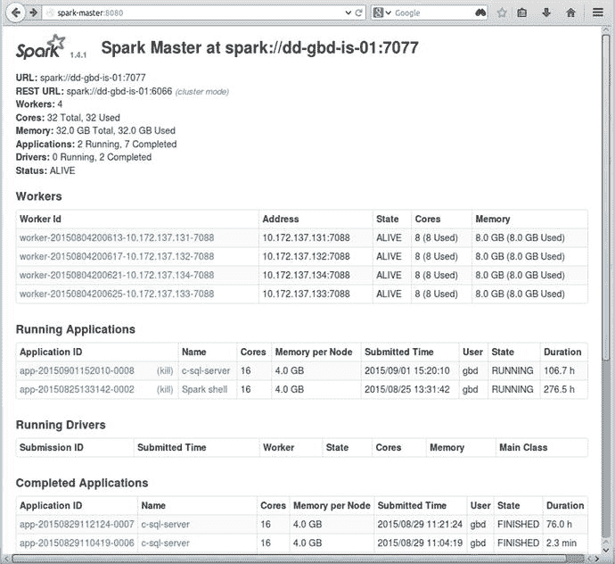
*图 11-1. 用于监控 Spark 主节点的 Web 用户界面*

监控页面包含多个部分。顶部显示 Spark 版本和 Spark 主节点的 `URL`。这是工作节点需要用来连接到此主节点的 `URL`。

下一部分显示集群的摘要信息。它显示了集群中的工作节点数量、所有工作节点上可用的和正在使用的核心数、所有工作节点上可用的和正在使用的内存总量、当前正在运行和已完成的应用数量，以及主节点的当前状态。

摘要部分之后是 `Workers`（工作节点）部分，该部分提供主节点已知的所有工作节点的摘要信息。对于每个工作节点，本节显示其位置、当前状态、可用和正在使用的核心数，以及可用和正在使用的内存量。

`Workers` 部分之后是 `Running Applications`（正在运行的应用）部分。它显示当前正在运行的应用的摘要信息。对于每个应用，本节显示其名称、当前状态、分配的资源、启动时间、所有者以及已运行的时间。

请注意，一个应用在不同工作节点上可能被授予不同数量的核心。`Cores`（核心）列显示了分配给一个应用的不同工作节点上的核心总数。

标题为 `Completed Applications`（已完成的应用）的部分显示了已不在集群上运行的 Spark 应用的信息。它的列与 `Running Applications` 部分类似。`Status`（状态）列显示应用是正常结束还是因错误而停止。

Spark 主节点的 Web 用户界面对于排查与集群相关的问题非常有用。例如，如果某个工作节点崩溃或未能正确启动，其状态将显示为 `DEAD`（已死亡）。同样，每个工作节点的核心和内存相关指标可以帮助你识别配置、资源分配以及使用相关问题。

工作节点可用的核心和内存应与该工作节点的配置设置相匹配。如果不匹配，则表明配置变量未正确初始化，或者 Spark 正在使用另一个配置文件。

工作节点上正在使用的核心和内存是识别和排查潜在性能问题的有用指标。理想情况下，所有工作节点上使用的核心和内存应该相同。如果一个工作节点显示使用了 `100%` 的可用核心和内存，而另一个工作节点仅显示使用了 `25%` 的可用核心和内存，则表明集群资源分配不均。因此，应用可能无法以最佳性能运行。你可能需要停止所有应用并重新启动它们。

核心和内存相关的指标也有助于确定集群资源是否可用于在 Spark 集群上启动新应用。如果内存或核心的总数与已使用数相同，则意味着 Spark 调度器无法为新应用分配核心或内存。例如，对于图 11-1 所示的集群，所有可用的核心和内存都已分配给当前在集群上运行的应用。核心和内存的已使用数与总数（可用数）相同。只有在某个现有应用完成后，新应用的作业才能在此集群上执行。

当您在集群上启动 Spark 应用程序时，请检查“正在运行的应用程序”部分下的应用程序状态。如果其状态为 `WAITING`，则表示 Spark 没有该应用程序所需的核数或内存。它将保持该状态，直到资源可用。您可以等待现有应用程序之一完成，增加分配给 Spark 工作节点的资源，或者减少新应用程序请求的资源。

“已完成的应用程序”部分对于识别性能问题和排查未正常完成的应用程序都很有用。“状态”列显示应用程序是正常完成还是失败。对于失败的应用程序，您可以查看日志以获取更多详细信息。“持续时间”列显示应用程序完成其作业所花费的时间。根据处理的数据量，不同应用程序的持续时间会有所不同。您可以通过持续时间来判断是否存在性能问题。

`Master` 的监控页面同时也是工作节点和应用程序监控 UI 的门户。“工作节点”部分提供了指向每个工作节点监控 UI 的链接。类似地，“应用程序”部分提供了指向集群上部署的每个 Spark 应用程序监控 UI 的链接。

当您点击某个应用程序的应用程序 `ID` 时，会看到如图 11-2 所示的页面。它显示了有关应用程序及其执行器的摘要信息。

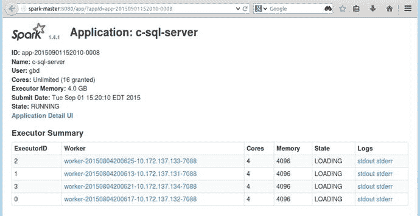
*图 11-2. 用于监控执行器的 Web UI*

顶部区域显示应用程序名称、所有者、请求和分配的核数、分配给每个执行器的内存、启动时间和当前状态。

“执行器摘要”部分提供了为应用程序启动的每个执行器的摘要。执行器执行应用程序任务。对于每个执行器，此部分显示其运行所在的工作节点、分配给它的资源、其当前状态以及指向其日志文件的链接。

此页面提供了在每个工作节点上分配给应用程序的资源的快速概览。理想情况下，每个节点上分配的核数和内存应该相同。不均衡的资源分配可能会导致性能问题。

此页面还允许您远程查看执行器日志。日志文件包含用于排查问题的有用信息。您也可以浏览日志文件，以更好地了解 Spark 的工作原理。

Spark 执行器将所有日志（包括 `DEBUG` 和 `INFO` 日志）写入 `stderr` 文件。`stdout` 文件为空。如果任务失败或抛出异常，请检查 `stderr` 文件来调试问题。您还可以使用日志文件来分析性能问题。

### 监控 Spark 工作节点

与 Spark `master` 类似，Spark 工作节点可以从浏览器远程监控。访问工作节点监控 Web UI 的默认 TCP 端口是 `8081`。如果端口 `8081` 不可用，您可以配置 Spark 工作节点使用其他端口。

图 11-3 显示了用于监控 Spark 工作节点的 Web UI 示例。

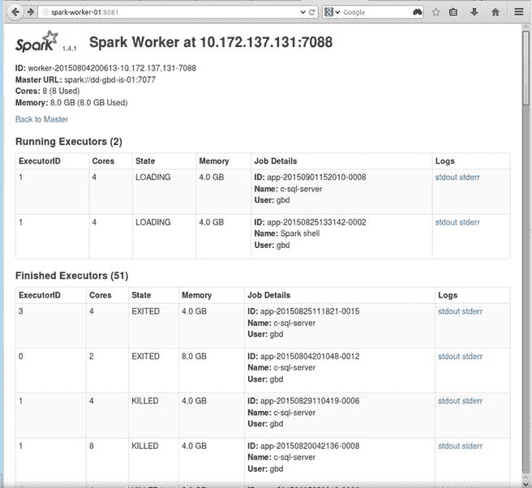
*图 11-3. 用于监控 Spark 工作节点的 Web UI*

工作节点监控 UI 显示了关于 Spark 工作节点以及在该节点上启动的执行器的摘要信息。

页面顶部显示了 Spark 版本和工作节点的位置。接下来，它显示工作节点所连接的 `master`，以及工作节点上可用和已使用的资源。

下一部分显示了当前在工作节点上运行的执行器。对于每个执行器，此部分显示其当前状态、分配的资源以及指向日志文件的链接。它还显示了所有者和启动执行器所对应的应用程序。

最后一部分显示有关已完成的执行器的相同信息。唯一的区别是“状态”列显示了执行器是如何终止的。

工作节点监控页面对于检查工作节点上的资源如何分配给不同的应用程序非常有用。根据您的需求，您可以在不同应用程序之间平均分配资源，或者为不同应用程序分配不同的数量。

您还可以使用工作节点监控页面远程检查日志文件。这些日志文件与上一节讨论的日志文件相同。区别在于，工作节点监控页面允许您检查在工作节点上运行的不同执行器生成的日志文件，而执行器监控页面允许您检查在不同工作节点上运行的执行器生成的日志文件。

## 监控 Spark 应用程序

Spark 支持多种用于监控 Spark 应用程序的工具。

首先，它预装了一个基于 Web 的监控应用程序。从浏览器访问内置监控应用程序的默认 TCP 端口是 `4040`。如果在同一主机上启动了多个 Spark 应用程序，它们将从端口 `4040` 开始绑定到后续的端口。

其次，Spark 提供了一个 `REST API`，用于以编程方式访问监控指标。`REST API` 以 `JSON` 格式返回指标。这允许应用程序开发人员创建自定义监控应用程序，或将 Spark 应用程序监控与其他应用程序监控集成。

第三，可以将 Spark 配置为将应用程序指标发送给第三方监控工具，例如 `Graphite`、`Ganglia` 和基于 `JMX` 的控制台。Spark 使用 `Metrics` Java 库，因此 Spark 支持 `Metrics` 库所支持的任何监控工具。

本节介绍内置的基于 Web 的监控应用程序或 UI。

### 监控应用程序启动的作业

您可以使用驱动程序程序的监控 `URL`，从浏览器连接到 Spark 的应用程序监控 UI。请使用运行驱动程序程序的计算机的主机名或 `IP` 地址。默认端口是 `4040`。您也可以通过在 Spark `master` 的监控 UI 中点击应用程序名称来访问应用程序监控 UI。

应用程序监控 UI 由多个选项卡组成。它有单独的选项卡来监控与作业、阶段、任务、执行器和其他一些内容相关的指标。默认选项卡是“作业”选项卡。

“作业”选项卡提供了应用程序启动的当前正在运行、已完成和失败的 Spark 作业的摘要。图 11-4 显示了一个示例。

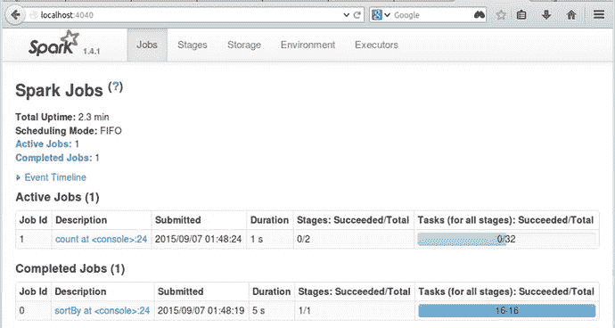
*图 11-4. 用于监控 Spark 应用程序的 Web UI*

页面顶部显示了应用程序的运行时间和调度模式。它还显示了活动、已完成和失败的作业总数。

“活动作业”部分提供了活动作业的摘要。它显示了每个作业的总阶段数和任务数以及已完成的阶段数和任务数。此外，它还显示了每个作业的描述、启动时间和持续时间。

“已完成作业”部分提供了已完成作业的摘要。它显示的信息与“活动作业”部分类似。

最后一部分提供了失败作业的摘要。对于未完成的作业，它显示的信息与前两部分类似。

“作业”选项卡对于检测性能问题很有用。“持续时间”列显示了每个作业所花费的时间。根据处理的数据量，您可以判断一个作业是否正在或已经花费了异常长的时间来完成。如果某个作业花费了异常长的时间，您可以深入分析有问题的阶段或任务。

### 监控作业中的阶段

`Jobs` 选项卡上的作业描述是超链接。点击作业描述，将进入一个页面，其中显示有关作业的更多详细信息。

图 11-5 展示了一个用于查看作业详细信息的 Web UI 示例。

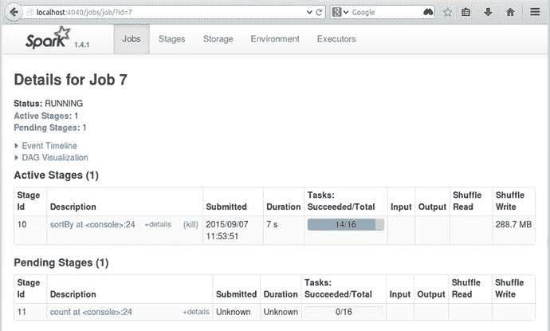
*图 11-5. 用于监控作业详情的 Web UI*

`Details` 页面被分成多个部分。第一部分显示作业中处于活跃和待处理状态的阶段总数，以及作业的当前状态。

`Active Stages` 部分显示了当前正在运行的阶段的摘要。下一部分则显示了等待执行阶段的摘要信息。处于待处理状态的阶段依赖于一个或多个活跃阶段。

不同列提供的信息有助于排查性能问题。例如，你可以检查 `Duration` 列来查找耗时异常长的阶段。`Tasks` 列显示了一个阶段内的并行度。根据集群的大小，任务数量过多或过少都可能成为性能问题的根源。同样地，`Shuffle Read` 和 `Write` 列提供的信息可用于优化应用程序性能。数据混洗会对应用程序性能产生负面影响，因此应尽量减少混洗读写量。

你也可以在此页面终止一个作业。如果某个作业耗时过长并阻塞了其他作业，或者你想修改代码后重新运行一个长时间运行的作业，可以在此处将其终止。描述列提供了一个终止作业的链接。

`Details` 页面还包含一些链接，用于显示作业的事件时间线以及 Spark 为作业生成的 `DAG` 可视化表示。

图 11-6 展示了一个 `DAG` 的可视化表示示例。

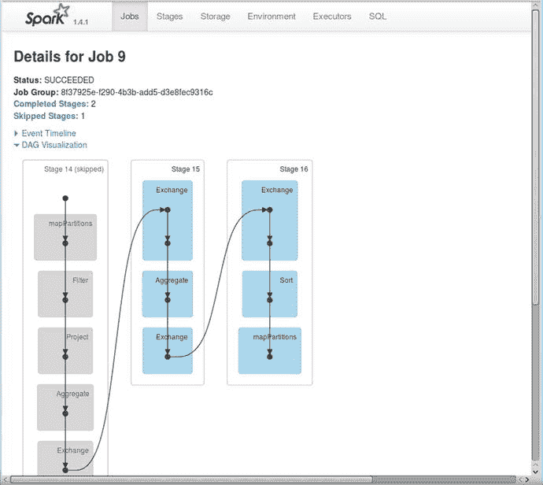
*图 11-6. `DAG` 的可视化表示*

### 监控阶段中的任务

点击 `Jobs` 页面上显示的某个阶段的描述时，Web UI 会带你进入一个显示该阶段中任务详细信息的页面。

这是排查性能问题最有用的页面之一。它是一个信息丰富的页面，包含大量有用信息。与之前讨论的其他监控页面相比，它提供了更细粒度的信息。

花些时间熟悉此页面提供的信息，这将有助于你更好地理解作业在 Spark 集群上是如何执行的。

图 11-7 展示了一个显示阶段详情的 Web UI 页面示例。

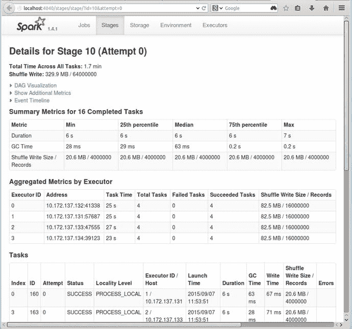
*图 11-7. 用于监控阶段详情的 Web UI*

与其他监控 UI 页面类似，阶段详情页面也分为多个部分。它以阶段的摘要信息开始。接下来，它提供了用于查看阶段 `DAG`、阶段其他指标以及阶段内任务时间线的链接。

当你点击事件时间线链接时，它会显示阶段内任务的时间线。它不仅能显示每个工作节点上并行运行的任务数量，还能显示哪些活动构成了任务完成所花费的总时间。

图 11-8 展示了一个时间线图的示例。在这个例子中，每个执行器并行运行四个任务。这些任务是计算密集型的，数据混洗很少。

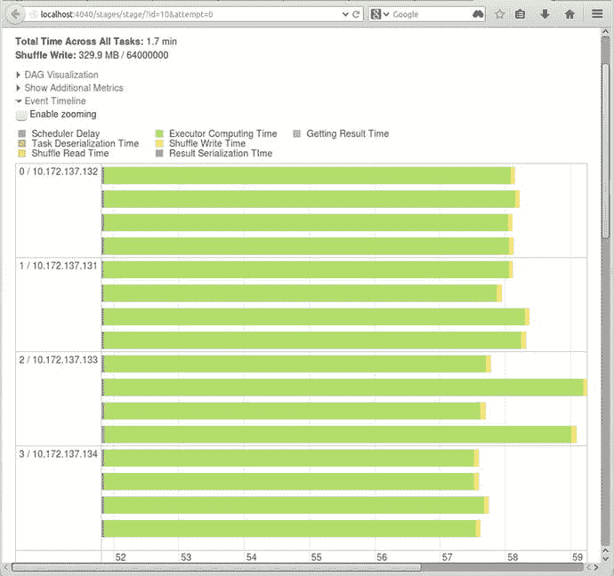
*图 11-8. 用于监控事件时间线的 Web UI*

图 11-9 展示了另一个示例。它显示了一个具有不同特性的阶段的事件时间线图。

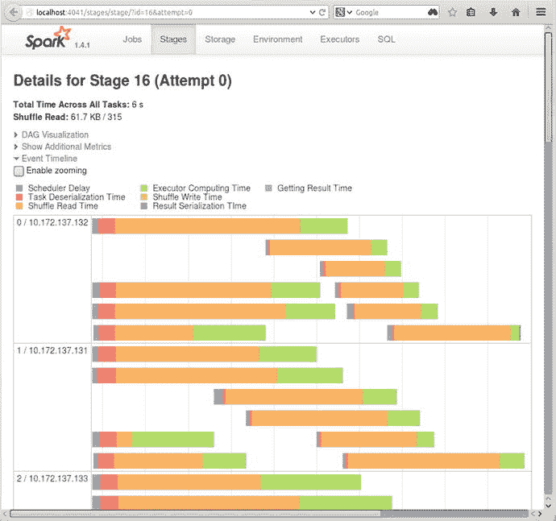
*图 11-9. 另一个事件时间线示例*

下一部分显示了阶段中已完成任务的指标摘要。图 11-10 展示了一个示例。

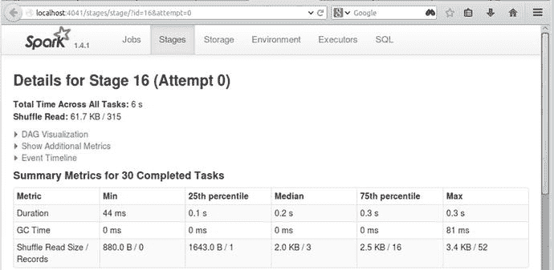
*图 11-10. 已完成任务的摘要指标*

快速浏览此部分可以判断阶段中是否存在掉队任务。如果任何四分位数的任务持续时间过高，则表明存在问题。一种可能性是某些分区太大。另一种可能性是混洗对任务产生了负面影响。同样，此部分可用于检查 `GC` 活动是否影响了性能。

下一部分显示了按执行器聚合的指标。图 11-11 展示了一个示例。

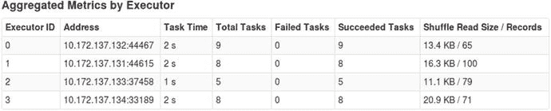
*图 11-11. 按执行器聚合的指标*

最后一部分显示了阶段中每个任务的信息。它展示了每个任务的关键指标。图 11-12 展示了一个示例。

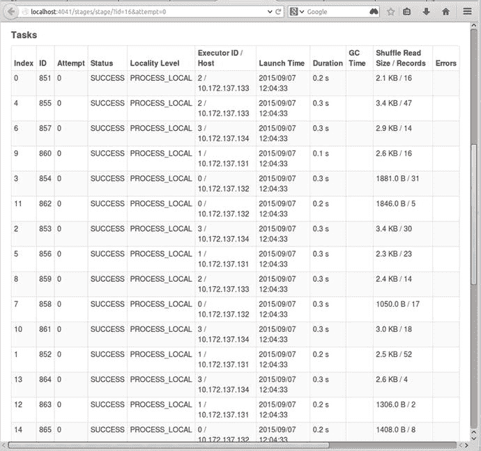
*图 11-12. 任务指标*

此部分对于识别有问题的任务非常有用。它显示了每个任务的持续时间以及其所处理的数据量。你可以使用这两列来查找运行缓慢或掉队的任务。此外，你应该检查 `GC` 时间来确认任务运行缓慢是否由 `GC` 活动导致。

另一个有用的指标是数据本地性级别。本地性级别 `PROCESS_LOCAL` 表示任务处理的数据缓存在内存中。本地性级别 `NODE_LOCAL` 表示数据是从本地存储读取的，而 `ANY` 表示数据可能来自集群中的任何节点。处理本地性级别为 `PROCESS_LOCAL` 的数据的任务会非常快。

你还可以使用此表来确定每个执行器内部以及不同执行器之间并行运行的任务数量。因此，它可以让你了解节点之间以及执行器内部的并行度情况。

图 11-13 展示了另一个示例。它显示了另一个阶段的 `Details` 页面。

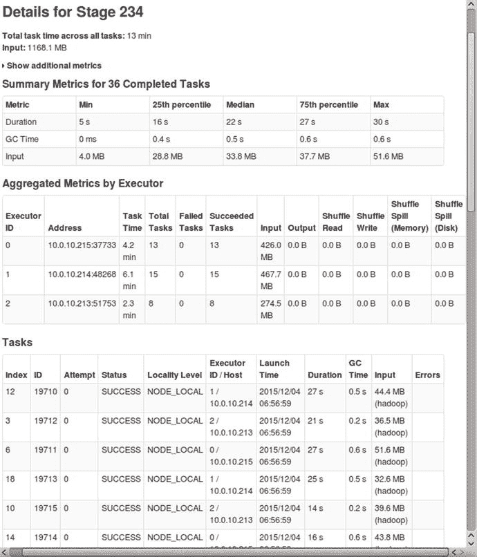
*图 11-13. 某个阶段的详细信息*

## 监控 RDD 存储

Spark 应用缓存到内存或磁盘中的数据量，可以通过点击 Web UI 中的“存储”标签页查看。该页面提供了每个持久化 RDD 的摘要信息。

`存储级别`列展示了数据集是如何被缓存的。此外，它还显示了缓存数据的副本数量。`内存大小`列对于故障排查非常有用。反序列化数据占用的内存空间可能远大于序列化数据。

图 11-14 中的示例展示了一个在内存中缓存了 Hive 表的应用的“`存储`”标签页。

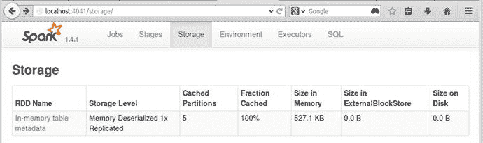

图 11-14. 缓存的 Hive 表

图 11-15 中的示例展示了一个在内存中缓存了 RDD 的应用的“`存储`”标签页。

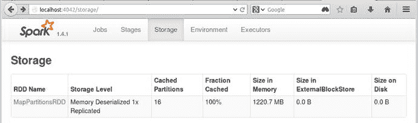

图 11-15. 缓存的 RDD

`RDD 名称`列中显示的名称是超链接。当你点击此列中的条目时，Web UI 会带你到一个页面，该页面包含关于持久化 RDD 的更详细信息。

图 11-16 显示了一个包含详细 RDD 存储信息的示例页面。

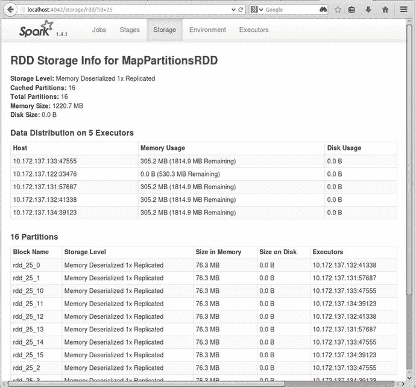

图 11-16. 详细的 RDD 存储信息

第一部分显示了一个缓存 RDD 的摘要信息。此处显示的信息与上图相同。

第二部分显示了缓存的 RDD 在不同执行器之间的分布情况。它展示了每个执行器上用于缓存 RDD 的内存使用量。

第三部分显示了每个缓存 RDD 分区的信息。它展示了每个缓存 RDD 分区的存储级别、位置和大小。

## 监控环境

“`环境`”标签页显示了各种环境和配置变量的值。一个示例页面如图 11-17 所示。

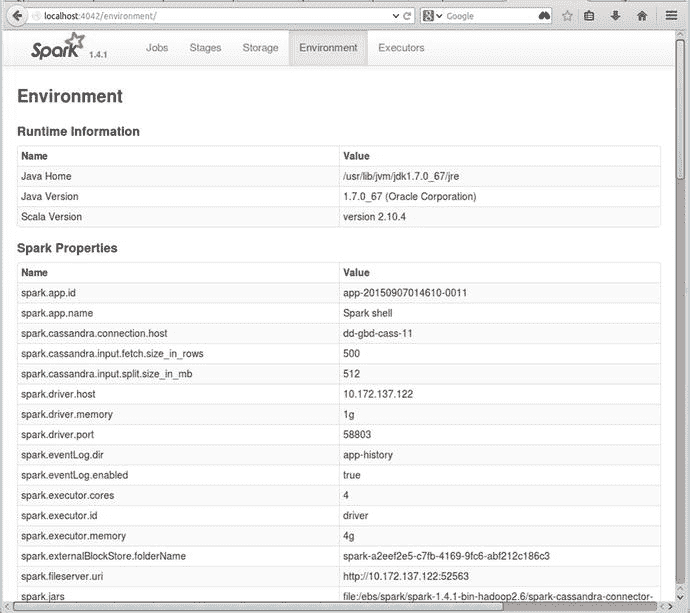

图 11-17. 环境和配置变量

“`环境`”标签页对于验证配置和环境变量是否设置正确非常有用。查看它们可以帮助你识别潜在问题。例如，某些变量可以通过多种方式配置。你可以通过编程方式设置它们，将它们作为命令行参数传递，或者在配置文件中指定。Spark 在此类情况下定义了优先级顺序。然而，如果你忘记了优先级顺序，最终可能以与你预期不同的配置运行 Spark 应用。

此外，检查那些你没有显式设置的变量的默认值。如果默认值不适合你的应用程序，请显式配置这些变量。

## 监控执行器

“`执行器`”标签页提供了关于 Spark 为应用创建的执行器的摘要信息。一眼就能看到每个执行执行应用任务的执行器的有用指标。

一个示例如图 11-18 所示。

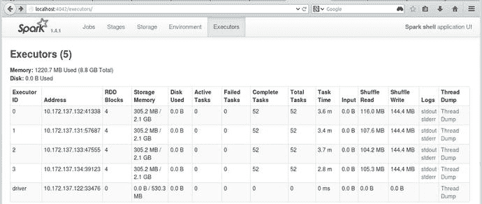

图 11-18. 监控执行器

对故障排查有用的一个列是“`存储内存`”列。它显示了为缓存数据保留的内存量以及已使用的内存量。如果可用内存少于你试图缓存的数据量，你将遇到性能问题。

类似地，“`Shuffle 读取`”和“`Shuffle 写入`”列对于排查性能问题也很有用。Shuffle 读取和写入是开销很大的操作。如果这些值过高，你应该重构应用代码或调优 Spark 以减少 Shuffle。

另一个有用的列是“`日志`”列。它包含指向每个执行器生成的日志的超链接。如前所述，你不仅可以用它们来调试应用，还可以深入了解 Spark 内部机制。

Web UI 还针对一些 Spark 库提供了额外的标签页。接下来的几个部分简要概述了特定于库的标签页。

## 监控 Spark Streaming 应用

如果你正在运行 Spark Streaming 应用，Web UI 会显示一个标签页用于可视化其执行过程。“`流`”标签页展示了对于排查 Spark Streaming 应用有用的指标。

一个示例如图 11-19 所示。

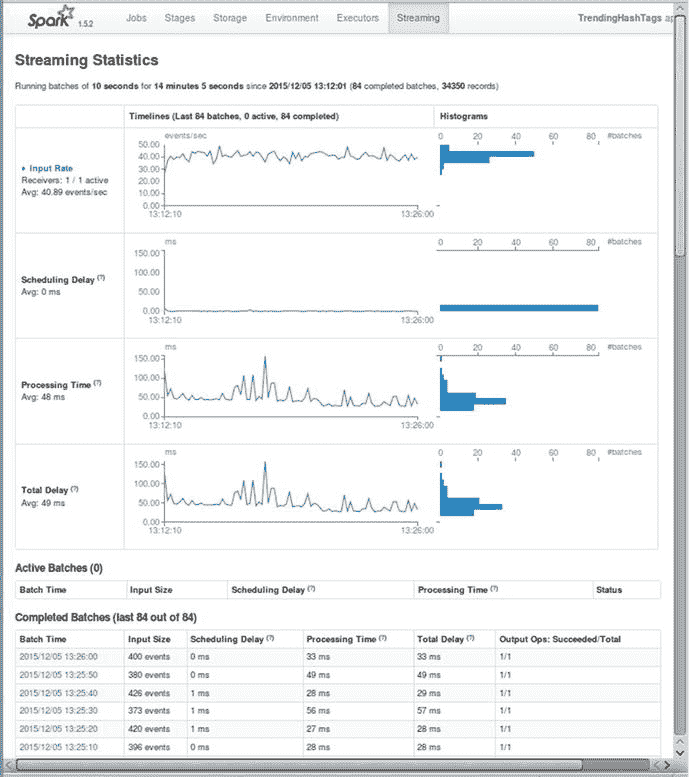

图 11-19. 监控 Spark Streaming

“`流`”标签页展示了一个信息丰富的页面，包含许多有用的指标。它显示了检测 Spark Streaming 应用性能问题的关键指标。

你应特别关注的指标是数据流中微批次的平均调度延迟和平均处理时间。调度延迟是一个微批次等待前一个微批次完成的时间。平均调度延迟应几乎为零。这意味着微批次的平均处理时间应小于批处理间隔。如果平均处理时间小于批处理间隔，Spark Streaming 会在下一个微批次创建之前完成对当前微批次的处理。另一方面，如果平均处理时间大于批处理间隔，则会导致微批次积压。积压会随着时间的推移而增长，最终使应用变得不稳定。

“`流`”标签页使得分析落后批次变得容易。显示处理时间的时间线图中的峰值代表处理时间的跳跃。如果你点击一个峰值，它将带你到“`已完成批次`”部分中相应的批次。在那里，你可以点击“`批次时间`”列中的链接，查看处理时间较长的批次的详细信息。

## 监控 Spark SQL 查询

如果你执行 Spark SQL 查询，Web UI 会显示“`Spark SQL`”标签页。图 11-20 显示了一个示例的“`SQL`”标签页，该页面展示了从 Spark Shell 提交的 Spark SQL 查询的信息。

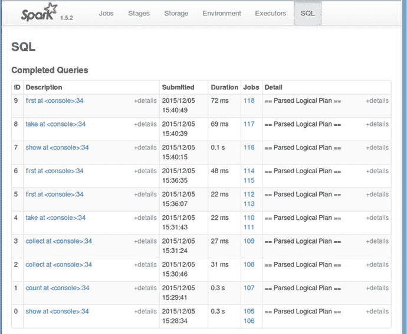

图 11-20. 监控 Spark SQL 查询

“`SQL`”标签页使得排查 Spark SQL 查询变得容易。“`详情`”列提供了一个链接，指向 Spark SQL 为查询生成的逻辑计划和物理计划。如果你点击详情链接，它将显示解析后的、分析后的、优化后的逻辑计划，以及该查询的物理计划。

“`作业`”列对于分析慢查询也很有用。它显示了 Spark SQL 为执行查询而创建的 Spark 作业。如果一个查询耗时很长，你可以通过点击“`作业`”列中显示的相应作业 ID 来分析它。它会带你到显示作业中各阶段的页面。你可以从那里进一步深入到各个任务。

## 监控 Spark SQL JDBC/ODBC 服务器

如果 Spark SQL JDBC/ODBC 服务器正在运行，监控 Web UI 会显示“`JDBC/ODBC 服务器`”标签页。“`JDBC/ODBC 服务器`”标签页允许你监控提交给 Spark SQL JDBC/ODBC 服务器的 SQL 查询。

一个示例如图 11-21 所示。

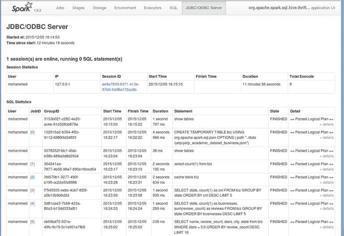

图 11-21. 监控 Spark SQL JDBC/ODBC 服务器

与“`SQL`”标签页类似，“`JDBC/ODBC 服务器`”标签页使得排查 Spark SQL 查询变得容易。它展示了 SQL 语句及其完成所需的时间。你可以通过检查其逻辑和物理计划来分析慢查询。它还允许你深入查看为执行查询而创建的 Spark 作业。

## 概述

Spark 对外暴露了大量的监控指标，并且预先打包了基于 Web 的应用，可用于监控 Spark 独立集群和 Spark 应用程序。此外，它还支持第三方监控工具，例如 Graphite、Ganglia 以及基于 JMX 的控制台。

Spark 提供的监控功能既有助于排查问题，也有助于优化应用程序性能。监控 Web UI 可以帮助您发现配置问题和性能瓶颈。如果某个作业耗时过长，您可以使用 Web UI 进行分析和排查。同样，如果应用程序崩溃，监控 UI 可让您远程检查日志文件并诊断问题。