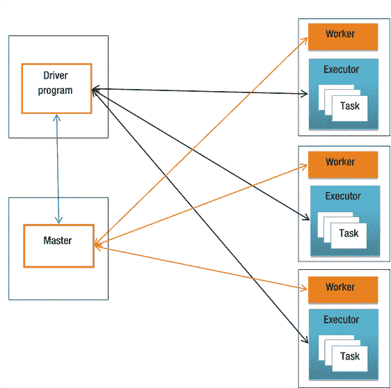
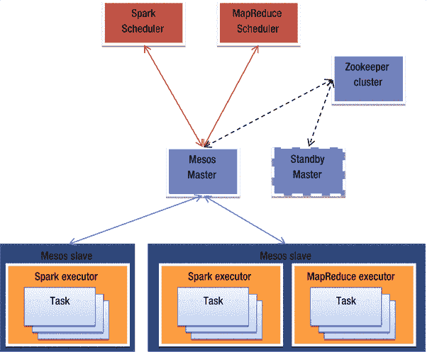
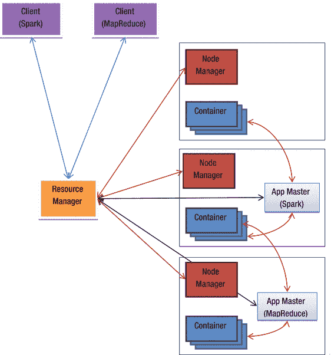

# 10. 集群管理器

集群管理器负责管理计算机集群。更具体地说，它管理集群节点上可用的 CPU、内存、存储、端口及其他资源。它汇集每个集群节点上的可用资源，并使不同的应用程序能够共享这些资源。因此，它将普通计算机集群转变为一台可供多个应用程序共享的虚拟超级计算机。

分布式计算框架使用嵌入式的或外部的集群管理器。例如，在 2.0 版本之前，Hadoop MapReduce 使用嵌入式的集群管理器。在 Hadoop 2.0 中，集群管理器与计算引擎分离。它成为一个独立的组件，可以与包括 MapReduce、Spark 和 Tez 在内的任何计算引擎配对使用。

Spark 自带集群管理器，但也可以与其他几个开源集群管理器一起使用。本章介绍 Spark 支持的不同集群管理器。

请注意，Spark 应用程序编程接口与集群管理器无关；Spark 应用程序可以部署在任何 Spark 支持的集群管理器上，而无需修改任何代码。因此，Spark 应用程序是对集群管理器透明的。

Spark 支持三种集群管理器：Apache Mesos、Hadoop YARN 和独立集群管理器。它提供了一个可用于将 Spark 应用程序部署到任何受支持集群管理器上的脚本。

## 独立集群管理器

独立集群管理器与 Spark 捆绑在一起。它提供了搭建 Spark 集群最简单的方法。


### 架构

Standalone 集群管理器由两个关键组件构成：`master`和`worker`（见图 10-1）。`worker`进程管理集群节点上的计算资源。`master`进程汇集所有`worker`的计算资源，并将它们分配给应用程序。`master`进程可以运行在独立的服务器上，也可以与`worker`进程一同运行在某个工作节点上。



图 10-1. Standalone 架构

使用 Standalone 集群管理器部署的 Spark 应用程序涉及以下关键实体：`driver program`、`executor`和`task`。`driver program`是使用 Spark 库的应用程序，它提供数据处理逻辑。`executor`是运行在工作节点上的 JVM 进程，执行由`driver program`提交的数据处理作业。一个`executor`可以同时运行一个或多个`task`，并为数据缓存提供内存。

`driver program`通过`SparkContext`对象连接到集群，该对象是进入 Spark 库的入口点。`SparkContext`对象使用`master`来获取工作节点上的计算资源。接着，它在工作节点上启动`executor`，并将应用程序代码发送给`executor`。最后，它将数据处理作业拆分为多个`task`，并将它们发送给`executor`执行。

### 设置 Standalone 集群

设置 Standalone 集群很简单：只需在每个集群节点上下载并解压 Spark 二进制文件。接着，启动`master`和`workers`。可以逐个手动启动`master`和`workers`，也可以使用 Spark 提供的脚本同时启动它们。

#### 手动启动集群

首先，在其中一台服务器上启动`master`进程，然后在每个集群节点上启动`worker`进程。

如下所示启动`master`进程：

```
$ /path/to/spark/sbin/start-master.sh
```

默认情况下，`master`进程在端口`7077`上监听非本地 IP 地址的连接。IP 地址和端口都是可配置的。

接下来，在 Spark 集群的每个节点上启动一个`worker`。可以如下启动：

```
$ /path/to/spark/sbin/start-slave.sh <master-URL>
```

`master-URL`的格式为`spark://HOST:PORT`，其中`HOST`是运行`master`进程的主机的主机名或 IP 地址，`PORT`是`master`监听的 TCP 端口。

用于启动`master`和`workers`的脚本接受命令行参数。表 10-1 列出了常用参数。

表 10-1. Standalone `master`和`worker`的命令行选项

| 选项 | 描述 |
| --- | --- |
| `--h HOST` | `master`或`worker`监听的主机名或 IP 地址。 |
| `--p PORT` | `master`或`worker`监听的 TCP 端口。默认情况下，`master`监听端口`7077`，`worker`监听随机端口。 |
| `--webui-port PORT` | 用于从浏览器监控`master`或`worker`的 TCP 端口。`master`默认端口为`8080`，`workers`默认端口为`8081`。 |
| `--cores CORES` | `worker`应分配给 Spark 应用程序的 CPU 核心数。默认情况下，`worker`分配所有核心。 |
| `--memory MEM` | `worker`应分配给 Spark 应用程序的内存量。默认情况下，`worker`分配总系统内存减去 1GB。 |

启动`master`和`worker`进程后，Spark 集群即可运行 Spark 应用程序。您可以通过浏览器连接到`master`的 webUI 端口（默认`8080`）来检查集群状态。第 11 章描述了 Spark 提供的基于 web 的监控界面。

#### 手动停止集群

可以使用 Spark 提供的脚本停止 Spark `worker`，如下所示：

```
$ /path/to/spark/sbin/stop-slave.sh
```

您必须在每台工作机器上执行此操作。

也可以使用 Spark 提供的脚本停止 Spark `master`：

```
$ /path/to/spark/sbin/stop-master.sh
```

#### 使用脚本启动集群

随着 Spark 集群中`worker`数量的增加，手动启动和停止`master`和`workers`变得繁琐。幸运的是，Spark 提供了脚本，可以一次性启动和停止`master`及所有`workers`。

要使用这些脚本，首先需要在`/path/to/spark/conf`目录下创建一个名为`slaves`的文件。该文件应列出所有`worker`的主机名或 IP 地址，每行一个。

此外，您需要启用从`master`机器到所有`worker`机器的基于私钥的 SSH 访问。在`master`上运行的启动脚本会通过 SSH 并行连接到所有`worker`。

满足这些要求后，您可以在`master`节点上运行`start-all.sh`脚本来启动 Spark 集群，如下所示：

```
$ /path/to/spark/sbin/start-all.sh
```

`start-all.sh`脚本使用默认配置启动`master`和`workers`。您可以通过在`/path/to/spark/conf`目录下的`spark-env.sh`文件中设置环境变量来指定自定义配置。Spark 在`/path/to/spark/conf`目录中提供了一个模板文件`spark-env.sh.template`。该文件列出了所有配置变量及其描述。复制此文件，重命名为`spark-env.sh`，并根据您的需求进行自定义。您需要在`master`和所有`worker`节点上执行此操作。

#### 使用脚本停止集群

您可以在`master`节点上运行`stop-all.sh`脚本停止集群，如下所示：

```
$ /path/to/spark/sbin/stop-all.sh
```

### 在 Standalone 集群上运行 Spark 应用程序

可以使用`spark-submit`脚本将 Spark 应用程序部署到 Standalone 集群上。首先，为您的应用程序创建一个 JAR 文件。如果它依赖于其他外部库，请创建一个包含应用程序代码及其所有外部依赖项的“uber”JAR。

可以如下在集群上启动 Spark 应用程序：

```
$ /path/to/spark/bin/spark-submit --master <master-URL> </path/to/app-jar> [app-arguments]
```

`spark-submit`脚本是可配置的；它接受许多命令行选项。您可以使用`help`选项了解所有可以传递给`spark-submit`的选项。

```
$ /path/to/spark/bin/spark-submit --help
```

Spark 应用程序可以以两种模式部署到集群上：`client`模式和`cluster`模式。`spark-submit`脚本提供了一个命令行选项`--deploy-mode`，可用于在`client`模式或`cluster`模式下运行 Spark 应用程序。默认情况下，它以`client`模式运行。

> **注意**：请记住，Spark 应用程序也称为`driver program`。本章中这两个术语可以互换使用。


好的，作为高级文档工程师和翻译员，我将严格遵循您提供的注意事项和示例格式，对给定的英文文本进行翻译。


#### 客户端模式

在客户端模式下，驱动程序运行在用于将 Spark 应用程序部署到 Spark 集群的客户端进程中。例如，如果您使用`spark-submit`脚本来部署 Spark 应用程序，那么该`spark-submit`脚本就是客户端。在这种情况下，驱动程序（本质上是您的 Spark 应用程序）与运行`spark-submit`脚本的进程在同一个进程中运行。

在客户端模式下，驱动程序的标准输入和标准输出会连接到启动它的控制台。此外，它可以读取和写入启动它的机器上的本地文件。

仅当客户端机器与 Spark 集群位于同一网络时，才建议使用客户端部署模式。您可以使用主节点或同一网络上的另一台机器以客户端模式启动 Spark 应用程序。

如下所示，Spark 应用程序可以以客户端模式启动。

```
$ /path/to/spark/bin/spark-submit --deploy-mode client \
                                  --master <master-URL> \
                                  </path/to/app-jar> [app-arguments]
```

如前所述，默认模式就是客户端模式，因此如果您想以客户端模式运行应用程序，则不一定需要指定`deploy-mode`。

#### 集群模式

在集群模式下，驱动程序运行在 Spark 集群中的一个工作节点上。`spark-submit`脚本向主节点发送请求，以找到一个运行驱动程序的工作节点。然后，该驱动程序从其中一个工作进程中启动。

如果部署 Spark 应用程序的机器与 Spark 集群不在同一网络上，建议使用集群模式。这可以最大限度地减少驱动程序与执行器之间的网络延迟。此模式还允许您选择，如果驱动程序以非零退出代码终止，则自动重启该驱动程序。

请注意，当使用`spark-submit`脚本以集群模式部署应用程序时，该脚本在提交应用程序后会退出。此外，由于驱动程序运行在工作节点上，它无法访问部署它的机器的控制台。它需要将其输出存储在文件或数据库中。

如下所示，Spark 应用程序可以以集群模式启动。

```
$ /path/to/spark/bin/spark-submit --deploy-mode cluster \
                                  --master <master-URL> \
                                  </path/to/app-jar> [app-arguments]
```

当应用程序以集群模式部署时，`spark-submit`脚本会打印一个提交 ID，该 ID 可用于检查驱动程序的状态或停止它。

如下所示，可以检查以集群模式运行的驱动程序的状态。

```
$ /path/to/spark/bin/spark-submit --status <submission-id>
```

如下所示，可以停止以集群模式运行的驱动程序。

```
$ /path/to/spark/bin/spark-submit --kill <submission-id>
```

如果您希望在驱动程序以非零退出代码终止时自动重启，请使用`--supervise`标志，如下所示。

```
$ /path/to/spark/bin/spark-submit --deploy-mode cluster --supervise \
                                  --master <master-URL> \
                                  </path/to/app-jar> [app-arguments]
```

## Apache Mesos

Apache Mesos 是一个开源集群管理器。从概念上讲，它可以被视为计算机集群的操作系统内核。它将集群中多台机器的计算资源汇集在一起，并允许这些资源在多样化的应用程序之间共享。

Mesos 提供了 Java、C++ 和 Python 的 API，用于获取集群资源和跨集群调度任务。此外，它还提供了一个用于监控集群的 Web UI。

Mesos 的主要优势之一是它允许不同的分布式计算框架动态共享集群资源。它允许 Spark 和非 Spark 应用程序同时在同一集群上运行。例如，Mesos 可以在动态共享的节点池上运行 Spark、Hadoop、MPI、Kafka、Elastic Search、Storm 和其他应用程序。

通过允许不同的计算框架动态共享集群，Mesos 不仅能有效利用集群资源，还能防止昂贵的数据复制。使用不同框架编写的应用程序可以处理相同的数据，而无需将数据从一个集群复制到另一个集群。

Mesos 提供的功能远多于 Spark 独立集群管理器。它不仅允许不同的框架共享集群资源，还使得开发分布式计算框架变得更加容易。

以下是 Mesos 的其他关键特性：

- 可扩展到 10,000 个节点
- 容错的主节点和从节点
- 多资源（CPU、内存、磁盘和端口）调度
- 支持 Docker 容器
- 任务间的原生隔离

### 架构

Mesos 集群管理器包含两个关键组件：主节点和从节点（参见图 10-2）。类似于独立集群中的工作节点，Mesos 从节点管理集群节点上的计算资源。Mesos 主节点管理 Mesos 从节点，并汇集每个从节点管理的资源。



图 10-2. Mesos 架构

使用 Mesos 实现的框架或应用程序包含一个调度器和多个执行器。执行器在从节点上运行并执行应用程序任务。

为防止单点故障，Mesos 支持多个主节点。在任何给定时间，只有一个主节点处于活动状态，其他主节点处于待命模式。如果活动主节点发生故障，则会选举出新的主节点。Mesos 使用 Zookeeper 处理主节点故障转移。

当应用程序部署到 Mesos 集群时，应用程序的调度器组件连接到 Mesos 主节点，后者会提供一个资源邀约。资源邀约是从节点上计算资源（如 CPU 核心、内存、磁盘和端口）的列表。Mesos 主节点向应用程序提供的资源量是可配置的。

调度器可以接受或拒绝 Mesos 主节点发送的邀约。如果它接受邀约，调度器会选择使用哪些提供的资源。接着，它将要在提供的资源上运行的应用程序任务发送给 Mesos 主节点。Mesos 主节点将这些任务转发给从节点，从节点为执行器分配适当的资源，执行器再运行应用程序任务。当任务完成并有新资源可用时，此过程会重复。

### 设置 Mesos 集群

Mesos 应安装在每个将用作 Mesos 主节点或从节点的节点上。下载和安装 Mesos 的说明请访问 [`mesos.apache.org/gettingstarted/`](http://mesos.apache.org/gettingstarted/)。

您可以运行带单个主节点的 Mesos。在这种情况下，您无需安装 Zookeeper。但是，建议安装 Zookeeper 以实现 Mesos 主节点故障转移。安装 Zookeeper 的说明请访问 [`zookeeper.apache.org/`](http://zookeeper.apache.org/)。

您可以通过在浏览器中连接到 Mesos 主节点的 5050 端口，来验证 Mesos 主节点和所有 Mesos 从节点是否正确设置。


### 在 Mesos 集群上运行 Spark 应用

在 Mesos 集群上部署 Spark 应用之前，必须完成以下步骤。

确保所有 Mesos Slave 节点都能访问 Spark 二进制文件。当 Mesos Slave 运行 Spark 任务时，需要访问 Spark 二进制文件来启动 Spark Executor。将 Spark 二进制文件放置在任何 Hadoop 可访问的 URI 或所有 Mesos Slave 节点的本地文件系统上。此外，在 `/path/to/spark/conf/spark-default.conf` 文件中配置变量 `spark.mesos.executor.home`，使其指向该位置。默认情况下，`spark.mesos.executor.home` 指向环境变量 `SPARK_HOME` 指定的目录位置。

在 `/path/to/spark/conf/spark-env.sh` 文件中设置以下环境变量。  
`MESOS_NATIVE_JAVA_LIBRARY=/path/to/libmesos.so`  
`SPARK_EXECUTOR_URI=/path/to/spark-x.y.z.tar.gz`

在 `/path/to/spark/conf/spark-default.conf` 文件中设置以下变量。  
`spark.executor.uri = /path/to/spark-x.y.z.tar.gz`

你可以使用 `spark-submit` 脚本在 Mesos 集群上启动一个 Spark 应用。

如下所示，可以在单主节点的 Mesos 集群上启动 Spark 应用。

`$ /path/to/spark/bin/spark-submit --master mesos://host:5050 </path/to/app-jar> [app-args]`

注意，这里的 Master URL 指向 Mesos 主节点。

在多主节点的 Mesos 集群上，可以像下面这样启动 Spark 应用。

```
$ /path/to/spark/bin/spark-submit \
    --master mesos://zk://host1:2181,host2:2181,host3:2181 \
    </path/to/app-jar> [app-args]
```

在这种情况下，Master URL 指向 ZooKeeper 节点。

#### 部署模式

Mesos 支持应用的客户端模式和集群模式部署。在客户端模式下，驱动程序在发起部署的机器上的客户端进程中运行。在集群模式下，它运行在其中一个 Mesos Slave 节点上。然而，在撰写本书时，Spark 不支持 Mesos 集群的集群模式。

#### 运行模式

Spark 应用可以在 Mesos 集群上以两种模式运行：细粒度模式和粗粒度模式。

##### 细粒度模式

在细粒度模式下，每个应用任务都作为独立的 Mesos 任务运行。这种模式支持不同应用之间动态共享集群资源。因此，它可以实现集群资源的高效利用。

然而，细粒度模式比粗粒度模式会产生更高的开销。它不适合迭代或交互式应用。

默认情况下，Spark 应用在 Mesos 集群上以细粒度模式运行。

##### 粗粒度模式

在粗粒度模式下，对于每个 Spark 应用，Spark 在每个 Mesos Slave 上启动一个长期运行的任务。应用提交的作业被拆分为任务，在这些长期运行的任务内部执行。在此模式下，Spark 会在应用的整个运行期间预留集群资源。

粗粒度模式产生的开销较低，但可能导致集群资源利用效率低下。例如，如果你在 Mesos 集群上启动一个 Spark shell，那么为该 Spark shell 预留的集群资源即使 Spark shell 处于空闲状态，也无法被任何其他应用使用。

要启用粗粒度模式，请在 `/path/to/spark/conf/spark-default.conf` 文件中设置以下变量。

`spark.mesos.coarse=true`

在粗粒度模式下，默认情况下，Spark 会将 Mesos 主节点提供给它的所有资源分配给一个应用。因此，你无法同时运行多个 Spark 应用。你可以通过限制 Spark 分配给应用的资源来改变这一默认行为。应用中 CPU 核心的最大数量可以在 `/path/to/spark/conf/spark-default.conf` 文件中配置，如下所示。

`spark.cores.max=N`

将 `N` 替换为符合你需求的正确数字。

## YARN

YARN（Yet Another Resource Negotiator，另一种资源协调器）也是一个通用的开源集群管理器。它从 Hadoop MapReduce 2.0 版本开始可用。事实上，Hadoop MapReduce 2.0 版本被称为 YARN。

第一代 Hadoop MapReduce 仅支持 MapReduce 计算引擎。它包含一个名为 JobTracker 的组件，该组件提供集群管理、作业调度以及监控功能。集群管理器和计算引擎紧密耦合。

在 Hadoop MapReduce 2.0 版本中，集群管理和作业调度/监控被拆分为独立的进程。YARN 提供集群管理功能，而特定于应用的 ApplicationMaster 提供作业调度和监控功能。采用这种新架构后，YARN 不仅可以支持 MapReduce 计算引擎，还可以支持其他计算引擎，如 Spark 和 Tez。

### 架构

YARN 集群管理器包含两个关键组件：ResourceManager 和 NodeManager（见图 10-3）。ResourceManager 相当于 YARN 中的 Mesos 主节点。NodeManager 相当于 YARN 中的 Mesos Slave 节点。



图 10-3. YARN 架构

NodeManager 管理单个节点上的可用资源，并将这些资源报告给 ResourceManager。ResourceManager 管理集群中所有节点的可用资源。它汇集所有 NodeManager 报告的资源，并将它们分配给不同的应用。本质上，它是一个调度器，负责在应用之间调度可用的集群资源。

基于 YARN 的分布式计算框架包含三个关键组件：客户端应用、ApplicationMaster 和容器。

客户端应用向 ResourceManager 提交作业。例如，`spark-submit` 脚本就是一个客户端应用。

ApplicationMaster 通常由 Spark 或 MapReduce 之类的库提供。它们为每个应用创建一个 ApplicationMaster。ApplicationMaster 拥有并在 YARN 集群上执行一个作业。ApplicationMaster 与 ResourceManager 协商资源，并与 NodeManagers 协作，使用容器来执行作业。它还监控作业并跟踪其进度。ApplicationMaster 运行在其中一台运行 NodeManager 的机器上。

从概念上讲，容器代表单个节点上可供应用使用的一组资源。ApplicationMaster 与 ResourceManager 协商执行作业所需的容器。分配成功后，它会与 NodeManagers 协作，在集群节点上启动容器。NodeManager 管理在一台机器上运行的容器。

ResourceManager 包含两个关键组件：ApplicationsManager 和 Scheduler。ApplicationsManager 接收来自客户端应用的作业，并分配第一个容器用于运行 ApplicationMaster。Scheduler 为 ApplicationMaster 分配集群资源以运行作业。它仅提供调度功能；不监控或跟踪应用状态。

使用 YARN 的一个好处是，Spark 和 MapReduce 应用可以共享同一个集群。如果你已有一个 Hadoop 集群，可以轻松地使用 YARN 在其上部署 Spark 应用。


### 在 YARN 集群上运行 Spark 应用

YARN 同时支持 Spark 应用的客户端模式与集群模式部署。在客户端模式下，驱动程序运行在部署 Spark 应用的客户端进程中。在此模式下，`ApplicationMaster` 仅用于向 `ResourceManager` 请求资源。在集群模式下，驱动程序运行在集群节点之一的 `ApplicationMaster` 进程中。

要在 YARN 集群上运行 Spark 应用，必须在 `/path/to/spark/conf/spark-env.sh` 文件中配置环境变量 `HADOOP_CONF_DIR` 或 `YARN_CONF_DIR`，使其指向包含客户端 Hadoop 配置文件的目录。

`spark-submit` 脚本也可用于在 YARN 集群上部署 Spark 应用。但在 YARN 集群上启动 Spark 应用时，master-URL 的值应为 `yarn-cluster` 或 `yarn-client`。Spark 会从 Hadoop 配置文件中获取 `ResourceManager` 的地址。

Spark 应用可以通过集群模式在 YARN 上启动，如下所示。

```
$ /path/to/spark/bin/spark-submit --class path.to.main.Class \
   --master yarn-cluster </path/to/app-jar> [app-args]
```

Spark 应用也可以通过客户端模式启动，如下所示。

```
$ /path/to/spark/bin/spark-submit --class path.to.main.Class \
   --master yarn-client </path/to/app-jar> [app-args]
```

## 总结

凭借其模块化架构，Spark 支持多种集群管理器。Spark 应用可以部署在 Mesos、YARN 或独立（Standalone）集群上。

独立集群管理器是 Spark 支持的三种集群管理器中最简单的一种。它易于安装和入门，但仅支持 Spark 应用，且功能有限。

YARN 允许 Spark 应用与 Hadoop MapReduce 应用共享集群资源。如果你已有运行 MapReduce 任务的现有 Hadoop 集群，可以使用 YARN 在同一集群上运行 Spark 作业。

Mesos 是本章介绍的三种集群管理器中通用性最强的。它被设计用于支持多种分布式计算应用，并允许集群资源的静态和动态共享。

