# 1. 大数据解决方案与物联网

本书以当前信息架构中最热门的两个技术概念作为章节标题：大数据与物联网。由于本书面向企业架构师、信息架构师，以及所有负责设计构建此类解决方案或关注项目最终成败的人员，我们将摒弃炒作。相反，我们旨在提供扎实的基础指导，帮助读者启动这类项目并最终成功交付。为此，我们首先回顾这些概念的出现背景、原因、前身，以及它们如何融入你正在构建的架构。

作者认为，大数据与物联网是重要的演进步骤，在定义新的信息架构项目时愈加相关。显然，当你阅读本书时，你已认同构成这些解决方案的技术能在组织的信息架构中发挥重要作用。由于我们相信这些步骤是演进性的，我们也认为，以往在开发和部署信息架构项目中积累的许多经验，能够且应当应用于大数据与物联网项目。

企业架构师将继续从敏捷方法论与开发流程中获益，这些方法能推动组织愿景的实现，并兼顾业务背景、治理以及从当前状态架构向期望未来状态的演进。一个关键里程碑是制定路线图，其中列出项目成功所必需的、按优先级排序的实施阶段。

那些已成功定义并构建了这些新一代解决方案的组织，遵循了这些最佳实践，并借鉴了他们在创建和部署前几代信息架构时积累的经验。我们将在本章中回顾其中的一些方法论。

另一方面，那些将大数据与物联网视为独特技术举措、实验或简历加分项的组织，往往难以从这类努力及技术本身中找到价值。许多项目从未与公司或组织内部的业务需求建立联系。当此类项目始终被定为纯技术研究时，它们通常会达到一个临界点：要么被视为未来资金的备选项，要么被直接宣告失败。这令人遗憾，但并非没有先例。

在本书中，我们考量的大数据举措通常包括：基于关系数据库管理系统（`RDBMS`）技术的传统数据仓库、`Hadoop`集群、`NoSQL`数据库以及其他新兴数据管理方案。我们将推动扩展信息架构采纳的举措描述范围延伸至物联网，即部署了带有智能控制器的传感器与设备的领域。这些传感器与设备连接至基础设施，以便对收集到的数据进行分析。设备上的智能传感器与控制器被设计为在需要时触发即时操作。

因此，本章开篇将描述大数据与物联网如何成为信息处理与架构漫长演进史的一部分。我们将在这类举措被构想出来之前的许久，开始这段历史的描述。图1-1展示了我们将快速浏览的时间线。

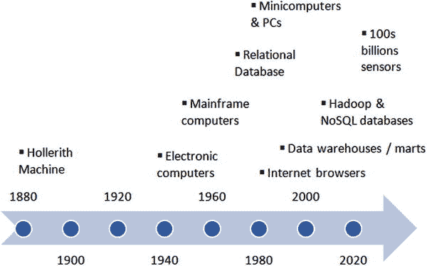

图1-1. 现代计算演进时间线

## 从穿孔卡片到决策支持

关于现代计算始于何时，众说纷纭。我们的历史描述从计算超越机械计算器之时开始。我们从专注于提供特定信息的数据处理方案讲起。许多人认为，一个重要的早期数据处理方案——它为后来的发展奠定了基础——是基于赫尔曼·何乐礼发明的穿孔卡片及设备。

这项发明最初解决的业务问题是对美国人口普查收集的数据进行制表与报告。在何乐礼于19世纪80年代提出其方案时，普查的概念当然不新鲜。数个世纪以来，政府一直手动收集其领土内的居民数量。在此期间，人们希望收集的数据项范围不断扩大，例如公民姓名、地址、性别、年龄、家庭规模、城乡地址、出生地、教育水平等。对更多此类关键绩效指标（`KPIs`）的需求，加之人口增长，推动了对更自动化数据收集与处理方式的需求。何乐礼的穿孔卡片方案满足了这些需求。到20世纪30年代，该技术已在其他类型的数据处理应用中广泛流行，例如为大型企业的会计系统提供基础。

20世纪40年代及第二次世界大战带来了更快解决复杂军事问题的需求，包括破译加密信息以及计算大型火炮发射炮弹的最佳弹道。快速且渐进式解决问题的需求，推动了早期电子计算设备的发展，这些设备由开关、真空管和布线机架组成，占满整个房间。战后，为军事计划制造更快计算机的研究继续进行，该技术也进入商业领域，用于财务会计等用途。

随后的几十年见证了现代软件操作系统与编程语言（使应用开发更简单、更快速）以及数据库（实现数据的快速简便检索）的引入。数据库从层次结构演变为更灵活的关系模型，其中数据存储于由行和列组成的表中。表通过公共列之间的外键进行关联。结构化查询语言（`SQL`）很快成为访问关系数据库的标准方式。

在整个20世纪70年代早期，应用开发侧重于对频繁更新的数据进行处理与报告，这后来被称为联机事务处理（`OLTP`）。软件开发的前提是捕获并报告业务或组织所需的特定`KPI`。尽管晶体管和集成电路极大地提升了这些系统的能力并开始降低计算成本，但大型机和软件仍然过于昂贵，无法进行大量实验。

所有这一切在20世纪70年代末至80年代初随着低成本小型计算机及个人电脑的引入而改变。电子表格和关系数据库使得最初被称为决策支持系统的数据能进行更灵活的分析。但随着时间的推移，数据变得更加分散，人们逐渐意识到，不一致的数据收集方法会导致存疑的分析结果和业务结论。定义新的信息架构方法的时机已经成熟。

# 数据仓库

比尔·恩门（Bill Inmon）通常被认为是首个将这些新型数据存储角色定义为“数据仓库”的人。他将数据仓库描述为“一种面向主题的、集成的、非易失的、随时间变化的数据集合，用于支持管理决策”。20 世纪 90 年代初，他进一步完善了企业数据仓库（EDW）的概念。EDW 被设计为一家公司所有历史数据的单一存储库。它被描述为包含一个第三范式数据模型，其中所有属性都是原子的且包含唯一值，类似于 OLTP 数据库中的模式。

图 1-2 展示了一个虚构的航空票务数据仓库第三范式模型的极小部分。如图所示，它可用于分析单个航空旅客交易、已出票的飞机座位、航段、已售票价以及促销/常旅客奖励。

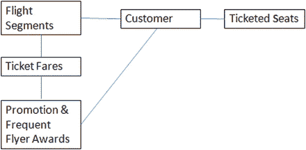
图 1-2. 简单的第三范式（3NF）模式

`EDW` 加载的数据是从源系统的 `OLTP` 表中提取的。在从各种来源提取数据时，通过转换来实现数据定义的一致性，并实施数据质量规则和标准。在数据仓库最初开发时，源和目标之间的抽取、转换、加载（`ETL`）处理通常以批处理模式按周或按月进行。然而，企业对近乎实时数据分析的需求不断推动数据仓库更频繁地加载数据。如今，数据加载通常是持续不断的涓流式输入，加载过程中的任何时间延迟通常源于数据必须经历的转换的复杂性。许多组织发现，减少数据转换造成延迟的唯一方法是对数据在 `OLTP` 系统中的初始填充方式制定更严格的规则，从而在源端确保质量和一致性，并减少转换需求。

许多早期的实践者最初专注于尽可能多地在数据仓库中收集数据，认为业务分析人员之后会自行决定如何利用这些数据。这种“建好了他们自然会来”的方法，常常因为业务分析人员无法轻松处理回答其业务问题所需的数据而导致项目停滞。许多业务分析师使用自己创建的多种提取工具，简单地将数据从 `EDW` 下载到电子表格中。他们有时还会用自己有权访问的其他来源的数据来补充这些数据。随后关于“单一事实版本”存在于何处引发了争论。这导致许多早期的 `EDW` 被宣布为失败，因此其设计受到了重新评估。

> **注意**  
> 如果 `EDW` 这种“建好了他们自然会来”的方法听起来与当今 IT 主导的 Hadoop 和 NoSQL 数据库项目中所尝试的方法相似，作者认为这并非巧合。正如任何架构师所知，形式应服从功能。另一方面，颠倒过来的概念并不是设计解决方案的正确方式。不幸的是，我们在许多这类大数据项目中看到历史正在重演，除非重新吸取过去的教训，否则其后果可能同样惨淡。

正当许多公司和组织的业务部门内部就 `EDW` 的实用性展开辩论时，拉尔夫·金博尔（Ralph Kimball）引入了一种方法，该方法似乎使业务分析人员能够以更直观的方式执行临时查询。他的星型模式设计以一个大型事实表为中心，周围环绕着维度表（有时称为查找表）并包含层次结构。这种模式被广泛部署在数据集中中，这些数据集通常被定义为面向业务部门的主题化数据仓库。

为了说明其用途，我们有一个非常简单的航空数据集市，如图 1-3 所示。我们想要确定 2014 年 7 月从美国飞往墨西哥的客户。如该星型模式所示，客户交易存储在事实表中。始发地和目的地维度表包含地理下钻信息（大洲、国家、州或省、城市和机场代码）。时间维度支持下钻到特定时间段（年、月、周、日、一天中的小时）。

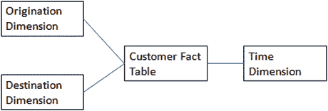
图 1-3. 简单的星型模式

并非所有关系型数据库最初都擅长在定义了星型模式的情况下提供最优的查询性能。这些性能挑战促使了专门设计用于处理层次结构和星型模式的多维在线分析处理（MOLAP）引擎的诞生。MOLAP 引擎之所以表现如此出色，是因为这些“立方体”由预连接的数据钻取路径组成。图 1-4 描绘了一个三维立方体的物理表示。

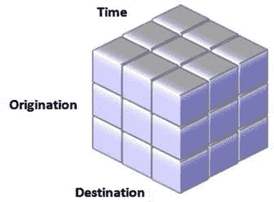
图 1-4. 三维立方体表示

后来，随着关系型数据库优化器的成熟，在关系型数据库管理系统内部署星型模式时，实现良好的查询性能成为可能。这些实现被称为关系型在线分析处理（ROLAP）实现。

### 独立数据集市与从属数据集市

在 20 世纪 90 年代中期，关于 `EDW` 与数据集市相比的实用性曾引发大量争论。当业务分析师发现星型模式更易于导航（并常常自行部署数据集市）时，一些 IT 数据库程序员通过在 `EDW` 中的数据和模式之上创建视图来回应这一反对意见。然而，构建视图所需的编程和维护工作通常不够及时，无法满足业务分析师日益增长的需求。

另一个问题也时常出现。当各个数据集市相互独立地定义和部署，且不遵循 `EDW` 内建立的数据定义规则时，通用数据的不一致表示会让人质疑真实数据的存储位置。图 1-5 展示了当不同业务线构建自己独立的数据集市并直接从 `OLTP` 源提取数据时可能出现的复杂性。在实际实施中，复杂性有时比图中所示的更大，因为数据也可能直接在数据集市之间流动。此图还可能加入电子表格，作为与独特数据存储和表示相关联的商业智能工具。以这种方式部署的组织通常会在业务会议上花费大量时间争论谁的报告能正确反映业务的真实状态，即使这些报告本应显示相同的 `KPI`。

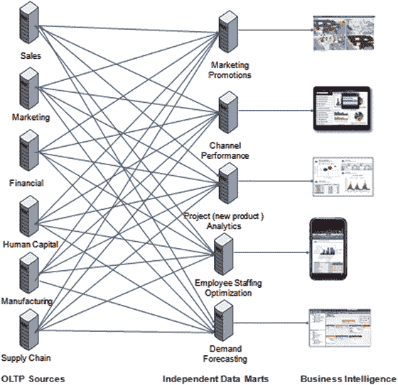
图 1-5. 源与目标集市之间具有独特 `ETL` 的独立数据集市

归根结底，争论本不应该是 `EDW` 与数据集市之间的对立。只要应用了正确的架构指南，两种方法都有其价值，而且理由充分。随着许多信息和数据仓库架构师开始认识到这一点，一种混合方法成为了最佳实践。`EDW` 得以实施，并随着数据集市中对新数据源的需求而逐步扩展。数据集市被设计为依赖于 `EDW` 中的数据定义。由于 `EDW` 仍然是历史记录的数据库，输入集市的数据均从 `EDW` 中提取。`EDW` 作为所有数据源的例外情况通常发生在存在仅与组织中某一条业务线相关的独特第三方数据时。此时，这些独特数据仅存储在该业务线的数据集中。

图 1-6 展示了依赖于 `EDW` 的数据集市。这种方法通常会导致定义一致性维度，以在数据集市之间建立一致性。当定义了一致性维度后，就可以提交单个查询来访问多个数据集市的数据（因为这些维度在各个数据集中代表了相同的层次结构）。

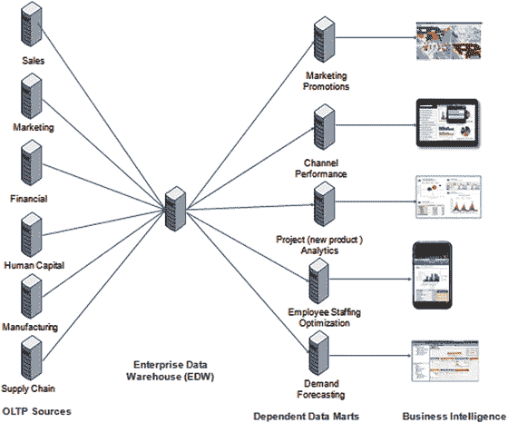
图 1-6. 从 `EDW`（可信数据源）进行 `ETL` 的从属数据集市

您最有可能遇到的、作为数据仓库和/或数据集市引擎的数据库数据管理平台包括：`Oracle (数据库企业版和 Essbase)`、`IBM (DB2 和 Netezza)`、`Microsoft SQL Server`、`Teradata`、`SAP HANA` 和 `HP Vertica`。常用的 `ETL` 工具包括 `Informatica`、`Oracle Data Integrator`、`IBM DataStage` 和 `Ab Initio`。

**注意**  
当 `EDW` 和数据集市首次成为企业运营的核心和必备要素时，信息架构师开始认识到这些平台也需要具备高可用性、可恢复性和安全性。如今，随着 Hadoop 集群和 NoSQL 数据库对业务线的重要性日益提升，对这些平台提出类似能力的需求正在推动这些发行版中新特性和功能的创建。这体现在开源社区较新的软件版本以及提供各种发行版的供应商越来越关注改进可用性、可恢复性和安全性。

### 增量方法

早期的数据仓库设计工作有时会陷入“过度分析导致的瘫痪”，侧重于优雅的 IT 设计，却未与业务线的需求相匹配。早期 `EDW` 的设计通常需要 12 个月或更长时间，远远超出业务需求的范围或业务发起人的关注周期。一些早期的从业者采用经典的瀑布式方法，首先确定整个 `EDW` 的工作范围，然后分配时间和资源。

图 1-7 说明了瀑布式方法。冗长的项目计划、延误以及缺乏对业务的关注，常常导致业务线自行其是，开发和部署独立的数据集市，或在电子表格中创建伪数据集市，以解决他们最紧迫的问题。

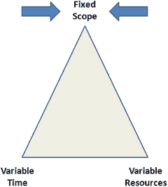
图 1-7. 瀑布式方法

鉴于这些问题，许多人放弃了瀑布式方法，转而采用敏捷增量方法来设计和开发。IT 部门与业务线之间建立了合作伙伴关系。在许多组织中，120 天或更短的时间范围内实施和评估业务解决方案的进展已变得司空见惯。图 1-8 展示了增量方法，并说明了分配固定时间和固定资源的情况。

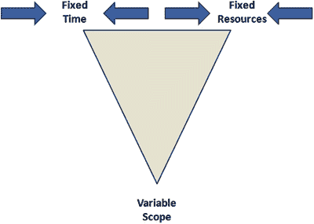
图 1-8. 增量方法

尽管图 1-8 显示可变范围，但应在流程的每个增量中展示一些与业务目标相符的实际商业价值。因此，在实践中，所应用的方法通常是增量方法和瀑布式方法的混合平衡。

使用这种方法，解决方案的实用性会在每一步中重新评估。在更短的时间增量内定义和评估 `EDW` 及从属数据集市意味着，IT 设计和开发可以在与业务期望严重偏离之前进行调整。可以定期计算投资回报率，并反映范围的任何变化。

一些公司选择将业务分析师嵌入到 IT 组织中，以推动持续识别增量需求。另一些公司则创建商业智能卓越中心作为虚拟组织，定期将业务线的分析师与 IT 架构师和开发人员聚集在一起。无论采用何种方法，团队之间持续的沟通和灵活性对于成功至关重要。

**注意**  
提供新业务解决方案的成功大数据项目通常也采用增量方法开发。在组织内部，各团队之间就所发现的内容及其潜在业务影响进行持续对话，是成功的关键。

### 更快的实施策略

早期的数据仓库实施完全基于定制化设计。由于数据模型当时尚未成熟且未广泛可用，大量时间被用于从头定义和设计数据模型。工作负载特性及其随时间的变化极难预测，使得服务器和存储的规格制定困难重重。随着经验积累和数据仓库设计的成熟，最佳实践逐渐明晰，基于这些经验的解决方案也应运而生。

其中一类解决方案是基于常见数据分析需求预定义数据模型。这些模型可供特定行业（如零售、通信和银行业）使用，并提供横向分析解决方案（例如财务、销售、营销和供应链）。如今，此类模型已由软件供应商和咨询公司提供，其特点是定义了逻辑设计，有时还包含物理模式。它们涵盖关键业务领域，并包含启动数据仓库部署所需的表和其他数据元素。有些模型还附带 ETL 脚本，可用于从流行的 ERP 和 CRM 事务处理源中提取数据并加载到数据模型中。当然，大多数组织会根据自身独特的业务需求定制这些模型。然而，这些模型确实为许多数据仓库项目提供了起点，并且在使用增量方法时最有可能成功部署。

正如我们之前提到的，为数据仓库工作负载配置服务器和存储也给信息架构师及服务器与存储架构师带来了挑战。由于数据量的增长速度远快于物理磁盘驱动器访问速度的提升，大多数平台发现，如果对整体系统设计不够重视，其吞吐量就会受限。近年来，部署专为数据仓库和数据市集配置的设备化平台的概念已变得相当普遍。一些同时提供服务器和存储的关系数据库供应商也提供了多种此类产品。存储中闪存的应用进一步提升了性能，前提是数据库软件针对闪存进行了优化。最近，内存成本的大幅降低、能够处理海量内存的新一代处理器的推出，以及数据库在内存中存储和检索常用数据能力的进一步改进，带来了巨大的查询响应和分析性能提升。所有这些都有助于减轻许多以前必需的复杂数据库调优和设计任务。

话虽如此，随着吞吐量等某些服务器和存储瓶颈被克服，其他瓶颈自然会浮现，因为系统中的某个地方始终存在物理限制。业务分析师将继续要求新的分析应用，以利用新的平台能力并推动技术边界。

> **注意**：在本书出版时，Hadoop 集群和 NoSQL 数据库的应用数量还相当少，但正在增长。针对这些数据管理引擎，可用的设备化服务器和存储平台也在增多。随着需要此类引擎的解决方案的商业价值得到认可，实施效率和服务水平保障能力的重要性将日益凸显。因此，预计对这类优化配置设备的需求将会增长，其普及轨迹将与数据仓库设备的采用情况类似。

### 为分析师匹配商业智能工具

数据的访问和利用方式取决于业务线人员的需求和技能。对于那些需要通过查看数据来做出决策的人来说，他们可能使用的工具范围从简单的报表工具到极其复杂的数据挖掘工具。现代基础设施有时还包括用于自动化推荐和操作以及信息发现工具的引擎。

图 1-9 展示了各种工具和技术及其相对用户群体规模和复杂程度。

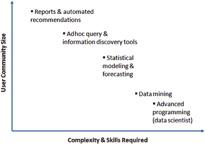
**图 1-9.** 各类分析师工具的潜在业务分析师和用户群体规模

向业务分析师传达信息的最简单方式是通过预定义的报表来显示由报表开发者选定的关键绩效指标 (`KPI`)。报表在可查看的信息方面灵活性有限，但也确保了广泛的业务用户能够成为信息的消费者，因为它们的访问方式简单。开发者使用的报表工具会生成 SQL 来访问所需数据。报表开发者通常根据报表呈现 `KPI` 的清晰度，以及生成、共享和分发报表的简便性和灵活性来评判报表工具的质量。例如，通常支持多种模板类型用于打印，如 PDF、RTF 和 XSL。

即席查询与分析工具提供了更高的灵活度，因为业务分析师可以通过自行浏览数据库表来提出假设性问题。开发者会创建业务元数据，将晦涩的表名转换为有意义的面向业务的数据描述。业务用户浏览数据的难易程度也取决于数据库中底层模式的设计。正如我们之前所述，采用维度模型和层次结构的星型模式尤其易于浏览。图 1-10 展示了一个界面，其中包含由销售事实表及其周围的维度（包括时间、产品、办公室等）组成的结构。在界面背后，这些工具也会生成 SQL 来访问数据。除了灵活性，现代即席查询与分析工具还以其提供的数据可视化能力来评判。

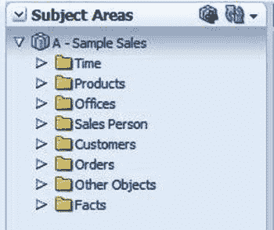
**图 1-10.** 典型的事实与维度即席查询工具界面

如今您可能会看到正在使用的典型即席查询、分析和报表工具包括 Oracle Business Intelligence Foundation Suite、SAP Business Objects、IBM Cognos、MicroStrategy、Tableau、QlikView、Pentaho 以及 Tibco Jaspersoft。当然，很多人会说 Microsoft Excel 是组织中最常用的此类工作工具。在大多数组织中，会使用来自不同供应商的工具。

少数但不断增长的业务分析师会处理海量数据，并试图利用数据发现隐藏的模式和/或预测未来结果。分析类型范围从您可能在大学学过的简单统计（例如均值、标准差等）到基于更复杂数据挖掘算法的模型。

业务分析师为弄清数据含义所用的统计函数通常属于以下类别：

*   基本统计函数，如汇总、排序、排名和频率
*   密度、概率和分位数函数
*   特殊函数，如 Gamma 函数
*   检验函数，如卡方检验、简单和加权 kappa 系数以及相关性分析

# 高级数据挖掘算法

高级数据挖掘算法用于需要理解哪些变量对准确预测结果至关重要，以及定义随后用于预测结果的预测模型时。这些模型通常应用于存在数百个变量但只有十几个或更少变量影响结果的情况。数据挖掘算法可分为以下几类：

- `聚类算法`：用于探索某些业务结果是否属于具有共同特征（如青少年、男性等）的特定群体。
- `逻辑模型`：用于某些事件发生后，其他事件将随之发生的情况（通常称为决策树）。
- `神经网络`：一种黑箱数学模型，针对已知结果的样本集进行训练。
- `异常检测算法`：用于检测异常值和罕见事件。

在您当前架构中，可能已安装并提供统计和数据挖掘能力的供应商包括：`SAS Institute`、`IBM SPSS`、`R`（一种开源统计引擎）和 `Oracle Advanced Analytics`。

从历史上看，统计学家和数据挖掘者同时也是领域专家，有时被称为“量化分析师”。随着 `Hadoop` 的日益普及，出现了数据科学家这一新角色。早期的数据科学家尤其擅长利用利用 `Hadoop` 特性的高级编程技术。

> **注意**
> 如今关于数据科学家的技能和定义存在诸多争论。一些人仍然认为数据科学家是统计学家和 `Hadoop` 编程大师的结合。然而，许多具备这些技能的人被雇佣后，已显示出他们缺乏理解数据中应寻找什么以及对业务潜在影响所需的领域专业知识。在当今许多组织中，数据科学家与业务领域专家配对，作为一个团队工作以确保成功。

本世纪初，人们认识到探索可能包含结构化、半结构化以及流数据的大规模数据集的需求日益增长。引入的信息发现工具能够在不预定义模式的情况下探索数据。这些工具通常要么拥有自己的专有数据存储引擎（如 `Oracle Endeca Information Discovery`），要么依赖 `Hadoop` 来探索数据集及数据组合。所分析的数据通常来源于 `OLTP` 源、`EDW`、`NoSQL` 数据库和 `Hadoop`。`Tibco Spotfire`、`Oracle Big Data Discovery` 以及我们之前在本章提到的一些商业智能工具可以直接访问 `Hadoop`，并用于信息发现。

最后，对于某些问题，必须实时采取行动。示例可能包括：在网站购物访问期间推荐可能感兴趣的产品，或建议检查某设备是否需要维护，因为预测该设备在不久的将来会发生故障。

网站活动数据通常使用预测分析模型进行分析。模型结果会定期以批处理更新的方式提供给实时推荐引擎。该引擎随后根据模型的指导，推荐网站向用户呈现特定的网页或通知。随着分析的进行，推荐会不断调整并变得更加准确。通常，报告工具用于监控这些自动化操作的结果。

其他业务问题，例如设备即将发生故障，可能需要在任何详细数据分析之前立即采取行动，因为上述学习过程中存在延迟。业务规则引擎或事件处理引擎可以预编程，以便根据检测到的事件采取特定行动。这些通常部署在物联网解决方案中，以便根据传感器检测到的情况触发即时响应。

在本书后续部分，我们将描述如何发现对这些不同工具和解决方案的需求，然后描述它们成为信息架构设计一部分时的技术考量。

## 数据管理策略的演变

随着业务工作负载需求的变化以及新技术要求的推动，关系型数据库不断发展，并引入了旨在满足这些要求的新功能。然而，一些人发现，基于数据严格适合行和列概念的技术引入了过多的开销，或者与需要解决的问题不一致。正是出于这些原因，`NoSQL` 数据库和 `Hadoop` 引擎大约在本世纪初开始出现。

巧合的是，它们出现在“开源”运动势头正盛之时，并反过来助长了这一势头。在开源模型中，供应商和个人可以访问源代码，这些“提交者”提交他们愿意分享的更新和实用工具。`NoSQL` 数据库的源代码可以从 `Apache Software Foundation` 和 `GNU` 获得许可。`Hadoop` 的许可可以从 `Apache` 获得。随着新功能被纳入开源代码的新版本，软件供应商随后决定在自己的发行版中包含哪些内容。尽管这些发行版可以免费下载，但供应商相信，通过订阅（包括支持）和提供付费服务来产生收入，他们最终可以成为盈利且成功的公司。

### NoSQL 数据库

`NoSQL` 数据库这一术语可追溯到 20 世纪 90 年代末，旨在描述一类广泛的非关系型数据库引擎，它们被设计用于处理快速更新和摄入海量数据，同时提供水平可扩展性。这种更新和摄入工作负载对某些在线应用（如网站上的购物车）来说已成为一项挑战，在这些应用中，尽管用户数量庞大，但快速的更新性能至关重要。

早期的 `NoSQL` 数据库不支持 SQL，因此得名。随着时间的推移，许多可用的 `NoSQL` 数据库已不同程度地增加了对 SQL 的支持。早期的 `NoSQL` 数据库也不提供关系型数据库所具备的传统原子性、一致性、隔离性和持久性（ACID）属性。这种支持被认为是不必要的，因为它需要过多的开销，会妨碍所需的性能。如今，许多 `NoSQL` 数据库声称至少支持部分 ACID 属性。然而，人们普遍认为，它们不应被用作 `OLTP` 关系型数据库引擎的替代品，也不适用于需要跨维度连接多种类型数据的场景。

现已出现了多种 `NoSQL` 数据库类型，包括以下几种：

- `键值对`：由键和一个值或一组值组成的数据库，通常用于非常轻量级的事务，并且与键关联的值的数量会随时间增长。
- `列式`：一个或多个键值对的集合，有时被描述为二维数组，用于表示记录，以便数据查询可以返回完整的记录。
- `文档型`：与列式 `NoSQL` 数据库类似，专为文档存储而设计，具有深度嵌套能力，能够构建复杂结构，从而实现文档中存储文档。
- `图式`：使用具有节点和边的树状结构，并通过关系进行连接的数据库。

`NoSQL` 数据库通过一种称为分片的技术实现水平可扩展性。分片简单来说就是将数据分布到集群中的多个独立服务器或节点上。性能取决于节点的能力，同时也取决于数据分布的方式是否与各个服务器的性能相匹配。例如，如果所有最新数据都放在单个节点上，而大部分活动都与最新数据相关，那么应用将无法良好扩展。许多 `NoSQL` 数据库供应商专注于自动化分片过程，以提供更好的负载均衡，并更轻松地在集群中添加或移除容量。

尽管在支持高可用性故障转移场景方面不如关系型数据库强大，但 `NoSQL` 数据库确实支持数据复制，以便在服务器或节点发生故障时提供数据库可用性。数据副本通常会被复制到与主数据所在节点不同的节点上。

我们描述的各种类型的 `NoSQL` 数据库引擎有数十种。您更有可能遇到的一些包括 `Apache Cassandra`、`MongoDB`、`Amazon DynamoDB`、`Oracle NoSQL Database`、`IBM Cloudant`、`Couchbase` 和 `MarkLogic`。由于这些数据库的功能列表可能会迅速变化，了解正在考虑部署的版本所提供的功能非常重要。例如，有些仅在其较新的版本中才添加了内存计算功能。

### Hadoop 的演变

在本世纪初，来自网站的流式数据馈送越来越让那些试图分析其搜索引擎有效性的公司和组织感到头疼。这些数据流包含嵌入的标识符和有价值的数据，但也包含其他杂项字符。图 1-11 展示了网络日志中典型数据的一个示例。显然，这类数据不太适合存储在关系型数据库中。早在 2002 年，Doug Cutting 就开始研究通过开发一种名为 Nutch 的新引擎来解决这个问题。2003 年和 2004 年，谷歌发表了两篇重要论文，描述了谷歌文件系统（`GFS`）和 `MapReduce`。分布式文件系统的概念在当时并不新鲜，但谷歌的论文阐述了一种如何解决搜索问题的愿景。

``

图 1-11. 典型的网络日志数据流

Cutting 理解谷歌这些论文的重要性，并对自己正在进行的工作进行了修改。`MapReduce` 能够映射数据流，并将流中的数据缩减为有价值的数据。`GFS` 提供了如何扩展引擎的线索，鉴于部署的网站数量正在爆炸式增长，这种可扩展性被视为尤为关键。2006 年，Cutting 加入雅虎，并以他儿子的玩具大象名字重新命名了他的存储和处理项目。Hadoop 诞生了。同年，Hadoop 成为 Apache 软件基金会的一个项目。

分布式文件系统能够跨海量存储实现高度并行的负载。`MapReduce` 与数据位于同一位置，提供了所需的可扩展性。当早期倡导者讨论这种组合时，它通常被描述为解决大数据问题，即数据具有巨大的体量、多样性和速度。随着时间的推移，大数据这个术语的含义变得更加广泛，因为供应商们已经推出了许多不同的解决方案来解决许多不同但类似的问题。

如今，`Hadoop` 集群被视为处理多种类型工作负载的理想解决方案。其中一些集群现在用于通过提供源系统和数据仓库之间的高度并行转换来加速 `ETL`（数据提取、转换、加载）处理。其他 `Hadoop` 集群则用于预测分析工作负载，分析师们使用诸如 `R` 或 `SAS` 等工具，或者利用 Hadoop 自己的机器学习和数据挖掘编程库 `Mahout`。数据科学家有时会编写代码（使用 `Java`、`Python`、`Ruby on Rails` 或其他语言），并在代码中嵌入 `MapReduce` 或 `Mahout` 来发现数据中的模式。此外，越来越多的人通过各种 SQL 接口（如 `Hive`、`Impala` 或其他供应商的类似产品）来访问集群中的数据。

**注**：本书中描述的较新数据管理解决方案是为了通过满足特定新兴工作负载需求来提供优化解决方案而发明的。然而，对于许多这类以开源方式推广的数据存储，人们的看法是它们更便宜。这可能导致这些软件发行版被应用于其技术优势领域之外，以降低获取和支持成本。随着开发者抱怨与那些被认为成本更高的其他引擎相比功能有限，创建这些软件发行版的供应商通常会通过添加新特性和功能来回应。一个悬而未决的问题是，随着这些发行版与传统数据管理解决方案以及彼此之间的功能重叠越来越多，它们在资源利用率和性能方面的许多优势是否会消失。

### Hadoop 特性与工具

Apache 软件基金会为 Hadoop 的特性和工具提供孵化器，并将其归类为开发项目。随着新版本的发布，这些项目的成果会以不同程度进入来自 Cloudera、Hortonworks、IBM、MapR 和 Pivotal 等厂商的 Hadoop 发行版中。Apache Hadoop 项目状态更新会发布在 `apache.org` 网站上。

如果你是 Hadoop 新手，了解一些发行商和开发者常作为 Hadoop 技术和特性谈论的关键项目的定义可能会有所帮助。一些核心数据管理特性包括：

- `HDFS`：Hadoop 分布式文件系统。
- `Parquet`：一种用于 Hadoop 的压缩列式存储格式。
- `Sentry`：一个为 Hadoop 中存储的数据和元数据提供细粒度、基于角色的授权的系统。
- `Spark`：一个支持 Hadoop 内存数据处理的引擎。
- `YARN`：用于调度和管理作业及集群资源的框架。
- `Zookeeper`：分布式应用的协调服务。

Hadoop 中用于数据传输和收集的重要特性包括：

- `Flume`：用于在 `HDFS` 中收集和聚合流式数据（包括日志和事件数据）的服务。
- `Kafka`：一个设计用于处理实时数据流的发布-订阅消息代理平台。
- `Sqoop`：用于在 Hadoop 和数据库之间传输数据的工具。

Hadoop 中的编程工具、应用程序编程接口（API）和实用程序包括：

- `Hive`：一种用于在 Hadoop 中查询数据的类 SQL 结构（`HiveQL`）。
- `MapReduce`：一种早期的 Hadoop 编程范式，对分布在节点间的数据执行“映射”（过滤和排序）然后进行“归约”（汇总操作）。
- `Oozie`：用于管理 Hadoop 作业的工作流作业调度器。
- `Pig`：用于数据处理的数据流语言和并行执行框架。
- `Spark GraphX`：一个 API，支持将数据视为图与集合、对图进行转换和连接以形成弹性分布式数据集（`RDD`），以及在 `Spark` 中创建自定义图算法。
- `Spark MLib`：在 `Spark` 中实现的机器学习库。
- `Spark SQL`：一个 API，支持在结构化的（`Hive`）上下文中查询 `Spark` 中的 `RDD`。
- `Spark Streaming`：一个 API，支持在 `Spark` 中创建流处理流程。
- `Solr`：一个全文索引和搜索平台。

基于 Hadoop 的应用程序的创建者有时会寻求 `NoSQL` 数据库在其设计中提供的功能。`HBase` 提供了一个部署在 `HDFS` 上的 `NoSQL` 列式数据库，支持随机读写。它在处理数据稀疏性问题时尤其有用。除了支持即席查询外，`HBase` 还常用于提供数据摘要。

在底层服务器和存储上布局 Hadoop 集群需要指定名称节点、数据节点以及提供我们之前提到的特性的服务的节点。在集群中正确部署服务可以消除可能导致整个 Hadoop 集群宕机的关键单点故障。数据通常会进行三副本复制，以确保在节点发生故障时数据仍然可用。

关于何时适合将 Hadoop 集群作为信息架构中的一个组件，而不是建议使用关系数据库部署数据仓库，仍然存在一些争论。表格 1-1 试图突出各自的优势。由于数据管理引擎的功能正在迅速变化，你应根据当前最新的可用信息重新验证这些特性，以便在考虑自己项目的部署选项时做出决策。

**表 1-1。** 部署 Hadoop 与数据仓库（关系数据库）的一些差异总结

| 特性 | Hadoop | 数据仓库 |
| --- | --- | --- |
| 数据价值 | 数据通常质量与价值混杂——数量最重要 | 仅高质量价值的数据最重要 |
| 模式 | 最常用作分布式文件系统 | 最常见的是 3NF 与星型模式混合 |
| 典型工作负载 | 信息发现、预测分析、ETL 处理 | 历史事务报告、即席查询、OLAP |
| 数据源 | 从流式数据到结构化数据的各种数据类型 | 结构化数据源 |
| 可用性 | 跨节点复制数据 | 保证一致的故障转移 |
| 安全性 | 身份验证、加密、访问控制列表 | 与 Hadoop 相同，外加更细粒度的控制 |
| 可扩展性 | 可分布在数百个节点、数百 PB 数据上 | 多节点，通常为数百 TB 或数 PB 数据 |

# 物联网

在这十年间，从传感器和控制设备收集数据并进行分析报告的做法日益普及，其价值已清晰显现。早在 20 世纪 80 年代，人们就已开始探讨此类解决方案的价值，并通过连接至互联网的自动售货机进行了初步实验。本世纪初，业界对机器对机器（M2M）通信及其潜在价值进行了大量讨论，甚至有人开玩笑说，你的厨房电器或许正在暗中密谋对付你。然而，人们很快意识到，解决方案的范围远不止设备本身，因此“物联网”这一术语便应运而生，进入了我们的词汇表。

在这类概括性术语诞生之前，许多设备制造商已经通过为其产品配备智能传感器和控制器，增加了从设备收集数据的能力。有些制造商还包含了早期版本的简易数据收集软件。然而，早期传感器和控制器在价格、尺寸以及功能上的局限性，有时也限制了所收集数据的实用性。此外，对于此类数据潜在业务用途的理解尚未普及，用于分析数据的软件也并非最优。因此，即使在数据源处收集了数据，也常常不会进行传输或分析，这些数据往往被直接丢弃。

由于制造产品的设计需要漫长的准备时间，且产品一旦生产出来往往拥有相当长的使用寿命，工程师们始终将传感器和数据收集能力融入到他们设计的产品中。他们预见到，有朝一日，这些数据将在多方面发挥作用。许多工程师意识到，此类数据可用于更好地理解产品质量和组件的潜在故障，实现自动化的服务请求，提供环境因素信息，辅助更优的能源管理，并为数百种其他潜在应用提供数据。

> **注**  
> 技术狂热者有时会要求我们描述其行业中大数据（特别是 `Hadoop`）的“杀手级应用场景”。当传感器和智能控制器提供的数据对业务运营至关重要时，他们所寻求的应用场景便会变得清晰可见。他们的大数据用例可能是由分析物联网数据的迫切需求所驱动的。

对传感器的日益增长的需求推动了更多研究，进而实现了传感器的进一步微型化和价格的显著降低。微型化在一定程度上得益于传感器能耗的大幅减少。因此，如今已有数十亿个传感器投入使用，预计到本十年末，这一数字将迅速增长至数千亿。这种不断增长的规模与持续降低的成本，将继续推动传感器应用的进一步创新和动力。

幸运的是，在传感器和智能控制器普及的同时，第二项突破也在发生。这项突破体现在新型数据管理软件能够摄取和分析海量流式数据的能力上。尽管 `NoSQL` 数据库和 `Hadoop` 最初最常用于处理和分析网站流量及社交媒体数据，但事实证明，这些引擎同样是捕获和分析来自传感器和控制器数据流的理想工具。

如今，它们被用于收集和分析来自汽车、喷气发动机、移动设备、健康监测器、运输中物品以及众多其他来源的流式数据。`图 1-12` 简化展示了物联网的关键组件。我们在本章前面介绍的信息架构主要集中在图的右侧，即数据管理和商业智能平台。物联网进一步引入了对数据路由和事件处理、传感器上软件的配置和管理、用于保护中间层数据传输安全的身份访问控制，以及从传感器和设备到企业内网基础设施的适当通信网络的需求。在本出版物发布之时，这些领域新兴且相互竞争的标准和联盟仍对此类实施构成挑战。参与其中的包括开放互联网联盟（端到端物联网架构）、`IETF`（通信和编码）、AllSeen 联盟（近端设备连接性）、IPSO 联盟（数据表示）、开放移动联盟（设备管理和对象注册）以及 Thread 集团（智能家居网络）。工业互联网联盟则致力于为工业应用标准化垂直解决方案，而各种行业团体也在试图定义相关标准。

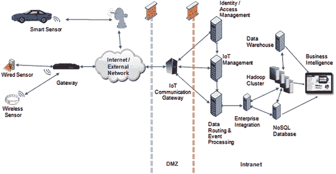  
`图 1-12`. 物联网组件简化视图

希望分析物联网数据的组织已经采用了多种策略。有些组织自行设计并开发了整个图示架构。其他组织则设计、部署并管理智能传感器代码（通常使用 `Java` 编程），同时聚焦于数据的收集与分析，并与通信基础设施提供商合作以支持并保障传输安全。还有一部分组织只专注于数据分析，将通信和传感器智能化的工作交由其他方完成。

我们关于扩展信息架构以纳入 `NoSQL` 数据库和 `Hadoop` 集群的描述，将适用于以上所有三种场景。但在本书后续章节中，我们还将介绍物联网所特有的一些额外组件，以及您在考虑智能传感器的通信、安全性和配置时可能需要做出的额外决策。

# 本书的方法论

本书的其余部分描述了一种用于开发和部署项目的方法论。作者观察到，在前一代项目成功时，这种方法论被普遍采用。现在，它正被应用并扩展到大数据和物联网领域。

我们描述的方法论并非革命性的。它建立在大多数企业架构师所熟知的公认最佳实践之上。我们意识到本书的读者群体远不止具有架构背景的人士，因此接下来我们将介绍广受欢迎的 The Open Group 架构框架（`TOGAF`）模型，以及如何将其应用于我们的方法论中。在应用任何方法论来构建下一代信息架构时，尤为重要的是采用我们本章前面描述过的增量方法。

## `TOGAF` 与架构原则

The Open Group 是一个提供企业架构标准与认证计划的全球性组织。`TOGAF` 自 1995 年首次确立以来，已被广泛采用，并为其众多成员组织中的架构设计方法提供了基础。截至本书出版时，已有超过 350 个组织参与其中。许多组织参与了定义最佳实践与标准的 The Open Group 董事会、理事会、成员论坛、工作组或技术工作组。

`TOGAF` 本身描述了四种架构类型。所有这些类型都适用于定义我们在本书中描述的信息架构。这四种类型如下：

- **业务架构**，由业务战略、治理、组织及关键业务流程构成
- **数据架构**，包含逻辑和物理数据资产结构以及数据管理资源
- **应用架构**，描述应用程序如何部署、它们之间如何交互，以及它们如何与业务架构所定义的业务流程相关联
- **技术架构**，描述所需的逻辑软件、服务器、存储、网络及通信能力

当 IT 专家和架构师定义并开发信息架构时，业务架构往往是四种类型中最容易被忽视的，但它在实现这些项目的整体成功中至关重要。我们在本书中花了一些篇幅来描述如何发掘公司或组织的业务战略及其对运营至关重要的流程。业务组织显然可以驱动技术信息架构的多个方面，例如，可能需要在何处建立数据集市以满足特定业务线的需求。数据治理这一主题在业务和 IT 领域都是重中之重，并且在多个章节中均有出现。

信息架构的核心是数据架构和技术架构。你会看到我们在讨论收集 IT 需求以及未来状态设计的章节中重点关注这些领域。`TOGAF` 所描述的应用架构定义了信息架构中的业务解决方案，以及这些解决方案在基于底层数据和技术架构组件构建时彼此之间的关系。

你或你的架构团队最熟悉的可能是作为标准的 `TOGAF`。`TOGAF` 标准包含以下部分：

- 对企业架构和 `TOGAF` 关键概念的介绍
- 一种架构开发方法（`ADM`），描述了逐步开发企业架构的方法
- 一系列应用 `ADM` 的指南和技术
- 一个架构内容框架，包括可重用的架构构建块（`ABBs`）和典型的架构交付物
- 一个企业连续系列，它提供了一个对工件进行分类并展示它们如何随时间被重用和修改的模型
- `TOGAF` 参考模型，包括技术参考模型（`TRM`）和集成信息基础设施模型（`III-RM`）
- 一个架构能力框架，为在组织或公司内建立架构实践提供了有用的指南、模板和资源

`TOGAF` 的范围与我们本书中描述的信息架构方法论高度吻合，这并非巧合，因为该方法论基于使用源自 `TOGAF` 的标准架构技术所获得的经验教训。如果你希望获取比本书涵盖范围更详细的关于 `TOGAF` 的信息，我们强烈建议你访问 The Open Group 的网站：[`www.opengroup.org/TOGAF`](http://www.opengroup.org/TOGAF)。成为其成员可以让你接触到丰富的信息，并且，如果你是一名架构师，还能为你提供机会，成为提供架构思想领导力的社区中的贡献成员。

**注意**

本书的 IT 读者可能还想知道 `ITIL`（原名信息技术基础架构库）在定义信息架构时的适用性。`ITIL` 与 `ISO/IEC 20000`（一项 IT 服务管理的国际标准）紧密相关，并定义了一个框架和认证流程。最近，`ITIL` 的持续开发由 `AXELOS`（[`www.axelos.com`](http://www.axelos.com/)）指导，这是一家由英国内阁办公室和 Capita PLC 共同创立的公司。`ITIL` 涉及的五大服务领域是：服务战略、服务设计、服务转换、服务运营和持续服务改进。所提供的 IT 服务水平必须符合组织的业务需求，而这些需求反过来应指导你定义本书后续描述的“未来状态技术架构”。因此，`ITIL` 是对 `TOGAF` 的补充，因为它可以帮助你确定如何将架构化的未来状态付诸实践。

## 我们的成功方法论

本书后续章节重点介绍的方法论包含七个阶段，从早期的概念愿景贯穿到项目落地实施。每个阶段在本书中都有对应章节进行阐述。

我们详细描述的第一个阶段，是建立未来状态信息架构的初步愿景。接下来，我们需要确定所需的业务驱动力和关键绩效指标（`KPI`）。然后，我们将 `KPI` 和关键指标映射到数据来源，并确定如何将数据转化为可用的信息。接着评估组织内现有的人才技能。基于前几个阶段收集的信息，我们便可以更详细地设计未来的信息架构。之后，我们需要定义并商定一份路线图，用以描述未来架构的实施顺序。至此，我们便做好了开始实施的准备。

图 1-13 展示了这一过程。该图呈现为一个连续的循环，以表明流程并非在实施阶段就终止了。我们简单看一下每个阶段的具体内容。

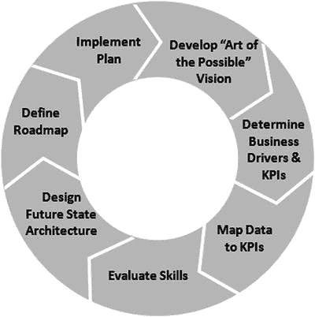

**图 1-13.** 成功方法论的各个阶段

> **注意**
> 在实践中，方法论的各个阶段有时会重叠。例如，在执行某个阶段时，你可能会发现所需的关键信息缺失，而这些信息本应在上一阶段完成收集。当然，一旦出现这种情况，你必须返回去补全缺失的信息，才能继续当前阶段的工作。

当我们描绘未来架构的愿景时，我们先要对当前状态有基本的了解，并开始推测其可能的演变方向。许多组织面临的一个挑战是，在初始阶段，技术愿景可能与业务愿景不一致。事实上，业务愿景的制定者和潜在赞助方必须驱动技术愿景。因此，我们必须了解当前业务对现有信息架构的利用方式，以及这种利用方式未来可能如何变化。正如我们将在下一章中描述的，愿景阶段主要是关于需求收集和探索可能性边界。

方法论的下一阶段会更深入地审视业务驱动力。业务线负责人和业务分析师会提供更多关于当前业务运营要求以及他们所面临的新挑战的洞见。在此阶段，我们必须理解他们的关键成功因素、业务分析师所需的关键绩效指标，以及必须收集的衡量指标。所有这些都将指导后续的技术架构设计。我们还需开始了解访问这些数据可能带来的潜在业务收益，并根据业务价值和成功机会，开始对项目的不同阶段进行优先级排序。

一旦我们理解了业务分析师需要哪些数据，就必须确定数据来源。业务线负责人和业务分析师在此方面同样能提供帮助。他们可以描述所需的数据质量、他们信赖的数据源以及数据治理要求。此外，他们还能帮助我们了解数据分析的方式、所需的粒度、数据的保留期限以及交付形式（例如，是报表形式、临时查询工具，还是通过数据探索和可视化工具）。他们还能描述由“利用数据及时决策”这一需求所驱动的基础设施可用性要求，以及这些要求对业务的潜在影响。

至此，我们应当已经理解了数据和分析需求。现在可以开始设计未来的技术架构，IT 架构团队将在此阶段深度参与。然而，在开始更详细的设计之前，我们可能想先了解组织内现有人才的技能，以及这些技能（或技能缺失）可能对架构产生的影响。我们还需要清晰地了解当前架构的优势与不足，以及如何通过引入新的软件组件和系统来对其进行扩展。此时，重新定义业务版图所需的成本规模，应已初步显现。

硬件和软件的材料清单很有用，但要真正理解何时能获得正向投资回报，还必须开始评估所构想的各个阶段的潜在实施成本。实施成本通常远高于软件及其他基础设施方面的考虑。根据识别出的技能差距，我们应开始评估系统集成商为弥补这些差距所需的服务成本。此外，还需评估工作范围、实施风险等其他因素。

一旦掌握了这些信息，我们就可以制定一份高层次的实施路线图，并以合理且易于理解的商业案例作为支撑。路线图的目标受众包括将为项目提供资金的高管和赞助方。如果在整个过程中我们工作到位，那么在此阶段应该不会出现太多意外情况。演示的一部分可以是针对将要交付的业务能力进行模拟展示。讨论的重点应围绕优先级以及项目各阶段的顺序是否正确。高管和赞助方还可能询问有关成本的更多细节，这些问题很可能集中在实施成本上。但只要拥有可靠的商业案例，项目获得批准继续推进的可能性就很大。

最后，就是实施阶段本身。如前所述，采用增量式方法可以确保项目轨迹良好且假设正确。在实施过程中，后续阶段可能会根据业务优先级的变化以及在实施中发现的新挑战，重新排序或提前到初始阶段进行。所有这些都必须在避免范围蔓延的前提下完成。除了展示解决方案交付的进展外，跟踪实施成本并定期报告，也能体现问责制的落实。

当项目初步完成，并且你按照商定的蓝图交付成果时，庆祝成功至关重要。然而，业务线和 IT 部门很可能已经开始构思下一步的修订愿景。随着业务需求的变化以及业务分析师对可行性理解的不断深入，这些项目总是在不断演变。因此，这个循环会一次又一次地重复。

在本书的其余章节，我们将对上述每个主题进行更深入的探讨。我们将从理解“可能性边界”开始，定义未来状态信息架构的愿景。

