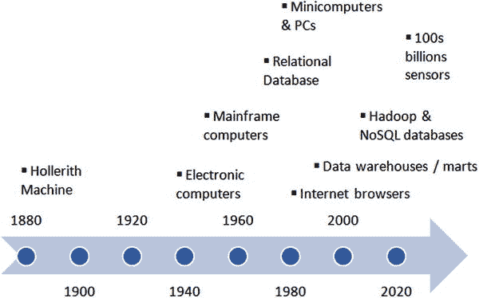

# 大数据解决方案与物联网

本书以当前信息架构中最热门的两个技术概念作为章节标题：大数据与物联网。由于本书面向企业架构师、信息架构师，以及所有负责设计构建此类解决方案或关注项目最终成败的人员，我们将摒弃炒作。相反，我们旨在提供扎实的基础指导，帮助读者启动这类项目并最终成功交付。为此，我们首先回顾这些概念的出现背景、原因、前身，以及它们如何融入你正在构建的架构。

作者认为，大数据与物联网是重要的演进步骤，在定义新的信息架构项目时愈加相关。显然，当你阅读本书时，你已认同构成这些解决方案的技术能在组织的信息架构中发挥重要作用。由于我们相信这些步骤是演进性的，我们也认为，以往在开发和部署信息架构项目中积累的许多经验，能够且应当应用于大数据与物联网项目。

企业架构师将继续从敏捷方法论与开发流程中获益，这些方法能推动组织愿景的实现，并兼顾业务背景、治理以及从当前状态架构向期望未来状态的演进。一个关键里程碑是制定路线图，其中列出项目成功所必需的、按优先级排序的实施阶段。

那些已成功定义并构建了这些新一代解决方案的组织，遵循了这些最佳实践，并借鉴了他们在创建和部署前几代信息架构时积累的经验。我们将在本章中回顾其中的一些方法论。

另一方面，那些将大数据与物联网视为独特技术举措、实验或简历加分项的组织，往往难以从这类努力及技术本身中找到价值。许多项目从未与公司或组织内部的业务需求建立联系。当此类项目始终被定为纯技术研究时，它们通常会达到一个临界点：要么被视为未来资金的备选项，要么被直接宣告失败。这令人遗憾，但并非没有先例。

在本书中，我们考量的大数据举措通常包括：基于关系数据库管理系统（`RDBMS`）技术的传统数据仓库、`Hadoop`集群、`NoSQL`数据库以及其他新兴数据管理方案。我们将推动扩展信息架构采纳的举措描述范围延伸至物联网，即部署了带有智能控制器的传感器与设备的领域。这些传感器与设备连接至基础设施，以便对收集到的数据进行分析。设备上的智能传感器与控制器被设计为在需要时触发即时操作。

因此，本章开篇将描述大数据与物联网如何成为信息处理与架构漫长演进史的一部分。我们将在这类举措被构想出来之前的许久，开始这段历史的描述。图1-1展示了我们将快速浏览的时间线。

图1-1. 现代计算演进时间线

## 从穿孔卡片到决策支持

关于现代计算始于何时，众说纷纭。我们的历史描述从计算超越机械计算器之时开始。我们从专注于提供特定信息的数据处理方案讲起。许多人认为，一个重要的早期数据处理方案——它为后来的发展奠定了基础——是基于赫尔曼·何乐礼发明的穿孔卡片及设备。

这项发明最初解决的业务问题是对美国人口普查收集的数据进行制表与报告。在何乐礼于19世纪80年代提出其方案时，普查的概念当然不新鲜。数个世纪以来，政府一直手动收集其领土内的居民数量。在此期间，人们希望收集的数据项范围不断扩大，例如公民姓名、地址、性别、年龄、家庭规模、城乡地址、出生地、教育水平等。对更多此类关键绩效指标（`KPIs`）的需求，加之人口增长，推动了对更自动化数据收集与处理方式的需求。何乐礼的穿孔卡片方案满足了这些需求。到20世纪30年代，该技术已在其他类型的数据处理应用中广泛流行，例如为大型企业的会计系统提供基础。

20世纪40年代及第二次世界大战带来了更快解决复杂军事问题的需求，包括破译加密信息以及计算大型火炮发射炮弹的最佳弹道。快速且渐进式解决问题的需求，推动了早期电子计算设备的发展，这些设备由开关、真空管和布线机架组成，占满整个房间。战后，为军事计划制造更快计算机的研究继续进行，该技术也进入商业领域，用于财务会计等用途。

随后的几十年见证了现代软件操作系统与编程语言（使应用开发更简单、更快速）以及数据库（实现数据的快速简便检索）的引入。数据库从层次结构演变为更灵活的关系模型，其中数据存储于由行和列组成的表中。表通过公共列之间的外键进行关联。结构化查询语言（`SQL`）很快成为访问关系数据库的标准方式。

在整个20世纪70年代早期，应用开发侧重于对频繁更新的数据进行处理与报告，这后来被称为联机事务处理（`OLTP`）。软件开发的前提是捕获并报告业务或组织所需的特定`KPI`。尽管晶体管和集成电路极大地提升了这些系统的能力并开始降低计算成本，但大型机和软件仍然过于昂贵，无法进行大量实验。

所有这一切在20世纪70年代末至80年代初随着低成本小型计算机及个人电脑的引入而改变。电子表格和关系数据库使得最初被称为决策支持系统的数据能进行更灵活的分析。但随着时间的推移，数据变得更加分散，人们逐渐意识到，不一致的数据收集方法会导致存疑的分析结果和业务结论。定义新的信息架构方法的时机已经成熟。