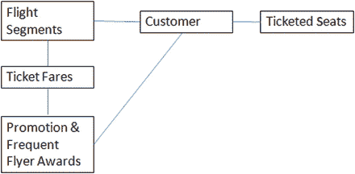
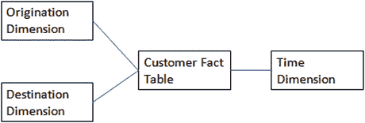
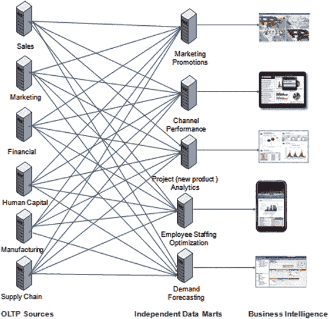
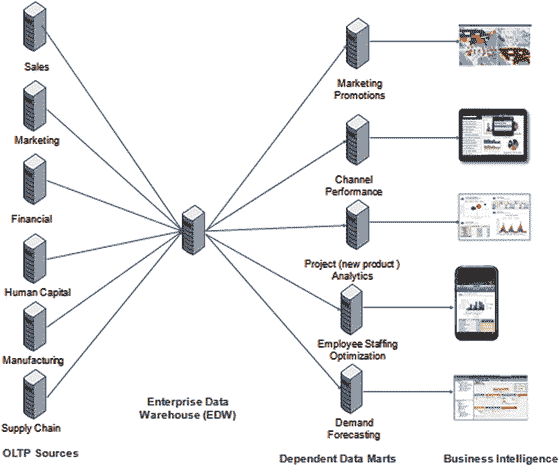
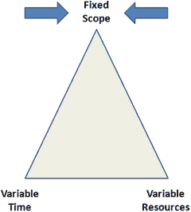
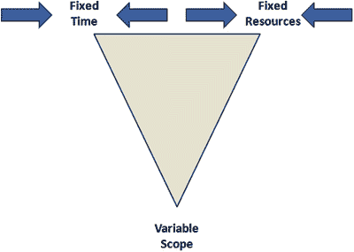
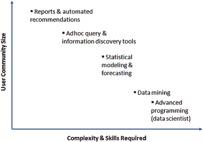
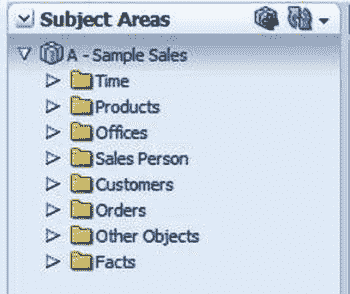

# 数据仓库

比尔·恩门（Bill Inmon）通常被认为是首个将这些新型数据存储角色定义为“数据仓库”的人。他将数据仓库描述为“一种面向主题的、集成的、非易失的、随时间变化的数据集合，用于支持管理决策”。20 世纪 90 年代初，他进一步完善了企业数据仓库（EDW）的概念。EDW 被设计为一家公司所有历史数据的单一存储库。它被描述为包含一个第三范式数据模型，其中所有属性都是原子的且包含唯一值，类似于 OLTP 数据库中的模式。

图 1-2 展示了一个虚构的航空票务数据仓库第三范式模型的极小部分。如图所示，它可用于分析单个航空旅客交易、已出票的飞机座位、航段、已售票价以及促销/常旅客奖励。

图 1-2. 简单的第三范式（3NF）模式

EDW 加载的数据是从源系统的 OLTP 表中提取的。在从各种来源提取数据时，通过转换来实现数据定义的一致性，并实施数据质量规则和标准。在数据仓库最初开发时，源和目标之间的抽取、转换、加载（ETL）处理通常以批处理模式按周或按月进行。然而，企业对近乎实时数据分析的需求不断推动数据仓库更频繁地加载数据。如今，数据加载通常是持续不断的涓流式输入，加载过程中的任何时间延迟通常源于数据必须经历的转换的复杂性。许多组织发现，减少数据转换造成延迟的唯一方法是对数据在 OLTP 系统中的初始填充方式制定更严格的规则，从而在源端确保质量和一致性，并减少转换需求。

许多早期的实践者最初专注于尽可能多地在数据仓库中收集数据，认为业务分析人员之后会自行决定如何利用这些数据。这种“建好了他们自然会来”的方法，常常因为业务分析人员无法轻松处理回答其业务问题所需的数据而导致项目停滞。许多业务分析师使用自己创建的多种提取工具，简单地将数据从 EDW 下载到电子表格中。他们有时还会用自己有权访问的其他来源的数据来补充这些数据。随后关于“单一事实版本”存在于何处引发了争论。这导致许多早期的 EDW 被宣布为失败，因此其设计受到了重新评估。

> **注意**  
> 如果 EDW 这种“建好了他们自然会来”的方法听起来与当今 IT 主导的 Hadoop 和 NoSQL 数据库项目中所尝试的方法相似，作者认为这并非巧合。正如任何架构师所知，形式应服从功能。另一方面，颠倒过来的概念并不是设计解决方案的正确方式。不幸的是，我们在许多这类大数据项目中看到历史正在重演，除非重新吸取过去的教训，否则其后果可能同样惨淡。

正当许多公司和组织的业务部门内部就 EDW 的实用性展开辩论时，拉尔夫·金博尔（Ralph Kimball）引入了一种方法，该方法似乎使业务分析人员能够以更直观的方式执行临时查询。他的星型模式设计以一个大型事实表为中心，周围环绕着维度表（有时称为查找表）并包含层次结构。这种模式被广泛部署在数据集中中，这些数据集通常被定义为面向业务部门的主题化数据仓库。

为了说明其用途，我们有一个非常简单的航空数据集市，如图 1-3 所示。我们想要确定 2014 年 7 月从美国飞往墨西哥的客户。如该星型模式所示，客户交易存储在事实表中。始发地和目的地维度表包含地理下钻信息（大洲、国家、州或省、城市和机场代码）。时间维度支持下钻到特定时间段（年、月、周、日、一天中的小时）。

图 1-3. 简单的星型模式

并非所有关系型数据库最初都擅长在定义了星型模式的情况下提供最优的查询性能。这些性能挑战促使了专门设计用于处理层次结构和星型模式的多维在线分析处理（MOLAP）引擎的诞生。MOLAP 引擎之所以表现如此出色，是因为这些“立方体”由预连接的数据钻取路径组成。图 1-4 描绘了一个三维立方体的物理表示。

图 1-4. 三维立方体表示

后来，随着关系型数据库优化器的成熟，在关系型数据库管理系统内部署星型模式时，实现良好的查询性能成为可能。这些实现被称为关系型在线分析处理（ROLAP）实现。

### 独立数据集市与从属数据集市

在 20 世纪 90 年代中期，关于`EDW`与数据集市相比的实用性曾引发大量争论。当业务分析师发现星型模式更易于导航（并常常自行部署数据集市）时，一些 IT 数据库程序员通过在`EDW`中的数据和模式之上创建视图来回应这一反对意见。然而，构建视图所需的编程和维护工作通常不够及时，无法满足业务分析师日益增长的需求。

另一个问题也时常出现。当各个数据集市相互独立地定义和部署，且不遵循`EDW`内建立的数据定义规则时，通用数据的不一致表示会让人质疑真实数据的存储位置。图 1-5 展示了当不同业务线构建自己独立的数据集市并直接从`OLTP`源提取数据时可能出现的复杂性。在实际实施中，复杂性有时比图中所示的更大，因为数据也可能直接在数据集市之间流动。此图还可能加入电子表格，作为与独特数据存储和表示相关联的商业智能工具。以这种方式部署的组织通常会在业务会议上花费大量时间争论谁的报告能正确反映业务的真实状态，即使这些报告本应显示相同的`KPI`。

图 1-5.

源与目标集市之间具有独特`ETL`的独立数据集市

归根结底，争论本不应该是`EDW`与数据集市之间的对立。只要应用了正确的架构指南，两种方法都有其价值，而且理由充分。随着许多信息和数据仓库架构师开始认识到这一点，一种混合方法成为了最佳实践。`EDW`得以实施，并随着数据集市中对新数据源的需求而逐步扩展。数据集市被设计为依赖于`EDW`中的数据定义。由于`EDW`仍然是历史记录的数据库，输入集市的数据均从`EDW`中提取。`EDW`作为所有数据源的例外情况通常发生在存在仅与组织中某一条业务线相关的独特第三方数据时。此时，这些独特数据仅存储在该业务线的数据集中。

图 1-6 展示了依赖于`EDW`的数据集市。这种方法通常会导致定义一致性维度，以在数据集市之间建立一致性。当定义了一致性维度后，就可以提交单个查询来访问多个数据集市的数据（因为这些维度在各个数据集中代表了相同的层次结构）。

图 1-6.

从`EDW`（可信数据源）进行`ETL`的从属数据集市

您最有可能遇到的、作为数据仓库和/或数据集市引擎的数据库数据管理平台包括：`Oracle (数据库企业版和 Essbase)`、`IBM (DB2 和 Netezza)`、`Microsoft SQL Server`、`Teradata`、`SAP HANA` 和 `HP Vertica`。常用的`ETL`工具包括`Informatica`、`Oracle Data Integrator`、`IBM DataStage` 和 `Ab Initio`。

注意

当`EDW`和数据集市首次成为企业运营的核心和必备要素时，信息架构师开始认识到这些平台也需要具备高可用性、可恢复性和安全性。如今，随着`Hadoop`集群和`NoSQL`数据库对业务线的重要性日益提升，对这些平台提出类似能力的需求正在推动这些发行版中新特性和功能的创建。这体现在开源社区较新的软件版本以及提供各种发行版的供应商越来越关注改进可用性、可恢复性和安全性。

### 增量方法

早期的数据仓库设计工作有时会陷入“过度分析导致的瘫痪”，侧重于优雅的 IT 设计，却未与业务线的需求相匹配。早期`EDW`的设计通常需要 12 个月或更长时间，远远超出业务需求的范围或业务发起人的关注周期。一些早期的从业者采用经典的瀑布式方法，首先确定整个`EDW`的工作范围，然后分配时间和资源。

图 1-7 说明了瀑布式方法。冗长的项目计划、延误以及缺乏对业务的关注，常常导致业务线自行其是，开发和部署独立的数据集市，或在电子表格中创建伪数据集市，以解决他们最紧迫的问题。

图 1-7.

瀑布式方法

鉴于这些问题，许多人放弃了瀑布式方法，转而采用敏捷增量方法来设计和开发。IT 部门与业务线之间建立了合作伙伴关系。在许多组织中，120 天或更短的时间范围内实施和评估业务解决方案的进展已变得司空见惯。图 1-8 展示了增量方法，并说明了分配固定时间和固定资源的情况。

图 1-8.

增量方法

尽管图 1-8 显示可变范围，但应在流程的每个增量中展示一些与业务目标相符的实际商业价值。因此，在实践中，所应用的方法通常是增量方法和瀑布式方法的混合平衡。

使用这种方法，解决方案的实用性会在每一步中重新评估。在更短的时间增量内定义和评估`EDW`及从属数据集市意味着，IT 设计和开发可以在与业务期望严重偏离之前进行调整。可以定期计算投资回报率，并反映范围的任何变化。

一些公司选择将业务分析师嵌入到 IT 组织中，以推动持续识别增量需求。另一些公司则创建商业智能卓越中心作为虚拟组织，定期将业务线的分析师与 IT 架构师和开发人员聚集在一起。无论采用何种方法，团队之间持续的沟通和灵活性对于成功至关重要。

注意

提供新业务解决方案的成功大数据项目通常也采用增量方法开发。在组织内部，各团队之间就所发现的内容及其潜在业务影响进行持续对话，是成功的关键。

### 更快的实施策略

早期的数据仓库实施完全基于定制化设计。由于数据模型当时尚未成熟且未广泛可用，大量时间被用于从头定义和设计数据模型。工作负载特性及其随时间的变化极难预测，使得服务器和存储的规格制定困难重重。随着经验积累和数据仓库设计的成熟，最佳实践逐渐明晰，基于这些经验的解决方案也应运而生。

其中一类解决方案是基于常见数据分析需求预定义数据模型。这些模型可供特定行业（如零售、通信和银行业）使用，并提供横向分析解决方案（例如财务、销售、营销和供应链）。如今，此类模型已由软件供应商和咨询公司提供，其特点是定义了逻辑设计，有时还包含物理模式。它们涵盖关键业务领域，并包含启动数据仓库部署所需的表和其他数据元素。有些模型还附带 ETL 脚本，可用于从流行的 ERP 和 CRM 事务处理源中提取数据并加载到数据模型中。当然，大多数组织会根据自身独特的业务需求定制这些模型。然而，这些模型确实为许多数据仓库项目提供了起点，并且在使用增量方法时最有可能成功部署。

正如我们之前提到的，为数据仓库工作负载配置服务器和存储也给信息架构师及服务器与存储架构师带来了挑战。由于数据量的增长速度远快于物理磁盘驱动器访问速度的提升，大多数平台发现，如果对整体系统设计不够重视，其吞吐量就会受限。近年来，部署专为数据仓库和数据市集配置的设备化平台的概念已变得相当普遍。一些同时提供服务器和存储的关系数据库供应商也提供了多种此类产品。存储中闪存的应用进一步提升了性能，前提是数据库软件针对闪存进行了优化。最近，内存成本的大幅降低、能够处理海量内存的新一代处理器的推出，以及数据库在内存中存储和检索常用数据能力的进一步改进，带来了巨大的查询响应和分析性能提升。所有这些都有助于减轻许多以前必需的复杂数据库调优和设计任务。

话虽如此，随着吞吐量等某些服务器和存储瓶颈被克服，其他瓶颈自然会浮现，因为系统中的某个地方始终存在物理限制。业务分析师将继续要求新的分析应用，以利用新的平台能力并推动技术边界。

> **注意**：在本书出版时，Hadoop 集群和 NoSQL 数据库的应用数量还相当少，但正在增长。针对这些数据管理引擎，可用的设备化服务器和存储平台也在增多。随着需要此类引擎的解决方案的商业价值得到认可，实施效率和服务水平保障能力的重要性将日益凸显。因此，预计对这类优化配置设备的需求将会增长，其普及轨迹将与数据仓库设备的采用情况类似。

### 为分析师匹配商业智能工具

数据的访问和利用方式取决于业务线人员的需求和技能。对于那些需要通过查看数据来做出决策的人来说，他们可能使用的工具范围从简单的报表工具到极其复杂的数据挖掘工具。现代基础设施有时还包括用于自动化推荐和操作以及信息发现工具的引擎。

图 1-9 展示了各种工具和技术及其相对用户群体规模和复杂程度。

**图 1-9.** 各类分析师工具的潜在业务分析师和用户群体规模

向业务分析师传达信息的最简单方式是通过预定义的报表来显示由报表开发者选定的关键绩效指标 (KPI)。报表在可查看的信息方面灵活性有限，但也确保了广泛的业务用户能够成为信息的消费者，因为它们的访问方式简单。开发者使用的报表工具会生成 SQL 来访问所需数据。报表开发者通常根据报表呈现 KPI 的清晰度，以及生成、共享和分发报表的简便性和灵活性来评判报表工具的质量。例如，通常支持多种模板类型用于打印，如 PDF、RTF 和 XSL。

即席查询与分析工具提供了更高的灵活度，因为业务分析师可以通过自行浏览数据库表来提出假设性问题。开发者会创建业务元数据，将晦涩的表名转换为有意义的面向业务的数据描述。业务用户浏览数据的难易程度也取决于数据库中底层模式的设计。正如我们之前所述，采用维度模型和层次结构的星型模式尤其易于浏览。图 1-10 展示了一个界面，其中包含由销售事实表及其周围的维度（包括时间、产品、办公室等）组成的结构。在界面背后，这些工具也会生成 SQL 来访问数据。除了灵活性，现代即席查询与分析工具还以其提供的数据可视化能力来评判。

**图 1-10.** 典型的事实与维度即席查询工具界面

如今您可能会看到正在使用的典型即席查询、分析和报表工具包括 Oracle Business Intelligence Foundation Suite、SAP Business Objects、IBM Cognos、MicroStrategy、Tableau、QlikView、Pentaho 以及 Tibco Jaspersoft。当然，很多人会说 Microsoft Excel 是组织中最常用的此类工作工具。在大多数组织中，会使用来自不同供应商的工具。

少数但不断增长的业务分析师会处理海量数据，并试图利用数据发现隐藏的模式和/或预测未来结果。分析类型范围从您可能在大学学过的简单统计（例如均值、标准差等）到基于更复杂数据挖掘算法的模型。

业务分析师为弄清数据含义所用的统计函数通常属于以下类别：

*   基本统计函数，如汇总、排序、排名和频率
*   密度、概率和分位数函数
*   特殊函数，如 Gamma 函数
*   检验函数，如卡方检验、简单和加权 kappa 系数以及相关性分析

