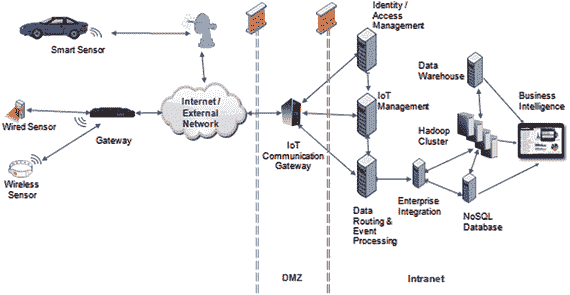

# 物联网

在这十年间，从传感器和控制设备收集数据并进行分析报告的做法日益普及，其价值已清晰显现。早在 20 世纪 80 年代，人们就已开始探讨此类解决方案的价值，并通过连接至互联网的自动售货机进行了初步实验。本世纪初，业界对机器对机器（M2M）通信及其潜在价值进行了大量讨论，甚至有人开玩笑说，你的厨房电器或许正在暗中密谋对付你。然而，人们很快意识到，解决方案的范围远不止设备本身，因此“物联网”这一术语便应运而生，进入了我们的词汇表。

在这类概括性术语诞生之前，许多设备制造商已经通过为其产品配备智能传感器和控制器，增加了从设备收集数据的能力。有些制造商还包含了早期版本的简易数据收集软件。然而，早期传感器和控制器在价格、尺寸以及功能上的局限性，有时也限制了所收集数据的实用性。此外，对于此类数据潜在业务用途的理解尚未普及，用于分析数据的软件也并非最优。因此，即使在数据源处收集了数据，也常常不会进行传输或分析，这些数据往往被直接丢弃。

由于制造产品的设计需要漫长的准备时间，且产品一旦生产出来往往拥有相当长的使用寿命，工程师们始终将传感器和数据收集能力融入到他们设计的产品中。他们预见到，有朝一日，这些数据将在多方面发挥作用。许多工程师意识到，此类数据可用于更好地理解产品质量和组件的潜在故障，实现自动化的服务请求，提供环境因素信息，辅助更优的能源管理，并为数百种其他潜在应用提供数据。

> **注**  
> 技术狂热者有时会要求我们描述其行业中大数据（特别是 Hadoop）的“杀手级应用场景”。当传感器和智能控制器提供的数据对业务运营至关重要时，他们所寻求的应用场景便会变得清晰可见。他们的大数据用例可能是由分析物联网数据的迫切需求所驱动的。

对传感器的日益增长的需求推动了更多研究，进而实现了传感器的进一步微型化和价格的显著降低。微型化在一定程度上得益于传感器能耗的大幅减少。因此，如今已有数十亿个传感器投入使用，预计到本十年末，这一数字将迅速增长至数千亿。这种不断增长的规模与持续降低的成本，将继续推动传感器应用的进一步创新和动力。

幸运的是，在传感器和智能控制器普及的同时，第二项突破也在发生。这项突破体现在新型数据管理软件能够摄取和分析海量流式数据的能力上。尽管 NoSQL 数据库和 Hadoop 最初最常用于处理和分析网站流量及社交媒体数据，但事实证明，这些引擎同样是捕获和分析来自传感器和控制器数据流的理想工具。

如今，它们被用于收集和分析来自汽车、喷气发动机、移动设备、健康监测器、运输中物品以及众多其他来源的流式数据。图 1-12 简化展示了物联网的关键组件。我们在本章前面介绍的信息架构主要集中在图的右侧，即数据管理和商业智能平台。物联网进一步引入了对数据路由和事件处理、传感器上软件的配置和管理、用于保护中间层数据传输安全的身份访问控制，以及从传感器和设备到企业内网基础设施的适当通信网络的需求。在本出版物发布之时，这些领域新兴且相互竞争的标准和联盟仍对此类实施构成挑战。参与其中的包括开放互联网联盟（端到端物联网架构）、IETF（通信和编码）、AllSeen 联盟（近端设备连接性）、IPSO 联盟（数据表示）、开放移动联盟（设备管理和对象注册）以及 Thread 集团（智能家居网络）。工业互联网联盟则致力于为工业应用标准化垂直解决方案，而各种行业团体也在试图定义相关标准。

  
**图 1-12.** 物联网组件简化视图

希望分析物联网数据的组织已经采用了多种策略。有些组织自行设计并开发了整个图示架构。其他组织则设计、部署并管理智能传感器代码（通常使用 Java 编程），同时聚焦于数据的收集与分析，并与通信基础设施提供商合作以支持并保障传输安全。还有一部分组织只专注于数据分析，将通信和传感器智能化的工作交由其他方完成。

我们关于扩展信息架构以纳入 NoSQL 数据库和 Hadoop 集群的描述，将适用于以上所有三种场景。但在本书后续章节中，我们还将介绍物联网所特有的一些额外组件，以及您在考虑智能传感器的通信、安全性和配置时可能需要做出的额外决策。

