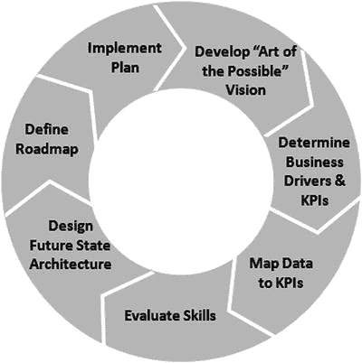

# 本书的方法论

本书的其余部分描述了一种用于开发和部署项目的方法论。作者观察到，在前一代项目成功时，这种方法论被普遍采用。现在，它正被应用并扩展到大数据和物联网领域。

我们描述的方法论并非革命性的。它建立在大多数企业架构师所熟知的公认最佳实践之上。我们意识到本书的读者群体远不止具有架构背景的人士，因此接下来我们将介绍广受欢迎的 The Open Group 架构框架（TOGAF）模型，以及如何将其应用于我们的方法论中。在应用任何方法论来构建下一代信息架构时，尤为重要的是采用我们本章前面描述过的增量方法。

### TOGAF 与架构原则

The Open Group 是一个提供企业架构标准与认证计划的全球性组织。`TOGAF` 自 1995 年首次确立以来，已被广泛采用，并为其众多成员组织中的架构设计方法提供了基础。截至本书出版时，已有超过 350 个组织参与其中。许多组织参与了定义最佳实践与标准的 The Open Group 董事会、理事会、成员论坛、工作组或技术工作组。

`TOGAF` 本身描述了四种架构类型。所有这些类型都适用于定义我们在本书中描述的信息架构。这四种类型如下：

- **业务架构**，由业务战略、治理、组织及关键业务流程构成
- **数据架构**，包含逻辑和物理数据资产结构以及数据管理资源
- **应用架构**，描述应用程序如何部署、它们之间如何交互，以及它们如何与业务架构所定义的业务流程相关联
- **技术架构**，描述所需的逻辑软件、服务器、存储、网络及通信能力

当 IT 专家和架构师定义并开发信息架构时，业务架构往往是四种类型中最容易被忽视的，但它在实现这些项目的整体成功中至关重要。我们在本书中花了一些篇幅来描述如何发掘公司或组织的业务战略及其对运营至关重要的流程。业务组织显然可以驱动技术信息架构的多个方面，例如，可能需要在何处建立数据集市以满足特定业务线的需求。数据治理这一主题在业务和 IT 领域都是重中之重，并且在多个章节中均有出现。

信息架构的核心是数据架构和技术架构。你会看到我们在讨论收集 IT 需求以及未来状态设计的章节中重点关注这些领域。`TOGAF` 所描述的应用架构定义了信息架构中的业务解决方案，以及这些解决方案在基于底层数据和技术架构组件构建时彼此之间的关系。

你或你的架构团队最熟悉的可能是作为标准的 `TOGAF`。`TOGAF` 标准包含以下部分：

- 对企业架构和 `TOGAF` 关键概念的介绍
- 一种架构开发方法（`ADM`），描述了逐步开发企业架构的方法
- 一系列应用 `ADM` 的指南和技术
- 一个架构内容框架，包括可重用的架构构建块（`ABBs`）和典型的架构交付物
- 一个企业连续系列，它提供了一个对工件进行分类并展示它们如何随时间被重用和修改的模型
- `TOGAF` 参考模型，包括技术参考模型（`TRM`）和集成信息基础设施模型（`III-RM`）
- 一个架构能力框架，为在组织或公司内建立架构实践提供了有用的指南、模板和资源

`TOGAF` 的范围与我们本书中描述的信息架构方法论高度吻合，这并非巧合，因为该方法论基于使用源自 `TOGAF` 的标准架构技术所获得的经验教训。如果你希望获取比本书涵盖范围更详细的关于 `TOGAF` 的信息，我们强烈建议你访问 The Open Group 的网站：[`www.opengroup.org/TOGAF`](http://www.opengroup.org/TOGAF)。成为其成员可以让你接触到丰富的信息，并且，如果你是一名架构师，还能为你提供机会，成为提供架构思想领导力的社区中的贡献成员。

**注意**

本书的 IT 读者可能还想知道 `ITIL`（原名信息技术基础架构库）在定义信息架构时的适用性。`ITIL` 与 `ISO/IEC 20000`（一项 IT 服务管理的国际标准）紧密相关，并定义了一个框架和认证流程。最近，`ITIL` 的持续开发由 `AXELOS`（[`www.axelos.com`](http://www.axelos.com/)）指导，这是一家由英国内阁办公室和 Capita PLC 共同创立的公司。`ITIL` 涉及的五大服务领域是：服务战略、服务设计、服务转换、服务运营和持续服务改进。所提供的 IT 服务水平必须符合组织的业务需求，而这些需求反过来应指导你定义本书后续描述的“未来状态技术架构”。因此，`ITIL` 是对 `TOGAF` 的补充，因为它可以帮助你确定如何将架构化的未来状态付诸实践。

### 我们的成功方法论

本书后续章节重点介绍的方法论包含七个阶段，从早期的概念愿景贯穿到项目落地实施。每个阶段在本书中都有对应章节进行阐述。

我们详细描述的第一个阶段，是建立未来状态信息架构的初步愿景。接下来，我们需要确定所需的业务驱动力和关键绩效指标（KPI）。然后，我们将 KPI 和关键指标映射到数据来源，并确定如何将数据转化为可用的信息。接着评估组织内现有的人才技能。基于前几个阶段收集的信息，我们便可以更详细地设计未来的信息架构。之后，我们需要定义并商定一份路线图，用以描述未来架构的实施顺序。至此，我们便做好了开始实施的准备。

图 1-13 展示了这一过程。该图呈现为一个连续的循环，以表明流程并非在实施阶段就终止了。我们简单看一下每个阶段的具体内容。

**图 1-13.** 成功方法论的各个阶段

> **注意**  
> 在实践中，方法论的各个阶段有时会重叠。例如，在执行某个阶段时，你可能会发现所需的关键信息缺失，而这些信息本应在上一阶段完成收集。当然，一旦出现这种情况，你必须返回去补全缺失的信息，才能继续当前阶段的工作。

当我们描绘未来架构的愿景时，我们先要对当前状态有基本的了解，并开始推测其可能的演变方向。许多组织面临的一个挑战是，在初始阶段，技术愿景可能与业务愿景不一致。事实上，业务愿景的制定者和潜在赞助方必须驱动技术愿景。因此，我们必须了解当前业务对现有信息架构的利用方式，以及这种利用方式未来可能如何变化。正如我们将在下一章中描述的，愿景阶段主要是关于需求收集和探索可能性边界。

方法论的下一阶段会更深入地审视业务驱动力。业务线负责人和业务分析师会提供更多关于当前业务运营要求以及他们所面临的新挑战的洞见。在此阶段，我们必须理解他们的关键成功因素、业务分析师所需的关键绩效指标，以及必须收集的衡量指标。所有这些都将指导后续的技术架构设计。我们还需开始了解访问这些数据可能带来的潜在业务收益，并根据业务价值和成功机会，开始对项目的不同阶段进行优先级排序。

一旦我们理解了业务分析师需要哪些数据，就必须确定数据来源。业务线负责人和业务分析师在此方面同样能提供帮助。他们可以描述所需的数据质量、他们信赖的数据源以及数据治理要求。此外，他们还能帮助我们了解数据分析的方式、所需的粒度、数据的保留期限以及交付形式（例如，是报表形式、临时查询工具，还是通过数据探索和可视化工具）。他们还能描述由“利用数据及时决策”这一需求所驱动的基础设施可用性要求，以及这些要求对业务的潜在影响。

至此，我们应当已经理解了数据和分析需求。现在可以开始设计未来的技术架构，IT 架构团队将在此阶段深度参与。然而，在开始更详细的设计之前，我们可能想先了解组织内现有人才的技能，以及这些技能（或技能缺失）可能对架构产生的影响。我们还需要清晰地了解当前架构的优势与不足，以及如何通过引入新的软件组件和系统来对其进行扩展。此时，重新定义业务版图所需的成本规模，应已初步显现。

硬件和软件的材料清单很有用，但要真正理解何时能获得正向投资回报，还必须开始评估所构想的各个阶段的潜在实施成本。实施成本通常远高于软件及其他基础设施方面的考虑。根据识别出的技能差距，我们应开始评估系统集成商为弥补这些差距所需的服务成本。此外，还需评估工作范围、实施风险等其他因素。

一旦掌握了这些信息，我们就可以制定一份高层次的实施路线图，并以合理且易于理解的商业案例作为支撑。路线图的目标受众包括将为项目提供资金的高管和赞助方。如果在整个过程中我们工作到位，那么在此阶段应该不会出现太多意外情况。演示的一部分可以是针对将要交付的业务能力进行模拟展示。讨论的重点应围绕优先级以及项目各阶段的顺序是否正确。高管和赞助方还可能询问有关成本的更多细节，这些问题很可能集中在实施成本上。但只要拥有可靠的商业案例，项目获得批准继续推进的可能性就很大。

最后，就是实施阶段本身。如前所述，采用增量式方法可以确保项目轨迹良好且假设正确。在实施过程中，后续阶段可能会根据业务优先级的变化以及在实施中发现的新挑战，重新排序或提前到初始阶段进行。所有这些都必须在避免范围蔓延的前提下完成。除了展示解决方案交付的进展外，跟踪实施成本并定期报告，也能体现问责制的落实。

当项目初步完成，并且你按照商定的蓝图交付成果时，庆祝成功至关重要。然而，业务线和 IT 部门很可能已经开始构思下一步的修订愿景。随着业务需求的变化以及业务分析师对可行性理解的不断深入，这些项目总是在不断演变。因此，这个循环会一次又一次地重复。

在本书的其余章节，我们将对上述每个主题进行更深入的探讨。我们将从理解“可能性边界”开始，定义未来状态信息架构的愿景。

