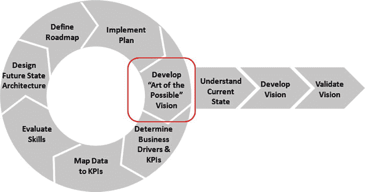
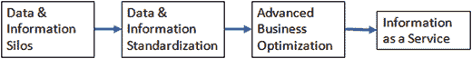

# 2. 评估可能性之艺术

害怕落后于人可能是一种强大的动力。如今，许多组织开始构建大数据和物联网原型，仅仅是因为他们担心竞争对手正在抢占先机。率先将差异化解决方案推向市场，是初创公司吸引风险投资家资金的共同目标。尽管许多初创公司会失败，但有些却取得了巨大成功，并在新市场中站稳了脚跟，这反过来又威胁到了这些市场中原有的成熟公司。面对新的竞争，成熟公司的首席执行官和高级业务领导者们，并未忘记凭借创新型解决方案率先进入市场所能获得的巨大优势。

这些组织中的许多还开始专注于依据事实管理业务，而非凭直觉做出决策，后者曾主导他们过去的决策。数据成为了王道，从数据中挖掘出的信息被视为至关重要。能够回溯过去并准确评估所发生事件的能力，已成为一种基本要求。在评估各种方案以及新决策的潜在影响时，利用数据来预测未来也变得越来越重要。

从表面上看，大数据理应能帮助组织满足这两方面的需求。毕竟，更多的数据种类和更大的数据量应该有助于发现新的事实真相，或者说，许多企业高管都愿意如此相信。而物联网似乎开辟了新的商业可能性，不仅适用于针对传统竞争对手的策略，也适用于在相邻市场开发新战略。

因此，许多 `IT` 部门的任务就是制定一项战略，利用大数据开发能对业务产生影响的解决方案。出于许多相同的原因，物联网现在也受到了类似的关注。想要弄清楚这些计划可能在哪里产生价值，一种常见的初步方法是寻找同行业其他公司发现的杀手级用例。另一种方法是尝试通过探索海量的多样化数据，做出重大的、出乎意料的业务发现，并寄希望于出现一些“灵光一现”的时刻。然而，如果对于通过分析所有数据（包括来自传感器、社交媒体、网站和其他流数据源的数据）可能解决哪些业务问题没有一个坚实的假设，这些方法很少能奏效。

为了提出这样的假设，你的公司或组织或许需要召开一次愿景研讨会。当然，`IT` 高管、企业架构师和 `IT` 架构师将会对 `IT` 的发展方向有看法，并且对大数据和物联网的潜在影响也有所认识。然而，我们正在寻找的用例很可能存在于业务领导者的头脑中。巧合的是，他们可能也拥有为这些项目提供资金的预算。在我们协助组织的规划会议中，描述过此类项目需求的人员包括营销总监、风险管理负责人以及工程副总裁（仅举几例）。

在本章中，我们将描述如何通过评估“可能性之艺术”，来发现你未来信息架构中可能包含的内容，并推动未来的项目。当你的组织召开这样的研讨会时，你可能会发现许多潜在的项目。但本章概述的技术也将帮助你，对这些期望项目的可行性进行切合实际的早期评估。这样一来，你将能够专注于那些确实获得了足够支持，并且能够对业务产生真正影响的项目。

图 2-1 强调了我们在方法论中所处的阶段以及本章涵盖的内容。愿景研讨会中的讨论包括对当前和未来业务架构、数据架构、应用架构以及技术架构的评估。由于这只是我们探索过程的开始，一旦我们确立了愿景并确信可能存在值得追求的项目，后续还会有许多阶段。

图 2-1. 我们成功方法论中的“可能性之艺术”愿景阶段

## 了解当前状态

在描绘我们可能前进方向的愿景之前，了解我们当前所处的位置至关重要。对于当前状态，总是存在业务和技术两种视角。从业务角度来看，我们需要了解我们的业务高管和分析师是否对他们所拥有的信息和数据感到满意。这通常会引发关于他们如何使用数据及其原因、数据粒度、可访问的历史数据广度以及数据质量的讨论。还会讨论缺失的数据源和数据历史，以及添加这些数据将对未来容量需求产生的影响。对数据的及时性需求以及可接受的及时性标准也在讨论之列。

从 `IT` 角度来看，我们需要了解当前的关键数据源、数据如何传输以及在何处传输、使用了哪些数据管理系统、以及当前使用或缺乏哪些业务分析工具。除了软件之外，我们还应该了解当前状态架构中服务器和存储组件的能力和使用年限。我们还应该了解，针对业务的服务水平协议是否得到满足，以及当业务必须响应不断变化的条件时，技术基础设施的灵活性和敏捷性如何。

### 信息架构成熟度自评估

对当前信息架构的成熟度进行早期自评估，有助于洞察组织扩展其现有架构的能力。如果某个组织连基础的数据仓库实施都困难重重，那么就不应指望大数据项目能神奇地解决所有问题。事实上，此类项目反而可能阻碍解决业务线更希望优先处理的高优先级问题。

出版物中存在多种信息架构成熟度评级标准。我们发现，组织通常遵循一条路径：可能从信息和数据孤岛开始，接着是信息和数据的标准化，应用高级业务优化技术，最后将信息作为一种服务提供。图 2-2 展示了这一路径。

图 2-2. 信息架构成熟度阶段

以下是每个阶段所发生情况的定义：

- `信息和数据孤岛`：数据跨多个独立的数据集市和工具进行不一致的重复存储，主要由业务线管理，且经常就哪个数据集是真实数据集展开争论。因此，对数据分析所得结果的解读往往受到质疑。
- `信息和数据标准化`：集中管理的从属数据集市和企业数据仓库用于报表和临时查询，并关注数据质量、一致性和安全性。`IT` 部门与业务线协作扩展数据集市并推出新的集市。
- `高级业务优化`：引入流数据以增强传统数据源。利用预测分析来更好地理解和预测决策结果。
- `信息即服务`：内部开发的可信数据存储和分析工具在公司或组织外部同样具有价值。作为商业合作的好处，为优选合作伙伴提供访问权限。订阅者愿意为这项服务付费，并可以获得访问权限。

这些阶段并非总是按顺序进行。组织可能同时推进其中几个举措。例如，组织常常在数据孤岛和标准化之间摇摆，尤其是在 `IT` 部门行动不够快，无法满足业务线不断变化的分析需求时。预测分析和流数据的引入有时会在这种摇摆过程中被探索和实施。

当然，成功跨越前三个阶段的组织将创造出具有非凡商业价值的东西。此时，一些组织会考虑设立订阅服务，并可能开始与所在行业的数据聚合商展开竞争，因为他们开始将信息作为一种服务来提供。

在评估组织成熟度时，重要的是要认识到，当您从数据孤岛迈向信息即服务时，`IT` 部门必须为组织带来的角色和技能也变得更加高级。承接一个新项目时需要考虑的因素之一是：您是否正在为组织引入一套截然不同的技能组合，以及获取这些技能所需的投入是应该花在这里，还是花在那些要求较低但可能同样有利可图的任务上。

### 行业当前业务状况

在制定未来信息架构时，了解行业趋势以及最优秀的竞争对手如何重新定义其信息架构来应对这些趋势也至关重要。请记住，大数据和物联网的引入正在导致许多行业竞争格局的重新定义。一些公司基于以新方式理解数据的能力，正选择进入其他行业，从而开启新的业务切入点和解决方案。

最具影响力的信息架构项目总是与解决特定业务问题相关联。以下按行业列出了典型的数据仓库项目以及将信息架构扩展到包含 `Hadoop` 和/或物联网的项目的示例清单。当与组织内的业务目标对齐时，这份清单可能会为您探索新项目领域带来一些想法，这些新项目可能产生显著的投资回报。

## 行业应用场景

### 农业

- `数据仓库`：农业生产成本与优化分析、产量分析、农产品大宗商品定价/交易分析。
- `Hadoop` / 物联网：基于田间传感器和天气数据的耕作模式、施肥、收获成熟度及水分含量的分析与优化。

### 汽车制造

- `数据仓库`：制造成本与质量分析、供应链分析、保修分析、销售与营销分析、人力资本管理。
- `Hadoop` / 物联网：客户情绪分析、联网车辆分析（包括部件故障、服务需求与服务调度、驾驶历史及自动驾驶汽车）、驾驶员紧急情况检测与响应。

### 银行业

- `数据仓库`：跨金融渠道的客户统一视图、财务分析、欺诈检测、信用评估、人力资源管理、房地产管理与优化。
- `Hadoop` / 物联网：欺诈检测、风险分析、客户情绪分析。

### 通信行业

- `数据仓库`：定价策略与财务分析、客户支持与服务、营销分析、供应链、物流与流程优化、合规监管、房地产优化、人力资本管理。
- `Hadoop` / 物联网：社交数据分析、移动设备使用分析、网络质量与可用性分析（利用传感器）、网络欺诈检测，以及面向物联网的扩展网络管理与优化。

### 消费品行业

- `数据仓库`：销售、营销、供应商、制造、物流、消费趋势及风险分析。
- `Hadoop` / 物联网：促销效果分析（通过社交媒体和店内传感器）、供应链分析、运输途中成品状态分析、零售终端产品陈列分析及风险分析。

### 教育与科研

- `数据仓库`：机构或设施财务分析、人员与人力资本管理、校友档案与捐赠模式分析。
- `Hadoop` / 物联网：基于传感器数据的学生风险分析、科研传感器数据分析、设施监控与利用率优化。

### 医疗健康（支付方）

- `数据仓库`：医疗成本、医疗质量、风险与欺诈分析。
- `Hadoop` / 物联网：参保客户情绪分析、风险与欺诈分析。

### 医疗健康（提供方）

- `数据仓库`：医疗成本分析、医疗质量分析、人员与人力资源分析、风险分析。
- `Hadoop` / 物联网：疾病与流行病模式研究、患者监护、设施监控与优化、患者情绪分析、风险分析。

### 高科技与工业制造

- `数据仓库`：供应商与分销商分析、物流管理、制造质量与保修分析。
- `Hadoop` / 物联网：车间生产与质量分析、子组件质量分析、产品故障与潜在故障分析、自动化服务请求。

### 保险（财产与意外险）

- `数据仓库`：销售与营销分析、人力资源分析、风险分析。
- `Hadoop` / 物联网：客户情绪分析与风险分析。

### 执法

- `数据仓库`：物流优化、犯罪统计分析、人力资源优化。
- `Hadoop` / 物联网：威胁分析（通过社交媒体和视频捕获识别）。

### 媒体与娱乐

- `数据仓库`：观众偏好分析、媒体频道流行度分析、广告销售分析、营销推广分析。
- `Hadoop` / 物联网：观看习惯分析（基于机顶盒）、娱乐场所客户行为分析、客户情绪分析。

### 石油与天然气

- `数据仓库`：钻井勘探成本分析、潜在勘探点分析、生产分析、人力资源分析、物流优化。
- `Hadoop` / 物联网：钻井勘探传感器分析（故障预防）。

### 制药

- `数据仓库`：临床试验分析（包括药物相互作用研究、受试者结果分析）、研发与生产财务分析、销售与营销分析、人力资源分析。
- `Hadoop` / 物联网：临床研究传感器数据分析、社交行为与疾病追踪（通过社交媒体）、基因组学研究。

### 零售

- `数据仓库`：市场购物篮分析、销售分析、供应链优化、房地产优化、物流与配送优化。
- `Hadoop` / 物联网：全渠道分析与客户情绪分析。

### 运输与物流

- `数据仓库`：设备与机组人员物流及路线规划、销售与营销分析、房地产优化、人力资源分析与优化。
- `Hadoop` / 物联网：交通优化（基于高速公路传感器数据）、交通安全分析与控制、设备性能与潜在故障分析（基于车载传感器）、物流管理（基于传感器）、客户情绪分析。

### 公用事业

- `数据仓库`：物流优化、电网电力传输分析与优化、客户能源使用分析、人力资源分析与优化。
- `Hadoop` / 物联网：基于智能电表数据的电网优化与状态分析、主动维护优化。

`注意`：上述列表仅代表了 2015 年已部署或进行中的部分项目与实施方案。随着各组织不断发掘该技术的创新用途，并寻求针对先前无法解决的问题的新业务方案，该列表也在持续变化。

在本书后续章节中，我们将讨论此类项目的优先级排序。优先级排序（以及通常所需的资金支持）要求业务部门与信息技术部门协同合作。当项目定义和优先级排序作为联合活动开展时，项目最终成功的概率将显著提升。

## 是否需要新的愿景？

至此，我们已经对自身的信息架构成熟度进行了自我评估，并审查了一些可能的项目。或许可以通过对现有信息架构进行小幅修改来推进期望的新项目。例如，如果分析所需的数据大多结构化，且数据仓库基础设施完善，那么最有效的做法可能就是在此基础上直接构建。然而，当基础设施与业务需求不匹配时，现在或许是时候构想一个方案来应对这些日益增长的需求了。

一个显而易见需要修改架构的理由（你可能已经从本书的主题中猜到了），就是识别出那些需要分析数据仓库难以轻松处理的新数据源的业务需求。例如，新的数据源可能包括流式数据或半结构化数据。可能会引入高速、高容量的数据摄取需求。这些需求可能导致将 `NoSQL` 数据库和 `Hadoop` 纳入信息架构，而之前它们可能并不存在或并非必需。探索 `Hadoop` 的数据科学家可能渴望并推动采用新的信息发现工具和预测分析引擎。

你如何收集需求，并共同制定未来状态信息架构的愿景？我们合作过的公司和组织通常会召开规划会议（有时称为研讨会）并收集需求。初步的需求收集可能只需两三个小时，但它能帮助确定后续所有工作的方向。

在愿景制定会议期间，与会者应讨论他们对当前数据仓库、商业智能、`ETL` 工具及处理流程的满意程度。讨论可能会延伸到包括服务器和存储在内的底层基础设施。通常正是在这个阶段，人们会首次考虑对现有组件进行升级或变更。例如，如果目标数据仓库上的 `ETL` 性能及所需资源存在问题，那么考虑利用为处理流式数据源而引入的 `Hadoop` 集群来充当 `ETL` 引擎或许是个好主意。实际上，`Hadoop` 引擎可以成为所有数据的初始着陆点。如果出现了对预测分析的新兴需求，或者正在重新评估如何部署预测分析，那么你也可以探索使用 `Hadoop` 集群来处理该工作负载。

通常在这个阶段，`IT` 部门的许多人会开始担忧当前信息架构的成熟度是否与正在讨论的愿景严重脱节。`IT` 部门或业务部门的技能差距可能会变得非常明显。数据治理和运营问题也可能浮现。潜在的预算成本和影响通常是 `IT` 高层管理的首要关注点。

所有这些问题即使在现阶段提出来也是好的。然而，我们才刚刚开始。我们正在构建未来信息架构可能成为什么样子的愿景。我们尚不够了解业务案例（包括是否有业务案例），无法确定我们是否能够推进一个项目。我们也没有关于所需数据的足够细节。这些我们将在后续阶段更好地理解。之后，我们还会更仔细地评估所需技能。当我们开始定义更详细的未来状态信息架构时，我们将开始更好地理解解决方案的潜在成本。

而现在，我们只是在探索可能性的艺术。

## 制定愿景

愿景通常是在有引导的规划和白板会议中制定的。即使在推测修订信息架构的最初阶段，你也会希望有各种关键利益相关者参与会议。当然，你希望了解当前架构及其组件的架构师和 `IT` 管理人员在场。但在这个时间点，组织中业务主管和分析师可能最清楚地知道必须将哪些新的数据源纳入进来，以解决新出现的业务问题。至于数据需要多精细以及数据需要保留多久，业务分析师与 `IT` 部门的看法可能截然不同。请记住，现在不是争论的时候。现在是收集每个人需求的时候。

当然，在会议前做好预习工作并无坏处。如果 `CIO` 或其他 `IT` 高级领导不经常参加业务规划会议，那么你需要回顾组织在财报电话会议、财务报表、内部广播和其他内部论坛中阐述的最高业务优先级。你也可以对竞争对手进行类似的研究，因为贵公司的业务主管很可能对竞争压力非常敏感。

`注意`：在一些公司和组织中，如果 `IT` 部门与业务部门脱节，并且不被视为值得信赖或可靠的交付伙伴，我们曾见过 `IT` 团队试图独立定义和推行他们认为具有普遍意义的信息架构修改。在重新与业务部门建立信任并开展联合愿景制定和规划之前，此类努力往往停留在研发阶段，且几乎没有可自由支配的资金支持。

为了吸引合适的人员参加会议，你应该在会议前传达愿景制定会议的目标和议程。例如，一个明确的目标可能是：希望就一项 `IT` 投资的五年计划获得初步意见，以帮助公司提供更好的客户体验。请注意，我们除了 `IT` 目标外，也提到了一个业务目标。如果我们希望业务人员参加会议，就需要描述这对他们有什么好处。

愿景制定会议上讨论的议程大纲可能如下所示：

- 会议总体目标
- 与会者自我介绍及自述会议目标
- 概述需要收集的信息类型
- 讨论当前信息架构成熟度及其影响
- 回顾现有信息架构覆盖范围及所提供的业务解决方案
- 讨论需要改变什么以及为什么
- 信息架构和业务解决方案如何演进的愿景
- 讨论后续步骤及其他所需会议

你应在会议一开始就明确表示，会记录下大家的意见和白板上的画图。你还应提前承诺，会议结束后将提供并分发一份总结所收集信息的报告。