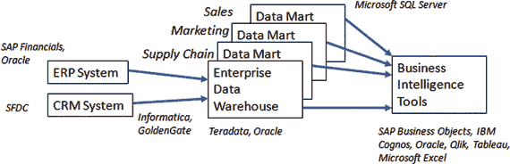
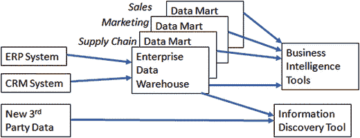
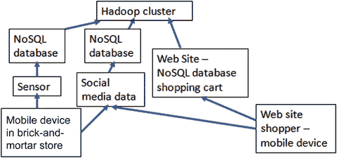
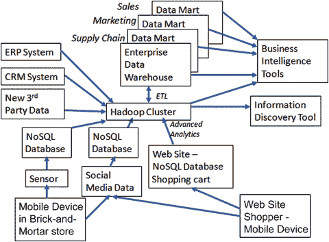
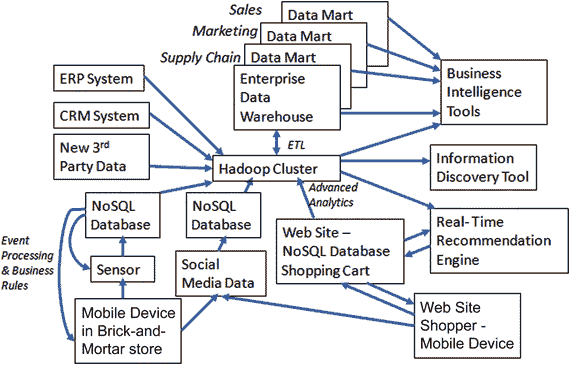

# 数据仓库的当前状态与未来状态

IT 部门很可能已经绘制出高度技术性且详尽的状态信息架构图。在我们着手确定可能发生的信息架构演进过程时，这些图表可以作为有用的参考资料。但我们需要简化这些图表，并聚焦于与参与愿景制定的业务领域需求相关的部分。

图 2-3 展示了一家拥有零售商店的企业中，当前状态的数据足迹可能的表现形式，其愿景制定的重点在于提升促销和销售活动的成功率。我们将以此图或类似图表为起点。在该示例中，企业数据仓库（EDW）提供了历史数据库记录。数据从多个 OLTP 系统（图中展示了 ERP 和 CRM 系统）中提取。数据集市围绕 EDW 分布。业务分析师使用报表、即席查询和分析工具来访问数据集市及/或 EDW。图中还标出了一些当前数据足迹中的关键技术，以便我们在讨论过程中进行参考。

**图 2-3.** 典型的当前状态信息架构图

在围绕此架构图展开的讨论中，可以深入探讨许多主题。这些讨论中经常出现的主题包括：

*   当前数据的粒度以及 EDW 中历史数据的时长（以及期望的时长）
*   数据集市当前的有用性，包括它们之间的重叠、扩展或部署新数据集的灵活性，以及所需的历史数据时长
*   当前报表、商业智能工具和仪表盘的有用性
*   如果同时存在多个功能重叠、用户群体规模不一的商业智能工具，是否可能进行标准化
*   是否需要具备一致维度（conformed dimensions）的维度模型
*   是否需要预测分析和数据挖掘
*   对当前查询和分析性能的满意度
*   是否需要实时告警或建议
*   第三方数据源的重要性，以及这些数据对一个或多个数据集市的适用性
*   是否需要额外的数据源来解决新出现的业务问题
*   EDW 和数据集市当前的数据质量，以及未来期望达到的质量标准
*   数据更新的频率，以及能否及时将数据交付到 EDW 或数据集市（并最终交付给分析师），以便做出业务决策
*   对数据安全（包括静态数据和传输中的数据的顾虑）
*   是否需要更高可用性的 EDW 或数据集市

尽可能多地收集在场所有人的意见，并视需要在白板上做好记录。你需要记录下数据集市、数据源和其他组件的名称，以便大家对讨论内容有一致的理解。

**注意**

如果你对当前状态信息架构只是略知一二，而参加会议的其他架构师想要修正你的图示，请欣然将记号笔交给他们，让他们绘制自己版本的图。他们的图可能与本章提供的插图大相径庭，但看到他们的版本能让在场所有人对当前架构的认知有极大启发。这将有助于建立对现有架构更全面的共同理解，并在确定未来状态架构愿景时，就哪些方面需要改进展开更好的协作。

正如我们刚才提到的，数据安全问题可能会在此次讨论中出现。部分讨论可能由该组织所在行业的特定需求驱动。如果你在某个特定行业或政府机构工作，你可能对必须执行的合规标准已经很熟悉。但如果你在不同行业间提供咨询服务，表 2-1 可以帮助说明一些经常被提及的较为通用的标准。

**表 2-1.** 各行业数据安全标准示例

| 行业 | 标准名称 | 描述 |
| --- | --- | --- |
| 欧盟 | 欧盟数据保护指令 (EUDPD) | 要求所有欧盟成员国采用安全指令 |
| 金融/银行业 | (美国) FFIEC 审计员安全指南 | 定义网上银行安全要求 |
| 金融/银行与服务 | 格拉姆-里奇-比利雷法案 (GLB 或 GLBA) | 为所收集金融数据的隐私和安全设定要求 |
| 金融与零售—支付处理 | 支付卡行业数据安全标准 (PCI DSS) | 支付卡数据安全处理框架：身份验证、欺诈检测与预防 |
| 医疗保健—病历 | 健康保险流通与责任法案 (HIPAA) | 医疗数据的访问控制、审计、数据完整性、加密标准 |
| 美国教育部 | 家庭教育权利和隐私法案 (FERPA) | 学生数据（包括成绩、注册、账单）的隐私标准 |
| 美国政府 | 联邦信息处理标准 (FIPS)，来自 NIST | 定义美国机构的身份验证、加密密钥管理和物理安全 |

你也可以开始与业务分析师探讨，是否需要易于访问的沙箱，以便他们能根据需要探索来自各种来源的数据。过去，这些沙箱有时被设置在 EDW 中，或作为一次性数据集市提供。近来，一些信息发现工具已经出现，它们自带数据管理引擎，或使用 Hadoop 进行数据管理。这些工具在探索新数据方面更加灵活、及时，因为它们通常是“无模式”的——换句话说，不需要预先定义模式就能发挥作用。

图 2-4 在我们当前状态的数据仓库架构中，加入了信息发现工具的概念。理解通过使用此类工具探索数据所获得的洞察价值，有助于我们了解如何更好地利用 Hadoop 集群中的数据，同时，使用此类工具也可能有助于推动未来数据集市和传统商业智能工具构建的需求。

**图 2-4.** 信息架构图中的信息发现

请记得从在场的业务分析师那里收集他们确信能够通过实现报表和分析愿景而带来的具体业务收益。他们可能分享关于行业最佳实践的数据，或者研究过自己组织的效率，并提供一些有力证据，说明可能创造的价值。这些信息在后续我们更详细地探讨如何为该项目的商业模式论证、以及如何在竞争性项目中确定其优先级时，将非常重要。

### 确定 Hadoop 与 NoSQL 数据库的适用场景

现在，我们准备探讨是否需要扩展信息架构以纳入 Hadoop 和 NoSQL 数据库。这种扩展很可能源于需要以比关系数据库技术更高效的方式来处理流式数据和半结构化数据源。

如果你的公司像许多组织一样，可能已经在开展研发工作，试图确定此类数据能带来的价值。如果你的组织已有此类项目，你应将其记录为当前状态的一部分。例如，如果 Hadoop 原型正在开发中，或者 Hadoop 已成为生产环境的一部分，你可以探讨以下主题：

- Hadoop 集群的当前数据来源
- 加载到 Hadoop 集群中的数据所代表的历史时间长度及其当前数据量
- 希望加载到 Hadoop 集群中的额外数据源
- 希望存储的数据历史时间长度及其对数据量的影响
- 当前和未来计划的数据摄取速率
- 当前和未来计划在 Hadoop 集群中的工作负载（`MapReduce`、SQL 查询、`Solr`/搜索、预测分析、`ETL` 等）
- 当前和未来计划的分析工具（商业智能、信息发现、搜索、预测分析、`ETL` 等）
- 对当前理解数据并驱动业务价值能力的满意程度（包括与技能相关的任何挑战）
- 对数据安全（包括静态数据和传输中数据）的顾虑
- 对集群中数据的可恢复性和可用性的顾虑

图 2-5 展示了众多在 Hadoop 中分析数据的项目是如何启动的。该图描述了一家拥有零售门店的公司的典型 Hadoop 计划。图中，基于 Hadoop 的工作被描绘为与已有的数据仓库及其周边基础设施完全分离。

**图 2-5.** 在独立的研发工作中使用 Hadoop 和 NoSQL 数据库

在这个理论上的零售门店示例中，业务目标是更好地理解促销和销售活动的成效。数据在购物者购买商品、浏览网站以及进入实体门店时被捕获，随后收集到 Hadoop 中。表达购物者与该公司进行交易体验的评价数据则从社交媒体收集到 Hadoop。流式数据落地到 NoSQL 数据库集群中，这些集群可以轻松扩展以满足高摄取需求，然后加载到 Hadoop 中进行分析。

请注意，从传感器收集数据的部分以非常简化的物联网架构视图表示。图中缺失了很多内容，包括配置、安全和其他必要服务。就定义一个如何将所有这一切整合在一起的愿景而言，目前这样是可以的。

### 链接 Hadoop 与数据仓库基础设施

接下来，我们将确定是否需要同时查询和分析驻留在传统数据仓库信息架构和 Hadoop 集群中的数据。了解我们分析师群体的专业水平以及他们为回答业务问题而同时访问两个数据源的频率，将有助于我们确定要推荐的最佳方案。

例如，如果我们需要提供维度模型以便业务分析师探索数据，那么我们要么需要将有价值的数据从 Hadoop 集群迁移到数据仓库，要么提供一个能将 Hadoop 集群用作数据仓库扩展存储的基础设施。如果我们计划提供一个包含两个数据源数据的预测分析平台，那么我们很可能希望所有待分析的数据都驻留在 Hadoop 集群中。如前所述，我们需要向业务分析师收集联合分析这些不同来源数据所带来的潜在业务收益。

图 2-6 展示了 Hadoop 和 NoSQL 数据库如何通常成为现有数据仓库信息架构的一部分。由于我们可能还想利用 Hadoop 进行 `ETL` 处理，我们将以前直接馈送给企业数据仓库的数据源描绘为成为 Hadoop 的输入。这同样是一个高度简化的示意图。

**图 2-6.** 链接到数据仓库基础设施的 Hadoop 和 NoSQL 数据库

在愿景构建会议的这个阶段，有时会就数据应托管在何处展开辩论。这些新数据源的数据应该首先落地并在云端进行分析吗？还是数据应该落地到一个包含现有数据仓库和 Hadoop 集群的本地基础设施中？

数据量以及通过网络（带宽有限）所需的移动量将帮助您决定数据是最适合放在云端、本地还是混合模式。为了了解数据移动量，您需要了解针对各种数据管理系统中数据的查询和分析活动及其位置。这些选项应在技术信息架构得到更好定义后再进行更详细的探讨。届时，您将对设想的业务用例以及解决这些问题所需的数据有更清晰的认识。

> **注意：** 如今，许多组织使用云来快速部署 Hadoop、NoSQL 或数据仓库的研发工作，尤其是在业务价值不明确的情况下；随后，当考虑到整体生产基础设施不断增长的数据量和定制化要求时，再将基础设施引入内部。

### 实时推荐与行动

显而易见，图 2-6 所描绘的基础架构因数据在点与点之间传输而引入了显著的时延（即延迟）。针对企业可能遇到的某些问题，可能需要提供实时推荐并采取相应行动。例如，当购物者正在网站上选购商品时，你希望在他们浏览网站期间智能地推荐其他商品，而不是在他们离开网站之后才进行推荐。

对于此类场景，我们使用实时推荐引擎来引导购物者，在他们浏览网上商店时向其展示特定产品。关于购买和购物行为的预测分析模型在 Hadoop 集群或数据仓库中进行处理。当然，目标是做出明智的推荐，让购物者购买更多商品，并更快地找到他们想要的东西。推荐引擎中的模型会根据当前的购买模式定期更新，随着时间推移，引擎的推荐能力会变得越来越智能。

在部署了智能传感器和控制器的场景中，对及时行动的迫切需求可能意味着需要在进行分析之前就制定某些规则来驱动行动。这正是当今事件处理和业务规则引擎常被部署为智能传感器解决方案一部分的原因。例如，如果实体店中的传感器开始检测到顾客到达收银台的延误以及不满意的顾客放弃他们想购买的商品，预定义的规则可能会触发设备向正在从事其他活动的收银员发出信号，要求他们开放额外的收银台，以缓解拥堵。

图 2-7 展示了在我们网站中添加实时推荐引擎的情况，该引擎的数据模型在 Hadoop 集群中运行，并定期向引擎提供更新。购物者画像和位置信息被传递给引擎。具体的推荐则通过网站返回给在线购物者。

图 2-7。

信息架构中的实时推荐引擎与事件处理

我们还展示了在实体店部署传感器的情况下，闭环事件处理和业务规则的加入。除了我们的收银台瓶颈示例，当购物者使用运行我们忠诚度应用的手机进入商店时，我们可能希望开始监控他们的位置，并根据我们收集到的关于他们最近在我们网站上浏览过的商品信息，让我们的销售人员更好地为他们提供帮助。

我们刚才展示的图表对于业务分析师来说可能看起来有点技术性。然而，我们的经验是，此类图表可以帮助业务分析师理解当前基础设施的局限性，以及可用于解决他们问题的数据流和分析选项。这些图表还有助于就为了交付他们所构想的业务解决方案而需要做出的改变，尽早获得大家的认同。

## 验证愿景

愿景规划会议通常以在白板上绘制当前状态和未来状态架构图而告终，这些图通常通过用手机拍照来保存。其他时候，这些图表会保留在活动挂图的可撕页上。会议主持人在讨论当前状态和期望的未来状态期间，也应该收集了大量笔记。这些笔记应包括来自业务部门、IT 高级管理层、架构师以及任何其他出席人员的意见。一些笔记可能包含关于未来状态信息架构一旦部署后，将对做出更好业务决策的能力产生何种影响的假设。

现在是时候以更正式的方式总结所有收集到的信息了。这些信息应以报告或演示文稿的形式，反馈给所有参与愿景规划会议的相关方。这样做有助于验证是否已捕获关于未来需求的所有关键信息。这也可能引发对所需内容的进一步澄清。通常，在一到两周内将信息反馈给初始与会者是最佳实践，这有助于维持初次会议中所建立的团队合作精神。

> **注意**  
> 在某些项目中，我们曾收到请求，要求邀请截然不同的受众参加后续会议，而该会议本意是总结之前规划会议中的发现。这种情况之所以发生，有时是因为原始与会者对讨论过的潜在未来状态架构感到兴奋并分享了这份兴奋，从而吸引了更多利益相关方。在其他情况下，来自其他业务部门的领导者对这个过程产生了兴趣，并希望确保他们的需求也被记录下来。这是一个积极的信号，表明组织中的许多人认为这样的项目具有价值，并且未来有可能获得资助和实施。请记住，如果后续会议更多地侧重于进一步探索，而不是对前期工作的汇报和验证，那么一个好的方法是主动提出撰写一份新版本的报告，然后安排对该版本的另一次汇报和验证。

在愿景规划会议期间所发现内容的汇报报告或演示文稿中，通常应包含以下内容：

*   当前的业务挑战，包括由当前信息架构引发的挑战
*   当前状态的信息架构描述与图表
*   新兴的业务需求，可能预期的进一步业务模式变更，以及有效运营业务所需的内容
*   能够应对需求和挑战的未来状态信息架构图
*   未来状态信息架构到位后可能实现的业务收益（理想情况下包括这些收益可能的财务规模）
*   后续步骤，包括本书后续章节中概述活动的日程安排

在某些组织中，我们观察到 IT 架构师希望利用在此愿景规划活动中收集的信息，立即开始未来状态信息架构的详细设计。然而，仍有许多未知因素。我们还没有掌握与业务运营相关的关键成功因素的详细信息，包括所需的关键绩效指标和衡量标准。我们还不清楚如何分项目阶段来实施期望的解决方案，也不清楚各阶段的优先级应该如何排序。

正因如此，我们目前尚未形成可靠的商业案例，尽管对于其可能来源已有些初步设想。关于哪些数据源能提供所需指标并对应关键绩效指标，我们的认知极为有限。此外，我们也不确定组织内部（缺乏）相关技能会对部署管理预期解决方案、或利用该方案提升业务运营效率产生何种影响。

现阶段，在项目定义清晰之前，我们仍需进行更多调研与文档编制工作。但至少我们已初步了解调整信息架构的可行性与可能性，并且更清楚应从何处寻找论证依据。此外，我们开始隐约知晓业务赞助可能来自何方。因此，下一步我们将与业务部门合作伙伴共同深入挖掘实际需求。

