# 大数据与物联网的业务信息映射

至此，我们已按照成功方法论，为一个潜在项目定义了宽泛的业务与 IT 愿景。既然我们已将愿景与更详细的战略及对组织目标的更深入理解相融合，现在应该对项目的潜在业务目标有了更细致的认识。利益相关者和潜在赞助方也正在被识别。然而，我们距离理解那些将影响现有信息架构的必要数据流与处理变革仍有相当距离。

在本章中，我们将把支撑业务运营所需的关键绩效指标（`KPI`）映射回其数据源。我们还将开始了解在数据方面存在的差距、所需的分析工作，以及数据如何呈现给业务。我们的业务信息映射（或本章中有时简称的 `BIM`）将推动我们在成功方法论下一阶段重新设计技术架构。但在此，你可能会问为什么要开发一系列映射图来达成此目的。

数据流的映射将在多个方面帮助我们。有句老话说：“一图胜千言”。图形化表达能够简化复杂思想的沟通。当我们用手指在地图上追踪物体在两点之间的移动路径时，这一点尤为明显。数千年来，我们一直用这样的地图来指引旅程。

在某种程度上，我们之所以能利用地图理解世界的复杂性，得益于大脑天生善于处理眼睛收集的二维图像。事实上，今天的神经科学家认为，超过一半的大脑功能是用于处理视觉信息的。这就是为什么我们能如此轻松地理解并发现模式。

可以说，我们的大脑已经适应了以这种方式处理大数据分析的可视化输出。这种输出通常以图形形式呈现。例如，比较随机选择与系统选择结果的增长图，能帮助我们更好地理解预测的有效性。

相比之下，语言在人类进化史上出现得相对较晚。而理解书面语言，更是我们在学校经过多年训练才适应。因此，你能够理解我们在本书中描述的方法论与细节（我们期望如此）。

多维图像比单一维度的文本能够传达多得多的信息。它们在打破因语言和文化造成的误解壁垒方面极为有效。当我们使用普遍接受和认可的符号与图形图标时，这一点尤其突出。因此，在本章中，我们将采用一个公认的数据流映射标准：`Yourdon / DeMarco`。我们将借鉴（无论字面还是比喻意义上）这一标准来提供可视化分析。

由于本书关注的是大数据与物联网的架构，我们将效仿物理世界中的建筑师的做法。我们将创建目标受众能够理解的图像，并以易于吸收的格式传达相关信息。

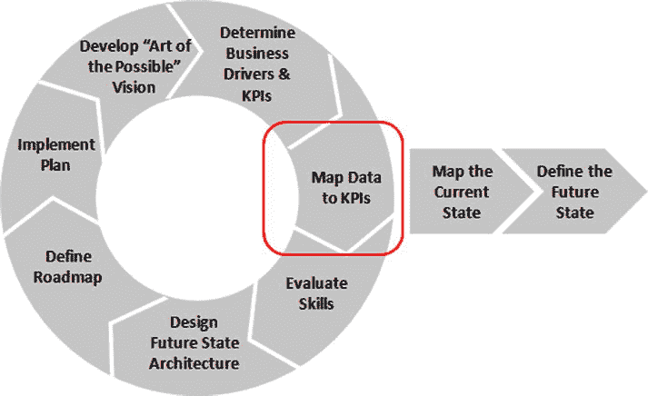
**图 4-1.** 成功方法论中的业务信息映射阶段

本章分为两部分。第一部分主要关注开发当前状态的业务信息映射。第二部分则阐述定义未来状态并将其映射到代表这一未来的 `BIM` 上的过程。

## 映射当前状态

在提供如何创建当前状态业务信息映射的示例之前，我们首先介绍一些背景知识：`Yourdon / DeMarco` 符号体系，这套符号通常用于定义我们在此使用的数据流图中的组件。这将帮助你理解本章各图表的含义，同时为你日后自行开发的映射建立标准。

我们还将再次审视方法论前几个阶段的输出成果如何帮助我们构建业务信息映射。我们会回顾一个之前已在方法论中揭示的理论业务场景，并利用已获得的背景知识来开发代表当前状态的 `BIM`。

### 数据流图基础

数据流图（`DFD`）这一名称恰如其分，因为它用于以图形方式表示系统的输入及由此产生的输出。它还可用于说明关键流程和数据存储。爱德华·尤登和汤姆·德马科创建了一组标准对象，这些对象是典型数据流图中使用的组件。

根据尤登/德马科的定义，`DFD` 的四个基本组件描述如下：

- **输入/输出**：系统外部但与系统交互的个人、组织或系统。
- **流程**：因特定原因执行的活动或功能。它可以是手动的，也可以是计算机化的。每个流程应仅执行一项活动。
- **数据存储**：永久存储的数据集合。
- **数据流**：在上述任何组件之间移动的单个数据项或信息的逻辑集合。

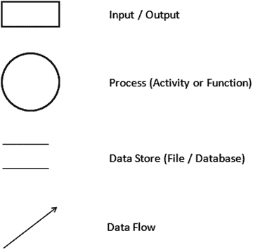
**图 4-2.** 尤登/德马科表示法

`DFD` 用于直观地表示数据来自何处、系统如何处理数据以及处理产生的输出。这些系统可能已存在（当前状态）或处于规划阶段（未来状态）。系统分析师通常首先与业务分析师和架构师会面，然后创建 `DFD` 图。图表创建后，他们会请同样的人员验证这些图是否反映了现实情况或预期的结果。

以下是创建数据流图的最佳实践：

- 一系列数据流总是起始或终止于输入/输出，并起始或终止于数据存储。反之，这意味着一系列数据流不能起始或终止于流程。
- 一个流程必须同时有数据流入和流出。
- 所有数据流都必须用正在交换的精确数据来标记。
- 流程名称应以动词开头，以名词结尾。
- 数据流应命名为描述性名词。
- 数据存储必须至少有一个数据流入。
- 数据流不能在输入/输出和数据存储之间直接流动，中间必须有流程。
- 数据流不能在两个数据存储之间直接流动，中间必须有流程。
- 为避免线条交叉，输入/输出和数据流可以在数据流图中重复，但流程不能重复。

开发 `DFD` 的第一步是创建一个上下文图，并以正在建模的系统命名。有时，该图被称为零级（0 级）图，因为没有更高层次的抽象。它将整个系统表示为一个单一的流程，以及与该系统交互的输入/输出之间的数据流。与其他定义的低层级流程（如 1 级、2 级等）不同，上下文流程通常是系统的名称。低层级流程的名称通常以类似动词的标识符开头。通常，上下文图不会描绘数据存储，因为它们位于系统内部。

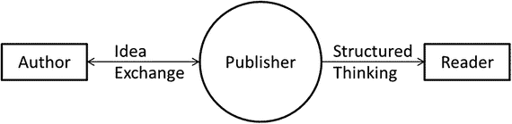
**图 4-3.** 标题为“发布者”的上下文（0 级）`DFD` 示例

你可以将上下文流程圆环想象成一个通向正在分析的基础系统的检修孔。在这个抽象的最高层级，数据流就像电缆一样，从检修孔消失并再次出现。为了进一步理解上下文流程内部进行的通信和处理，我们需要至少下降一层，进入我们的地下世界，沿着数据流电缆前行。下降的第一层称为 1 级。在这里，我们可以追踪从 0 级检修孔进出的数据电缆，观察它们经过哪些额外的子流程。这些子流程本身就像检修孔一样，可能下降到更详细的层级。从这些地下检修孔中出来的一些数据电缆将通往数据存储或“水库”（文件和数据库）。这些“水库”可能由一条或多条数据电缆连接到其他流程。

例如，如果我们把图 4-3 中的上下文 `DFD` 分解成一个 1 级 `DFD`，它可能看起来像图 4-4 所示的图表。

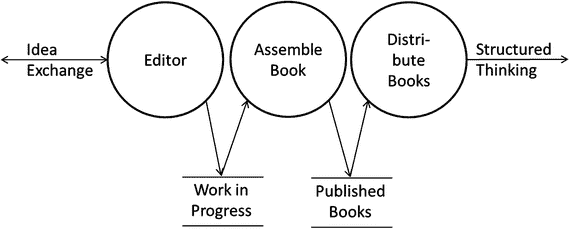
**图 4-4.** 标题为“发布者”的（1 级）`DFD` 示例

到目前为止，我们介绍了通用的尤登/德马科概念。现在，我们引入关键绩效指标（`KPI`）符号，作为我们业务信息地图中一个极其重要的表示法。回想一下，`KPI` 是业务分析师或业务流程做出业务决策所需的关键指标。`KPI` 通常出现在高管仪表盘中。在图 4-5 中，我们说明了如何在 `BIM` 图中表示它们。

**图 4-5.** 在 `BIM` 图中表示的关键绩效指标

### 了解当前状况

在第 3 章中，我们描述了一个流程，其中包括了解业务需求、识别关键成功因素，以及了解解决当前业务问题所需的衡量标准和关键绩效指标（`KPI`）。在创建业务信息图之前，我们会先经历这个流程。为了给创建业务信息图奠定基础，我们将以虚构的豪华汽车制造商 `Lux Motor Cars`（`LMC`）为例，说明如何收集这类信息。

`LMC` 在全球销售精美汽车。在美国，其销售的 70%至 75%的新车是通过内部租赁公司 `LMC Lease` 提供融资的。租赁车辆的比例正在增长。使用这种融资方案的客户喜欢以下特点：

- 低成本、可预测，且无需支付任何“预付”金。换句话说，租赁公司实际上购买了车辆，并以固定价格在固定期限内将其有效租赁给承租人，从而平滑了车辆折旧和资本支出的实际利息。
- 制造商通过新车保修承担了重大维修风险。

为了确保车辆在市场上具有竞争力定价，`LMC` 将新车销售的毛利率维持在很低的水平。这一策略是可行的业务方法，因为车辆质量很高，由此产生的保修成本远低于行业平均水平。由于车辆使用时间长，`LMC` 最终通过在定期维护中消耗的车辆配件和专有润滑剂上保持较高利润率，获得了大部分利润。`LMC` 知道，保持利润增长、降低保修成本的最佳方式是鼓励车主使用 `LMC` 品牌产品主动进行保养（保持液位充足、按时更换机油滤清器等）。因此，行业数据显示，`LMC` 在其提供的每类车辆中，拥有最低的总拥有成本。

虽然租赁数字持续增长，但 `LMC` 管理层却看到了一个令人不安的趋势。不仅 `LMC` 在美国的客户质量评级在下降，保修成本也在上升。进一步分析发现，在美国由 `LMC Lease` 拥有的车辆导致了保修成本的意外增加，同时承租人的满意度评分也在下降。

利用信息发现工具筛选美国所有 `LMC Lease` 车辆的服务记录后，发现了以下信息：

- 车辆应进行定期保养的时间与实际进行保养的时间之间存在很大差异。换句话说，承租人似乎不像其他 `LMC` 车主那样严格遵守保养计划。
- `LMC Lease` 车辆在“检查发动机”灯亮起后的行驶里程数显著更高。似乎承租人没有认真对待“检查发动机”灯。

承租人似乎更倾向于将 `LMC Lease` 车辆视为租赁车。对索赔金额最高的承租人进行访谈后，发现了以下情况：

- 承租人认为自己非常忙碌，并表示他们看到“保养到期”灯亮后会迅速致电 `LMC` 经销商的服务部门。然而，当面临立即进行定期保养还是等待安排代步车时，他们选择了等待。显然，他们看重的是车辆持续可用。
- 最昂贵的保修索赔来自“检查发动机”灯亮起且驾驶员表示感觉车辆运转不太正常的租赁车辆。但同样，当他们致电要求服务时，他们选择等待直到有代步车可用。他们不想租用替代车辆，尤其是在不知道需要租用多久的情况下。

现在让我们回顾一下迄今为止收集到的信息。两个关键的 `LMC` 业务目标凸显出来：降低美国不断攀升的保修成本，以及提高承租人中的车辆质量评级。

经过进一步讨论，我们发现保修支持组织认为，如果 `LMC Lease` 的车辆配备了一个能够报告问题并在问题报告时自动安排维修的远程信息处理系统，30%至 50%的保修索赔成本是可以避免的。这样的系统可以使服务团队更好地优化维修车间的员工配备水平。车队管理团队可以更好地优化代步车的数量，并根据需要适当补充租车。最后，公司从收集的市场研究数据中了解到，客户愿意为此类服务支付溢价。

业务部门显然希望跟踪多个 `KPI`。这些 `KPI` 包括终身保修成本、终身车辆盈利能力、服务安排等待时间、代步车可用性和利用率、服务车间盈利能力、高级服务盈利能力以及客户满意度。

`LMC` 目前还无法实施这样的计划。他们运行此类项目所需的大部分数据目前尚不可用，尽管业务部门对此尚未完全了解。因此，接下来我们将构建描述当前状态的业务信息图，以便所有人都能更好地理解业务这一部分如何利用现有数据运作。

好消息是，`LMC` 已准备好进行远程信息处理方面的投资。我们将在本章后面探讨这项投资的潜在影响。届时，我们将研究当这些数据在未来状态下可用时，业务流程可以如何改变。

## 构建当前状态业务信息地图

`BIM`通常是通过了解业务的高管、分析师、数据科学家以及`IT`部门（尤其是在业务分析师和数据科学家不确定数据可能来源的情况下）之间的协作来开发的。业务部门的高管提供了关于他们如何利用所提供的数据做出决策的重要信息。

注意：`IT`部门可能希望提供他们在当前状态下对数据流的看法。这没问题。但是，在许多组织中，业务部门会创建额外的报告，其中包含未记录在案的数据源。因此，我们应该采访所有相关方，以真正了解数据的当前状态及其使用方式。

你可能会问，为什么我们要在绘制未来状态图之前，先为当前状态构建`BIM`。当前状态为我们提供了一个基线理解，即当前可用的数据源以及它们是如何被利用的。这种理解可以包括数据存储的类型、当前环境中的数据集成方法，以及报告和分析能力。我们将在定义未来状态时，以此基线为基础进行构建。

在我们的`LMC`示例中，我们需要与来自公司多个业务领域的关键高管和业务分析师进行交谈。通过研讨会进行这种发现是一种常见的方法。必须从产品开发、租赁、保修支持、经销商服务以及车队管理业务部门收集信息。我们需要了解当前的数据馈送在决策时如何被使用、它们提供了哪些智能信息，以及当前的局限性。

为了在我们的第一次`BIM`实践中取得良好的开端，让潜在的业务发起人启动会议是一个好主意。对于像`LMC`这样的公司，我们可能希望让`车辆产品开发副总裁`或类似职位的人来开场讨论。这有助于凸显这项工作的重要性。

在研讨会或访谈期间，我们将首先验证组织内不同部门如何看待这个机会和当前状况。对于`LMC`，以下是我们可能发现内容的示例：

-   从我们的租赁团队访谈中，我们发现，虽然我们了解客户的信用度，但我们也发现许多承租人将租赁等同于“汽车即服务”。一个常见的要求是以溢价提供延长服务保修，保证在需要时能提供代步车。
-   我们的保修支持团队认为，车辆中的传感器日志是控制成本的关键。目前，车上的车载系统会提醒驾驶员可能存在的问题以及该怎么做（例如，需要保养、检查发动机等）。传感器产生的错误代码存储在车辆中，当车辆进行保养时，这些数据会被下载。他们认为，通过实时处理数据，可以避免重大的车辆故障并降低服务成本。
-   服务部门认为，缺少代步车会延误及时维修。他们与客户的唯一接触点是车辆被送来维修的时候。他们认为，更及时的服务也能降低保修成本。
-   车队管理部门只衡量代步车的使用率。由于该百分比很高（例如，95%），他们觉得自己提供了优化良好的服务。
-   高管们表示，保修支持方面缺乏可见的`KPI`尤其令人担忧。

现在，让我们看看`LMC`维护与保修（`M&W`）系统当前的运作方式。我们首先从最高层级（第 0 级）来表示当前状态的业务信息地图。首先，我们识别潜在的数据源：

-   `传感器`：传感器安装在由`LMC Lease`拥有的`LMC`汽车中。`M&W`系统从传感器收集数据，但不提供反馈。
-   `车库`：车库代表 LMC 经销商的服务部门。`M&W`系统与各个服务部门交互，但其运作方式超出了本分析的范围。
-   `代步车`：这代表我们车队管理的代步车数据。虽然代步车可用性不足是一个问题，但该部门的运作方式也超出了本分析的范围。为完整起见，我们将展示其与`M&W`系统的关系。
-   `承租人`：这代表`LMC Lease`车辆的驾驶员/承租人。`LMC Lease`中驾驶车辆的客户显然是`LMC`业务的核心，但仅处于本分析的边缘。同样，为完整起见，我们将展示其与`M&W`系统的关系。
-   `利益相关者`：这代表关心`M&W`系统性能的`LMC`高管。我们将指出，目前并没有太多`KPI`反馈给这些利益相关者。

这些数据源在图 4-6 中表示。此时，我们不会说明`M&W`系统内部的数据存储（例如车辆数据库或来自车载电子设备的数据）。

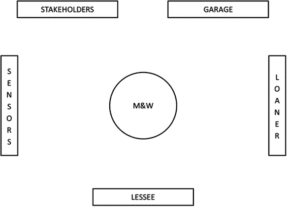

`图 4-6.` 名为“LMC 维护与保修系统”的当前状态上下文（第 0 级）BIM 的局部视图

接下来，让我们评估数据如何从这些源流出。我们在图 4-7 中表示以下数据流：

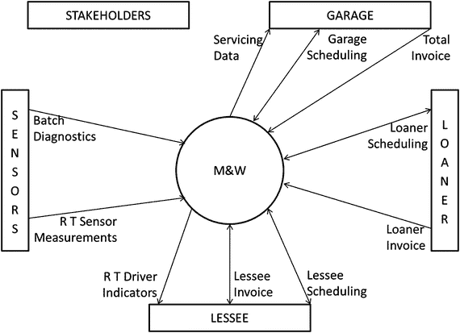

`图 4-7.` 名为“LMC 维护与保修系统”的已完成当前状态上下文（第 0 级）BIM

-   `传感器`通过仪表盘下的汽车诊断扫描端口发送批量诊断日志（`批量诊断`）。
-   `传感器`发送实时数据，这些数据在`M&W`系统的`车载电子设备`部分进行处理（`RT 传感器测量值`）。
-   `承租人`和/或驾驶员以实时指示灯和仪表盘的形式，从`M&W`系统的`车载电子设备`部分接收信息（`RT 驾驶员指示器`）。
-   `承租人`和/或驾驶员通过进行汽车维修调度协商，与`M&W`系统交换信息（`承租人调度`）。
-   `承租人`和/或驾驶员接收维修发票的非保修部分（`承租人发票`）。
-   `代步车队管理`在执行业务过程中，与`M&W`系统交换信息以进行代步车调度协商（`代步车调度`）。
-   `代步车队管理`向`M&W`系统发送代步车发票以进行成本核算（`代步车发票`）。
-   `车库`从`M&W`系统接收车辆数据，包括诊断结果和服务建议（`服务数据`）。
-   `车库`与`M&W`系统交换信息，并进行服务调度协商（`车库调度`）。
-   `车库`向`M&W`系统发送完整的维修发票，包括保修和非保修部分（`总发票`）。

如你所见，我们在一个相当简单的图中展示了所有这些数据流。业务信息地图开始讲述我们的当前维护与保修系统是如何运作的。现在，我们准备在更深入的层面上探索该系统的运作方式。

我们首先意识到，`M&W`的`车载电子设备`部分（负责解读实时（`RT`）传感器测量值，从而生成实时（`RT`）驾驶员指示器）与`M&W`系统的其余部分是完全断开的。因此，第 1 级图中显示的第一个过程被命名为“解读传感器”，如图 4-8 所示。

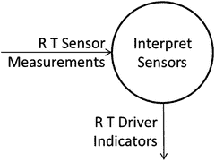

`图 4-8.` 名为“`LMC M&W` 系统”的当前状态局部视图（第 1 级）BIM（仅限车载处理）

另一个独特的流程，“赋能车库”，使得服务部门能够通过将批量诊断转化为可行的服务数据来维修 LMC 车辆。它与车辆数据库相连。我们在图 4-9 中展示了这一新增内容。

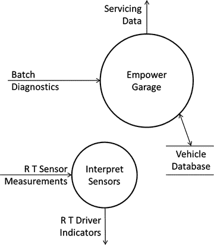

`图 4-9.` 部分当前状态（第 1 层）`LMC M&W` 系统 BIM（车载处理与车辆/车库交互）

当前状态的 M&W 系统的其余部分负责协商日程安排并处理车辆服务的账务。因此，我们在图中展示了“账户与日程服务”流程，并添加了从该流程到车辆数据库的连接。完整的第 1 层 BIM 如图 4-10 所示。

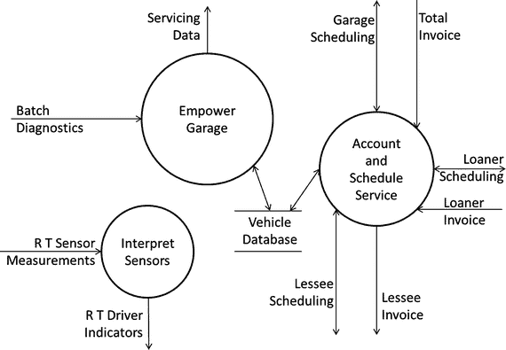

`图 4-10.` 完成的当前状态（第 1 层）“`LMC M&W` 系统”BIM

## 定义未来状态

从我们当前的业务信息图可以清楚地看到，我们无法获取之前确定的、优化运营汽车保养与保修业务所必需的关键绩效指标（`KPI`）。在我们召集的团队的协助下定义未来状态时，我们将确定数据必须如何流动，以便向业务提供那些至关重要的缺失信息。

在本章的这一部分，我们将简要介绍为未来状态 `BIM` 演练所做的准备工作，继续以我们的 `LMC` 示例来探讨如何定义未来状态，然后开始过渡到如何将技术平台融入我们的业务信息图。

### 为未来状态会议做准备

当我们再次召集团队时，首先会回顾当前的 `BIM` 图。这样做是为了确保没有遗漏任何内容，同时也是为了提醒参与者之前讨论过的要点。和以前一样，我们将邀请相关的业务主管、分析师、数据科学家以及 `IT` 数据管理员。由于传感器在我们未来状态中收集数据方面将发挥关键作用，并且很可能设想出额外的功能，我们希望工程代表也能加入对未来状态 `BIM` 的讨论。

> **注意**
> 在项目可能获得资助的预期下，这一阶段可能会带来动力的增加和普遍兴趣的上升。有时，更多样化的受众会开始对这个项目产生兴趣并希望加入讨论。为了使 `BIM` 演练易于管理，有时会为团队的新成员单独召开简报会，审查之前收集的信息，从而避免那些曾帮助制定早期需求和当前状态 `BIM` 的人员参与不必要的重复审查。

回顾一下，本章前面我们提到了一些在未来状态中将对业务运营至关重要的 `KPI`。这些指标包括：终身保修成本、车辆终身盈利能力、服务预约等待时间、代步车可用性与利用率、车库服务盈利能力、高级服务盈利能力以及客户满意度。我们还看到了提供更自动化的保养预约系统的必要性。因此，现在我们将着手确定所需的数据，以及数据和流程的流动方式，以提供所需的信息并实现业务所需的功能。

### 未来状态业务信息图

在当前的 `BIM` 图（第 1 层）中，您可能注意到了标识出的 `KPI` 缺乏。显然，`LMC` 无法获取这些改变其业务运营方式所需的 `KPI`。同样也缺失了提供自动化保养预约所需的其他关键链接和流程。

在开发未来状态 `BIM` 时，我们首先审视 `KPI` 对利益相关者的重要性，以及我们将如何添加传感器和承租人的新数据流。需要添加的额外数据流如下：

*   利益相关者将从未曾获得的 `M&W` 系统中接收关键绩效指标（`KPI`）。
*   传感器将与 `M&W` 系统交换数据，包括交互式诊断（包含驾驶员警报和按需日志）。
*   承租人和/或驾驶员将接收近实时（`RT`）的驾驶员警报，并交换消息以处理服务预约（近实时驾驶员警报与预约）。

如图 4-11 所示，可以绘制一个未来状态上下文（第 0 层）`BIM`，该图以阴影部分表示这些额外的数据流。

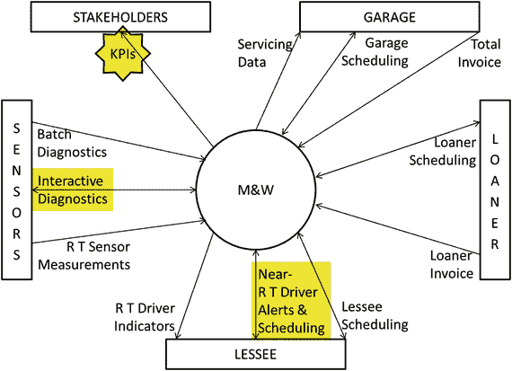

`图 4-11.` `LMC M&W` 系统的未来状态上下文（第 0 层）`BIM`

接下来，我们重新审视之前制作的当前状态（第 1 层）`BIM` 并做一些修改。根据项目拟议的预期成果，我们将“赋能车库”流程重新命名为“优化保养”。我们还添加了与服务预约及 `LMC` 会计系统的交互，具体如下：

*   优化后的预约功能，用于协商在最佳时间为车库和代步车安排日程。
*   会计 `KPI` 反馈至优化保养流程，以确保所做出的选择能优化两个流程的综合 `KPI`。

因此，未来状态上下文（第 1 层）`BIM` 可以如图 4-12 所示，其中阴影部分表示额外的数据流正在被处理。

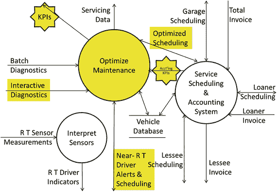

`图 4-12.` 未来状态（第 1 层）“`LMC M&W` 系统”`BIM`

由于“优化保养”流程对于项目成功至关重要，接下来我们将深入探讨其工作原理。我们将创建一个第 2 层图表。

为了开始实现此流程的自动化，下一代 `LMC` 车辆中的传感器将能够通过远程信息处理系统将警报流式传输到一个专为事件处理而优化的车辆事件数据库。一个“故障”事件由“优化短期事件保养”流程检测到，并会从车载传感器交互式请求更多信息，以便制定一个建议的行动方案。

数据作为检测到的保养事件被转发给“长期事件保养”流程，该流程在类似历史事件的背景下评估该事件，并找出最经济的解决方案。这些信息驱动自动协商车辆何时可以被服务部门检查以解决问题，并预订与 `LMC` 业务目标相符的代步车。虽然警示灯可能会实时亮起，但协商过程是在后台近实时进行的。

为了使系统随着时间的推移变得更加智能，事件及其他相关数据将被存档到车辆日志数据库中，以备日后使用。为了降低远程信息处理成本，与警报无关的常规日志将在下次车辆到服务点进行维修时，通过连接到汽车扫描仪进行下载，并添加到同一个车辆日志数据库中。`LMC` 将通过报告 `KPI` 来了解优化保养流程的运行情况。

图 4-13 展示了我们刚刚描述的场景下的第 2 层“优化保养”`BIM`，同样用阴影部分表示额外的数据流是如何被处理的。

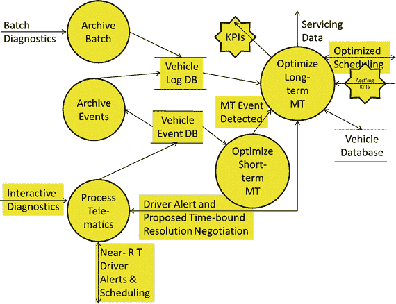

`图 4-13.` 未来状态（第 2 层）“优化保养”`BIM`

### 过渡到技术设计

如同我们先前对当前状态的 `BIM` 所做的那样，我们将在后续的会议中与各类与会者一起验证未来状态的图表。我们将找出所需的关键绩效指标（`KPI`）与图表所示可能实现的 `KPI` 之间的差距。我们还会查找因关键利益相关者坚持认为必需但缺失的额外数据源和流程而导致的差距。如果发现此类差距，我们将调整图表并达成共识。

业务信息图将在帮助我们定义第 6 章中信息架构背后的技术方面发挥重要作用。当我们过渡到下一阶段时，我们将开始与架构设计团队共享这些图表。他们对于交付解决方案所需的数据管理系统和工具很可能有自己的看法。当团队开始评估数据流和所需处理的影响时，您的 `BIM` 图可能会开始类似于图 4-14。图中对角线上的标签标示出了技术平台。

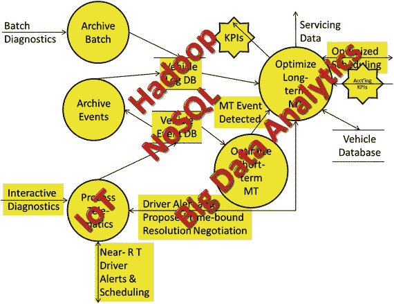

`图 4-14.` 叠加了大数据和物联网技术的未来状态（第 2 级）“优化维护”`BIM`

当我们达成共识后，我们几乎可以开始进行更详细的技术架构设计工作了。该阶段的一个目标是开始了解项目实际可能变得有多庞大、复杂和昂贵。大部分设计工作将由消除当前信息架构中的数据和处理差距的需求所驱动，这些差距是在我们于本阶段创建未来状态 `BIM` 时暴露出来的。

然而，在开始技术架构设计工作之前，我们将会发现，了解我们当前可用技能并识别缺失的关键技能是很有用的。这可以帮助我们更好地决定如何最有效地解决刚刚发现的数据和处理差距。