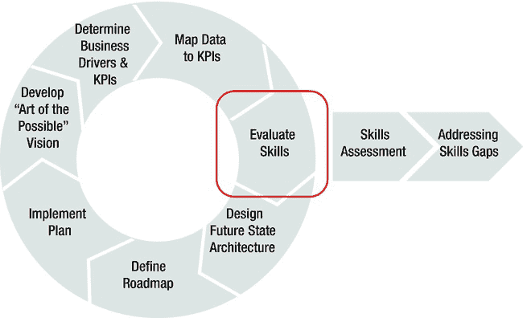
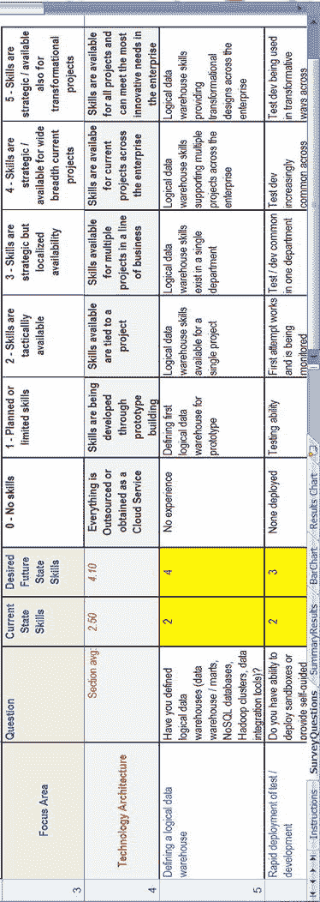
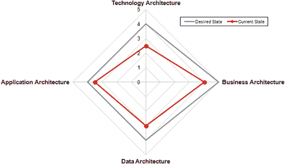
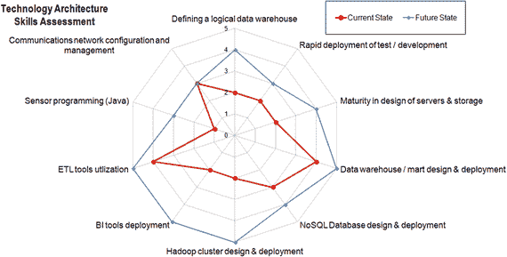
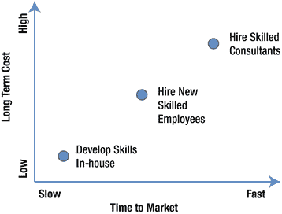

# 5. 了解组织技能

在本章中，我们将探讨评估组织中对于成功设计、部署和管理大数据与物联网项目的未来状态信息架构至关重要的技能。在此处讨论技能这个话题可能会让你感到困惑。在我们详细定义未来状态信息架构之前就评估组织中的技能，是不是为时过早？毕竟，信息架构应该匹配业务需求，而我们在前面章节中描述了如何收集这些需求。我们也描述了在我们的方法中更早地创建未来架构可能样子的广泛愿景。我们可能会认为，我们现在可以着手处理业务需求，并开始规划未来状态信息架构的细节。

然而，如果我们现在就跳入未来状态的规划，我们可能会发现自己缺少了一些应该考虑的关键信息。通常情况下，不止一种信息架构技术方案可能为同一个业务问题提供可行的解决方案。我们考虑的一些方案肯定会在技术上比其他方案更优雅。但我们可能需要考虑，建议一个我们难以实施或维护的方案是否明智。如果我们有多个信息架构设计可以选择，并且技术上的权衡并非不可接受，那么我们可能会想重新考虑我们的选择，如果我们认为满足特定方案的技能要求会很困难且独特，并且这些技能并非更广泛战略平台愿景的一部分。当然，在我们开始了解组织中现有的技能之前，我们无法完全评估架构方案的取舍。

话虽如此，在我们更详细地定义未来状态信息架构之后，我们将对所需（以及非必需）的技能有更全面的了解。我们将开始了解可能实施的供应商及开源产品，因此我们也需要更详细地探讨所需技能，以更好地理解真实的实施成本。您将会看到，我们在本书的第 7 章重新讨论技能话题，并更侧重于所需的 `Hadoop`、`NoSQL` 数据库、传感器开发和网络通信主干技能。

当我们在此处开始技能评估过程时，我们需要一个框架来描述我们正在评估并为其分配指标的关键技能。在本章中，我们将描述如何根据 `TOGAF`（在第 1 章中介绍）描述的四种架构类型来评估技能。这四个领域是业务架构、数据架构、应用架构和技术架构。我们将介绍组织中每种架构类型成功设计、部署、持续使用和管理所需的许多关键技能。

图 5-1 突出显示了我们在项目成功方法论中所处的阶段，以及本章将涵盖的内容。当我们评估组织中的技能时，我们将同时考察所需的业务技能和专业技能。并且我们将开始了解组织当前在技能方面的关键差距，这些差距可能影响我们成功部署、管理和利用未来状态架构的能力。

图 5-1. 我们成功方法论中的技能评估阶段

接下来，我们将探讨评估技能时可能使用的指标。然后，我们提供许多可能需要的关键技能的概要描述。最后，我们将介绍如何传达有关技能差距的发现，包括验证我们在评估过程中发现的内容，以及我们可用于弥补差距的一些选择。

## 技能评估与衡量指标

技能评估通常由一系列与项目成功息息相关的业务线和部门的访谈组成。访谈对象通常是精通下属技能的部门经理。在此过程中，我们不仅要确定组织内是否有人具备某项技能，还需了解该技能的普及程度。毕竟，如果某项关键技能仅掌握在一个人手中，这将严重制约我们扩展项目规模或增加项目数量的能力。

为了评估和量化现有技能的成熟度，我们建议采用从 0 到 5 的简单评分标准。通常，这项工作会借助电子表格来完成，我们描述的各项指标数据也会在其中收集。有些人还会在电子表格中，除了记录当前评分外，也记下期望的未来技能成熟度水平。然后，该电子表格可用来显示哪些地方存在可能阻碍项目成功的技能差距，以及差距有多大。

对于技能成熟度的评估，表 5-1 包含了可用于评估组织内现有技能的定义。评分等级数值代表了一个范围，从完全没有技能到非常先进且广泛可用的技能，包括用于转型活动的技能。您可以根据自身独特需求修改此处提供的技能指标的定义和描述，但该表格至少提供了一个起点。

**表 5-1. 技能评估指标**

| 评分 | 定义 | 技能应用领域 |
| --- | --- | --- |
| 0 | 组织内任何地方都未发现该技能 | 技能从未被应用，或即使应用也是外包的 |
| 1 | 技能处于非常早期的开发阶段，已计划或非常有限 | 技能开发通常通过原型构建进行 |
| 2 | 技能已在非常战术的层面上得到开发 | 技能直接与某个项目挂钩 |
| 3 | 技能在本地化的一组当前项目中可用且具有战略意义 | 技能已在或将在部门级别多次应用 |
| 4 | 技能在广泛的当前项目中可用且具有战略意义 | 技能已在或将在企业范围内多次应用 |
| 5 | 技能在广泛的转型项目中可用且具有战略意义 | 拥有足够的关键技能人才，以满足整个企业创新项目的需求 |

图 5-2 展示了一个典型技能评估电子表格的一部分。在我们所展示的电子表格上半部分，包含了技能评估指标以及针对技术架构技能评估指标含义的进一步说明。您可以看到，我们提供了一个典型的可能用于确定技能水平的问题，以及一个用于输入每项技能当前状态评分的位置。同时，我们还有一个用于输入未来期望技能水平的位置。

**图 5-2. 电子表格中的技能评估指标**

现在我们已经概述了如何评估技能，接下来我们将着眼于在我们提议的项目中，可能评估的与业务架构、数据架构、应用架构和技术架构相符的技能。

### 业务架构技能

本节描述的一系列技能对于成功地将我们未来的信息架构与不断变化的业务需求联系起来至关重要。我们在组织内评估的业务相关技能通常包括：制定业务战略和定义关键业务流程的能力、确定业务需求的成熟度、以及理解驱动数据可用性和治理需求的业务指令和目标的能力。

对于业务战略成熟度，我们可能在组织内评估的一些技能包括：

*   业务计划制定技能，包括将业务线的目标和指标与企业目标和指标联系起来，以及基于对整个组织的业务影响来确定目标优先级。
*   从组织内不同角度理解业务目标和指标的关键成功因素的能力。
*   识别和发掘实现预期业务目标将产生的价值及其他收益的经验，以及构建反映该价值的业务案例的能力。（部分潜在的技能指标包括：拥有明确的业务案例方法论、能够进行净现值计算以比较不同选项，以及组织中其他公认的标准。）
*   在业务线参与定义信息技术计划时，建立明确的支持、资金和问责机制以确保成功的成熟度。

当我们评估定义和执行业务流程的能力时，可能在组织内评估的一些技能包括：

*   将业务需求和目标转化为可重复流程的经验。
*   通过报告中呈现的关键绩效指标来管理业务的坚定承诺和经验，以及定义所需关键绩效指标和关键衡量的能力。
*   通过临时查询工具管理业务的经验，以及阐述事实和维度数据需求的能力。
*   利用统计分析和数据挖掘工具理解过去业务表现和/或预测未来结果的能力。
*   使用信息发现工具来揭示数据特征，并为报表、临时查询分析和统计分析识别新来源的经验。
*   使用高级编程工具和实用程序的能力（例如数据科学家经常使用且在 `Hadoop` 环境中常见的工具，包括 `Java`、`Python`、`Ruby`、`MapReduce` 和 `Spark`）。

> **注意**
>
> 在第 1 章中，我们建议了信息发现、商业智能、预测分析以及业务分析师和数据科学家使用的其他工具和技术的典型相对用户群体规模。当我们进行技能评估时，可以了解我们组织中真实的用户群体规模。

在理解我们组织收集和理解业务需求的成熟度时，评估的一些技能可能与我们已建立的结构和方法论相关联。这些可以包括：

*   通过能力中心正式收集需求的经验，将业务线的需求与 `IT` 架构师、规划师和开发人员联系起来。
*   在部署新技术时管理业务变革的成熟度，包括为确保技术得到采纳而在其使用方面进行的教育方法。

我们还可能考虑理解影响我们数据可用性和治理方法的业务需求和指令的能力。我们可以在组织内评估的一些技能包括：

*   能够准确评估并阐述分析所需的数据（例如数据描述、粒度及历史长度），并能描述确保及时决策或建议所需的数据可用性允许延迟。
*   具备评估数据质量及其对准确商业决策影响的经验。
*   熟练运用数据血缘来评估数据转换和所选数据源如何影响我们用于业务决策的数据。
*   能够在决定谁应拥有数据访问权限、谁应被拒绝访问时，将数据访问需求与安全标准及政策相结合。

### 数据架构技能

评估的数据架构技能通常包括定义和管理数据管理系统内可能存在的逻辑与物理数据结构所需的技能。评估的技能通常包括管理数据管理系统本身所需的技能。正如我们在前几章讨论的，大数据和物联网项目中部署的一些关键数据管理平台包括关系型数据库、`NoSQL` 数据库和 `Hadoop`。

在评估定义和管理数据结构所需的技能时，我们可能关注以下几点：

*   能够成熟地选择并定义合适的数据管理系统，以匹配提供业务解决问题所需信息的数据处理工作负载（例如，用于结构化数据的关系型数据库、用于摄入可扩展性和轻量级事务的 `NoSQL` 数据库、用于处理多种数据类型和预测分析的 `Hadoop` 等）。
*   具备定义符合业务需求且兼顾灵活性的关系型数据库数据模型的经验（例如，在企业数据仓库中按需使用第三范式、在星型模式模型中部署一致性维度等）。
*   具备协调业务元数据与技术元数据的经验。
*   熟练管理数据与元数据随时间的变化（例如，为数据管理系统中的数据及周边元数据建立版本管理，并利用此能力支持历史数据重述，以满足随时间推移对业务不同视角的需求）。

管理数据管理系统所需评估的技能包括：

*   能够管理关系型数据库数据仓库的性能（优化与调优）、用户认证、数据访问、高可用性、备份与恢复以及灾难恢复。
*   具备为数据集市和开发项目快速部署与配置关系型数据库的经验。
*   能够快速扩展（分片）和管理 `NoSQL` 数据库，并提供数据可用性（复制与备份）。
*   具备为开发项目和新生产环境快速部署与配置 `NoSQL` 数据库的经验。
*   熟练管理 `Hadoop` 集群的用户认证、数据访问和数据可用性（复制），并具备快速扩展集群的经验。
*   具备为开发项目和新生产环境快速部署与配置 `Hadoop` 集群的经验。

### 应用架构与集成技能

应用架构应定义技术解决方案如何通过支持业务运行所需的业务流程来解决业务问题，以及这些应用如何相互交互。对于由众多组件定义的信息架构，其交互由关键的数据集成组件实现，这些组件将所有部分整合在一起。

我们在此可能评估的一些技能包括：

*   能够成熟地将业务需求和驱动因素转化为软件驱动的解决方案，提供对决策至关重要的信息。
*   具备部署适当组合的数据发现、商业智能和预测分析工具的经验，以从数据中收集信息并解决业务问题。
*   具备使用敏捷应用开发和变更管理方法论快速响应快速变化的业务需求的经验。
*   具备将数据管理系统（数据仓库、`NoSQL` 数据库、`Hadoop`）与数据源连接，并在系统间按需转换数据的经验。
*   能够在各种数据管理解决方案之间快速集成数据。
*   熟练通过最合适的数据集成流程（例如 `ETL`、复制、消息队列等）及时交付数据以支持关键业务决策。
*   具备开发与部署主数据管理或替代数据合理化解决方案的经验。

### 技术架构技能

底层技术架构将为项目的成功奠定基础。`IT` 领域现有的技能对于定义和管理技术架构至关重要。对于物联网项目而言，我们工程组织中现有的技能同样可能至关重要。

评估的这一部分主要评估逻辑软件、技术编程，以及服务器、存储、网络和通信的设计与管理技能。相关技能清单可能相当广泛，并且随着 `NoSQL` 数据库、`Hadoop` 集群以及物联网加入信息架构，其复杂性只会不断增加。我们可以评估的一些技能包括以下方面：

-   在信息架构中定义逻辑数据仓库的经验，该数据仓库由传统数据仓库和数据集市、`NoSQL` 数据库、`Hadoop` 集群以及数据集成工具和实用程序组成。
-   为信息架构中的关键组件（例如，逻辑数据仓库、商业智能和数据发现工具）定义并快速部署测试与开发环境的经验。
-   针对服务器和存储的设计与容量规划技能的成熟度，以便为企业数据仓库和数据集市提供最佳数据库占用空间，并具备成功部署和管理这些平台的可靠能力。
-   设计、部署和管理服务器与存储以提供最佳 `NoSQL` 数据库占用空间的经验。
-   设计、部署和管理服务器与存储以提供最佳 `Hadoop` 集群占用空间的经验。
-   评估预构建设备与自行构建系统能力的成熟度（例如系统设计技能、上市时间考量、替代方案成本以及灵活性）。
-   设计、部署和管理商业智能即席查询和报表以及数据发现中间层服务器的经验。
-   设计、部署和管理包括 `ETL` 和数据复制在内的数据集成解决方案的经验。
-   将数据管理系统服务器、中间层服务器及其他信息架构组件进行网络连接的经验。
-   设计和部署满足系统环境需求（如冷却、电力和机柜空间）的数据中心的成熟度。
-   保障数据中心安全的成熟度。
-   设计和部署弹性数据中心（如主站点和备用站点、站点间的最佳网络连接等）的经验。

部署物联网所需技能的范围可能远远超出仅关注分析功能的信息架构所需技能。例如，根据计划的实施范围，以下技能可能值得纳入评估：

-   设计智能传感器和控制器，并将其集成到制造零件、部件装配、设备和产品中的经验（例如，电源考量、占用空间和加固设计）。
-   对智能传感器和控制器进行编程的经验（编程语言如 `Java` 和 `C`，事件处理引擎，以及业务规则引擎）。
-   保障智能传感器和控制器安全（软件和物理层面）的经验。
-   配置智能传感器和控制器的成熟度。
-   设计用于将数据从智能传感器和控制器传输到分析功能（如 `Wi-Fi` 或其他网络解决方案及网关）的通信网络的经验。
-   保障和管理通信网络安全的经验。

**注意：** 我们在本章前面列表中描述的技能旨在提供评估领域的示例。您可能还认为有其他重要的技能需要包含在内。根据您的关注点，您可能还希望在本阶段对所列技能进行更详细的评估。例如，在商业智能能力中心内，您可能希望评估个人与公司内部其他人沟通和建立联系的能力，以及他们引导讨论、管理项目、理解数据和可视化技术、并利用数据和信息资源的能力。显然，您可以评估的技能细节几乎是无穷无尽的。请记住，本阶段的目的在于了解：在当前技能条件下，设想的项目是否可行；如果不可行，应采取哪些步骤来弥补这些技能差距。

### 解决技能差距

如果你的组织具备上一节所述的所有技能，那么你很可能供职于一家非常大型的软件供应商或系统集成商，或者你所在的公司或组织已经在构建一个完整的物联网解决方案。然而，我们遇到的所有组织，在定义和部署大数据及物联网项目时，能够拥有所有必需技能的组织数量非常少。大多数组织在一个或多个领域都存在明显的技能差距。

图 5-3 展示了一个典型总结图，来自我们为某个正在考虑物联网项目的组织进行的技能评估电子表格。你可以看到，它揭示了我们所探讨的四种架构类型中存在的技能差距。内部数据点代表当前状态的调查答案，外部数据点代表我们期望的未来状态。两者之间的空间代表技能差距。

**图 5-3.** 由电子表格图表呈现的技能差距总结

我们可以从该图中清晰地看到，所有四个领域都存在技能差距。其中技术架构领域的差距似乎最大。然而，我们需要深入探究每个领域中识别出的各个具体技能差距，因为某些特定技能可能对项目成功与否比其他技能更为关键。

鉴于技术架构技能差距较大，接下来让我们探讨一些具体的技能差距。图 5-4 展示了我们在技术架构技能评估电子表格中创建的一个典型图表，其中包含我们本章前面提到的一些技能。同样，内部数据点代表我们组织当前技能状态的调查答案；外部数据点代表这些技能的期望未来状态。两组数据点之间的空间即为技能差距。您可能会注意到这里显示的一些物联网项目的特定技能，包括传感器编程以及通信网络配置和管理。`Hadoop` 和 `NoSQL` 数据库也被纳入考虑。

**图 5-4.** 由电子表格图表呈现的技术架构技能差距

从图 5-3 和图 5-4 所示的图表中，我们了解到该组织对此类项目尚不熟悉。在定义、部署和管理信息架构所需的传统技能方面，存在一些差距。同时，大数据和物联网项目所需的技能也有所缺失。要成功实施项目，采取措施克服这些技能差距将至关重要。

### 传达技能差距信息

现在是时候总结已收集的技能评估信息了。这些信息应以演示文稿和报告的形式，反馈给所有参与评估过程的利益相关方以及潜在的项目赞助者。首先在互动论坛上进行演示，有助于确保开展验证流程，审查技能评估的完整性和评分的准确性。这通常还能引发关于缺失技能和关键资源可用性的进一步讨论。

一般来说，最佳实践是在一到两周内将信息反馈给最初的与会者，这有助于维持最初会议中建立的团队合作精神。考虑到此处评估的技能组合的多样性，我们可能希望首先与每位经理或管理层小组进行详细审查，验证内容，然后再为项目赞助者创建一份高层摘要版本。例如，详细讨论可能包括对评估的每项技能进行逐条审查。而高层版本通常以摘要形式呈现。本章前面展示的图表，在直观地引起高管对关键技能差距的注意方面，可能会很有用。

此类演示的典型议程可能包括以下主题：

-   会议总体目标
-   与会者自我介绍及自述的会议目标
-   简要回顾拟议项目的范围（基于早期愿景规划和业务探索确定）以及所需的关键技能
-   讨论已发现的当前技能与差距
-   验证评估的准确性（包括评分和/或遗漏的关键技能）
-   讨论解决技能差距的可行方案及其对信息架构和项目的潜在影响
-   讨论后续步骤及其他必要的会议

举行这些会议并收集进一步反馈后，应发布最终报告，其中包含建议的调整方案，或至少提及这些方案。报告中应包含以下内容：

-   参与研究的人员
-   业务需求和愿景如何驱动早期项目定义，以及定义、实施和管理拟议的未来状态信息架构所需的技能
-   评估的技能细分（按架构类型）
-   实现愿景所需的技能评估，以及重要差距的识别
-   填补技能差距的拟议解决方案
-   后续步骤，包括本书后续章节所述活动的安排

正如我们在演示报告和报告的议程末尾所指出的，我们不仅仅是将技能差距视为一个问题来呈现。我们也在提出能够解决这些差距并提供解决方案的替代方案。

### 解决关键技能差距

面对关键技能差距，有几种可能的方法可以解决。例如，可以修改未来状态架构愿景，纳入创新性较低但更成熟的技术，前提是这些更改仍能实现项目目标。然而，我们可能也会发现，必须包含更具挑战性的技术，或者这些技术对于其他长期需求是可取的。那该怎么办呢？

如果缺失的技能对组织未来的成功具有战略意义，我们可以评估培训现有人员，或招聘具备这些技能的新员工。或者，可能决定最佳选择是聘请系统集成商或依赖专业顾问来提供全部或部分缺失的技能。所作的选择很可能取决于购买技能与培养技能的成本，以及培养技能所需的时间。我们还应该考虑使用这些方法中的任何一种会带来的项目风险。图 5-5 说明了技能差距如何可能得到补救，以及相应的权衡比较。如果决策基于项目所提供解决方案上市时间的重要性，或者基于组织的长期成本，那么使用此图可以使选择变得清晰。

图 5-5. 技能差距补救选项比较

其他因素也可能影响我们的决策。我们公司的一些员工可能会将该项目视为一个学习机会和在组织内部培养战略技能的机会。这些员工可能认为，在项目进行过程中跟随所聘请的顾问学习，可以为技能差距提供解决方案。我们可能会发现，特定的所需技能在咨询公司或市场上很难找到，这让我们别无选择，只能在内部培养这些技能。例如，当需要数据科学家技能或高级数据管理解决方案技能（例如与 `Hadoop` 和 `NoSQL` 数据库相关的技能）时，熟练人员的短缺通常是必须克服的挑战。

为了克服技能短缺，一些目前正在定义和构建大数据与物联网项目的组织已经开发出创新的解决方案。一些组织正与当地大学合作，创建课程，使学生能够培养这些稀缺但需求量极高的技能。然后，这些组织制定协议，在学生毕业后以实习生或正式员工的身份聘用他们。

**注意**

物联网项目通常包括对信息架构中关键所需组件的“自建 vs. 购买”评估，而这些评估通常部分取决于组织中是否存在某些技能。例如，许多组织依赖制造商和工程咨询合作伙伴来提供设备上的传感器和智能控制器。这些合作伙伴还可能对这些设备进行编程以提供关键数据。一些组织还依赖第三方设计和提供必要的通信骨干网，以将数据从设备传输到内部设计和部署的分析基础设施。

在我们的方法论的这个阶段，我们刚刚开始技能评估和补救过程。理解项目成功所需的技能将变得更加关键，并且随着我们开始建立实施路线图，后续将需要更详细的分析。但是，当我们更仔细地审视未来状态信息架构时，我们可能会发现，我们有足够的灵活性来修改计划，避免添加某些已识别的缺失技能的需求。即使我们没有发现这种灵活性，至少我们已经开始收集关键信息，用于制定培训计划和招聘计划，以及用于后续从系统集成商和顾问那里获取实施成本估算。