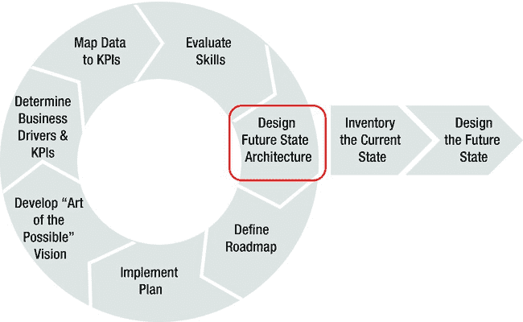
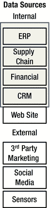
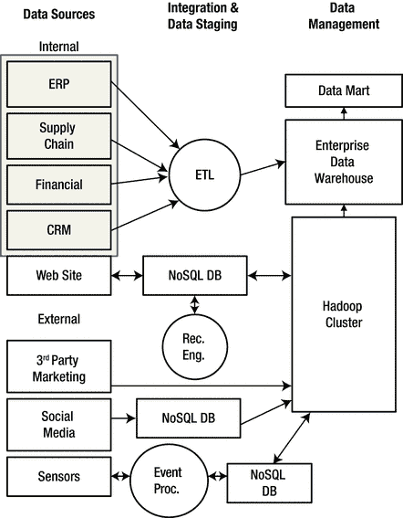
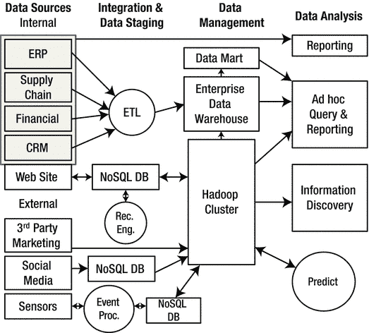
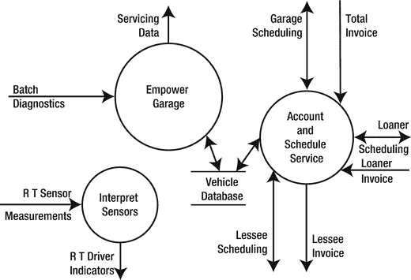
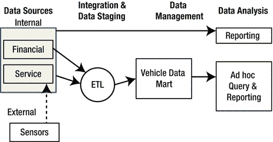
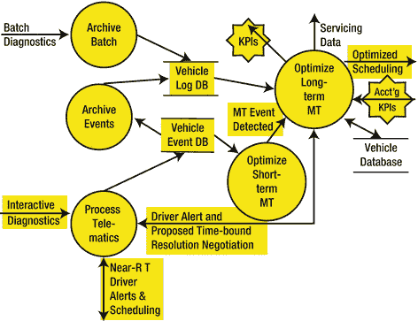
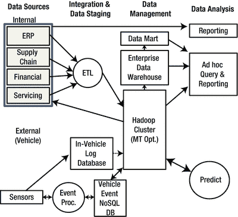
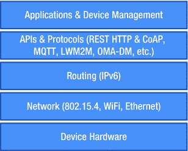
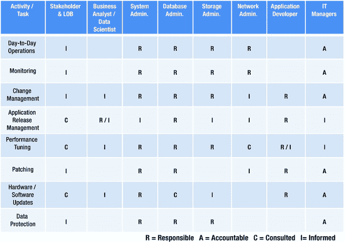

# 6. 设计未来状态信息架构

在早期的愿景会议中探索“可能性艺术”时，我们已初步接触了信息架构的当前状态和可能的未来状态。尽管这些练习很有价值，但我们当时只是浅尝辄止地评估了当前状态中的关键组件。那时，我们利用有限的知识开始设想未来可能需要的增强功能。随后，我们对潜在的业务用例有了更深入的了解，并在业务部门的帮助下准备了业务信息地图。这些需求以及期望的未来状态业务信息地图现在将帮助我们进一步理解当前信息架构中的差距以及它必须如何变革。在定义未来状态架构的发展方向时，我们还会考虑对组织内现有技能的初步评估。

在本阶段开始设计未来状态信息架构时，我们首先要捕获当前状态信息架构的更详细视图，并探索当前存在的各种组件。您可能还记得，我们在第 1 章中对大数据和物联网项目中通常部署的关键技术进行了初步介绍。现在，我们将从架构的角度来审视它们。在本阶段，我们还将捕获有关这些组件所需属性的详细信息，以及这些需求将如何影响未来状态的设计。一旦收集到这些信息，我们将把当前状态的业务信息地图映射到架构上，以验证我们是否已捕获所有相关组件。

在该方法论的前一个阶段，我们还收集了未来状态的业务信息地图。我们很可能会发现，现在需要在信息架构中提供新的能力，以支持业务运营方式中设想的变革。未来状态的业务信息地图可以帮助我们确定提供和处理所需数据所需的额外数据源和数据管理系统。因此，我们将利用这些需求来创建我们的未来状态信息架构。在引入这些新组件时，我们将重新审视未来状态版图中所需的其他各种能力。

本章结束时，我们将准备好着手制定项目获得资金至关重要的路线图。我们将对当前项目的范围有更清晰的认识。我们不仅会理解技术组件，还会更好地理解成功可能需要的额外技能。我们将开始思考如何分阶段交付未来状态信息架构和业务解决方案，从而使这些阶段与我们当前的状态以及未来的发展方向最佳对齐。

图 6-1 说明了我们在成功方法论中的当前阶段。它还概述了本章的重点。

图 6-1. 在我们的成功方法论中设计未来状态架构阶段

与之前涵盖业务信息地图的章节类似，本章关于信息架构的内容也分为两个部分，分别聚焦于当前状态和未来状态。在本章中，我们将首先专注于记录当前状态的信息架构，并验证我们之前绘制的当前状态业务信息地图。第二部分将逐步定义未来状态的信息架构，该架构将交付与之前创建的未来状态业务信息地图相一致的能力。

## 当前状态信息架构

我们开始此阶段的工作，需要足够详细地探索当前状态的信息架构，以便理解它对我们正在规划的项目的影响。我们将探索的关键组件包括当前的数据源、数据集成工具、事件处理（在物联网部署中尤为常见）、用于分析的数据管理系统、数据集成工具、信息访问应用程序和工具，以及其他用户界面。我们将部分地通过绘制架构的概念版本来描述这些组件。

我们还将评估底层安全性和数据治理、共享服务以及服务器和存储基础设施。我们将从盘点所有组件及其角色开始。我们还将评估它们在满足当前期望方面的表现如何。此过程的一部分通常包括对现有供应商的盘点，以及他们当前提供的组件对组织未来发展是否具有战略意义。

### 数据源

当前信息架构将包含许多不同的数据源。其中一些将是文档完善的内部系统，例如企业资源计划系统、供应链系统、客户关系管理系统和财务系统。在某些行业中，我们会发现其他文档完善的企业级系统，它们对业务运营至关重要。例如，在金融服务业，我们会发现银行的信息架构会包含资金管理系统。这些内部系统通常托管关系数据库，这些数据库非常适合在线事务处理，因为数据高度结构化且更新频繁。

其他提供关键数据来源的系统可能文档记录不那么完善。这些有时包括业务部门用来填充特定部门数据集市或电子表格的外部数据源。根据这些数据生成的报告可能被视为业务运营的关键。如果我们在方法论的前期阶段工作做得好，我们应该已经在业务信息地图中记录了这些数据源。此类数据源的一个例子是营销信息的外部数据聚合器。数据聚合器能够提供更广泛的行业数据，这些数据是无法从现有的内部数据源中收集到的。

即使其他现有的内部或外部数据源尚未集成到更广泛的企业信息架构中，此时也可能会被盘点。例如，来自内部网站的点击流数据目前可能大部分未被使用。传感器可能已部署在设备上，但数据可能至今未被处理。提供对组织重要的客户情感和其他特性报告的第三方可以分析社交媒体数据。然而，第三方可能不提供实际的原始源数据。

我们对所有这些数据源的理解将有助于我们后续审视未来的业务信息地图，并开始理解可用数据中的差距。图 6-2 展示了典型的数据源，这些数据源是我们概念性信息架构图的起点。

图 6-2. 概念性信息架构图中展示的数据源

在开发表示当前数据源清单的概念图时，我们还会收集关于这些源目前提供的服务级别的其他信息。我们这样做是因为这些服务级别可能会影响我们未来交付所需商业智能和分析解决方案的能力。

我们可能收集的一些关键属性包括以下内容：

*   可用性：
    *   源系统是否提供 99.999% 的可用性？
    *   需要达到什么级别的可用性？
    *   是否存在用于灾难恢复的第二个站点，并且是否强制要求有第二个站点？
*   可恢复性：
    *   数据归档策略是什么？
    *   如果数据已归档，恢复数据需要多长时间？
    *   数据恢复时间范围是否满足业务需求？
*   性能：
    *   源系统是否有保证的性能级别？
    *   如何管理源系统以满足性能级别要求？
*   数据粒度：
    *   数据的详细程度如何？
    *   源系统中保留历史数据的时间是多长？
    *   所需的详细程度和历史数据长度是否会随时间变化？它们是如何变化的？
*   数据安全与治理：
    *   源系统当前对静态数据采取了何种安全措施？数据是否已加密？
    *   实施了何种访问控制安全策略？某些数据字段是否对特定业务用户进行了编辑处理？
    *   现有的安全措施是否满足行业标准（例如医疗行业的 HIPAA 或金融交易的 PCI）的要求？
    *   整个基础设施是否保持了相同的安全标准？如果没有，它们有何不同？

## 用于分析的数据管理系统

接下来我们要探索的信息架构的主要部分，包括用于数据分析的数据管理系统。这些系统包括我们通常使用关系数据库部署的数据仓库和数据市场。一些数据市场的变体可能使用 OLAP 技术部署。越来越多的 Hadoop 集群被部署来在此架构中发挥多种作用。各种类型数据管理系统的组合通常统称为“逻辑数据仓库”。

如今，Hadoop 集群可能用于处理来自传感器和其他来源的流式数据。它们也可能充当所有数据的着陆点，并作为预测分析的首选位置。Hadoop 集群还可以充当高度并行化且高性能的 ETL 引擎。

当然，对当前用于分析的数据管理系统的讨论，自然会引向关于这些数据管理系统如何填充数据的思考。虽然在数据质量和数据合理化是流程一部分的情况下，ETL 工具是流行的选择，但有时仅需提取和加载过程就已足够，因此会部署更轻量级的引擎。在加载 Hadoop 集群时，有时会使用现有的原生工具（如 Flume）进行数据加载。

图 6-3 展示了随着我们添加用于分析的数据管理系统和关键集成组件，我们的信息架构概念图的演进过程。在这个当前状态图中，我们展示了 ETL 处理与 Hadoop 集群独立进行。

图 6-3.

添加到概念图中的用于分析和集成的数据管理系统 注

如果组织已经部署了物联网解决方案并正在处理传感器数据，那么传感器数据将被加载到一个分析数据管理系统中，这很可能是一个 Hadoop 集群或 NoSQL 数据库。鉴于通常需要针对事件做出实时响应，您可能会发现定义了业务规则来提供这种响应。这些规则将使用事件处理引擎来实现。您还可以在图 6-3 中看到事件处理被展示为一个组件。

在收集有关当前数据仓库、数据市场和 Hadoop 集群以及它们如何填充的信息时，在确定这些系统和工具的特性时，我们应提出可能包括以下方面的问题：

*   模式：
    *   数据仓库的模式是第三范式、星型模式还是混合模式？
    *   数据市场中存在何种类型的模式？
    *   如果存在多个数据市场，维度在各个数据市场之间是否一致？
*   可用性：
    *   数据仓库和/或数据市场和/或 Hadoop 集群和/或 NoSQL 数据库的可用性要求是什么？
    *   网络的可用性要求是什么？
    *   是否有灾难恢复计划？计划内容是什么？
*   可恢复性：
    *   作为逻辑数据仓库一部分部署的各种系统的数据归档策略是什么？
*   性能：
    *   是否有任何系统有保证的性能级别？
    *   它们如何被管理以满足这些性能级别？
    *   是否将内存数据库作为部署足迹的一部分？内存解决方案的影响和/或局限性是什么？
    *   如果部署了 Hadoop，它是否利用了 YARN 和 Spark 技术？
*   数据粒度与容量：
    *   每个系统中存储的数据的详细程度如何？
    *   每个系统中保留历史数据的时间是多长？
    *   每个系统中的数据量（原始数据和压缩数据）是多少？
    *   当前系统中数据量的增长速度有多快？
*   数据安全与治理：
    *   逻辑数据仓库当前具有何种级别的数据安全？
    *   各个系统之间的安全级别是否一致？
    *   安全级别是否达到/超过行业标准（例如医疗行业的 HIPAA）？
    *   每个系统中的数据是否已加密？通过网络传输时数据是否已加密？
    *   每个系统中如何管理访问控制？
*   数据加载：
    *   ETL 是如何处理的（例如，转换发生在何处，以及处理的并行化程度如何）？
    *   数据加载的频率如何，加载需要多长时间？
    *   系统之间移动的数据量以及提取和加载过程中使用的映射是什么？
    *   如果存在 Hadoop 集群，数据摄入 Hadoop 的速率是多少？
    *   是否使用 NoSQL 数据库作为 Hadoop 集群的前端以加速数据摄入或采用其他技术？
*   数据质量与含义：
    *   数据质量分析和数据质量改进是否是 ETL 处理的一部分？
    *   是否为构成逻辑数据仓库的系统中的数据定义了元数据（并且是否也通过 ETL 工具进行了定义）？

### 数据分析工具与接口

我们将记录的第三个主要领域涵盖现有的数据分析工具与接口。这些工具供业务分析师和数据科学家用于理解业务，但也包括非专业业务决策者和管理人员使用的简单工具。许多工具提供对已发生事件的回顾，但另一些工具还能针对决策对未来业务结果的影响进行预测性分析。

提供的最简单工具将报告业务成果。它们可能直接从`OLTP`源系统收集数据以显示业务当前状态，或从逻辑数据仓库中的任何数据管理系统收集数据。

一些业务分析师可能通过即席查询来自行创建报告，并使用即席查询与分析工具来应对不断变化的业务需求。这些工具可指向逻辑数据仓库中的任何数据管理系统。当需要高数据质量并需要引导式下钻时，它们最常指向数据集市或采用混合模式结构的企业级数据仓库。

当需要探索数据集市或数据仓库模式不支持的新型数据组合时，信息发现工具可提供相应手段。这些工具可以访问逻辑数据仓库中任何位置的数据，既可直接从各种来源提取数据，也可访问作为企业数据枢纽（例如，作为所有数据的汇集点）的`Hadoop`集群中的数据。此类工具底层的数管理引擎是“无模式”的，支持对数据进行自由形式的探索。

最先进的业务分析师、统计学家和数据科学家可能使用数据挖掘和预测分析工具。这些工具通常也用于分析逻辑数据仓库中任何数据管理系统中的数据。它们提供的数学算法用于对数据建模并分析结果模式。当模型经过优化后，它们便用于指示未来事件的可能结果。

任何这些工具都可能用于生成所需的洞察力，不仅用于展示已发生或将要发生的事件，还能帮助定义在观察到特定结果或行为时可以自动运行的特定业务流程。您可能会发现已部署的补充技术包括：在商业智能工具中触发的业务流程执行语言（`BPEL`）脚本，或利用预测分析的实时推荐引擎。

图 6-4 展示了我们添加数据分析工具与接口后信息架构概念图的进一步演进。

图 6-4.
添加到概念图中的数据分析工具与接口

进一步审视现有的工具与能力时，在确定其属性过程中，我们可能会提出以下问题：

- **报告：**
    - 报告生成的频率如何，以及谁在使用它们？
    - 数据源是什么，如何访问它们（例如，通过`SQL`直接访问、通过供应商特定选项访问，或通过`Hive`等通用接口访问）？
    - 为了满足业务需求，报告必须达到多高的可用性？
    - 驱动报告需求的业务要求是什么？
- **即席查询与分析工具：**
    - 谁使用即席查询与分析工具？
    - 数据源是什么，数据更新频率如何，如何访问数据，以及访问频率如何？
    - 为了满足业务需求，工具及底层数据必须达到多高的可用性？
    - 驱动部署即席查询与分析工具的业务要求是什么？
    - 通过工具必须满足哪些数据可视化需求？
- **信息发现工具：**
    - 谁使用信息发现工具？
    - 数据源是什么，如何访问它们？
    - 什么因素驱动了对信息发现工具的需求？它们是如何使用的？
    - 工具必须提供哪些数据可视化能力？
- **预测分析与数据挖掘工具：**
    - 谁使用预测分析与数据挖掘工具？
    - 数据源是什么，如何访问它们？为了满足业务需求，工具及底层数据必须达到多高的可用性？
    - 驱动使用这些工具的业务要求是什么？这些工具和分析师在满足业务需求方面的成功率如何？
    - 这些工具必须提供哪些数据可视化能力？
- **作为输出的自动化业务流程：**
    - 执行这些自动化流程对业务有何影响？
    - 数据源是什么，数据可以在哪里访问（例如，在数据存储或数据流中），以及随着数据处理流程需要多快完成？
    - 为了满足业务需求，流程及底层数据必须达到多高的可用性？

### 验证当前的 BIM

如果您所在组织当前的概念信息架构与图 6-4 几乎一致，那么在此抽象层级上，您可能面临相对较少的变更。然而，随着新项目的设计、开发和实施，架构中现有组件的许多细节可能会发生变化。

相反，我们经常发现，大多数组织中更常见的信息架构缺少该图中所示的许多组件。为了说明我们通常发现的情况，让我们再次审视在第 4 章中描述的虚构`LMC`汽车制造商收集的当前状态`BIM`。然后，我们将查看该`BIM`背后公司更可能的当前状态信息架构概念图。

您可能还记得，维护与保修系统的当前状态`BIM`由图 6-5 中的图表表示，我们在此处重现。

图 6-5.
已完成的当前状态（第 1 级）“LMC M&W 系统”BIM

该`BIM`图表展示了当车辆在`LMC`维修车间时，能够将车辆中存储的数据下载到车辆数据库中（例如，作为批量诊断）。账户和服务调度数据也存储在该数据库中。车辆中的传感器无法实时直接与数据库通信。

我们预计与当前状态`BIM`中数据流相匹配的`LMC`当前状态信息架构，将类似于图 6-6 中的图表。

图 6-6.
与“LMC M&W 系统”BIM 对齐的当前状态信息架构

这里描绘的架构是我们目前在设备和产品中部署传感器时常见的情况。当我们在本章下一主要部分重新审视`LMC`的未来状态`BIM`时，您将看到信息架构必须如何改变，以交付所需数据并满足`LMC`的新业务需求。

### 底层服务器与存储

到目前为止，我们重点关注了软件组件，但尚未评估基础设施中当前存在的底层服务器、存储和网络基础设施。在我们定义支持数据管理系统及周边中间件的未来状态信息架构时，这些组件很可能也会影响我们的一些选择。

在探索这些组件时，我们需要提出一些问题，这些问题可能看起来与我们之前提出的一些问题有所重叠。但这些问题将向系统、存储和网络架构师提出，他们可能持有与之前不同的观点。以下问题具有代表性，可供我们参考：

-   **服务器：**
    -   当前的在线事务处理（OLTP）和逻辑数据仓库服务器能否支持当前的工作负载需求，并能轻松适应变化？
    -   系统上的当前工作负载是否受到 CPU、内存或吞吐量问题的限制？
    -   如果服务器配置为高可用性以满足服务水平协议，它们是如何配置的？
    -   是否有灾难恢复计划？服务器和存储的配置是什么？
    -   是否已建立参考配置，或者是否更倾向于使用工程化系统/设备？
    -   开发和测试系统是否可用？它们是否与生产系统相同？
-   **存储：**
    -   存储架构是与服务器分开管理，还是更倾向于使用工程化系统/设备？
    -   是否有用于归档数据的信息生命周期管理策略？具体是什么？
    -   每个系统都有哪些备份和恢复流程？这些流程是否经过充分测试并被证明是可靠的？
    -   存储系统对于工作负载需求变化和数据增长的灵活性如何？
    -   部署了哪种类型的 RAID 策略？该策略如何受到服务水平协议和性能要求的影响？
-   **网络：**
    -   当前，集群内部、数据中心内系统之间或组织内部是否存在网络瓶颈？
    -   采用了哪些网络标准（例如以太网、InfiniBand 等）？
    -   从数据中心外部源移动数据的网络策略是什么？
    -   为网络制定了哪些服务水平协议？
    -   通过网络传输数据时，数据是如何确保安全的？
    -   数据传输时是否需要遵守行业标准和/或认证级别（例如，医疗保健领域的 HIPAA 和金融交易领域的 PCI）？

上述每个问题的答案都可能提供详尽且技术复杂的细节。此外，务必牢记，部署选择背后也可能存在出于政治考量的组织原因。例如，存储架构组是否因感受到威胁而不赞成使用工程化系统和设备？业务部门是否因 IT 部门配置和上线新系统所需的时间过长而感到沮丧？如果目标是确保未来状态信息架构的设计能得到关键影响者和利益相关者的广泛认可，那么也必须理解这类问题的答案。

> **注意**
> 由于某些系统充当数据管理平台，而另一些则支持中间层软件解决方案，因此上述问题的答案可能存在很大差异。必须了解系统和网络在业务运行中的关键程度，以及系统和网络服务水平协议是否已协商好并必须得到满足。许多组织试图标准化其系统和网络的设计、部署和管理，以确保一致的服务质量并简化基础设施。理解组织当前的理念，对于理解未来需求可能如何衍生，以及所述需求对未来状态信息架构设计的重要性至关重要。

### 其他当前状态实践

在评估当前状态时，我们还应该记录当前用于数据管理和中间件软件平台、服务器、存储以及网络组件的监控和管理实践。在设计未来状态信息架构时，我们需要考虑如何引入新组件，而不会不必要地对当前方法造成过多干扰。引入新工具和流程将带来额外的采购成本以及对进一步技能发展的需求。我们需要了解此类变更可能会被接受的程度。

我们还应该了解当前组织如何开发和运营项目。我们应该了解组织在创建新代码以及测试提议解决方案的功能、性能和可用性时所采用的方法论。我们还应该了解在测试环境和生产环境中应用补丁的策略，以及新解决方案通常如何投入生产。

## 设计未来状态

至此，我们已经收集了大量关于当前状态信息架构的信息，包括组织内公认的设计、部署和管理技术。我们将描述当前数据流的业务信息图应用到底层信息架构图上，并确认了其准确性。正如前一章所述，我们也了解了组织中现存的技能，并通过之前的技能评估，能够更好地理解我们承担这个新项目的能力。

现在是时候利用我们收集的新业务需求以及相关的未来状态 BIM，开始用图表来规划我们预计的信息架构了。一旦我们定义了未来状态，我们将探讨引入包括 Hadoop 和 NoSQL 数据库在内的新数据管理平台，以及物联网项目所需的其他技术可能带来的影响。我们还将探索运营管理规划的早期阶段。

### 未来状态 BIM 与信息架构

在第 4 章中，我们描述了 LMC 更全自动化的维护与保修系统的未来状态 BIM。当时我们开始怀疑，当前的信息架构可能无法为所需的业务解决方案提供必要的基础支撑。

维护与保修系统的未来状态 BIM 重新展示在图 6-7 中。你可能还记得前一章的内容，该图展示了从车辆捕获的传感器数据传输至车辆事件数据库。系统会检测维护事件，并以优化方式安排车辆维修。所有事件都记录在车辆日志数据库中，以便车辆维修时进行后续处理。此外，还会报告一系列关键绩效指标（KPI），描述维护是如何安排的、何时发生以及最终结果如何。如图 6-5 先前所示，维护任务和会计数据也存储在车辆数据库中。

**图 6-7.** 未来状态“LMC 维护与保修系统”BIM

我们所开发的未来状态信息架构图必须产生一种设计，使其与未来状态 BIM 中所呈现的数据流和流程保持一致。图 6-8 展示了我们未来状态信息架构图可能呈现的一个示例。

**图 6-8.** 未来状态“LMC 维护与保修系统”信息架构

图 6-8 中的未来状态图与之前图 6-6 中的当前状态图之间的差异非常显著。图中新增了许多技术组件，包括 NoSQL 数据库、事件处理、Hadoop 集群和预测分析。来自事务性数据源的 ETL 处理显示为在加载到数据仓库之前先通过 Hadoop 集群进行路由。由于信息架构中提出了重大变更，LMC 在向未来状态过渡时必须面对众多涉及设计、部署、维护和技能方面的考量。

### 广泛的未来状态考量

在定义包含大数据和物联网组件的修订后信息架构时，许多组织都面临与我们虚构的 LMC 案例所描述的类似挑战。由于引入的复杂性增加，基于云的部署策略有时会被视为一种替代方案。如今，未来状态组件的早期测试和开发通常发生在公有云中。然而，随着测试和开发接近尾声，通常会认真审视本地解决方案中已有的数据量以及云中可能存在的数据量。如果基于云的解决方案与本地解决方案之间的数据量和数据移动需求巨大，对网络性能的要求可能会构成挑战。因此，在这一过渡期间，有时会进行评估，考虑是将所有平台重新托管到云中、将架构部署为混合云和本地解决方案，还是将从新数据源收集的数据作为更广泛的本地信息架构的一部分进行托管。当然，每种方法的成本和灵活性权衡也会进行比较。

我们还必须重新评估我们已记录的当前状态部署中所使用的方法将如何应用于未来状态。例如，随着我们从更多样化的来源收集更多数据，数据仓库中的数据量可能会大幅增长。以前被认为足够的管理、调优和备份流程，可能证明难以胜任新需求。现有的报表和即席查询解决方案，在解决新的业务问题时也可能力不从心。因此，我们的关注点应超越新平台，延伸到现有基础设施中必要的变更。

> **注意**
> 对现有基础设施潜在变更的一个例子，是考虑将 ETL 处理迁移到 Hadoop 引擎，如图 6-8 所示。Hadoop 的高度并行特性使其非常适合处理逻辑数据仓库中经常发生的复杂数据转换。

数据治理是一个在此阶段需要特别关注的话题。我们应重新审视整个基础设施所需的数据质量水平。在将预测分析应用于庞大数据集时，数据质量可能不那么重要（因为考虑到问题解决中使用的统计技术，低质量数据很可能作为噪声被消除）。相比之下，当存在可疑数据时，报表和即席查询解决方案可能会呈现出截然不同的结果。使用此类工具时，通常只希望使用可信数据。因此，在我们未来状态图所代表的信息架构中，企业数据仓库将仍然作为历史记录数据库。如果将主数据管理（MDM）战略作为未来状态战略的一部分来推进，那么它更有可能在企业数据仓库及跨数据集市中得到实施。

如果意图在报表或即席查询中混合来自不同来源的数据，那么在整个修订后的基础设施中保持数据的一致性将是一项挑战。因此，业务分析师必须理解数据血统，以便能够追踪数据在这套混合数据管理系统之间移动时发生的变化。一致的元数据也将极为有用，并且应存在于即席查询与报表工具、ETL 工具，以及数据管理系统中定义元数据的地方。

### Hadoop 注意事项

正如我们在虚构示例中所描述的，基于远程信息处理系统从传感器收集数据并传输的数据特性，将 Hadoop 纳入 LMC 未来状态信息架构是极具意义的。尽管 LMC 目前的技术差距可能构成挑战，但培养这些技能看来是一项明智的投资。然而，Hadoop 还引入了其他一些应予以高度重视的具体注意事项。

来自传感器或其他流数据源（例如社交媒体信息流）的数据量可能非常庞大，并且很可能会持续增长。将数据摄入 Hadoop 集群需要具有高度可扩展性。为了处理如此庞大的数据量，当前一种常见的架构是在 Hadoop 集群前端部署 NoSQL 数据库，以便根据需要快速扩展。一种可能的替代方案（在本书首次出版时，许多组织正在探索中）是在 Hadoop 中使用 Kafka 的发布和订阅模型。

Hadoop 带来了独特的可用性挑战。目前确保数据可用性的主要方法是对数据进行三副本复制。通常，数据的一个副本会被复制到另一个站点，以提供灾难恢复手段。必须规划好集群离线或通信接口故障时如何处理数据的特殊考量。此外，数据复制通常被视为在其他地方拥有备份副本的唯一可行策略。数据量通常非常巨大，以至于大多数人认为对存储在 Hadoop 集群中的数据进行恢复是不切实际的。

调整 Hadoop 集群配置的规模也可能具有挑战性。集群中的节点由 CPU、内存和存储组成。所需的原始数据存储和复制量往往决定了当前规模调整活动的主要工作内容。尽管通过首先计算原始数据存储需求，然后将该值与一定数量节点提供的存储容量进行比较（同时除以数据复制因子）来调整集群规模可能很诱人，但这种方法很可能导致失败。

重要的是要记住，集群还必须为 MapReduce 作业和其他工作负载提供临时和工作空间。一个常见的做法是将集群的可用容量调整为原始存储容量的 65% 到 70% 左右。例如，如果一个集群拥有 600 TB 的原始容量，复制因子为 3，我们将计算 200 TB（考虑复制后的剩余存储）的 65%，并估算出可以存储 130 TB 的数据。当然，由于大多数 Hadoop 集群支持不同级别的压缩，且压缩率因数据类型而异，130 TB 的数据存储量仅仅是一个初步且保守的估计。

由于存储容量会随着节点的增加而增长，因此当达到容量上限时，许多人只是简单地向集群添加更多节点。在调整性能大小时，通常也需要增加节点。例如，将数据分散到更多的磁盘和节点上可以减少争用。

随着内存技术（例如 Spark）在处理 Hadoop 数据中扮演重要角色，对适当内存大小的需求变得更加重要。越来越多的信息发现和数据访问工具现在依赖于 Spark。内存处理能力推动了对单个节点更大内存容量的需求（在本书出版时，通常配置为 128 到 512 GB），同时也导致向集群添加更多节点。由于内存技术会利用 CPU 中所有可用的核心，因此增加节点所带来的 CPU 核心扩展也很有帮助。

确保集群中各节点间具有足够的互连速度有时会被忽视，但它能为处理各种工作负载提供灵活性。随着生产级性能要求变得越来越高，许多人选择重新评估使用商品化服务器和网络与使用预配置、包含大内存配置和可扩展高速互连的工程化系统和设备之间的权衡。

**注意**

为了获得最佳性能，处理特定工作负载的 Hadoop 集群中的节点应在物理上彼此靠近。虽然在部署本地解决方案时这凭直觉就能理解（例如，通常会将新节点网络连接到与现有节点物理相邻的集群中），但在基于云的公共部署场景中，新节点的配置可以自动化，因此情况并非总是如此。当您尝试配置额外的相邻节点时，可能会发现没有可用的相邻节点或服务器。如果这是一个具有苛刻工作负载需求的生产集群，并且您希望向其添加节点，您的云提供商可能会建议将整个集群迁移到其设施中的另一个位置，或迁移到另一个有足够相邻节点可用的设施。

保护 Hadoop 集群中的数据也需要考虑。Hadoop 安全方面的最新改进应有助于您定义一个安全的环境。可以使用 Kerberos 来保障访问控制的安全。当然，如果 Kerberos 目前也作为其他拟议和现有数据管理系统的安全机制得到支持和部署，那将对您很有帮助。或者，您也可以决定使用现有的供应商解决方案之一，通过数据仓库或其他查询引擎将 SQL 查询传递到 Hadoop 集群。对于以数据库为中心的解决方案，您可以简单地利用关系数据库中已有的安全模型，这极大地简化了您部署和维护数据访问控制的方式。

您还应该考虑 Hadoop 集群中静态数据的安全性，以及互连网络和与其他数据管理系统网络连接中传输中数据的安全性。当前 Hadoop 发行版中的加密功能可以保护这些数据。为了跟踪人们如何访问数据以及他们对数据做了什么，您可能希望将审计工具作为未来状态信息架构的一部分。

### 物联网考量

本章示例中，我们用作参考的未来 LMC 状态信息架构图（图 6-8）包含从车辆传感器收集的数据。这些数据被传输至一个车辆事件`NoSQL`数据库，并在`Hadoop`中进一步处理。此场景符合许多人对物联网足迹的定义。为此类项目设计未来状态信息架构时，其足迹已从传统数据管理组件扩展到用于数据采集和智能决策的传感器软件。传感器与设备管理、安全及事件处理软件有时被称为中间件组件，它们提供关键功能。将这些组件（包括所需网关）连接起来的网络设计，也是架构定义的组成部分。

图中所示的智能传感器有时由传感器供应商预编程，或需要定制编程。大多数智能传感器支持使用`Java`编程，不过有时也会支持或要求使用其他语言。

传感器和设备管理软件用于注册和管理设备。注册过程可维护设备清单。传感器状态受到监控，检测到问题时可应用诊断程序。传感器和设备管理软件还能管理更新，并为设备和传感器配置软件。鉴于其作用，该软件还应能访问身份目录，以确保只有经授权的更新才能推送到设备。在我们的示例中，LMC 不希望恶意指令关闭租赁用户的车辆而可能引发危险情况。

事件处理能在传感器读数检测到特定条件时，立即执行智能决策。应用的业务规则是预编程的，通常与先前在特定条件下可能手动应用的最佳实践相匹配。它们通常直接应用于数据流（使用`Java`等语言）或驻留在`NoSQL`数据库引擎中的数据。在我们的示例中，当车辆部件发生故障、即将发生故障或需要其他维护时，事件处理用于触发在 LMC 服务部门预约车辆维修。

> **注意：**  
> 从远程信息处理系统和传感器传输的数据通常首先发送到“云”进行暂存。如果其他关键数据和分析平台托管在云中，这些数据可能保留在云端，也可能传输到本地平台。如本章前面所述，所需的数据量和网络带宽将帮助我们确定要部署的正确架构。

鉴于创建、管理和维护网络的复杂性，大多数组织会与移动通信提供商建立合作关系。然而，在网络可用性、强度和弹性的规格方面进行密切协调至关重要，同样重要的是进行联合工程，以确保传感器与负责处理的数据管理系统之间的通信得以维持。

如第 1 章所述，众多开源组织、标准组织和联盟正在制定数据、通信、设备连接、设备管理和架构标准。有时，这些标准被认为给选择要部署的平台和通信网络增加了进一步的复杂性。我们在图 6-9 中展示了通信和数据标准在描述和定义智能设备时发挥的关键作用。

**图 6-9.** 典型物联网设备通信与数据标准

部分行业团体也在定义和采纳特定标准。在定义未来状态时，理解并采纳这些标准对于简化初始部署、确保未来能够支持并对系统足迹进行持续修改至关重要。请参阅本书的附录 B，其中列出了可供您探索和考虑的标准、开源项目和联盟参考列表。

### 早期运营规划

尽管我们将在第 8 章描述项目实施时重新讨论信息架构的运维落地问题，但在当前设计阶段就开始思考如何实现这一目标并不算早。如果不尽早且频繁地进行规划，可能会导致一个创新的原型无法在生产环境中得到支持。我们在本章中已开始触及将设计投入运营的某些方面。让我们简要看看如何评估手头的任务。

解决方案运维落地的关键任务将包括日常运营、监控、变更管理、应用发布管理、调优、打补丁、硬件和软件更新以及数据保护。要首先评估谁将执行这些任务，通常会准备一张`RACI`表或图。`RACI`是负责（Responsible）、问责（Accountable）、咨询（Consulted）和知情（Informed）的缩写。您将在图 6-10 中看到，我们将`RACI`映射到了各项任务及一组人员（利益相关者和业务线负责人、业务分析师和数据科学家、系统管理员、数据库管理员（`DBA`）、存储管理员、网络管理员、应用开发人员以及 IT 经理）。

**图 6-10.** `RACI`表：未来状态信息架构的运维落地

准备`RACI`表可在多个方面对我们有所帮助。它可以帮助我们确定哪些人员将负责关键任务，从而找出最需要提升技能和接受培训的目标人群。它还可以帮助我们了解所需的运营管理工具类型。被标记为问责的人员很可能会为运营团队争取合适的技能发展，并确保部署合适的管理基础设施的工具和策略。该表还能帮助我们根据不同的任务，确定在哪些方面需要进行持续的沟通。

> **注意：**  
> `RACI`表因组织而异，并在一定程度上取决于组织信息架构中的组件和策略。虽然本章的示例表体现了典型的角色和职责，但您为所服务的组织准备的版本可能需要进行大量修改。您还可以通过在图 6-10 中所示的每个大类任务背后定义详细的子任务，来创建比示例更详细的`RACI`表。例如，您可以为打补丁这个任务创建一个`RACI`表，专门聚焦于管理整个流程的人员。

用于管理`Hadoop`和物联网平台的工具和技术正在快速演进。这种变化是由平台新特性和新功能的引入，以及简化现有功能管理需求所驱动的。虽然各供应商都有专门用于管理其平台的工具，但许多组织在将`Hadoop`和物联网平台引入其信息架构时，也会探索扩展其现有工具。

### 制定路线图的恰当时机

通过本章所述的活动，我们收集并创建了大量当前技术设计、部署、管理和支持文档以及未来计划。当我们收集完所有这些信息后，应该能更清晰地描绘出未来状态信息架构的蓝图。我们很可能第一次对即将面临的组织变革程度以及当前任务的复杂性有了清晰的认知。

部分参与者可能希望在此刻对技术计划进行精细调整。然而，在方法论的这个阶段，我们仍未获得项目资助。获取资助最关键的一点，是基于项目将带来的潜在投资回报率，获得关键利益相关者和赞助者的支持。在计算回报率时，我们需要了解项目的可能成本。在探究成本时，最大的一部分并非来自技术组件的购买或维护，而是来自于解决方案的构建。

我们此刻是否准备好进入下一阶段，很可能取决于我们有多大把握能够掌控项目的总成本。在我们成功方法论的下一个阶段，收集到的成本数字无需精确无误，但也不能在后来被证明与我们将在资助和项目提案中申请的金额相差一个数量级。我们需要对解决方案有足够的定义，以便有信心在方法论下一阶段，对该项目所能带来的收益、成本及风险进行切合实际的评估。

