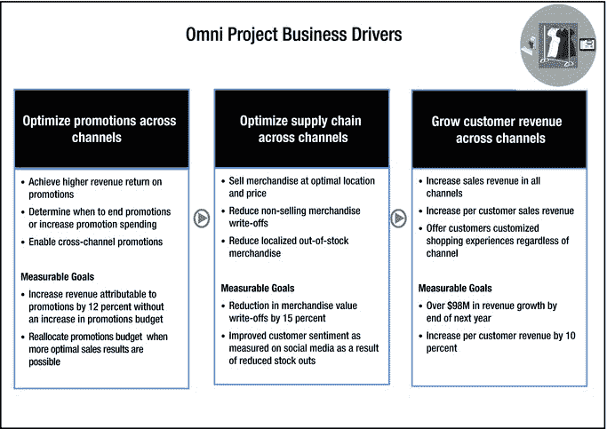
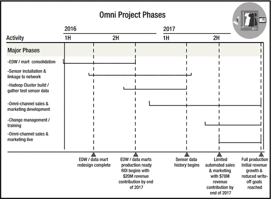
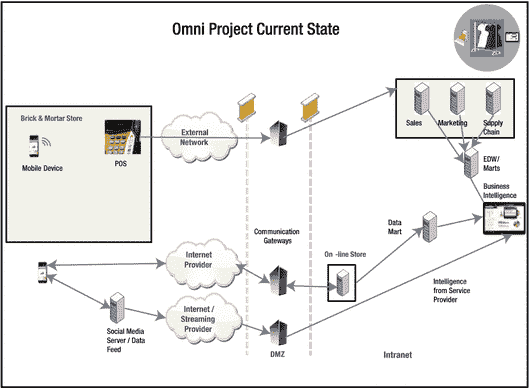
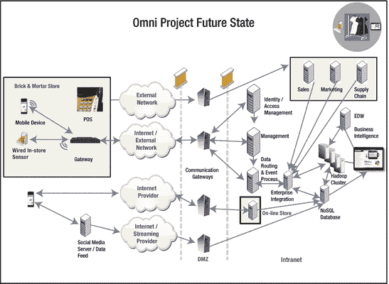
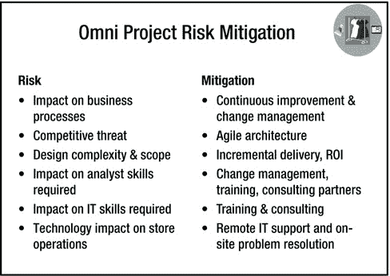
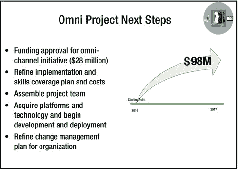
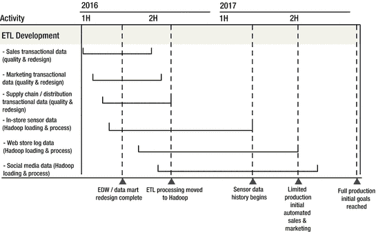

# 排版后的文档

当然，我们的听众必须在他们愿意投资并为项目提供资金之前理解预期的业务成果。在图 7-6 中，我们概述了全渠道项目的关键业务驱动因素。需要明确的是，为了让该项目按利益相关者设想的那样成功，它必须提供一个能够跨渠道优化促销、跨渠道优化供应链以及跨渠道提升客户收入的解决方案。

图 7-6. 路线图高管演示——业务驱动因素幻灯片

我们还在幻灯片上提供了关于期望成果和可衡量目标的更多细节。所有陈述的可衡量目标必须得到我们关键利益相关者（例如，营销、供应链管理和销售领域备受尊敬的领导者）的认可，证明其是合理的。这些应该与我们之前制定商业案例时使用的数字相同。我们的关键利益相关者必须愿意再次支持这些数字，并支持项目的关键目标。

高管听众会希望了解项目如何分解为可管理的阶段，这些阶段将开始带来我们刚刚描述的业务回报。他们还想知道这些阶段是否能够降低项目失败和成本超支的风险。

图 7-7 展示我们如何说明这些阶段。下轴上的标记表示随时间推移预期的增量收入。这种图表有时也用于在收益累积的同时说明项目成本随时间的变化。

图 7-7. 路线图高管演示——项目阶段

该图还表示了这个听众可能关心的其他活动（你可以将图 7-7 及其活动与图 7-3 中针对 IT 管理层的活动进行比较）。例如，我们在此指出，我们将制定一个变更管理和培训计划，并在上线阶段之前执行。将该图添加到图表中是为了预期高管们可能提出的一些反对意见，这些意见涉及业务部门使用拟议解决方案的能力以及 IT 部门管理它的能力。

尽管提出了一个坚实的商业案例，我们的听众可能仍然想知道为什么项目如此昂贵。他们可能不清楚我们正在描述实体店和 IT 部门内的基础设施的重大改造。这些改造是由跨多个渠道收集和分析数据的需求驱动的，而这是目前不存在的方式；我们需要向他们展示这一点。

图 7-8 以简化的形式展示了我们当前的基础设施状态。我们可以用这个图来说明，关于客户的数据目前存储在孤岛中。作为业务领导者，他们应该已经认识到，组织目前可以看到客户在每个渠道购买了什么，但几乎无法实现我们刚才概述的三个业务目标，而这些目标需要跨渠道的客户视图。

图 7-8. 路线图高管演示——当前状态信息架构图

图 7-9 用于说明基础设施必须如何改变。有时，最有效地描述这种改变的方法是创建一个构建幻灯片，说明向未来状态的逐步过渡，并与关键项目阶段保持一致。

图 7-9. 路线图高管演示——未来状态信息架构图

我们可能预料到，听众可能会对这个项目的复杂性和其他方面感到震惊。我们的下一张幻灯片（图 7-10）说明我们已经考虑了许多风险，并制定了风险缓解计划。除了寻求他们对我们的计划的信心之外，在讨论这一点时，我们可能开始寻求对培训计划和顾问需求的认同。我们还可以利用这次讨论来开启关于所有迄今为止对计划的反对意见的对话，并将这些问题摆到桌面上。

图 7-10. 路线图高管演示——已识别的风险与计划缓解措施

高管演示必须在掌握项目资金的人面前建立并维持可信度。我们力求在每一步都确认我们有一个可靠的计划。如果我们未能建立这种信任，项目很可能无法获得批准。因此，演示文稿背后的项目计划中必须有足够的细节，以便我们能够自信地回答将会出现的问题。

我们现在应该准备用“下一步”讨论来结束我们的演示。我们将请求项目资金，并指出任何阻碍因素。在结尾部分，我们还用来描述我们已预见的任何其他下一步措施，部分目的是展示我们对获得批准的信心。当然，我们会记下高管提出的任何其他步骤，并将他们的想法纳入我们的计划。

描述下一步措施的幻灯片如图 7-11 所示。你可能注意到，我们在这张幻灯片上重申了预期的增量业务收益以及请求的资金金额。继续强调潜在的投资回报率，有助于传达这样的信息：虽然有些人可能认为项目成本高昂，但它将为组织带来巨大的价值。

图 7-11. 路线图高管演示——结束语幻灯片

## 获得批准与过渡阶段

至此，我们应该相信我们的路线图演示已准备好接受高管评审。我们已做好了充分准备，该计划对我们而言似乎完全可行。我们也已将详细计划记录在案，在演示过程中回答问题时可以依赖其中的信息。那么，可能会出什么问题呢？

除非该倡议是 CEO 直接下达的任务，否则我们在呈现路线图时很可能面对一群高度怀疑的听众。高管们可能极度厌恶风险，并且可能认为大数据和物联网项目只是被过度炒作、成本高昂的计划，是他们想要避免的。也许，组织内部在部署此类创新项目方面有过不良记录。高管们还可能有一些我们未曾意识到的其他热点问题和业务顾虑。

我们可以采取几个步骤来为高管会议做好更充分的准备。首先，我们应该与项目发起人一起审查我们的内容，并就我们准备的材料征求他们的指导。我们还可以与将出席会议的部分高管或其直接下属一起审查内容，以征求他们的反馈（包括他们已有的或预计会提出的任何顾虑）。如果我们能在会议前与一些决策者会面，我们也可以争取他们尽早对项目表示支持。

如果我们被告知高管听众需要更多直观的证据来理解项目将提供的价值，我们可以构建一个演示，展示一些示例仪表盘或构建图表显示业务流程将如何改进。我们可以在高管演示之前，与我们的`test`受众一起审查这些演示以及演示文稿中的其他补充内容，并进一步征求反馈，了解这些视觉辅助工具在帮助我们论证项目资金需求方面所具有的价值。

### 高管会议

我们的路线图演示在高管会议议程中的位置以及实际出席演示的人员，将表明我们的项目对高管的重要性。如果被安排在议程最后，且只剩下少数几位高管在场，这不是一个好兆头。至少，如果演示被缩短，我们还有些准备，因为正如前一节所述，我们已将建议、商业利益以及我们要请求的事项提前总结。在这种情况下，争取在日后得到全面听证或许是我们最好的期望。我们可以利用初次会议，在有限的时间和有限的听众面前，开始推销项目的价值。

在演示过程中，可能会发生三种情况。最好的结果是资金获得批准。然而，我们可能会遇到第二种结果：没有资金，项目将不被考虑。第三种选择在某些组织中往往最为常见——推迟对项目资金的决策，等待更多信息或召集不同的高管听众进行演示。让我们看看，如果在会议中出现后两种情况，我们可以做些什么。

如果项目因缺乏资金而未能获得批准，真正的原因可能是商业案例和/或发起人的支持力度不够。在许多组织中，真正有说服力的商业案例能够推动资金重新分配给某个项目。既然我们已经确立了正向的投资回报率，也许问题是回报周期太慢。我们必须直接询问，是什么阻碍了做出积极决策。缺乏资金可能并非真正的问题所在。项目可能并非没有希望，我们可以稍后再回来，带着对高管关切的答复，从而获得资金批准。

在一些组织中，要做出任何形式的决策都很难。如果决策被推迟，我们必须找出推迟决策的确切原因，并询问未来我们如何以及何时能再次提出该项目，并确保能做出决策。

如果决策是设立资金并推进项目，那么在离开会议并庆祝之前，我们应该询问高管们他们是否希望定期收到关于项目进展的报告，以及这些报告应如何提交。我们可以建议在后续高管会议中留出五分钟来汇报进展并提出遇到的任何问题。

### 过渡到实施阶段

资金到位后，就该着手组建项目团队了。项目发起人可能认为资金一到位他们的工作就结束了，但他们在整个实施过程中仍应是团队的关键成员。他们通常在业务部门与高管层之间扮演关键联络人的角色。当需要在项目团队会议上强调该计划对业务的重要性时，他们也能发挥重要作用。

组建项目团队的关键在于任命项目经理。项目经理将确定所需资源，为团队招募或聘用这些资源，设定并协商里程碑，并监督项目进度，确保在批准的预算内达成里程碑节点。项目经理应熟悉组织内用于跟踪和监控活动与任务的标准项目管理框架。他们还需持续监控项目质量与范围变更，并在质量问题、范围蔓延或团队成员间的问题影响到及时交付既定业务目标的能力时，召集相关方共同解决。

一旦被任命，项目经理将审阅详细计划中迄今为止收集到的所有信息。如果他们不理解某些权衡取舍的原因，会向早期参与制定初始计划的成员提出疑问。在组建团队时，他们会要求团队成员及值得信赖的顾问在计划制定过程中寻找漏洞，判断计划可能失败的原因，然后修复潜在的计划缺陷。

**注意**
优秀的项目经理在与各类受众沟通时极为高效，受众范围从高度专业的技术人员、业务专家到团队领导和企业高管。他们组织能力出众，尤其擅长解决问题。他们通常具备敏锐的政治嗅觉，懂得如何以推动项目前进的创新问题解决策略来传递坏消息。

通常会组建多个团队，并使其成为更大项目团队的一部分。其中一些团队可能围绕以下角色组建：
- 业务分析师和数据科学家（包括业务部门代表）
- 数据管理系统架构师
- 数据采集专家
- 企业架构师
- 基础设施与设计架构师（服务器、存储和内部网络）
- IT 运维人员（例如，熟悉组织最佳管理实践、标准和服务水平协议的人员）
- 智能传感器开发专家和程序员（适用于物联网项目）
- 网络设计与运维人员（负责将数据从传感器传输到分析基础设施）

团队成员的选择基于其定义和构建解决方案的能力。当然，他们还必须具备人际交往能力，以及在时间和交付范围截止日期的压力下工作的能力。正如我们在技能评估过程中所讨论的，团队成员可能来自内部员工、顾问、系统集成商，或这些来源的混合组合。

随着成员的加入，团队可能会变得庞大，以至于需要自身的管理层级，因此通常会在每个团队内指定团队负责人。鉴于团队负责人在解决方案交付过程中的关键作用，他们通常需要具备与项目经理相似的技能。

经验丰富的项目经理还会在资金获批后、实施前的这段时间，利用从团队获取的信息，为项目计划补充更多细节。图 7-12 展示了数据采集团队可能提供的 ETL（数据提取、转换、加载）开发简化高级计划。以这种格式呈现的图表有时被称为甘特图。在此 ETL 计划之下，还有另一层级的细节，描述如何构建解决方案，以便从内部和第三方数据源提取关键数据，并将其加载到支持各业务领域（如销售、营销和供应链）的解决方案中。

图 7-12. 典型的 ETL 开发高级项目管理计划

你可能已经猜到，一份详细的整体项目计划可能包含数百项活动和数千个任务。在此规划阶段，项目经理特别关注的是理解各项活动和任务之间的相互关系，以及特定任务的延迟如何影响关键里程碑。这通常通过关键路径法（CPM）来实现，该方法识别出处于完成活动关键路径上的任务。有时会使用 PERT（计划评审技术）图作为甘特图的替代方案来表示任务进度，因为它能清晰展示关键路径上的任务。

到目前为止，我们在这些阶段的工作主要涉及设计和规划，因此架构师通常处于领导地位。正如你所见，我们正在将项目领导权过渡给项目经理。当然，架构师的工作尚未完成，你将在最后一章中看到这一点。

最后一章描述的是将产生我们方法论设计成果的阶段：一个能够实现所需业务解决方案的实施。与本书其他章节类似，我们将重点介绍在该项目阶段观察到的**最佳实践**。