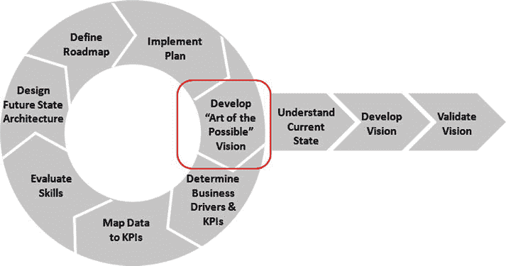
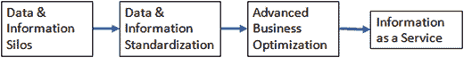
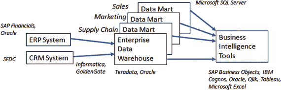
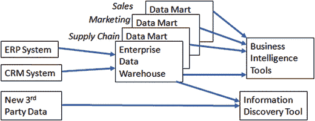
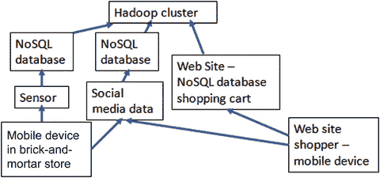
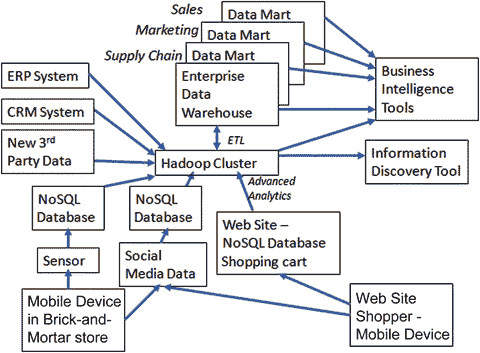
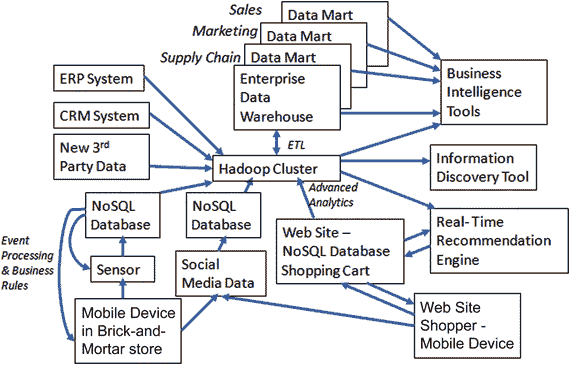

# 2. 评估可能性之艺术

害怕落后于人可能是一种强大的动力。如今，许多组织开始构建大数据和物联网原型，仅仅是因为他们担心竞争对手正在抢占先机。率先将差异化解决方案推向市场，是初创公司吸引风险投资家资金的共同目标。尽管许多初创公司会失败，但有些却取得了巨大成功，并在新市场中站稳了脚跟，这反过来又威胁到了这些市场中原有的成熟公司。面对新的竞争，成熟公司的首席执行官和高级业务领导者们，并未忘记凭借创新型解决方案率先进入市场所能获得的巨大优势。

这些组织中的许多还开始专注于依据事实管理业务，而非凭直觉做出决策，后者曾主导他们过去的决策。数据成为了王道，从数据中挖掘出的信息被视为至关重要。能够回溯过去并准确评估所发生事件的能力，已成为一种基本要求。在评估各种方案以及新决策的潜在影响时，利用数据来预测未来也变得越来越重要。

从表面上看，大数据理应能帮助组织满足这两方面的需求。毕竟，更多的数据种类和更大的数据量应该有助于发现新的事实真相，或者说，许多企业高管都愿意如此相信。而物联网似乎开辟了新的商业可能性，不仅适用于针对传统竞争对手的策略，也适用于在相邻市场开发新战略。

因此，许多 `IT` 部门的任务就是制定一项战略，利用大数据开发能对业务产生影响的解决方案。出于许多相同的原因，物联网现在也受到了类似的关注。想要弄清楚这些计划可能在哪里产生价值，一种常见的初步方法是寻找同行业其他公司发现的杀手级用例。另一种方法是尝试通过探索海量的多样化数据，做出重大的、出乎意料的业务发现，并寄希望于出现一些“灵光一现”的时刻。然而，如果对于通过分析所有数据（包括来自传感器、社交媒体、网站和其他流数据源的数据）可能解决哪些业务问题没有一个坚实的假设，这些方法很少能奏效。

为了提出这样的假设，你的公司或组织或许需要召开一次愿景研讨会。当然，`IT` 高管、企业架构师和 `IT` 架构师将会对 `IT` 的发展方向有看法，并且对大数据和物联网的潜在影响也有所认识。然而，我们正在寻找的用例很可能存在于业务领导者的头脑中。巧合的是，他们可能也拥有为这些项目提供资金的预算。在我们协助组织的规划会议中，描述过此类项目需求的人员包括营销总监、风险管理负责人以及工程副总裁（仅举几例）。

在本章中，我们将描述如何通过评估“可能性之艺术”，来发现你未来信息架构中可能包含的内容，并推动未来的项目。当你的组织召开这样的研讨会时，你可能会发现许多潜在的项目。但本章概述的技术也将帮助你，对这些期望项目的可行性进行切合实际的早期评估。这样一来，你将能够专注于那些确实获得了足够支持，并且能够对业务产生真正影响的项目。

图 2-1 强调了我们在方法论中所处的阶段以及本章涵盖的内容。愿景研讨会中的讨论包括对当前和未来业务架构、数据架构、应用架构以及技术架构的评估。由于这只是我们探索过程的开始，一旦我们确立了愿景并确信可能存在值得追求的项目，后续还会有许多阶段。

图 2-1. 我们成功方法论中的“可能性之艺术”愿景阶段

## 了解当前状态

在描绘我们可能前进方向的愿景之前，了解我们当前所处的位置至关重要。对于当前状态，总是存在业务和技术两种视角。从业务角度来看，我们需要了解我们的业务高管和分析师是否对他们所拥有的信息和数据感到满意。这通常会引发关于他们如何使用数据及其原因、数据粒度、可访问的历史数据广度以及数据质量的讨论。还会讨论缺失的数据源和数据历史，以及添加这些数据将对未来容量需求产生的影响。对数据的及时性需求以及可接受的及时性标准也在讨论之列。

从 `IT` 角度来看，我们需要了解当前的关键数据源、数据如何传输以及在何处传输、使用了哪些数据管理系统、以及当前使用或缺乏哪些业务分析工具。除了软件之外，我们还应该了解当前状态架构中服务器和存储组件的能力和使用年限。我们还应该了解，针对业务的服务水平协议是否得到满足，以及当业务必须响应不断变化的条件时，技术基础设施的灵活性和敏捷性如何。

### 信息架构成熟度自评估

对当前信息架构的成熟度进行早期自评估，有助于洞察组织扩展其现有架构的能力。如果某个组织连基础的数据仓库实施都困难重重，那么就不应指望大数据项目能神奇地解决所有问题。事实上，此类项目反而可能阻碍解决业务线更希望优先处理的高优先级问题。

出版物中存在多种信息架构成熟度评级标准。我们发现，组织通常遵循一条路径：可能从信息和数据孤岛开始，接着是信息和数据的标准化，应用高级业务优化技术，最后将信息作为一种服务提供。图 2-2 展示了这一路径。

图 2-2. 信息架构成熟度阶段

以下是每个阶段所发生情况的定义：

- `信息和数据孤岛`：数据跨多个独立的数据集市和工具进行不一致的重复存储，主要由业务线管理，且经常就哪个数据集是真实数据集展开争论。因此，对数据分析所得结果的解读往往受到质疑。
- `信息和数据标准化`：集中管理的从属数据集市和企业数据仓库用于报表和临时查询，并关注数据质量、一致性和安全性。`IT` 部门与业务线协作扩展数据集市并推出新的集市。
- `高级业务优化`：引入流数据以增强传统数据源。利用预测分析来更好地理解和预测决策结果。
- `信息即服务`：内部开发的可信数据存储和分析工具在公司或组织外部同样具有价值。作为商业合作的好处，为优选合作伙伴提供访问权限。订阅者愿意为这项服务付费，并可以获得访问权限。

这些阶段并非总是按顺序进行。组织可能同时推进其中几个举措。例如，组织常常在数据孤岛和标准化之间摇摆，尤其是在 `IT` 部门行动不够快，无法满足业务线不断变化的分析需求时。预测分析和流数据的引入有时会在这种摇摆过程中被探索和实施。

当然，成功跨越前三个阶段的组织将创造出具有非凡商业价值的东西。此时，一些组织会考虑设立订阅服务，并可能开始与所在行业的数据聚合商展开竞争，因为他们开始将信息作为一种服务来提供。

在评估组织成熟度时，重要的是要认识到，当您从数据孤岛迈向信息即服务时，`IT` 部门必须为组织带来的角色和技能也变得更加高级。承接一个新项目时需要考虑的因素之一是：您是否正在为组织引入一套截然不同的技能组合，以及获取这些技能所需的投入是应该花在这里，还是花在那些要求较低但可能同样有利可图的任务上。

### 行业当前业务状况

在制定未来信息架构时，了解行业趋势以及最优秀的竞争对手如何重新定义其信息架构来应对这些趋势也至关重要。请记住，大数据和物联网的引入正在导致许多行业竞争格局的重新定义。一些公司基于以新方式理解数据的能力，正选择进入其他行业，从而开启新的业务切入点和解决方案。

最具影响力的信息架构项目总是与解决特定业务问题相关联。以下按行业列出了典型的数据仓库项目以及将信息架构扩展到包含 `Hadoop` 和/或物联网的项目的示例清单。当与组织内的业务目标对齐时，这份清单可能会为您探索新项目领域带来一些想法，这些新项目可能产生显著的投资回报。

## 行业应用场景

### 农业

- `数据仓库`：农业生产成本与优化分析、产量分析、农产品大宗商品定价/交易分析。
- `Hadoop` / 物联网：基于田间传感器和天气数据的耕作模式、施肥、收获成熟度及水分含量的分析与优化。

### 汽车制造

- `数据仓库`：制造成本与质量分析、供应链分析、保修分析、销售与营销分析、人力资本管理。
- `Hadoop` / 物联网：客户情绪分析、联网车辆分析（包括部件故障、服务需求与服务调度、驾驶历史及自动驾驶汽车）、驾驶员紧急情况检测与响应。

### 银行业

- `数据仓库`：跨金融渠道的客户统一视图、财务分析、欺诈检测、信用评估、人力资源管理、房地产管理与优化。
- `Hadoop` / 物联网：欺诈检测、风险分析、客户情绪分析。

### 通信行业

- `数据仓库`：定价策略与财务分析、客户支持与服务、营销分析、供应链、物流与流程优化、合规监管、房地产优化、人力资本管理。
- `Hadoop` / 物联网：社交数据分析、移动设备使用分析、网络质量与可用性分析（利用传感器）、网络欺诈检测，以及面向物联网的扩展网络管理与优化。

### 消费品行业

- `数据仓库`：销售、营销、供应商、制造、物流、消费趋势及风险分析。
- `Hadoop` / 物联网：促销效果分析（通过社交媒体和店内传感器）、供应链分析、运输途中成品状态分析、零售终端产品陈列分析及风险分析。

### 教育与科研

- `数据仓库`：机构或设施财务分析、人员与人力资本管理、校友档案与捐赠模式分析。
- `Hadoop` / 物联网：基于传感器数据的学生风险分析、科研传感器数据分析、设施监控与利用率优化。

### 医疗健康（支付方）

- `数据仓库`：医疗成本、医疗质量、风险与欺诈分析。
- `Hadoop` / 物联网：参保客户情绪分析、风险与欺诈分析。

### 医疗健康（提供方）

- `数据仓库`：医疗成本分析、医疗质量分析、人员与人力资源分析、风险分析。
- `Hadoop` / 物联网：疾病与流行病模式研究、患者监护、设施监控与优化、患者情绪分析、风险分析。

### 高科技与工业制造

- `数据仓库`：供应商与分销商分析、物流管理、制造质量与保修分析。
- `Hadoop` / 物联网：车间生产与质量分析、子组件质量分析、产品故障与潜在故障分析、自动化服务请求。

### 保险（财产与意外险）

- `数据仓库`：销售与营销分析、人力资源分析、风险分析。
- `Hadoop` / 物联网：客户情绪分析与风险分析。

### 执法

- `数据仓库`：物流优化、犯罪统计分析、人力资源优化。
- `Hadoop` / 物联网：威胁分析（通过社交媒体和视频捕获识别）。

### 媒体与娱乐

- `数据仓库`：观众偏好分析、媒体频道流行度分析、广告销售分析、营销推广分析。
- `Hadoop` / 物联网：观看习惯分析（基于机顶盒）、娱乐场所客户行为分析、客户情绪分析。

### 石油与天然气

- `数据仓库`：钻井勘探成本分析、潜在勘探点分析、生产分析、人力资源分析、物流优化。
- `Hadoop` / 物联网：钻井勘探传感器分析（故障预防）。

### 制药

- `数据仓库`：临床试验分析（包括药物相互作用研究、受试者结果分析）、研发与生产财务分析、销售与营销分析、人力资源分析。
- `Hadoop` / 物联网：临床研究传感器数据分析、社交行为与疾病追踪（通过社交媒体）、基因组学研究。

### 零售

- `数据仓库`：市场购物篮分析、销售分析、供应链优化、房地产优化、物流与配送优化。
- `Hadoop` / 物联网：全渠道分析与客户情绪分析。

### 运输与物流

- `数据仓库`：设备与机组人员物流及路线规划、销售与营销分析、房地产优化、人力资源分析与优化。
- `Hadoop` / 物联网：交通优化（基于高速公路传感器数据）、交通安全分析与控制、设备性能与潜在故障分析（基于车载传感器）、物流管理（基于传感器）、客户情绪分析。

### 公用事业

- `数据仓库`：物流优化、电网电力传输分析与优化、客户能源使用分析、人力资源分析与优化。
- `Hadoop` / 物联网：基于智能电表数据的电网优化与状态分析、主动维护优化。

`注意`：上述列表仅代表了 2015 年已部署或进行中的部分项目与实施方案。随着各组织不断发掘该技术的创新用途，并寻求针对先前无法解决的问题的新业务方案，该列表也在持续变化。

在本书后续章节中，我们将讨论此类项目的优先级排序。优先级排序（以及通常所需的资金支持）要求业务部门与信息技术部门协同合作。当项目定义和优先级排序作为联合活动开展时，项目最终成功的概率将显著提升。

## 是否需要新的愿景？

至此，我们已经对自身的信息架构成熟度进行了自我评估，并审查了一些可能的项目。或许可以通过对现有信息架构进行小幅修改来推进期望的新项目。例如，如果分析所需的数据大多结构化，且数据仓库基础设施完善，那么最有效的做法可能就是在此基础上直接构建。然而，当基础设施与业务需求不匹配时，现在或许是时候构想一个方案来应对这些日益增长的需求了。

一个显而易见需要修改架构的理由（你可能已经从本书的主题中猜到了），就是识别出那些需要分析数据仓库难以轻松处理的新数据源的业务需求。例如，新的数据源可能包括流式数据或半结构化数据。可能会引入高速、高容量的数据摄取需求。这些需求可能导致将 `NoSQL` 数据库和 `Hadoop` 纳入信息架构，而之前它们可能并不存在或并非必需。探索 `Hadoop` 的数据科学家可能渴望并推动采用新的信息发现工具和预测分析引擎。

你如何收集需求，并共同制定未来状态信息架构的愿景？我们合作过的公司和组织通常会召开规划会议（有时称为研讨会）并收集需求。初步的需求收集可能只需两三个小时，但它能帮助确定后续所有工作的方向。

在愿景制定会议期间，与会者应讨论他们对当前数据仓库、商业智能、`ETL` 工具及处理流程的满意程度。讨论可能会延伸到包括服务器和存储在内的底层基础设施。通常正是在这个阶段，人们会首次考虑对现有组件进行升级或变更。例如，如果目标数据仓库上的 `ETL` 性能及所需资源存在问题，那么考虑利用为处理流式数据源而引入的 `Hadoop` 集群来充当 `ETL` 引擎或许是个好主意。实际上，`Hadoop` 引擎可以成为所有数据的初始着陆点。如果出现了对预测分析的新兴需求，或者正在重新评估如何部署预测分析，那么你也可以探索使用 `Hadoop` 集群来处理该工作负载。

通常在这个阶段，`IT` 部门的许多人会开始担忧当前信息架构的成熟度是否与正在讨论的愿景严重脱节。`IT` 部门或业务部门的技能差距可能会变得非常明显。数据治理和运营问题也可能浮现。潜在的预算成本和影响通常是 `IT` 高层管理的首要关注点。

所有这些问题即使在现阶段提出来也是好的。然而，我们才刚刚开始。我们正在构建未来信息架构可能成为什么样子的愿景。我们尚不够了解业务案例（包括是否有业务案例），无法确定我们是否能够推进一个项目。我们也没有关于所需数据的足够细节。这些我们将在后续阶段更好地理解。之后，我们还会更仔细地评估所需技能。当我们开始定义更详细的未来状态信息架构时，我们将开始更好地理解解决方案的潜在成本。

而现在，我们只是在探索可能性的艺术。

## 制定愿景

愿景通常是在有引导的规划和白板会议中制定的。即使在推测修订信息架构的最初阶段，你也会希望有各种关键利益相关者参与会议。当然，你希望了解当前架构及其组件的架构师和 `IT` 管理人员在场。但在这个时间点，组织中业务主管和分析师可能最清楚地知道必须将哪些新的数据源纳入进来，以解决新出现的业务问题。至于数据需要多精细以及数据需要保留多久，业务分析师与 `IT` 部门的看法可能截然不同。请记住，现在不是争论的时候。现在是收集每个人需求的时候。

当然，在会议前做好预习工作并无坏处。如果 `CIO` 或其他 `IT` 高级领导不经常参加业务规划会议，那么你需要回顾组织在财报电话会议、财务报表、内部广播和其他内部论坛中阐述的最高业务优先级。你也可以对竞争对手进行类似的研究，因为贵公司的业务主管很可能对竞争压力非常敏感。

`注意`：在一些公司和组织中，如果 `IT` 部门与业务部门脱节，并且不被视为值得信赖或可靠的交付伙伴，我们曾见过 `IT` 团队试图独立定义和推行他们认为具有普遍意义的信息架构修改。在重新与业务部门建立信任并开展联合愿景制定和规划之前，此类努力往往停留在研发阶段，且几乎没有可自由支配的资金支持。

为了吸引合适的人员参加会议，你应该在会议前传达愿景制定会议的目标和议程。例如，一个明确的目标可能是：希望就一项 `IT` 投资的五年计划获得初步意见，以帮助公司提供更好的客户体验。请注意，我们除了 `IT` 目标外，也提到了一个业务目标。如果我们希望业务人员参加会议，就需要描述这对他们有什么好处。

愿景制定会议上讨论的议程大纲可能如下所示：

- 会议总体目标
- 与会者自我介绍及自述会议目标
- 概述需要收集的信息类型
- 讨论当前信息架构成熟度及其影响
- 回顾现有信息架构覆盖范围及所提供的业务解决方案
- 讨论需要改变什么以及为什么
- 信息架构和业务解决方案如何演进的愿景
- 讨论后续步骤及其他所需会议

你应在会议一开始就明确表示，会记录下大家的意见和白板上的画图。你还应提前承诺，会议结束后将提供并分发一份总结所收集信息的报告。

# 数据仓库的当前状态与未来状态

IT 部门很可能已经绘制出高度技术性且详尽的状态信息架构图。在我们着手确定可能发生的信息架构演进过程时，这些图表可以作为有用的参考资料。但我们需要简化这些图表，并聚焦于与参与愿景制定的业务领域需求相关的部分。

图 2-3 展示了一家拥有零售商店的企业中，当前状态的数据足迹可能的表现形式，其愿景制定的重点在于提升促销和销售活动的成功率。我们将以此图或类似图表为起点。在该示例中，企业数据仓库（`EDW`）提供了历史数据库记录。数据从多个 `OLTP` 系统（图中展示了 `ERP` 和 `CRM` 系统）中提取。数据集市围绕 `EDW` 分布。业务分析师使用报表、即席查询和分析工具来访问数据集市及/或 `EDW`。图中还标出了一些当前数据足迹中的关键技术，以便我们在讨论过程中进行参考。

**图 2-3.** 典型的当前状态信息架构图

在围绕此架构图展开的讨论中，可以深入探讨许多主题。这些讨论中经常出现的主题包括：

*   当前数据的粒度以及 `EDW` 中历史数据的时长（以及期望的时长）
*   数据集市当前的有用性，包括它们之间的重叠、扩展或部署新数据集的灵活性，以及所需的历史数据时长
*   当前报表、商业智能工具和仪表盘的有用性
*   如果同时存在多个功能重叠、用户群体规模不一的商业智能工具，是否可能进行标准化
*   是否需要具备一致维度（conformed dimensions）的维度模型
*   是否需要预测分析和数据挖掘
*   对当前查询和分析性能的满意度
*   是否需要实时告警或建议
*   第三方数据源的重要性，以及这些数据对一个或多个数据集市的适用性
*   是否需要额外的数据源来解决新出现的业务问题
*   `EDW` 和数据集市当前的数据质量，以及未来期望达到的质量标准
*   数据更新的频率，以及能否及时将数据交付到 `EDW` 或数据集市（并最终交付给分析师），以便做出业务决策
*   对数据安全（包括静态数据和传输中的数据的顾虑）
*   是否需要更高可用性的 `EDW` 或数据集市

尽可能多地收集在场所有人的意见，并视需要在白板上做好记录。你需要记录下数据集市、数据源和其他组件的名称，以便大家对讨论内容有一致的理解。

> **注意**
>
> 如果你对当前状态信息架构只是略知一二，而参加会议的其他架构师想要修正你的图示，请欣然将记号笔交给他们，让他们绘制自己版本的图。他们的图可能与本章提供的插图大相径庭，但看到他们的版本能让在场所有人对当前架构的认知有极大启发。这将有助于建立对现有架构更全面的共同理解，并在确定未来状态架构愿景时，就哪些方面需要改进展开更好的协作。

正如我们刚才提到的，数据安全问题可能会在此次讨论中出现。部分讨论可能由该组织所在行业的特定需求驱动。如果你在某个特定行业或政府机构工作，你可能对必须执行的合规标准已经很熟悉。但如果你在不同行业间提供咨询服务，表 2-1 可以帮助说明一些经常被提及的较为通用的标准。

**表 2-1.** 各行业数据安全标准示例

| 行业 | 标准名称 | 描述 |
| --- | --- | --- |
| 欧盟 | 欧盟数据保护指令 (`EUDPD`) | 要求所有欧盟成员国采用安全指令 |
| 金融/银行业 | (美国) `FFIEC` 审计员安全指南 | 定义网上银行安全要求 |
| 金融/银行与服务 | 格拉姆-里奇-比利雷法案 (`GLB` 或 `GLBA`) | 为所收集金融数据的隐私和安全设定要求 |
| 金融与零售—支付处理 | 支付卡行业数据安全标准 (`PCI DSS`) | 支付卡数据安全处理框架：身份验证、欺诈检测与预防 |
| 医疗保健—病历 | 健康保险流通与责任法案 (`HIPAA`) | 医疗数据的访问控制、审计、数据完整性、加密标准 |
| 美国教育部 | 家庭教育权利和隐私法案 (`FERPA`) | 学生数据（包括成绩、注册、账单）的隐私标准 |
| 美国政府 | 联邦信息处理标准 (`FIPS`)，来自 `NIST` | 定义美国机构的身份验证、加密密钥管理和物理安全 |

你也可以开始与业务分析师探讨，是否需要易于访问的沙箱，以便他们能根据需要探索来自各种来源的数据。过去，这些沙箱有时被设置在 `EDW` 中，或作为一次性数据集市提供。近来，一些信息发现工具已经出现，它们自带数据管理引擎，或使用 `Hadoop` 进行数据管理。这些工具在探索新数据方面更加灵活、及时，因为它们通常是“无模式”的——换句话说，不需要预先定义模式就能发挥作用。

图 2-4 在我们当前状态的数据仓库架构中，加入了信息发现工具的概念。理解通过使用此类工具探索数据所获得的洞察价值，有助于我们了解如何更好地利用 `Hadoop` 集群中的数据，同时，使用此类工具也可能有助于推动未来数据集市和传统商业智能工具构建的需求。

**图 2-4.** 信息架构图中的信息发现

请记得从在场的业务分析师那里收集他们确信能够通过实现报表和分析愿景而带来的具体业务收益。他们可能分享关于行业最佳实践的数据，或者研究过自己组织的效率，并提供一些有力证据，说明可能创造的价值。这些信息在后续我们更详细地探讨如何为该项目的商业模式论证、以及如何在竞争性项目中确定其优先级时，将非常重要。

## 确定 Hadoop 与 NoSQL 数据库的适用场景

现在，我们准备探讨是否需要扩展信息架构以纳入 `Hadoop` 和 `NoSQL` 数据库。这种扩展很可能源于需要以比关系数据库技术更高效的方式来处理流式数据和半结构化数据源。

如果你的公司像许多组织一样，可能已经在开展研发工作，试图确定此类数据能带来的价值。如果你的组织已有此类项目，你应将其记录为当前状态的一部分。例如，如果 `Hadoop` 原型正在开发中，或者 `Hadoop` 已成为生产环境的一部分，你可以探讨以下主题：

- `Hadoop` 集群的当前数据来源
- 加载到 `Hadoop` 集群中的数据所代表的历史时间长度及其当前数据量
- 希望加载到 `Hadoop` 集群中的额外数据源
- 希望存储的数据历史时间长度及其对数据量的影响
- 当前和未来计划的数据摄取速率
- 当前和未来计划在 `Hadoop` 集群中的工作负载（`MapReduce`、SQL 查询、`Solr`/搜索、预测分析、`ETL` 等）
- 当前和未来计划的分析工具（商业智能、信息发现、搜索、预测分析、`ETL` 等）
- 对当前理解数据并驱动业务价值能力的满意程度（包括与技能相关的任何挑战）
- 对数据安全（包括静态数据和传输中数据）的顾虑
- 对集群中数据的可恢复性和可用性的顾虑

图 2-5 展示了众多在 `Hadoop` 中分析数据的项目是如何启动的。该图描述了一家拥有零售门店的公司的典型 `Hadoop` 计划。图中，基于 `Hadoop` 的工作被描绘为与已有的数据仓库及其周边基础设施完全分离。

**图 2-5.** 在独立的研发工作中使用 Hadoop 和 NoSQL 数据库

在这个理论上的零售门店示例中，业务目标是更好地理解促销和销售活动的成效。数据在购物者购买商品、浏览网站以及进入实体门店时被捕获，随后收集到 `Hadoop` 中。表达购物者与该公司进行交易体验的评价数据则从社交媒体收集到 `Hadoop`。流式数据落地到 `NoSQL` 数据库集群中，这些集群可以轻松扩展以满足高摄取需求，然后加载到 `Hadoop` 中进行分析。

请注意，从传感器收集数据的部分以非常简化的物联网架构视图表示。图中缺失了很多内容，包括配置、安全和其他必要服务。就定义一个如何将所有这一切整合在一起的愿景而言，目前这样是可以的。

## 链接 Hadoop 与数据仓库基础设施

接下来，我们将确定是否需要同时查询和分析驻留在传统数据仓库信息架构和 `Hadoop` 集群中的数据。了解我们分析师群体的专业水平以及他们为回答业务问题而同时访问两个数据源的频率，将有助于我们确定要推荐的最佳方案。

例如，如果我们需要提供维度模型以便业务分析师探索数据，那么我们要么需要将有价值的数据从 `Hadoop` 集群迁移到数据仓库，要么提供一个能将 `Hadoop` 集群用作数据仓库扩展存储的基础设施。如果我们计划提供一个包含两个数据源数据的预测分析平台，那么我们很可能希望所有待分析的数据都驻留在 `Hadoop` 集群中。如前所述，我们需要向业务分析师收集联合分析这些不同来源数据所带来的潜在业务收益。

图 2-6 展示了 `Hadoop` 和 `NoSQL` 数据库如何通常成为现有数据仓库信息架构的一部分。由于我们可能还想利用 `Hadoop` 进行 `ETL` 处理，我们将以前直接馈送给企业数据仓库的数据源描绘为成为 `Hadoop` 的输入。这同样是一个高度简化的示意图。

**图 2-6.** 链接到数据仓库基础设施的 Hadoop 和 NoSQL 数据库

在愿景构建会议的这个阶段，有时会就数据应托管在何处展开辩论。这些新数据源的数据应该首先落地并在云端进行分析吗？还是数据应该落地到一个包含现有数据仓库和 `Hadoop` 集群的本地基础设施中？

数据量以及通过网络（带宽有限）所需的移动量将帮助您决定数据是最适合放在云端、本地还是混合模式。为了了解数据移动量，您需要了解针对各种数据管理系统中数据的查询和分析活动及其位置。这些选项应在技术信息架构得到更好定义后再进行更详细的探讨。届时，您将对设想的业务用例以及解决这些问题所需的数据有更清晰的认识。

> **注意：** 如今，许多组织使用云来快速部署 `Hadoop`、`NoSQL` 或数据仓库的研发工作，尤其是在业务价值不明确的情况下；随后，当考虑到整体生产基础设施不断增长的数据量和定制化要求时，再将基础设施引入内部。

## 实时推荐与行动

显而易见，图 2-6 所描绘的基础架构因数据在点与点之间传输而引入了显著的时延（即延迟）。针对企业可能遇到的某些问题，可能需要提供实时推荐并采取相应行动。例如，当购物者正在网站上选购商品时，你希望在他们浏览网站期间智能地推荐其他商品，而不是在他们离开网站之后才进行推荐。

对于此类场景，我们使用实时推荐引擎来引导购物者，在他们浏览网上商店时向其展示特定产品。关于购买和购物行为的预测分析模型在 `Hadoop` 集群或数据仓库中进行处理。当然，目标是做出明智的推荐，让购物者购买更多商品，并更快地找到他们想要的东西。推荐引擎中的模型会根据当前的购买模式定期更新，随着时间推移，引擎的推荐能力会变得越来越智能。

在部署了智能传感器和控制器的场景中，对及时行动的迫切需求可能意味着需要在进行分析之前就制定某些规则来驱动行动。这正是当今事件处理和业务规则引擎常被部署为智能传感器解决方案一部分的原因。例如，如果实体店中的传感器开始检测到顾客到达收银台的延误以及不满意的顾客放弃他们想购买的商品，预定义的规则可能会触发设备向正在从事其他活动的收银员发出信号，要求他们开放额外的收银台，以缓解拥堵。

图 2-7 展示了在我们网站中添加实时推荐引擎的情况，该引擎的数据模型在 `Hadoop` 集群中运行，并定期向引擎提供更新。购物者画像和位置信息被传递给引擎。具体的推荐则通过网站返回给在线购物者。

**图 2-7.** 信息架构中的实时推荐引擎与事件处理

我们还展示了在实体店部署传感器的情况下，闭环事件处理和业务规则的加入。除了我们的收银台瓶颈示例，当购物者使用运行我们忠诚度应用的手机进入商店时，我们可能希望开始监控他们的位置，并根据我们收集到的关于他们最近在我们网站上浏览过的商品信息，让我们的销售人员更好地为他们提供帮助。

我们刚才展示的图表对于业务分析师来说可能看起来有点技术性。然而，我们的经验是，此类图表可以帮助业务分析师理解当前基础设施的局限性，以及可用于解决他们问题的数据流和分析选项。这些图表还有助于就为了交付他们所构想的业务解决方案而需要做出的改变，尽早获得大家的认同。

# 验证愿景

愿景规划会议通常以在白板上绘制当前状态和未来状态架构图而告终，这些图通常通过用手机拍照来保存。其他时候，这些图表会保留在活动挂图的可撕页上。会议主持人在讨论当前状态和期望的未来状态期间，也应该收集了大量笔记。这些笔记应包括来自业务部门、IT 高级管理层、架构师以及任何其他出席人员的意见。一些笔记可能包含关于未来状态信息架构一旦部署后，将对做出更好业务决策的能力产生何种影响的假设。

现在是时候以更正式的方式总结所有收集到的信息了。这些信息应以报告或演示文稿的形式，反馈给所有参与愿景规划会议的相关方。这样做有助于验证是否已捕获关于未来需求的所有关键信息。这也可能引发对所需内容的进一步澄清。通常，在一到两周内将信息反馈给初始与会者是最佳实践，这有助于维持初次会议中所建立的团队合作精神。

> **注意**
>
> 在某些项目中，我们曾收到请求，要求邀请截然不同的受众参加后续会议，而该会议本意是总结之前规划会议中的发现。这种情况之所以发生，有时是因为原始与会者对讨论过的潜在未来状态架构感到兴奋并分享了这份兴奋，从而吸引了更多利益相关方。在其他情况下，来自其他业务部门的领导者对这个过程产生了兴趣，并希望确保他们的需求也被记录下来。这是一个积极的信号，表明组织中的许多人认为这样的项目具有价值，并且未来有可能获得资助和实施。请记住，如果后续会议更多地侧重于进一步探索，而不是对前期工作的汇报和验证，那么一个好的方法是主动提出撰写一份新版本的报告，然后安排对该版本的另一次汇报和验证。

在愿景规划会议期间所发现内容的汇报报告或演示文稿中，通常应包含以下内容：

*   当前的业务挑战，包括由当前信息架构引发的挑战
*   当前状态的信息架构描述与图表
*   新兴的业务需求，可能预期的进一步业务模式变更，以及有效运营业务所需的内容
*   能够应对需求和挑战的未来状态信息架构图
*   未来状态信息架构到位后可能实现的业务收益（理想情况下包括这些收益可能的财务规模）
*   后续步骤，包括本书后续章节中概述活动的日程安排

在某些组织中，我们观察到 IT 架构师希望利用在此愿景规划活动中收集的信息，立即开始未来状态信息架构的详细设计。然而，仍有许多未知因素。我们还没有掌握与业务运营相关的关键成功因素的详细信息，包括所需的关键绩效指标和衡量标准。我们还不清楚如何分项目阶段来实施期望的解决方案，也不清楚各阶段的优先级应该如何排序。

正因如此，我们目前尚未形成可靠的商业案例，尽管对于其可能来源已有些初步设想。关于哪些数据源能提供所需指标并对应关键绩效指标，我们的认知极为有限。此外，我们也不确定组织内部（缺乏）相关技能会对部署管理预期解决方案、或利用该方案提升业务运营效率产生何种影响。

现阶段，在项目定义清晰之前，我们仍需进行更多调研与文档编制工作。但至少我们已初步了解调整信息架构的可行性与可能性，并且更清楚应从何处寻找论证依据。此外，我们开始隐约知晓业务赞助可能来自何方。因此，下一步我们将与业务部门合作伙伴共同深入挖掘实际需求。

