# 3. 理解业务

在这个信息驱动的时代，我们正处在数据革命的十字路口。我们正站在利用大数据与物联网革命性技术获取洞察、优化运营、赢得竞争性商业优势的转折点。增强并改造现有数据仓库与分析体系已成为众多组织的当务之急。在开始整合新技术之前，我们应自问几个基本问题：回答“为何”要这样做，以及“如何”使技术支撑业务战略。尽管这些问题看似直观基础，但这正是正确的起点。我们的经验表明，那些在启程前就理解业务驱动因素、关键成功要素及优先级的组织，其成功概率远高于他人。这也有助于在快速有效启动项目时获得必要的内部支持，同时成功实现预期的业务收益。

本章将阐述如何识别与分析组织在制定未来信息架构前的业务挑战与需求。图 3-1 标明了当前所处的阶段。在此阶段，我们开始更详细地揭示所需的业务架构。本书后续章节将带领读者进入技术架构阶段。

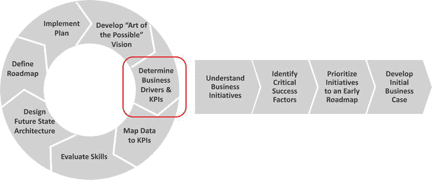
*图 3-1. 成功方法中的业务驱动因素与关键绩效指标*

## 理解业务计划

将业务需求与创新同信息架构计划相连接，有助于加速实现业务价值。我们也能更有效地进行规划。数据来源的增长与变化，以及信息需求模式的改变，给跨业务条线的信息需求预测与优先级排序带来了挑战。通常，利用新技术的架构创新会因无法将新分析能力与预期业务成果对齐，以及缺乏信息需求优先级排序而受阻。组织应以明确聚焦业务成果为方向，制定信息战略以满足数据与分析需求。将信息交付与业务成果对齐，能提升 IT 响应能力，使投资精准投向最需要的领域。

### 大数据与物联网对业务的影响

IT 提供的商业智能与分析能力有时未能体现对组织的附加价值。如图 3-2 所示，在从业务战略到 IT 系统的串联过程中，提出正确问题至关重要：包括业务战略如何塑造业务目标，以及需要哪些信息能力来支撑该战略。我们必须了解关键数据源的位置及潜在数据缺口。基于本书的范畴与重点，我们需明确 IT 解决方案在哪些环节可能需要纳入大数据与物联网组件。

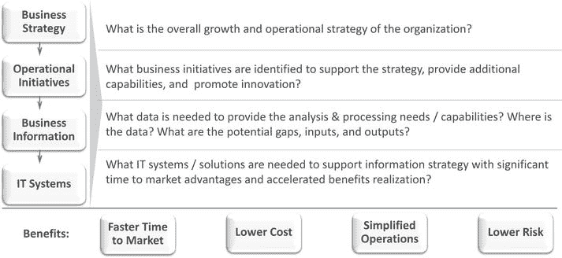
*图 3-2. 为更高业务价值对齐优先级*

典型的商业智能与分析应用侧重于分析历史数据，试图回答组织过去表现如何的问题。然而，这种能力可能无法让业务分析师灵活应对并快速调整业务方向。这如同通过后视镜观察已走过的路径。尽管运营分析对于了解过去业务表现至关重要，但引入预测性分析能使分析师前瞻未来、快速反应并影响组织航向，从而提供更高业务价值。鉴于大数据与物联网项目通常具备高数据量、多样性与高速性的特征，统一的企业信息架构中通常同时提供预测性与运营分析能力。这种信息架构方法能助力组织跃升至新的业务效率层级。

**注**
通常，大数据项目的创新会因组织无法将新分析能力与明确业务成果对齐，以及无法对信息需求进行优先级排序而受阻。

通常仅有少数几项新技术能力能真正为业务增值，如图 3-3 所示。理解这些能力如何切实影响业务至关重要。确定其影响程度并加以衡量的能力，使组织能够更优地规划与执行。

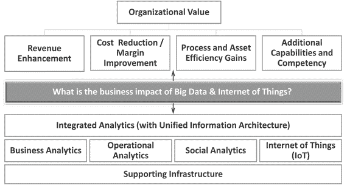
*图 3-3. 需与分析需求对齐的代表性业务价值驱动因素*

一些可衡量的典型影响及可能发生的改进包括：
*   **更高营收**：以市场份额提升和新市场渗透率来衡量。
    *   通过构建更丰富的客户画像、吸引新客户、促进创新并实现交叉销售/向上销售，提升销量。
    *   具备进入/创造新市场的能力，或在价值链上提供新服务以改善营收。
*   **增强利润**：以商品及服务的直接与间接成本降低，以及营销投资回报率提高来衡量。
    *   降低供应链中的成本与浪费，并灵活应对营销活动所激增的需求。
    *   通过优化定价策略、加强需求与供应管理，提升客户留存率与满意度。
*   **提升效率**：以设备与系统维护成本及可用性的改善来衡量。
    *   延长现有设备寿命、提高可用性与运行效率。
    *   通过改进需求管理提升设备利用率。
*   **核心竞争力**：以公众与合作伙伴对公司的正面认知，及其灵活应对外部因素的能力来衡量。
    *   提升公司股价与价值，优化合作伙伴关系，加快对竞争威胁的响应速度。
    *   显著缩短产品上市时间。

**注意**
当大数据与物联网计划仅由 IT 部门驱动，且只关注技术需求与现有数据时，企业往往最终建立一套分析平台，但这类平台影响力甚微，而无法构建能够提供更高整体业务影响力的统一分析解决方案。

大数据与物联网技术可以在我们刚刚描述的领域提供变革性能力。下一步，我们需要理解它们如何增强我们的信息架构，并带来这些业务收益。图`3-4`展示了一个示例性高层战略地图。此类图表可以有多种变体，并可用于帮助使 IT 计划与业务战略保持一致。

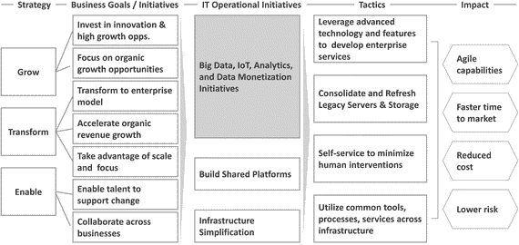
*图 3-4. 使 IT 与信息战略对齐业务战略的示例图*

### 数据收集方法

理解业务需求，并使 IT 计划与业务目标及战略保持一致，对此类项目的成功至关重要。对于许多此类计划，工作可分为三步：规划探索、初步调研以及与关键干系人访谈。我们在图`3-5`中展示了这一过程。

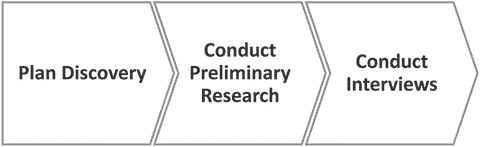
*图 3-5. 探索的主要组成部分*

#### 规划探索

事前投入时间进行探索规划，将有助于以最高效、最及时的方式收集业务驱动因素、挑战、能力与优先级。其结果将是对所有这一切有更深入的理解。任何主要的规划活动都应由以下要素定义：
*   范围、目标与预计时间表
*   所需信息、潜在信息来源以及数据收集方法

#### 开展初步调研

在进行访谈之前，我们应做好功课。一些可能提供有价值洞察的来源包括：
*   年度与季度报告
*   内部业务战略文档
*   各业务线报告的关键成功指标
*   行业数据库及任何其他相关的离线信息来源
*   关键干系人的个人绩效评估与薪酬影响因素

初步调研通常是重要信息的来源，可以帮助我们形成初步价值假设，并在访谈中指导早期提问方向。一般而言，调研范围越广，初步分析就越丰富。尽管高价值数据正越来越多地在线提供，但最佳信息来源往往来自线下。坚持与创造力始终有助于收集尽可能多的信息，以理解支持大数据与物联网计划的潜在业务驱动因素与用例。

#### 进行访谈

在此探索阶段，重点是收集与正在考虑的业务用例相关的额外信息与见解。此阶段旨在收集独家、未公开且独特的信息。通过访谈和焦点小组进行探索是常见的初步研究方法，可以产生定性与定量数据。以下是一些可以访谈的关键样本群体/资源：
*   业务线负责人（例如市场、供应链等部门负责人）
*   首席财务官及财务支持组织
*   企业战略部门
*   首席信息官、IT 负责人及组织内的其他企业架构师与信息架构师

访谈的深度取决于正在探索的用例数量以及所需信息。许多访谈可用于从同一批人那里收集定性与定量数据。收集定量数据需要更具结构化的方法，通常包括问卷与数据收集模板的组合。在可能的情况下，建议进行面对面访谈以高效收集信息并理解业务需求。

小组研讨会与探索会议通常旨在收集定性信息。这些会议使参与者能够对正在考虑的用例发表看法。互动可以产生新想法，交流可能非常有效。通过比较参与者与探索过程中其他关键群体对类似问题的回答，可以了解该群体的观点。

## 识别关键成功因素

对于任何信息架构计划，都应确定一组业务与 IT 成功因素。这些因素将被映射到一个项目上，该项目将定义拟议的未来状态架构。成功因素通常用于解决现有挑战和/或提供能够推动业务创新与差异化的新能力。

### 业务驱动力

业务驱动力影响组织当前和未来的业务绩效。理解组织及其所属行业的关键业务驱动力至关重要。我们必须了解这些驱动力将如何影响我们提议的未来状态。例如，图 3-6 列出了交通行业具有代表性的一些关键业务驱动力。

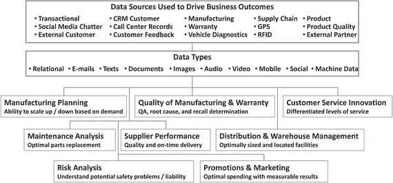
*图 3-6. 交通公司常常考虑的未来状态驱动力*

如今，释放数据的力量通常取决于组织能否在企业层面有效整合结构化、半结构化和流式数据，并构建与业务需求相一致的统一信息架构。作者认为，分析来自物联网和其他大数据源的数据可以带来更好的业务成果。表 3-1 列出了交通行业中典型用例的代表性清单，这些用例可对该行业公司的业务产生积极影响。

**表 3-1. 交通行业大数据与物联网的重点关注领域**

| 业务类别 | 重点领域 | 收益 |
| --- | --- | --- |
| 互联交通模式 | 提升安全性 | 利用车辆传感器数据进行早期故障检测、服务警报和排放监测。监控驾驶员行为/模式以进行风险分析和改进指导。通过传感器数据分析预防事故/实现自动制动。 |
| | 额外的基于位置的服务 | 通过混搭播客、音乐或新闻，提供基于位置的播放列表。基于车辆位置开发个性化广告活动和警报。 |
| | 优化导航与改善驾驶员体验 | 基于实时交通模式的智能路线引导和导航。为操作员提供驾驶室个性化设置。 |
| | 降低保修成本 | 持续的实时监控和远程诊断将直接带来保修索赔中的成本规避/节省潜力。 |
| | 保险远程信息处理与新的数据货币化机会 | 通过分析基于实时驾驶统计数据的风险概况，降低索赔与保费比率。 |
| 互联交通与企业 | 精准的业务需求规划与物流 | 改进的仓库和车队管理。优化的需求与生产管理。优化的库存水平和改进的物流，实现可预测的商品和服务交付。增强的合作伙伴关系与整合以改善整个供应链的运营。 |
| | 优化运营 | 车队管理和保修效率。提供差异化服务，避免代价高昂的公开召回。 |
| | 更高的业务价值与改善的客户体验 | 增加服务收入。能够推出新的、改进的、个性化的移动服务以获取更高收入。整体成本优化、更好的利润/改进的价格实现。有效且个性化的营销活动、供应链优化以及主动的客户互动。 |

每个行业和每个组织都有独特的业务用例。我们在第 2 章中对一些可能的用例提供了广泛指导。在发现过程中识别这些用例至关重要。

确定业务用例后，识别支持这些用例的具体成功因素至关重要。我们必须确定关键成功因素、关键绩效指标和所需的关键衡量标准。例如，如果一个组织希望其在线销售额增长 10%，我们应该了解当前状态的信息架构是如何衡量销售额的。我们还希望了解如何通过提议的未来状态架构来衡量对销售的影响。如本章后续所述，在构建包含预期收益量化的业务案例时，理解这些内容非常重要。

### IT 驱动力及与业务举措的关联

尽管发掘业务举措是本章本节的主要关注点，但在此讨论 IT 驱动力同样重要。两者之间的协调一致对于开发能够有效满足业务需求的企业级统一解决方案至关重要。

一旦定义了举措的业务用例被确定，就需要进行环境的技术评估和差距分析，以确定当前状态与支持用例所需的未来状态之间的差距。我们在第 2 章中介绍了信息架构成熟度自我评估的概念。在成熟度谱系上，图 3-7 也显示了与组织转型的关联性。作者认为，大多数组织目前正从标准化环境向更敏捷和灵活的环境转变。他们正在考虑分析各种数据类型所带来的好处。随着环境变得越来越先进，对实时行动和实时推荐的需求已成为一个期望且可行的目标。如今，许多此类想法都处于 IT 部门的关注焦点。

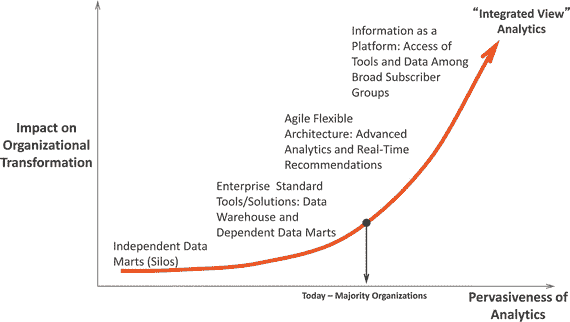
*图 3-7. 集成分析成熟度连续体*

规划良好的举措会同时考虑业务驱动力和 IT 能力。有时，对技术能力的讨论会开启业务方面更多可能性的讨论。

差距分析可以使组织确保提议的解决方案能够提供支持业务需求所需的能力。以下是与主要考虑领域相关的关键属性列表，这些属性可能推动信息架构变更的需求：
*   **战略**：属性可包括总体战略、资本和运营预算、绩效指标、赞助，以及项目和计划论证。
*   **技术**：属性可描述技术的适当性、适用性、集成性、对标准的支持，以及技术及 IT 架构在相关负载下的性能表现。
*   **数据**：属性可包括所有数据类型的数据质量、相关性、可用性、可靠性、治理、安全性和可访问性。
*   **人员**：可考虑的属性包括技术和分析技能、团队内与团队间协作，以及组织结构、领导力、培训和文化准备度。
*   **流程**：属性可包括数据采集处理、数据整合、数据集成交互、数据分析、信息分发与消费，以及决策制定。

技术和数据领域尤其值得关注，因为它们之间紧密相连，能够帮助实现业务战略和业务流程中定义的业务需求。随着基础设施变得更加灵活，我们拥有了更多解决方案的可能性。至此，我们将关于人员和组织技能的细节推迟到本书的第 5 章讨论。

**提示**：确保所选的技术解决方案在信息成熟度规模的所有主要属性上均经过评估。我们将在本书的多个地方描述如何做到这一点。这对于实现更高的收益至关重要。

图 3-8 展示了部分有助于定义统一信息架构的关键技术组件和数据属性。至此，我们对未来状态的信息架构如何整合其中某些属性已有了初步构想。当我们构建早期业务案例，以更好地判断一个或多个项目是否具备初步可行性时，我们将开始了解这项工作的潜在范围和可能产生的成本。

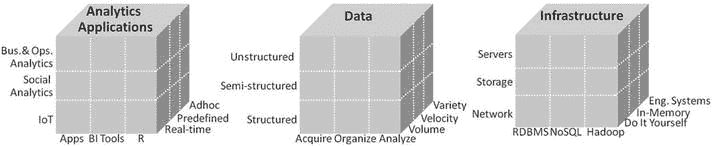
*图 3-8. 通常定义信息架构的关键组件*

识别技术和业务驱动因素将使组织能够选择正确的解决方案，并尽早启动实际项目规划，同时有助于量化对信息技术部门和业务的价值。

## 将举措优先排序，形成早期路线图

当我们踏上转型之旅时，渐进式的方法比大爆炸式的替换更有可能成功。这同样适用于所有信息架构项目，包括大数据和物联网项目。由于其中一些技术足迹在大多数组织中相对较新，它们通常是以试验性方式部署的，可能最初只是在实验室中作为概念验证启动。

要跨越试验阶段，需要理解技术能够驱动的潜在业务成果，以及这些项目是否具有影响力和变革性。如果是这样，并且正在考虑多个项目，则通常根据特定业务成果的重要性和可能存在的潜在资金来确定阶段。项目的资金优先级通常由部署解决方案所能实现的潜在投资回报率决定。在预算范围内，投资回报率最高的项目阶段会获得资金。

你可以设想一个三阶段的方法：从识别举措，到确定业务影响，最后对举措进行优先级排序，如图 3-9 所示。鉴于本章已花费大量篇幅描述如何发现举措，接下来我们将重点探讨如何确定业务影响。

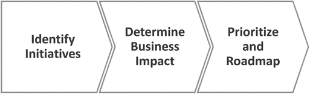
*图 3-9. 优先级排序方法*

### 确定业务影响并排列举措优先级

应遵循一致且系统的方法，将可能的项目与业务目标联系起来，并确定项目可能产生的影响程度。如图 3-10 所示，业务和流程绩效驱动因素及其结果被映射到成功衡量标准，而这些衡量标准又被映射到项目举措。这种方法可以确保我们能够从项目中捕获对业务的潜在投资回报。

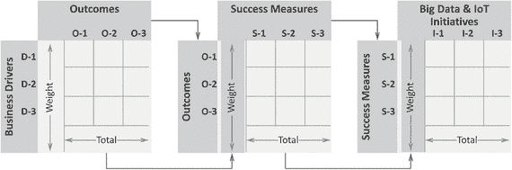
图 3-10. 优先级排序方法

让我们详细了解一下如何分三步执行此方法。

**步骤 1**：在此步骤中，我们确定最高级的组织目标及其预期的成果。接下来，我们根据这些目标对组织的重要性为其分配权重。为简单起见，我们可以使用低、中、高三个等级（1 到 3 分）。如果团队希望粒度更细，可以使用 1 到 10 分的标准来打分。同样，我们将指出这些成果被认为如何影响目标。可以使用 1 到 3 分或 1 到 10 分的标准进行评分。在此阶段获得利益相关者的共识至关重要，以确保完全获得认同。评分完成后，每个成果都会有一个加权分数，代表它将如何影响组织目标。（该分数通过将每个业务驱动因素的权重与其对应的成果得分相乘，再求和得到）。图 3-11 提供了一个示例评分卡，作为步骤 1 中优先级排序的一部分。

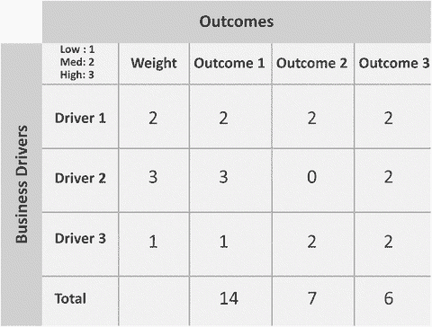
图 3-11. 优先级排序方法的步骤 1

在制造业/汽车行业中，从不同角度出发，与有效的保修管理相关的一些代表性成果可能包括：
*   **财务**：按产品管理保修成本的能力。
*   **客户**：为高端产品提供有竞争力保修的能力。
*   **内部**：关联服务与保修履行以判断是否存在欺诈的能力。
*   **创新与增长**：将保修作为产品差异化一部分的能力。

**步骤 2**：在此步骤中，我们获取步骤 1 的总分，并将其作为每个成果的相对权重。与步骤 1 类似，我们评估每个成功衡量标准如何影响成果，并计算每个成功衡量标准的总分。图 3-12 提供了一个代表性计算示例，用于得出已识别成功衡量标准的分数。
*   继续我们的示例，以下是针对同一视角下已识别成果的几个代表性成功衡量标准：
    *   **财务**：减少保修储备基金，节省数百万美元、欧元等。（衡量标准：按产品划分的保修成本）
    *   **客户**：匹配的保修服务有助于改善产品形象。（衡量标准：产品满意度）
    *   **内部**：报告时间从五天减少到按需生成。服务的领先指标通常是保修运营的可视性。（衡量标准：与订单相关的缺陷数及产品更换订单数）
    *   **创新与增长**：通过提供更长周期且有利可图的保修服务来增加销售额。（衡量标准：各时间段内每种产品的保修索赔数量）

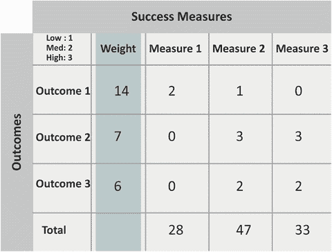
图 3-12. 优先级排序方法的步骤 2

**步骤 3**：接下来，我们获取步骤 2 的汇总分数，并将其作为成功衡量标准的相对权重。然后，我们根据每个已识别的项目举措预计如何影响这些成功衡量标准来为其打分。评分完成后，每个举措都会有一个最终分数，用以表示它预计将如何影响业务成果。得分较高的举措预计将产生更高的业务影响。图 3-13 突出显示了在一个代表性场景中，所有已识别举措的最终得分。
*   在我们的制造业组织示例中，可能出现的一些举措示例如下：
    *   通过构建客户 360 度全景视图，我们可以推出改进后的个性化与移动服务，从而增加服务收入。
    *   通过持续进行远程诊断，我们可以对车辆进行更好的预防性和主动性维护，从而直接避免成本或节省保修索赔支出。

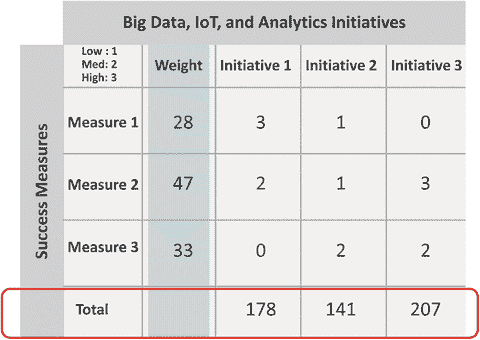
图 3-13. 优先级排序方法的步骤 3

**提示**：在成功衡量标准和影响评估方法上达成初步共识，通常能让所有利益相关者站在同一立场。确保所有主要利益相关者都有机会在此过程中投票，以帮助确保获得认可。在影响评估过程中，让众多利益相关者参与打分，将有助于使过程更易被接受，并使分数更准确。

### 其他优先级考量因素

在各项举措完成评分、其对业务的影响得以量化之后，我们需要对每项举措所需的工作量和资源数量进行早期估算。我们还将开始考虑成本、实施难度、预计实施时间，以及任何其他对举措落地执行至关重要的因素。

尽管各业务条线可能会确定多项举措，但这些额外因素将有助于我们进一步评估各项举措的可行性。图 3-14 是一个示例图表，它将各项举措绘制在一个网格中，比较了战略影响和价值与风险和复杂程度。此类图表可以帮助我们确定优先级和阶段。在此类图表中还可以选择并显示其他坐标轴——所选坐标轴取决于公司或组织的价值取向。

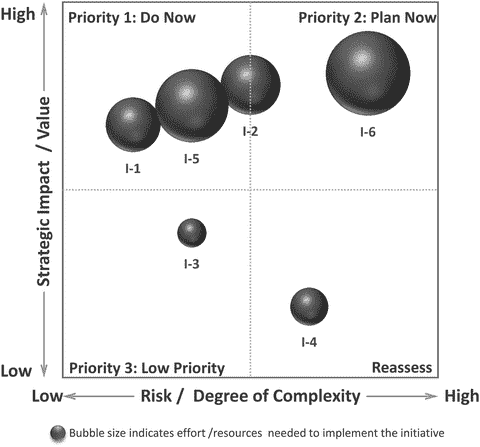
**图 3-14.** 战略路线图

我们可能还希望在决策中指明其他因素。例如，可以使用不同颜色的气泡来标识转型主题或举措所属的业务条线。可以在气泡周围添加额外的圆圈来表示实施举措所需的时间。可能性有很多。关键是要确保通过这些图表能够做出明智的投资决策，并且我们也会在规划项目阶段时使用它们。

### 制定初步业务案例

在推进关键举措时，拥有支持可行技术解决方案的业务案例至关重要。它有助于证明投资的合理性，也有助于为举措赢得内部支持。现阶段，我们尚不具备制定全面业务案例所需的所有信息。我们还无法提供详细的技术设计，也无法详细估算实施成本。但现在正是开始确定我们设想的项目和未来状态架构是否能够通过业务案例获得合理支撑的好时机。

在这一阶段，为构建一个简单的业务案例，我们将重点关注以下三个领域：
-   **总拥有成本（TCO）：** 在特定时间段内解决方案的直接成本。
-   **IT 价值：** `IT` 流程改进和成本规避的量化体现。
-   **业务价值：** 特定举措及其用例所带来的业务收益。

我们观察到，当 `IT` 部门和业务部门都参与到业务案例的制定中时，项目最有可能成功启动。这种协同努力能更准确地预测新举措的真实总收益。

如图 3-15 所示，当组织超越单纯计算 `TCO`，开始量化预期的 `IT` 和业务收益时，量化收益的难度和耗时确实会增加。产生这种复杂性的原因在于，需要涉及来自业务条线、`IT` 和公司的多个团队，并且难以收集高质量的数据点。如果能够预先确定关键绩效指标（`KPI`），量化相关收益将变得更容易，业务案例的准确性也会提高。

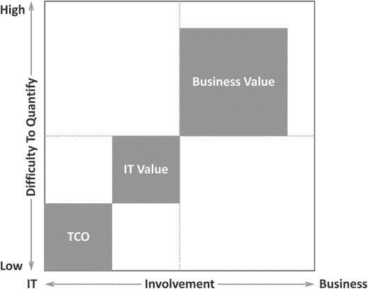
**图 3-15.** 全面业务案例的主要组成部分

> **注意**
> 在制定全面业务案例时，应重点关注所有三个重要领域——`TCO`、`IT` 价值和业务价值。这将提升手头业务案例的质量和完整性。

业务案例可以帮助组织评估解决方案的各种备选方案。尽管关键技术方面、解决方案实施和集成可行性在筛选潜在方案时起主要作用，但财务业务案例可以打破平衡，帮助推动最终决策，同时验证投资需求。业务案例有助于确定资本支出（`CapEx`）和运营支出（`OpEx`）为举措提供资金的程度，或者在组织出于融资需求而希望将资本支出转换为运营支出时，如何实现这种转换。

在着手制定业务案例时，明确全部或部分资金的来源非常重要。例如，资金可能来自 `CIO` 部门、`CFO` 部门、各业务条线，或者来自公司资金池。组织中可能存在费用回收机制，或者存在一个可被视为成本中心的中央资金池，因此无需进行费用回收。如果决策者的绩效或薪酬与计划中的在范围举措所解决的业务成果挂钩，我们在与高管讨论时就需要调整我们的“价值语言”。在向决策者制定和提交业务案例时，务必确保考虑到所有这些因素。

在制定业务案例时，确定组织内部资金的核算方式同样重要。这方面可能各不相同，通常通过决策者使用的语言来体现。理解他们语言的细微之处，便能够以与组织相符的方式分析财务状况。例如，一些组织会强调三到五年的运营率分析，因为他们专注于降低运营支出（`OpEx`），而另一些组织则同等关注资本支出（`CapEx`）和运营支出（`OpEx`）。

虽然许多组织已经投资于实验室或概念验证环境来测试诸如 `Hadoop` 之类的下一代信息架构组件，但有些组织已将下一代蓝图部署到生产环境中。在组织已进行此类投资的情况下，重要的是要找出支持业务举措所需的预期增长率、现有设备的使用年限和折旧情况，以及设备是自有还是租赁。这些因素也可能对修订后的信息架构（包括大数据和物联网技术）中的变革性投资的总体案例产生影响。

### 总拥有成本（TCO）

`TCO` 计算应考虑服务器、存储、软件、系统环境成本、安装及实施成本。所有与解决方案选项相关的硬成本都应纳入审查，包括任何会影响直接成本的额外人员相关投资。以下是针对替代解决方案进行简单 `TCO` 比较时可能考虑的代表性因素列表：
- **硬件：**
    - 节点（服务器和存储）、传感器和网络组件的采购成本
    - 年度支持成本
- **软件：**
    - 软件许可成本（数据发现工具、商业智能工具、数据管理软件、应用许可、集成工具以及支持全面解决方案的任何其他适用组件）
    - 年度支持成本
    - 因采用新技术替换旧软件而节省的任何软件成本
- **环境考量：**
    - 电力和冷却成本（我们强烈建议无论资金来源或 `IT` 部门是否已设立收费机制，都应包含这些成本。）
    - 数据中心空间成本（对于受空间限制的数据中心而言，这可能是一个非常大的因素。）
- **安装与实施：**
    - 关于解决方案安装与实施成本的最佳初步估算
    - 解决方案的培训需求及相关成本
    - 与企业级别其他系统的额外集成成本

通常，我们将独立解决方案的 `TCO` 与一组预期的 `IT` 及业务效益进行比较。表 3-2 提供了一个 18 节点 `Hadoop` 集群高层次 `TCO` 摘要的示例。为便于比较，应为每个正在考虑的解决方案选项制定类似的 `TCO` 摘要。

**表 3-2.** 商业案例中 `TCO` 摘要示例部分

| 类别 | 五年总计 |
| --- | --- |
| 硬件采购 | `$327,330+$0+$0+$0+$0 = $327,330` |
| 硬件支持 | `$45,826+$45,826+$45,826+$45,826+$45,826 = $229,130` |
| 软件采购 | `$113,400+$113,400+$113,400+$113,400+$113,400 = $567,000` |
| 软件支持 | `$0+$0+$0+$0+$0 = $0` |
| 场地、电力和冷却 | `$16,367+$16,367+$16,367+$16,367+$16,367 = $81,835` |
| 实施、迁移和培训 | `$62,400+$0+$0+$0+$0 = $62,400` |
| 总计 | `$565,323+$175,593+$175,593+$175,593+$175,593 = $1,267,695` |
| 净现值（`NPV`） | `$1,131,397` |

### IT 价值

商业案例的这一部分涉及量化 `IT` 流程改进和所实现的成本规避。一些代表性的 `IT` 效益可能包括以下内容：
- **流程改进：**
    - 能够更快地响应业务需求（由具备敏捷能力的解决方案所增加的价值，该能力可应用于正在审查的项目之外）
    - 能够更快地部署解决方案（`IT` 部门的上市时间效益，例如构建一个解决方案所需的时间 vs. 一个可以更快部署的选项）
    - 修补、配置、问题解决方面的改进（环境的有效维护）
    - 增强的监控和诊断能力（生态系统中内置或可用的工具，用于提供卓越的监控和集成能力）
    - 能够在企业级别集成到组织生态系统中，而非仅限于项目级别的集成（例如，能够轻松与企业级信息架构集成的解决方案）
    - 改进的服务水平协议（`SLA`）指标
    - 来自其他架构因素（如可靠性、可扩展性和标准化）的收益（由于这些因素在很大程度上取决于特定的技术解决方案，因此当规格发生变化时，应经常重新审视。有时，正在考虑的选项在这些方面可能具有变革性能力，并为组织增加显著价值。）
- **`IT` 员工生产力提升：**
    - 由于 `IT` 流程改进而减少的管理工作量（从初始安装、测试、集成到持续的运维和管理所需时间减少，从而释放出时间用于更高价值的活动）
    - 能够使用固定资源扩展平台（相比于随着平台扩展而需要增加资源）
- **成本规避：**
    - 与正在考虑的其他选项相比，某选项的资本支出和运营支出更低
    - 由于解决方案的变革性质，避免了未来的计算和存储采购
    - 避免 `SLA` 或其他罚款

此列表仅具有代表性。`IT` 效益在不同组织之间差异很大。表 3-3 展示了一个简单的 `IT` 效益价值量化示例。

**表 3-3.** 商业案例中 `IT` 价值摘要示例部分

| 效益 | 总成本 | 年节省额 |
| --- | --- | --- |
| 缩短配置、监控、调优和管理环境的时间 | 用于配置、监控、调优的员工工时：`2000*$65 = $130,000`（每年一名专职人员） | 成本的 10% `$13,000` |
| 预测试的补丁包减少了升级和修补的时间，降低了复杂性，减少了手动集成 | 用于修补、集成和纠正集成过程中出现错误的员工工时：`1000*$65 = $65,000`（每年半个人力） | 成本的 20% `$13,000` |
| 更快的数据访问 | 用于访问数据、运行查询等的员工工时：`4400*$65 = $286,000`（假设 20 名员工每年工作 220 天，每天 1 小时。如果采用集成度更高的解决方案，可实现更高效益。） | 成本的 10% `$28,600` |
| 减少停机时间和 `IT` 生产力损失 | 每年发生次数：`4*$42,530 = $170,120`（`IT` 生产力：根据历史记录或行业基准计算的数据中心宕机平均成本） | 成本的 50% `$85,060` |
| 接口改进 | 员工在美国境外及境内运行查询所花费的工时：`1100*$65 = $71,500`（五名员工每年在境外工作 220 天，每天一小时） | 成本的 100% `$71,500` |
| 高效、更简单的存储管理（配置、调优、复制、克隆、性能监控） | 用于管理环境的员工工时：`5000*$65 = $325,000`（得益于卓越的存储策略以及数据和信息策略） | 成本的 40% `$130,000` |
| **总计** |  | **`$341,160`** |

`IT` 方面的收益可能看起来并不十分显著。对于这类计算而言，这并不罕见。变革性的信息架构项目，例如那些包含大数据和物联网的项目，因其能够提供的业务价值而具有巨大的潜力（本章后面部分将会看到这一点）。`IT` 成本节约通常并非驱动这类项目的主要因素。

请记住，对 `IT` 和业务收益进行量化时，大约包含 80%的事实数据和 20%的推测，这源于可能存在的各种变化以及一些较难量化的收益。然而，在目前阶段，我们只是想了解可能成为我们商业案例一部分的潜在收益。因此，在这一阶段对所包含的内容保持灵活态度是好的。

> **提示**
>
> 随着组织开始制定复杂的商业案例，我们建议为所声称的每一项收益至少收集三个数据点，以确保收益合理，并代表一个可能的价值范围。这三个点通常分别代表保守、务实和积极的收益预测。

在许多场景下，预期收益可能会因所做的假设不同而有很大差异。表 3-4 展示了如何使用三点法（定义保守、务实和积极的收益预测）在多种场景下计算相同的节余：

**表 3-4.** `IT` 价值驱动因素的详细计算示例

| 说明 | 保守 | 务实 | 积极 |
| --- | --- | --- | --- |
| `[a]` 支持该环境的管理员数量（来源：模型输入） | 1 | 1 | 1 |
| `[b]` 每位管理员的完全负担劳动力成本（来源：模型输入） | `$130,000` | `$130,000` | `$130,000` |
| `[c]` 集成活动的总劳动力成本（来源：计算：`[a]/[b]`） | `$130,000` | `$130,000` | `$130,000` |
| `[d]` 由于更高收益而估计的减少百分比。专用选项是预配置、集成、测试和认证的解决方案，具有开箱即用的性能特征。这最大程度地减少了各种 `IT` 人员的活动，包括配置、调优和诊断，同时允许管理员利用现有知识。此外，该解决方案提供单一支持点，可以进一步减少解决问题所花费的时间。（来源：基于已知客户信息的模型输入） | 5% | 10% | 20% |
| `[e]` 该活动的潜在新劳动力成本（来源：计算：`[c]*(1-[d])`） | `$123,500` | `$117,000` | `$104,000` |
| `[f]` 总收益（来源：计算：`[c]-[e]`） | `$6,500` | `$13,000` | `$26,000` |

通过为所有预测的 `IT` 和业务收益考虑三个数据点，组织可以制定出具有合理分布范围的综合预测收益以供评审，如图 3-16 所示。

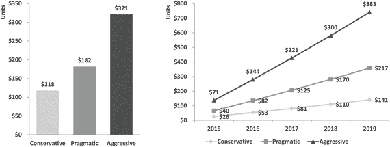
**图 3-16.** 三种场景下的示例预测收益——保守、务实和积极

## 业务价值

识别和量化业务价值的过程与上一节描述的 IT 价值量化过程类似。然而，其类别和影响/价值却显著不同，并且在很大程度上更依赖于行业业务驱动因素和公司业务举措。业务价值往往远高于 IT 价值，是决策过程中的主要驱动因素。

通常情况下，大部分业务收益可以再次归纳为几个类别，正如本章前面所述。以下是一些代表性收益的列表，这些收益可以作为业务案例制定过程的一部分进行量化：

*   推出新业务服务的能力
*   对收入的影响
*   成本规避与削减
*   降低业务风险
*   计划内和计划外非计划停机对业务的影响
*   提高对客户及市场需求的敏捷性和响应能力
*   由于 IT 与组织业务之间的战略伙伴关系而产生的额外组织协同效应

接下来，我们将根据我们在几个行业中观察到的大数据和物联网常见举措，来看几个例子。我们将提供示例的行业是零售业和制造业。

如今，几乎所有的大型零售商都在投资全渠道战略。这种方法将实体店和网店的管理与分析无缝衔接，以创造无缝的购物体验。由于网络日志的存在以及通过社交媒体表达的购物者情绪的重要性，这些解决方案通常被设计为将 `Hadoop` 作为信息架构的一部分。当然，各个门店的交易记录在关系数据库中，数据仓库也是其中的一部分。未来的信息架构状态可以积极影响线上收入和实体店业务，这得益于供应链和运营效率的提升。表 3-5 提供了一个计算示例，描述了可能对在线销售产生的业务影响：

**表 3-5.** 某零售商在线销售影响的详细计算示例

| 说明 | 保守 | 务实 | 积极 |
| --- | --- | --- | --- |
| `[a]` 该部门的年度销售额（来源：模型输入。最新年报） | $2,970,000,000 | $3,300,000,000 | $3,630,000,000 |
| `[b]` 通过门店品牌销售的百分比（来源：模型输入。根据研讨会记录） | 36% | 40% | 44% |
| `[c]` 门店中品牌产品的销售额（来源：计算：`[a]*[b]`） | $1,069,200,000 | $1,320,000,000 | $1,597,200,000 |
| `[d]` 门店销售商品的网络销售百分比（来源：模型输入。根据研讨会记录） | 18% | 20% | 22% |
| `[e]` 该部门的在线销售收入（来源：计算：`[c]*[d]`。同时基于最新的第一、第二季度业绩和上一年年报。该部门贡献了 71%至 78%的在线商务。这也与预测的销售收入一致。） | $192,456,000 | $264,000,000 | $351,384,000 |
| `[f]` 由技术驱动的业务影响带来的预期增长（来源：模型输入） | 11% | 12% | 13% |
| `[g]` 由技术创新驱动的数字销售影响预测（来源：计算：`[e]*[f]`） | $20,785,248 | $31,680,000 | $46,382,688 |

类似地，其他业务收益可以按年度量化，然后预测未来三到五年的情况，以展示未来架构状态的真正影响。

在我们的第二个示例中，一家工业餐厅设备制造商正在评估分析冷柜传感器数据的价值。该制造商的业务部门认为，他们可以利用这项技术来改善当前冷柜的销售，并增加维修业务的收入。同时，他们还相信，在此过程中可以延长设备的使用寿命，从而提升客户满意度。表格 3-6 概述了其业务影响。

**表 3-6.** 通过冷柜服务实现业务影响的详细计算示例

| 描述 | 保守型 | 务实型 | 激进型 |
| --- | --- | --- | --- |
| [a] 冷柜年均市场容量（来源：模型输入） | 40,500,000 美元 | 45,000,000 美元 | 49,500,000 美元 |
| [b] 每台冷柜平均成本（来源：模型输入） | 4,500 美元 | 5,000 美元 | 5,500 美元 |
| [c] 市场每年新冷柜数量（来源：计算 [a]/[b]） | 9,000 | 9,000 | 9,000 |
| [d] 组织每年售出的冷柜数量（来源：模型输入） | 900 | 1,000 | 1,100 |
| [e] 冷柜市场份额百分比（来源：计算：[d]/[c]） | 10% | 11% | 12% |
| [f] 因传感器而预期的冷柜市场份额百分比（来源：模型输入） | 13% | 15% | 17% |
| [g] 因传感器影响而每年额外售出的冷柜数量（来源：计算：`([c]*[f])-[d]`） | 248 | 350 | 385 |
| [h] 因传感器影响而产生的额外冷柜收入（来源：计算：`[b]/[g]`） | 4,050,000 美元 | 1,750,000 美元 | 2,117,500 美元 |
| [i] 每台冷柜所需的平均例行维修次数（来源：模型输入） | 3 | 4 | 5 |
| [j] 每次例行维修的收费（来源：模型输入） | 45 美元 | 50 美元 | 55 美元 |
| [k] 维修期间预计售出的零件数量（来源：计算：[g]/[i]） | 744 | 1,400 | 1,925 |
| [l] 通过新冷柜产生的潜在额外零件收入（来源：计算：[j]/[k]） | 33,480 美元 | 70,000 美元 | 105,875 美元 |
| [m] 冷柜服务的年均市场容量（来源：模型输入） | 13,500,000 美元 | 15,000,000 美元 | 16,500,000 美元 |
| [n] 每台冷柜的平均服务收入（来源：计算：`[m]/[c]`） | 1,500 美元 | 1,667 美元 | 1,834 美元 |
| [o] 通过新冷柜产生的额外服务收入（来源：计算：`[n]*[g]`） | 372,000 美元 | 583,450 美元 | 706,090 美元 |
| [p] 年度总收益（来源：计算：`[h]+[l]+[o]`） | 4,455,480 美元 | 2,403,450 美元 | 2,929,465 美元 |

对正在考虑的举措进行预期收益的量化，使组织能够将特定时间段的成本与收益进行比较，并做出明智的投资决策。

虽然用于计算收益范围的三点法非常有用，但在某些情况下，组织需要更高的粒度，并以特定的概率计算上限和下限。蒙特卡洛方法可用于运行数百甚至数千个这样的场景。通常使用商业软件工具来运行这些模拟，使组织能够确定风险和预测收益。这种方法可应用于投资规模巨大或输入变量数量众多且数值范围显著的情形。在决定哪种方法适合组织时，应将模拟软件的成本以及在特定概率水平上预测收益范围的需求，与执行三点法的简便性和更快的速度进行权衡。

图 3-17 是一个软件包输出的示例。该软件在为一个潜在举措建立的商业案例模型基础上运行了蒙特卡洛模拟。

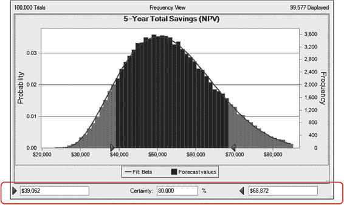

**图 3-17.** 商业案例的蒙特卡洛模拟输出示例

如图 3-17 所强调的，这种方法有助于以特定的置信水平识别预测收益的上限和下限。通过将此置信水平调整到可接受的概率，组织可以在做出明智的投资决策之前，看到可能收益的下限和上限。

## 其他需要权衡的因素

随着我们为这类项目构建商业案例，我们可能会开始发现与为更新的数据管理系统创建企业级平台相关的额外成本。同时，由于商业案例的迫切性，我们可能也会看到对面向未来状态的架构有更快上市时间的要求。

第一个挑战可能是找到构建和使用所考虑技术足迹所需的技能型人才。例如，与 `Hadoop` 相关的数据科学家仍然稀缺且昂贵。幸运的是，如今有多种方法可以在 `Hadoop` 中访问和分析数据，包括使用 `SQL` 接口和流行的预测分析工具。对于 `ETL` 卸载，许多常见的 `ETL` 工具现在都已完全支持 `Hadoop`。

对更快企业级部署和运营支持的需求，也可能促使我们考虑评估购买预集成的服务器、存储和软件单元，作为自助式（`DIY`）配置的替代方案。例如，针对不断演变的信息架构中典型的各种数据管理系统，可用的设备种类越来越多。

许多 `Hadoop` 集群开始时，在实验室或生产环境中的类似小型配置中只使用相对较少的节点。随着对更大集群的需求增加，运营工作量和相关风险也随之上升。组织可能会在宝贵资源上受到严重制约，并迅速达到那个临界点。图 3-18 说明了这一挑战。

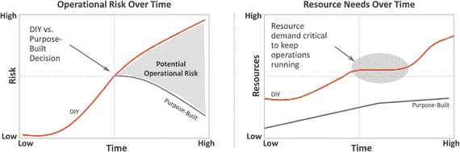

**图 3-18.** 大数据环境增长中的自助式资源考量

另一个可以考虑的选项是云部署策略。与构建自己的系统相比，基于云的解决方案似乎相当简单，如图 3-19 所示。采用基于云的方法可以带来显著的成本和上市时间优势。

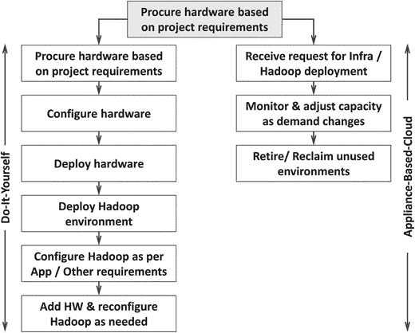

**图 3-19.** 自助式部署与基于云的大数据环境的运营影响

能够根据业务需求快速扩展或缩减，以及通过使用自助服务方法快速部署的能力，可能极具吸引力。权衡因素通常是技术性的，尤其是在大型数据集可能位于与基于云的解决方案相距甚远的位置，并且需要利用所有数据源共同寻找业务解决方案的情况下。此时，关于网络带宽和灵活性的讨论会首先浮现在脑海中，而解决这些问题相关的成本也变得更加明显。

## 我们仅仅是开了个头

我们才刚刚开始我们的商业案例。在这一点上，我们现在可能有了更强烈的信念，认为我们可以证明一个或多个项目的合理性。而这些项目将推动定义和部署未来状态架构的需求。然而，我们也意识到，在收集到更多信息后，我们需要在方法论后续步骤中重新审视该商业案例。

既然已经确定了一些业务驱动力，并且我们将它们与优先举措对齐，接下来我们将要确定所需的潜在数据源。同时，我们还将更深入地了解我们的报表、查询和分析需求，以及数据将如何帮助回答我们在本章中识别出的一些业务挑战。

