# 7. 定义初步计划与路线图

我们未来状态信息架构的设计已在第 6 章中描述。鉴于其设计方式，它应该能提供一个符合组织业务需求的解决方案。现在，我们暂时将技术设计工作搁置。基于我们先前对技能的评估，我们相信能够弥补技能差距，并成功部署和维护该架构（尽管现在必须进一步探索这一点）。到目前为止，我们的赞助者很满意。但是，我们仍不完全了解实施此设计的成本，也不清楚我们何时能开始为业务赞助者和组织交付价值。这可能让赞助者感到担忧，因为我们即将进入需要获得高级管理人员支持并获取项目资金的阶段。
本章将描述我们如何定义未来状态架构部署的初步计划。然后，我们将描述如何制定一份路线图，以回答我们刚才提出的问题并解决其他疑虑。该路线图将面向组织的高管，并提供足够的信息来获取项目资金。换句话说，在这个阶段，项目将获得真正的推进承诺。
通过遵循我们迄今为止的方法论，我们应该为成功获得这种承诺奠定了基础。我们在整个过程中收集业务输入的彻底性，很可能已被潜在的项目资金来源方注意到。我们对技术细节的关注也应该让我们的 IT 支持者感到兴奋和乐观。因此，提出一份路线图和预算申请应该是意料之中的事，而非一个意外。
在准备路线图时，我们将整合所有收集到的相关背景信息。既然我们已经更好地定义了未来状态信息架构，就可以更深入地重新审视我们认为所需的技能。我们还将重新验证业务优先级，并将其映射到项目阶段。然后，我们将准备好计算分阶段实施的成本，所需技能可能由内部员工、新员工或将要聘请的顾问和系统集成商提供。我们还将收集硬件、软件、网络、其他组件以及持续支持的定价，以便构建更准确的商业案例。
在本章后面部分，我们将涵盖所有这些主题，描述如何为广泛的高管受众准备和交付路线图演示。我们还将描述如果首次资金申请得到的是“不”的答复该怎么办，以及如果答案是“是”，如何过渡到实施阶段。

图 7-1 展示了我们成功方法论中的当前阶段，以及将我们带到这一点的先前阶段。早期所有阶段收集的信息都将为当前阶段做出贡献。尽管项目计划的实施阶段是下一步，但出于多种原因，顺利度过此阶段可能是最困难的一步，我们将在本章中描述这些原因。当然，最重要的原因是组织面临着为项目投入资金的决策，而该决策将产生政治和财务预算方面的影响。

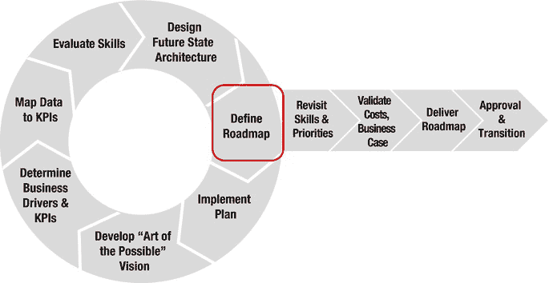
**图 7-1.** 成功方法论中的路线图定义阶段

我们将从重新审视所需技能开始。回顾一下，在第 3 章中，我们描述了一种在零售公司以及与消费者和客户有实体和网络交互的任何组织中正变得流行的全渠道战略。在本章中，我们将以一个全渠道项目作为我们的项目示例。对于此类项目，我们未来状态信息架构的实施显然可以标记为大数据和物联网项目，并且它将需要许多新技能。

## 重新审视早期发现

在第 5 章中，我们列出了为成功定义、部署和管理项目可能需要的一系列广泛技能。我们的技能评估有助于确定我们在哪些方面存在需要克服的重大差距。现在，是时候详细审视这些技能需求了，以便我们能更好地了解开发和获取这些技能的成本。
我们也在更早的阶段开始确定业务解决方案推广的优先级，并在第 3 章中讨论了这一过程。现在，我们可以结合技能差距分析，重新审视我们之前的优先级列表，并进一步细化我们将交付项目业务解决方案的顺序。例如，如果我们拥有所有必需的技能，我们可能希望将项目的部分内容提前纳入交付计划，并推迟项目中需要我们花时间开发或获取技能的其他阶段。

### 细化我们的技能评估

我们将继续使用此前在第 5 章中描述的技能评估方法。我们在第 5 章展示的电子表格中记录了所需的技能、技能的当前状态以及期望的未来状态。但现在，随着我们聚焦于可能需要填补的技能差距，我们将把先前在电子表格中概述的技能类别细化为更具体的个人技能。理解这种详细程度所需的技能，对于本章后面制定需求建议书（`RFP`）以及为项目实施和持续管理获取更准确的成本估算至关重要。
我们未来的信息架构可能需要综合运用我们已经掌握的技能以及组织内可能稀缺的技能。我们应该更详细地重新评估所有必需的技能。在本章中，我们将重点关注那些在大数据和物联网项目中可能尤为稀缺的技能。
例如，由于我们为全渠道项目所定义的未来信息架构需要一个 `Hadoop` 集群，我们发现现在需要进一步调查这些技能在我们组织内的存在情况。有三类关键人员必须掌握此类技能，且对项目成功至关重要：`Hadoop 管理员`、`Hadoop 开发者`和`数据科学家`。
`Hadoop 管理员`在大数据平台的定义和部署中扮演着关键角色。他们的技能对于系统后续的成功管理也至关重要。在大多数组织中，这些人员通常隶属于 IT 部门。他们应具备并需要评估的一些具体技能包括对以下方面的理解和专业知识：
*   `Hadoop` 内核，包括 `MapReduce`、`HDFS` 和 `YARN`
*   集群和/或部署到云基础设施的服务器与存储基础设施规模规划
*   集群服务配置、监控和故障排除
*   资源调度和性能调优（以满足服务级别协议）
*   `Hadoop` 集群可用性（通过在 `Hadoop` 软件和基础设施设计过程中消除单点故障）
*   数据可用性（通过集群内和/或到辅助集群的数据复制）、备份和恢复
*   `Hadoop` 数据治理与安全（包括授权与访问控制、认证、数据加密和审计）
*   `Hadoop` 数据加载（包括用于将流数据加载到 `Hadoop` 的 `Flume`，以及用于从关系型数据库加载数据的 `Sqoop`，及其他供应商的加载选项）
*   部署、配置和管理 `HBase`
使用我们在第 5 章中描述的电子表格对该角色进行差距分析，可以生成如图 7-2 所示的图表。该图清晰地展示了我们对当前技能的评估（内层连接的点集）以及我们认为应达到的未来技能状态（外层连接的点集）。两者之间的空间表示我们需要填补的差距。请注意，我们的分析考虑了这些技能是否存在以及这些技能的普及程度。该图表明，我们具备部分技能，但项目成功需要更多掌握这些技能的人员。
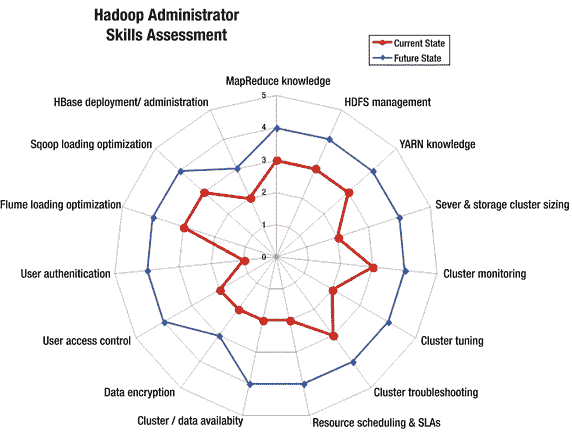
**图 7-2.** 评估 `Hadoop` 管理员的组织差距分析图
> **注意：** 在刚接触 `Hadoop` 的组织中，管理技能有时主要存在于研发环境或创新中心。如果组织尚未拥有 `Hadoop` 生产环境，则某些所需的“企业级”技能可能尚未完全发展或被充分理解（例如对高可用性、高级安全性和既定服务等级的需求）。
我们应进一步评估的第二类技能属于 `Hadoop 开发者`。`Hadoop` 开发者必须掌握构建分析从传感器及其他流数据源传输数据的软件所需的技能。在大多数组织中，这些开发者通常也隶属于 IT 部门。他们应具备对以下方面的理解和专业知识：
*   `Hadoop` 架构与生态系统
*   用于分析 `Hadoop` 中数据的 `MapReduce` 及其他功能和特性
*   数据科学（下文将进一步描述）
*   `Spark`（用于加速性能）
*   `HBase` 作为列式数据存储，用于提供灵活的数据访问
`数据科学家`有时隶属于 IT 部门，但更常见的是与业务分析师一起在创新中心或业务部门工作。他们应具备的技能包括对以下方面的理解和专业知识：
*   数据访问与操作编程（例如，使用 `Java` 和 `Python` 等语言以及 `MapReduce`、`Pig` 和 `Oozie` 等 `Hadoop` 特性进行编程的能力，以及优化为 `YARN`、`Spark` 等开发的应用程序的能力）
*   使用信息发现工具来理解数据特征
*   理解如何使用商业智能工具和 `SQL` 访问 `Hadoop` 中的数据（通过 `Hive`、`Impala` 或其他供应商接口）
*   使用高级分析和机器学习工具与技术（`R`、`SAS`、`Mahout` 等）
如您所见，此处讨论的技能列表比本书前面介绍的更长、更详细。正是这种详细程度开始描述我们项目成功所需的人才类型，并将为撰写职位描述和确定个人期望的认证水平奠定基础。这种详细程度也能更好地指示现有人员可能需要的技能发展和培训的类型与数量。
当使用可扩展的 NoSQL 数据库作为前端接入 `Hadoop` 集群的摄取引擎时，我们还需要进一步评估我们在配置、管理和编程这些平台方面的技能。典型的管理技能包括安装、配置复制和容错、分片、索引、性能调优、监控以及备份与恢复技能。除了理解如何使用 `Java`、`Python` 和 `C#` 等语言进行编码外，所需的 NoSQL 数据库编程技能还包括使用语言驱动程序、`JSON`、集合中的动态模式设计、索引以及数据的插入与查询。
如果项目部分依赖于构建物联网生态的其他组成部分，包括智能传感器、控制器和通信骨干网，那么所需技能将变得更加多样化，并且部分技能将属于工程角色，而非 IT 部门。例如，智能传感器开发技能通常存在于电气工程师和软件工程师团队中。
电气工程师在参与传感器开发时需要掌握的一些典型技能包括对以下方面的专业知识和理解：
- 微芯片设计
- 模拟与数字电路设计
- 电源设计与电池充电
- 音频电路设计
- 印刷电路板（PCB）设计、布局与原型制造
- 射频（RF）设计
- 无线技术（如`WiFi`、`蓝牙`、`低功耗蓝牙`、`蜂窝网络`、`GPS`和`近场通信 [NFC]`）
- 用户界面设计（如`LED`、`按钮`和`开关`）
- 硬件与传感器集成
- RFID 集成
- 根本原因故障分析
- 元器件分析与优化
参与智能传感器和控制器设计工作的软件工程师可能需要具备以下技能：
- 硬件设备驱动程序
- 无线模块（如`WiFi`、`蓝牙`、`低功耗蓝牙`、`蜂窝网络`、`GPS`、`RFID`和`NFC`）
- 控制逻辑
- 电源管理
- 安全性
- 诊断
- 数据采集
- 用户界面设计
- 操作系统（`Linux`、`iOS`、`Android`）及嵌入式固件
建立和维护传感器与分析基础设施之间通信骨干所需的技能，属于网络编程专家以及网络设计师和管理员的专业领域。网络编程专家将与业务分析师和数据科学家合作，了解应用程序工作负载对网络的影响。他们还要与网络设计师和管理员协作，后者拥有丰富的路由、交换和网络可用性知识，以及在管理和保障网络安全方面的知识与经验。

### 再谈项目优先级

在第 3 章中，我们基于战略影响和价值，以及项目存在的风险与复杂程度，描述了一个用于选择项目及确定项目内部优先级的流程。此时，我们开始更清楚地认识到，组织内部技能差距可能给项目成功带来的风险。我们或许会选择此时重新评估我们的项目选择，转而追求一个与我们现有技能更加匹配的项目。
然而，我们所做的项目选择及其战略影响和价值可能极其重大，以至于承担风险是值得的，尤其是当那些被认定为缺失的技能会影响到我们执行其他同样具有高价值的项目时。我们所面临的挑战是，在部署和管理某些关键技能缺失的项目时，能够尽早并频繁地取得成功。
一种常用的技巧是将项目分解为多个阶段，以增量方式交付业务价值。项目先从更容易完成的阶段入手，将更困难的阶段留到后面。例如，我们可能参与了一个将构建欺诈检测解决方案列为高优先级的项目。将所有数据收集到一个充当数据池的`Hadoop`集群中，并在其中执行高级分析，这可能是非常有意义的。但如果目前缺乏及时部署该解决方案的技能，我们可以采取另一种方法。与其这样，我们不如先利用已有的内部技能，通过传统数据仓库解决业务问题，同时在幕后培养`Hadoop`技能，着手部署一个数据池，并计划最终将工作负载迁移到其上。
请记住，无论部署何种技术解决方案，甚至即使它仅仅是一个临时方案，都有可能获得显著的正投资回报率。如果我们能更快地获得期望的业务结果并展示出正投资回报率，那么即使某些技术后来被替换，这笔投入也并非浪费。
对于物联网项目而言，智能传感器的设计与编码，以及通信骨干的建立与管理，可能是组织内部所不具备的全新且迥异的技能。一些组织选择只专注于解决方案的分析层面，而依靠其他组织来构建智能传感器和提供通信网络。
在我们流程的下一步构建商业案例时，了解项目如何分阶段部署就变得非常重要。我们需要收集详细的技术和实施方案成本。虽然我们可以自行收集所有数据，但也有大量的供应商、顾问和系统集成商可以根据他们的经验帮助我们估算成本，从而提供支持。

## 站得住脚的商业案例

一个站得住脚的商业案例必须包含可信的收益。你可能还记得，在第 3 章中，我们采取了一种务实的方法。在我们方法论的那个早期阶段，目标是判断我们是否拥有一个可行的商业案例。现在，我们要确认这一点。
在更早的阶段，我们也对成本进行了非常初步的估算。我们对未来的状态信息架构会是什么样子并不十分确定。我们也完全不知道技能差距可能带来的成本影响。现在，我们准备将可信的成本纳入考量。因此，接下来我们将探讨如何获取真实的成本。

### 获取真实的成本估算

为了解项目实施及后期持续支持的真实成本，一种常见的方法是让供应商和咨询合作伙伴提供成本估算。通常，这通过提案请求（`RFP`）流程完成。一份典型的`RFP`包含关于服务器、存储、软件、网络以及实施与管理能力的问题，并寻求提供和支持这些项目的成本。
以下是通常涵盖在大数据和物联网`RFP`中的一些关键领域：
- 集群/节点（服务器和存储）技术规格，包括 CPU、内存、存储容量、性能和环境细节，以及定价和支持成本
- 集群互连技术细节，以及定价和支持成本
- 数据管理系统软件技术细节，包括性能和可扩展性、可管理性、可用性、功能特性（支持的数据类型、分析能力）和安全特性（用于访问管理、加密和审计），以及定价和支持成本
- 数据集成软件技术细节，包括性能和可扩展性、支持的数据管理系统和数据源，以及支持数据沿袭和数据质量计划的能力，以及定价和支持成本
- 数据发现、商业智能和高级分析技术细节，包括性能和可扩展性、支持的数据管理系统和数据源，以及定价和支持成本
- 智能传感器和控制器技术细节，包括可编程能力、支持的通信协议、安全特性、环境因素，以及定价和支持成本
- 网络骨干技术细节（用于将智能传感器和控制器连接到我们的分析基础设施），包括支持的通信协议、安全特性，以及定价和支持成本
- 用于部署和管理上述内容的技术培训课程，包括培训模块的成本
- 用于优化利用未来状态信息架构所提供数据的业务培训课程，包括培训模块的成本
- 上述技术组件与项目阶段和交付解决方案相关的实施成本
- 任何可能提出的其他持续管理、支持或云服务成本
由于`RFP`通常会发送给许多潜在供应商和实施合作伙伴，可能会提出各种解决方案和选项，有时会以截然不同的价格提供截然不同的能力。要提供关于我们需求的适当详细程度，并引导响应者提供一致的信息，需要事先规划。我们希望进行同类比较，而不是把苹果、手风琴和汽车混为一谈。
> 注意
> 我们明确将此描述为提案请求（`RFP`）流程，而非信息请求（`RFI`）流程。我们的经验是，`RFI`流程通常是组织试图从供应商那里获得教育的一种尝试，但有时它发生的时候与任何真实或紧迫的业务计划没有关联。收到的回复常常答非所问，因为`RFI`中根本没有描述目标。在本章中，我们反而概述了一个与本书前面所述工作相关联的`RFP`流程。这些工作产生了明确可识别的关键业务计划。由于我们之前的努力，我们也了解了自身的技能差距以及未来状态架构的可能面貌。我们依赖合作伙伴来填补空白，建议与我们架构相匹配的具体产品以及能够填补技能差距的人才。在他们提供这些信息的同时，他们也会向我们提供与其建议相关的成本。
在审阅这些`RFP`时，我们应该对部署成功项目的能力建立信心，并且应该对各个部分如何整合以及项目的真实成本有更清晰的认识。现在，是时候接受这些输入并修订我们的商业案例了。

### 修订商业案例

在第 3 章中，我们基于对项目总拥有成本（`TCO`）、IT 价值和业务价值的初步估算创建了一个商业案例。我们`TCO`计算中包含的价值包括硬件采购和支持成本、软件采购和支持成本、环境（占地空间、电力和冷却）成本，以及实施、迁移和培训成本。在评估的那个阶段，我们填入电子表格的成本是基于对未来状态信息架构的初步设想而进行的非常粗略的估算。
完成`RFP`流程后，我们将获得多种方案，这些方案可以映射到我们按照第 6 章所述创建的更详细的未来状态信息架构。该设计基于我们在此过程中发现的真实业务需求。我们可能会在`RFP`回复中发现对我们设计的改进建议，并且我们可能会选择采纳这些建议。最重要的是，我们现在有了一些真实的成本估算可以纳入我们的`TCO`计算。使用之前介绍过的相同计算模型，我们现在来精炼我们的`TCO`计算。
`RFP`回复还可能为我们提供一些最初未考虑到的额外 IT 和业务价值主张。这些可能非常重要，尤其是如果我们最初的成本被严重低估，而修订后的成本使得我们的商业案例看起来存在问题。我们可能考虑的其他成本权衡因素包括：更仔细地审视本地部署计算与基于云的解决方案的成本，以及内部培养技能与聘请顾问和系统集成商的成本。
在大多数组织中，负责提供资金的 CFO 和其他业务高管会询问我们这些成本数字的来源。提供这种程度的细致考察和详细信息，将大大有助于获得对这些数字的信心以及对项目的支持。

## 定义路线图

我们现在可以创建一个初步的实施计划和路线图了。我们在此描述的初步计划将针对 IT 组织，并提供包含当前状态和未来状态信息架构、未来状态架构背后的业务驱动力、项目阶段，以及如何提供项目成功所需的技能、成本和风险等详细信息。这些详细信息将补充我们将在实施路线图演示文稿中提供的信息。
实施路线图是为一个截然不同的受众准备的。我们组织的高管和发起人不太可能关心我们收集的所有详细信息。他们只想了解为什么提议该项目、该项目对组织的价值是什么、可能存在哪些风险以及我们如何克服这些风险、项目将花费多少成本、何时开始交付业务价值，以及他们可以期望获得多少价值。因此，实施路线图演示文稿主要是面向业务的，切中要点，并且仅包含足够准确传达项目全部范围所需的技术信息。

## IT 初步计划

我们的 IT 初步计划将提供技术受众能够理解的详细程度。汇总我们发现内容的目的，在于解释我们为何以及如何得出未来的信息架构设计，以及实施将如何进行。如果在项目实施过程中计划发生修改，本文档将成为以后重要的参考依据。它还有助于解答我们在即将描述的“实施路线图”演示中提出的详细问题。

根据我们的经验，初步计划通常以两种形式创建。一份详细的文档，用于汇总我们迄今为止在该项目上的所有工作。同时还会准备一份演示文稿，用于详细介绍计划内容，并与技术受众进行讨论。

一份典型的初步项目计划文档包含以下信息：

-   对项目迄今为止历史的讨论（项目何时开始、制定项目计划所遵循的流程，以及参与此流程的人员）
-   我们的初步愿景成果（发现的潜在业务驱动因素及其对当前架构状态的影响）
-   关键业务驱动因素和关键绩效指标（包括关键成功因素、已确定的关键衡量指标和业务优先级）
-   数据源映射以及为交付与我们关键业务驱动因素相一致的信息所必需的分析（业务信息图）
-   详细的当前状态和最终的未来状态信息架构图
-   项目阶段以及信息架构随时间推移的演变（包括所需技能、弥补技能差距的方法以及项目各阶段的成本估算）
-   与不断演变的信息架构项目阶段相关联的、不断发展的商业案例
-   项目成功所面临的风险
-   项目批准后的后续步骤

配套的图表将进入技术演示文稿中，需要强调的要点总结也是如此（例如历史、业务驱动因素、技能覆盖计划和风险/风险缓解）。可能会使用类似于图 7-3 的图表，从 `IT` 角度说明和总结主要项目阶段。该图显示了测试和开发何时开始，以及主要任务何时转入生产环境。还将提供其他更详细的图表，深入展示这些任务背后各个步骤的细节。

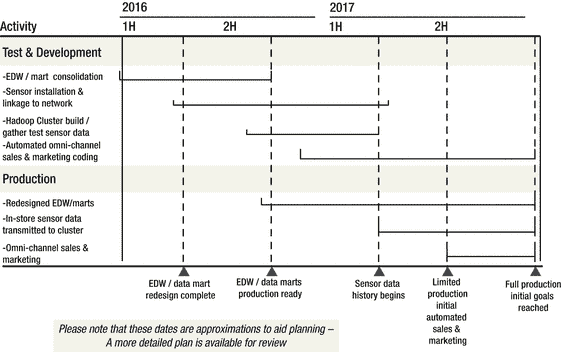
图 7-3. 为 `IT` 总结的主要项目阶段

注意

随着技术演示文稿在细节和篇幅上的增长，通常需要为 `IT` 管理层准备一份高管级别的技术演示文稿，总结项目中关键阶段的交付情况。与详细的技术演示文稿一样，它往往比面向更广泛高管受众的路线图演示文稿更少业务导向，我们将在本章下一节对此进行描述。

现在我们已经汇总了迄今为止发现的所有信息，并且确信项目的可行性，我们的下一个目标是获取资金。我们需要创建一份面向业务执行层面的内容版本，这将对组织中的决策者有意义，并有助于推销项目。

## 构建路线图

定义清晰的路线图可以帮助高管们规划出一条通往新目标的路径。然而，这条路线图还必须为高管们提供他们愿意遵循这条路径的理由，包括为什么值得投入时间和金钱，以及他们如何确信能够到达目的地。路线图通常以演示文稿的形式呈现，但也可能会准备一份总结文档。

请记住，面向广泛的高管受众进行演示时，简洁明了是最好的方法。在下面的流程中，我们将在示例中用一张幻灯片代表每个主要要点。应当涵盖的内容如下：

-   我们的建议（我们也会在演示结束时再次提及）：
    -   一分钟总结解决了哪些业务问题以及工作范围，为我们在演示结束时请求资金做铺垫
-   议程：
    -   描述我们将如何支持资金请求的议程
-   业务驱动因素：
    -   回顾各业务部门提供的关键业务驱动因素，回答“为何要行动”的问题
-   项目阶段及相关商业案例：
    -   项目阶段时间线和投资回报率
-   技术解决方案：
    -   从当前状态到未来状态的解决方案演进
-   风险与缓解措施：
    -   项目成功面临的重大风险及缓解这些风险的步骤总结
-   结论与后续步骤：
    -   描述项目为何必须立即启动的总结，以及资金请求

现在，让我们看一个路线图演示文稿的示例。面向高管受众、描述我们全渠道项目的路线图演示文稿可以基于一组类似于下图的幻灯片。我们从一张前置总结幻灯片开始，如图 7-4 所示。

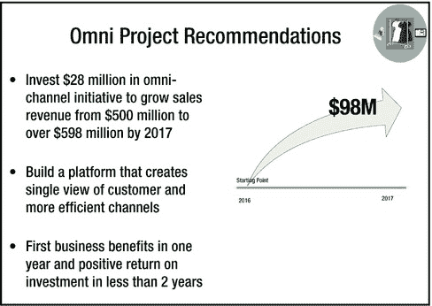
图 7-4. 路线图高管演示文稿——建议幻灯片

如您所见，我们将快速确立项目将交付的内容（客户的单一视图以及渠道效率的提升）、项目成本（2800 万美元），并强调可衡量的业务收益（我们期望获得的增量销售收入，9800 万美元）。我们还将强调这些收益将在多快的时间内实现（到 2017 年底）。

注意

在我们的项目中可能实现其他业务收益，事实上，我们稍后会在示例演示文稿中指出一些。然而，在我们的建议幻灯片上，我们希望关注点仅限于那些我们有可靠且得到充分支持的数字的收益。在演示中过早地就我们的假设展开对抗性讨论是不合适的。

当然，我们的高管受众会希望我们为这些陈述提供依据。因此，我们的下一张幻灯片（如图 7-5 所示）说明了我们的演示文稿在论证时将遵循的议程。

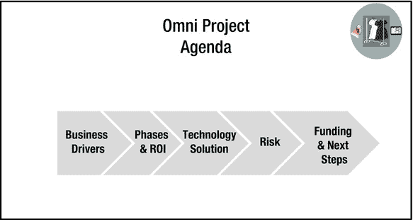
图 7-5. 路线图高管演示文稿——议程幻灯片

在继续之前，我们应该询问高管们，他们认为议程中是否遗漏了任何内容。他们可能会提到我们本来也计划涵盖的特定关切事项。但这将有助于我们确定在哪个议程项目上可能需要花更多时间。

# 排版后的文档

当然，我们的听众必须在他们愿意投资并为项目提供资金之前理解预期的业务成果。在图 7-6 中，我们概述了全渠道项目的关键业务驱动因素。需要明确的是，为了让该项目按利益相关者设想的那样成功，它必须提供一个能够跨渠道优化促销、跨渠道优化供应链以及跨渠道提升客户收入的解决方案。

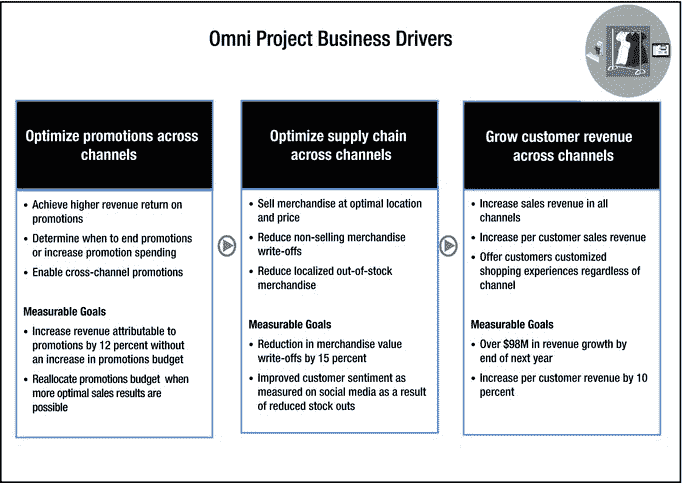

图 7-6. 路线图高管演示——业务驱动因素幻灯片

我们还在幻灯片上提供了关于期望成果和可衡量目标的更多细节。所有陈述的可衡量目标必须得到我们关键利益相关者（例如，营销、供应链管理和销售领域备受尊敬的领导者）的认可，证明其是合理的。这些应该与我们之前制定商业案例时使用的数字相同。我们的关键利益相关者必须愿意再次支持这些数字，并支持项目的关键目标。

高管听众会希望了解项目如何分解为可管理的阶段，这些阶段将开始带来我们刚刚描述的业务回报。他们还想知道这些阶段是否能够降低项目失败和成本超支的风险。

图 7-7 展示我们如何说明这些阶段。下轴上的标记表示随时间推移预期的增量收入。这种图表有时也用于在收益累积的同时说明项目成本随时间的变化。

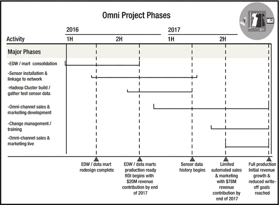

图 7-7. 路线图高管演示——项目阶段

该图还表示了这个听众可能关心的其他活动（你可以将图 7-7 及其活动与图 7-3 中针对 IT 管理层的活动进行比较）。例如，我们在此指出，我们将制定一个变更管理和培训计划，并在上线阶段之前执行。将该图添加到图表中是为了预期高管们可能提出的一些反对意见，这些意见涉及业务部门使用拟议解决方案的能力以及 IT 部门管理它的能力。

尽管提出了一个坚实的商业案例，我们的听众可能仍然想知道为什么项目如此昂贵。他们可能不清楚我们正在描述实体店和 IT 部门内的基础设施的重大改造。这些改造是由跨多个渠道收集和分析数据的需求驱动的，而这是目前不存在的方式；我们需要向他们展示这一点。

图 7-8 以简化的形式展示了我们当前的基础设施状态。我们可以用这个图来说明，关于客户的数据目前存储在孤岛中。作为业务领导者，他们应该已经认识到，组织目前可以看到客户在每个渠道购买了什么，但几乎无法实现我们刚才概述的三个业务目标，而这些目标需要跨渠道的客户视图。

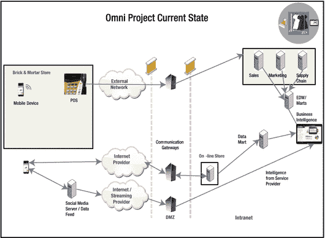

图 7-8. 路线图高管演示——当前状态信息架构图

图 7-9 用于说明基础设施必须如何改变。有时，最有效地描述这种改变的方法是创建一个构建幻灯片，说明向未来状态的逐步过渡，并与关键项目阶段保持一致。

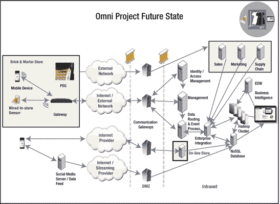

图 7-9. 路线图高管演示——未来状态信息架构图

我们可能预料到，听众可能会对这个项目的复杂性和其他方面感到震惊。我们的下一张幻灯片（图 7-10）说明我们已经考虑了许多风险，并制定了风险缓解计划。除了寻求他们对我们的计划的信心之外，在讨论这一点时，我们可能开始寻求对培训计划和顾问需求的认同。我们还可以利用这次讨论来开启关于所有迄今为止对计划的反对意见的对话，并将这些问题摆到桌面上。

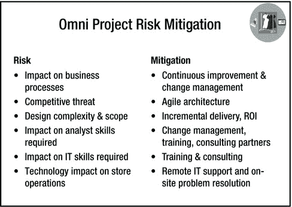

图 7-10. 路线图高管演示——已识别的风险与计划缓解措施

高管演示必须在掌握项目资金的人面前建立并维持可信度。我们力求在每一步都确认我们有一个可靠的计划。如果我们未能建立这种信任，项目很可能无法获得批准。因此，演示文稿背后的项目计划中必须有足够的细节，以便我们能够自信地回答将会出现的问题。

我们现在应该准备用“下一步”讨论来结束我们的演示。我们将请求项目资金，并指出任何阻碍因素。在结尾部分，我们还用来描述我们已预见的任何其他下一步措施，部分目的是展示我们对获得批准的信心。当然，我们会记下高管提出的任何其他步骤，并将他们的想法纳入我们的计划。

描述下一步措施的幻灯片如图 7-11 所示。你可能注意到，我们在这张幻灯片上重申了预期的增量业务收益以及请求的资金金额。继续强调潜在的投资回报率，有助于传达这样的信息：虽然有些人可能认为项目成本高昂，但它将为组织带来巨大的价值。

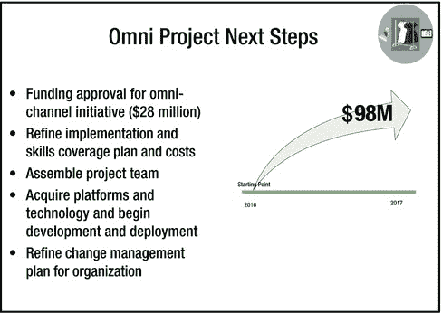

图 7-11. 路线图高管演示——结束语幻灯片

## 获得批准与过渡阶段

至此，我们应该相信我们的路线图演示已准备好接受高管评审。我们已做好了充分准备，该计划对我们而言似乎完全可行。我们也已将详细计划记录在案，在演示过程中回答问题时可以依赖其中的信息。那么，可能会出什么问题呢？

除非该倡议是 CEO 直接下达的任务，否则我们在呈现路线图时很可能面对一群高度怀疑的听众。高管们可能极度厌恶风险，并且可能认为大数据和物联网项目只是被过度炒作、成本高昂的计划，是他们想要避免的。也许，组织内部在部署此类创新项目方面有过不良记录。高管们还可能有一些我们未曾意识到的其他热点问题和业务顾虑。

我们可以采取几个步骤来为高管会议做好更充分的准备。首先，我们应该与项目发起人一起审查我们的内容，并就我们准备的材料征求他们的指导。我们还可以与将出席会议的部分高管或其直接下属一起审查内容，以征求他们的反馈（包括他们已有的或预计会提出的任何顾虑）。如果我们能在会议前与一些决策者会面，我们也可以争取他们尽早对项目表示支持。

如果我们被告知高管听众需要更多直观的证据来理解项目将提供的价值，我们可以构建一个演示，展示一些示例仪表盘或构建图表显示业务流程将如何改进。我们可以在高管演示之前，与我们的`test`受众一起审查这些演示以及演示文稿中的其他补充内容，并进一步征求反馈，了解这些视觉辅助工具在帮助我们论证项目资金需求方面所具有的价值。

### 高管会议

我们的路线图演示在高管会议议程中的位置以及实际出席演示的人员，将表明我们的项目对高管的重要性。如果被安排在议程最后，且只剩下少数几位高管在场，这不是一个好兆头。至少，如果演示被缩短，我们还有些准备，因为正如前一节所述，我们已将建议、商业利益以及我们要请求的事项提前总结。在这种情况下，争取在日后得到全面听证或许是我们最好的期望。我们可以利用初次会议，在有限的时间和有限的听众面前，开始推销项目的价值。

在演示过程中，可能会发生三种情况。最好的结果是资金获得批准。然而，我们可能会遇到第二种结果：没有资金，项目将不被考虑。第三种选择在某些组织中往往最为常见——推迟对项目资金的决策，等待更多信息或召集不同的高管听众进行演示。让我们看看，如果在会议中出现后两种情况，我们可以做些什么。

如果项目因缺乏资金而未能获得批准，真正的原因可能是商业案例和/或发起人的支持力度不够。在许多组织中，真正有说服力的商业案例能够推动资金重新分配给某个项目。既然我们已经确立了正向的投资回报率，也许问题是回报周期太慢。我们必须直接询问，是什么阻碍了做出积极决策。缺乏资金可能并非真正的问题所在。项目可能并非没有希望，我们可以稍后再回来，带着对高管关切的答复，从而获得资金批准。

在一些组织中，要做出任何形式的决策都很难。如果决策被推迟，我们必须找出推迟决策的确切原因，并询问未来我们如何以及何时能再次提出该项目，并确保能做出决策。

如果决策是设立资金并推进项目，那么在离开会议并庆祝之前，我们应该询问高管们他们是否希望定期收到关于项目进展的报告，以及这些报告应如何提交。我们可以建议在后续高管会议中留出五分钟来汇报进展并提出遇到的任何问题。

### 过渡到实施阶段

资金到位后，就该着手组建项目团队了。项目发起人可能认为资金一到位他们的工作就结束了，但他们在整个实施过程中仍应是团队的关键成员。他们通常在业务部门与高管层之间扮演关键联络人的角色。当需要在项目团队会议上强调该计划对业务的重要性时，他们也能发挥重要作用。

组建项目团队的关键在于任命项目经理。项目经理将确定所需资源，为团队招募或聘用这些资源，设定并协商里程碑，并监督项目进度，确保在批准的预算内达成里程碑节点。项目经理应熟悉组织内用于跟踪和监控活动与任务的标准项目管理框架。他们还需持续监控项目质量与范围变更，并在质量问题、范围蔓延或团队成员间的问题影响到及时交付既定业务目标的能力时，召集相关方共同解决。

一旦被任命，项目经理将审阅详细计划中迄今为止收集到的所有信息。如果他们不理解某些权衡取舍的原因，会向早期参与制定初始计划的成员提出疑问。在组建团队时，他们会要求团队成员及值得信赖的顾问在计划制定过程中寻找漏洞，判断计划可能失败的原因，然后修复潜在的计划缺陷。

**注意**
优秀的项目经理在与各类受众沟通时极为高效，受众范围从高度专业的技术人员、业务专家到团队领导和企业高管。他们组织能力出众，尤其擅长解决问题。他们通常具备敏锐的政治嗅觉，懂得如何以推动项目前进的创新问题解决策略来传递坏消息。

通常会组建多个团队，并使其成为更大项目团队的一部分。其中一些团队可能围绕以下角色组建：
- 业务分析师和数据科学家（包括业务部门代表）
- 数据管理系统架构师
- 数据采集专家
- 企业架构师
- 基础设施与设计架构师（服务器、存储和内部网络）
- IT 运维人员（例如，熟悉组织最佳管理实践、标准和服务水平协议的人员）
- 智能传感器开发专家和程序员（适用于物联网项目）
- 网络设计与运维人员（负责将数据从传感器传输到分析基础设施）

团队成员的选择基于其定义和构建解决方案的能力。当然，他们还必须具备人际交往能力，以及在时间和交付范围截止日期的压力下工作的能力。正如我们在技能评估过程中所讨论的，团队成员可能来自内部员工、顾问、系统集成商，或这些来源的混合组合。

随着成员的加入，团队可能会变得庞大，以至于需要自身的管理层级，因此通常会在每个团队内指定团队负责人。鉴于团队负责人在解决方案交付过程中的关键作用，他们通常需要具备与项目经理相似的技能。

经验丰富的项目经理还会在资金获批后、实施前的这段时间，利用从团队获取的信息，为项目计划补充更多细节。图 7-12 展示了数据采集团队可能提供的 ETL（数据提取、转换、加载）开发简化高级计划。以这种格式呈现的图表有时被称为甘特图。在此 ETL 计划之下，还有另一层级的细节，描述如何构建解决方案，以便从内部和第三方数据源提取关键数据，并将其加载到支持各业务领域（如销售、营销和供应链）的解决方案中。

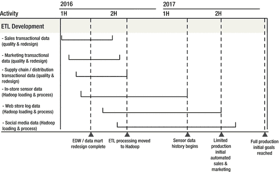

图 7-12. 典型的 ETL 开发高级项目管理计划

你可能已经猜到，一份详细的整体项目计划可能包含数百项活动和数千个任务。在此规划阶段，项目经理特别关注的是理解各项活动和任务之间的相互关系，以及特定任务的延迟如何影响关键里程碑。这通常通过关键路径法（CPM）来实现，该方法识别出处于完成活动关键路径上的任务。有时会使用 PERT（计划评审技术）图作为甘特图的替代方案来表示任务进度，因为它能清晰展示关键路径上的任务。

到目前为止，我们在这些阶段的工作主要涉及设计和规划，因此架构师通常处于领导地位。正如你所见，我们正在将项目领导权过渡给项目经理。当然，架构师的工作尚未完成，你将在最后一章中看到这一点。

最后一章描述的是将产生我们方法论设计成果的阶段：一个能够实现所需业务解决方案的实施。与本书其他章节类似，我们将重点介绍在该项目阶段观察到的**最佳实践**。

