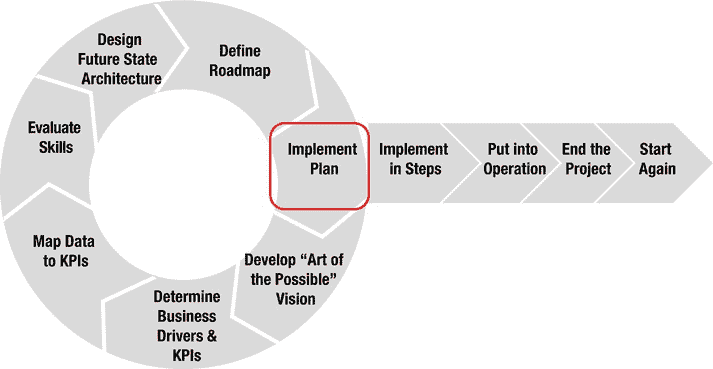
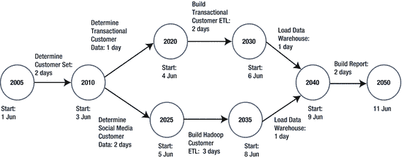
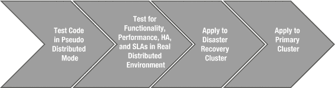
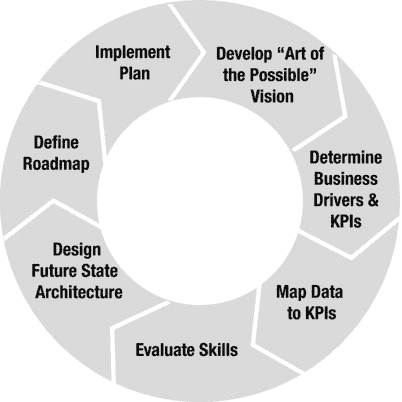

# 8. 实施计划

我们以涵盖项目实施计划的这一章来结束本书。在此阶段，我们为准备计划和获取资金所付出的所有辛勤工作都应得到回报。我们将开始交付解决方案，这些方案能提供我们在商业案例中所承诺的价值。我们能否在此阶段取得成功，部分取决于我们在早期阶段执行成功方法论的效果。

然而，在宣布成功之前，仍有许多工作要做。在项目的这个最终阶段，可能会出现许多陷阱。我们将在本章中涉及其中许多内容。鉴于包含大数据和物联网技术的项目具有创新性，这一阶段可能尤其具有挑战性。

当我们开始这一阶段时，我们已经制定了项目计划，任命了项目经理，并组建了团队（如第 7 章所述），我们已准备好开始创建和运营能够实现新解决方案的技术。在本章中，我们首先描述一种逐步实施的方法及相关最佳实践。我们还将描述可能导致项目时间表发生变化的情况，这些情况需要我们留意。

解决方案开发完成后，我们必须准备好将可投入生产的方案投入运营。我们将从技术角度描述解决方案投入运营时发生的转变，并重新审视我们在第 6 章中描述的一些早期设计考虑因素。我们还将描述在此阶段执行变更管理计划的重要性。

当项目按照定义的范围完全部署后，我们将宣布项目结束。许多组织在这一步骤上会遇到困难，因为这些项目往往会因业务部门请求更多功能而不断演变。一旦业务部门开始设想这些解决方案可能提供的其他可能性，这种情况尤其常见。当然，我们的项目成功必须在高管和关键利益相关者心中确立并得到加强。这将有助于我们建立信任，证明我们有能力成功交付这些项目。

此时，我们还需要重新评估我们的解决方案在多大程度上满足了最初的商业案例，并审视我们在此过程中所做的任何调整。我们应该吸取经验教训，使其成为我们未来最佳实践的一部分。我们还可能发现，业务部门提出的新需求在范围上如此之大，以至于可能启动一个拥有自身生命周期的新项目。

我们的最后一部分描述了围绕新的、早期范围之外的需求启动另一个项目。虽然我们将重复我们的成功方法论，但参与下一个项目的所有相关人员都将从前一个项目中学到很多东西。对成功的业务和技术期望很可能会更高。

图 8-1 强调我们正处于成功方法论中的项目实施计划阶段，并说明我们将本章分为四个部分：实施计划中的步骤、使解决方案投入运营、结束项目以及重新开始。虽然这是本书的最后一章，但我们相信，当项目成功交付并为业务带来承诺的价值时，可以建立一个永无止境的循环。



图 8-1. 成功方法论中的实施计划阶段

在下一节中，我们将描述如何采用逐步方法实施我们的项目。正如您从前面章节中回忆的那样，我们这样做是为了交付增量式的临时解决方案，这些解决方案的工作范围更易于管理，同时在此过程中也能展示进展和业务价值。每 90 到 180 天交付的增量解决方案被认为具有合理的交付时间表，因为时间序列足够短，能够保持业务部门的关注。


## 实施步骤

一旦项目团队组建完毕且计划就位，我们就可以认真开始项目实施阶段了。实施阶段常见的第一步是举行项目启动会议。这次会议不应仅仅是走个形式。启动会议是一个让整个团队达成共识、在各方参与者之间建立共同目标的机会。

典型的启动会议应是管理团队主持的面对面会议。基于网络和电话的会议无法实现启动会议的目标。会议议程通常包括以下内容：

-   由一位非常高级别的业务主管讨论并概述该项目为何对业务具有重要意义
-   简要介绍解决方案的业务愿景是如何形成的，并由项目发起人重申其重要性
-   介绍团队负责人和到场的团队
-   由首席架构师讨论信息架构的规划演进
-   由项目经理描述项目计划，包括讨论关键里程碑，例如如何监控范围、工作质量和进度；如何提出对时间表的担忧；以及项目评估会议的预定时间表
-   由助理项目经理或高级团队负责人描述活动与任务将如何被跟踪，以及这种跟踪的重要性
-   由项目发起人对项目进行总结性发言

会议的一个目标是让每个人对项目感到兴奋，并对实施者所属的团队充满热情。我们还希望团队成员理解自己在成功完成项目中所扮演的角色。在这次面对面会议中建立的工作关系可以带来更好的团队合作，并在后期项目中，当顺利交接和协作至关重要时，节省大量时间。这也是各个团队聚集在一起，讨论他们在执行计划中自己那部分任务时所扮演角色的机会。

会议结束时，每个人都应清楚了解自己负责的活动和任务、现有的预算限制以及交付的截止日期。团队应具有共同的目标感并理解具体的绩效目标，同时团队中个人的互补技能也应得到理解。所有参与者都应对项目有坚定的承诺，对其他团队成员有相互信任，并理解自己将被问责。

项目的成功将通过持续交付范围明确、增量式的开发成果来衡量。必须谨慎管理任何变更，并且理想情况下，这些变更应保持在已建立的项目时间表内。


### 项目计划与关键路径法

在第 7 章中，我们简要介绍了如何使用关键路径法（`CPM`）来识别处于关键路径上的任务，这些任务关系到各项活动和项目本身的完成。里程碑被定义为任务或活动必须完成的日期。项目经理在项目启动和持续推进过程中，会特别关注这些里程碑的达成情况。有时，不在关键路径上的任务会有最早开始和最早完成日期，即该任务可能开始和完成的最早日期。同样常被提及的还有最晚开始和最晚完成日期，即任务可以开始和完成的最晚日期。最晚日期与最早日期之间的差值在进度表中被称为“浮动时间”或“宽裕时间”。

当然，`CPM` 活动网络中的任务依赖于前置任务。因此，持续跟踪对于了解项目进展状况至关重要。大多数团队还会在项目推进过程中，使用 `CPM` 来跟踪任务和活动的持续成本，以便发现并缓解可能出现的成本超支风险。

> **注**
> 一些项目经理倾向于在其 `CPM` 模型中，为任务的完成日期和工期设置变动范围，以考虑到某些人在提供时间估算时天生保守，而另一些人在估算完成任务所需时间时则不够严谨。时间估算在项目推销阶段往往偏短，而当意识到手头任务的完整范围时，估算时间又会变长。

为了说明 `CPM` 的工作原理，我们将参考图 8-2，该图展示了开发工作中关键路径图的一小部分。图中描绘了从同一天（6 月 3 日）开始的并行任务，但其中一条路径成为了关键路径。模型中的节点标识符由图中圆圈内的四位数字表示。任务从起始节点开始，持续时间为节点间连接线上所示的时长。为简化任务完成日期的计算，我们假设团队每周工作七天。



*图 8-2. 简单的关键路径法示意图*

此图中的关键路径是构建社交媒体客户数据 `ETL` 代码的那条路径，因为执行这一系列任务所需时间更长。因此，从数据仓库中的数据构建报告的开始日期为 6 月 9 日，尽管事务性客户数据最早可在 6 月 7 日就加载到数据仓库中。

鉴于客户事务性数据的 `ETL` 代码构建不在关键路径上，我们可以为该任务设定一个最晚开始日期为 6 月 6 日（而非图中所示的 6 月 4 日）。构建此 `ETL` 任务的最晚完成日期将是 6 月 8 日，因此我们将在加载社交媒体数据的同一天，将这批数据加载到数据仓库中。这不会延迟构建报告的开始日期。

项目经理会密切关注那些耗时异常长或消耗资源超出原计划的任务和活动。这些偏差可能由多种原因造成，包括原始时间和资源需求估算严重失误、缺乏具备适当技能的人员来执行任务，或是新需求和变更导致的范围蔓延。上述任何一种情况都可能导致里程碑无法达成，并需要重新分析计划的可行性。在特别棘手的时刻，人员选择有时也会受到重新审视。

为确保里程碑能够实现，项目经理有时会在工作开展之前，在关键路径上创建“管理储备”任务。这些任务并非实际工作，而仅仅是额外的时间缓冲。所增加的时间百分比通常取决于项目经理和团队领导对其团队交付所需任务能力的了解程度。增加 10%到 15%的额外时间是常见做法。当任务实施时间超出关键路径上分配的时限时，便会启用管理储备任务。


### 推动按时进展的最佳实践

尽管有些参与者可能希望只在达成里程碑时才召开项目更新会议，但这种做法可能导致问题积压，从而引发难以挽回的延误。因此，大多数项目经理更倾向于与各个团队举行每周更新会议。当然，如果在会议间隔期间发现重大问题，项目经理需要立即得到通知。

在关键开发阶段有时会采用的一种技术是：将解决方案开发到足够成熟的阶段，使其成为一个可向关键业务赞助商和分析师演示的工作原型。在大数据和物联网项目中，原型对于早期测试组件集成以及解决方案交付业务预期成果的能力，极具价值。这种方法有助于确保：当从技术开发角度达成里程碑时，业务部门会认同解决方案交付了承诺的成果。

交付物的质量也必须被跟踪。项目经理必须理解交付物是否符合当前任务的规格要求。未能监控质量可能会带来负面影响，因为当认为某个增量解决方案即将交付时，可能需要进行大量的返工。质量可以通过多种技术进行评估，包括同行评审、外部顾问评估以及业务部门早期采用者的审查。

随着增量解决方案接近完成，对解决方案进行弹性和功能测试是必要的。进行这种测试是为了确保已完成的开发工作能够处理输入数据量，并在所有条件下交付所界定的解决方案的同时满足其他要求。任何异常情况都应在设计和实现中加以考虑。

项目进度会在评审会议上定期向关键利益相关方报告。在项目团队内部，管理评审会持续进行，以更好地管理风险，尤其是在时间和成本估算存疑，或任务/活动的范围不明确时。当达成里程碑且预期应交付部分业务价值时，也会举行定期评审。在这些关键节点上，有时会做出关于项目是否应在进一步变更前继续推进的决定，同时可能在此刻进行技术评审。

**注意**

有时，项目中已沉没的成本会形成一种继续开发的势头，即使项目的商业案例变得存疑。此时，有必要将因已投入资金而产生的情感与对商业案例的重新评估分离开来，以确定按当前形式继续推进项目是否合理。

项目时间线的变更从来都不是理想之事。然而，在像大数据和物联网实施中常见的那样复杂项目中，有时又是不可避免的。每当发生变更时，必须向所有相关方恰当传达项目的状态。时间线的变更及其对业务效益交付和项目成本的影响，应该引起广泛关注。诸如变更增量解决方案交付顺序等重要决策，可能需要讨论。优先级变更需要与业务利益相关方以及技术实施团队进行讨论。

项目范围的任何变更都应通过正式的变更控制流程来处理。实施正式流程有助于项目经理控制项目范围的变更。应向项目经理提交正式的项目变更请求，由其酌情审查并批准或拒绝。当提出此类变更时，必须向项目经理提供足够的信息，使其不仅了解变更的范围，还要了解其对进度、成本、交付物质量以及所需资源的影响。必须理解这些变更为成功按时交付增量解决方案及整个项目解决方案所带来的风险。


### 项目时间表变更的原因

项目时间表发生不可避免的变更可能有许多原因。对于大数据和物联网项目，可能存在技能问题以及复杂的技术实施和管理挑战。然而，项目及其时间表的调整也可能并非由技术引起，而是由业务需求的变化所导致。

鉴于此类项目对人才的需求，人员技能管理问题经常出现。技术娴熟的个人和顾问通常难以寻觅。团队成员有时会在项目过程中收到其他有吸引力的工作邀请，而当他们决定离职时，很难找到替代人员。监控关键人员的管理并建立储备人才库至关重要。

当组织外部的合作伙伴提供系统开发、集成或工程技能时，如果合作伙伴无法交付符合范围和质量要求的可交付成果，解决方案的开发工作可能会放缓。在合作伙伴评估期间提供的简历，可能与实际参与项目人员的技能不符。可能需要就人员配置方面的某些变更进行协商。

随着实施的推进，可能会发现，虽然团队中的开发人员拥有原型开发所需的技能，但他们可能不具备创建可供企业基础架构部署和管理的、可用于生产环境的解决方案所需的技能。当在一个不熟悉大数据和/或物联网技术组件的组织中操作化解决方案时，这一点会变得尤为明显。如果发现这种技能差距，了解企业运营标准的额外资源应加入团队。

开发工作也可能因作为解决方案一部分的关键技术要素快速变化而面临挑战。例如，主要的 `Hadoop` 版本和 `NoSQL` 数据库版本可能在一年内发布多次。每个版本都可能包含重要的新功能，能以更好的方式解决旧的技术问题，但有时需要新的编码工作。必须做出决定：是重新编码解决方案以利用新功能，还是继续已在进行中的开发路径。

实现里程碑还可能遇到许多其他挑战。

在物联网项目中，在合适的设备位置缺乏合适的传感器，以及由此导致无法收集所需数据，都可能导致项目延期。有必要与设备制造商紧密合作以解决此类问题，或者自行设计定制解决方案。工程团队与软件开发团队之间需要密切协调。

通信骨干网提供商在物联网项目中也可能扮演至关重要的角色。他们的设计和实施需要与工程和软件开发团队密切协作。缺乏此类解决方案经验的通信骨干网提供商，可能会在网络带宽、安全性、可用性或其他问题出现时，为项目实施设置障碍。

在业务方面，组织变革或关键业务发起人的离职都可能对项目的成功构成挑战。推动使用正在构建的更先进解决方案的业务分析师，可能会转移到组织中的不同岗位，并被能力较差、无法使用先进解决方案的分析师所取代。业务需求也可能因组织面临新的竞争压力，或由高级管理层指示的业务方向变更而发生变化。

**注意**

这些变更中的任何一项都会给项目计划的成功带来新的风险。所有相关方之间的密切协调对于管理风险和变更计划至关重要。当然，可以而且应该提出关切。如果项目发起人和高管对重大关切不感兴趣，那么该项目或许被认为并不那么重要。这本身就可能是一个信号，表明前方存在问题。


## 解决方案的操作化

随着里程碑的达成，项目阶段准备就绪上线，基础开发工作结束，解决方案的操作化将开始。此时，解决方案必须支持已商定的服务水平以确保成功交付。此前作为设计考量引入的许多可用性、管理和数据治理方面的考虑因素，此时将重新评估。我们还要为 `IT` 部门记录我们的操作流程，并审查我们为业务分析师群体记录的 `ETL` 流程效果如何。

我们还必须再次审视所需的技能赋能，以使 `IT` 部门能够管理这些解决方案，并使业务分析师能够有效地使用它们。在此阶段，我们将实施需要密切协作和培训的变更管理技术。我们还将开始向更广泛的受众推销正在交付的业务能力，以激发对该项目的进一步热情。


### 服务级别与文档编制

在前期收集项目需求时，我们便开始了解所需的服务级别。如果尚未明确定义，此处必须详细制定服务级别协议（`SLA`）。`SLA` 将驱动我们的部署策略和配置，以满足性能、可靠性、可用性、可服务性和安全性的需求。

例如，我们应清楚了解解决方案投入生产后，将有多少业务分析师使用它，并理解可能产生的工作负载。我们还应该对分析师群体的最终规模及其未来的工作负载需求有所预期。在将解决方案发布到生产环境之前，我们需要对其进行扩展性测试，以确保能够达到或超出已商定的 `SLA`。

我们还会在生产环境上线前，测试满足 `SLA` 所需的管理最佳实践。应测试的流程包括以下内容：

-   日常运维管理能力，包括在软件、服务器或通信基础设施发生故障，或遭遇灾难事件时，维持数据和解决方案可用性的能力
-   对包括事件管理在内的整个基础设施进行监控
-   问题与事件管理及补丁修复
-   性能管理与调优
-   基础设施变更与应用程序发布管理
-   业务用户管理与数据保护管理，包括访问控制、数据加密和审计

在此测试过程中，我们将制定并记录必须落实的运维流程。我们应在运维团队内部，并通过服务器、软件和通信供应商关系，建立明确的支持流程。

例如，我们可以定义一套用于更新 `Hadoop` 集群上托管应用程序的流程。如图 8-3 所示，应用程序发布管理流程首先会在一个与生产环境截然不同的开发环境中，对新版本的应用程序进行初步测试。这种早期测试将在由虚拟机组成的“伪分布式环境”中进行。伪环境用于验证应用程序是否已准备好进入与生产环境相似的环境中进行更高级的测试。高级测试使我们能够确定新版本在功能、性能和可用性方面满足 `SLA` 的能力。测试成功后，应用程序接下来可能会部署到集群的灾难恢复站点，然后是主生产站点。



图 8-3. Hadoop 集群上的应用程序更新流程

应用程序发布管理文档的一部分还可能包含对经过验证的集群备份和恢复流程的引用，以防在此过程中出现任何问题。我们可以定义如何使用 `Linux` 操作系统实用程序来备份集群上的程序文件、源代码和配置文件。由于 `Hadoop` 集群中的数据量巨大，使用传统的备份和恢复程序无法满足恢复时间目标，因此我们将描述数据副本的存储位置，以及在应用程序测试期间如何管理测试数据集。

```
我们编写的、描述此方法及其他方法的逐步文档，将建立可重复的流程，这些流程可供运维人员成功实践。在测试中难以掌握文档步骤和流程的人员，可能需要接受进一步培训（或者文档本身需要进一步改进）。
```

> **注意**
> 在开发解决方案时，我们应在 `ETL` 编码过程中以及通过部署的商业智能工具，定义技术和业务元数据。这是文档编制过程的另一个重要部分，它使业务人员在进行数据沿袭分析和使用分析工具时，能够理解数据所代表的含义。


### 组织变革管理

经验丰富的项目经理深知，在解决方案投入运营的这个阶段，关注变革管理的重要性。如果业务分析师没有准备好使用按交付的解决方案，项目几乎注定会失败，并且后续资金可能会被削减。项目的正投资回报率通常取决于业务部门是否理解如何从解决方案中获取最大价值，并利用它来交付可衡量的业务成果。

为业务线制定的变革管理流程通常包含一个培训计划，该计划将使分析师能够获得使用新部署的分析工具所需的技能。通用的工具培训通常对分析师价值有限。一个更合适的培训计划应侧重于如何以符合项目业务目标的方式，从数据中获取商业洞察。

这通常也是数据所有权可能移交给业务线的时刻。如果在解决方案运营化过程中移交数据所有权，则还应针对新的数据管理者、数据赞助者和数据保管者制定培训计划。

同样，通常也会为 IT 部门制定培训计划，以应对新系统和数据管理解决方案的上线。进入生产环境后，大数据和物联网项目需要具备的企业管理技能，更接近于为数据仓库和其他 IT 基础设施提供的传统技能。正如我们之前在其他地方讨论的，这类技能通常供不应求，并且/或者当项目超出研发阶段时，需要重新审视这些技能。因此，很可能需要额外的培训。

在我们增量式解决方案部署的早期，我们可能会观察到预期的业务价值未能完全实现。我们还可能发现基础设施管理是个问题。这应让我们停下来，重新评估项目时间表和未来阶段，并调整我们的变革管理流程。我们应该在朝着可能失败的方向走得太远之前，找到问题的根源。

> `注意`  
> 当增量解决方案部署后能够清晰展示业务价值时，我们应该开始宣传成功。这样做是为了在开发团队中保持项目势头和热情，同时也是为了鼓励更广泛的业务采纳。当然，我们需要避免过于兴奋的业务用户提出过多新需求，导致范围蔓延，超出我们按项目时间表交付的能力。不过，此时我们可以开始为未来阶段或未来项目收集新需求。这是一个令人愉悦的挑战。


## 结束项目

我们在许多组织中观察到的挑战之一是结束这类项目。对改进的需求常常会拉伸原有项目的时间和范围。但到了某个节点，项目必须结束，以便其能完全融入组织。

项目结束的标志是所有关键任务均已完成，并交付了双方一致认可的最终解决方案。应当讨论并确定过渡日期，这些日期涉及项目所有权移交、剩余培训的完成，以及任何延期支持和保修范围（如果可交付成果由外部方提供保修）的启动。当所有剩余的范围内任务均完成且达到组织满意时，应记录正式的验收。

当项目结束时，宣告成功至关重要，即使其他项目可能已经准备就绪。那句老话“人人都支持赢家”在这里尤其适用。此外，对项目进行一次事后分析也是必要的，以便了解在下一次项目规划和执行时，哪些方面可以做得更好。


### 宣告成功

如果我们在这个阶段遵循了方法论，那么我们现在应该有一份清单，列出了在增量解决方案的推出过程中，项目实现了哪些业务价值。我们收集了关于所提供效益的客观可衡量货币价值以及主观意见。我们还有交付这些项目阶段和整个项目的实际增量成本。现在，我们必须重新审视我们在业务案例和路线图中的最初预测，并将早期预测的业务价值与实际发生的情况进行比较。

我们很可能会发现，一些增量解决方案带来的价值远超我们的预期，而另一些则远低于预期。这很正常。重要的是，当我们把可衡量的货币价值加起来时，整个解决方案所获得的收益要超过项目的成本。我们必须确保业务部门高管和发起人认识到这一点，并支持我们的结论。

我们还应该探索收益如何随着时间的推移而持续累积。当然，我们应该在未来的投资回报率（`ROI`）中包括维护基础设施的持续成本。一些增量解决方案可能在部署初期尚未收回成本，但假以时日，它们可能会产生正的 `ROI`。也有可能它们是项目中稍后出现的其他更有利可图阶段的先决条件。


### 事后分析

在期待新项目之前，我们应该回顾一下即将完成的项目，并收集经验教训。这将使我们能够在下次开发业务案例、架构和项目计划，以及管理项目时更加明智。

精明的项目经理会持续记录项目各个阶段出现问题的提醒事项。他们衡量个人和团队的表现，以及过程中变化带来的影响。随着项目接近完成，他们通常会访谈团队领导和关键团队成员，寻求关于项目执行过程中哪些方面做得好、哪些方面不足的意见。可能会重新评估交付成果的质量以及质量问题对项目成功的影响。项目经理和其他团队领导也可能访谈业务部门的关键人员，了解他们对项目进展如何以及项目是否兑现承诺的看法。

事后分析中可能会问到的一些问题包括：

*   解决方案交付成果是否匹配了业务期望？如果没有，原因是什么？
*   项目里程碑是否按时并在预算内完成？如果没有，原因是什么？
*   交付成果是否顺利地从开发阶段转移到了生产环境？如果出现过问题，是哪些问题？
*   整个项目的初始预算是否准确？如果不准确，原因是什么？
*   哪些团队效率最高、效果最好？为什么？
*   哪些团队效率最低、效果最差？为什么？
*   哪些技能被发现有所欠缺、在过程中得到了发展，或者仍然供不应求？
*   质量评估实践是否改进了项目的交付成果？是如何改进的？
*   业务对项目解决方案的采纳是否带来了预测的业务价值？
*   技术运营和业务变革管理计划是否得到了充分的规划和良好的执行？

`注意`

在方法论早期阶段担任领导角色的架构师也应参与此阶段的访谈。事后分析提供了一个机会，可以了解架构在哪些方面取得了成功，又在哪些地方导致了实施问题。架构还将根据其在多大程度上实现了项目承诺的目标来进行评估。项目完成并投入生产后，架构师可以学到许多经验教训，并将其应用于后续的设计。

一旦收集了这些信息，就应与关键高管、发起人以及业务分析师社区的其他领导者一起评审项目成果。他们很可能也对哪些方面做得好以及未来的挑战有自己的看法，并且可能并未完全了解项目的收益。项目经理应准备好展示以下内容：

*   归功于项目的业务成果摘要及早期反馈
*   项目进展和上线的时间线
*   项目开发和推广过程中遇到的挑战以及如何克服的
*   经验教训
*   项目开发期间搁置的修改请求及后续步骤

收集所有这些信息有助于对项目成果进行公正的评估。应准备一份详细报告，记录项目的目标、挑战、经验教训以及取得的成果。它应在团队和关键发起人之间广泛分享。这将有助于证明在整个方法论中采用了非常彻底和一致的方法。它可以进一步建立项目领导和团队工作的可信度，并且在争取下一个项目获得资金批准时，将证明其极为有用。

当然，成功项目的最后一步通常是举行庆祝聚会。这是一个认可和感谢每个人为使项目取得成功所付出努力的机会——从项目团队成员、团队领导、架构师，到提供支持和指导的关键发起人、高管和业务分析师。目标之一通常是强化成就感，并鼓励优秀的团队成员考虑参与未来设想的项目。一些管理者也利用这个机会，在前一个项目的成功光环依然耀眼之时，开始与潜在的未来发起人讨论新项目。


## 重新开始

我们的成功方法论现已完备。我们已经走过了整个方法论流程，交付了项目，并评审了成果。既然已经完整经历了这一方法论，当我们准备启动新项目时，就不会从零开始了。

我们现在已经建立了一套可供参考的业绩记录。希望这套记录是良好的。如果下一个项目是前一个项目的延伸，那么很可能我们已经收集了大量需求。无论如何，当我们重新开始时，应该再次遵循这套成功方法论。

> `注意`
> 在某些组织中，开发项目的项目团队也会将其投入生产，然后完全投入到对已完成解决方案的持续管理和进一步改进中。这种方法可能会严重限制组织承接新项目的能力。一种更可取的做法是将已完成项目的控制权移交给运维团队。这使得项目团队能够开始专注于开发新项目，也使组织能够利用该团队此前积累的众多项目管理和开发经验。

我们将再次从与业务部门和 IT 部门讨论“可能性的艺术”开始，并共同与大家描绘愿景。如果我们之前的项目是成功的，并且许多相同的人员也参与了新项目的规划，那么我们的讨论将比第一次经历该流程时更具互动性和启发性。我们此前从业务部门收集的大量信息以及我们对技术版图的理解，在开始建立新愿景时可能会被证明非常有用。

和之前一样，接下来我们将收集有关潜在业务驱动因素、关键成功因素以及所需衡量标准和关键绩效指标的更多细节，并开始构建一个潜在的业务案例。接下来，我们将把所需的数据源映射到所需的输出，并描述所发生的数据处理过程。然后，我们将更详细地定义要部署的信息架构。我们将制定一份实施路线图，以便我们推销项目并获得资金。一旦获得资金，我们将更详细地制定项目计划，并开始另一个项目的实施。

图 `8-4` 展示了我们现在熟悉的、如何在成功方法论中推进的图表。你现在也应该开始理解为什么我们将其表示为一个闭环。如图所示，我们既了解前方的情况，又在开始每个新项目时借鉴了我们以往的经验。



**图 8-4.** 作为闭环的成功方法论

随着这些周期的重复，通过对当前状态的分析、未来状态的设计以及成功几率的评估，使用这种重复性方法将会持续改进。我们将更清晰地了解各个团队和个人在执行此类项目时的表现如何，并且我们将越来越清楚问题可能出在哪里。我们还将更好地理解技术限制以及如何克服它们。

通过在以往成功的基础上再接再厉，这些项目对业务赞助方和技术团队的风险应该会大大降低。这反过来应该会为架构师、项目经理、开发人员、业务分析师、业务主管，以及组织中与解决方案开发和这些解决方案应用相关的其他所有人，带来更多获得资助的项目和机会。


## 出版来源

Arraj, Valerie. *ITIL: 基础* (白皮书). APM Group and The Stationery Office, 2013.

Buytendijk, Frank. *绩效领导力*. 纽约, NY: McGraw-Hill, 2009.

Chodorow, Kristina. *MongoDB: 权威指南*. 塞瓦斯托波尔, CA: O'Reilly Media, 2013.

Farooq, M.U., M. Waseem, A. Khairi, and S. Mazhar. “物联网 (IoT) 安全问题的批判性分析.” *国际计算机应用期刊*, 2015 年 2 月.

Fields, Edward. *非财务经理财务与会计精要*. 纽约, NY: AMACOM, 2011.

Greenwald, R., R. Stackowiak, and J. Stern. *Oracle 精要: Oracle Database 12c*. 塞瓦斯托波尔, CA: O'Reilly Media, 2013.

Koster, Michael. “物联网数据模型.” *开放移动联盟*, 2015 年 2 月.

哈佛商业评论. *HBR 项目管理指南*. 波士顿, MA: 哈佛商业评论出版社, 2012.

IEEE-SA. “物联网生态系统研究.” 纽约, NY: IEEE, 2014.

Inmon, W.H. *构建数据仓库*. 印第安纳波利斯, IN: Wiley Publishing, Inc., 2005.

Ishaq, I., D. Carels, G. Teklemariam, J. Hoebeke, F. Van den Abeele, E. De Poorter, I. Moerman, and P. Demeester. “IETF 在物联网(IoT)领域的标准化：一项调查.” *传感器与执行器网络期刊*, 2013.

Josey, Andrew. *TOGAF 9.1 版企业版简介* (白皮书). 旧金山, CA: The Open Group, 2011.

Khosla, Sanjay, and Mohanbir Sawhney. *更少，更大，更大胆*. 纽约, NY: Portfolio / Penguin, 2014.

Kimball, Ralph, and Margy Ross. *数据仓库生命周期工具箱*. 纽约, NY: John Wiley & Sons, 2013.

Linoff, Gordon, and Michael Berry. *数据挖掘技术*. 纽约, NY: John Wiley & Sons, 2011.

Miller, Simon, and William Hutchinson. *Oracle 商业智能应用*. 纽约, NY: McGraw-Hill Oracle Press, 2013.

Mosley, Mark. *DAMA-DMBOK 功能框架* (白皮书). DAMA International, 2008.

Phillips, Joseph. *IT 项目管理：从头到尾保持正轨*. 纽约, NY: McGraw-Hill, 2010.

Plunkett, T., B. Macdonald, B. Nelson, et al. *Oracle 大数据手册*. 纽约, NY: McGraw-Hill Oracle Press, 2013.

Ross, J., P. Weill, and D. Robertson. *作为战略的企业架构：为业务执行奠定基础*. 波士顿, MA: 哈佛商学院出版社, 2006.

Schrader, M. D. Vlamis, M. Nader, et al. *Oracle Essbase 与 Oracle OLAP：Oracle 多维解决方案指南*. 纽约, NY: McGraw-Hill Oracle Press, 2010.

Stackowiak, R., J. Rayman, and R. Greenwald. *Oracle 数据仓库与商业智能解决方案*. 印第安纳波利斯, IN: Wiley Publishing, Inc., 2007.

The Open Group. “The Open Group 认证架构师 (Open CA) 计划.” 雷丁, 英国: The Open Group, 2013.

Wheelan, Charles. *赤裸裸的统计学：剥离数据之惧*. 纽约, NY: W.W. Norton & Company, 2013.

White, Tom. *Hadoop: 权威指南*. 塞瓦斯托波尔, CA: O'Reilly Media, 2011.

Yinbiao, Dr. Shu et al. *物联网：无线传感器网络* (白皮书). IEC, 2014.

## 网站来源

Apache 软件基金会。 [`http://www.apache.org`](http://www.apache.org/)。

CEB 公司，《大数据的商业成果》，2013 年。
[`http://docs.media.bitpipe.com/io_10x/io_102267/item_674000/Business%20Outcomes%20from%20Big%20Data.pdf`](http://docs.media.bitpipe.com/io_10x/io_102267/item_674000/Business%20Outcomes%20from%20Big%20Data.pdf)。

Cloudera 公司。 [`http://www.cloudera.com`](http://www.cloudera.com/)。

德勤，《企业价值地图》，2004 年。 [`http://public.deloitte.com/media/0268/enterprise_value_map_2_0.pdf`](http://public.deloitte.com/media/0268/enterprise_value_map_2_0.pdf)。

EAdirections 公司。 [`http://www.eadirections.com`](http://www.eadirections.com/)。

Hortonworks 公司。 [`http://www.hortonworks.com`](http://www.hortonworks.com/)。

ITIL (Axelos 公司)。 [`http://www.axelos.com/itil`](http://www.axelos.com/itil)。

MongoDB 公司。 [`http://www.mongodb.com`](http://www.mongodb.com/)。

Oracle 企业架构。 [`http://www.oracle.com/goto/EA`](http://www.oracle.com/goto/EA)。

圣地亚哥州立大学，《数据流图教程》。 [`http://www-rohan.sdsu.edu/∼haytham/dfd_tutorial.htm`](http://www-rohan.sdsu.edu/%E2%88%BChaytham/dfd_tutorial.htm)。

The Open Group 组织，TOGAF 框架。 [`http://www.opengroup.org/subjectareas/enterprise/togaf`](http://www.opengroup.org/subjectareas/enterprise/togaf)。

另请参阅附录 B 中列出的标准机构、开源项目和联盟的网站。

# 物联网标准

在第 1 章和第 6 章中，我们提到，在本书首次出版时，已有多种标准、开源项目和联盟共同影响着物联网组件的发展方向。在本附录中，我们列出了一些您在评估物联网项目部署方案时可能会遇到的实体。此列表并不完整，我们预计它会随着时间推移而快速变化和增长。

## 标准机构

`IEC - 国际电工委员会` ( [`http://www.iec.ch`](http://www.iec.ch/) )
IEC 已发布多份物联网白皮书，包括一份关于无线传感器网络 (WSN) 的白皮书，并参与了关键标准的制定，例如用于智能电表的 `IEC 62056` (DLMS/COSEM) 和用于应用程序间数据交换的 `OPC-UA`。另请参见下文 ISO/IEC 联合技术委员会的工作。

`IEEE - 电气与电子工程师协会` ( [`http://www.ieee.org`](http://www.ieee.org/) )
IEEE 标准协会 (IEEE-SA) 已完成一项物联网生态系统研究，并正在制定物联网架构框架标准 `IEEE P2413`。在本书首次出版时，`P2413` 仍处于早期草案阶段。在构建物联网基础设施时，也经常引用其他 IEEE 标准。例如，`IEEE 802.15.4` 为用于无线个域网 (WPAN) 的低速率、低功耗、短距离射频传输定义了标准。

`IETF - 互联网工程任务组` ( [`http://www.ietf.org`](http://www.ietf.org/) )
IETF 专注于网络路由协议（例如 IPv6 数据包），并在 `IETF CoRE` 工作组中致力于受限 RESTful 环境的标准制定。这些工作旨在解决如何部署与 IPv6 互连的自组织传感器网络，以及如何使用嵌入式 Web 服务技术构建应用程序。

`ISA - 国际自动化学会` ( [`http://www.isa.org`](http://www.isa.org/) )
`ANSI / ISA-100.11a-2011`——“工业自动化无线系统：过程控制及相关应用”——于 2014 年 9 月获批，并作为 `IEC 62734` 发布。该标准定义了可靠且安全的无线操作，包括监控、报警、监督控制、开环控制和闭环应用。自 2011 年获得 ANSI 初步批准后，合规设备的制造便开始认真进行，到 2012 年底已出现超过 13 万台联网设备。`ISA / IEC 62443` (原 ISA-99) 为自动化系统安全提供了标准。

`ISO - 国际标准化组织` ( [`http://www.iso.org`](http://www.iso.org/) )
与物联网相关的 ISO 标准包括用于 RFID 的 `ISO18185` 以及众多其他供应链和传感器标准（范围从用于监控条件的设备接口，到传感器网络和网络安全框架）。在本书出版时，计划中的 `ISO/AWI 18575` 旨在解决供应链中物联网的产品和产品包装问题。ISO 通常被视为参考架构、规范和测试程序的宝贵来源。

`ISO/IEC JTC/SWG 5`
这个 ISO 和 IEC 的联合技术委员会 (JTC) 下设了一个分委员会/工作组 (SWG)，负责识别市场需求和标准化差距。它记录了来自 ISO 和 IEC 内外部团体的物联网标准化活动。该 SWG 重点关注的合作领域包括可访问性、用户界面、软件和系统工程、IT 教育、IT 可持续性、传感器网络、自动识别和数据采集、地理空间信息、运输、包装以及热性能和能源使用。

`W3C - 万维网联盟` ( [`http://www.w3.org`](http://www.w3.org/) )
2015 年初，W3C 发起了一项“万物网”倡议，旨在基于物联网及其所谓的“数据网络”制定 Web 标准。W3C 此前许多标准工作，如 `XML`、`SOAP`、`WSDL` 和 `REST`，都是物联网开发的基础。

## 开源项目

开源项目基于共享代码库的理念，允许多个提交者或贡献者参与。在物联网领域，已涌现出许多此类项目。尽管它们不被视为传统意义上的标准，但如果被广泛采用，这些努力可能成为事实标准。

### Allseen 联盟 (`http://www.allseenalliance.org`)
该联盟由超过 140 个成员（截至 2015 年初）组成，创建了“AllJoyn”，这是一个用于开发物联网项目的开源框架。该联盟主要由对构建物联网解决方案感兴趣的非 IT 公司组成。该框架定义了数据传输与电源传输、语言绑定、平台和安全方法，并提供了一系列不断增长的通用服务和接口。

### Contiki (`http://www.contiki-os.org`)
Contiki 提供了一个用 C 语言编写的开源开发环境，用于将低成本和低功耗的微控制器连接到互联网（IPv6 和 IPv4）。该环境包含模拟器和回归测试工具。

### Eclipse (`http://iot.eclipse.org`)
Eclipse 提供了用于开发物联网网关的框架，包括 `Kura`（基于 Java 和 OSGi 服务）和 `Mihini`（用 Lua 脚本编写）。行业服务被整合在 `SmartHome` 项目中，该项目包含 OSGi 模块和 Eclipse SCADA 产品。此外，还为 MQTT（消息队列遥测传输）、CoAP（受限应用协议）、OMA-DM 和 OMA LWM2M（设备管理协议）提供了工具和库。

### openHAB (`http://www.openhab.org`)
一个名为 openHAB 的开源项目开发出了能够通过统一接口集成家庭自动化系统和技术的软件。它可以部署到家中任何能运行 Java 虚拟机（JVM）的智能设备上。它包含一个由用户控制启用的规则引擎，并可通过流行的移动设备（Android、iOS）或网络提供界面。

### ThingSpeak (`http://www.thingspeak.org`)
ThingSpeak 为“频道”提供 API，使应用程序能够存储和检索数据，并为“图表”提供可视化功能。ThingHTTP 使设备能够通过网络或互联网使用 HTTP 连接到 Web 服务。还提供了与 Twitter 的链接以实现通知功能。

## 联盟

联盟通常是出于便利而建立的合作组织，供应商和开发者在此联合解决特定问题并分享最佳实践。其目标之一通常是为新兴标准建立关键力量，并推动对该标准的正式采纳。在物联网领域，大多数最初的联盟都致力于解决广泛的横向物联网架构挑战。后来，其他围绕特定行业、并定义这些行业所需物联网解决方案的组织也开始参与进来。

### ADA - 应用开发者联盟 (`http://www.appdevelopersalliance.org`)
应用开发者联盟代表开发者发声。它通过出版物分享创新策略，例如物联网领域的相关策略。新兴技术工作组提供汽车行业、制造业和零售业的物联网项目信息，并研究了可穿戴设备及家庭物联网的影响。

### Continua (`http://www.continuaalliance.org`)
Continua 是一个由全球 200 多家公司组成的联盟，专注于建立一套可互操作的个人医疗保健解决方案系统。个人互联健康联盟（PCHA）隶属于 HIMSS，旨在代表消费者。Continua 为互联医疗设备制定了认证流程，以确保它们易于使用、减少劳动强度、避免低效的技术重复，且不会过早过时。

### HGI - 家庭网关倡议组织 (`http://www.homegatewayinitiative.org`)
HGI 由宽带服务提供商和家庭数字设备供应商组成。HGI 开放平台 2.0 套件汇聚了家庭网关软件的模块化需求，并提供了远程测试工具。

### IPSO 联盟 (`http://www.ipso-alliance.org`)
IPSO 联盟提供一个资源中心，并致力于在将互联网协议（IP）确立为连接物联网中“智能对象”的基础上发挥思想领导作用。其智能对象采用通用设计模式，并在运行智能对象的设备与连接的应用程序之间使用 `IETF CoAP` 协议。

### IPv6 论坛 (`http://www.ipv6forum.com`)
IPv6 论坛是一个由全球各地区和国家分会组成的国际协会。该协会专注于推广 IPv6 的使用，包括在物联网项目中，并在其网站上提供有关 IPv6 的文档和新闻。它还举办涵盖物联网等各个主题的论坛活动。

### ITU - 国际电信联盟 (`http://www.itu.int`)
ITU-T 提供构成信息与通信技术（ICTs）定义要素的建议。其关于物联网的全球标准倡议（IoT-GSI）已在 `ITU-T Y.2060` 建议书中定义。

### OASIS - 结构化信息标准促进组织 (`http://www.oasis-open.org`)
OASIS 致力于推动全球信息领域开放标准的融合与采用。2013 年，它采纳 MQTT 作为其物联网标准消息传递协议。

### OGC - 开放地理空间联盟 (`http://www.opengeospatial.org`)
OGC 是一个由超过 500 家公司、政府机构和大学组成的国际联盟，它们通过协商一致的方式共同创建地理空间接口标准。OGC 的传感器网络使能（SWE）标准侧重于收集来自传感器的位置数据，并涉及为观测和测量开发模型与 XML 代码、规划数据收集以及提供通用数据交换模型等领域。

### OIC - 开放互联联盟 (`http://openinterconnect.org`)
OIC 提供了一个连接框架，能够跨 WiFi、蓝牙、Zigbee 和 Z-Wave 等多种传输方式实现常见的发现和连接任务。

### OMA - 开放移动联盟 (`http://www.openmobilealliance.org`)
OMA 为移动服务使能规范的发展提供了核心平台。如今，它是物联网项目中倡导使用轻量级机器对机器 (LWM2M) 协议的一方。该协议可通过传感器网络和蜂窝网络实现设备管理，并可用于将服务数据从网络传输到设备。它还通过 `OMA-DM` 规定了移动设备、服务访问以及互联物联网设备的设备管理协议。

### OMG - 对象管理集团与工业互联网联盟 (`http://www.omg.org`)
OMG 是工业互联网联盟 (IIC) 的总部所在地，该联盟由众多供应商组成，致力于创建行业用例和测试平台、参考架构和最佳实践，并对全球标准产生影响。参与 IIC 的供应商包括 AT&T、思科、通用电气和 IBM。

### OSGi 联盟 (`http://www.osgi.org`)
OSGi 联盟成立于 1999 年，旨在创建开放的 Java 规范。如今，它正致力于推动 Java 在物联网应用中的使用，并收集物联网演示案例及其他佐证。

### 线程组 (`http://www.threadgroup.org`)
线程组成立于 2014 年，旨在创建一种专为低功耗 `802.15.4` 网状网络设计的 IPv6 网络协议。其特点包括使网状网络在部署数百个设备时具备自愈能力，并实现数据的安全加密。

### TM 论坛 (`http://inform.tmforum.org`)
TM 论坛是一个全球性的行业协会，主要致力于为服务提供商和技术供应商提供研究与出版物。其物联网重点领域记录了当前广泛的用例和行业趋势。

### Zigbee 联盟 (`http://www.zigbee.org`)
Zigbee 联盟如今已拥有超过 400 名成员。其无线解决方案集基于“智能对象”构建，最常见于智能家居产品、互联照明应用以及公用事业行业（用于监控、控制和自动化能源及水的输送与使用）。

### Z-Wave 联盟 (`http://www.z-wavealliance.org`)
Z-Wave 联盟致力于推广 Z-Wave 技术在物联网设备无线控制与监控中的应用，以及 Z-Wave 设备间的互操作性。它还提供有助于开发新产品和服务的协作流程。该联盟成员生产的产品和应用主要集中在家庭和轻型商业活动领域。

# 索引

## A

- Allseen 联盟
- 应用架构与集成技能：TOGAF 愿景会议
- 应用开发者联盟 (ADA)
- 应用程序编程接口 (`API`)
- 架构构建块 (`ABB`)
- 架构开发方法 (`ADM`)
- 原子性、一致性、隔离性、持久性 (`ACID`) 属性

## B

- `BIM`。请参见业务信息映射 (`BIM`)
- 业务架构技能：业务流程、业务战略成熟度、数据可用性与治理方法、组织成熟度、TOGAF 愿景会议
- 商业论证：商业价值、业务影响、基于云的大数据环境、开发流程收益、自助式 (`DIY`) 配置、`Hadoop`、蒙特卡洛方法、在线销售组件
- 融资需求：资金
- `Hadoop`：IT 价值收益、价值量化、保守/务实/激进收益预测、成本规避、员工生产力提升、流程改进
- 业务信息映射 (`BIM`) ：当前状态、账户与排程服务、已完成一级、`LMC M&W` 系统数据流、`DFD` (参见数据流图 (`DFD`))、`Empower Garage` 信息架构、`LMC M&W` 系统、解释传感器 (一级)、`KPI`、`LMC` 租赁车辆、Lux Motor Cars (`LMC`) 市场、维护与保修 (`M&W`) 系统、实时 (`RT`) 驾驶员指标、车辆产品 (`VP`) 开发、Yourdon/DeMarco 符号数据流
- 未来状态：数据流信息架构、`LMC M&W` 系统、`LMC M&W` 系统 (0 级和 1 级)、长期-事件-维护流程、优化维护 (1 级和 2 级)、传感器、短期-事件-维护流程、成功的技术设计方法论
- 业务倡议与 `KPI`：大数据与物联网影响、业务价值驱动因素、更高收入、IT 与信息战略、预测性与运营分析价值、优先级、能力数据收集方法、提升利润率、设备与系统维护成本、访谈计划、发现、初步研究、研讨会与发现会议
- 业务赞助方

## C

- 资本支出 (`CapEx`)
- Contiki
- Continua
- 关键路径法 (`CPM`)
- `ETL`：代码管理储备
- 关键成功因素：业务驱动因素、运输行业当前状态信息架构、未来状态驱动因素、IT 驱动因素、当前状态与未来状态差距分析、信息架构、技术组件
- 组织转型

## D

- 数据分析工具与接口：即席查询与分析工具、自动化业务流程、数据挖掘与预测分析工具、信息架构概念图、信息发现工具、逻辑数据仓库、`OLTP` 源系统、报告
- 数据架构技能：数据管理系统、数据结构、TOGAF 愿景会议
- 数据流图 (`DFD`) ：组件、创建、`KPI` 符号、一级、零级 (0) 图、Yourdon/DeMarco 符号
- 数据管理策略：`Hadoop` 演进、特性与工具、`NoSQL` 数据库、“开源”运动
- 数据管理系统：分析与集成组件、可用性、数据粒度与容量、数据加载、数据质量与含义、数据安全与治理、数据仓库与数据集市、`Hadoop` 集群、“逻辑数据仓库”、性能、可恢复性、模式
- 数据科学家：电气工程师、传感器开发、工程角色、语言、代码、`NoSQL` 数据库、技能、软件工程师、传感器与控制器设计
- 数据源、信息架构：可用性、概念信息架构、数据粒度、数据安全与治理、内部或外部数据、性能、可恢复性
- 数据仓库：即席查询工具接口、航空票务、社区规模与复杂性、数据集市引擎、数据挖掘算法、数据安全标准、数据存储引擎、定义、`EDW`、`ETL` 处理、`Hadoop` 与 `NoSQL` 数据库、基础设施、实施策略、增量方法、独立与依赖数据集市、信息架构：农业、汽车制造、银行、通信、消费品、当前状态图、教育与研究、医疗支付方、医疗服务提供方、高科技与工业制造、保险、执法、媒体与娱乐、石油与天然气、制药、零售、运输与物流、公用事业、信息发现工具、`KPI`、`MOLAP` 引擎、“量化分析师”、`ROLAP` 实现、统计函数、三维立方体表示、工具与技术、瀑布方法
- `DFD`。请参见数据流图 (`DFD`)
- 文档：`Hadoop` 集群、伪分布式环境、`SLA`

## E

- Eclipse
- 企业数据仓库 (`EDW`) 与数据集市：带 `ETL` 的依赖数据集市、带 `ETL` 的独立数据集市、`OLTP` 系统、重新评估、星型模式设计、第三范式 (`3NF`) 模式

## F

- Flume

## G

- 谷歌文件系统 (`GFS`)

## H

- `Hadoop` 管理员：差距分析、技能、数据分析、数据管理、特性、数据传输与收集 vs 数据仓库开发者、技能、流式数据源
- 演进：大数据术语、`Hadoop` 集群、`Nutch`、Web 日志数据流
- `HBase`：信息架构：农业、汽车制造、银行、通信、消费品、教育与研究、医疗支付方、医疗服务提供方、高科技与工业制造、执法、媒体与娱乐、石油与天然气、制药、零售、运输与物流、公用事业、编程工具与 `API`、关系型数据库技术、研发工作、流式或半结构化数据
- `Hadoop` 集群：可用性、配置、数据量、加密能力、生产级性能、安全能力、存储容量
- `Hadoop` 分布式文件系统 (`HDFS`)
- Hive
- 家庭网关倡议 (`HGI`)

## I

- 电气电子工程师学会 (`IEEE`) 标准协会 (`IEEE-SA`)
- 工业互联网联盟 (`IIC`)
- 信息架构：当前状态 `BIM`、数据分析工具与接口、数据管理系统、数据源、网络、服务器、服务器与存储、存储、未来状态 `BIM`、基于云的部署策略、数据治理、数据质量、`Hadoop`、物联网、`MDM` 策略、方法论、运营规划、组织变革、`RACI` 表、修订后的信息架构、成熟度阶段：高级业务优化、信息即服务、评级量表、自我评估、信息与数据孤岛、信息与数据标准化、规划会议 (研讨会)、推荐引擎与事件处理
- 初始计划与路线图：商业论证、`CFO`、`RFP`、`TCO`、数据科学家、未来状态信息架构、`Hadoop` 管理员、`Hadoop` 开发者、兴奋且乐观的 IT 支持者、成功方法论、全渠道项目、演示议程幻灯片、业务驱动因素幻灯片、结束幻灯片、当前与未来状态信息架构、已识别的风险及计划缓解措施、项目阶段、建议幻灯片、优先级排序流程、项目阶段、IT、`RFP`、`ROI`、转型执行会议、实施流程、典型的初始项目计划文档
- 电气电子工程师学会 (`IEEE`)
- 国际电工委员会 (`IEC`)
- 国际标准化组织 (`ISO`)
- 国际自动化协会 (`ISA`)
- 国际电信联盟 (`ITU`)
- 互联网工程任务组 (`IETF`)
- 物联网 (`IoT`)：业务发现、通信与数据标准、组件、事件处理、信息架构 (参见 `Hadoop`)、机器对机器 (`M2M`) 通信、中间件组件、网络可用性、`NoSQL` 数据库与 `Hadoop` 集群、传感器与设备管理软件、传感器与控制器、策略、开发
- `IPSO` 联盟
- `IPv6` 论坛

## J

- 联合技术委员会 (`JTC`)

## K

- Kafka
- 关键绩效指标 (`KPI`)

## L

- 轻量级机器对机器 (`LWM2M`) 协议
- `LMC` 维护与保修 (`M&W`) 系统
- 逻辑数据仓库

## M

- `MapReduce`
- 主数据管理 (`MDM`) 策略
- 现代计算时间线、演进
- `MOLAP` 引擎。请参见多维在线分析处理 (`MOLAP`) 引擎
- 蒙特卡洛模拟
- 多维在线分析处理 (`MOLAP`) 引擎

## N

- `NoSQL` 数据库：`ACID` 属性、快速更新、数据复制、分片、流式或半结构化数据类型、基于列、基于文档、基于图、键值对

## O

- 对象管理组与工业互联网联盟 (`OMG`)
- `OLAP` 技术
- `OLTP`。请参见在线事务处理 (`OLTP`)
- 全渠道项目：`Hadoop` 集群路线图、演示
- 在线事务处理 (`OLTP`)
- Oozie
- 开放地理空间联盟 (`OGC`)
- openHAB
- 开放互联联盟 (`OIC`)
- 开放移动联盟 (`OMA`)
- 运营支出 (`OpEx`)
- 组织技能：应用架构、评估指标、评估电子表格、业务架构、数据架构、评估阶段、个人技能、信息架构设计、技能差距、报告内容、关键技能差距、演示、补救方案、技能评估电子表格、技术架构、技术架构、TOGAF
- 结构化信息标准促进组织 (`OASIS`)
- `OSGi` 联盟

## P, Q

- Parquet
- 绩效评估与审查技术 (`PERT`)
- 个人互联健康联盟 (`PCHA`)
- `PERT`。请参见绩效评估与审查技术 (`PERT`)
- Pig
- 优先级排序方法：制造/汽车组织、示例评分卡、评分、战略路线图、成功度量指标
- 项目计划、实施：业务分析师社区、商业价值、挑战、`CPM`、交付质量、描述、面对面会议、方法论、成功、组织变更管理、事后分析、服务级别与文档、时间线
- 穿孔卡片：早期电子计算设备、开发、设备、发明、`KPI`、小型计算机与个人计算机、`OLTP`、`SQL`

## R

- 关系型数据库管理系统 (`RDBMS`) 技术
- 关系型在线分析处理 (`ROLAP`) 实现
- 提案请求 (`RFP`)：成本估算、关键领域、大数据与互联网
- `ROLAP`。请参见关系型在线分析处理 (`ROLAP`) 实现

## S

- 传感器网络增强 (`SWE`) 标准
- Sentry
- 服务级别协议 (`SLA`)
- Solr
- Spark
- Spark GraphX
- Spark MLib
- Spark SQL
- Spark Streaming
- `SQL`。请参见结构化查询语言 (`SQL`)
- Sqoop
- 结构化查询语言 (`SQL`)
- 分委员会/工作组 (`SWG`)

## T, U

- `TCO`。请参见总体拥有成本 (`TCO`)
- 技术架构技能：信息架构、物联网项目、传感器与控制器、TOGAF 愿景会议
- 开放组织架构框架 (`TOGAF`) 模型：应用架构、业务架构、数据架构、标准、组成部分、技术
- ThingsSpeak
- Thread 组
- TM 论坛
- `TOGAF`。请参见开放组织架构框架 (`TOGAF`) 模型
- 总体拥有成本 (`TCO`)：环境考量、硬件、高级 `TCO`、安装与实施、软件

## V

- 车辆产品 (`VP`) 开发
- 愿景会议：`ETL` 工具、资金、目标与议程、规划会议、白板会议

## W, X

- 无线个域网 (`WPAN`)
- 无线传感器网络 (`WSN`)
- 万维网联盟 (`W3C`)

## Y

- YARN

## Z

- Zigbee 联盟
- Zookeeper
- Z-Wave 联盟