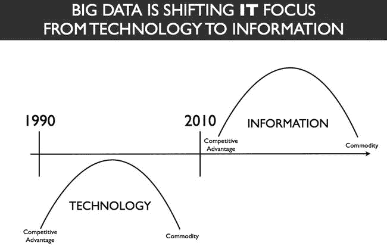
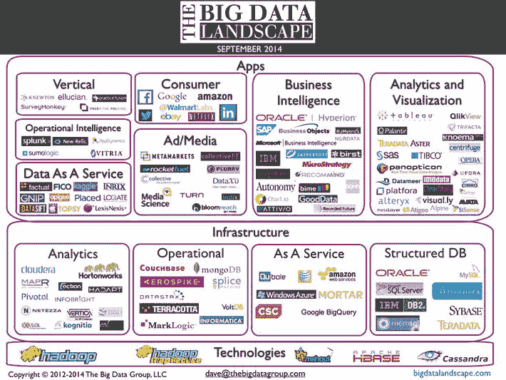
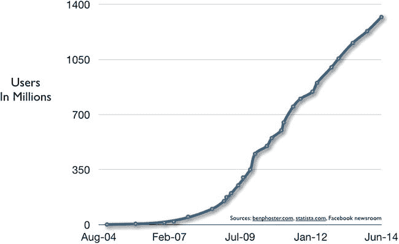
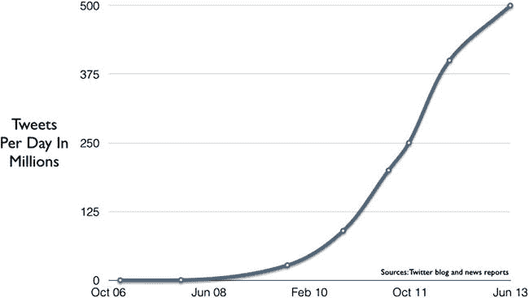

# 大数据的真正价值

这些定义虽然准确，却忽略了大数据的真正价值。大数据的衡量标准应该是其影响力的大小，而非其消耗的存储空间或处理能力。很多时候，关于大数据的讨论都陷入了几`TB`（太字节）和`PB`（拍字节）的泥潭，以及如何存储和处理数据，而不是如何使用数据。

作为消费者和商业用户，数据的规模和体量并不是我们关心的。相反，我们希望能够提出并回答那些对我们至关重要的问题。我们应该服用什么药物来治疗严重的健康问题？我们应该给学生提供哪些信息、学习工具和练习，以帮助他们更有效地学习？我们应该在营销活动上多花多少钱？我们新产品的哪些功能正在被客户使用？

这才是大数据的真正意义所在。它指的是以比以往低得多的成本，获取和分析数据，并从数据中获得可操作洞察的能力。

大数据真正的变革性在于我们现在使用数据的便捷性。我们不再需要那些需要数月或数年才能搭建和使用的复杂软件。几乎所有我们需要的分析能力，都可以通过简单的软件下载或在云端获得。

我们不再需要昂贵的设备来收集数据。现在，我们可以从汽车中收集性能和驾驶数据，从`GPS`手表中收集健康和位置数据，甚至可以通过手机的低成本附件收集个人健康数据。正是这些能力的结合——大数据与云计算和移动技术的融合——才真正改变了游戏规则，让数据的使用和应用变得简单。

 **注意** 大数据具有变革性：你不需要复杂的软件或昂贵的数据收集技术来利用它。大数据与云端和移动世界的结合，正在改变所有规模企业的竞争格局。

## 大数据进入主流视野

那么，为什么大数据会突然变得如此火爆？大数据之所以进入主流视野，是由于三大趋势的汇聚。

首先，多家备受瞩目的消费品公司加大了对大数据的应用。社交网络巨头`Facebook`利用大数据追踪其网络内的用户行为。该公司通过分析您还认识谁，来为您推荐新朋友。

您的朋友越多，您在`Facebook`上保持活跃的可能性就越大。更多的朋友意味着您会浏览更多内容、分享更多照片、发布更多状态更新。

商务社交网站`LinkedIn`利用大数据将求职者与工作机会联系起来。有了`LinkedIn`，猎头不再需要给潜在员工打冷电话。他们可以通过一次简单的搜索找到并联系他们。同样，求职者也可以通过联系网站上的其他人，获得向潜在招聘经理进行“暖介绍”的机会。

`LinkedIn`首席执行官`杰夫·韦纳`最近谈到了该网站的未来及其“经济图谱”——一个全球经济的数字地图，它将实时识别“指向经济机会的趋势”。² 实现这样一个图谱及其预测能力所面临的挑战，正是一个大数据问题。

其次，这两家公司（`Facebook`和`LinkedIn`）都在过去几年内上市了——`Facebook`在纳斯达克上市，`LinkedIn`在纽交所上市。尽管这些公司和谷歌表面上是消费品公司，但它们的核心实际上是庞大的大数据公司。

这些公司的上市——连同运营智能软件提供商`Splunk`和可视化公司`Tableau Software`的上市——极大地提高了华尔街对大数据业务的兴趣。

因此，硅谷的风险投资家们正以前所未有的热情排队资助大数据公司。大数据正在定义下一波重大的创业浪潮，而硅谷希望在未来几年内将这些公司推向华尔街。

`Facebook`的早期投资者`Accel Partners`在2011年底宣布设立一只1亿美元的大数据基金，并于2012年初进行了首次投资。`Zetta Venture Partners`是2013年推出的一个新基金，专门专注于大数据分析。`Zetta`由`马克·戈伦伯格`创立，他曾是`Hummer Winblad`的董事总经理。³ 知名投资者`Andreessen Horowitz`、`Greylock Partners`等也在该领域进行了多项投资。

第三，作为亚马逊、`Facebook`、`LinkedIn`以及其他以数据为核心的消费产品的活跃用户，商业人士开始期望在工作中也能获得与在家中同样快速便捷的大数据访问体验。如果互联网零售商亚马逊能够利用大数据推荐要读的书、要看的电影和要购买的商品，那么商业用户认为他们自己的公司也应该能够利用大数据。

例如，为什么一家租车公司不能更智能地为租车者推荐合适的车辆呢？毕竟，公司拥有该人过去租车的记录和当前可用车辆的信息。但借助新技术，该公司还能获取关于特定市场动态的公开信息——有关可能影响市场需求和可用性的会议、活动及其他活动的信息。

通过将内部供应链数据与外部市场数据相结合，公司应该能够更准确地预测哪些车辆应该在何时投入使用。

同样，零售商应该能够结合内部和外部数据，逐日设定产品价格、陈列位置和品类组合。通过考虑从产品供应情况到消费者购物习惯（包括哪些产品倾向于一起畅销）等多种因素，零售商可以提升平均购物篮大小，从而获得更高利润。这反过来又能确保在正确的时间有正确的商品库存，从而保持客户满意度。

因此，尽管大数据似乎在一夜之间变得炙手可热，但实际上，大数据是多年软件开发、市场增长以及消费者和商业用户被压抑的需求共同作用下的最终成果。

## 谷歌如何践行大数据计划

如果说有一家科技公司抓住了这一需求并成为了大数据的典范，那便是搜索引擎巨头谷歌公司。据谷歌称，该公司每月处理的搜索查询量高达惊人的1000亿次。⁴

但谷歌存储的不仅仅是搜索结果中出现的网站链接。它还存储了人们进行的所有搜索，这使得该公司对人们搜索行为的时间、内容和方式拥有无与伦比的洞察力。

这些洞察意味着，谷歌可以优化其展示的广告，从而比全球几乎所有其他公司更好地将网络流量变现。这也意味着谷歌可以预测人们接下来会搜索什么。换句话说，在你搜索之前，谷歌就已经知道你在找什么了！

多年来，谷歌不得不处理海量的非结构化数据，例如网页、图像等，而不是更传统的结构化数据，比如包含姓名和地址的表格。因此，谷歌的工程师从零开始开发了创新的大数据技术。这样的机会帮助谷歌吸引了一支才华横溢的工程师队伍，这些人正是被谷歌技术挑战的独特规模和体量所吸引。

该公司的另一个优势是其基础设施。谷歌搜索引擎本身就是为在数十万台服务器上无缝运行而设计的。如果需要更多的处理能力或存储空间，或者某台服务器出现故障，谷歌的工程师只需添加更多服务器即可。据估计，谷歌的服务器总数已超过一百万台。

# 谷歌的大数据技术

谷歌的软件技术在设计之初就考虑了这种基础设施。其中有两项技术尤为突出，即 `MapReduce` 和 `谷歌文件系统`，它们在 2012 年夏季被《连线》杂志报道为“重塑了谷歌构建搜索索引的方式”。⁵

如今，许多公司都在拥抱 `Hadoop`，它是 `MapReduce` 和 `谷歌文件系统` 的开源衍生品。`Hadoop` 由雅虎公司基于谷歌一篇关于 `MapReduce` 的论文率先开发，它支持在多台计算机上对大型数据集进行分布式处理。

当其他公司才刚刚开始使用 `Hadoop` 时，谷歌已经大规模应用大数据技术多年，这让它在行业中占据了巨大优势。与此同时，谷歌正将重心转向其他更新的技术。这些技术包括用于内容索引的 `Caffeine`、用于映射关系的 `Pregel`，以及用于查询海量数据的 `Dremel`。`Dremel` 是该公司 `BigQuery` 服务的基础。⁶

现在，谷歌正将其在数据处理方面的一些投资开放给第三方。`Google BigQuery` 是一项网络服务，允许对包含数十亿行数据的海量数据集进行交互式分析。`BigQuery` 是一种按需的云端数据分析服务。2014 年，谷歌推出了 `Cloud Dataflow`，作为 `Hadoop` 和 `MapReduce` 的继任者，它能够处理大批量的批处理数据和流式数据。

以前，公司必须购买昂贵的安装软件并建立自己的基础设施才能进行此类分析。借助 `BigQuery` 这样的服务，这些公司现在无需进行巨额前期投资就能分析大型数据集。

谷歌还能获取海量的机器数据，这些数据来源于用户在其网站及其整个网络上进行的搜索。每当有人输入搜索查询，谷歌就知道此人在寻找什么。人们在互联网上的每一个动作都会留下痕迹，而谷歌恰好能够很好地捕捉并分析这些痕迹。

然而，谷歌掌握的数据远不止搜索数据。公司安装 `Google Analytics` 等产品来追踪自己网站的访客，谷歌也能获取这些数据。网站使用 `Google AdSense` 在自己的网站上展示来自谷歌广告商网络的广告，因此谷歌不仅了解广告在自己网站上的表现，还能洞悉广告在其他发布者网站上的情况。谷歌还拥有来自 `Google Maps` 和 `Google Earth` 的大量地图数据。

将所有数据整合在一起，其结果是，一项业务不仅能从最顶尖的技术中受益，还能从最优质的信息中获益。在信息技术方面，许多公司都在 IT 的“技术”部分投入巨资，但很少有公司能像谷歌那样，在 IT 的“信息”部分投入同样巨大且卓有成效。

 **注释** 在信息技术领域，最具前瞻性的公司在信息方面的投入与在技术方面的投入一样多。

## 大数据如何助力亚马逊成为全球最大零售商的雄心

当然，谷歌并非唯一一家将大数据投入应用的大型科技公司。互联网零售商亚马逊已采取了一些激进的举措，并且可能对谷歌以数据驱动的主导地位构成最大的长期威胁。

至少有一位分析师预测，到 2015 年亚马逊的收入将超过 1000 亿美元，这将使其有望超越沃尔玛，成为全球最大的零售商。与谷歌类似，亚马逊手中也掌握着海量数据，尽管其数据更偏向电子商务性质。

每当客户在其网站上搜索要观看的电视节目或要购买的商品时，亚马逊对该客户的了解就会增加一分。基于搜索和产品购买行为，亚马逊可以判断出接下来应该推荐哪些产品。

该公司甚至比这还要智能。它不断在其网站上测试新的设计方案，以找出哪种方案能带来最高的转化率。

你以为亚马逊网站页面上某段文字只是恰好放在那里？再想想吧。布局、字体大小、颜色、按钮以及公司网站设计的其他元素都经过了精心的反复测试，以确保达到最佳效果。

数据驱动的方法还不止于此。据多位前员工透露，公司文化是冷酷无情地以数据为导向。数据会显示什么行得通，什么行不通，而任何新的业务投资理由都必须有数据支撑。

这种对数据的持续关注使得亚马逊能够提供更低的价格和更好的服务。消费者往往直接登录亚马逊网站搜索要购买的商品或直接下单，完全跳过了谷歌等搜索引擎。

对消费者的争夺战甚至蔓延到了更广阔的领域。苹果、亚马逊、谷歌和微软——合称“四巨头”——不仅在线上展开激烈竞争，在移动领域亦是如此。

随着消费者将越来越多的时间花在手机和平板电脑上，而不是电脑前，拥有消费者手中移动设备的公司将具备最强的向该消费者销售产品的能力，并能最深入地洞察其行为。一个公司掌握的关于消费者群体和个体的信息越多，就越能有效地向这些消费者定向投放内容、广告和产品。

令人难以置信的是，亚马逊的影响力从支撑新兴科技公司的基础设施，一直延伸到了人们消费内容的移动设备上。多年前，亚马逊就预见到了将其电子商务平台支柱——服务器和存储基础设施——向他人开放的价值。

`Amazon Web Services`（AWS），作为该公司的公有云服务，为新兴公司和成熟公司提供可扩展的计算和存储资源。虽然 AWS 仍处于增长的相对早期阶段，但一位分析师估计，该服务的年收入运行率已超过 38 亿美元。⁷

这种易于获取的计算能力的普及，为新的数据计划铺平了道路。当然，公司仍然可以并且会继续以私有云的形式投资建设自己的私有基础设施。当涉及到特定的安全、监管或可用性问题时，私有云——即公司在内部管理和托管的云——是合理的。

但如果公司想要快速利用额外的或可扩展的计算资源，他们只需在亚马逊的公有云中启动一批服务器实例即可。更重要的是，亚马逊还在持续降低其计算和存储服务的价格。凭借其巨大的购买力和基础设施规模，它能够以远低于其他大多数大公司所能获得的价格来协商采购计算机和网络设备。亚马逊的 `Web Services` 服务不仅通过其面向消费者的网站和 `Kindle Fire` 等移动设备脱颖而出，还通过支撑数千个其他流行网站的基础设施占据了核心地位。

其结果是，大数据分析不再需要前期对固定成本的 IT 进行投资。用户只需在需要时购买更多的计算能力进行分析或购买更多的存储空间来保存数据。数据捕获和分析可以在云端快速轻松地完成，用户无需就 IT 基础设施做出昂贵的前期决策。相反，他们可以根据实际需要，仅在需要的时间和期限内购买满足其大数据需求的计算和存储资源。

如今，企业可以捕获和分析前所未有的数据量——这些数据在过去是它们根本无力分析或存储而不得不丢弃的。

 **注意** 大数据最强大的特性之一在于其可扩展性。借助云计算资源（包括分析和存储），企业在数据存储、处理与价值挖掘方面，如今已不再有容量限制。

# 大数据最终带来信息优势

`Amazon Web Services` 等基础设施与 `Hadoop` 等开源技术的普及，意味着企业终于能够实现 IT 界长期承诺的种种好处。

几十年来，IT 领域的焦点始终是“技术”本身。首席信息官（`CIO`）的职责是购买并管理服务器、存储设备和网络。

然而，如今为企业带来竞争优势的，却是信息以及基于信息进行存储、分析和预测的能力（图 1-1）。在 IT 技术刚刚普及时，早期采用的企业能够更快行动、执行更优，从而超越那些未采用的企业。有人认为，微软在 20 世纪 90 年代的崛起，不仅得益于其交付了全球最广泛使用的操作系统，更在于公司内部率先拥抱电子邮件，将其作为标准沟通机制。

图 1-1. 信息正在成为曾经技术所扮演的关键资产角色

当许多公司还在犹豫是否以及如何采用电子邮件时，微软内部已将其作为讨论新员工招聘、产品决策、营销策略等事宜的实际沟通工具。虽然电子群组通讯如今已司空见惯，但在当时，这赋予了微软相比那些尚未采用电子邮件的公司更快的速度和更强的协作优势。

那些拥抱数据，并在整个组织内推动数据民主化使用的公司，将获得类似的优势。谷歌和 Facebook 等公司已从这种数据民主化中获益。通过向组织内的分析师、经理和高管开放内部数据分析平台，谷歌、Facebook 等公司使得组织内的每个人都能快速地向数据提出业务问题，并获得所需答案。正如 Facebook 前大数据负责人 Ashish Thusoo 所言，新技术已将讨论的话题从“存储什么数据”转变为“有了更多数据我们能做什么？”

例如，Facebook 将其大数据工作作为一个内部服务来运行。这意味着该服务并非为工程师设计，而是为最终用户——那些需要运行查询来弄清楚什么有效、什么无效的直线经理——设计的。因此，经理们无需等待数天或数周才能知道哪些网站更改最有效，或哪种广告方法效果最佳。他们可以利用内部大数据服务实时获得业务问题的答案。并且，该服务从运营稳定性到社交功能（使数据分析结果易于与同事分享）等方方面面，都充分考虑了最终用户的需求。

过去的二十年是属于 IT 中“技术”的二十年。相比之下，接下来的二十年将是属于 IT 中“信息”的二十年。那些能够更快处理数据，并整合公共与内部数据源的公司，将获得独特的洞察力，从而超越竞争对手。正如大数据初创公司 `SpaceCurve` 的创始人兼 CTO `J. Andrew Rogers` 所说：“分析数据的速度越快，其预测价值就越大。”企业正从批处理（即先存储数据，事后再对数据运行缓慢的分析处理）转向实时分析，以获取竞争优势。

对于高管们来说，好消息是，大数据带来的信息优势不再仅为谷歌和亚马逊这样的公司所独享。像 `Hadoop` 这样的开源技术正使得众多其他公司——无论是老牌的《财富》1000 强企业还是新兴初创公司——都能够以合理的成本利用大数据获得竞争优势。大数据确实带来了长期承诺的信息优势。

## 大数据正在颠覆什么

大数据带来的巨大颠覆，不仅仅在于能够比过去捕获和分析更多的数据，更在于能够以低一个数量级的价格实现这一点。随着价格下降，消耗量反而上升。这种具有讽刺意味的反转被称为*杰文斯悖论*，得名于这位对工业革命做出此观察的经济学家。随着技术进步使数据存储和分析更加高效，企业进行的分析不是变少了，而是大大增加了。简而言之，这就是大数据的颠覆性所在。

从亚马逊到谷歌，从 IBM 到微软，许多大型科技公司都在涉足大数据。与此同时，数十家初创公司如雨后春笋般涌现，提供开源和基于云的大数据解决方案。当大公司专注于横向的大数据解决方案——用于通用分析的平台——时，小公司则专注于为特定业务线和关键垂直领域提供应用程序。一些产品优化销售效率，而另一些产品则通过将多个不同渠道的营销表现与实际的产品使用数据进行关联，为未来的营销活动提供建议。还有大数据产品可以帮助企业更高效地招聘员工，并在招聘后留住他们。

还有一些产品通过分析海量的调查数据，提供对客户需求的洞察。大数据产品可以评估医疗记录，帮助医生和制药公司提供更好的医疗服务。创新的应用程序现在可以利用学生的出勤率和考试成绩统计数据，帮助学生更有效地学习，并提高完成学业的几率。从历史上看，我们很容易说没有所需的数据，或者数据太难分析了。而现在，这些大数据应用的普及意味着公司无需在内部开发和部署所有的大数据技术。在很多情况下，他们可以利用基于云的服务来满足分析需求。大数据正在让数据本身，以及分析和获取可执行洞察的能力，变得比以往任何时候都更容易、更便捷。这确实是颠覆性的。

## 改变你工作方式的大数据应用

大数据应用（`Big Data Applications`， `BDAs`）代表了大数据领域的下一波浪潮。行业分析机构 `CB Insights` 研究了大数据领域的融资情况，报告称仅 2013 年上半年，大数据公司就筹集了约 12.8 亿美元。此后，投资者继续向现有基础设施企业注入资金。`Hadoop` 软件的商业供应商 `Cloudera` 公司于 2014 年 3 月宣布了一轮 9 亿美元的巨额融资，使该公司的总融资额达到 12 亿美元。

展望未来，焦点将从处理大量数据所需的基础设施，转移到如何利用这些数据上来。问题将不再是“在哪里以及如何存储大量数据”。相反，用户会问“如何利用所有这些数据来获得洞察和竞争优势”。

 **注意** 创建和提供处理大数据所需基础设施的时代已近尾声。展望未来，焦点将集中在一个关键问题上：“我们如何利用所有数据来创造新产品、销售更多产品，并全面超越我们的竞争对手？”

`Splunk`，一家运营智能公司，就是一个现成的例子。从历史上看，企业不得不以一种相对手动的流程，使用自己开发的脚本来分析*日志文件*——那些由构成其 IT 系统的网络设备和服务器生成的文件。IT 管理员不仅要维护企业基础设施的服务器、网络设备和软件，还必须以脚本形式构建自己的工具，以确定这些系统所产生问题的根源。而这些系统生成了海量的数据。每次用户登录或访问文件，每次软件生成警告或错误，这些都是管理员必须梳理的数据，以查明情况。

借助 `BDA`，企业不再需要自己构建工具。他们可以利用预先构建好的应用程序，专注于运营业务。例如，`Splunk` 的软件可以通过搜索 IT 日志文件并可视化问题的位置和频率，轻松找到基础设施问题。当然，该公司的软件主要是*安装型软件*，这意味着它必须安装在客户的站点上。

基于云的 `BDA` 有望使企业完全无需安装任何硬件或软件。在某些方面，它们可以被看作是软件即服务（`SaaS`）产品之后的合理下一步。`SaaS`，即通过互联网交付的软件产品，已经相对成熟。例如，`Salesforce.com`，它在十多年前首次引入了“无软件”的概念，如今已成为云端客户关系管理（`CRM`）的事实标准，这是一种帮助企业管理客户列表和关系的软件。`SaaS` 将软件转变为一种可以随时随地被使用、且用户几乎无需维护的产品。就像 `SaaS` 改变了我们访问软件的方式一样，`BDA` 正在改变我们访问数据的方式。此外，`BDA` 正在将软件的价值从软件本身转移到那些软件使我们能够操作的数据上。换句话说，`BDA` 有潜力将当今的技术公司转变为未来极具价值的信息企业。

`BDA` 正在同时改变我们的工作和个人生活。例如，`Opower` 正在改变能源的消耗方式。该公司与 75 家不同的公用事业公司合作，追踪全美约 5000 万家庭的能源消耗情况。公司利用来自智能电表（一种追踪家庭能源使用情况的设备）的数据，为消费者提供详细的能源消耗报告。即使是能源消耗上的微小变化，当它扩展到数千万个家庭时，也能产生巨大影响。就像谷歌可以访问海量的关于消费者在互联网上行为的数据一样，`Opower` 也掌握着大量关于人们在能源使用方面行为的数据。这类数据最终将赋予 `Opower` 以及类似公司高度差异化的洞察力。虽然该公司从提供能源报告起步，但通过持续积累其信息资产，它将很好地定位为一家大数据企业。⁹

然而，`BDA` 并非只出现在商业领域。各公司正在开发许多其他能够对我们的日常生活产生积极影响的数据应用程序。举个例子，一些移动应用程序会追踪健康相关的指标，并提出改善人类行为的建议。这类产品有望减少肥胖、提高生活质量并降低医疗成本。它们也证明了，最具有创新性和变革性的大数据应用可能出现在新型移动设备、大数据和云计算的交汇之处。

## 大数据助力迈向实时处理

如果说过去几年的大数据是关于以更低成本捕获、存储和分析数据，那么接下来的几年将是关于加速对这些数据的访问，并使我们能够实时地对其进行操作。如果你曾经点击过网站按钮却只看到等待屏幕，你就会知道等待交易完成或报告生成是多么令人沮丧。相比之下，谷歌搜索结果的响应时间则截然不同。谷歌在 2010 年推出的`Google Instant`，可以在你输入时实时显示搜索结果。通过引入这一功能，谷歌对典型搜索的搜索结果页面展现量增加了五到七倍。当这个界面刚推出时，人们并不确定是否喜欢它¹⁰。而仅仅几年后的今天，没有人能想象没有它的生活。

数据分析师、经理和高管们希望在了解其业务时获得`Google Instant`那样的即时性。随着这些大数据用户追求越来越快的结果，仅仅采用大数据技术将不再足够。持续的竞争优势将不再来自大数据本身，而是来自比他人更快地从信息资产中获取洞察的能力。像`Google Instant`这样的界面展示了即时访问的强大力量。

根据 IBM 的说法，“我们每天产生 2.5×10¹⁸字节的数据——如此之多，以至于世界上 90%的数据都是在过去两年内创造的。”¹¹行业研究公司 `Forrester` 估计，企业数据总量每年增长 94%。¹²

面对这种增长，每家公司都需要一个大数据路线图。至少，公司需要有一个捕获数据的策略——从内部计算机系统生成的机器日志文件到网站上的用户交互——即使他们直到后来才决定如何处理这些数据。正如 Rogers 所说：“数据的价值远超你最初的预期——不要丢弃它。”

**提示** “数据的价值远超你最初的预期——不要丢弃它。” ——`J. Andrew Rogers`，`SpaceCurve` 公司 CTO。

公司需要为其数据的指数级增长做好规划。尽管照片、即时消息和电子邮件的数量非常庞大，但由联网“传感器”（如手机、`GPS` 和其他设备）生成的数据量则要大得多。理想情况下，公司应具有一个愿景，使数据分析能够在整个组织内进行，并且尽可能接近实时地完成。通过研究谷歌、亚马逊、`Facebook` 和其他科技领导者的大数据方法，你可以看到大数据能实现什么。在此基础上，你可以在自己的组织中制定有效的大数据策略。

那些在大数据方面取得成功的公司还为其组合增加了一个关键要素：一位大数据领导者。如果你无法从中获取洞察，那么世界上所有的数据都毫无意义。你的大数据领导者——无论是首席数据官还是数据洞察副总裁——不仅可以帮助你的整个组织制定正确的战略，还可以指导你的组织获得其所需的可操作洞察。

像谷歌和亚马逊这样的公司多年来一直利用数据驱动决策，并在此过程中取得了巨大的成功。有了大数据，你现在也可以利用这些能力。你将在第 3 章中读到更多关于如何利用这些能力并制定你自己的大数据路线图的内容。但首先，让我们看看整个大数据领域中令人难以置信的市场驱动力和创新技术。¹³

---

¹ `http://radar.oreilly.com/2012/01/what-is-big-data.html`
² `http://www.linkedin.com/today/post/article/20121210053039-22330283-the-future-of-linkedin-and-the-economic-graph`
³ `Zetta Venture Partners` 是我所在公司 `Content Analytics` 的投资方。
⁴ `http://phandroid.com/2014/04/22/100-billion-google-searches/`
⁵ `http://www.wired.com/wiredenterprise/2012/08/googles-mind-blowing-big-data-tool-grows-open-source-twin/`
⁶ `http://www.wired.com/wiredenterprise/2012/08/googles-dremel-makes-big-data-look-small/`
⁷ `http://www.zdnet.com/amazons-aws-3-8-billion-revenue-in-2013-says-analyst-7000009461/`
⁸ `http://www.cbinsights.com/blog/big-data-funding-venture-capital-2013`
⁹ `http://www.forbes.com/sites/davefeinleib/2012/10/24/software-is-dead-long-live-big-data-2/`
¹⁰ `http://googleblog.blogspot.com/2010/09/google-instant-behind-scenes.html`
¹¹ `http://www-01.ibm.com/software/data/bigdata/what-is-big-data.html`
¹² `http://www.forbes.com/sites/ciocentral/2012/07/05/best-practices-for-managing-big-data/`
¹³ 本章部分素材来源于我以特约撰稿人身份发表在《哈佛商业评论》（中文版）2013 年 1 月刊上的文章。

## 大数据全景图

### 基础设施与应用

在探讨了大数据的几个方面之后，接下来我们将放眼更广阔的领域，了解那些在大数据生态系统中扮演重要角色的公司。从基础设施和应用的角度来思考大数据全景图，是最容易理解的方式。

随后的图表（见图 2-1）展示了“大数据全景图”。该图对大数据领域中的众多参与者进行了分类。由于新入行者层出不穷，该全景图的最新版本始终可在网页 `www.bigdatalandscape.com` 上查阅。

图 2-1. 大数据全景图

基础设施主要负责存储，并在一定程度上处理公司所捕获的海量数据。人类和计算机系统则使用应用程序从数据中获取洞察。

人们使用应用程序来可视化数据，以便做出更明智的决策；而计算机系统则使用应用程序来向合适的人群投放精准广告、检测信用卡欺诈，以及执行众多其他活动。虽然我们无法在此逐一介绍全景图中的每一家公司，但我们将描述其中的一部分，并说明该生态系统是如何形成的。

### 大数据市场增长

大数据是一个巨大的市场。市场研究机构 `IDC` 预计，到 2016 年，大数据市场将增长至每年 238 亿美元，且该领域的年增长率将达到 31.7%。这还不包括分析软件，仅该市场本身的价值就高达 510 亿美元。

我们生成的数据量正以惊人的速度增长。其中一个最有趣的衡量指标是 `Facebook` 的增长。2012 年 10 月，该公司宣布其用户数已达到 10 亿——几乎占全球人口的 15%。截至 2013 年底，`Facebook` 在全球拥有超过 12.3 亿用户（见图 2-2），一年内新增了 1.7 亿用户。为了跟上其庞大的用户增长，该公司不得不开发各种新的基础设施和分析技术。²

图 2-2. `Facebook` 用户增长率

`Facebook` 每天处理约 3.5 亿次照片上传、45 亿次“赞”和 100 亿条消息。这意味着该公司用于分析的存储数据超过 100 `PB`，并且每天新增超过 500 `TB` 的数据。³,⁴ 这相当于大约 2000 个完全装满数据的 `Macintosh Air` 硬盘所存储的数据量。

`Twitter` 提供了另一个衡量数据增长的有趣指标。截至 2013 年，该公司的注册用户数已超过 8.83 亿，每天处理超过 5 亿条推文，而仅在五年前，这一数字仅为每天 2 万条（见图 2-3）。⁵

图 2-3. 社交网站 `Twitter` 上的推文增长

然而，需要客观看待的是，这些仅仅是人类产生的数据。机器生成的数据甚至更多。每次我们点击网站按钮、进行购买、打电话或进行几乎任何其他活动时，都会留下数字足迹。上传一张照片这个简单操作，就会生成大量其他数据：谁上传了照片、何时上传的、与谁分享了、关联了哪些标签，等等。

数据量无处不在增长：沃尔玛每小时处理超过一百万笔客户交易，每年发送大约 90 万亿封电子邮件。具有讽刺意味的是，所有这些邮件中超过一半（71.8%）被视为垃圾邮件。根据一项估计，商业数据量每 1.2 年就会翻一番。⁶,⁷

为了应对这种惊人的增长，涌现出许多新公司，同时也有许多现有公司正在围绕大数据重新定位自己和他们的产品。

### 开源的作用

开源在大数据近年来的发展中发挥了重要作用。但在讨论这一点之前，有必要先对开源角色的更广泛背景进行说明。

就在几年前，`Linux` 成为主流操作系统，并与商品化硬件（低成本、现成的服务器）相结合，蚕食了像 `Sun Microsystems` 这样曾经占据主导地位的厂商的市场。例如，`Sun` 以其名为 `Solaris` 的 `Unix` 版本而闻名，该版本运行在其定制的 `SPARC` 硬件上。

通过使用 `Linux`，企业能够在低成本硬件上利用开源操作系统，以低得多的成本获得大部分相同的功能。开源数据库 `MySQL`、开源 `Web` 服务器 `Apache` 以及最初为构建网站而创建的开源脚本语言 `PHP` 的可用性，也推动了 `Linux` 的普及。

随着企业开始在大型商业用途中使用和采用 `Linux`，他们需要企业级的支持与可靠性。工程师在实验室里使用开源的 `Linux` 没问题，但企业需要一个他们可以寻求培训、支持和定制的供应商。换句话说，大公司喜欢从其他大公司购买。

在众多供应商中，红帽（`Red Hat`）脱颖而出，成为为 `Linux` 提供商业支持和服务的市场领导者。该公司目前的市值略高于 100 亿美元。瑞典公司 `MySQL AB` 赞助了开源 `MySQL` 数据库项目的开发。`Sun Microsystems` 于 2008 年初以 10 亿美元收购了 `MySQL AB`，随后 `Oracle` 于 2009 年底收购了 `Sun`。

包括 `IBM` 和 `Oracle` 在内的几家公司，将大规模关系型数据库商业化。关系型数据库允许将数据存储在定义良好的表中，并通过键进行访问。例如，一名员工可以通过员工编号来识别，然后该编号将与包含该员工信息的多个其他字段关联，例如其姓名、地址、入职日期和职位。

此类数据库运行良好，直到公司不得不处理海量的非结构化数据。谷歌需要处理海量的网页以及这些网页中链接之间的关系。脸书则需要应对社交图谱数据。社交图谱是其社交网络上人与人之间关系的数字表示，以及图谱中每个节点所关联的所有非结构化数据，例如照片、消息和个人资料。这些公司还希望利用廉价硬件成本较低的优势。

 **注意** 关系型数据库曾是许多大型企业 `IT` 环境的主力，它们运行良好，直到公司意识到自己生成了更多的非结构化数据，需要一种不同的解决方案。于是，`NoSQL` 和图数据库等专为当今多样化数据环境设计的方案应运而生。

因此，像谷歌、雅虎、脸书等公司开发了自己的解决方案来存储和处理海量数据。在操作系统和数据库市场中，`Linux` 作为 `Unix` 的开源版本出现，而 `MySQL` 则作为 `Oracle` 等数据库的开源替代品。如今，类似的情况正在大数据领域发生。

`Apache Hadoop` 是一个开源的分布式计算平台，它通过 `Hadoop` 分布式文件系统（`HDFS`）存储大量数据，并通过名为 `MapReduce` 的编程模型将针对这些数据的操作拆分为小片段。它源自谷歌和雅虎最初构建的技术。

围绕 `Hadoop` 涌现了其他开源技术。`Apache Hive` 提供了数据仓库功能，包括数据提取/转换/加载（`ETL`）——这是一个从各种来源提取数据、将其转换为满足运营需求（包括确保数据质量）并加载到目标数据库的过程。`Apache HBase` 在 `Hadoop` 之上为非常大的结构化表提供实时读写访问。它模仿了谷歌的 `BigTable`。同时，`Apache Cassandra` 通过复制数据提供容错的数据存储。

从历史上看，这些功能只能从商业软件供应商那里获得，并且通常运行在专用硬件上。`Linux` 使 `Unix` 的功能在通用硬件上得以实现，大幅降低了计算成本。同样地，开源大数据技术正在使数据存储和处理能力变得人人可用，这些能力以前只有谷歌这样的公司或商业供应商才能提供，如今则可在通用硬件上获得。

低成本大数据技术的广泛普及降低了处理大数据的初始成本，并有潜力使大数据为更多潜在用户所用。闭源供应商指出，虽然开源软件可以免费使用，但其维护成本可能很高，尤其是在大规模部署时。

尽管如此，开源可以免费上手这一事实使其成为许多人的有吸引力的选择。一些商业供应商采用了“免费增值”商业模式来竞争。产品可以在个人使用或有限数据量下免费使用，但客户需要为部门级或更大规模的数据使用付费。

那些长期采用开源技术的企业最终需要商业支持，这与他们对待 `Linux` 的方式类似。像 `Cloudera`、`Hortonworks` 和 `MapR` 这样的公司正在满足 `Hadoop` 的这一需求，而像 `DataStax` 这样的公司则为 `Cassandra` 提供同样的服务。同样地，`LucidWorks` 正在为 `Apache Lucene` 扮演这样的角色，后者是用于索引和搜索海量网页和文档的开源文本搜索引擎。

 **注意** 尽管像 `Cloudera` 和 `Hortonworks` 这样的公司提供基于开源软件（如 `Hadoop`、`Hive`、`Pig` 等）构建的产品，但企业始终需要经过商业打包、测试的版本，以及相应的支持和培训。因此，英特尔最近向 `Cloudera` 注资 9 亿美元。

## 进入云端

另外两个市场趋势正在并行发生。首先，数据量正在增加——几乎每年翻一番。我们以照片、推文、点赞和电子邮件的形式生成更多数据。我们的数据本身也有相关联的数据。此外，机器正在以服务器、汽车、飞机、手机和其他设备的状态更新及其他信息的形式生成数据。

因此，处理所有这些数据的复杂性也在增加。更多的数据意味着需要整合、理解并尝试从中获取洞察的数据更多。这也意味着数据安全和数据隐私的风险更高。虽然企业历来将内部数据（如销售数据）和外部数据（如品牌情绪或市场研究数据）分开看待，但他们现在希望整合这些类型的数据，以利用由此产生的洞察。

其次，企业正在将计算和处理迁移到云端。这意味着他们不再购买硬件和软件并将其安装在自己的数据中心并维护那套基础设施，而是通过互联网按需获取所需的能力。如前所述，软件即服务（`SaaS`）公司 `Salesforce.com` 以其“无软件”模式开创了通过 `Web` 提供应用程序的先河，用于客户关系管理（`CRM`）。该公司继续构建一个产品生态系统以补充其核心 `CRM` 解决方案。`SaaS` 模式已经获得了动力，许多其他公司也提供了面向商业用户的基于云的服务。

与此同时，`Amazon` 通过 `Amazon Web Services（AWS）` 为实现按需基础设施铺平了道路，`AWS` 是该公司极受欢迎的基于云的计算和存储服务。`Amazon` 于 2002 年推出 `AWS`，其初衷是利用运行 `Amazon.com` 商店所需的基础设施来盈利。该公司继续增加按需基础设施服务，使开发人员能够快速启动新的服务器、存储和数据库。

`Amazon` 还推出了针对大数据的特定服务，包括 `Amazon Elastic MapReduce（EMR）`——一个基于 `Amazon` 云的开源 `Hadoop MapReduce` 版本。`Amazon Redshift` 是一个按需数据仓库解决方案，`Amazon` 预计其成本低至每年每 `TB` 1,000 美元，不到企业通常为本地数据仓库支付费用的十分之一，后者每年每 `TB` 的费用可能超过 20,000 美元。同时，`Amazon Glacier` 提供低成本数字归档服务，费用为每月每 `GB` 0.01 美元，或每年每 `TB` 约 120 美元。

`Amazon` 相对于其他供应商有两个主要优势。它拥有一个非常知名的消费品牌。该公司还受益于支撑 `Amazon.com` 网站以及在其基础设施上服务众多客户所带来的规模经济。其他技术市场领导者也提供云基础设施服务，包括谷歌的 `Google Cloud Platform` 和微软的 `Windows Azure`，但 `Amazon` 已经铺平了道路，并通过 `AWS` 占据了领先地位。

`AWS` 已实现惊人的增长。2013 年，该服务预计将为公司带来 32 亿美元的收入。截至 2012 年 6 月，`Amazon` 在其简单存储服务（`S3`）中存储了超过一万亿个对象，并且每秒新增超过 40,000 个对象。这一数字远高于 2006 年底的 29 亿个对象和 2010 年底的 2620 亿个对象。`Netflix`、`Dropbox` 等主要公司均在 `AWS` 上运营其业务¹²,¹³。

`Amazon` 持续拓展其基础设施即服务（`Infrastructure-on-Demand`）产品，新增了 `IP` 路由、电子邮件发送以及一系列大数据相关服务。除了提供自己的按需基础设施外，`Amazon` 还与一个合作伙伴生态系统合作，提供他们的基础设施产品。因此，任何考虑构建公共云产品的新基础设施初创公司都可能面临以下局面：要么找到与 `Amazon` 合作的方式，要么就得预期该公司将推出具有竞争力的产品。

借助云服务，客户只需按使用量付费。这使得启动新的 `Big Data` 项目变得更加容易。公司不再受制于通常与购买、部署和管理服务器及存储基础设施相关的高昂前期成本。

我们能够比过去更快速、更经济地存储和分析与大数据计划相关的大量数据。借助基于云的大数据基础设施，从规划到获得洞见可能只需数天，而非数月或数年。这反过来意味着，在初创公司和大型企业中，大数据领域的创新会更多，并且数据驱动的洞见获取也变得更加容易。

 **Note** 经济实惠的基于云的大数据基础设施意味着公司可以在几天内从设计走向产品，或从假设到发现洞见，而不是数月或数年。

## 克服云的挑战

当然，许多人仍然对利用公共云基础设施持怀疑态度。从历史上看，公共云服务存在三个主要的潜在问题。首先，大型企业的技术人员认为此类服务不安全，而内部基础设施更安全。其次，许多大型供应商根本不提供其软件的互联网/云端版本。公司必须自行购买硬件并运行软件，或聘请第三方来完成。最后，将大量数据从内部系统迁移到云端很困难。

尽管第一个挑战对某些受合规性要求的政府机构和企业来说仍然存在，但 `Salesforce` 用于管理客户数据，以及 `Box`、`Dropbox` 和 `Google Drive` 用于存储文件等服务的广泛采用表明，许多公司现在已习惯让第三方供应商存储其机密信息。简而言之，企业使用的基于网络交付的应用程序比过去多得多。

首先是客户数据，然后是人力资源数据。如今，市场对基于网络的人力资源管理解决方案提供商 `Workday` 的估值接近 90 亿美元。随着时间的推移，企业将把越来越多的业务应用程序和数据迁移到云端。

第三个挑战，即将海量数据迁移到云端，仍然是个问题。许多专家认为，对于真正高容量的数据，数据会受到一种“引力”的影响。他们认为，始于公司本地的数据将留在本地，而始于云端的数据将留在云端。

但随着越来越多的业务应用程序通过网络提供服务，更多的数据将从云端开始并留在那里。此外，一些公司正在涌现，提供加速大量数据传输的技术。例如，`Aspera` 专注于加速文件传输速度，特别是对于大型音频和视频文件。`Netflix` 和 `Amazon` 等公司使用 `Aspera` 以高达传统速度 10 倍的速度传输文件。

借助云，公司还能获得一系列其他优势：他们花在维护和部署硬件与软件上的时间减少，并且可以按需扩展。如果公司需要更多的计算资源或存储空间，这不再是几个月的问题，而是几分钟的问题。更重要的是，使用已安装软件的公司在使用最新版本软件方面历来落后。对于通过网络提供的应用程序，用户可以在最新版本可用时立即使用。

当然，也有一些权衡取舍。在成本方面，公司受制于他们选择合作的公共云提供商。但云供应商之间的竞争持续推动价格下降。一旦公司在特定云供应商之上构建并部署了应用程序，切换平台可能会很困难。尽管底层基础设施相似，但用于部署新应用程序构建的脚本、特定平台服务的钩子以及网络配置都基于所选平台。

 **Note** 大多数公司倾向于坚持使用他们最初选择的公共云平台。这也是云客户争夺战比以往任何时候都更加激烈的原因之一。

客户还依赖此类提供商提供可靠的服务。`Amazon` 曾遭受过几次重大的高调宕机事件，这导致一些人质疑依赖其服务是否明智。其中一次宕机事件导致电影流媒体提供商 `Netflix` 在 2012 年圣诞节前夕和圣诞节当天服务中断，而传统上这是观看电影的高峰期。然而，总体而言，基于云的基础设施服务在其服务可用性方面已变得更加透明，并增加了企业级的服务和支持选项，以满足企业客户的需求。在许多情况下，像 `Amazon`、`Google` 和 `Microsoft` 这样的提供商，凭借其运营的惊人规模，可以提供比许多企业自行交付的基础设施更可靠、更安全且更具成本效益的服务。

云提供商将继续推出更多的按需基础设施能力。随着他们相互竞争并降低价格，更多的企业将利用此类产品。初创公司将推出基于这些基础设施服务的新型创新大数据应用程序，企业和消费者都将从中受益。

## 大数据基础设施

在了解了开源和大数据在云中的背景后，我们现在来看一些在基础设施和应用领域扮演关键角色的公司。

在大背景下，投资者直到最近才将相对较少量的资本投入到大数据基础设施中。截至 2013 年底，他们对 `Hadoop` 相关公司（`Cloudera`、`Hortonworks` 和 `MapR`）以及 `NoSQL` 公司（`MongoDB`、`Couchbase` 等）的总投资额不到十亿美元。然而，在 2014 年初，英特尔和 `Cloudera` 因英特尔向 `Cloudera` 投资了高达 9 亿美元而成为头条新闻。

# 大数据基础设施公司

Cloudera 是所有新兴大数据基础设施公司中最引人注目的。该公司销售帮助企业管理 `Hadoop` 的工具和咨询服务。其投资者包括 `Accel Partners`、`Ignition Partners`、`In-Q-Tel`、`Intel`、`Greylock Partners` 和 `Meritech Capital Partners`。Cloudera 由明星团队创立，成员包括曾在 `Yahoo!` 参与 `Hadoop` 工作的 `Mike Olson` 和 `Amr Awadallah`、曾在 `Facebook` 使用过它的 `Jeff Hammerbacher`，以及来自 `Google` 的 `Christophe Bisciglia`。¹⁴,¹⁵

值得注意的是，`Google` 早在 2004 年就首次发表了一篇描述 `Google MapReduce` 和 `Google File System` 的论文，`Hadoop` 正是源于此。这充分说明了像 `Google` 和 `Yahoo!` 这样的大型消费者企业所使用的技术，需要经过多长时间才能进入企业领域。¹⁶

`Cloudera` 的竞争对手 `Hortonworks` 是从 `Yahoo!` 分拆出来的。其工程师为 `Apache Hadoop` 贡献了超过 80% 的代码。`MapR` 则专注于通过其 `M5` 产品提供更高性能的 `Hadoop` 版本，旨在解决 `Hadoop` 最大的诟病：处理数据所需时间过长。

在这些公司向企业交付和支持 `Hadoop` 的同时，其他公司也纷纷涌现，在云端交付 `Hadoop`。`Qubole`、`Nodeable` 和 `Platfora` 是云 `Hadoop` 领域的三个玩家。这些公司面临的挑战将是如何从诸如 `Amazon` 自家的 `EMR` 产品等原生大数据云处理服务中脱颖而出。

# Hadoop 能做什么？

`Hadoop` 旨在跨非常大的数据集执行基于批处理的操作。在传统的 `Hadoop` 模型中，工程师设计作业，这些作业在数百或数千台服务器上并行处理。各个结果被汇总以产生最终结果。举一个非常简单的例子，一个 `Hadoop MapReduce` 作业可能被用来统计不同文档中单词出现的次数。如果有数百万份文档，在单台机器上执行这样的计算将非常困难。`Hadoop` 将任务分解成每台机器都能执行的较小作业。每个单独计数作业的结果相加起来得到最终的计数。

挑战在于，运行此类作业可能会消耗大量时间，这对于希望实时查询数据的分析师和其他业务用户来说并不理想。`Hadoop` 的新增功能，例如 `Cloudera Impala` 项目，有望使 `Hadoop` 响应更快，不仅适用于批处理，也适用于近实时分析应用。当然，这样的创新使得 `Cloudera` 成为一个理想的收购目标（在上市之前或之后），无论是被作为其投资后续的 `Intel`，还是被现有的分析或数据仓储巨头如 `EMC`、`HP`、`IBM` 或 `Oracle` 等公司收购。¹⁷

 **注意** 无需再花几天或几周时间等待分析运行和解读。大数据基础设施和应用正使实时分析成为有史以来的首次可能。

# 大数据应用

我们每天都在使用各种各样的**大数据应用程序**，通常甚至不认为它们是 BDA。`Facebook`、`Google`、`LinkedIn`、`Netflix`、`Pandora` 和 `Twitter` 只是其中几个利用海量数据为我们提供洞察并带来娱乐的应用。

尽管我们将会继续看到大数据基础设施方面的创新，但未来大数据的许多兴趣点将集中在利用生成的海量数据和处理这些数据所需低廉计算能力的 BDA 上。以下是一些例子：

- `Facebook` 以用户资料、照片、信息和广告的形式存储并利用大数据。通过分析这些数据，该公司能够更好地了解其用户，并弄清楚向他们展示什么内容。
- `Google` 抓取数十亿个网页，并拥有大量其他大数据源，例如 `Google Maps`，它包含了海量数据，包括物理街道位置、卫星图像、街景照片，甚至许多建筑物的内部视图。
- `LinkedIn` 拥有数亿份在线简历，以及了解人们如何相互关联的知识。该公司利用所有这些数据来建议我们可能想要联系的人群子集。`LinkedIn` 还利用这些数据向我们展示关于朋友和同事的相关动态。
- 互联网广播服务 `Pandora` 使用大约 450 首歌曲的属性来确定推荐哪些歌曲。该公司雇佣音乐学家，对几乎每首新歌的属性进行特征描述，并将其特征存储为 `Music Genome Project` 的一部分。¹⁸ 该公司的数据库中有来自超过 90,000 位艺术家的 900,000 多首歌曲。
- `Netflix` 以其电影预测算法而闻名，该算法使其能够向电影观众推荐接下来该看什么电影。该公司依赖一个由大约 40 名人工标注员组成的团队，对每部电影从故事情节到基调等 100 多个属性进行标注。¹⁹
- `Twitter` 每天处理超过 5 亿条推文。像 `Topsy`（最近被 `Apple` 收购），一家对推文进行实时分析的数据分析初创公司，正在利用这些数据源在 `Twitter` 和其他平台之上构建应用。

# 用于个人生活的大数据应用

大数据应用也正在涌现以改善我们的个人生活。教育初创公司 `Knewton` 利用大数据创造动态学习体验，并了解哪些学生可能辍学，以便顾问可以帮助他们留在学校。医疗保健初创公司 `Practice Fusion` 通过使医生更轻松地处理患者病历，改善了患者体验。`SurveyMonkey` 将数百万份调查的回复转化为市场人员和产品设计师可以用来更好地理解其客户的数据。

这些应用在大数据应用领域只是冰山一角。企业历来都是构建和维护自己的基础设施来处理大数据，并且在许多情况下开发定制应用来分析这些数据。从利用运营智能工具更好地服务现有客户，到在线提供更相关的广告，这一切在多个领域都开始发生变化。越来越多的企业将继续利用预先构建的、基于云的应用来满足其需求。

# 在线广告应用

为了决定向你展示哪个广告，公司使用算法解决方案实时处理海量数据。这些算法方法结合了多种规则，这些规则告诉计算机如何处理关于市场当前状况的实时数据，以及关于你（或与你类似的用户）过去是否对相关内容表现出兴趣的数据。例如，一个算法广告竞价系统可能会判断出你最近访问过一个汽车网站，并且汽车广告的广告位可以以理想的价格获得。基于此信息，竞价算法将获取该广告位并向你展示一个相关的汽车广告。

通过这种自动化分析，计算机程序可以判断出哪个广告与你最相关，以及特定广告展示应该支付（或收取）多少费用。这个领域的供应商包括 `Collective`、`DataXu`、`Metamarkets`、`Rocket Fuel`、`Turn` 以及其他一些公司。

这些供应商真正在大数据规模下运营。`Turn`平台每天处理约 1000 亿个数据事件，并存储约 20 万亿个属性。²⁰ `Rocket Fuel`平台目前每天处理约 432 亿次查询。²¹ 与此同时，`Admeld`（现为`Google`的一部分）与发布商合作，帮助他们优化广告库存。这些公司不仅仅提供基本的广告服务，而是使用先进算法分析来自一系列数据源的多种属性，以优化广告投放。

营销人员将继续将更多资金转向在线广告，这表明该领域可能会迎来增长和整合。移动广告和移动分析呈现出最大的潜在增长市场之一，因为消费者和商业用户现在在移动设备上花费的时间越来越多。

像`Flurry`（最近被`Yahoo!`收购）这样的公司提供分析能力，使移动应用开发者能够衡量消费者行为并更有效地将受众变现。与此同时，由于亚马逊、苹果、谷歌以及三星等硬件制造商在该领域施加的控制，移动领域也是最复杂的领域之一。

## 销售与营销应用

`Salesforce.com`通过引入其托管的“无软件”客户关系管理（CRM）模式，改变了公司进行客户关系管理的方式，以此替代了`PeopleSoft`等需要安装、定制并在本地运行的产品。

最近，像`Eloqua`（现为`Oracle`的一部分）、`Marketo`（现已上市）和`HubSpot`这样的营销自动化公司，使公司进行潜在客户管理、需求生成和电子邮件营销的方式系统化。

但如今的营销人员面临着一系列新的挑战。他们必须管理和理解跨大量渠道的客户活动和互动。

如今的营销人员需要确保公司优化其网页，以便它们能被`Google`和`Bing`索引，并易于潜在客户找到。他们需要在诸如`Facebook`、`Twitter`和`Google Plus`等社交媒体渠道上保持定期存在。这不仅是因为这些是人们娱乐和获取信息的场所，还因为`Google`越来越强调将社交媒体作为衡量特定内容重要性的方式。

正如应用性能监控公司`New Relic`的首席营销官`Patrick Moran`所指出的，营销人员还需要考虑各种其他数据源，以全面了解其客户。这包括实际产品使用数据、潜在客户来源和故障单信息。这些数据可以让营销人员深入了解哪些客户最有价值，以便他们寻找具有类似属性的其他潜在客户。他们还可以确定哪些营销活动最有可能促使潜在客户转化为客户。

所有这些都意味着营销人员需要可视化大量数据并据此采取行动。正如`Lattice Engines`（前身为`Eloqua`和`Forrester Research`）的首席营销官`Brian Kardon`所言，未来的营销在很大程度上将关乎算法。华尔街的交易曾经是人类的主场，直到计算机运行的算法交易取代了它。`Kardon`预见了营销领域的类似未来，一个由算法分析所有这些数据源以发现有用模式，并告诉营销人员下一步该做什么的未来。²²

 **注意** 基于云的销售和营销软件现在允许公司分析流入公司的任何数据，包括产品使用情况、在线行为、故障单信息等。营销人员需要保持警惕，在竞争对手之前实施利用此类数据所必需的技术。

此类软件很可能会告诉营销人员该运行哪些活动、发送哪些电子邮件、撰写哪些博客帖子，以及何时发推文、发什么内容。然而，它不会止步于此。

最终，大数据营销应用不仅会分析所有这些数据源，还会基于数据执行大量优化营销活动的工作。像`BloomReach`和`Content Analytics`这样的公司已经在这条道路上迈进，它们使用基于算法的软件帮助电子商务公司优化其网站，以实现最高的转化率和可见性。

当然，营销中创造性的部分仍将至关重要，营销人员仍将就投资方向以及如何相对于竞争对手进行定位做出宏观决策。但是，大数据应用将在自动化目前与在线营销相关的大量手动工作中发挥巨大作用。

## 可视化应用

随着数据获取变得更加民主化，可视化变得愈发重要。可视化领域有许多公司，因此在本节中我们仅重点介绍其中几家。`Tableau Software`以其交互式且易于使用的可视化软件而闻名。该公司的技术源自斯坦福大学的研究。该公司最近成功完成了首次公开募股。

`QlikTech`提供其广受欢迎的`QlikView`可视化产品，全球约有 26,000 家公司在使用该产品。该公司于 2010 年上市，截至 2014 年 2 月，其估值约为 23 亿美元。还有许多其他新进入者。`SiSense`在像笔记本电脑这样的小型计算机上执行大量数据处理，并以可视化形式输出结果。

虽然严格来说不是一家可视化公司，但`Palantir`以其大数据软件而闻名，并在政府和金融服务领域拥有强大的客户基础。此外，大型企业供应商也提供相关产品，包括`IBM`、`Microsoft`、`Oracle`、`SAS`、`SAP`和`TIBCO`。

越来越多的公司正在添加将交互式可视化嵌入网站的工具。出版商现在使用此类可视化工具为读者提供对数据的更深入洞察。

像`Yammer`这样的企业协作和社交网络公司的出现，使得无论是内部还是外部的商业沟通都更具社交性。预计类似的社交能力将成为几乎所有数据分析和可视化产品的标准配置。

鉴于可视化作为理解大型数据集和复杂关系的重要性，新的工具将继续涌现。此类工具的挑战和机遇在于，帮助人们以提供更深入洞察的方式查看数据，并帮助他们基于这些洞察采取有意义的行动。

## 商业智能应用

数据分析的很大一部分历史在于商业智能（BI）。组织依赖商业智能来组织和分析大量公司数据，以帮助管理者做出更好的决策。例如，通过分析销售和供应链数据，管理者未来可能能够确定更好的定价方法。

商业智能首次出现在 1958 年一位`IBM`研究人员的文章中，该公司通过算法交易和`IBM Watson`等技术进步不断开创新领域。包括`SAP`、`SAS`和`Oracle`在内的其他主要供应商都提供商业智能产品。`MicroStrategy`仍是该领域少数几家大规模独立参与者之一。其市值约为 10 亿美元，并且最近向市场推出了引人注目的移动产品。²³

# Domo

`Domo`，一家基于云计算的商业智能软件公司，是市场相对较晚的进入者。`Domo`由`Josh James`创立，他是分析领域领导者`Omniture`（现为`Adobe`）的创始人兼前首席执行官。该领域的其他知名玩家包括`GoodData`和`Birst`。然而，由于让公司将关键任务数据迁移到云端面临的挑战以及传统上所需的定制化程度，托管式商业智能领域一直难以攻克。但正如其他领域一样，这种情况正在开始改变。用户希望能够在其台式机、平板电脑和手机上访问和处理相同的数据，这意味着更多数据需要迁移到云端，以便于轻松访问和共享。

# 运营智能

通过执行搜索和查看图表，公司可以了解服务器故障及其他基础设施问题的原因。企业不再构建自己的脚本和软件来理解基础设施故障，而是开始依赖像`Splunk`这样的新型运营智能公司。该公司提供其软件的本地部署版和云端版，IT 工程师利用它来分析服务器、网络设备及其他设备产生的大量日志数据。

`Sumo Logic`和`Loggly`是该领域较新的进入者，而大型供应商如`TIBCO`（收购了`LogLogic`）、`HP`（收购了`ArcSight`）以及现有玩家`Vitria`也各有产品。与此同时，`AppDynamics`和`New Relic`提供网络服务，使工程师能够理解应用程序层面的问题。

# 数据即服务

介于大数据基础设施和应用程序之间的是数据即服务类别。历史上，公司在获取大数据集方面一直面临挑战。获取最新数据或通过互联网获取数据通常很困难。然而，如今数据即服务提供商以多种形式出现。`Dun & Bradstreet`为金融、地址及其他形式的数据提供网络编程接口，而`FICO`则提供金融数据。大量流式数据，例如`Twitter`提供的推文流，是最有趣的新数据源之一。

这些数据源使其他人能够基于它们构建引人注目的应用程序。新的应用程序可以以非常高的准确率预测总统选举结果，或帮助公司了解大量消费者对其品牌的看法。还有一些公司通过服务接口提供垂直特定数据。`BlueKai`提供与消费者画像相关的数据，`INRIX`提供交通数据，而`LexisNexis`提供法律数据。

# 数据清洗

在处理数据时，或许最不引人注目但至关重要的领域之一是数据清洗与集成。像`Informatica`这样的公司长期以来在该领域占据主导地位。内部和外部数据可能以多种格式存储，并可能包含错误和重复记录。此类数据通常需要在被使用前，或在多个数据源被一同使用前进行清洗。

在最简单的层面上，数据清洗涉及删除重复记录和规范化地址字段等任务。由知名风险投资公司`Andreessen Horowitz`和`Greylock`投资的`Trifacta`等公司，正在将用于清洗数据和处理多样化数据源的新应用程序推向市场。作为一种云服务的数据清洗，也许通过机器算法和众包的结合，呈现出一个有趣且迄今尚未被充分开发的市场机会。

# 数据隐私

随着我们将更多数据迁移到云端，并在网络上发布更多关于我们自己的信息，数据隐私和安全问题日益受到关注。`Facebook`已加强了对用户共享信息方式的控制。`Google`增加了安全层和加密措施，以使其数据中心更加安全。近期在`Target`等零售商处发生的大规模消费者数据泄露事件，也提高了消费者和企业对数据安全和隐私的认识。

与任何新技术一样，大数据提供了许多潜在的好处，但也带来了各种风险。它要求我们围绕存储的数据类型以及如何使用这些数据，制定深思熟虑的政策。例如，匿名数据可能并不像看起来那样匿名。在一项研究中，分析师能够查看匿名的电影观看数据，并通过查看在互联网电影数据库（`IMDB`）上发布评论的用户评价，确定哪些用户观看了哪些电影。

未来，可能出现的大数据分析应用不仅让我们决定共享哪些数据，还帮助我们理解共享个人信息的隐藏含义，无论这些信息是否能识别个人身份。

# 领域未来

数据以及旨在利用数据的算法，正成为消费者导向和商业导向公司的一项基础性、具有显著竞争优势的资产。

文件共享和协作解决方案`Box`和`Dropbox`很可能被视为大数据分析应用，考虑到它们存储的海量文件。越来越多垂直聚焦的大数据分析应用正在涌现。正如后续章节中提到的，像`Opower`这样的公司，从电表获取数据，帮助消费者和企业了解其电力消耗，并更有效地利用能源。

最近被`Google`以 32 亿美元收购的`Nest`，是一款学习型恒温器，它能理解消费者行为，并将算法应用于其收集的数据，从而更好地调节家庭冷暖。这些大数据分析公司中，有些将被收购，而另一些则将效仿`QlikTech`、`Tableau`和`Splunk`，在寻求建立领先、独立的大数据分析公司的过程中上市。显而易见的是，市场对大数据的胃口才刚刚开始。

 **注意** 市场对大数据的胃口才刚刚开始。

随着越来越多的大数据分析应用进入市场，基础设施提供商的定位如何？在基于云的基础设施方面，`Amazon`很可能在几乎每个领域都提供极具竞争力的产品。对于那些它不涉及的领域，更大的开源基础设施供应商可能会介入，提供基于云的产品。如果历史具有预测性，大型企业玩家，从`Cisco`到`EMC`、`IBM`和`Oracle`，很可能会继续成为这些供应商极其活跃的收购方。`Intel`对`Cloudera`的 9 亿美元投资表明，它对大数据极为重视。

展望未来，预计会有更多的大数据分析应用涌现，以提升我们的工作和个人生活。其中一些应用程序将帮助我们更好地理解信息。但许多应用程序不会止步于此。大数据分析应用将提高我们触达正确客户的能力，以及在触达后有效服务客户的能力。但它们不会就此止步。处于大数据和移动交叉点的大数据分析应用，将改善我们就医时获得的护理质量。有朝一日，大数据分析应用甚至可能使自动驾驶汽车接管我们的日常通勤。无论应用场景如何，大数据领域在未来几年内必将成为深刻创新的源泉。

---

## 章节

### 你的大数据路线图

思考在数据收集和分析完成后，你希望如何根据结果采取行动，这将帮助你顺利导航至成功的大数据成果。在某些情况下，你的项目成果可能是你向管理层、合作伙伴或客户展示的交互式可视化或仪表板。在其他情况下，你可能会实施使用大数据采取算法行动（做出更好的财务决策、自动更改定价或投放更有针对性的广告）的自动化系统。

你的路线图还应包括一个计划，用于组建合适的团队并获取你想要分析的必要数据资产。有了愿景和关键问题，你就可以整合必要的人员、技术和数据源，来交付你所需的答案。

## 再见 SQL，你好 NoSQL

首先，让我们看看大数据中一个备受关注的新兴领域——SQL 和 NoSQL。从许多方面来看，`NoSQL` 数据存储像是回到了未来。传统关系数据库管理系统（RDBMS）依赖基于表的数据存储和结构化查询语言（`SQL`）来访问数据。相比之下，`NoSQL` 系统既不使用基于表的方法，也不使用 `SQL`。相反，它们依赖键值存储方法进行数据存储和查找。实际上，`NoSQL` 系统与关系数据库系统引入之前普遍使用的信息管理系统（IMS）非常相似！

在关系数据库系统出现之前，数据存储在相对简单的数据存储中，这与当今 `NoSQL` 产品中的键值系统并无二致。发生变化的是，在经过很长一段时间（大约 40 年）使用计算机系统存储结构化数据之后，非结构化数据现在的增长速度远快于其结构化对应物。IMS 重新受到青睐，而它如今被称为 `NoSQL`。另一个变化是，正如 `MySQL` 因其开源分发方式而流行起来一样，`NoSQL` 也受益于开源软件的流行，主要体现在 `MongoDB` 和 `Cassandra` 上。

与同为开源但可通过同名公司获得商业支持的 `MySQL` 数据库类似，`MongoDB` 也采取了类似的方法。`MongoDB` 作为免费的开源软件提供，其商业版本和支持可通过同名公司获得。`Cassandra` 是另一个 `NoSQL` 数据库，由 Apache 软件基金会维护。

`MongoDB` 是最流行的 `NoSQL` 数据库，MongoDB（公司）已获得约 2.31 亿美元融资。DataStax 为 `Cassandra` 提供商业支持，迄今已获得约 8300 万美元融资。`Aerospike` 是该领域的另一个参与者，它专注于通过优化其产品以充分利用闪存存储的特性来提高 `NoSQL` 性能。`Aerospike` 最近决定将其数据库服务器代码开源。

`NoSQL` 数据库特别适合作为文档存储。传统的结构化数据库需要在存储数据之前预先定义表和列。相比之下，`NoSQL` 数据库使用可以动态更改的动态模式。

由于现在产生的非结构化数据量巨大，`NoSQL` 数据库正变得越来越流行。现在说“告别” `SQL` 数据库可能还为时过早，但对于需要存储海量非结构化数据的应用程序来说，`NoSQL` 具有很大的意义。

## 编译和查询大数据

确定要处理的数据源是制定大数据路线图的第一步重要工作。有些数据可能是公开的，例如市场、人口或天气数据。其他数据源可能存在于内部的各种不同位置。如果你希望分析并减少网络安全问题，你的数据可能以日志文件的形式分布在不同网络设备上。

如果你的目标是通过更好的销售和营销来增加收入，你的数据可能以网站日志、应用程序仪表板以及各种分析产品的形式出现，这些产品可能位于内部或云端。或者，你可能正在从事一个大数据法律合规项目。在这种情况下，你的数据以文档和电子邮件的形式分散在电子邮件系统、文件服务器和系统备份中。金融交易数据可能存储在不同的数据仓库中。

根据你选择使用的工具，你可能不需要将所有数据汇集到同一个存储库中。有些产品可以处理其原有位置的数据，而不是将数据拉取到一个公共存储中。在其他情况下，你可能希望将所有数据编译到一个地方，以便更快地进行分析。

一旦你获得了数据访问权限，下一步就是运行查询以获取你需要的特定数据。尽管非结构化数据的规模不断增长，但绝大多数大数据仍然使用 `SQL` 和类似 `SQL` 的方法进行查询。但首先，让我们谈谈如何将数据转换为可以处理的状态。

---

¹ `http://gigaom.com/2013/01/08/idc-says-big-data-will-be-24b-market-in-2016-i-say-its-bigger/`  
² `http://www.theguardian.com/technology/2014/feb/04/facebook-10-years-mark-zuckerberg`  
³ `http://www.digitaltrends.com/social-media/according-to-facebook-there-are-350-million-photos-uploaded-on-the-social-network-daily-and-thats-just-crazy/#!Cht6e`  
⁴ `http://us.gizmodo.com/5937143/what-facebook-deals-with-everyday-27-billion-likes-300-million-photos-uploaded-and-500-terabytes-of-data`  
⁵ `http://twopcharts.com/twitteractivitymonitor`  
⁶ `http://www.securelist.com/en/analysis/204792243/Spam_in_July_2012`  
⁷ `http://knowwpcarey.com/article.cfm?cid=25&aid=1171`  
⁸ `http://en.wikipedia.org/wiki/Extract,_transform,_load`  
⁹ `http://phx.corporate-ir.net/phoenix.zhtml?c=176060&p=irol-corporateTimeline`  
¹⁰ `http://en.wikipedia.org/wiki/Amazon_Web_Services#cite_note-1`  
¹¹ `http://www.informationweek.com/software/information-management/amazon-redshift-leaves-on-premises-openi/240143912`  
¹² `http://www.informationweek.com/cloud/infrastructure-as-a-service/amazon-web-services-revenue-new-details/d/d-id/1112068?`  
¹³ `http://aws.typepad.com/aws/2012/06/amazon-s3-the-first-trillion-objects.html`  
¹⁴ 作者是 Ignition Partners 的投资人。  
¹⁵ `http://www.xconomy.com/san-francisco/2010/11/04/is-cloudera-the-next-oracle-ceo-mike-olson-hopes-so/2/`  
¹⁶ `http://static.googleusercontent.com/external_content/untrusted_dlcp/research.google.com/en/us/archive/mapreduce-osdi04.pdf`  
¹⁷ `http://blog.cloudera.com/blog/2012/10/cloudera-impala-real-time-queries-in-apache-hadoop-for-real/`  
¹⁸ `http://www.time.com/time/magazine/article/0,9171,1992403,00.html`  
¹⁹ `http://consumerist.com/2012/07/09/how-does-netflix-categorize-movies/`  
²⁰ `http://www.turn.com/whyturn`  
²¹ `http://www.slideshare.net/HusetMarkedsforing/rtb-update-4-dominic-trigg-rocket-fuel`  
²² `http://www.b2bmarketinginsider.com/strategy/real-time-marketing-trading-room-floor`  
²³ `http://en.wikipedia.org/wiki/Business_intelligence`

