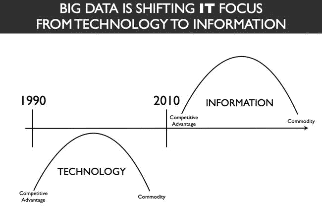

# 大数据：它是什么，以及你为何应该关心

搜索互联网，你会找到数十个关于大数据的定义。有“三 V”——体量（Volume）、多样性（Variety）和速度（Velocity）。也有一些更技术性的定义，比如 O'Reilly Media 的分析师埃德·邓比尔（Edd Dumbill）给出的这个定义：“大数据是指超出了传统数据库系统处理能力的数据。这些数据太大、变化太快，或者不符合数据库架构的约束条件。为了从这些数据中获取价值，你必须选择一种替代的方法来处理它。”`¹`

# 大数据的真正价值

这些定义虽然准确，却忽略了大数据的真正价值。大数据的衡量标准应该是其影响力的大小，而非其消耗的存储空间或处理能力。很多时候，关于大数据的讨论都陷入了几`TB`（太字节）和`PB`（拍字节）的泥潭，以及如何存储和处理数据，而不是如何使用数据。

作为消费者和商业用户，数据的规模和体量并不是我们关心的。相反，我们希望能够提出并回答那些对我们至关重要的问题。我们应该服用什么药物来治疗严重的健康问题？我们应该给学生提供哪些信息、学习工具和练习，以帮助他们更有效地学习？我们应该在营销活动上多花多少钱？我们新产品的哪些功能正在被客户使用？

这才是大数据的真正意义所在。它指的是以比以往低得多的成本，获取和分析数据，并从数据中获得可操作洞察的能力。

大数据真正的变革性在于我们现在使用数据的便捷性。我们不再需要那些需要数月或数年才能搭建和使用的复杂软件。几乎所有我们需要的分析能力，都可以通过简单的软件下载或在云端获得。

我们不再需要昂贵的设备来收集数据。现在，我们可以从汽车中收集性能和驾驶数据，从`GPS`手表中收集健康和位置数据，甚至可以通过手机的低成本附件收集个人健康数据。正是这些能力的结合——大数据与云计算和移动技术的融合——才真正改变了游戏规则，让数据的使用和应用变得简单。

 **注意** 大数据具有变革性：你不需要复杂的软件或昂贵的数据收集技术来利用它。大数据与云端和移动世界的结合，正在改变所有规模企业的竞争格局。

## 大数据进入主流视野

那么，为什么大数据会突然变得如此火爆？大数据之所以进入主流视野，是由于三大趋势的汇聚。

首先，多家备受瞩目的消费品公司加大了对大数据的应用。社交网络巨头`Facebook`利用大数据追踪其网络内的用户行为。该公司通过分析您还认识谁，来为您推荐新朋友。

您的朋友越多，您在`Facebook`上保持活跃的可能性就越大。更多的朋友意味着您会浏览更多内容、分享更多照片、发布更多状态更新。

商务社交网站`LinkedIn`利用大数据将求职者与工作机会联系起来。有了`LinkedIn`，猎头不再需要给潜在员工打冷电话。他们可以通过一次简单的搜索找到并联系他们。同样，求职者也可以通过联系网站上的其他人，获得向潜在招聘经理进行“暖介绍”的机会。

`LinkedIn`首席执行官`杰夫·韦纳`最近谈到了该网站的未来及其“经济图谱”——一个全球经济的数字地图，它将实时识别“指向经济机会的趋势”。² 实现这样一个图谱及其预测能力所面临的挑战，正是一个大数据问题。

其次，这两家公司（`Facebook`和`LinkedIn`）都在过去几年内上市了——`Facebook`在纳斯达克上市，`LinkedIn`在纽交所上市。尽管这些公司和谷歌表面上是消费品公司，但它们的核心实际上是庞大的大数据公司。

这些公司的上市——连同运营智能软件提供商`Splunk`和可视化公司`Tableau Software`的上市——极大地提高了华尔街对大数据业务的兴趣。

因此，硅谷的风险投资家们正以前所未有的热情排队资助大数据公司。大数据正在定义下一波重大的创业浪潮，而硅谷希望在未来几年内将这些公司推向华尔街。

`Facebook`的早期投资者`Accel Partners`在2011年底宣布设立一只1亿美元的大数据基金，并于2012年初进行了首次投资。`Zetta Venture Partners`是2013年推出的一个新基金，专门专注于大数据分析。`Zetta`由`马克·戈伦伯格`创立，他曾是`Hummer Winblad`的董事总经理。³ 知名投资者`Andreessen Horowitz`、`Greylock Partners`等也在该领域进行了多项投资。

第三，作为亚马逊、`Facebook`、`LinkedIn`以及其他以数据为核心的消费产品的活跃用户，商业人士开始期望在工作中也能获得与在家中同样快速便捷的大数据访问体验。如果互联网零售商亚马逊能够利用大数据推荐要读的书、要看的电影和要购买的商品，那么商业用户认为他们自己的公司也应该能够利用大数据。

例如，为什么一家租车公司不能更智能地为租车者推荐合适的车辆呢？毕竟，公司拥有该人过去租车的记录和当前可用车辆的信息。但借助新技术，该公司还能获取关于特定市场动态的公开信息——有关可能影响市场需求和可用性的会议、活动及其他活动的信息。

通过将内部供应链数据与外部市场数据相结合，公司应该能够更准确地预测哪些车辆应该在何时投入使用。

同样，零售商应该能够结合内部和外部数据，逐日设定产品价格、陈列位置和品类组合。通过考虑从产品供应情况到消费者购物习惯（包括哪些产品倾向于一起畅销）等多种因素，零售商可以提升平均购物篮大小，从而获得更高利润。这反过来又能确保在正确的时间有正确的商品库存，从而保持客户满意度。

因此，尽管大数据似乎在一夜之间变得炙手可热，但实际上，大数据是多年软件开发、市场增长以及消费者和商业用户被压抑的需求共同作用下的最终成果。

## 谷歌如何践行大数据计划

如果说有一家科技公司抓住了这一需求并成为了大数据的典范，那便是搜索引擎巨头谷歌公司。据谷歌称，该公司每月处理的搜索查询量高达惊人的1000亿次。⁴

但谷歌存储的不仅仅是搜索结果中出现的网站链接。它还存储了人们进行的所有搜索，这使得该公司对人们搜索行为的时间、内容和方式拥有无与伦比的洞察力。

这些洞察意味着，谷歌可以优化其展示的广告，从而比全球几乎所有其他公司更好地将网络流量变现。这也意味着谷歌可以预测人们接下来会搜索什么。换句话说，在你搜索之前，谷歌就已经知道你在找什么了！

多年来，谷歌不得不处理海量的非结构化数据，例如网页、图像等，而不是更传统的结构化数据，比如包含姓名和地址的表格。因此，谷歌的工程师从零开始开发了创新的大数据技术。这样的机会帮助谷歌吸引了一支才华横溢的工程师队伍，这些人正是被谷歌技术挑战的独特规模和体量所吸引。

该公司的另一个优势是其基础设施。谷歌搜索引擎本身就是为在数十万台服务器上无缝运行而设计的。如果需要更多的处理能力或存储空间，或者某台服务器出现故障，谷歌的工程师只需添加更多服务器即可。据估计，谷歌的服务器总数已超过一百万台。

# 谷歌的大数据技术

谷歌的软件技术在设计之初就考虑了这种基础设施。其中有两项技术尤为突出，即 `MapReduce` 和 `谷歌文件系统`，它们在 2012 年夏季被《连线》杂志报道为“重塑了谷歌构建搜索索引的方式”。⁵

如今，许多公司都在拥抱 `Hadoop`，它是 `MapReduce` 和 `谷歌文件系统` 的开源衍生品。`Hadoop` 由雅虎公司基于谷歌一篇关于 `MapReduce` 的论文率先开发，它支持在多台计算机上对大型数据集进行分布式处理。

当其他公司才刚刚开始使用 `Hadoop` 时，谷歌已经大规模应用大数据技术多年，这让它在行业中占据了巨大优势。与此同时，谷歌正将重心转向其他更新的技术。这些技术包括用于内容索引的 `Caffeine`、用于映射关系的 `Pregel`，以及用于查询海量数据的 `Dremel`。`Dremel` 是该公司 `BigQuery` 服务的基础。⁶

现在，谷歌正将其在数据处理方面的一些投资开放给第三方。`Google BigQuery` 是一项网络服务，允许对包含数十亿行数据的海量数据集进行交互式分析。`BigQuery` 是一种按需的云端数据分析服务。2014 年，谷歌推出了 `Cloud Dataflow`，作为 `Hadoop` 和 `MapReduce` 的继任者，它能够处理大批量的批处理数据和流式数据。

以前，公司必须购买昂贵的安装软件并建立自己的基础设施才能进行此类分析。借助 `BigQuery` 这样的服务，这些公司现在无需进行巨额前期投资就能分析大型数据集。

谷歌还能获取海量的机器数据，这些数据来源于用户在其网站及其整个网络上进行的搜索。每当有人输入搜索查询，谷歌就知道此人在寻找什么。人们在互联网上的每一个动作都会留下痕迹，而谷歌恰好能够很好地捕捉并分析这些痕迹。

然而，谷歌掌握的数据远不止搜索数据。公司安装 `Google Analytics` 等产品来追踪自己网站的访客，谷歌也能获取这些数据。网站使用 `Google AdSense` 在自己的网站上展示来自谷歌广告商网络的广告，因此谷歌不仅了解广告在自己网站上的表现，还能洞悉广告在其他发布者网站上的情况。谷歌还拥有来自 `Google Maps` 和 `Google Earth` 的大量地图数据。

将所有数据整合在一起，其结果是，一项业务不仅能从最顶尖的技术中受益，还能从最优质的信息中获益。在信息技术方面，许多公司都在 IT 的“技术”部分投入巨资，但很少有公司能像谷歌那样，在 IT 的“信息”部分投入同样巨大且卓有成效。

 **注释** 在信息技术领域，最具前瞻性的公司在信息方面的投入与在技术方面的投入一样多。

## 大数据如何助力亚马逊成为全球最大零售商的雄心

当然，谷歌并非唯一一家将大数据投入应用的大型科技公司。互联网零售商亚马逊已采取了一些激进的举措，并且可能对谷歌以数据驱动的主导地位构成最大的长期威胁。

至少有一位分析师预测，到 2015 年亚马逊的收入将超过 1000 亿美元，这将使其有望超越沃尔玛，成为全球最大的零售商。与谷歌类似，亚马逊手中也掌握着海量数据，尽管其数据更偏向电子商务性质。

每当客户在其网站上搜索要观看的电视节目或要购买的商品时，亚马逊对该客户的了解就会增加一分。基于搜索和产品购买行为，亚马逊可以判断出接下来应该推荐哪些产品。

该公司甚至比这还要智能。它不断在其网站上测试新的设计方案，以找出哪种方案能带来最高的转化率。

你以为亚马逊网站页面上某段文字只是恰好放在那里？再想想吧。布局、字体大小、颜色、按钮以及公司网站设计的其他元素都经过了精心的反复测试，以确保达到最佳效果。

数据驱动的方法还不止于此。据多位前员工透露，公司文化是冷酷无情地以数据为导向。数据会显示什么行得通，什么行不通，而任何新的业务投资理由都必须有数据支撑。

这种对数据的持续关注使得亚马逊能够提供更低的价格和更好的服务。消费者往往直接登录亚马逊网站搜索要购买的商品或直接下单，完全跳过了谷歌等搜索引擎。

对消费者的争夺战甚至蔓延到了更广阔的领域。苹果、亚马逊、谷歌和微软——合称“四巨头”——不仅在线上展开激烈竞争，在移动领域亦是如此。

随着消费者将越来越多的时间花在手机和平板电脑上，而不是电脑前，拥有消费者手中移动设备的公司将具备最强的向该消费者销售产品的能力，并能最深入地洞察其行为。一个公司掌握的关于消费者群体和个体的信息越多，就越能有效地向这些消费者定向投放内容、广告和产品。

令人难以置信的是，亚马逊的影响力从支撑新兴科技公司的基础设施，一直延伸到了人们消费内容的移动设备上。多年前，亚马逊就预见到了将其电子商务平台支柱——服务器和存储基础设施——向他人开放的价值。

`Amazon Web Services`（AWS），作为该公司的公有云服务，为新兴公司和成熟公司提供可扩展的计算和存储资源。虽然 AWS 仍处于增长的相对早期阶段，但一位分析师估计，该服务的年收入运行率已超过 38 亿美元。⁷

这种易于获取的计算能力的普及，为新的数据计划铺平了道路。当然，公司仍然可以并且会继续以私有云的形式投资建设自己的私有基础设施。当涉及到特定的安全、监管或可用性问题时，私有云——即公司在内部管理和托管的云——是合理的。

但如果公司想要快速利用额外的或可扩展的计算资源，他们只需在亚马逊的公有云中启动一批服务器实例即可。更重要的是，亚马逊还在持续降低其计算和存储服务的价格。凭借其巨大的购买力和基础设施规模，它能够以远低于其他大多数大公司所能获得的价格来协商采购计算机和网络设备。亚马逊的 `Web Services` 服务不仅通过其面向消费者的网站和 `Kindle Fire` 等移动设备脱颖而出，还通过支撑数千个其他流行网站的基础设施占据了核心地位。

其结果是，大数据分析不再需要前期对固定成本的 IT 进行投资。用户只需在需要时购买更多的计算能力进行分析或购买更多的存储空间来保存数据。数据捕获和分析可以在云端快速轻松地完成，用户无需就 IT 基础设施做出昂贵的前期决策。相反，他们可以根据实际需要，仅在需要的时间和期限内购买满足其大数据需求的计算和存储资源。

如今，企业可以捕获和分析前所未有的数据量——这些数据在过去是它们根本无力分析或存储而不得不丢弃的。

 **注意** 大数据最强大的特性之一在于其可扩展性。借助云计算资源（包括分析和存储），企业在数据存储、处理与价值挖掘方面，如今已不再有容量限制。

# 大数据最终带来信息优势

`Amazon Web Services` 等基础设施与 `Hadoop` 等开源技术的普及，意味着企业终于能够实现 IT 界长期承诺的种种好处。

几十年来，IT 领域的焦点始终是“技术”本身。首席信息官（`CIO`）的职责是购买并管理服务器、存储设备和网络。

然而，如今为企业带来竞争优势的，却是信息以及基于信息进行存储、分析和预测的能力（图 1-1）。在 IT 技术刚刚普及时，早期采用的企业能够更快行动、执行更优，从而超越那些未采用的企业。有人认为，微软在 20 世纪 90 年代的崛起，不仅得益于其交付了全球最广泛使用的操作系统，更在于公司内部率先拥抱电子邮件，将其作为标准沟通机制。

图 1-1. 信息正在成为曾经技术所扮演的关键资产角色

当许多公司还在犹豫是否以及如何采用电子邮件时，微软内部已将其作为讨论新员工招聘、产品决策、营销策略等事宜的实际沟通工具。虽然电子群组通讯如今已司空见惯，但在当时，这赋予了微软相比那些尚未采用电子邮件的公司更快的速度和更强的协作优势。

那些拥抱数据，并在整个组织内推动数据民主化使用的公司，将获得类似的优势。谷歌和 Facebook 等公司已从这种数据民主化中获益。通过向组织内的分析师、经理和高管开放内部数据分析平台，谷歌、Facebook 等公司使得组织内的每个人都能快速地向数据提出业务问题，并获得所需答案。正如 Facebook 前大数据负责人 Ashish Thusoo 所言，新技术已将讨论的话题从“存储什么数据”转变为“有了更多数据我们能做什么？”

例如，Facebook 将其大数据工作作为一个内部服务来运行。这意味着该服务并非为工程师设计，而是为最终用户——那些需要运行查询来弄清楚什么有效、什么无效的直线经理——设计的。因此，经理们无需等待数天或数周才能知道哪些网站更改最有效，或哪种广告方法效果最佳。他们可以利用内部大数据服务实时获得业务问题的答案。并且，该服务从运营稳定性到社交功能（使数据分析结果易于与同事分享）等方方面面，都充分考虑了最终用户的需求。

过去的二十年是属于 IT 中“技术”的二十年。相比之下，接下来的二十年将是属于 IT 中“信息”的二十年。那些能够更快处理数据，并整合公共与内部数据源的公司，将获得独特的洞察力，从而超越竞争对手。正如大数据初创公司 `SpaceCurve` 的创始人兼 CTO `J. Andrew Rogers` 所说：“分析数据的速度越快，其预测价值就越大。”企业正从批处理（即先存储数据，事后再对数据运行缓慢的分析处理）转向实时分析，以获取竞争优势。

对于高管们来说，好消息是，大数据带来的信息优势不再仅为谷歌和亚马逊这样的公司所独享。像 `Hadoop` 这样的开源技术正使得众多其他公司——无论是老牌的《财富》1000 强企业还是新兴初创公司——都能够以合理的成本利用大数据获得竞争优势。大数据确实带来了长期承诺的信息优势。

## 大数据正在颠覆什么

大数据带来的巨大颠覆，不仅仅在于能够比过去捕获和分析更多的数据，更在于能够以低一个数量级的价格实现这一点。随着价格下降，消耗量反而上升。这种具有讽刺意味的反转被称为*杰文斯悖论*，得名于这位对工业革命做出此观察的经济学家。随着技术进步使数据存储和分析更加高效，企业进行的分析不是变少了，而是大大增加了。简而言之，这就是大数据的颠覆性所在。

从亚马逊到谷歌，从 IBM 到微软，许多大型科技公司都在涉足大数据。与此同时，数十家初创公司如雨后春笋般涌现，提供开源和基于云的大数据解决方案。当大公司专注于横向的大数据解决方案——用于通用分析的平台——时，小公司则专注于为特定业务线和关键垂直领域提供应用程序。一些产品优化销售效率，而另一些产品则通过将多个不同渠道的营销表现与实际的产品使用数据进行关联，为未来的营销活动提供建议。还有大数据产品可以帮助企业更高效地招聘员工，并在招聘后留住他们。

还有一些产品通过分析海量的调查数据，提供对客户需求的洞察。大数据产品可以评估医疗记录，帮助医生和制药公司提供更好的医疗服务。创新的应用程序现在可以利用学生的出勤率和考试成绩统计数据，帮助学生更有效地学习，并提高完成学业的几率。从历史上看，我们很容易说没有所需的数据，或者数据太难分析了。而现在，这些大数据应用的普及意味着公司无需在内部开发和部署所有的大数据技术。在很多情况下，他们可以利用基于云的服务来满足分析需求。大数据正在让数据本身，以及分析和获取可执行洞察的能力，变得比以往任何时候都更容易、更便捷。这确实是颠覆性的。

## 改变你工作方式的大数据应用

大数据应用（`Big Data Applications`， `BDAs`）代表了大数据领域的下一波浪潮。行业分析机构 `CB Insights` 研究了大数据领域的融资情况，报告称仅 2013 年上半年，大数据公司就筹集了约 12.8 亿美元。此后，投资者继续向现有基础设施企业注入资金。`Hadoop` 软件的商业供应商 `Cloudera` 公司于 2014 年 3 月宣布了一轮 9 亿美元的巨额融资，使该公司的总融资额达到 12 亿美元。

展望未来，焦点将从处理大量数据所需的基础设施，转移到如何利用这些数据上来。问题将不再是“在哪里以及如何存储大量数据”。相反，用户会问“如何利用所有这些数据来获得洞察和竞争优势”。

 **注意** 创建和提供处理大数据所需基础设施的时代已近尾声。展望未来，焦点将集中在一个关键问题上：“我们如何利用所有数据来创造新产品、销售更多产品，并全面超越我们的竞争对手？”

`Splunk`，一家运营智能公司，就是一个现成的例子。从历史上看，企业不得不以一种相对手动的流程，使用自己开发的脚本来分析*日志文件*——那些由构成其 IT 系统的网络设备和服务器生成的文件。IT 管理员不仅要维护企业基础设施的服务器、网络设备和软件，还必须以脚本形式构建自己的工具，以确定这些系统所产生问题的根源。而这些系统生成了海量的数据。每次用户登录或访问文件，每次软件生成警告或错误，这些都是管理员必须梳理的数据，以查明情况。

借助 `BDA`，企业不再需要自己构建工具。他们可以利用预先构建好的应用程序，专注于运营业务。例如，`Splunk` 的软件可以通过搜索 IT 日志文件并可视化问题的位置和频率，轻松找到基础设施问题。当然，该公司的软件主要是*安装型软件*，这意味着它必须安装在客户的站点上。

基于云的 `BDA` 有望使企业完全无需安装任何硬件或软件。在某些方面，它们可以被看作是软件即服务（`SaaS`）产品之后的合理下一步。`SaaS`，即通过互联网交付的软件产品，已经相对成熟。例如，`Salesforce.com`，它在十多年前首次引入了“无软件”的概念，如今已成为云端客户关系管理（`CRM`）的事实标准，这是一种帮助企业管理客户列表和关系的软件。`SaaS` 将软件转变为一种可以随时随地被使用、且用户几乎无需维护的产品。就像 `SaaS` 改变了我们访问软件的方式一样，`BDA` 正在改变我们访问数据的方式。此外，`BDA` 正在将软件的价值从软件本身转移到那些软件使我们能够操作的数据上。换句话说，`BDA` 有潜力将当今的技术公司转变为未来极具价值的信息企业。

`BDA` 正在同时改变我们的工作和个人生活。例如，`Opower` 正在改变能源的消耗方式。该公司与 75 家不同的公用事业公司合作，追踪全美约 5000 万家庭的能源消耗情况。公司利用来自智能电表（一种追踪家庭能源使用情况的设备）的数据，为消费者提供详细的能源消耗报告。即使是能源消耗上的微小变化，当它扩展到数千万个家庭时，也能产生巨大影响。就像谷歌可以访问海量的关于消费者在互联网上行为的数据一样，`Opower` 也掌握着大量关于人们在能源使用方面行为的数据。这类数据最终将赋予 `Opower` 以及类似公司高度差异化的洞察力。虽然该公司从提供能源报告起步，但通过持续积累其信息资产，它将很好地定位为一家大数据企业。⁹

然而，`BDA` 并非只出现在商业领域。各公司正在开发许多其他能够对我们的日常生活产生积极影响的数据应用程序。举个例子，一些移动应用程序会追踪健康相关的指标，并提出改善人类行为的建议。这类产品有望减少肥胖、提高生活质量并降低医疗成本。它们也证明了，最具有创新性和变革性的大数据应用可能出现在新型移动设备、大数据和云计算的交汇之处。

## 大数据助力迈向实时处理

如果说过去几年的大数据是关于以更低成本捕获、存储和分析数据，那么接下来的几年将是关于加速对这些数据的访问，并使我们能够实时地对其进行操作。如果你曾经点击过网站按钮却只看到等待屏幕，你就会知道等待交易完成或报告生成是多么令人沮丧。相比之下，谷歌搜索结果的响应时间则截然不同。谷歌在 2010 年推出的`Google Instant`，可以在你输入时实时显示搜索结果。通过引入这一功能，谷歌对典型搜索的搜索结果页面展现量增加了五到七倍。当这个界面刚推出时，人们并不确定是否喜欢它¹⁰。而仅仅几年后的今天，没有人能想象没有它的生活。

数据分析师、经理和高管们希望在了解其业务时获得`Google Instant`那样的即时性。随着这些大数据用户追求越来越快的结果，仅仅采用大数据技术将不再足够。持续的竞争优势将不再来自大数据本身，而是来自比他人更快地从信息资产中获取洞察的能力。像`Google Instant`这样的界面展示了即时访问的强大力量。

根据 IBM 的说法，“我们每天产生 2.5×10¹⁸字节的数据——如此之多，以至于世界上 90%的数据都是在过去两年内创造的。”¹¹行业研究公司 `Forrester` 估计，企业数据总量每年增长 94%。¹²

面对这种增长，每家公司都需要一个大数据路线图。至少，公司需要有一个捕获数据的策略——从内部计算机系统生成的机器日志文件到网站上的用户交互——即使他们直到后来才决定如何处理这些数据。正如 Rogers 所说：“数据的价值远超你最初的预期——不要丢弃它。”

**提示** “数据的价值远超你最初的预期——不要丢弃它。” ——`J. Andrew Rogers`，`SpaceCurve` 公司 CTO。

公司需要为其数据的指数级增长做好规划。尽管照片、即时消息和电子邮件的数量非常庞大，但由联网“传感器”（如手机、`GPS` 和其他设备）生成的数据量则要大得多。理想情况下，公司应具有一个愿景，使数据分析能够在整个组织内进行，并且尽可能接近实时地完成。通过研究谷歌、亚马逊、`Facebook` 和其他科技领导者的大数据方法，你可以看到大数据能实现什么。在此基础上，你可以在自己的组织中制定有效的大数据策略。

那些在大数据方面取得成功的公司还为其组合增加了一个关键要素：一位大数据领导者。如果你无法从中获取洞察，那么世界上所有的数据都毫无意义。你的大数据领导者——无论是首席数据官还是数据洞察副总裁——不仅可以帮助你的整个组织制定正确的战略，还可以指导你的组织获得其所需的可操作洞察。

像谷歌和亚马逊这样的公司多年来一直利用数据驱动决策，并在此过程中取得了巨大的成功。有了大数据，你现在也可以利用这些能力。你将在第 3 章中读到更多关于如何利用这些能力并制定你自己的大数据路线图的内容。但首先，让我们看看整个大数据领域中令人难以置信的市场驱动力和创新技术。¹³

---

¹ `http://radar.oreilly.com/2012/01/what-is-big-data.html`
² `http://www.linkedin.com/today/post/article/20121210053039-22330283-the-future-of-linkedin-and-the-economic-graph`
³ `Zetta Venture Partners` 是我所在公司 `Content Analytics` 的投资方。
⁴ `http://phandroid.com/2014/04/22/100-billion-google-searches/`
⁵ `http://www.wired.com/wiredenterprise/2012/08/googles-mind-blowing-big-data-tool-grows-open-source-twin/`
⁶ `http://www.wired.com/wiredenterprise/2012/08/googles-dremel-makes-big-data-look-small/`
⁷ `http://www.zdnet.com/amazons-aws-3-8-billion-revenue-in-2013-says-analyst-7000009461/`
⁸ `http://www.cbinsights.com/blog/big-data-funding-venture-capital-2013`
⁹ `http://www.forbes.com/sites/davefeinleib/2012/10/24/software-is-dead-long-live-big-data-2/`
¹⁰ `http://googleblog.blogspot.com/2010/09/google-instant-behind-scenes.html`
¹¹ `http://www-01.ibm.com/software/data/bigdata/what-is-big-data.html`
¹² `http://www.forbes.com/sites/ciocentral/2012/07/05/best-practices-for-managing-big-data/`
¹³ 本章部分素材来源于我以特约撰稿人身份发表在《哈佛商业评论》（中文版）2013 年 1 月刊上的文章。

