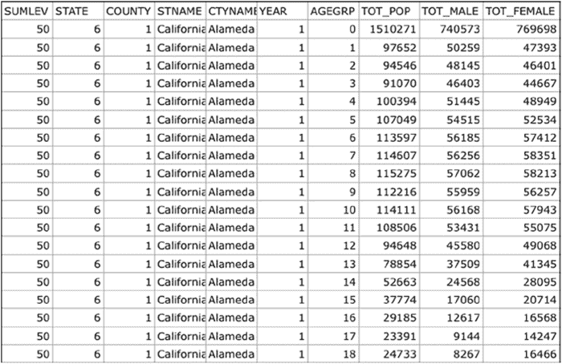
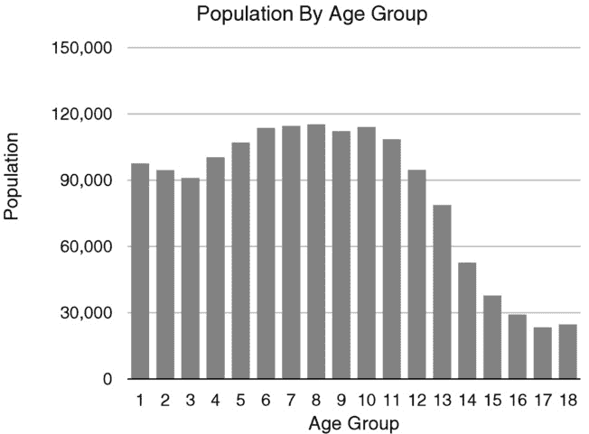
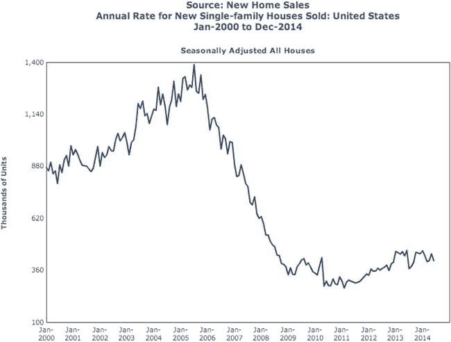
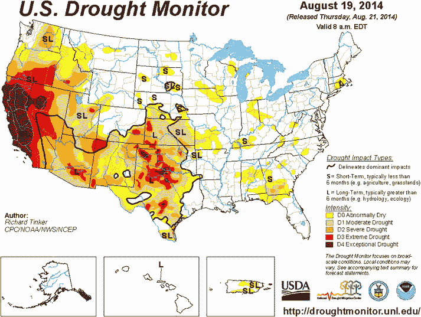
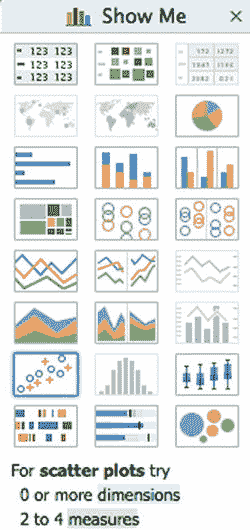
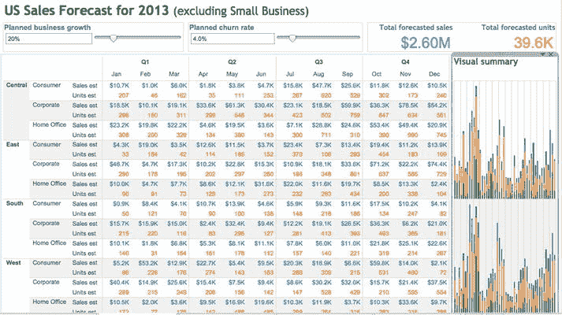
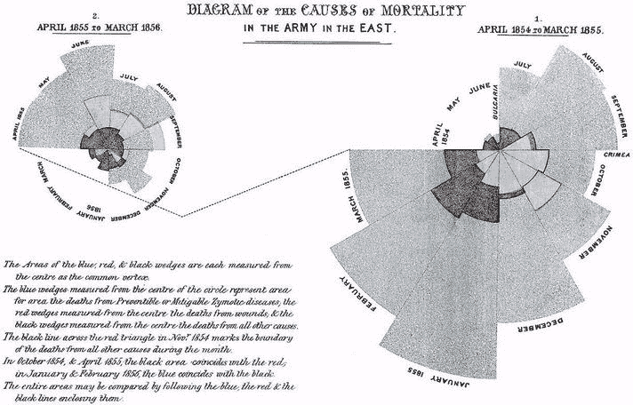

# 一图胜千言

## 大数据如何讲述故事

这是你第一次来到华盛顿特区。抵达美国首都后，你兴奋地想要参观所有纪念碑和博物馆，看看白宫，并攀登华盛顿纪念碑。要从一个地方到另一个地方，你需要乘坐当地的公共交通系统——地铁。这看起来很简单。但有一个问题：你没有地图。

想象一下，咨询台的工作人员没有给你地图，而是递给你一张按字母顺序排列的站点列表、地铁线路名称和地理坐标。理论上，你拥有了在华盛顿地铁中导航所需的所有信息。但实际上，要弄清楚乘坐哪条线路以及在哪里上下车，将是一场噩梦。

幸运的是，咨询台还有同一数据的另一种表现形式。那就是华盛顿特区的地铁图，它按不同线路顺序显示所有站点，每条线路用不同颜色标示。图上还标明了每条线路的交汇点，这样你就能轻松知道在哪里换乘。突然之间，乘坐地铁变得轻而易举。

地铁图不仅仅给了你数据——它还给了你知识。

你不仅知道该乘坐哪条线路，还大致知道到达目的地需要多长时间。无需多想，你就能看到到达目的地有八站，每站之间间隔几分钟，因此从你所在位置到，比如说，航空航天博物馆，需要稍多于 20 分钟。不仅如此，你不仅能通过名称或终点站来识别每条地铁线路，还能通过颜色：红色、蓝色、黄色、绿色或橙色。每条线路都有独特的颜色，你在地图上就能识别出来——当你在站内寻找正确线路时，也能从地铁墙壁上看到。

这个简单的例子说明了可视化的强大魅力。通过混合运用颜色、布局、标记和其他元素，可视化能在几秒钟内向我们展示纯数字或文本可能需要几分钟甚至几小时才能传达的信息——如果我们还能从中得出结论的话。

为了让你更直观地理解，华盛顿特区地铁仅有 86 个站点。而由东京地铁和都营地铁组成的东京地铁系统，大约有 274 个站点。算上东京大都市区的所有铁路网，总共有约 882 个站点。如此多的站点，如果没有地图，几乎不可能导航。

## 趋势发现

如果你曾使用过电子表格，你就会亲身体验到在大量填满数字的单元格中发现趋势有多困难。表 5-1 是 2010 年加州阿拉米达县的一个美国人口普查数据示例。

**表 5-1.** 表格形式的美国人口普查人口数据

与电影《黑客帝国》中数字看起来像图像、图像看起来像数字的情况不同，电子表格并不那么容易解读。这就是像 `Microsoft Excel` 和 `Apple Numbers` 这类程序内置图表创建功能的原因之一。当我们以图形形式（如图 5-1 所示）查看时，表 5-1 中展示的人口普查数据就容易理解得多。

**图 5-1.** 按年龄分组的美国人口普查人口数据可视化形式

当我们看到饼图或柱状图之类的图表时，通常更容易看出事物随时间或相对变化的情况。

事物随时间的变化在做决策时至关重要。单个数据点本身往往不足以说明事情的进展，无论你关注的是销售趋势还是健康数据。

图 5-2 显示了美国人口普查局从 2000 年开始的新房销售数据。如果我们只看 2000 年 1 月的数值（87.3 万），这本身说明不了太多问题。但当我们观察新房销售随时间的变化时，情况就一目了然了。我们能清晰地看到，在房地产泡沫高峰期的新房销售与今天的新房销售之间存在着多么巨大的差异。

**图 5-2.** 美国人口普查新房销售数据随时间变化的可视化展示

使用这种视觉趋势分析是理解数据的关键方法之一。例如，投资者经常评估一家公司在一段时间内的表现。一家公司可能会报告某个季度的收入和利润。如果没有对公司前几个季度财务表现的了解，投资者可能会得出该公司经营良好的结论。

但这个时间点数据无法告诉投资者的是，该公司的销售额每个季度都在不断下滑。因此，尽管总的销售额和利润看起来不错，但实际上，如果找不到提高利润的方法，这家公司将会走向破产。

*内部环境*是管理者和投资者用来判断业务趋势的关键指标之一。同时，管理者和投资者也需要*外部环境*，它能告知他们与同行相比自身表现如何。

假设某个季度的销售额下降了。管理者可能会得出结论，认为公司执行不力。然而，实际上销售额下降可能是由于更广泛的行业问题——例如，房地产行业新建房屋减少，或航空业旅行减少。缺乏外部环境，即没有同行企业在同一时期的表现数据，管理者就很难洞察导致业务受损的真正原因。

即使管理者同时掌握了内部和外部环境信息，仅凭抽象的数字依然难以判断实际情况。这时，数据可视化就能真正发挥其作用。

## 可视化的多种类型

几乎每位商业用户都熟知常见的饼图、柱状图或折线图。在将数据转化为可视化形式时，这些只是冰山一角。还有许多其他类型的可视化方法。

地理可视化对于展示位置信息非常有用。这类可视化通常还叠加了额外信息。例如，它们可以展示人口密度、商店位置、收入分布、天气模式以及其他有助于直观查看的数据。图 5-3 将地理信息（美国地图）与天气数据相结合，直观地展示了截至 2014 年 8 月美国有多少地区正遭受干旱。⁴

图 5-3. 一种结合了地理与天气数据的可视化

地图可以显示路径信息，告知销售人员何时访问哪些地点，或者为驾驶员展示从一个地点到另一个地点的最佳路线。

网络图展示了连接与互联关系。网络图可以通过展示人员之间的关系，说明信息在组织中的流动方式。网络图还可以展示社交网络中的连接，或计算机网络中不同机器之间的连接。

时间序列可视化展示了事物随时间的变化规律。时间序列图表可以展示天然气、石油和煤炭等自然资源多年来的消耗情况，或者展示收入来源。时间序列可视化可以与地理可视化相结合，以展示人口密度或特定人群的赚钱能力随时间的变化。

信息图通常用于营销目的，它不仅以视觉形式展示数据，还整合了绘画、文字和图形，讲述关于数据的故事。

词云图，如图 5-4 所示，是一种有用的方式，将大量文本中最常出现的词语进行可视化。⁵ 这类可视化能轻松确定特定文本的核心内容。你可以使用多种工具创建词云图。一个易于使用的网络工具叫 Wordle，网址是 `wordle.net`。

图 5-4. 美国宪法的词云图

如今涌现出越来越多具有动态特性的可视化。与过去静态、固定的可视化不同，当今的交互式可视化允许用户与之互动，从而可以改变查看的时间段、放大特定地理区域以获取更多细节，或改变可视化中包含的变量组合，以不同的方式查看数据。交互式可视化结合了传统可视化的最佳特性——以图形形式呈现数据的强大能力——以及易于使用的现代动态分析能力。

 **注** 许多网站现在展示了每日海量涌现的各种令人惊叹的可视化作品。其中两个网站是 `visualizing.org` 和 `www.informationisbeautiful.net`。这些网站上的可视化作品可以作为创建自己引人注目的可视化作品的绝佳灵感来源。

## 如何创建可视化

有许多易于使用的工具可以帮助你创建自己的可视化。可视化工具既有在线版本，也有桌面版和移动版。`Google Public Data Explorer` 是开始创建可视化的一个好起点。该工具位于 `https://www.google.com/publicdata/directory`，内置了大量不同类型的公开可用数据。无需安装任何软件，你就可以尝试各种不同的可视化方式，并查看不同数据集随时间的变化。

还有一些在线工具可用于创建特定类型的可视化。例如，`CartoDB` (`cartodb.com`) 是创建地理可视化的有用工具。使用 `CartoDB`，只需几行代码，就可以轻松地将复杂地理数据集的交互式可视化嵌入到你的网站、博客或其他应用中。

如果你在构建自己的应用程序，`HighCharts` (`www.highcharts.com`) 是另一个可用的在线可视化资源。只需少量代码，就可以将在线数据加载到 `HighCharts` 中，它会完成以图表形式显示数据的繁重工作。

由于合规性、隐私或安全要求，你可能无法始终将数据上传到基于云的可视化工具。在这种情况下，你可以使用桌面软件应用程序，例如 `Tableau Desktop` 或 `QlikTech` 的 `QlikView`。如果你需要访问存储在 `Hadoop`、`Microsoft SQL Server`、`Oracle`、`Teradata` 或其他数据源中的数据仓库里的数据，可以使用 `Tableau` 和 `QlikView` 直接连接这些数据源。

这些程序还可以连接到基于文件的数据源，如 Excel 文件和文本文件。这意味着你可以访问各种不同的数据源，以及存储在多个数据仓库中的数据源，并轻松地对其中的数据进行可视化。

像 `Tableau Desktop` 这样的软件（参见图 5-5），使得在不同类型的可视化之间切换变得极其容易。这意味着你可以获取复杂的数据集，并快速尝试多种可视化方式，以找出哪种方式能以最引人注目的方式呈现你的数据。

图 5-5. `Tableau Desktop` 中的“向我显示”弹出窗口允许用户轻松在不同类型的可视化之间切换（由 Tableau Software 提供；经许可使用）

如图 5-6 所示，使用合适的工具，可以轻松地将原本难以解读的数据（例如销售预测）转化为引人注目、直观的可视化形式。

图 5-6. 在 `Tableau Desktop` 中显示的示例销售预测数据，右侧为对应的可视化视图（由 Tableau Software 提供；经许可使用）

无论您选择哪种工具，可视化都能让复杂数据变得易于理解。您不仅可以在演示中使用可视化图表，还可以将它们直接嵌入到网站和应用程序中。

## 使用可视化压缩知识

俗话说，一图胜千言。但这引出了一个问题：为什么可视化如此强大？正如可视化专家 David McCandless 所说，“可视化是一种知识压缩的形式。”⁶ 一种压缩形式是减小数据的大小，例如通过使用简写（如数字）来表示一个单词或一组单词。然而，虽然这种压缩使数据存储更高效，但并不能让数据变得更容易理解。

然而，一张图片可以获取大量信息，并以易于理解的形式呈现。在大数据领域，这类图片被称为可视化。

地铁图、饼图和条形图都是可视化的形式。尽管可视化乍看起来可能是个简单的问题，但出于一些原因，它其实很难。首先，通常很难将所有人们想要可视化的数据集中到一个地方，并保持一致的格式。内部和外部上下文数据可能存储在两个不同的地方。行业数据可能在市场研究报告中，而实际的公司销售数据可能存储在公司的数据库中。

其次，这两种形式的数据格式可能略有不同。公司销售数据可能按天存储，而行业数据可能只能按季度获取。

或者，特定数据项的名称可能不同；在行业报告中，硬盘可能被称为“hard drives”，但在内部销售数据库中，可能用型号来指代。这种形式的数据不一致性会使我们难以理解数据真正在告诉我们什么。数据不一致性问题没有银弹解决方案，但像 `Trifacta` 和其他更新的产品正在涌现，使这个问题更容易处理。

 **提示** 构建一个易于使用的托管数据清洗服务，仍然存在巨大的机遇。如今，许多数据一致性问题消耗了数据分析师原本可以用来解决业务问题的时间。托管的数据清洗和数据一致性服务可以通过结合算法和人工方法，大规模解决这个问题。

好消息是，现代可视化产品可以直接连接到各种数据源，从本地文件到数据库，再到像 `Hadoop` 这样的数据存储。通过获取所有这些数据并为其创建图像，数据可以变得不仅仅是数据。它可以变成我们可以据此行动的知识。

可视化是一种知识压缩的形式，因为一张看似简单的图像可以获取大量结构化或非结构化数据，并将其压缩成几条线条和几种颜色，从而快速高效地传达所有这些数据的含义。

## 为什么视觉信息如此强大？

在可视化领域，很少有人像 Edward Tufte 那样对该领域产生如此巨大的影响。*《纽约时报》* 称 Tufte 为“数据界的列奥纳多·达·芬奇”。

1982 年，Tufte 出版了 20 世纪最具定义性的著作之一 —— *《定量信息的视觉展示》*。尽管他的职业生涯始于教授政治学课程，但 Tufte 的毕生工作致力于理解和教授信息设计。

Tufte 的贡献之一是专注于让插图中的每一个数据点都有意义，并排除任何不相关的数据。Tufte 的图像不仅仅是传达信息；许多人认为他的图形是艺术作品。Tufte 证明了，可视化不仅是有用的商业工具，还可以以视觉上吸引人的方式传达数据。

虽然可能难以达到 Tufte 推广的一些图形方法的水准，但*信息图*（如今通常这么称呼）已成为传达信息的流行方式。

信息图不仅仅是好看。如同大数据的其他方面一样，视觉数据呈现为何如此引人入胜，是有科学解释的。

在一篇博客文章中，Tufte 引用了一篇发表在 *《当代生物学》* 上的文章相关的新闻稿，该文章描述了我们视觉吸收的信息量有多大。⁷ 根据这篇文章，宾夕法尼亚大学医学院的研究人员估计，人类视网膜“传输视觉输入的速度大约与以太网连接相同。”⁸

在他们的研究中，研究人员使用了豚鼠的完整视网膜，并配合一种称为多电极阵列的设备，该设备用于测量神经节细胞发出的电脉冲尖峰。神经节细胞将信息从视网膜传递到大脑。基于他们的研究，科学家能够估算出豚鼠视网膜中所有神经节细胞（总共约 10 万个）传递信息的速度。然后，科学家们计算了人类视网膜中相应细胞每秒传输的数据量。人类视网膜含有约 100 万个神经节细胞。将这些细胞加在一起，人类视网膜以大约每秒 10 兆比特的速度传输信息。

为了说明这一点，丹麦科普作家 Tor Norretranders 创建了一张图示，展示了我们感官的带宽。在这张图中，他指出我们通过视觉接收到的信息比通过任何其他感官都要多。如果我们通过视觉接收信息的速度与计算机网络大致相同，那么通过触觉接收信息的速度大约是视觉的十分之一，大约相当于 U 盘与计算机接口的速度。

我们通过耳朵和鼻子接收信息的速度更慢，大约是触觉的十分之一，或者与硬盘与计算机接口的速度大致相同；而我们通过味蕾接收信息的速度则更慢。

换句话说，我们通过眼睛获取信息的速度比通过任何其他感官快十倍到一百倍。因此，通过视觉传达的信息非常强大，这是有道理的。而且，如果这些信息包含大量数据，并被压缩成一个充满知识的可视化图像，我们就能更快地接收这些信息。

但这并不是视觉数据表示如此强大的唯一原因。另一个原因是，我们喜欢分享，尤其是喜欢分享图像。

## 图像与分享的力量

2012 年 11 月 22 日，照片分享服务 `Instagram` 的用户分享了很多照片。那是 `Instagram` 有史以来最繁忙的一天，用户在那天分享的照片数量是前一天的两倍。这是因为 11 月 22 日并非寻常的一天。那是感恩节。`Instagram` 用户上传了大约 1000 万张照片，这些照片的标题中提到了与感恩节相关的词语。可以毫不夸张地说，这包含了大量的火鸡照片，当然还有亲人的照片。现在每月约有 2 亿人使用该服务。⁹

2012 年初，Facebook 以 10 亿美元收购了 `Instagram`。Facebook 在分享照片方面也毫不逊色。截至 2013 年底，Facebook 用户平均每天上传 3.5 亿张照片，每月超过 100 亿张。¹⁰

# 我们为何热爱图像：信息图表的魅力

我们热爱照片的另一个原因，当然是因为现在拍摄照片变得如此容易。就在几年前，我们还需要在拍摄的那一刻决定哪些照片该拍，哪些不该拍。如果胶卷快用完了，我们可能会把最后一张留到以后再用。但如今，数码相机、智能手机和廉价的存储设备使得捕捉几乎无限数量的数字图像成为可能。几乎每部智能手机现在都内置了摄像头。这意味着我们不仅可以拍摄所有这些照片，还可以轻松地上传和分享它们。

这种轻松捕捉和分享图像的能力向我们展示了这项活动是多么有趣和有回报。因此，当我们遇到有趣的信息图表时，我们自然也想分享它们。

和照片一样，如今创建信息图表也比过去容易得多。公司也有更多动力去创建这类图形。2011 年 2 月，搜索引擎巨头谷歌对其算法进行了调整，以奖励高质量网站，特别是那些“拥有原创内容和信息，如研究、深度报告、深入分析等的网站”。¹¹ 因此，公司的营销人员意识到，他们需要做更多工作才能让网站在谷歌搜索结果中获得高排名。

但是，对于一个信息有限的营销人员来说，要如何创建一份引人注目的研究呢？创建信息图表。信息图表可以整合广泛的数据源，将它们融合在一起，并讲述一个引人入胜的故事。这些故事可以是关于 `IE`、`Chrome`、`Firefox` 和 `Safari` 之间激烈的浏览器大战，也可以是关于众筹法案带来的就业机会。寻找引人注目的图表以融入作品的博主和记者们喜欢这类图形，因为读者喜欢观看和分享它们。

最有效的信息图表不仅仅是被发布到网上——它们会被分享，而且会被反复分享。其中一些会像病毒一样传播，在 `Twitter`、`Facebook` 和 `LinkedIn` 等社交网络上，以及通过传统邮件，被分享成千上万次，甚至数百万次。

随着对创建信息图表需求的增加，可用的公司和服务的数量也在增加。一个相对较新的进入者是 `Visual.ly`，这是一个创建信息图表的市场。该公司成立于 2011 年，专门帮助客户以图形方式传达复杂的数据。`CartoDB` 帮助人们创建地理可视化。即使是几乎没有统计学或分析背景的用户，也可以使用该公司的基于网页的设计工具。地理可视化是呈现数据（如人口密度、店铺位置、自然资源和销售路线）最具说服力的方式之一。

领先的公司，如 `QlikTech` 及其 `QlikView` 产品、`Tableau Software` 和拥有 `Spotfire` 的 `TIBCO`，都提供产品帮助人们创建用于报告、分析和营销的引人注目的静态和交互式可视化。同时，`Google Public Data Explorer` 允许人们在线探索公共数据集，例如人口增长和人均收入。

## 利用公共数据集

可视化工具的商业用户通常从创建仪表盘的角度来思考可视化。仪表盘获取关于销售、营销和供应链的数据，并将这些数据转化为管理层可以轻松审阅的有意义的图表。

但可视化的力量远不止于此。公共数据集指的是公众可获取且通常由政府或政府相关组织收集的数据。1790 年进行的第一次美国人口普查就是这类数据收集的一种形式。¹² 人口普查的结果提供了大量关于美国人口的信息，包括人口的构成及其地理分布。

在网上很容易找到公共数据集。一个有用的资源是 `data.gov`，它链接到种类繁多的公共数据源。这些数据源包括国家气象局数据、劳动数据、美国人口普查数据、经济活动数据以及一系列其他数据源。`NASA` 在其网站 `http://data.nasa.gov/` 上有许多有趣的数据源，包括具有历史意义的图像和来自火星探测器项目的图像。这些图像是很好的非结构化数据示例。它们在创建大数据规模的图像管理、分类和处理系统中极为有用。

另一个有趣的公共数据集是位于 `http://commoncrawl.org/` 的 `Common Crawl Corpus`。该语料库包含超过 50 亿个网页。这个数据集是开发处理大量非结构化文本的应用程序的宝贵资源。它对于开发检测文本模式、语言处理软件和搜索产品的机器学习算法也很有用。

公共数据源对于学习如何处理和可视化大量数据很有用。它们在进行真实世界的数据分析时也很有用。正如数据讲述者 `Hans Rosling` 所展示的那样，公开的人口和健康数据对于理解人口变化、国家的兴衰以及抗击婴儿死亡率和其它流行病的进展（或缺乏进展）极其有价值。¹³ `Rosling` 使用数据可视化来用数据讲故事，特别是公共数据，就像足球评论员使用比赛回放一样。

`Rosling` 将数据动画化。他不是用数据制作卡通片。相反，他在图表上绘制数据，然后展示数据如何随时间变化——例如，不同国家的相对人口或收入在 40 或 50 年期间如何演变。这种动画化让数据变得生动起来，而 `Rosling` 与他的儿子和儿媳一起开发的软件成为了 `Google Public Data Explorer` 的基础。

一些有史以来最著名的可视化，都是基于以新颖且引人注目的方式呈现公开可用数据。`Visual.ly` 在其网站上的一篇题为 `12 Great Visualizations That Made History` 的文章中展示了几个这样的图表。¹⁴ 其中一些可视化展示了正确的图形能产生多么巨大的影响。在一个例子中，`John Snow` 在 1854 年绘制的伦敦霍乱爆发地图帮助解释了受污染水井中的水是疾病传播的原因。

大约同一时期，另一个著名的、拯救生命的图表来自现代护理学之母 `Florence Nightingale`。`Nightingale` 使用玫瑰图（`coxcomb diagram`）来“向广泛的受众戏剧性地传达复杂的统计信息”。¹⁵

### 图 Figure 5-7

`Nightingale` 关于英国陆军死亡原因图表

特别是，`Nightingale` 的图表显示，对于英国陆军来说，许多死亡是可以预防的。死于非战斗原因的士兵比死于战斗相关原因的士兵更多。因此，她说服了政府重视利用卫生设施来降低死亡率的重要性。

## 实时可视化

大多数信息图表提供的信息本质上是静态的，即使 `Rosling` 创建的引人入胜的动画，也由历史数据构成。

# 信息图通常需要花费大量时间和精力来制作：它们需要数据、有趣的故事，以及能够以引人入胜的方式呈现数据的平面设计师。工作并没有就此结束；就像森林里倒下的树无人听见一样，信息图只有被分发、推广、共享和查看才具有真正的价值。而到了那时，数据本身可能已经过时数周或数月了。那么，如何呈现本质上是实时的数据，并以令人信服的方式进行可视化呢？

要让数据在实时中具有价值，必须满足三个条件。数据本身必须可用，必须有足够的存储空间和计算能力来存储和分析数据，并且必须有一种无需数日或数周工作就能令人信服地呈现数据的方式。

如果你认为实时了解数百万人的想法并能以视觉方式展示他们的想法听起来很牵强，不妨再想想。我们只需看看 2012 年总统选举就能确信这一点。

在过去几十年里，民意调查是由个别民调专家通过打电话询问人们意见或与他们当面交谈来进行的。通过将相对较少人群的民调与统计抽样方法相结合，民调专家能够预测选举结果，并就人们对重要政治议题的感受得出结论。

`Nielsen` 采用类似的统计方法进行电视收视率测量，`comScore` 在网络上也如法炮制。`Nielsen` 最初通过使用一种设备来检测 1000 人将收音机调到了哪些电台，从而进行媒体测量。¹⁶ 该公司后来将类似的方法应用于电视节目，这就是广为人知的 `Nielsen` 收视率。

这类测量方法至今仍被广泛使用，但与其他领域一样，大数据正在改变我们的测量方式。如果说在过去几年中，有一家公司对我们衡量公众舆论的能力影响最大——这项活动被称为`情感分析`——那非 `Twitter` 莫属。

事实上，就其大数据资产而言，`Twitter` 可能是最被低估的公司之一。截至 2012 年 10 月，`Twitter` 用户每天通过网络发送约 5 亿条推文（短文本消息），¹⁷ 这是海量的人类生成信息。而 2006 年时这个数字还是零。

通过评估推文中使用的词汇，计算机程序不仅能检测出哪些话题正在`流行`（即受到更多关注），还能就人们的感受和所持观点得出结论。

捕获和存储此类数据只是像 `Twitter` 这样的公司所面临的大数据挑战和机遇的一个方面。为了能够分析这些数据，该公司必须提供对推文流的访问，每秒近 5000 条文本消息，在总统辩论等活动期间，当用户每秒创建约 20000 条推文时，访问量甚至更大。接下来是分析这些推文以找出常见词汇的任务，最后，以有意义的方式呈现所有这些数据。这意味着要将所有这些推文转化为可视化信息。

处理如此海量的实时数据流是困难的，但并非不可能。`Twitter` 本身为通常所说的推文“数据洪流”提供了程序化接口。围绕 `Twitter`，像 `DataSift` 这样的公司也应运而生，提供类似的数据访问服务。

其他公司，例如最近被 `WealthEngine` 收购的 `BrightContext`，则提供实时情感分析工具。在 2012 年总统辩论期间，《华盛顿邮报》使用了 `BrightContext` 的实时情感模块来测量和绘制观众观看辩论时的情感图表。¹⁸ 最近被 `Apple` 收购的实时搜索公司 `Topsy`，已经索引了约 2000 亿条推文。该公司为 `Twitter` 的政治指数（称为 `Twindex`）提供了技术支持。`Vizzuality` 专注于地理空间数据映射，并为《华尔街日报》的选举地图提供了技术支持。

所有这些系统的工作原理都是处理海量的非结构化数据（以文本形式），并将这些数据以视觉形式呈现。

与基于电话的民意调查（耗时且每次访谈成本约 20 美元）相比，实时测量的成本仅仅是计算周期，并且可以以前所未有的规模进行。此处提到的一些公司的产品，则可以提供收集到的数据的实时可视化。

但这种可视化并不局限于在网站上显示实时信息。被《时代》杂志评为 2012 年最佳发明之一的 `Google Glass`，¹⁹ “是一台嵌入眼镜框中的计算机，它将使增强现实成为我们日常生活的一部分。”²⁰ 未来，我们不仅能在电脑和手机上看到数据的可视化呈现，还能在我们移动和探索周围世界时，更好地通过视觉理解和认知物理世界。

如果这听起来像是科幻小说里的情节，那你就错了。如今，`Google Glass` 售价 1500 美元，且略显笨重。但就像其他新技术随着时间的推移变得越来越小、越来越便宜一样，`Google Glass` 也会如此。增强可视化很可能成为我们日常生活的一部分。

## 为什么理解图像对我们来说很容易，对计算机来说却很难

具有讽刺意味的是，虽然计算机擅长处理大量文本信息，但它们仍然在分析视觉信息方面举步维艰。回想一下上次你拍了几百张照片，希望有一个网站或软件能自动剔除糟糕的照片并将相关照片分组。或者，自动识别照片中的人是谁，并将照片副本分享给他们？

在更大规模上，像 `Facebook` 这样的公司需要过滤掉不当图像。`Amazon` 则需要判断哪些文本产品描述与其对应的图像匹配，哪些不匹配。这些对于计算机来说似乎是相对容易的问题，尽管图像识别和特征化技术已经取得了显著进步，但在大规模上进行此类分析仍然充满挑战。如今，许多识别和匹配任务仍然由人类完成。

在论文《为什么真实世界的视觉物体识别如此困难？》中，²¹ 来自麻省理工学院和哈佛大学的科学家指出：“我们识别视觉物体的轻松程度掩盖了完成这一壮举的计算难度。这一挑战的核心在于图像的变异性——任何给定的物体都可能在视网膜上投射出无限多不同的图像，这取决于物体的位置、大小、方向、姿态、光照等。”

简而言之，图像可能存在很大的变异性，这使得判断不同图像是否包含相同的物体或人物变得困难。此外，模式检测也更加困难；虽然“总统”这个词很容易在句子中被找到，因此相对容易在数百万个句子中被找到，但要识别出拥有这一头衔的人（在图像中）则要困难得多。

让一个人来对图像进行定性是一回事，但要处理数百万张图像呢？为了解决图像定性问题，像亚马逊和 Facebook 这样的公司会求助于 `oDesk` 和 `Amazon Mechanical Turk`²² 等众包平台。在这些平台上，通过特定测试或满足特定资格的内容审核员可以访问图像，然后对其进行定性和筛选。

如今，计算机擅长帮助我们创建可视化。但未来，随着 `Google Glass` 等产品不断发展，它们也可能会帮助我们实时地更好地理解视觉信息。

## 可视化的心理学与生理学

有一个行业比几乎所有其他行业都更理解以视觉方式呈现信息的重要性，那就是广告业。它是处于利用新兴大数据技术前沿的行业之一。

如果有人对图像是一种强大的沟通媒介心存疑虑，只需看看美国公司每年在电视广告上花费的 700 亿美元²³ 就够了。正如市场研究公司 `Millward Brown` 的首席全球分析师 `Nigel Hollis` 所指出的那样，如果电视广告效果不佳，公司就不会投入如此之多的资金²⁴。

`Hollis` 表示，人们在电视广告的影响力方面产生的误解在于，他们认为广告商想让他们立刻采取行动。这正是“他们错误的地方”。品牌广告并非通过行动号召或争论来取得成功，而是通过留下正面印象。“最好的广告利用图像、广告歌和故事来将注意力集中到品牌上。” `Hollis` 特别指出，“引人入胜且令人难忘的广告能够绕过我们的心理防线，植入影响我们行为的记忆。”

事实上，一些广告商已经将视觉图像的传递提升到了一个新高度，他们应用数据分析，通过一种名为“神经营销学”的科学来确定哪些可视化手段最为有效。神经营销学利用功能性磁共振成像（`fMRI`）和其他技术“观察大脑的哪些区域会‘亮起’”²⁵以回应各种广告手段。营销人员甚至可以模拟各种情境，以确定哪种投放方式（例如在广告牌上或公交车侧面）能产生最大影响。

因此，可视化不仅是一种有效沟通大量数据的方式，它还能直接连接大脑，触发情绪和化学反应。可视化或许是传达基于数据的讯息的最佳方式之一。研究表明，重要的不仅仅是可视化本身，还有这些可视化内容呈现的时间、地点和方式。

通过设定正确的场景、选择合适的颜色，甚至选择一天中合适的时间，就有可能更有效地传达蕴藏在海量数据中的洞见。正如著名媒体研究者 `Marshall McLuhan` 曾说过的那样，“媒介即信息。”现在，科学证据正表明，在沟通信息时，场景和传递方式是多么重要。

## 可视化乘数效应

正如我们在本章中所看到的，可视化与数据密不可分。当然，有些情况下，计算机可以在没有人类参与的情况下处理数据。例如，在处理我们在 `Google` 和 `Bing` 等网站上进行的数十亿次搜索查询时，人类根本不可能判断出哪些文字广告应该与搜索结果一起显示。同样，计算机系统擅长自动化定价决策，并能快速评估数百万笔交易以确定哪些是欺诈性的。

但在许多其他情况下，人们正试图基于数据做出更明智的决策。仅仅因为我们拥有更多的数据，并不意味着更容易从中产生更好的洞见。事实上，情况可能恰恰相反。我们拥有的数据越多，就越需要能够将这些数据提炼成我们可以据此采取行动的有意义的洞见。将此类数据可视化正是我们做到这一点最强大的机制之一。

可视化之所以有效，是因为我们的眼睛拥有向大脑传输信息的超高带宽，其吞吐量比我们其他一些感官高出上百倍。可视化可以触发情绪反应。它可以将海量数据压缩成我们可以利用的知识。

将可视化的知识压缩能力与视觉传递的高吞吐量相结合，就能产生“可视化乘数效应”——更快地吸收更多数据。

大数据不仅仅关乎数据本身，还关乎我们如何沟通数据以及利用数据做什么。像可视化这样的工具也意味着大数据不仅仅是科学家、数据分析师或工程师的专属领域。以可视化形式呈现的大数据无处不在，从我们用于做出关键商业决策的图表，到我们为更有效地传达信息而创作的广告，皆是如此。

社交媒体平台正在改变我们的沟通方式，并不仅实现了文本信息，也实现了高影响力的视觉知识的更广泛传播。借助得当的可视化，数据就不仅仅是文本或数字。恰当的可视化可以讲述一个故事，不仅在商业领域，而且在教育和全球健康等更广泛的背景下，都能产生切实的影响。正如你将在下一章中看到的，可视化只是大数据正在创造激动人心新机遇的众多领域之一。

____________________________

¹ 我在寻找一个关于为什么信息可视化如此重要的有力例证时，在维基百科的信息图页面看到了华盛顿特区地铁图。参见 `http://en.wikipedia.org/wiki/Infographic`。

² `http://en.wikipedia.org/wiki/Tokyo_subway`

³ 通过 `www.census.gov` 生成的图表。实际查询为 `https://www.census.gov/econ/currentdata/dbsearch?program=RESSALES&startYear=2000&endYear=2014&categories=ASOLD&dataType=TOTAL&geoLevel=US&adjusted=1&submit=GET+DATA`。

⁴ `http://www.ncdc.noaa.gov/news/us-drought-monitor-update-august-5-2014` 由内布拉斯加大学林肯分校国家干旱缓解中心、美国农业部以及美国国家海洋和大气管理局制作。

⁵ 通过将美国宪法文本粘贴到 `wordle.net` 创建。

⁶ `https://www.ted.com/talks/david_mccandless_the_beauty_of_data_visualization/transcript`

⁷ `http://www.edwardtufte.com/bboard/q-and-a-fetch-msg?msg_id=0002NC`

⁸ `http://www.eurekalert.org/pub_releases/2006-07/uops-prc072606.php`

⁹ `http://blog.instagram.com/post/80721172292/200m`

¹⁰ `http://internet.org/efficiencypaper`

¹¹ `http://googleblog.blogspot.com/2011/02/finding-more-high-quality-sites-in.html`

¹² `http://www.census.gov/history/www/census_then_now/`

¹³ `http://www.ted.com/talks/hans_rosling_the_good_news_of_the_decade.html`

¹⁴ `http://blog.visual.ly/12-great-visualizations-that-made-history/`

¹⁵ `http://www.datavis.ca/gallery/historical.php`

¹⁶ `http://en.wikipedia.org/wiki/Nielsen_Company`

¹⁷`http://news.cnet.com/8301-1023_3-57541566-93/report-twitter-hits-half-a-billion-tweets-a-day/`.

¹⁸`http://www.forbes.com/sites/davefeinleib/2012/10/22/not-your-grandmothers-presidential-debate/5/`.

¹⁹`http://www.forbes.com/sites/davefeinleib/2012/10/17/3-big-data-insights-from-the-grandfather-of-google-glass/`

²⁰`http://techland.time.com/2012/11/01/best-inventions-of-the-year-2012/slide/google-glass/`

²¹`http://www.ploscompbiol.org/article/info:doi/10.1371/journal.pcbi.0040027`

²²`http://gawker.com/5885714/`.

²³`http://www.theatlantic.com/business/archive/2011/08/why-good-advertising-works-even-when-you-think-it-doesnt/244252/`.

²⁴发表于《大西洋月刊》的文章，题为“为什么好广告有效（即使你认为它无效）”。*`http://www.theatlantic.com/business/archive/2011/08/why-good-advertising-works-even-when-you-think-it-doesnt/244252/`.

²⁵`http://www.businessweek.com/stories/2007-10-08/this-is-your-brain-on-advertisingbusinessweek-business-news-stock-market-and-financial-advice`.

