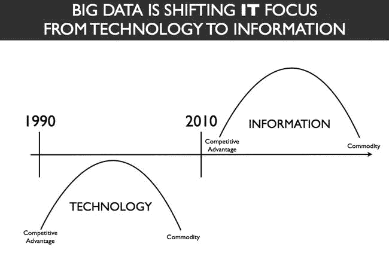
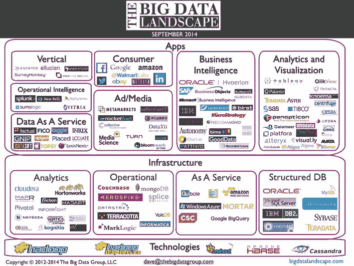
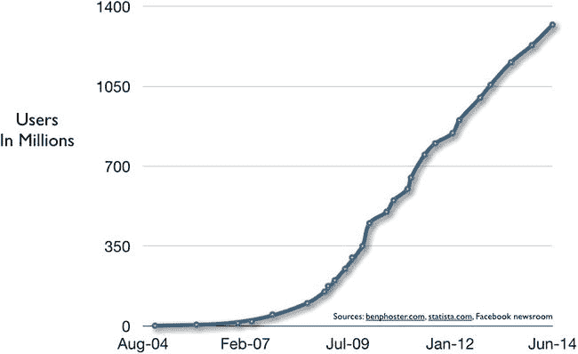
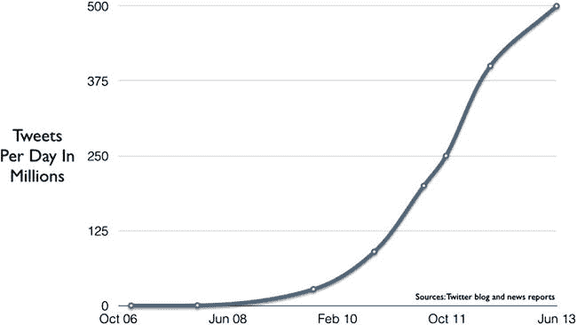

# 大数据最终带来信息优势

`Amazon Web Services` 等基础设施与 `Hadoop` 等开源技术的普及，意味着企业终于能够实现 IT 界长期承诺的种种好处。

几十年来，IT 领域的焦点始终是“技术”本身。首席信息官（`CIO`）的职责是购买并管理服务器、存储设备和网络。

然而，如今为企业带来竞争优势的，却是信息以及基于信息进行存储、分析和预测的能力（图 1-1）。在 IT 技术刚刚普及时，早期采用的企业能够更快行动、执行更优，从而超越那些未采用的企业。有人认为，微软在 20 世纪 90 年代的崛起，不仅得益于其交付了全球最广泛使用的操作系统，更在于公司内部率先拥抱电子邮件，将其作为标准沟通机制。

图 1-1. 信息正在成为曾经技术所扮演的关键资产角色

当许多公司还在犹豫是否以及如何采用电子邮件时，微软内部已将其作为讨论新员工招聘、产品决策、营销策略等事宜的实际沟通工具。虽然电子群组通讯如今已司空见惯，但在当时，这赋予了微软相比那些尚未采用电子邮件的公司更快的速度和更强的协作优势。

那些拥抱数据，并在整个组织内推动数据民主化使用的公司，将获得类似的优势。谷歌和 Facebook 等公司已从这种数据民主化中获益。通过向组织内的分析师、经理和高管开放内部数据分析平台，谷歌、Facebook 等公司使得组织内的每个人都能快速地向数据提出业务问题，并获得所需答案。正如 Facebook 前大数据负责人 Ashish Thusoo 所言，新技术已将讨论的话题从“存储什么数据”转变为“有了更多数据我们能做什么？”

例如，Facebook 将其大数据工作作为一个内部服务来运行。这意味着该服务并非为工程师设计，而是为最终用户——那些需要运行查询来弄清楚什么有效、什么无效的直线经理——设计的。因此，经理们无需等待数天或数周才能知道哪些网站更改最有效，或哪种广告方法效果最佳。他们可以利用内部大数据服务实时获得业务问题的答案。并且，该服务从运营稳定性到社交功能（使数据分析结果易于与同事分享）等方方面面，都充分考虑了最终用户的需求。

过去的二十年是属于 IT 中“技术”的二十年。相比之下，接下来的二十年将是属于 IT 中“信息”的二十年。那些能够更快处理数据，并整合公共与内部数据源的公司，将获得独特的洞察力，从而超越竞争对手。正如大数据初创公司 `SpaceCurve` 的创始人兼 CTO `J. Andrew Rogers` 所说：“分析数据的速度越快，其预测价值就越大。”企业正从批处理（即先存储数据，事后再对数据运行缓慢的分析处理）转向实时分析，以获取竞争优势。

对于高管们来说，好消息是，大数据带来的信息优势不再仅为谷歌和亚马逊这样的公司所独享。像 `Hadoop` 这样的开源技术正使得众多其他公司——无论是老牌的《财富》1000 强企业还是新兴初创公司——都能够以合理的成本利用大数据获得竞争优势。大数据确实带来了长期承诺的信息优势。

## 大数据正在颠覆什么

大数据带来的巨大颠覆，不仅仅在于能够比过去捕获和分析更多的数据，更在于能够以低一个数量级的价格实现这一点。随着价格下降，消耗量反而上升。这种具有讽刺意味的反转被称为*杰文斯悖论*，得名于这位对工业革命做出此观察的经济学家。随着技术进步使数据存储和分析更加高效，企业进行的分析不是变少了，而是大大增加了。简而言之，这就是大数据的颠覆性所在。

从亚马逊到谷歌，从 IBM 到微软，许多大型科技公司都在涉足大数据。与此同时，数十家初创公司如雨后春笋般涌现，提供开源和基于云的大数据解决方案。当大公司专注于横向的大数据解决方案——用于通用分析的平台——时，小公司则专注于为特定业务线和关键垂直领域提供应用程序。一些产品优化销售效率，而另一些产品则通过将多个不同渠道的营销表现与实际的产品使用数据进行关联，为未来的营销活动提供建议。还有大数据产品可以帮助企业更高效地招聘员工，并在招聘后留住他们。

还有一些产品通过分析海量的调查数据，提供对客户需求的洞察。大数据产品可以评估医疗记录，帮助医生和制药公司提供更好的医疗服务。创新的应用程序现在可以利用学生的出勤率和考试成绩统计数据，帮助学生更有效地学习，并提高完成学业的几率。从历史上看，我们很容易说没有所需的数据，或者数据太难分析了。而现在，这些大数据应用的普及意味着公司无需在内部开发和部署所有的大数据技术。在很多情况下，他们可以利用基于云的服务来满足分析需求。大数据正在让数据本身，以及分析和获取可执行洞察的能力，变得比以往任何时候都更容易、更便捷。这确实是颠覆性的。

## 改变你工作方式的大数据应用

大数据应用（`Big Data Applications`， `BDAs`）代表了大数据领域的下一波浪潮。行业分析机构 `CB Insights` 研究了大数据领域的融资情况，报告称仅 2013 年上半年，大数据公司就筹集了约 12.8 亿美元。此后，投资者继续向现有基础设施企业注入资金。`Hadoop` 软件的商业供应商 `Cloudera` 公司于 2014 年 3 月宣布了一轮 9 亿美元的巨额融资，使该公司的总融资额达到 12 亿美元。

展望未来，焦点将从处理大量数据所需的基础设施，转移到如何利用这些数据上来。问题将不再是“在哪里以及如何存储大量数据”。相反，用户会问“如何利用所有这些数据来获得洞察和竞争优势”。

 **注意** 创建和提供处理大数据所需基础设施的时代已近尾声。展望未来，焦点将集中在一个关键问题上：“我们如何利用所有数据来创造新产品、销售更多产品，并全面超越我们的竞争对手？”

`Splunk`，一家运营智能公司，就是一个现成的例子。从历史上看，企业不得不以一种相对手动的流程，使用自己开发的脚本来分析*日志文件*——那些由构成其 IT 系统的网络设备和服务器生成的文件。IT 管理员不仅要维护企业基础设施的服务器、网络设备和软件，还必须以脚本形式构建自己的工具，以确定这些系统所产生问题的根源。而这些系统生成了海量的数据。每次用户登录或访问文件，每次软件生成警告或错误，这些都是管理员必须梳理的数据，以查明情况。

借助 `BDA`，企业不再需要自己构建工具。他们可以利用预先构建好的应用程序，专注于运营业务。例如，`Splunk` 的软件可以通过搜索 IT 日志文件并可视化问题的位置和频率，轻松找到基础设施问题。当然，该公司的软件主要是*安装型软件*，这意味着它必须安装在客户的站点上。

基于云的 `BDA` 有望使企业完全无需安装任何硬件或软件。在某些方面，它们可以被看作是软件即服务（`SaaS`）产品之后的合理下一步。`SaaS`，即通过互联网交付的软件产品，已经相对成熟。例如，`Salesforce.com`，它在十多年前首次引入了“无软件”的概念，如今已成为云端客户关系管理（`CRM`）的事实标准，这是一种帮助企业管理客户列表和关系的软件。`SaaS` 将软件转变为一种可以随时随地被使用、且用户几乎无需维护的产品。就像 `SaaS` 改变了我们访问软件的方式一样，`BDA` 正在改变我们访问数据的方式。此外，`BDA` 正在将软件的价值从软件本身转移到那些软件使我们能够操作的数据上。换句话说，`BDA` 有潜力将当今的技术公司转变为未来极具价值的信息企业。

`BDA` 正在同时改变我们的工作和个人生活。例如，`Opower` 正在改变能源的消耗方式。该公司与 75 家不同的公用事业公司合作，追踪全美约 5000 万家庭的能源消耗情况。公司利用来自智能电表（一种追踪家庭能源使用情况的设备）的数据，为消费者提供详细的能源消耗报告。即使是能源消耗上的微小变化，当它扩展到数千万个家庭时，也能产生巨大影响。就像谷歌可以访问海量的关于消费者在互联网上行为的数据一样，`Opower` 也掌握着大量关于人们在能源使用方面行为的数据。这类数据最终将赋予 `Opower` 以及类似公司高度差异化的洞察力。虽然该公司从提供能源报告起步，但通过持续积累其信息资产，它将很好地定位为一家大数据企业。⁹

然而，`BDA` 并非只出现在商业领域。各公司正在开发许多其他能够对我们的日常生活产生积极影响的数据应用程序。举个例子，一些移动应用程序会追踪健康相关的指标，并提出改善人类行为的建议。这类产品有望减少肥胖、提高生活质量并降低医疗成本。它们也证明了，最具有创新性和变革性的大数据应用可能出现在新型移动设备、大数据和云计算的交汇之处。

## 大数据助力迈向实时处理

如果说过去几年的大数据是关于以更低成本捕获、存储和分析数据，那么接下来的几年将是关于加速对这些数据的访问，并使我们能够实时地对其进行操作。如果你曾经点击过网站按钮却只看到等待屏幕，你就会知道等待交易完成或报告生成是多么令人沮丧。相比之下，谷歌搜索结果的响应时间则截然不同。谷歌在 2010 年推出的`Google Instant`，可以在你输入时实时显示搜索结果。通过引入这一功能，谷歌对典型搜索的搜索结果页面展现量增加了五到七倍。当这个界面刚推出时，人们并不确定是否喜欢它¹⁰。而仅仅几年后的今天，没有人能想象没有它的生活。

数据分析师、经理和高管们希望在了解其业务时获得`Google Instant`那样的即时性。随着这些大数据用户追求越来越快的结果，仅仅采用大数据技术将不再足够。持续的竞争优势将不再来自大数据本身，而是来自比他人更快地从信息资产中获取洞察的能力。像`Google Instant`这样的界面展示了即时访问的强大力量。

根据 IBM 的说法，“我们每天产生 2.5×10¹⁸字节的数据——如此之多，以至于世界上 90%的数据都是在过去两年内创造的。”¹¹行业研究公司 `Forrester` 估计，企业数据总量每年增长 94%。¹²

面对这种增长，每家公司都需要一个大数据路线图。至少，公司需要有一个捕获数据的策略——从内部计算机系统生成的机器日志文件到网站上的用户交互——即使他们直到后来才决定如何处理这些数据。正如 Rogers 所说：“数据的价值远超你最初的预期——不要丢弃它。”

**提示** “数据的价值远超你最初的预期——不要丢弃它。” ——`J. Andrew Rogers`，`SpaceCurve` 公司 CTO。

公司需要为其数据的指数级增长做好规划。尽管照片、即时消息和电子邮件的数量非常庞大，但由联网“传感器”（如手机、`GPS` 和其他设备）生成的数据量则要大得多。理想情况下，公司应具有一个愿景，使数据分析能够在整个组织内进行，并且尽可能接近实时地完成。通过研究谷歌、亚马逊、`Facebook` 和其他科技领导者的大数据方法，你可以看到大数据能实现什么。在此基础上，你可以在自己的组织中制定有效的大数据策略。

那些在大数据方面取得成功的公司还为其组合增加了一个关键要素：一位大数据领导者。如果你无法从中获取洞察，那么世界上所有的数据都毫无意义。你的大数据领导者——无论是首席数据官还是数据洞察副总裁——不仅可以帮助你的整个组织制定正确的战略，还可以指导你的组织获得其所需的可操作洞察。

像谷歌和亚马逊这样的公司多年来一直利用数据驱动决策，并在此过程中取得了巨大的成功。有了大数据，你现在也可以利用这些能力。你将在第 3 章中读到更多关于如何利用这些能力并制定你自己的大数据路线图的内容。但首先，让我们看看整个大数据领域中令人难以置信的市场驱动力和创新技术。¹³

---

¹ `http://radar.oreilly.com/2012/01/what-is-big-data.html`
² `http://www.linkedin.com/today/post/article/20121210053039-22330283-the-future-of-linkedin-and-the-economic-graph`
³ `Zetta Venture Partners` 是我所在公司 `Content Analytics` 的投资方。
⁴ `http://phandroid.com/2014/04/22/100-billion-google-searches/`
⁵ `http://www.wired.com/wiredenterprise/2012/08/googles-mind-blowing-big-data-tool-grows-open-source-twin/`
⁶ `http://www.wired.com/wiredenterprise/2012/08/googles-dremel-makes-big-data-look-small/`
⁷ `http://www.zdnet.com/amazons-aws-3-8-billion-revenue-in-2013-says-analyst-7000009461/`
⁸ `http://www.cbinsights.com/blog/big-data-funding-venture-capital-2013`
⁹ `http://www.forbes.com/sites/davefeinleib/2012/10/24/software-is-dead-long-live-big-data-2/`
¹⁰ `http://googleblog.blogspot.com/2010/09/google-instant-behind-scenes.html`
¹¹ `http://www-01.ibm.com/software/data/bigdata/what-is-big-data.html`
¹² `http://www.forbes.com/sites/ciocentral/2012/07/05/best-practices-for-managing-big-data/`
¹³ 本章部分素材来源于我以特约撰稿人身份发表在《哈佛商业评论》（中文版）2013 年 1 月刊上的文章。

## 大数据全景图

### 基础设施与应用

在探讨了大数据的几个方面之后，接下来我们将放眼更广阔的领域，了解那些在大数据生态系统中扮演重要角色的公司。从基础设施和应用的角度来思考大数据全景图，是最容易理解的方式。

随后的图表（见图 2-1）展示了“大数据全景图”。该图对大数据领域中的众多参与者进行了分类。由于新入行者层出不穷，该全景图的最新版本始终可在网页 `www.bigdatalandscape.com` 上查阅。

图 2-1. 大数据全景图

基础设施主要负责存储，并在一定程度上处理公司所捕获的海量数据。人类和计算机系统则使用应用程序从数据中获取洞察。

人们使用应用程序来可视化数据，以便做出更明智的决策；而计算机系统则使用应用程序来向合适的人群投放精准广告、检测信用卡欺诈，以及执行众多其他活动。虽然我们无法在此逐一介绍全景图中的每一家公司，但我们将描述其中的一部分，并说明该生态系统是如何形成的。

### 大数据市场增长

大数据是一个巨大的市场。市场研究机构 `IDC` 预计，到 2016 年，大数据市场将增长至每年 238 亿美元，且该领域的年增长率将达到 31.7%。这还不包括分析软件，仅该市场本身的价值就高达 510 亿美元。

我们生成的数据量正以惊人的速度增长。其中一个最有趣的衡量指标是 `Facebook` 的增长。2012 年 10 月，该公司宣布其用户数已达到 10 亿——几乎占全球人口的 15%。截至 2013 年底，`Facebook` 在全球拥有超过 12.3 亿用户（见图 2-2），一年内新增了 1.7 亿用户。为了跟上其庞大的用户增长，该公司不得不开发各种新的基础设施和分析技术。²

图 2-2. `Facebook` 用户增长率

`Facebook` 每天处理约 3.5 亿次照片上传、45 亿次“赞”和 100 亿条消息。这意味着该公司用于分析的存储数据超过 100 `PB`，并且每天新增超过 500 `TB` 的数据。³,⁴ 这相当于大约 2000 个完全装满数据的 `Macintosh Air` 硬盘所存储的数据量。

`Twitter` 提供了另一个衡量数据增长的有趣指标。截至 2013 年，该公司的注册用户数已超过 8.83 亿，每天处理超过 5 亿条推文，而仅在五年前，这一数字仅为每天 2 万条（见图 2-3）。⁵

图 2-3. 社交网站 `Twitter` 上的推文增长

然而，需要客观看待的是，这些仅仅是人类产生的数据。机器生成的数据甚至更多。每次我们点击网站按钮、进行购买、打电话或进行几乎任何其他活动时，都会留下数字足迹。上传一张照片这个简单操作，就会生成大量其他数据：谁上传了照片、何时上传的、与谁分享了、关联了哪些标签，等等。

数据量无处不在增长：沃尔玛每小时处理超过一百万笔客户交易，每年发送大约 90 万亿封电子邮件。具有讽刺意味的是，所有这些邮件中超过一半（71.8%）被视为垃圾邮件。根据一项估计，商业数据量每 1.2 年就会翻一番。⁶,⁷

为了应对这种惊人的增长，涌现出许多新公司，同时也有许多现有公司正在围绕大数据重新定位自己和他们的产品。

### 开源的作用

开源在大数据近年来的发展中发挥了重要作用。但在讨论这一点之前，有必要先对开源角色的更广泛背景进行说明。

就在几年前，`Linux` 成为主流操作系统，并与商品化硬件（低成本、现成的服务器）相结合，蚕食了像 `Sun Microsystems` 这样曾经占据主导地位的厂商的市场。例如，`Sun` 以其名为 `Solaris` 的 `Unix` 版本而闻名，该版本运行在其定制的 `SPARC` 硬件上。

通过使用 `Linux`，企业能够在低成本硬件上利用开源操作系统，以低得多的成本获得大部分相同的功能。开源数据库 `MySQL`、开源 `Web` 服务器 `Apache` 以及最初为构建网站而创建的开源脚本语言 `PHP` 的可用性，也推动了 `Linux` 的普及。

随着企业开始在大型商业用途中使用和采用 `Linux`，他们需要企业级的支持与可靠性。工程师在实验室里使用开源的 `Linux` 没问题，但企业需要一个他们可以寻求培训、支持和定制的供应商。换句话说，大公司喜欢从其他大公司购买。

在众多供应商中，红帽（`Red Hat`）脱颖而出，成为为 `Linux` 提供商业支持和服务的市场领导者。该公司目前的市值略高于 100 亿美元。瑞典公司 `MySQL AB` 赞助了开源 `MySQL` 数据库项目的开发。`Sun Microsystems` 于 2008 年初以 10 亿美元收购了 `MySQL AB`，随后 `Oracle` 于 2009 年底收购了 `Sun`。

包括 `IBM` 和 `Oracle` 在内的几家公司，将大规模关系型数据库商业化。关系型数据库允许将数据存储在定义良好的表中，并通过键进行访问。例如，一名员工可以通过员工编号来识别，然后该编号将与包含该员工信息的多个其他字段关联，例如其姓名、地址、入职日期和职位。

此类数据库运行良好，直到公司不得不处理海量的非结构化数据。谷歌需要处理海量的网页以及这些网页中链接之间的关系。脸书则需要应对社交图谱数据。社交图谱是其社交网络上人与人之间关系的数字表示，以及图谱中每个节点所关联的所有非结构化数据，例如照片、消息和个人资料。这些公司还希望利用廉价硬件成本较低的优势。

 **注意** 关系型数据库曾是许多大型企业 `IT` 环境的主力，它们运行良好，直到公司意识到自己生成了更多的非结构化数据，需要一种不同的解决方案。于是，`NoSQL` 和图数据库等专为当今多样化数据环境设计的方案应运而生。

因此，像谷歌、雅虎、脸书等公司开发了自己的解决方案来存储和处理海量数据。在操作系统和数据库市场中，`Linux` 作为 `Unix` 的开源版本出现，而 `MySQL` 则作为 `Oracle` 等数据库的开源替代品。如今，类似的情况正在大数据领域发生。

`Apache Hadoop` 是一个开源的分布式计算平台，它通过 `Hadoop` 分布式文件系统（`HDFS`）存储大量数据，并通过名为 `MapReduce` 的编程模型将针对这些数据的操作拆分为小片段。它源自谷歌和雅虎最初构建的技术。

围绕 `Hadoop` 涌现了其他开源技术。`Apache Hive` 提供了数据仓库功能，包括数据提取/转换/加载（`ETL`）——这是一个从各种来源提取数据、将其转换为满足运营需求（包括确保数据质量）并加载到目标数据库的过程。`Apache HBase` 在 `Hadoop` 之上为非常大的结构化表提供实时读写访问。它模仿了谷歌的 `BigTable`。同时，`Apache Cassandra` 通过复制数据提供容错的数据存储。

从历史上看，这些功能只能从商业软件供应商那里获得，并且通常运行在专用硬件上。`Linux` 使 `Unix` 的功能在通用硬件上得以实现，大幅降低了计算成本。同样地，开源大数据技术正在使数据存储和处理能力变得人人可用，这些能力以前只有谷歌这样的公司或商业供应商才能提供，如今则可在通用硬件上获得。

低成本大数据技术的广泛普及降低了处理大数据的初始成本，并有潜力使大数据为更多潜在用户所用。闭源供应商指出，虽然开源软件可以免费使用，但其维护成本可能很高，尤其是在大规模部署时。

尽管如此，开源可以免费上手这一事实使其成为许多人的有吸引力的选择。一些商业供应商采用了“免费增值”商业模式来竞争。产品可以在个人使用或有限数据量下免费使用，但客户需要为部门级或更大规模的数据使用付费。

那些长期采用开源技术的企业最终需要商业支持，这与他们对待 `Linux` 的方式类似。像 `Cloudera`、`Hortonworks` 和 `MapR` 这样的公司正在满足 `Hadoop` 的这一需求，而像 `DataStax` 这样的公司则为 `Cassandra` 提供同样的服务。同样地，`LucidWorks` 正在为 `Apache Lucene` 扮演这样的角色，后者是用于索引和搜索海量网页和文档的开源文本搜索引擎。

 **注意** 尽管像 `Cloudera` 和 `Hortonworks` 这样的公司提供基于开源软件（如 `Hadoop`、`Hive`、`Pig` 等）构建的产品，但企业始终需要经过商业打包、测试的版本，以及相应的支持和培训。因此，英特尔最近向 `Cloudera` 注资 9 亿美元。

## 进入云端

另外两个市场趋势正在并行发生。首先，数据量正在增加——几乎每年翻一番。我们以照片、推文、点赞和电子邮件的形式生成更多数据。我们的数据本身也有相关联的数据。此外，机器正在以服务器、汽车、飞机、手机和其他设备的状态更新及其他信息的形式生成数据。

因此，处理所有这些数据的复杂性也在增加。更多的数据意味着需要整合、理解并尝试从中获取洞察的数据更多。这也意味着数据安全和数据隐私的风险更高。虽然企业历来将内部数据（如销售数据）和外部数据（如品牌情绪或市场研究数据）分开看待，但他们现在希望整合这些类型的数据，以利用由此产生的洞察。

其次，企业正在将计算和处理迁移到云端。这意味着他们不再购买硬件和软件并将其安装在自己的数据中心并维护那套基础设施，而是通过互联网按需获取所需的能力。如前所述，软件即服务（`SaaS`）公司 `Salesforce.com` 以其“无软件”模式开创了通过 `Web` 提供应用程序的先河，用于客户关系管理（`CRM`）。该公司继续构建一个产品生态系统以补充其核心 `CRM` 解决方案。`SaaS` 模式已经获得了动力，许多其他公司也提供了面向商业用户的基于云的服务。

与此同时，`Amazon` 通过 `Amazon Web Services（AWS）` 为实现按需基础设施铺平了道路，`AWS` 是该公司极受欢迎的基于云的计算和存储服务。`Amazon` 于 2002 年推出 `AWS`，其初衷是利用运行 `Amazon.com` 商店所需的基础设施来盈利。该公司继续增加按需基础设施服务，使开发人员能够快速启动新的服务器、存储和数据库。

`Amazon` 还推出了针对大数据的特定服务，包括 `Amazon Elastic MapReduce（EMR）`——一个基于 `Amazon` 云的开源 `Hadoop MapReduce` 版本。`Amazon Redshift` 是一个按需数据仓库解决方案，`Amazon` 预计其成本低至每年每 `TB` 1,000 美元，不到企业通常为本地数据仓库支付费用的十分之一，后者每年每 `TB` 的费用可能超过 20,000 美元。同时，`Amazon Glacier` 提供低成本数字归档服务，费用为每月每 `GB` 0.01 美元，或每年每 `TB` 约 120 美元。

`Amazon` 相对于其他供应商有两个主要优势。它拥有一个非常知名的消费品牌。该公司还受益于支撑 `Amazon.com` 网站以及在其基础设施上服务众多客户所带来的规模经济。其他技术市场领导者也提供云基础设施服务，包括谷歌的 `Google Cloud Platform` 和微软的 `Windows Azure`，但 `Amazon` 已经铺平了道路，并通过 `AWS` 占据了领先地位。

`AWS` 已实现惊人的增长。2013 年，该服务预计将为公司带来 32 亿美元的收入。截至 2012 年 6 月，`Amazon` 在其简单存储服务（`S3`）中存储了超过一万亿个对象，并且每秒新增超过 40,000 个对象。这一数字远高于 2006 年底的 29 亿个对象和 2010 年底的 2620 亿个对象。`Netflix`、`Dropbox` 等主要公司均在 `AWS` 上运营其业务¹²,¹³。

`Amazon` 持续拓展其基础设施即服务（`Infrastructure-on-Demand`）产品，新增了 `IP` 路由、电子邮件发送以及一系列大数据相关服务。除了提供自己的按需基础设施外，`Amazon` 还与一个合作伙伴生态系统合作，提供他们的基础设施产品。因此，任何考虑构建公共云产品的新基础设施初创公司都可能面临以下局面：要么找到与 `Amazon` 合作的方式，要么就得预期该公司将推出具有竞争力的产品。

借助云服务，客户只需按使用量付费。这使得启动新的 `Big Data` 项目变得更加容易。公司不再受制于通常与购买、部署和管理服务器及存储基础设施相关的高昂前期成本。

我们能够比过去更快速、更经济地存储和分析与大数据计划相关的大量数据。借助基于云的大数据基础设施，从规划到获得洞见可能只需数天，而非数月或数年。这反过来意味着，在初创公司和大型企业中，大数据领域的创新会更多，并且数据驱动的洞见获取也变得更加容易。

 **Note** 经济实惠的基于云的大数据基础设施意味着公司可以在几天内从设计走向产品，或从假设到发现洞见，而不是数月或数年。

## 克服云的挑战

当然，许多人仍然对利用公共云基础设施持怀疑态度。从历史上看，公共云服务存在三个主要的潜在问题。首先，大型企业的技术人员认为此类服务不安全，而内部基础设施更安全。其次，许多大型供应商根本不提供其软件的互联网/云端版本。公司必须自行购买硬件并运行软件，或聘请第三方来完成。最后，将大量数据从内部系统迁移到云端很困难。

尽管第一个挑战对某些受合规性要求的政府机构和企业来说仍然存在，但 `Salesforce` 用于管理客户数据，以及 `Box`、`Dropbox` 和 `Google Drive` 用于存储文件等服务的广泛采用表明，许多公司现在已习惯让第三方供应商存储其机密信息。简而言之，企业使用的基于网络交付的应用程序比过去多得多。

首先是客户数据，然后是人力资源数据。如今，市场对基于网络的人力资源管理解决方案提供商 `Workday` 的估值接近 90 亿美元。随着时间的推移，企业将把越来越多的业务应用程序和数据迁移到云端。

第三个挑战，即将海量数据迁移到云端，仍然是个问题。许多专家认为，对于真正高容量的数据，数据会受到一种“引力”的影响。他们认为，始于公司本地的数据将留在本地，而始于云端的数据将留在云端。

但随着越来越多的业务应用程序通过网络提供服务，更多的数据将从云端开始并留在那里。此外，一些公司正在涌现，提供加速大量数据传输的技术。例如，`Aspera` 专注于加速文件传输速度，特别是对于大型音频和视频文件。`Netflix` 和 `Amazon` 等公司使用 `Aspera` 以高达传统速度 10 倍的速度传输文件。

借助云，公司还能获得一系列其他优势：他们花在维护和部署硬件与软件上的时间减少，并且可以按需扩展。如果公司需要更多的计算资源或存储空间，这不再是几个月的问题，而是几分钟的问题。更重要的是，使用已安装软件的公司在使用最新版本软件方面历来落后。对于通过网络提供的应用程序，用户可以在最新版本可用时立即使用。

当然，也有一些权衡取舍。在成本方面，公司受制于他们选择合作的公共云提供商。但云供应商之间的竞争持续推动价格下降。一旦公司在特定云供应商之上构建并部署了应用程序，切换平台可能会很困难。尽管底层基础设施相似，但用于部署新应用程序构建的脚本、特定平台服务的钩子以及网络配置都基于所选平台。

 **Note** 大多数公司倾向于坚持使用他们最初选择的公共云平台。这也是云客户争夺战比以往任何时候都更加激烈的原因之一。

客户还依赖此类提供商提供可靠的服务。`Amazon` 曾遭受过几次重大的高调宕机事件，这导致一些人质疑依赖其服务是否明智。其中一次宕机事件导致电影流媒体提供商 `Netflix` 在 2012 年圣诞节前夕和圣诞节当天服务中断，而传统上这是观看电影的高峰期。然而，总体而言，基于云的基础设施服务在其服务可用性方面已变得更加透明，并增加了企业级的服务和支持选项，以满足企业客户的需求。在许多情况下，像 `Amazon`、`Google` 和 `Microsoft` 这样的提供商，凭借其运营的惊人规模，可以提供比许多企业自行交付的基础设施更可靠、更安全且更具成本效益的服务。

云提供商将继续推出更多的按需基础设施能力。随着他们相互竞争并降低价格，更多的企业将利用此类产品。初创公司将推出基于这些基础设施服务的新型创新大数据应用程序，企业和消费者都将从中受益。

## 大数据基础设施

在了解了开源和大数据在云中的背景后，我们现在来看一些在基础设施和应用领域扮演关键角色的公司。

在大背景下，投资者直到最近才将相对较少量的资本投入到大数据基础设施中。截至 2013 年底，他们对 `Hadoop` 相关公司（`Cloudera`、`Hortonworks` 和 `MapR`）以及 `NoSQL` 公司（`MongoDB`、`Couchbase` 等）的总投资额不到十亿美元。然而，在 2014 年初，英特尔和 `Cloudera` 因英特尔向 `Cloudera` 投资了高达 9 亿美元而成为头条新闻。