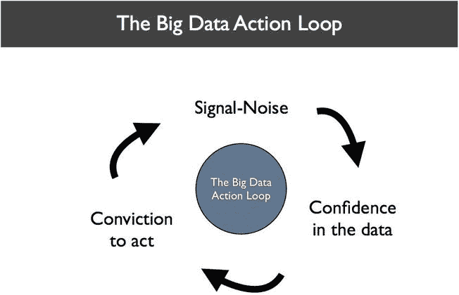
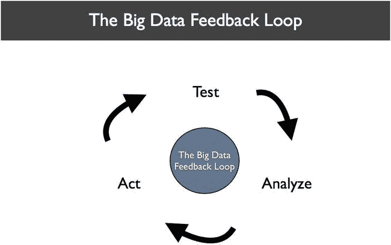
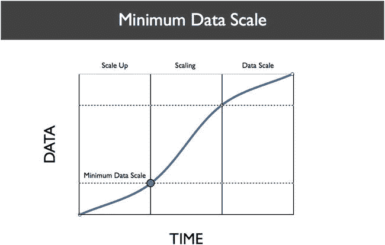

# 下一个十亿美元 IPO：大数据创业精神

## 像比利·比恩一样驾驭数据

作为奥克兰运动家队的总经理，比利·比恩面临着一个问题。比恩和奥克兰运动家队必须在没有像纽约洋基队那样的大市场预算的情况下，组建一支有竞争力的队伍。在由迈克尔·刘易斯所著的《魔球》一书及其同名电影讲述的著名故事中，比恩转向了数据和统计学。

这种方法被称为赛伯计量学，由棒球作家兼统计学家比尔·詹姆斯创造。赛伯计量学是 SABR（美国棒球研究学会）的衍生词，意为“寻求关于棒球的客观知识。”¹

当时，比恩这种数据驱动的方法受到了广泛批评。它打破了多年来依赖球探对球员进行定性观察的传统。相反，它侧重于利用薪资预算来购买足够的得分——不是来自单个球员，而是总体得分——以赢得比赛。

比恩并没有使用传统意义上定义的大数据——即处理比传统数据库能处理的数据量更大的数据。但他确实以一种新颖的方式应用了数据，产生了强大的影响。

比恩并非完全基于定性信息做决策，而是采用了数据驱动的方法。更具体地说，正如奈特·西尔弗在其畅销书《信号与噪声：为何大多数预测会失败，而有些却不会》中指出的那样，比恩严格地使用那些重要的统计数据，如上垒率，而不是那些不重要的数据。²

西尔弗开发了`PECOTA`系统，该系统是`球员经验比较与优化测试算法`的缩写，是一种广泛用于预测美国职业棒球大联盟球员表现的赛伯计量系统。`PECOTA`系统利用了一个包含自二战以来约 20,000 名大联盟击球手以及 15,000 名小联盟击球手的数据库。³

如今，那些希望在自己的组织中采用数据驱动方法的人，常常面临与比恩相同的挑战。采用数据驱动的方法来做决策并不容易。但正如比利·比恩所证明的那样，它确实能产生成果。

组织深知自身需要向数据驱动型转型，但要实现这一目标，必须大幅降低转型难度。大数据应用是实现这种转型的关键突破之一，这也是其有望孕育科技领域下一个十亿美元级 IPO 的重要原因。

## 为何数据驱动如此困难

亚马逊、谷歌、IBM 和甲骨文——仅举几例全球最具价值的数据相关公司——已经展示了利用大数据的价值。亚马逊处理数十亿笔电商交易，谷歌处理数十亿次搜索，而 IBM 和甲骨文提供的数据库软件和应用则专为存储和处理海量数据而设计。大数据意味着大收益。

然而，棒球并非唯一在数据决策上挣扎的领域。大多数组织仍发现基于数据做决策并非易事。在某些情况下，组织根本没有数据可用。例如，直到最近，获取营销活动的全面数据仍很困难。弄清楚你在营销上花了多少钱是一回事，但将营销投资与实际销售关联起来又是另一回事。因此有了那句古老的营销格言："我知道一半的广告预算被浪费了，但不知道是哪一半。"

然而，如今人们正在获取对理解客户、供应链和机器性能至关重要的数据，从网络服务器到汽车、飞机，以及许多其他关键业务指标。现在的巨大挑战不再是获取数据，而是理解数据。

数十年来，理解数据一直是数据分析师、统计学家和博士们的专属领域。业务部门经理不仅要等待 IT 部门获取关键数据，还得再等分析师整合数据并得出结论。大数据应用的承诺不仅是捕获数据，更是能基于数据采取行动，而无需使用只有统计学家才能操作的复杂工具。通过让数据更易获取，大数据应用将使组织能够逐步实现业务线的数据驱动化。

然而，即使你拥有数据和行动工具，行动依然困难。发表观点很容易，但坚定信念却很难。

正如沃伦·巴菲特曾有名言："在别人贪婪时恐惧，在别人恐惧时贪婪。"⁴巴菲特以其数据驱动的投资方法著称。然而，尽管历史证据表明追涨杀跌是糟糕策略，投资者仍不断在好消息时买入、坏消息时卖出。经济学家长期假设人们基于逻辑规则做决策，但现实中并非如此。⁵

诺贝尔奖得主、心理学家丹尼尔·卡尼曼及其同事阿莫斯·特沃斯基得出结论：人们的行为往往不合逻辑。他们对损失的重视程度高于收益，而生动的例子往往比数据对决策的影响更大，即便数据更为准确。

要做到数据驱动，你不仅需要拥有数据并找出哪些数据相关，还必须基于这些数据做决策。为此，你必须具备信心和信念：对数据的信心，以及基于数据做决策的信念，即使在舆论相反时也要坚持。这被称为大数据行动循环（参见图 8-1）。

图 8-1。大数据行动循环展示了大数据决策的关键要素

## 听见信号，忽略噪音

数据驱动在文化层面和实施层面都如此困难，这正是大数据应用将在未来发挥重要作用的根本原因之一。历史上，数据难以获取和运用。关键在于，数据常常分散在不同地方。公司内部数据遍布于各种不同的数据库、数据存储和文件服务器中。外部数据则存在于市场报告、网络和其他难以访问的来源。

大数据的威力与挑战在于，它常将所有这些数据汇集到一处。这意味着有可能从更大数量、更相关的数据中获得更深刻的洞察——工程师称之为`信号`——但也意味着更多的`噪音`，即与洞察无关甚至可能得出错误结论的数据。

如果计算机或人类无法理解这些数据，仅仅将数据集中在一处并无意义。这正是大数据应用的威力所在。大数据应用能帮助从噪音中提取信号。通过这样做，它们能让你对自己处理的数据更有信心，从而更坚定地基于这些数据采取行动——无论是手动还是自动化操作。

## 大数据反馈循环：基于数据行动

当你第一次摸到热炉子被烫伤、将手指插入电源插座被电击、或超速驾驶被开罚单时，你体验到了反馈循环。无论是否有意识，你进行了一次测试，分析了结果，并在未来采取了不同的行动。这被称为大数据反馈循环（参见图 8-2），也是构建成功大数据应用的关键。

图 8-2。大数据反馈循环

通过测试，你发现摸热炉子或被电击很痛。你发现超速驾驶会导致昂贵的罚单或车祸。或者，如果你侥幸逃脱，你可能得出结论：超速很有趣。

无论结果如何，所有这些活动都给了你反馈。你将反馈纳入自己的"数据库"，并基于数据改变未来的行动。如果尽管被开罚单，但超速体验让你觉得有趣，你可能会选择继续超速。如果与炉子相关的经历很糟糕，你可能会学会下次检查炉子是否烫手之后再触碰。

这样的反馈循环对大数据至关重要。仅收集和分析数据是不够的。你必须能从数据中得出一套结论，并获取对这些结论的反馈，以判断它们是否正确。你能输入模型的相关数据越多，对假设获取的反馈次数越多，你的洞察就越有价值。

历史上，运行这样的反馈循环既缓慢又耗时。例如，汽车公司收集销售数据，试图得出关于哪些定价模式或产品功能能促使人们购买更多汽车的结论。他们调整价格、修改功能，然后再次进行实验。问题在于，当他们完成分析并修订定价和产品时，环境已经改变了。动力强劲但耗油量大的汽车被淘汰，而节能汽车成为主流。MySpace 流失用户，而 Facebook 却用户增长。这样的例子不胜枚举。

大数据的好处在于，在许多情况下，你现在可以更快地运行反馈循环。在广告领域，大数据应用可以通过实时投放大量不同广告，然后仅显示那些效果好的广告，来确定哪些广告转化率最高。它们甚至能进行细分——确定哪些广告对哪些人群转化效果最好。这种 A/B 测试（展示不同广告以观察效果优劣）如果由人类操作，绝不可能足够快地完成以实现应用。

计算机可以大规模运行此类测试，不仅能在不同广告之间进行选择，还能实际修改广告本身。它们可以展示不同的字体、颜色、尺寸和图片，以找出最有效的组合。这种实时反馈循环——不仅能够收集海量数据，还能快速测试并执行多种不同方法——是大数据最强大的方面之一。

### 实现最小数据规模

随着人们在大数据领域的深入，问题已从如何收集和存储数据，转变为如何利用数据。一个高性能的反馈循环需要一个足够大的测试集才能发挥作用，例如访问网站的客户、打电话给潜在客户的销售人员，或观看广告的消费者。

这个测试集被称为最小数据规模（`MDS`；见图 8-3）。`MDS`是运行大数据反馈循环并从中获得有意义的洞察所需的最少数据量。

图 8-3. 最小数据规模是从数据中得出有意义结论所需的最少数据量。

`MDS`意味着公司拥有足够多的网站访客、广告观看者或潜在客户，从而能够从数据中得出有意义的结论并做出决策。当一家公司的数据点多到足以达到`MDS`时，它就可以利用大数据应用（`BDA`）来告知销售人员接下来该给谁打电话，决定投放哪条广告以获得最高转化率，或者推荐合适的电影或书籍。

当这个数据集变得足够大，以至于成为竞争优势的来源时，就意味着这家公司已经达到了早期 PayPal 和 LinkedIn 分析大师 Mike Greenfield 所说的`数据规模`。⁶ 像 Amazon、Facebook、Google、PayPal、LinkedIn 等公司都已经达到了数据规模。

### 创建大数据应用

成功的大数据应用运行大数据反馈循环的一部分或全部。例如，强大的分析和可视化应用会将数据集中到一处并使其可查看，以便人类决定下一步行动。另一些应用则会自动测试新方法并决定下一步行动，例如在广告投放或网站优化中。

当今的大数据应用无法在实现全局最优上提供显著帮助。例如，它们无法发明下一款 iPhone 或打造下一个 Facebook。但它们可以充分优化局部最优。它们可以投放正确的广告、优化网页、告诉销售人员该给谁打电话，甚至指导销售人员每次通话该说什么。

正是数据规模与应用（即大数据应用）的结合，将推动未来价值数十亿美元的首次公开募股（`IPO`）。

### 大数据资产的崛起：大数据初创公司的核心

公司收集的大量数据就是该公司的大数据资产。善于利用这项资产的公司将变得比不善于利用的公司更有价值。它们将能够收取更高费用、支付更低成本、优先处理某个潜在客户、转化更多客户，并最终留住更多客户。

这有两个主要含义。首先，对于初创公司而言，这是一个巨大的机会，可以构建开箱即用的应用，使这种竞争优势成为可能。企业无需自行构建这些能力；它们将以立即可用的应用程序形式获得这些能力。

其次，无论是初创公司还是行业巨头，那些将数据及基于数据采取行动的能力视为核心资产的公司，将比那些不这样做的公司拥有显著的竞争优势。

例如，PayPal 和 Square 正在激烈竞争，以颠覆传统的支付领域。胜者将能更好地理解客户，并更高效地触达他们。两家公司都能获取海量的交易数据。哪家公司能更有效地利用这些数据采取行动，谁就将胜出。

 **提示** 你想打造一家价值十亿美元的公司吗？那就高度关注大数据资产的创建和培育。它是吸引投资者和买家的闪亮特征。

### 打造一家十亿美元公司需要什么

面对大数据领域的各种机遇，决定一家公司是成长为小公司还是大公司的关键因素是什么？

正如风险投资公司`Ignition Partners`的创始合伙人 Cameron Myhrvold 告诉我的那样，打造一家十亿美元的公司不仅仅意味着选择一个巨大的市场。这意味着要选对市场。中国的快餐市场很大，但这并不意味着它是一个好市场。它竞争激烈，且难以攻破。

打造一家十亿美元公司意味着要乘上一波大浪。大数据、云计算、移动和社交之所以成为陈词滥调，是有原因的——因为它们是巨浪。乘风破浪的公司比那些没有这样做的公司更有可能成功。当然，这不仅仅如此。还要构建与这些浪潮相契合的具体产品，为客户提供不可或缺的价值。

在过去几年中，涌现了大量的网络公司。其中一些最成功的公司，如 Facebook 和 Twitter，实际上是伪装成消费者公司的大数据公司。它们存储着海量数据。它们维护着庞大的社交图谱，描绘了我们彼此之间以及我们与品牌等其他实体之间的联系。这些公司拥有内置系统，可以优化向每位用户展示的内容和广告。

现在，有多个价值数十亿美元的机会，可以通过大数据应用的形式，将这些能力作为开箱即用的解决方案提供给企业。

对于企业而言，从历史上看，要实现这种数据精细度，需要购买硬件和软件，并在此基础上进行定制开发。企业软件产品是此类实施的基础。但它们也带来了耗时的集成和昂贵的咨询，以便让最终用户能够使用复杂的数据分析能力。即便如此，也只有经验丰富的分析师才能使用公司开发的系统来生成报告、可视化和洞察。

如今，这些能力可以通过现成的大数据应用获得。`IT`基础设施的运营智能不再需要自定义脚本——像`Splunk`（目前市值超过 60 亿美元）这样的公司提供的应用，使这种功能随时可用。数据可视化不再需要用`R`等语言进行复杂的编程。相反，业务用户可以使用`Tableau Software`（估值近 50 亿美元）等公司的产品创建交互式可视化。这两家大数据公司都在过去几年刚刚上市。

更多大数据公司正准备很快上市。大数据公司`AppDynamics`和`New Relic`每月处理数十亿个事件，预计将在 2014 年提交上市申请。数据分析公司`Palantir`最近以 90 亿美元的估值融资，有估计表明该公司年收入可能高达 10 亿美元。

面对所有这些机遇，对于任何能够取得有意义进展的初创公司来说，达到十亿美元估值或许最大的挑战，就是被收购的高可能性。

谈到企业级领域的巨头，如今潜在的收购方有很多。有传统的超大型公司，市值接近或超过 1000 亿美元：`Cisco`、`IBM`、`Intel`、`Microsoft`、`Oracle`和`SAP`，它们提供硬件和软件组合产品。

# 大数据：投资趋势与机遇

在大型企业中，诸如亚马逊、苹果和谷歌等巨头正扮演着不断演变或新兴的角色。还有像戴尔、惠普、`EMC`、`Salesforce` 和 `VMware` 这样市值在 200 亿到 500 亿美元之间的集团。

最后，还有那些市值低于 100 亿美元的公司（`NetApp` 稍高于此），例如 `BMC`、`Informatica`、`Workday`、`NetSuite`、`ServiceNow`、`Software AG`、`TIBCO`、`Splunk` 等。这一群体中既有像 `Workday`、`ServiceNow` 和 `Splunk` 这样的新兴公司，也有像 `BMC` 和 `TIBCO` 这样的老牌企业。其中较小的公司可能成为大型企业的潜在收购目标。思科或 `IBM` 可能会对 `Splunk` 感兴趣，而甲骨文或惠普则可能想收购 `TIBCO`。

现有的上市公司将通过在自身产品组合中增加更多的大数据分析应用来壮大实力。可以预见 `Salesforce` 和甲骨文会持续收购。`Salesforce` 将继续构建一个足够庞大且全面的生态系统，使其难以被轻易撼动。甲骨文则会增加更多云服务产品，以便能够按照客户的需求提供大数据服务——无论是本地部署还是在云端。

像 `TIBCO` 和 `Software AG` 这样的公司也会继续收购。这两家公司一直在积累现金储备，其目的很可能是为了扩展产品组合并增加非有机增长的收入。

对于试图打造下一个十亿美元市值上市公司的创业者来说，这意味着什么？这意味着他们需要一个精彩的故事、出色的营收增长，或者两者兼具。例如，`Splunk` 最初只是一个集中查看日志文件的方式，后来演变成了机器数据领域的甲骨文。这个故事无疑起到了推动作用，公司的增长也是如此。

小公司会寻求壮大，而大公司则会努力保持自身相关性、提升收益，并充分利用其企业销售组织的巨大规模。这意味着那些拥有成功产品和营收增长、希望市值突破十亿美元的创业者们，必须努力避免过早被收购。

`` `提示` 如果你是一位寻求完美退出的科技创业者，不要卖得太早——也不要卖得太晚。在花时间提升估值与等待过久以至于错过出售或上市时机之间，有一条微妙的界限。

## 投资趋势：机遇无处不在

在大数据领域，我们已经看到大量新应用正在涌现。我们目前所见的大数据分析应用仅仅是冰山一角。许多应用专注于业务线问题，但未来还会有更多应用出现，颠覆整个领域和行业。

大型企业已经越来越愿意给小供应商一个机会——因为他们需要这些小公司带来的创新。

从历史上看，供应商和客户既相互依赖又相互对立。客户渴望灵活性，却因在定制开发和集成方面的大量投资而无法轻易转换；而供应商则希望锁定客户。

另一方面，大型客户需要全面的解决方案。即使供应商并非在每个领域都拥有最顶尖的技术，这意味着大客户的首席信息官或首席执行官可以致电大型供应商的首席执行官，从而获得答案或解决问题。

在系统宕机、数据问题或其他危机时刻，一位高管可以致电另一位高管来解决问题。在一个包含众多复杂且相互关联的系统（如航班调度、行李分拣、包裹递送等）的世界里，这一直且仍然至关重要。但敏捷的初创公司带来了大型供应商无法企及的创新和速度。他们利用现成的构建模块在云端创建服务。他们以更快的速度进入市场，并提供易于使用的、类似消费品的界面，而规模更大、更传统的供应商则难以匹敌。因此，无论大小买家，都开始成为众多新兴大数据初创公司的客户，这些初创公司提供了传统供应商无法比拟的功能和速度。

新的应用领域机遇众多，既有广泛的也有细分的。以加利福尼亚州圣克鲁斯市的警察局为例。通过分析历史犯罪记录，该警察局能够预测犯罪可能发生的区域。警方可以将警员派往犯罪高发区域，这已被证实能降低犯罪率。也就是说，仅仅在一天或一周中的特定时间（基于历史分析）让警员出现在这些区域，就能减少犯罪。圣克鲁斯警察局得到了 `PredPol` 公司的协助，这家公司专门利用这类大数据来实现这一特定目标。

这里的重点并非投资者应该支持、或者创业者应该创办一百家预测警务公司。而是，正如迈尔沃尔德所说，大数据正在推动一套全新应用的诞生。这也意味着大数据并非大公司的专利。如果圣克鲁斯这样的城市都能被大数据所塑造，那么大数据将影响各种规模的组织以及我们个人的生活，涵盖我们如何生活、如何爱以及如何学习。大数据已不再是那些拥有庞大数据分析师和工程师团队的大公司的专属领域。

基础设施已经唾手可得，正如你在第 6 章中所见，其中大部分基础设施都已在云端可用。启动和开始工作都非常容易。有大量公共数据集可供使用。因此，创业者将创造出海量的大数据分析应用。对于创业者和投资者而言，挑战在于如何找到有趣的数据组合（无论是公共数据还是私有数据），并在未来几年内将它们整合到能为广大用户带来真正价值的特定应用程序中。

来自点评网站 `Yelp` 的数据、来自 `Twitter` 的情绪数据、关于天气模式的政府数据——将这些数据源整合在一起，可能会产生一些极具吸引力的应用。银行可以更好地决定向谁放贷，而公司选择下一个门店地址时，也能对选址地点有更深入的洞察。

就风险投资而言，获取高额回报的关键在于驾驭大趋势。正如苹果、`Facebook`、谷歌以及其他大赢家所证明的那样，成功往往不取决于成为第一，而在于提供最优秀的产品，并最成功地顺应浪潮。

投资者押注的其他趋势包括云、移动和社交。当然，移动正在颠覆人们在何时、何地以及如何消费媒体、互动和开展业务。云使计算和存储资源变得触手可及。社交则正在改变我们的沟通方式。这其中任何一个趋势都是值得驾驭的浪潮。

对于寻求创业的创业者以及寻找下一个十亿美元投资机会的投资者来说，最终归结为三件事。

首先，是选择正确的市场——而不仅仅是一个巨大的市场。最好的市场是那些具有快速增长潜力的市场。其次，是驾驭浪潮，无论是大数据、云、移动还是社交。第三，正如 `Trinity Ventures` 的普通合伙人 `Gus Tai` 所说，是要能坦然面对高度的不确定性。

如果道路完全清晰，那么这个机遇从定义上讲，就太小了。清晰的道路让人感觉更舒适，我们能看清它们。但能够创造数十亿美元新价值的机遇，本质上是不明确的。这需要创业者和投资者愿意走出自己的舒适区。下一波十亿美元市值的大数据创业者，将是在道路模糊但目标极其清晰的情况下，构建大数据分析应用的人。

`` `注意` 通往机遇的清晰路径，并非你应该追寻的。其他人也会看到它们。相反，要寻找那些远处看起来模糊或不确定的机遇。一个适合创新的领域是：让迄今为止难以触及的数据变得有用。想想 `Zillow`、`AccuWeather`，以及其他利用大量难以获取数据的公司。

## 你可以填补的大数据“空白地带”

大数据正在为创业和投资开辟许多新领域。让数据更易获取、允许无需成为统计学家、工程师或数据分析师即可进行分析和洞察开发的产品，是一个主要的机遇领域。正如 `Facebook` 让分享照片变得更容易，新的分析产品不仅会让运行分析变得更容易，还会让与他人分享结果并从这种协作中学习变得更容易。

将不同的内部数据源汇集到一起，或者将公共和私有数据源结合起来的能力，也为产品创造和投资开辟了新的机遇。新的数据组合可能会带来更好的信用评分、更优的城市规划，以及企业比竞争对手更快地理解和应对市场变化的能力。

还将出现新的信息与数据服务业务。尽管现在网上有大量数据——从学校表现指标到天气信息，再到美国人口普查数据——但其中许多数据在其原始形态下仍然难以获取。

房地产网站 `Zillow` 整合了海量房地产数据，并使其易于访问。该公司不仅限于待售房源，还汇编了存放在全国各地县法院的房屋销售数据。像 `Zillow` 这样的服务将会在其他领域涌现。收集数据、将其标准化，并以一种易于访问的方式呈现出来是困难的。但信息服务正是一个适合颠覆的领域，正是由于获取这类数据如此困难。

我们生成的新数据也可能催生创新的数据服务。由于智能手机配备了 `GPS`、运动传感器和内置的网络连接，它们是以低成本生成新的、基于位置数据的完美选择。

开发者已经在构建应用程序，通过检测车辆在不平坦路面行驶时手机检测到的振动，来识别道路异常（例如坑洼）。这只是基于利用智能手机等设备内置的低成本传感器收集数据而涌现的一系列新型 `BDA`（大数据应用）中的第一个。

## 大数据商业模式

要从这类空白地带机遇中获取最大价值，最终需要金融市场不仅理解大数据业务，还要理解订阅模式。

尽管 `Splunk` 主要通过传统的许可软件加服务模式销售，但该公司根据每天索引的数据量收费。因此，投资者可以很容易地根据企业使用 `Splunk` 管理的数据量来为其估值。就 `Splunk` 而言，收入与数据量直接挂钩。（`Splunk` 也提供定期许可，即公司按年收费。）

然而，对于大多数基于云的服务，估值并非如此简单。正如 `Salesforce.com` 前首席营销官、基于云的计费公司 `Zuora` 的 `CEO` `Tien Tzuo` 所指出的，财务管理者仍未充分认识到订阅业务的价值。

这一点很重要，因为公司将使用订阅模式来实现许多未来的 `BDA` 的货币化。`Tzuo` 认为，这种模式的核心是建立并实现客户关系的周期性收入。这与传统的许可软件和本地硬件模式形成对比，后者是“为离散的一次性交易构建和交付产品单位”。⁷ 正如 `Tzuo` 所说，知道某人会一次性给你 `$100`，不如知道此人未来八年每年都会给你 `$100` 有价值，就像在订阅业务中那样。

未来几年，拥有订阅模式的公司将处于有利位置，能够留住客户并维持稳定的收入流。除了已经艰难的工作（获取新客户）之外，它们无需依赖说服现有客户升级到新的软件版本。相反，它们只需专注于交付价值。

在当今世界，`Apple` 很好地兼顾了这两种模式：通过 `iPads`、`iPhones` 和 `Macs` 实现重复的一次性购买，同时通过销售歌曲和音乐等数字商品获得持续收入。话虽如此，即便是拥有惊人品牌忠诚度的 `Apple` 可能也很快需要转向基于订阅的商业模式。像 `Spotify` 这样的公司正在使基于订阅的音乐成为一次性购买的可行替代方案。

二十年前，投资者很难想象专门投资于软件公司。如今，这类投资已成为常态。因此，不难想象，尽管今天仍存在质疑，但二十年后，大多数软件公司都将是订阅业务模式。至少，它们的定价将在某种程度上与实际使用量挂钩：数据越多，成本越高；数据越少，成本越低。

然而，这类企业需要解决的是，如何在提供灵活性和敏捷性的同时，提供成本的可预测性。由于客户可以轻松地启动更多实例或存储更多数据，云成本可能变得极不可预测，因此难以预算和管理。

存在许多不同的基于使用量的计费模式，尤其是对于云服务。这些模式包括：根据数据量收费；根据查询次数收费（例如某些分析服务）；或基于订阅收费。利用这些服务的客户无需维护自己的硬件、电力和工程维护资源。客户需要时可以有更多容量，不需要时则减少。

然而，这种灵活性的代价是成本的可预测性降低。在大多数情况下，这类服务应该比传统软件更便宜。客户只需为实际使用量付费。

很容易超出手机通话分钟数，从而收到一笔意外的高额账单。同样，客户可能会在不知不觉中过度使用和超支基于使用量的软件服务。

这种模糊性减缓了一些基于订阅服务的采用，因为 `CFO` 和 `CIO` 在预算编制方面理所当然地要求可预测性。供应商需要引入更好的控制和内置的使用策略，以便买家能够更轻松地管理其支出。它们需要使扩展和缩减都更容易，且几乎不需要投入工程精力。

`Hummer Winblad Ventures` 的董事总经理 `Mark Gorenberg` 表示，就在二十多年前，有限合伙人（如大学捐赠基金、企业及市政养老基金的管理者）在考虑向风险投资基金注资时，认为投资软件是一个激进的想法。此前，他们主要投资于开发计算机芯片、网络设备等硬件公司。投资者甚至将像 `Cisco` 这样开发了大量运行在其硬件上的软件的硬件公司，也主要视为硬件公司。

当时的有限合伙人不禁疑问，是否还会出现更多像微软这样的公司。如今，投资电信和硬件自然已不再受青睐，投资软件才是常态。在很长一段时间里，企业对企业（`B2B`）软件领域的投资，意味着投资于本地安装的预置软件。这类软件由公司销售，并随后收取实施、支持和升级的费用。它要求供应商不断努力，说服现有客户升级到新版本，仅仅是为了维持他们现有的收入基础。

当今的市场仍然倾向于低估基于订阅的业务。尽管供应商在让基于订阅和数据的定价模式更易于管理和预算方面还有很多工作要做，但不难想象，20 年后的世界里，大部分定价都将基于订阅。那将意味着，财务经理们不再对订阅模式的公司给予估值折扣，反而会对那些仍然采用传统授权软件及服务模式销售的公司进行折价。

在这样未来图景下，那些已经调整并转向与客户使用情况一致的订阅模式的公司，将会收购并整合那些尚未转型的公司，而不是相反。如果说科技行业有一个普遍真理，那就是：虽然巨头倒下需要很长时间，但总会有新的、灵活的初创公司崛起，成为下一个巨头。对于那些声称此类事情不会发生的讽刺者，只需记住，我们的记忆很短暂。你只需回顾一下房地产市场的繁荣与萧条，或者互联网泡沫的破灭即可。

因此，总会有下一个十亿美元级别的公司诞生，而 `B2B` 公司的伟大之处在于，每个领域通常都能容纳几家（不像 `Facebook` 这类倾向于赢家通吃的消费者公司）。随着大数据、云计算、移动和社交浪潮的铺陈，未来 20 年的信息技术必将比过去 20 年更加激动人心且更具价值。

____________________

¹`http://seanlahman.com/baseball-archive/sabermetrics/sabermetric-manifesto/`

²`http://bigdata.pervasive.com/Blog/Big-Data-Blog/EntryId/1123/It-s-Not-about-being-Data-Driven.aspx`

³`http://en.wikipedia.org/wiki/PECOTA`

⁴`http://www.nytimes.com/2008/10/17/opinion/17buffett.html?_r=0`

⁵`http://www.nytimes.com/2002/11/05/health/a-conversation-with-daniel-kahneman-on-profit-loss-and-the-mysteries-of-the-mind.html`

⁶`http://numeratechoir.com/2012/05/`

⁷`http://allthingsd.com/20121128/wall-street-loves-workday-but-doesnt-understand-subscription-businesses/`

