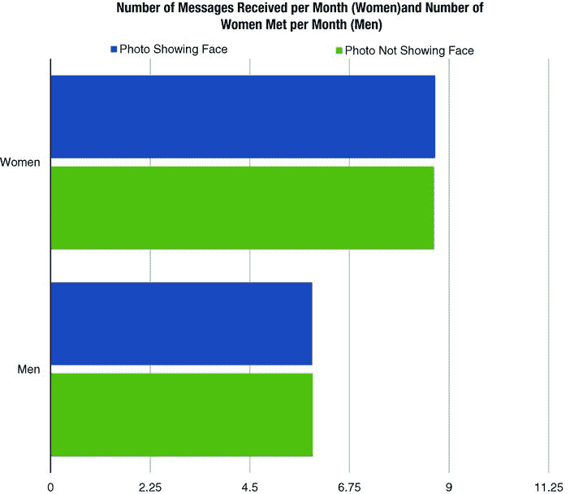

# 顶石案例研究：大数据邂逅爱情

## 产品、服务与爱情：大数据如何影响现实世界

在开发帮助人们相识、联系与互动的新应用方面，机会是无限的。你可以将有趣的新数据源（比如人们对音乐、电影、旅行或餐馆的兴趣）与移动应用等新技术结合起来。例如，你可以构建一个应用，聚合和分析人们的兴趣数据，然后在彼此靠近时发出提醒，以便他们可以线下见面。或者，你也可以构建一个应用，监测人们的活动水平（如睡眠时间表、活跃程度以及参加会议的数量），并在压力水平上升时发出警告——因为这可能对他们的个人关系产生负面影响。

基于日历的应用可以利用数据来判断你是否忽视了与朋友相处的时间，而新的社交网络应用则能使你在旅途中更方便地与关心的人联系。

许多公司正利用数据和移动技术，帮助我们建立更紧密的联系，并保持用户的更高参与度。社交网站`Facebook`利用大数据来决定显示什么内容、展示哪些广告，以及你应该与谁成为在线好友。婚恋网站`Match.com`存储了约`70TB`的会员数据。¹ 最近兴起的移动婚恋应用`Tinder`和`Hinge`则利用大数据，根据用户的`Facebook`资料来匹配用户。²

于 2011 年被`Match.com`收购的在线交友网站`OkCupid`开展了一系列关于什么能造就最成功在线交友档案的研究。在一篇题为“头像照片的四大谬误”的帖子中，`OkCupid`的研究人员描述了分析超过 7000 张头像照片的结果，以找出哪些照片能带来最佳效果——这一效果通过每位用户收到的消息数量来衡量。³

当然，收到更多消息并不一定就是好事。质量往往比数量更重要。但在探讨这个问题之前，我们先来看看研究人员的发现。

研究人员将照片分为三类：调情、微笑和不微笑。

研究人员发现，对于女性而言，在线交友头像中的眼神交流至关重要。那些带有调情表情的女性每月收到的消息略多于没有调情表情的女性，并且远多于被归类为不微笑的女性。

如果没有眼神交流，结果会显著变差。无论面部表情如何，那些没有进行眼神交流的人，整体收到的消息都比有眼神交流的人少。

与女性相反，男性在使用不看镜头、也不微笑的头像照片时，结识女性的成功率最高。然而，使用显示他们不看镜头且带有调情表情照片的男性，在结识女性方面成功率最低。因此，无论男女，不看镜头并带有调情表情都会产生最差的效果。

研究人员还发现，对于男性来说，照片中穿着“普通衣服”或“盛装打扮”在结识潜在伴侣方面没有太大区别。

或许在他们最有趣的发现之一中，研究人员发现，一个人的脸是否出现在照片中，对其收到的消息数量没有太大影响。

那些穿着潜水装备、穿越沙漠的照片，或者完全看不到脸的照片，与那些露脸的照片相比，在帮助网站用户引起兴趣方面效果几乎相同。使用露脸照片的女性平均每月收到`8.69`次联系，而不露脸的女性每月收到`8.66`次消息。使用露脸照片的男性每发出`10`次尝试，能结识`5.91`位女性，而不露脸的男性每`10`次尝试能结识`5.92`位女性。如图`Figure 12-1`所示的这一惊人数据，打破了你应该确保在网上交友头像中露出脸部的迷思。

图 12-1. 打破你应该确保在网上交友照片中露出脸部的迷思

研究人员的结论是什么？那就是，照片承担了所有工作——它们“激发浏览者的好奇心，并充分说明了‘主角’是谁（或想成为谁）。”值得注意的是，正如研究作者所说，“我们不建议你在没有看到对方完整照片之前就与他们线下见面。”

这一切意味着，大数据不仅仅是商业工具。只要拥有正确的数据源，它也能让我们洞察如何最好地展现自己，从而找到合适的伴侣。另一个经验教训当然是，你不应低估基于数据选择正确照片的重要性。

## 大数据如何戳穿谎言、该死的谎言和统计数据

当然，众所周知，人们在网上交友时会夸大事实。在另一项研究中，`OkCupid`联合创始人克里斯蒂安·鲁德研究了该交友网站约`151`万活跃用户的数据。

在《人们在网上交友中撒下的大谎》⁴一文中，鲁德发现，在身高方面，“几乎所有男性都喜欢给自己增加几英寸”。事实上，当男性“接近六英尺时”，他们比平时“凑整”得更多，“努力达到那个令人垂涎的心理基准线”。女性也会夸大自己的身高，“尽管没有向某个基准身高冲刺的趋势”。

`注意` 人们在社交媒体网站上经常夸大事实，身高和收入是用户喜欢夸张的属性。很快，精明的产品和服务开发者就会找到方法来验证这些声明的真实性，至少偶尔能让寻找爱情的人免于心碎。

那么收入呢？那些声称年收入`10`万美元或更多的人真的能赚那么多吗？关于网上交友，鲁德发现人们的收入比他们声称的要少`20%`。随着我们年龄的增长，我们倾向于更夸张，`40`多岁和`50`多岁的人会夸张`30%`或更多。人们不仅会虚报收入，还会上传过时的照片。鲁德的研究发现，“照片越有吸引力，它就越有可能是过时的。”

那么，交友网站如何决定向谁推荐可能匹配的对象呢？

拥有约`180`万付费订阅用户的`Match.com`推出了一套代号为`Synapse`的新算法，根据《金融时报》一篇题为“揭秘`Match.com`”⁵的文章介绍，该算法用于“分析多种因素以推荐可能的伴侣”。

我们嘴上说想要找的，并不总是我们实际在找的。尽管算法会考虑用户声明的偏好，但它也会将用户实际浏览的档案类型作为因素纳入考虑。例如，如果用户声明偏好某个年龄段，但却浏览了该年龄段之外的潜在伴侣，那么算法会考虑到这一点，并在未来的搜索结果中包含该年龄段之外的人。

预测偏好的挑战之所以更加复杂，是因为与电影或图书推荐不同，匹配人类的算法必须考虑双方的相互偏好。据报道，`Match.com`分析主管阿玛纳斯·汤姆布雷曾引述称：“即使你喜欢《教父》，《教父》也未必会喜欢你。”

此类算法的挑战在于，尽管`Match.com`拥有自`1995`年成立以来注册的`7500`万用户数据，但它缺乏关于哪些约会成功、哪些失败的数据。这种无法形成反馈闭环的缺失，是创建终极匹配算法时一个重要的缺失环节。

这就是为什么当人们取消订阅时，约会网站常会询问原因是他们对在线约会体验不满意，还是已经遇到了心仪对象。这类数据不仅对营销有用，还可以纳入预测算法的考量因素。

## 利用大数据寻找缺失的数据

但正是这种数据的缺失，可能导致机器匹配算法失效。与所有大数据分析和预测引擎一样，此类算法的优劣完全取决于工程师用于开发它们的数据以及它们所接收的数据。如果关键数据缺失，预测算法就无法奏效。

西北大学的伊莱·`J`·芬克尔和加州大学洛杉矶分校的本杰明·`R`·卡尼合著了一项研究，发表于期刊《公共利益心理学》。他们在研究及相应的《纽约时报》评论文章中指出，真正重要的是人们线下见面时如何互动，而非他们在网上说了什么。⁶

“沟通模式、解决问题倾向以及性兼容性等因素，对于预测恋爱关系的成败至关重要，”两位教授表示。

他们还指出，“情侣讨论并试图解决分歧的方式，能够预测他们未来的满意度以及关系是否可能破裂。”然而，这些并非在线约会网站环境中容易评估的特质。此外，约会网站并未考虑关系所处的环境，包括诸如“失业、经济压力、不孕不育和疾病”等压力因素。

作者们还指出，虽然约会网站可能会收集大量信息，但在判断什么能让两个人长期良好匹配时，这些信息只是冰山一角。尽管许多网站声称基于共同兴趣匹配用户，但一项对`313`项其他研究的`2008`年元分析发现，“已建立关系中的性格特质和态度相似性对关系幸福感没有影响。”

一项`2010`年对超过`23000`对已婚夫妇的研究表明，拥有共同的重大性格特征，如神经质、冲动性和外向性，仅能解释婚姻满意度的`0.5%`，这意味着`99.5%`取决于其他因素。

这些研究作者的结论是什么？在线约会并不比其他结识潜在伴侣的方式更好或更差。虽然在线约会网站使用的算法可能有助于市场营销，但最终这些算法可能只是帮助网站用户开启在线约会体验的一种方式，并在像纽约这样人口稠密的地区提供一个可管理的潜在伴侣库。

从大数据的角度来看，这类研究真正指出的是拥有完整数据的重要性。无论是尝试推荐电影、告诉销售人员接下来该给哪位客户打电话，还是推荐潜在伴侣，算法的优劣完全取决于数据。如果没有足够的数据，也没有办法通过了解算法是否做出了正确预测来形成闭环，就难以创建精确的算法。就像往飞镖盘上扔飞镖，如果所有飞镖都扎在一个区域，但这个区域不是靶心，那也没用。因此，捕获完整数据——并且能够对哪些有效、哪些无效形成反馈闭环——才是关键。

## 用大数据预测婚姻成功

在预测方面，有一位科学家能够以惊人的准确率预测哪些匹配可能成功。心理学教授约翰·戈特曼博士因在华盛顿大学运营一个被称为“爱情实验室”的生理学实验室而闻名。

戈特曼在`14`年的时间里研究了超过`650`对夫妇。基于他的研究，戈特曼仅凭对新婚夫妇半小时的访谈，就能以超过`90%`的准确率预测他们的婚姻能否长久。⁷

戈特曼将所谓的“心理地图绘制”视为浪漫的基础。在亲密关系中，“心理地图绘制”是了解伴侣的过程。戈特曼提供的一个简单例子是，男性对妻子某一天要做什么感兴趣。

一个积极绘制心理地图的人，不仅会收集信息，还会在白天思考这些信息，并在之后跟进。这意味着要询问配偶的会议、午餐，或者他们早上提到过的一个活动。

值得注意的是，收集数据、思考数据并跟进数据这个过程，不仅在计算领域有用，在维持健康的关系中也同样有效。

戈特曼和他的同事詹姆斯·默里教授更进一步，开发了生物学研究的大数据模型。他们创建了人类行为的数学模型，用于分析和预测婚姻成功。这两位教授与其他几位研究者甚至合著了一本书，名为《婚姻的数学：动态非线性模型》。

戈特曼和他的合著者认为，“婚姻的发展由微分方程支配，或者至少可以用微分方程来描述。”⁸ 戈特曼和他的同事们能够利用微积分数学来描述一段婚姻，并模拟夫妻在各种情况下的行为。

戈特曼的研究发现了四种频繁预示离婚的负面行为：对伴侣人格的批评、轻蔑、防御性，以及情感退缩。⁹ 戈特曼特别将轻蔑描述为“爱情的硫酸”。

通过将对夫妻回答各种问题的评估与通过数学模型进行的肢体语言和生理数据分析相结合，戈特曼不仅能预测一段婚姻是否可能成功，还能在偏离轨道时建议立即进行纠正性调整。

考虑到所有这些关于数学和微分方程的讨论，戈特曼似乎正在祛除浪漫的魔力。但正如戈特曼所言，科学家和研究者需要有一个客观的模型来衡量人际关系，这一点至关重要。而从这类大数据模型中收集到的信息，可以帮助维持牢固的关系。

# 戈特曼论亲密关系

戈特曼研究了那些对婚姻保持满意度的人，以找出是什么让他们的关系保持幸福。他的结论是，那些注重相互了解、彼此欣赏和关爱的夫妻，比不这样做的夫妻更有可能感到幸福。他特别发现，夫妻之间积极互动的次数必须是消极互动的五倍。

失败的婚姻能挽救吗？根据戈特曼的分析研究，答案是肯定的。许多接受过所谓婚姻咨询的夫妻，两年后又会复发，重蹈覆辙。

然而，根据他的研究，戈特曼总结出有两个有效成分可以对婚姻产生持久的积极影响。第一，在解决冲突时减少消极情绪。第二，通过专注于帮助婚姻中的伴侣“成为更好的朋友”来增加整体积极性。最重要的是，戈特曼的研究不仅仅是大量的数据点。与所有最优秀的大数据分析一样，戈特曼将他的研究转化为简单而强大的可操作见解。在这种情况下，这些见解可以引导我们建立更幸福、更令人满意的关系。

 **注** 最优秀的大数据分析，以及那些最容易转化为成功产品的分析，是将繁重的研究转化为简单、强大、可操作见解的分析。

## Facebook 如何塑造人际关系

当戈特曼和他的同事基于多年的研究在现实世界中帮助夫妻时，也许没有哪家在线公司能比社交网络巨头 Facebook 对人际关系产生更大的影响。

这家如今在全球拥有超过十亿用户的公司，是分享照片、更新状态和记录你（无论是独自一人还是与他人一起）生活时间线的首选目的地。

像 Facebook 这样的社交网站，通过所谓的“社交图谱”来呈现这类关系。与一对一的关系不同，社交图谱由许多相互关联的关系组成。如果乔认识弗雷德，弗雷德认识莎拉，那么在社交图谱的语境中，乔就通过弗雷德与莎拉有了联系。但此类互联关系通过纳入兴趣、地点、公司、品牌、生日和状态更新等非人类元素而进一步延伸。在社交图谱的语境中，人们不仅与他人建立联系，还与活动、事件、公司和产品建立联系。

 **提示** 正如一些公司专注于构建用于结构化和非结构化数据的数据库一样，也有一些公司专门为基于图谱的数据构建数据库。例如，`Neo4j` 就专注于构建专门用于表示连接的数据库。迄今为止，该公司已筹集了约 2400 万美元，其客户包括 eBay、惠普和沃尔玛等公司。

六度分隔理论普及了这样一种观念：在社交联系方面，任意两个人之间最多相隔六步。商务社交网站 LinkedIn 利用这一概念，向商务人士展示他们如何通过中间人与其他人建立联系。当这些专业人士想要与那些他们不直接认识、但却是朋友的朋友或同事的同事的人交谈时，他们就利用这种连通性。

在 Facebook 上，人们之间的联系甚至比六度理论所暗示的还要紧密。该公司的工程经理桑吉夫·库马尔指出，Facebook 用户之间的连接度很高，平均分隔度仅为 4.74。社交图谱中的关系因与地点、兴趣和其他元素的联系而变得更加密集。

通过表示大量连接之间的关系，社交图谱可以回答许多有趣的大数据问题。这包括数据分析师提出的问题，也包括数亿用户主动或被动提出的问题，例如“我应该与谁联系？”、“我应该看哪些照片？”以及“哪些信息对我很重要？”

尽管这些用户中的大多数并不认为自己是在对作为大数据的社交图谱执行查询，但这正是他们正在做的事情，或者至少是社交网络服务正在代表他们做的事情。

从技术角度来看，社交图谱在大数据领域也同样引人入胜。回答诸如上述之类的问题会消耗大量计算资源。每个查询都涉及处理整个图谱的一个非常大的子集（技术上称为工作集），并且是针对每个用户高度定制的。

 **提示** 社交图谱是我们人类关系的数字化表示。它们可能是洞悉人类关系最强大的信息来源之一。

更重要的是，社交图谱代表了大量实际数据，不仅仅是图谱本身的互联关系，还包括与每个用户关联的照片、视频、状态更新、生日和其他信息。一个查询必须返回正确的关联集，还必须几乎瞬间返回这些关联所关联的数据。

社交图谱代表的数据量如此之大，以至于为了跟上步伐，Facebook 不得不开发定制服务器，建立自己的数据中心，并设计专门的软件来高效地查询图谱，以及存储和检索其关联数据。

那么，这一切对我们的关系意味着什么呢？

在 Facebook 上表达自我的众多方式中，“关系状态是唯一一种直接涉及另一个人的方式。”我们通常在这个社交网站上宣布订婚、结婚、分手和离婚。

2010 年，大约 60%的 Facebook 用户在个人资料中设置了关系状态，截至同年 12 月，女性用户数量是男性的 1.28 倍。截至 2014 年 1 月，该网站约 53.3%的用户为女性，45.6%为男性。2011 年，三分之一的离婚申请中提到了“Facebook”这个词，高于前一年的 20%。

在线宣布我们的关系状态可以强化研究人员所谓的“情感规则提醒”。这些规则是社会规范，告诉我们何时该有何感受、感受什么，以及我们的情感应该有多强烈。通过在线声明我们的关系状态，我们强化了这些规则。

像 Facebook 这样的社交网站也会影响一个人的健康和个性。有些人在网站上真实地展现自己，而另一些人则由于不安全感而展现出一个经过美化的自己。

根据社交网络统计网站 *The Social Skinny* 的卡拉·普林引用的统计数据，大约 24%的美国人和 28%的英国人承认在社交网络上就自己做过什么和/或见过谁撒过谎或夸大其词。与此同时，过于频繁地访问我们的个人主页会让你我们过度关注自我，从而引起压力和焦虑。

拥有比其他人更多的数字好友——Facebook 用户平均拥有 229 个社交网络好友——可能会因为我们获得额外的社会支持而给我们带来一点自信。大约 25%的人认为社交网络增强了他们的自信心。拥有比其他人更少的好友可能会让我们感到难为情，但较小的数字社交圈也可能带来更真实的互动。

### 在线社交的影响

若有人对在线社交对我们生活产生的巨大影响心存疑虑，数据显示，40%的人花在线上社交的时间超过了面对面互动。互联网用户将 22.5%的上网时间用于社交网络活动，其中超过一半的 Facebook 用户每天都会登录该网站。

 **注意** 如果你担心自己的社交媒体应用市场不够大，请记住，近半数线上社交者花在网上的时间比与现实世界中的人互动的时间更多。

### 大数据如何增加——与减少——社交资本

我们珍视自己的线上身份及其带来的人际关系，不仅因为它们是自我表达的方式，还因为我们将其与社交资本相联系。社交资本是指我们因在社会网络中的位置，以及该网络（包括线上和线下）中相关的联系和资源而获得的利益。

根据卡内基梅隆大学人机交互研究所与 Facebook 的研究人员所述¹⁸，这种资本有两种形式：纽带型与桥梁型。纽带型指从与家人和亲密朋友的关系中获得的社交资本；而桥梁型则指从熟人关系中获得的社交资本。

两者都有价值，但纽带型通常提供情感支持与陪伴。桥梁型则源于更松散、更多样化的人际关系，通常能带来新的沟通机会和就业信息等机遇，因为关系过于紧密的圈子往往信息重复。

研究人员将社交网络上的活动分为三类。第一类是通过聊天或留言板与特定朋友进行定向沟通。第二类是被动消费社交新闻，即阅读他人的动态更新。最后一类是广播，即发布不针对特定个人的更新。

研究人员得出结论，由于定向沟通内容的丰富性以及沟通双方关系的强度，它有可能同时提升纽带型和桥梁型社交资本。在一对一沟通中，提供和接收信息都能增强关系强度。此外，与广播式沟通相比，仅因一对一沟通所需的努力，就体现了关系的重要性。

对于桥梁型社交资本，只有一对一沟通能增加 Facebook 发信方的社交资本。其他形式的沟通仅能增加收信方的社交资本。正如研究人员指出的，非定向广播以及被动消费新闻和动态，可能会增加接收者和消费者的知识，但无助于关系的发展。

广播式沟通作为获取他人信息的来源很有用，我们可以利用这些信息，通过提及共同兴趣来增强现有关系或发展新友谊。对于泛泛之交而言，发布广播对我们帮助不大，但接收广播和消费新闻却可能有益。（讽刺的是，接收者能获得这种价值，自然是因为发送者进行了广播。）对于现有社交沟通技能较低的人来说，接收广播信息的益处更大。

研究人员还发现，只有少数重大人生变故对桥梁型社交资本有显著影响。例如，搬家对桥梁型社交资本有积极影响，这可能是由于增加了新的人际关系，使我们获取信息和资源的途径多样化。然而，失业则因失去了与前同事相关的社交情境而产生负面影响。

那么，个人关系的变化对我们更广泛社交网络的影响又如何呢？尽管我们非常担心结婚、离婚、死亡、家庭添丁、换工作、疾病等人生变故对更广泛社交网络的影响，但现实是，这类事件虽然对个人影响巨大，但对更广泛社交网络的影响却相对较小。

这与通过 Facebook 增减社交资本的方式相比如何？每当我们在网络中的一对一沟通量翻倍时，其对桥梁型社交资本的影响量相当于搬到一个新城市。这大约相当于失业影响的一半。换句话说，一条建立新联系的一对一数字信息，对桥梁型关系的影响可能与搬到一个新城市相当。

这意味着，如果我们选择利用在线一对一沟通，社交网络可以大大减少通常与扩展更广泛网络相关的摩擦。这可能就是为什么在求职方面，职业社交网站 LinkedIn 上的一对一消息（甚至是经由联系人发送的消息）如此有效的原因之一。

虽然沟通显然在关系发展中扮演着重要角色，但信息也同样重要。尽管其作用可能不如 Facebook 那样明显，但 Google 同样影响着我们的关系。

问问几乎所有经历过线上约会的人，他们都会告诉你他们曾用 Google 搜索过潜在伴侣。根据婚恋服务公司《It's Just Lunch》的数据，43%的单身人士在约会前会用 Google 搜索对方。在接受调查的 1167 名单身人士中，88%的人表示，如果约会对象搜索过自己，他们不会介意。¹⁹

几乎在搜索引擎中输入任何人的名字，你都会看到一系列与该人相关的结果。其中包括提供背景信息的网站、提及或撰写某人的文章，以及 LinkedIn 上的工作档案。

Facebook、Twitter 和其他形式的数字社交通信相对较新，这意味着对此类媒介影响的学术研究相对有限。然而，显而易见的是，一个人的线上身份是一种海量的大数据形式。

就人类而言，大数据是我们以照片、视频、状态更新、推文和帖子形式分享的关于自己及人际关系的信息，更不用说我们以网站点击和在线购买形式留下的数字踪迹了。

### 大数据与浪漫：未来展望

数字社交通信的增强功能，如虚拟礼物，可能看起来不像人们表达浪漫兴趣的方式，但这种表达形式正变得越来越普遍。虚拟物品，如看起来像真实世界商品但仅以数字形式存在的鲜花，在社交游戏和社交网络中都变得非常流行。人们已经表现出为这些数字物品付费的意愿。

可以想象，在未来，推荐引擎能够准确预测哪些礼物会最受欢迎，并向发送者提出建议。当然，社交网络可能首先要确保伴侣们不会忘记彼此的周年纪念日！

无论我们是否想要这种洞察力，大数据都在收集并提供更多关于我们及我们人际关系的信息。像 *Match.com* 开发的尝试推荐更佳匹配的算法，可能忽略了关于关系如何随时间演变的重要数据，但我们可以预见，一个与 Facebook 及其他平台整合的服务提供高质量推荐和预测的时代终将到来。

事实上，随着时间的推移，脸书对我们人际关系的洞察力可能超过其他任何网站。博客网站《*All Facebook*》引用了《脸书效应：连接世界公司内幕》一书中的一段话：“通过分析好友关系和沟通模式，[脸书联合创始人兼首席执行官扎克伯格]能够以大约 33%的准确率提前一周预测用户将与谁建立恋爱关系。”扎克伯格显然能够利用关于谁刚恢复单身、谁正在查看哪些个人资料、以及谁和谁互为好友等数据来获得此类洞察。²⁰

在线约会和社交沟通正变得越来越被社会所接受，并在此过程中产生了海量数据。大众化的沟通形式无法替代一对一的交流。但那些使此类沟通变得更加便捷的社交网络，能够大幅减少建立新关系以及维护现有关系所需投入的精力。如今，像 Match.com 开发的这类算法或许只是开启沟通的一种方式。但在未来，大数据在改善我们个人及职业关系方面蕴藏着巨大机遇。

随着越来越多的人使用像 iPhone 和安卓设备这样的智能手机，我们看到针对约会以及更广泛的结识新朋友场景的移动应用层出不穷。Skout 等应用帮助用户无论身在何处——是当地酒吧、体育赛事现场，还是游览新城市时——都能发现新朋友。该应用提供了聊天、交换照片和赠送礼物等集成功能。移动应用将继续降低沟通障碍，帮助我们与关心的人保持联系，同时持续产生海量数据，这些数据有助于进一步优化互动并促成新的联系。

大数据或许还无法挽救一段濒临破裂的关系，但它能让我们洞察人际关系所处的背景环境，例如根据特定时期分手事件的数量，判断一年中哪段时间对情侣关系来说最为艰难。通过学习这些数据，我们可以采取积极措施来改善我们的关系。

大数据还能帮助我们判断亲友是否正面临麻烦，比如通过分析他/她是否比平时沟通频率降低、压力水平升高，或是否经历了离婚、失业、亲属或密友去世等可能导致抑郁或其他问题的重大人生事件。与此同时，通过持续降低沟通门槛，大数据很可能将巩固现有关系，并支持新关系的建立。

我们渴望建立新纽带并巩固现有纽带——这种作为人类与生俱来的社交天性——是推动新技术产生以帮助我们更便捷沟通的最大动力之一。

 **提示** 婚恋配对应用的市场规模巨大。但利用大数据帮助现有关系蓬勃发展的市场，或许更为广阔。

我们可能不会将脸书或谷歌这类网站视为大数据应用，因为它们被包装在易于使用、对消费者友好的界面之下。然而实际上，它们代表了大数据巨大的潜力。

在应用大数据来改善我们的人际关系并建立新友谊方面，像脸书这样的应用只是冰山一角。通过将数据与移动技术相结合，各种新型应用成为可能。何必只局限于根据一般兴趣进行匹配？为什么不更进一步，根据我们最近听的音乐、喜欢看的电影或爱吃的食物来推荐匹配对象呢？在构建新型人际关系应用时，如今的创业者有机会像 iPod 颠覆随身听一样，对现有的婚恋配对和社交网络服务产生颠覆性影响。

在所有关于大数据规模与经济性、实时数据流以及存储和分析成本下降的讨论中，我们很容易忽视大数据对我们日常生活的积极影响——无论是讨论在线婚恋配对，还是采取措施改善关系。大数据不仅能为你开启寻找一生所爱的新途径，对于全世界的单身人士而言，好消息是：在未来，大数据一旦助你找到真爱，也很可能帮你牢牢把握住这份爱情。

____________________

¹ `http://www.bbc.com/news/business-26613909`
² `http://www.cnbc.com/id/101151899`
³ `http://blog.okcupid.com/index.php/the-4-big-myths-of-profile-pictures/`
⁴ `http://blog.okcupid.com/index.php/the-biggest-lies-in-online-dating/`
⁵ `http://www.ft.com/intl/cms/s/2/f31cae04-b8ca-11e0-8206-00144feabdc0.html`
⁶ `http://www.nytimes.com/2012/02/12/opinion/sunday/online-dating-sites-dont-match-hype.html`
⁷ `http://www.uwtv.org/video/player.aspx?pid=OJG2Xv9kB9n0`
⁸ `http://www.slate.com/articles/life/do_the_math/2003/04/love_by_the_numbers.2.html`
⁹ `http://en.wikipedia.org/wiki/John_Gottman` 和 `http://psycnet.apa.org/?&fa=main.doiLanding&doi=10.1037/0893-3200.14.1.42`
¹⁰ `http://www.ece.lsu.edu/hpca-18/files/HPCA2012_Facebook_Keynote.pdf`
¹¹ `http://www.time.com/time/business/article/0`,8599,1895694,00.html
¹² `http://blogs.channel4.com/benjamin-cohen-on-technology/the-way-facebook-changes-relationships/2541`
¹³ `http://istrategylabs.com/2014/01/3-million-teens-leave-facebook-in-3-years-the-2014-facebook-demographic-report/`
¹⁴ `http://abcnews.go.com/Technology/facebook-relationship-status/story?id=16406245#.UMzUJaWTVjY`
¹⁵ `http://doctorat.sas.unibuc.ro/wp-content/uploads/2010/11/Issue2_GregBowe_Romantic.pdf`
¹⁶ `http://allfacebook.com/infographic-facebook-hurt-relationships_b45018`
¹⁷ `http://thesocialskinny.com/216-social-media-and-internet-statistics-september-2012/`
¹⁸ *社交资本在脸书：区分使用与用户* (2011 年 5 月)
¹⁹ `http://www.itsjustlunch.com`
²⁰ `http://allfacebook.com/facebook-knows-that-your-relationship-will-end-in-a-week_b14374`

