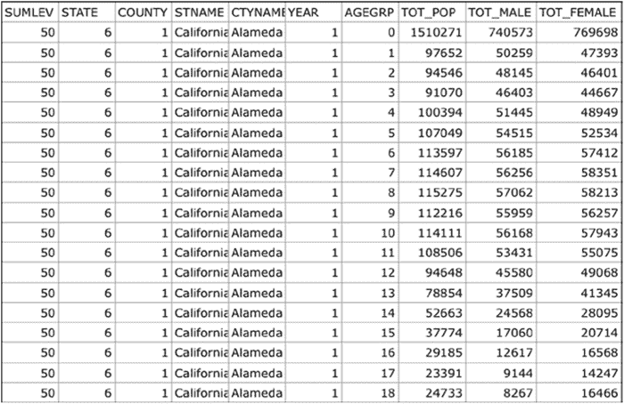
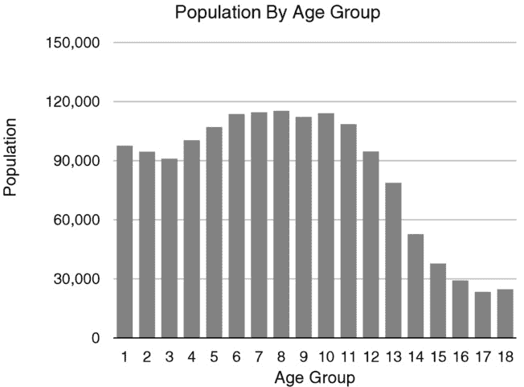
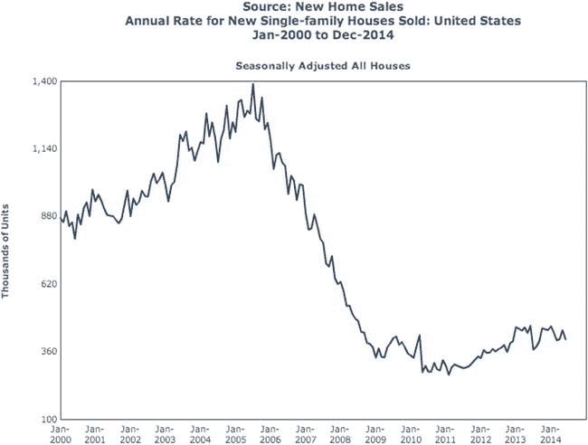
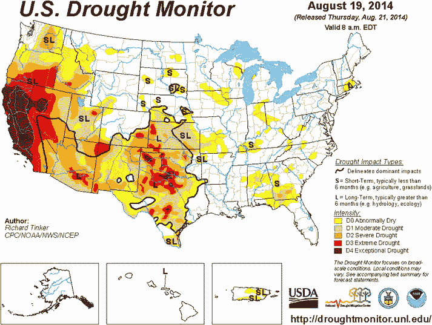
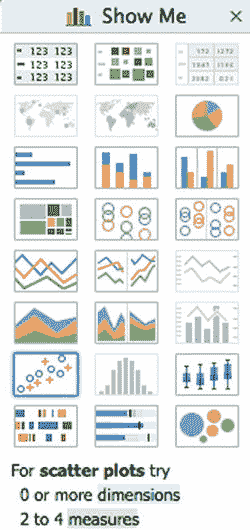
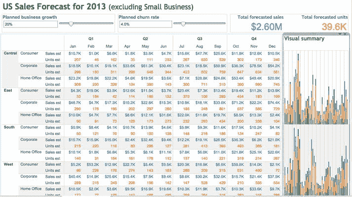

# 一图胜千言

## 大数据如何讲述故事

这是你第一次来到华盛顿特区。抵达美国首都后，你兴奋地想要参观所有纪念碑和博物馆，看看白宫，并攀登华盛顿纪念碑。要从一个地方到另一个地方，你需要乘坐当地的公共交通系统——地铁。这看起来很简单。但有一个问题：你没有地图。

想象一下，咨询台的工作人员没有给你地图，而是递给你一张按字母顺序排列的站点列表、地铁线路名称和地理坐标。理论上，你拥有了在华盛顿地铁中导航所需的所有信息。但实际上，要弄清楚乘坐哪条线路以及在哪里上下车，将是一场噩梦。

幸运的是，咨询台还有同一数据的另一种表现形式。那就是华盛顿特区的地铁图，它按不同线路顺序显示所有站点，每条线路用不同颜色标示。图上还标明了每条线路的交汇点，这样你就能轻松知道在哪里换乘。突然之间，乘坐地铁变得轻而易举。

地铁图不仅仅给了你数据——它还给了你知识。

你不仅知道该乘坐哪条线路，还大致知道到达目的地需要多长时间。无需多想，你就能看到到达目的地有八站，每站之间间隔几分钟，因此从你所在位置到，比如说，航空航天博物馆，需要稍多于 20 分钟。不仅如此，你不仅能通过名称或终点站来识别每条地铁线路，还能通过颜色：红色、蓝色、黄色、绿色或橙色。每条线路都有独特的颜色，你在地图上就能识别出来——当你在站内寻找正确线路时，也能从地铁墙壁上看到。

这个简单的例子说明了可视化的强大魅力。通过混合运用颜色、布局、标记和其他元素，可视化能在几秒钟内向我们展示纯数字或文本可能需要几分钟甚至几小时才能传达的信息——如果我们还能从中得出结论的话。

为了让你更直观地理解，华盛顿特区地铁仅有 86 个站点。而由东京地铁和都营地铁组成的东京地铁系统，大约有 274 个站点。算上东京大都市区的所有铁路网，总共有约 882 个站点。如此多的站点，如果没有地图，几乎不可能导航。

## 趋势发现

如果你曾使用过电子表格，你就会亲身体验到在大量填满数字的单元格中发现趋势有多困难。表 5-1 是 2010 年加州阿拉米达县的一个美国人口普查数据示例。

**表 5-1.** 表格形式的美国人口普查人口数据

与电影《黑客帝国》中数字看起来像图像、图像看起来像数字的情况不同，电子表格并不那么容易解读。这就是像 Microsoft Excel 和 Apple Numbers 这类程序内置图表创建功能的原因之一。当我们以图形形式（如图 5-1 所示）查看时，表 5-1 中展示的人口普查数据就容易理解得多。

**图 5-1.** 按年龄分组的美国人口普查人口数据可视化形式

当我们看到饼图或柱状图之类的图表时，通常更容易看出事物随时间或相对变化的情况。

事物随时间的变化在做决策时至关重要。单个数据点本身往往不足以说明事情的进展，无论你关注的是销售趋势还是健康数据。

图 5-2 显示了美国人口普查局从 2000 年开始的新房销售数据。如果我们只看 2000 年 1 月的数值（87.3 万），这本身说明不了太多问题。但当我们观察新房销售随时间的变化时，情况就一目了然了。我们能清晰地看到，在房地产泡沫高峰期的新房销售与今天的新房销售之间存在着多么巨大的差异。

**图 5-2.** 美国人口普查新房销售数据随时间变化的可视化展示

使用这种视觉趋势分析是理解数据的关键方法之一。例如，投资者经常评估一家公司在一段时间内的表现。一家公司可能会报告某个季度的收入和利润。如果没有对公司前几个季度财务表现的了解，投资者可能会得出该公司经营良好的结论。

但这个时间点数据无法告诉投资者的是，该公司的销售额每个季度都在不断下滑。因此，尽管总的销售额和利润看起来不错，但实际上，如果找不到提高利润的方法，这家公司将会走向破产。

*内部环境*是管理者和投资者用来判断业务趋势的关键指标之一。同时，管理者和投资者也需要*外部环境*，它能告知他们与同行相比自身表现如何。

假设某个季度的销售额下降了。管理者可能会得出结论，认为公司执行不力。然而，实际上销售额下降可能是由于更广泛的行业问题——例如，房地产行业新建房屋减少，或航空业旅行减少。缺乏外部环境，即没有同行企业在同一时期的表现数据，管理者就很难洞察导致业务受损的真正原因。

即使管理者同时掌握了内部和外部环境信息，仅凭抽象的数字依然难以判断实际情况。这时，数据可视化就能真正发挥其作用。

## 可视化的多种类型

几乎每位商业用户都熟知常见的饼图、柱状图或折线图。在将数据转化为可视化形式时，这些只是冰山一角。还有许多其他类型的可视化方法。

地理可视化对于展示位置信息非常有用。这类可视化通常还叠加了额外信息。例如，它们可以展示人口密度、商店位置、收入分布、天气模式以及其他有助于直观查看的数据。图 5-3 将地理信息（美国地图）与天气数据相结合，直观地展示了截至 2014 年 8 月美国有多少地区正遭受干旱。⁴

图 5-3. 一种结合了地理与天气数据的可视化

地图可以显示路径信息，告知销售人员何时访问哪些地点，或者为驾驶员展示从一个地点到另一个地点的最佳路线。

网络图展示了连接与互联关系。网络图可以通过展示人员之间的关系，说明信息在组织中的流动方式。网络图还可以展示社交网络中的连接，或计算机网络中不同机器之间的连接。

时间序列可视化展示了事物随时间的变化规律。时间序列图表可以展示天然气、石油和煤炭等自然资源多年来的消耗情况，或者展示收入来源。时间序列可视化可以与地理可视化相结合，以展示人口密度或特定人群的赚钱能力随时间的变化。

信息图通常用于营销目的，它不仅以视觉形式展示数据，还整合了绘画、文字和图形，讲述关于数据的故事。

词云图，如图 5-4 所示，是一种有用的方式，将大量文本中最常出现的词语进行可视化。⁵ 这类可视化能轻松确定特定文本的核心内容。你可以使用多种工具创建词云图。一个易于使用的网络工具叫 Wordle，网址是 `wordle.net`。

图 5-4. 美国宪法的词云图

如今涌现出越来越多具有动态特性的可视化。与过去静态、固定的可视化不同，当今的交互式可视化允许用户与之互动，从而可以改变查看的时间段、放大特定地理区域以获取更多细节，或改变可视化中包含的变量组合，以不同的方式查看数据。交互式可视化结合了传统可视化的最佳特性——以图形形式呈现数据的强大能力——以及易于使用的现代动态分析能力。

 **注** 许多网站现在展示了每日海量涌现的各种令人惊叹的可视化作品。其中两个网站是 `visualizing.org` 和 `www.informationisbeautiful.net`。这些网站上的可视化作品可以作为创建自己引人注目的可视化作品的绝佳灵感来源。

## 如何创建可视化

有许多易于使用的工具可以帮助你创建自己的可视化。可视化工具既有在线版本，也有桌面版和移动版。Google Public Data Explorer 是开始创建可视化的一个好起点。该工具位于 `https://www.google.com/publicdata/directory`，内置了大量不同类型的公开可用数据。无需安装任何软件，你就可以尝试各种不同的可视化方式，并查看不同数据集随时间的变化。

还有一些在线工具可用于创建特定类型的可视化。例如，CartoDB (`cartodb.com`) 是创建地理可视化的有用工具。使用 CartoDB，只需几行代码，就可以轻松地将复杂地理数据集的交互式可视化嵌入到你的网站、博客或其他应用中。

如果你在构建自己的应用程序，HighCharts (`www.highcharts.com`) 是另一个可用的在线可视化资源。只需少量代码，就可以将在线数据加载到 HighCharts 中，它会完成以图表形式显示数据的繁重工作。

由于合规性、隐私或安全要求，你可能无法始终将数据上传到基于云的可视化工具。在这种情况下，你可以使用桌面软件应用程序，例如 Tableau Desktop 或 QlikTech 的 QlikView。如果你需要访问存储在 Hadoop、Microsoft SQL Server、Oracle、Teradata 或其他数据源中的数据仓库里的数据，可以使用 Tableau 和 QlikView 直接连接这些数据源。

这些程序还可以连接到基于文件的数据源，如 Excel 文件和文本文件。这意味着你可以访问各种不同的数据源，以及存储在多个数据仓库中的数据源，并轻松地对其中的数据进行可视化。

像 Tableau Desktop 这样的软件（参见图 5-5），使得在不同类型的可视化之间切换变得极其容易。这意味着你可以获取复杂的数据集，并快速尝试多种可视化方式，以找出哪种方式能以最引人注目的方式呈现你的数据。

图 5-5. Tableau Desktop 中的“向我显示”弹出窗口允许用户轻松在不同类型的可视化之间切换（由 Tableau Software 提供；经许可使用）

如图 5-6 所示，使用合适的工具，可以轻松地将原本难以解读的数据（例如销售预测）转化为引人注目、直观的可视化形式。

图 5-6. 在 Tableau Desktop 中显示的示例销售预测数据，右侧为对应的可视化视图（由 Tableau Software 提供；经许可使用）

无论您选择哪种工具，可视化都能让复杂数据变得易于理解。您不仅可以在演示中使用可视化图表，还可以将它们直接嵌入到网站和应用程序中。

## 使用可视化压缩知识

俗话说，一图胜千言。但这引出了一个问题：为什么可视化如此强大？正如可视化专家 David McCandless 所说，“可视化是一种知识压缩的形式。”⁶ 一种压缩形式是减小数据的大小，例如通过使用简写（如数字）来表示一个单词或一组单词。然而，虽然这种压缩使数据存储更高效，但并不能让数据变得更容易理解。

然而，一张图片可以获取大量信息，并以易于理解的形式呈现。在大数据领域，这类图片被称为可视化。

地铁图、饼图和条形图都是可视化的形式。尽管可视化乍看起来可能是个简单的问题，但出于一些原因，它其实很难。首先，通常很难将所有人们想要可视化的数据集中到一个地方，并保持一致的格式。内部和外部上下文数据可能存储在两个不同的地方。行业数据可能在市场研究报告中，而实际的公司销售数据可能存储在公司的数据库中。

其次，这两种形式的数据格式可能略有不同。公司销售数据可能按天存储，而行业数据可能只能按季度获取。

或者，特定数据项的名称可能不同；在行业报告中，硬盘可能被称为“hard drives”，但在内部销售数据库中，可能用型号来指代。这种形式的数据不一致性会使我们难以理解数据真正在告诉我们什么。数据不一致性问题没有银弹解决方案，但像 Trifacta 和其他更新的产品正在涌现，使这个问题更容易处理。

 **提示** 构建一个易于使用的托管数据清洗服务，仍然存在巨大的机遇。如今，许多数据一致性问题消耗了数据分析师原本可以用来解决业务问题的时间。托管的数据清洗和数据一致性服务可以通过结合算法和人工方法，大规模解决这个问题。

好消息是，现代可视化产品可以直接连接到各种数据源，从本地文件到数据库，再到像 Hadoop 这样的数据存储。通过获取所有这些数据并为其创建图像，数据可以变得不仅仅是数据。它可以变成我们可以据此行动的知识。

可视化是一种知识压缩的形式，因为一张看似简单的图像可以获取大量结构化或非结构化数据，并将其压缩成几条线条和几种颜色，从而快速高效地传达所有这些数据的含义。

## 为什么视觉信息如此强大？

在可视化领域，很少有人像 Edward Tufte 那样对该领域产生如此巨大的影响。*《纽约时报》* 称 Tufte 为“数据界的列奥纳多·达·芬奇”。

1982 年，Tufte 出版了 20 世纪最具定义性的著作之一 —— *《定量信息的视觉展示》*。尽管他的职业生涯始于教授政治学课程，但 Tufte 的毕生工作致力于理解和教授信息设计。

Tufte 的贡献之一是专注于让插图中的每一个数据点都有意义，并排除任何不相关的数据。Tufte 的图像不仅仅是传达信息；许多人认为他的图形是艺术作品。Tufte 证明了，可视化不仅是有用的商业工具，还可以以视觉上吸引人的方式传达数据。

虽然可能难以达到 Tufte 推广的一些图形方法的水准，但*信息图*（如今通常这么称呼）已成为传达信息的流行方式。

信息图不仅仅是好看。如同大数据的其他方面一样，视觉数据呈现为何如此引人入胜，是有科学解释的。

在一篇博客文章中，Tufte 引用了一篇发表在 *《当代生物学》* 上的文章相关的新闻稿，该文章描述了我们视觉吸收的信息量有多大。⁷ 根据这篇文章，宾夕法尼亚大学医学院的研究人员估计，人类视网膜“传输视觉输入的速度大约与以太网连接相同。”⁸

在他们的研究中，研究人员使用了豚鼠的完整视网膜，并配合一种称为多电极阵列的设备，该设备用于测量神经节细胞发出的电脉冲尖峰。神经节细胞将信息从视网膜传递到大脑。基于他们的研究，科学家能够估算出豚鼠视网膜中所有神经节细胞（总共约 10 万个）传递信息的速度。然后，科学家们计算了人类视网膜中相应细胞每秒传输的数据量。人类视网膜含有约 100 万个神经节细胞。将这些细胞加在一起，人类视网膜以大约每秒 10 兆比特的速度传输信息。

为了说明这一点，丹麦科普作家 Tor Norretranders 创建了一张图示，展示了我们感官的带宽。在这张图中，他指出我们通过视觉接收到的信息比通过任何其他感官都要多。如果我们通过视觉接收信息的速度与计算机网络大致相同，那么通过触觉接收信息的速度大约是视觉的十分之一，大约相当于 U 盘与计算机接口的速度。

我们通过耳朵和鼻子接收信息的速度更慢，大约是触觉的十分之一，或者与硬盘与计算机接口的速度大致相同；而我们通过味蕾接收信息的速度则更慢。

换句话说，我们通过眼睛获取信息的速度比通过任何其他感官快十倍到一百倍。因此，通过视觉传达的信息非常强大，这是有道理的。而且，如果这些信息包含大量数据，并被压缩成一个充满知识的可视化图像，我们就能更快地接收这些信息。

但这并不是视觉数据表示如此强大的唯一原因。另一个原因是，我们喜欢分享，尤其是喜欢分享图像。

## 图像与分享的力量

2012 年 11 月 22 日，照片分享服务 Instagram 的用户分享了很多照片。那是 Instagram 有史以来最繁忙的一天，用户在那天分享的照片数量是前一天的两倍。这是因为 11 月 22 日并非寻常的一天。那是感恩节。Instagram 用户上传了大约 1000 万张照片，这些照片的标题中提到了与感恩节相关的词语。可以毫不夸张地说，这包含了大量的火鸡照片，当然还有亲人的照片。现在每月约有 2 亿人使用该服务。⁹

2012 年初，Facebook 以 10 亿美元收购了 Instagram。Facebook 在分享照片方面也毫不逊色。截至 2013 年底，Facebook 用户平均每天上传 3.5 亿张照片，每月超过 100 亿张。¹⁰

