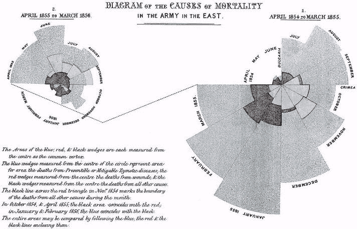

# 我们为何热爱图像：信息图表的魅力

我们热爱照片的另一个原因，当然是因为现在拍摄照片变得如此容易。就在几年前，我们还需要在拍摄的那一刻决定哪些照片该拍，哪些不该拍。如果胶卷快用完了，我们可能会把最后一张留到以后再用。但如今，数码相机、智能手机和廉价的存储设备使得捕捉几乎无限数量的数字图像成为可能。几乎每部智能手机现在都内置了摄像头。这意味着我们不仅可以拍摄所有这些照片，还可以轻松地上传和分享它们。

这种轻松捕捉和分享图像的能力向我们展示了这项活动是多么有趣和有回报。因此，当我们遇到有趣的信息图表时，我们自然也想分享它们。

和照片一样，如今创建信息图表也比过去容易得多。公司也有更多动力去创建这类图形。2011 年 2 月，搜索引擎巨头谷歌对其算法进行了调整，以奖励高质量网站，特别是那些“拥有原创内容和信息，如研究、深度报告、深入分析等的网站”。¹¹ 因此，公司的营销人员意识到，他们需要做更多工作才能让网站在谷歌搜索结果中获得高排名。

但是，对于一个信息有限的营销人员来说，要如何创建一份引人注目的研究呢？创建信息图表。信息图表可以整合广泛的数据源，将它们融合在一起，并讲述一个引人入胜的故事。这些故事可以是关于 `IE`、`Chrome`、`Firefox` 和 `Safari` 之间激烈的浏览器大战，也可以是关于众筹法案带来的就业机会。寻找引人注目的图表以融入作品的博主和记者们喜欢这类图形，因为读者喜欢观看和分享它们。

最有效的信息图表不仅仅是被发布到网上——它们会被分享，而且会被反复分享。其中一些会像病毒一样传播，在 `Twitter`、`Facebook` 和 `LinkedIn` 等社交网络上，以及通过传统邮件，被分享成千上万次，甚至数百万次。

随着对创建信息图表需求的增加，可用的公司和服务的数量也在增加。一个相对较新的进入者是 `Visual.ly`，这是一个创建信息图表的市场。该公司成立于 2011 年，专门帮助客户以图形方式传达复杂的数据。`CartoDB` 帮助人们创建地理可视化。即使是几乎没有统计学或分析背景的用户，也可以使用该公司的基于网页的设计工具。地理可视化是呈现数据（如人口密度、店铺位置、自然资源和销售路线）最具说服力的方式之一。

领先的公司，如 `QlikTech` 及其 `QlikView` 产品、`Tableau Software` 和拥有 `Spotfire` 的 `TIBCO`，都提供产品帮助人们创建用于报告、分析和营销的引人注目的静态和交互式可视化。同时，`Google Public Data Explorer` 允许人们在线探索公共数据集，例如人口增长和人均收入。

## 利用公共数据集

可视化工具的商业用户通常从创建仪表盘的角度来思考可视化。仪表盘获取关于销售、营销和供应链的数据，并将这些数据转化为管理层可以轻松审阅的有意义的图表。

但可视化的力量远不止于此。公共数据集指的是公众可获取且通常由政府或政府相关组织收集的数据。1790 年进行的第一次美国人口普查就是这类数据收集的一种形式。¹² 人口普查的结果提供了大量关于美国人口的信息，包括人口的构成及其地理分布。

在网上很容易找到公共数据集。一个有用的资源是 `data.gov`，它链接到种类繁多的公共数据源。这些数据源包括国家气象局数据、劳动数据、美国人口普查数据、经济活动数据以及一系列其他数据源。`NASA` 在其网站 `http://data.nasa.gov/` 上有许多有趣的数据源，包括具有历史意义的图像和来自火星探测器项目的图像。这些图像是很好的非结构化数据示例。它们在创建大数据规模的图像管理、分类和处理系统中极为有用。

另一个有趣的公共数据集是位于 `http://commoncrawl.org/` 的 `Common Crawl Corpus`。该语料库包含超过 50 亿个网页。这个数据集是开发处理大量非结构化文本的应用程序的宝贵资源。它对于开发检测文本模式、语言处理软件和搜索产品的机器学习算法也很有用。

公共数据源对于学习如何处理和可视化大量数据很有用。它们在进行真实世界的数据分析时也很有用。正如数据讲述者 `Hans Rosling` 所展示的那样，公开的人口和健康数据对于理解人口变化、国家的兴衰以及抗击婴儿死亡率和其它流行病的进展（或缺乏进展）极其有价值。¹³ `Rosling` 使用数据可视化来用数据讲故事，特别是公共数据，就像足球评论员使用比赛回放一样。

`Rosling` 将数据动画化。他不是用数据制作卡通片。相反，他在图表上绘制数据，然后展示数据如何随时间变化——例如，不同国家的相对人口或收入在 40 或 50 年期间如何演变。这种动画化让数据变得生动起来，而 `Rosling` 与他的儿子和儿媳一起开发的软件成为了 `Google Public Data Explorer` 的基础。

一些有史以来最著名的可视化，都是基于以新颖且引人注目的方式呈现公开可用数据。`Visual.ly` 在其网站上的一篇题为 `12 Great Visualizations That Made History` 的文章中展示了几个这样的图表。¹⁴ 其中一些可视化展示了正确的图形能产生多么巨大的影响。在一个例子中，`John Snow` 在 1854 年绘制的伦敦霍乱爆发地图帮助解释了受污染水井中的水是疾病传播的原因。

大约同一时期，另一个著名的、拯救生命的图表来自现代护理学之母 `Florence Nightingale`。`Nightingale` 使用玫瑰图（`coxcomb diagram`）来“向广泛的受众戏剧性地传达复杂的统计信息”。¹⁵

### 图 Figure 5-7

`Nightingale` 关于英国陆军死亡原因图表

特别是，`Nightingale` 的图表显示，对于英国陆军来说，许多死亡是可以预防的。死于非战斗原因的士兵比死于战斗相关原因的士兵更多。因此，她说服了政府重视利用卫生设施来降低死亡率的重要性。

## 实时可视化

大多数信息图表提供的信息本质上是静态的，即使 `Rosling` 创建的引人入胜的动画，也由历史数据构成。