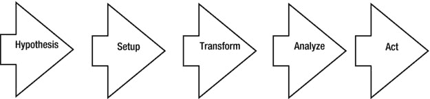
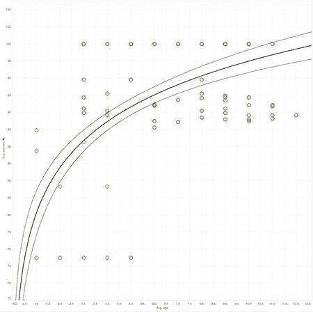
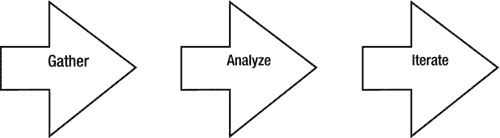
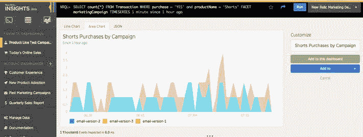
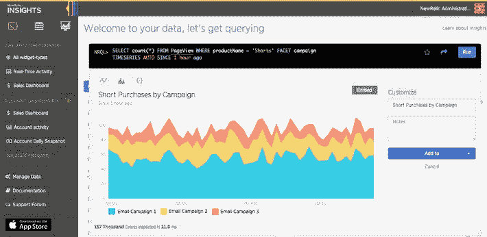
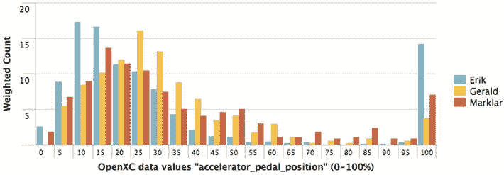

# 开展大数据项目

## 以终为始

正如古语所言，处理大数据时最好"以终为始"。在大数据领域，人们很容易迷失在数据或具体实施中。您想要达成的结果和需要回答的业务问题才是最重要的。因此，大数据的起点并非数据本身，而是您的业务目标和问题。

在设定大数据项目时，您需要：

- 定义目标成果
- 确定需要回答的问题
- 制定关于使用哪些数据以及如何使用数据的政策
- 衡量价值
- 确定所需资源，包括人员、数据、硬件和软件
- 将结果可视化

## 定义目标成果

在大数据的世界里，人们极易迷失在技术和数据中。这就是为什么在任何大数据项目启动之初，定义期望的商业成果至关重要。定义最清晰的成果往往在商业价值方面具有高度可衡量性。以下为几个示例：


- 在六个月内将净推荐值（NPS，一种常用的客户满意度衡量指标）提升 3 个点，并在此后保持该 NPS 评分。
- 通过提高广告转化率，在一周内将产品 X 的销售额提升 10%。
- 通过提高客户满意度，在两个月内将客户流失率降低 2%。
- 在三年内将高中毕业率提升 10%。
- 在一年内将紧急响应人员的每次响应时间缩短 30 秒。
- 在三个月内实现初始应用登录的网站亚秒级响应时间，并在此后至少 98%的时间内保持亚秒级响应。
- 通过分析关键数据源并证明明确的市场需求，为一项新项目获得足够的资金。
- 在新应用上线后三个月内，达到 10 万名活跃用户。
- 在六个月内将网站用户参与度每天提升两分钟，并在此后为至少 75%的活跃用户维持这一提升后的参与率。

请注意，许多此类目标既定义了初始目标，也定义了持续性目标。这一点很重要，因为一次性改进可能比可持续性改进容易得多。除非这两个目标都被明确，否则负责实施的人员可能会选择短期修复（例如为单台服务器增加内存），而非长期修复（例如重新设计应用以使其能在多台服务器上运行）。

如果你不确定想要实现的具体业务指标，但知道自己有需求，可以从更通用的目标开始，例如：

- 创建针对企业资产（包括线上和物理资产）安全攻击的实时可视化。
- 让技术人员能够实时看到攻击的发生。
- 提高技术人员响应安全攻击的速度。

这些目标的细化版本会为以可视化格式成功显示的攻击百分比、此类数据以可视化形式呈现所需的时间，以及技术人员能够多快做出响应设定具体数字。这些数字将基于对当前安全攻击率和响应时间的分析得出。

以上只是你为大数据项目可能确定的众多潜在业务目标中的一小部分。你的业务目标越具体，就越容易保持专注并及时实现该目标。当你能够为想要实现的目标赋予一个明确价值时，获得必要的资源（如资金、人员以及数据源访问权限）也会变得容易得多。

## 确定要回答的问题

与定义成果类似，你也应该准备一份想要回答的问题清单。如果你还没有现成的基线指标，你的第一组问题可能会涉及一些基本的数据收集。例如：

- 我们电子商务网站结账页面的平均网页加载时间是多少？
- 最佳加载时间是多少？最差的是什么？
- 网站响应时间的行业规范或最佳实践是什么？
- 我们是高于还是低于这些数值？
- 如果我们实现了网站结账页面的亚秒级响应时间，预计销售额会增加多少？

一旦你有了基线数据集，就可以迭代你的问题集，如下所示：

- 我们可以将哪些产品添加到首页的产品组合中以增加销售额？
- 某些产品描述或图片是否会导致更高的转化率？
- 哪种类型的客户推荐在增加购物篮大小（最终购买规模）方面最为有效？

这类问题只能通过迭代式的实验过程来回答。通过测试不同的方法、特色产品、产品图片以及网站的其他方面，你可以了解哪些方法能最有效地为潜在客户提供最相关的产品推荐——从而为你的业务带来最大的销售额。

这种方法同样适用于其他大数据领域。你可以运行对比实验，评估人工回复客户服务咨询与自动电子邮件回复对客户满意度的影响。将大数据付诸实践的方式有很多种，从构建全新的应用到可视化正在发生的事情以便做出更好的决策。关键是要对你的大数据项目采取一种探索性、发现驱动的方法。你的迭代速度越快，就能基于上一组问题的答案，更快地提出新的问题。

## 创建数据政策

俗话说，能力越大，责任越大。数据提供了巨大的能力，因此也带来了巨大的责任。

在着手大数据项目时，为你的数据使用制定政策至关重要。要考虑数据收集与价值交付之间的价值交换。如果你基于数据分析向客户提供更好的产品推荐和优惠，客户很可能会感谢你。但如果你像一家大型零售商那样，在潜在客户还不知道自己怀孕之前就向他们推销婴儿产品，你很可能会发现自己站在了数据价值等式的错误一方。

一个好的经验法则是问自己两个简单的问题。第一，你是否愿意自己的数据以你计划的方式被使用？第二，你计划使用所收集数据的方式是否对你的客户有益？至少，在大数据项目开始之初提出这样的问题，将开启一场关于数据使用和政策的重要讨论。

除了数据政策，你还应考虑数据的安全性——无论是传输中的还是静态的。传输中的数据是指从一个位置移动到另一个位置的数据。当你在网页上输入信用卡号，并且你的网络浏览器将该号码发送到位于国家另一端某处的服务器时，你重要的个人财务数据便被置于传输之中。

在数据从你的电脑传输到目的地（例如一个你正在下单购买心仪已久的新耳机的电商网站）的途中，你的信用卡信息是有风险的。黑客有可能访问并使用它达到自己的目的。现在，请设想一下这种风险放大数百万倍的情形——个人数据从一个地方传输到另一个地方，或者医疗记录从一个医生办公室传输到另一个。如果你在处理大规模数据，尤其是当这些数据包含个人信息时，考虑围绕这些数据使用的政策以及保护这些数据的方法至关重要。


一旦数据到达目的地，它就处于“静态”状态。这类数据通常存储在磁盘上，位于服务器的文件系统或数据库中，或者位于处理这些数据的计算机的内存中。哪些数据需要加密，以及应该使用什么方法进行加密，也是需要回答的重要问题。表面上，你可能想加密所有数据。但在实践中，加密和解密数据既耗时又消耗宝贵的计算资源。因此，绝大多数数据并未加密。当你处理的数据规模越大，公司的品牌越响亮时，这类考量就变得越发重要。品牌最大的公司往往是在发生数据泄露时最容易遭受后果的——想想最近零售商塔吉特（Target）暴露的数千万条信用卡记录事件。虽然还有其他合作伙伴和供应商卷入其中，但塔吉特自身承受了最明显的后果。

## 衡量价值

商业价值可以通过多种方式来衡量。当然，其中包括财务影响，例如通过提高业务流程效率节省的资金，或成功的营销活动带来的额外收入。但你也可以从其他方面衡量大数据的价值，例如它促进创新的能力，或支持在新项目开发中进行风险承担的能力。

假设你在项目启动时就确定了关键目标，那么只需在项目进行过程中衡量这些关键指标，并将这些指标与收入或成本节约挂钩即可。例如，你可以：

*   衡量网站响应时间，看看销售额是否有相应的增长，如果有，增长了多少。
*   比较你的主页的某个版本与另一个版本，确定哪个版本效果最好。然后，你可以查看销售额增长百分比或美元价值，并衡量你所作更改的影响。
*   评估客户的客户满意度水平，减少响应服务请求所需的时间，然后重新评估客户满意度水平。如果你知道客户满意度提高一定比例能减少多少客户流失，以及平均每个客户对你值多少钱，你就可以衡量减少客户支持响应时间的商业价值。

衡量价值的关键在于整合持续的衡量工具，并拥有可以将这些衡量结果与之挂钩的财务或其他指标。持续的衡量至关重要，因为任何仅进行一次的衡量可能实际上并不能代表真实情况，可能导致错误的决策。通过定期进行衡量，你可以观察结果随时间如何变化——这有助于更容易地识别任何潜在的无效数据，同时确保你正朝着正确的方向前进。

## 确定资源

除了人力资本，你的大数据项目还需要三种资源：

*   用于收集数据的传感器
*   数据本身
*   分析数据并获得可操作见解所需的必要工具

许多种类的硬件和软件都能生成和收集数据。全球定位系统（GPS）手表记录位置和海拔数据，并且通过连接到其他设备，它们还能收集心率和步频信息。飞机引擎会产生关于燃油消耗和引擎性能的数据，这些数据通过软件进行收集。与此同时，手机每秒生成许多数据点，从通话信号强度到电量消耗。

手机不仅生成关于其自身的数据，它们还能收集数据，例如用户的位置。配备适当的软件和硬件，它们还可以监测心率、睡眠模式以及各种其他健康信息，例如心电图数据和血糖水平。这可以帮助人们改善日常健康状况，并为糖尿病患者和其他患者提供成本更低的测量替代方案。

在很多情况下，你无需费力寻找就能找到所需的数据。很多数据已经存在，例如呼叫中心、计费、客户服务和产品使用数据。营销公司拥有关于营销支出、销售额和利润率的数据。人力资源组织拥有简历、服务年限、员工评级和薪酬等形式的数据。

你想要处理的数据往往并非你需要的格式。例如，呼叫中心或销售部门可能会出于质量保证或培训目的而录制通话，但当这些数据以音频形式存在时，理解它们就很困难。通过将这些录音转换为文本形式，组织就可以分析文本并发现原本无法获得的趋势和见解。

 **注意** 数据有多种形式。它可以是来自服务器日志或电子邮件查询的数据，也可能是由传感器采集的数据——想想心脏监测器，或者一辆新车监控和存储各种电气、机械或驾驶员数据的能力。然而，共同的需求是能够从这些来源捕获数据，并利用它来发现趋势或揭示关于客户的见解，从而催生新产品或更好的服务。

类似地，网络应用程序可能拥有大量数据，但如果没有合适的工具，这些数据可能难以解锁。例如，如果你的网站运行缓慢，你想找出性能下降的根本原因。合适的软件可以记录关于网站性能以及潜在性能瓶颈来源（如数据库和服务器）的一系列数据点。

对于正在构思新大数据项目的组织来说，一个常见的绊脚石是如何获取数据的问题。通常，那些本可以产生有意义见解的项目在开始之前就被叫停了。例如，一个移动应用程序开发者可能想要构建一个应用程序，通过提醒人们他们购买并消费了哪些杂货（以及哪些未被使用而被扔掉），来减少食物浪费。

这样一个应用程序带来的财务节省潜力巨大，而社会影响可能是非常积极的——浪费的食物更少，更多食物可以提供给有需要的人。然而，应用程序开发者如何获得必要的消费者杂货购买数据，以及关于消费者使用与扔掉哪些产品的数据呢？

人们很容易被这样的问题难住。但是，所能获得的价值可能远超为访问和分析这些数据以及构建一个消费者乐意采用的、引人注目的移动应用所需的投资。通过从一开始就专注于商业价值，而不是数据本身，实现大数据项目目标会变得容易得多。

无论你选择处理什么数据，你都需要将数据存储在某个地方以便进行分析，无论是本地存储还是在云端。如果你的公司拥有现有的信息技术（IT）资源，你可能能够在内部获得所需的服务器、存储和计算能力。然而，IT 部门通常忙于其他任务。在这种情况下，或者如果你预先不确定需要存储多少数据，或者将要进行多少分析处理，那么在云端存储和分析你的数据就更有意义了。


好的，作为高级文档工程师和翻译员，我将遵循您提供的注意事项和示例，将给定的英文文本翻译成符合格式要求的中文。


## 你选择的技术

你选择哪种技术也取决于你处理的是结构化数据还是非结构化数据。传统数据库可能完全足以存储联系信息、账单记录以及其他结构良好的信息。尽管非结构化数据，例如网页和文本文件，可以直接存储在磁盘上，但当需要大规模处理此类数据时，就需要更复杂的技术了。这正是像 `Hadoop` 和 `MapReduce` 这样的技术发挥作用的地方。

无论你处理了多少数据，最终你都需要让你的分析结果触手可及且可付诸行动。这正是可视化产品发挥作用的领域。来自 `Tableau Software` 和 `QlikTech` 等公司的产品，让你能够轻松地利用海量数据创建出引人入胜的交互式可视化。

## 可视化结果

将你的分析转化为可视化形式，是让你的大数据项目可付诸行动的最有效方法之一。通常，当人们想到大数据时，他们会联想到难以解读的电子表格，或者像《黑客帝国》中那样在屏幕上流淌的`1`和`0`的洪流。而可视化则将所有这些`1`和`0`转化为任何人都能理解的清晰图像。它让难以接近的东西变得平易近人。

处理大数据似乎需要很多不同的能力。然而，处理大数据实际上归结为三件事：传感器、数据和软件。

为了让事情变得更简单，新兴的大数据应用程序 (BDA) 将收集数据、存储数据和呈现数据等所有环节整合在一起，形成易于使用的应用程序。在许多情况下，这些 BDA 在云端运行并通过互联网交付，这意味着你无需购买任何硬件或安装任何软件即可启动大数据项目。大数据景观图（`http://www.bigdatalandscape.com/`）重点介绍了一些公司，你可能需要根据你的领域来关注它们的产品。例如，来自 `AppDynamics`、`CartoDB` 和 `New Relic` 等公司的基于云的大数据产品，仅举几例。

在许多情况下，即使你手头有看似定制化的大数据问题，在决定自行构建之前，也值得先寻找现成的大数据应用程序。有些 BDA 能处理从网站性能分析到车队管理的一切事务，其中许多还可以根据你的特定需求进行定制。

## 案例研究：降低客户流失率

根据行业分析师 Heavy Reading 的 Ari Banerjee 的说法，未来七年，电信行业的大数据技术市场预计将增长约 400%。考虑到电信公司处理的数据量巨大，这并不奇怪¹。从移动电话到互联网连接，从呼叫中心到数据中心，电信公司都处理着大量数据。网络数据、服务数据和用户数据只是电信公司处理的众多数据源中的一小部分。

电信领域的大数据用例非常多。其中包括：

*   客户流失管理
*   客户体验管理
*   手机分析
*   漫游管理
*   收益管理
*   互联互通计费验证
*   内容结算保障
*   车队路线管理
*   电子商务

对于当今的电信公司来说，这些领域中的每一个都提供了巨大的大数据机遇，这不仅是出于数据本身的目的而分析数据的机遇，更是为了更好地服务客户的机遇。

例如，对手机性能的分析可以延长电池寿命并提高可靠性。它还可以使呼叫中心操作员能够对客户问题进行故障排除。有了正确的数据，呼叫中心操作员无需依赖客户描述感知到的问题，就可以轻松地判断问题出在客户的手机或平板电脑上、客户手机上安装的某个应用程序中，还是网络本身。

## 大数据工作流

为了分析数据并确定要采取的行动，我将使用以下五步工作流（参见 图 7-1），其中包括创建业务假设、设置必要系统、转换数据、分析和可视化数据，以及对结果采取行动。



图 7-1. 大数据工作流

我们在这里要详细讨论的示例是客户流失管理。客户流失几乎是每家公司面临的挑战。无论你的业务规模如何，失去一个客户（让客户“流失”）都是一件代价高昂的事情。在大多数情况下，留住一个客户比增加一个新客户更具成本效益。

为了降低客户流失率，预测哪些客户将会流失，并执行主动的保留活动以留住他们，这一点至关重要。在本例中，我们将使用两种技术进行分析：一个数据清洗工具和一个用于存储和分析数据的 `Hadoop MapReduce`。

### 步骤 1：创建假设

预测哪些用户将会流失的一种方法是通过行为分析。通过这种方法，我们试图找出人口统计特征、使用位置、通话体验和消费者行为之间的关联。通过模拟这些数据点中哪些会一致地同时出现，我们可以预测可能会留下的客户和可能会流失的客户。

我们的假设是，经历高掉话率的用户更有可能离开我们的服务。

如果我们的假设被证明是正确的，我们就可以找到所有经历高掉话率的客户，并采取措施改善他们的体验。

例如，我们可以确定大量遭遇掉话的客户在地理上位于何处。有了这些信息，我们就可以调查掉话的根本原因。高掉话率可能是由于某个需要更换的有故障的网络设备造成的。或者，我们的网络可能在某些区域容量过剩，我们可以在这些区域增加更多的塔或网络带宽来降低掉话率。

对于那些经历高掉话率但并未与其他大量客户聚集在一起的客户，我们可以判断是否存在其他根本原因，例如特定客户的手机或已安装的应用程序存在问题，导致其设备掉话。

### 步骤 2：设置系统

第一步是收集相关的数据源。在本例中，我们需要处理两个重要的数据源：呼叫详细记录 (CDR) 和用户详细信息。CDR 通常存储在原始日志文件中，这些文件的结构并不清晰，不利于分析。

以下是一个 CDR 的示例，显示了一个用户呼叫语音信箱系统²：

```
"""Console"" <2565551212>","2565551212","*98","UserServices","Console/dsp","",
```

```
"VoiceMailMain","@shifteight.org","2010-08-16 01:08:44","2010-08-16 01:08:44","2010-08-16 01:08:53","9","9","ANSWERED","DOCUMENTATION","","1281935324.0","",0
```

数据分析师面临的挑战在于，通话记录是原始日志文件，其结构不清晰，不利于可视化。对于大数据来说，这是一个常见问题。根据一个消息来源，任何大数据项目中 80% 的工作都是数据清洗。³


虽然我们可以轻松地在单台计算机上分析少量通话记录，但要进行分析我们需要数百万条通话记录的数据。为此，我们首先要搭建一个 Hadoop 集群。

要搭建 Hadoop 集群，我们需要一组服务器（可以是现有或新购置的），以及在这些服务器上运行所需的操作系统和 Hadoop 软件。对于我们的 Hadoop 集群，有两种选择：可以在内部本地数据中心进行服务器的安装配置，也可以使用公有云中的 Hadoop 资源，例如 Amazon Elastic MapReduce（EMR）。

在本例中，由于我们要处理的数据已存放在内部本地数据中心，因此我们将在内部自行搭建 Hadoop 集群。（对于数据已存储在公有云中的大数据应用，例如网站的点击流分析，在云中执行数据处理任务更为合理。）

搭建 Hadoop 集群，简单来说就是在服务器上安装必要的操作系统软件（通常是一些 Linux 发行版）。我们将安装必要的 Hadoop 相关软件及其 Java 依赖项。我们还将使用标准化部署工具（例如 `Puppet`）来自动化安装和配置这些软件组件，以便在需要时轻松扩展更多服务器。

完成此设置后，我们将把通话记录加载到 Hadoop 中（假设它们最初并非存储于此），然后就可以准备运行数据转换了。

### 第 3 步：转换数据

在分析数据之前，我们必须定义并运行一组数据转换，将数据转换为可分析的形式。

转换过程将通话记录中的半结构化数据转变为我们可以审视并据此做出决策的形式。以往，数据分析师通过手动编写脚本的繁琐过程来创建此类转换。然而，现在已有新工具可供使用，这些工具能帮助分析师在易用的界面上查看原始数据，并通过示例指导工具完成所需的转换类型。在本例中，我们将使用一款工具，它利用我们提供的示例以及机器学习，自动生成所需的转换脚本。具体而言，一旦用户向工具提供了如何将一种数据格式转换为另一种格式的初始示例，该工具就能识别出需要自动转换的类似数据类型。随着时间的推移，当工具积累更多可识别的规则和模式后，软件无需人工干预即可更轻松地完成必要的转换。

例如，一种转换涉及移除与分析不相关的数据。在电信系统中，短信和通话通常都会生成呼叫记录。因此，在处理通话记录时，这意味着需要剔除短信记录，以便我们只分析相关数据，即与实际通话相关的记录。

第二种转换涉及将用户数据与通话记录数据相结合，这样我们就能查看掉话率与各种用户属性（如地理位置）之间的关联性。

Hadoop 分布式文件系统（HDFS）用于存储所有相关数据，而 MapReduce 则负责对数据执行必要的转换。`MapReduce` 的强大之处在于，它能将海量数据（在此例中为通话记录）拆分成可并行处理的小数据块。因此，通过向集群添加更多服务器，我们可以提高处理速度，减少将数据转换为可分析形式所需的时间。

### 第 4 步：分析数据

数据转换步骤完成后，我们就可以分析数据，验证之前的假设是否正确。在此例中，我们使用一款名为 `Tableau` 的流行可视化工具创建了数据的仪表盘视图（参见图 7-2）。（还有许多其他可视化工具可用，包括来自 QlikTech 和 MicroStrategy 等公司的软件。）



图 7-2。可视化显示掉话率与用户流失之间的关联性。（承蒙 Tableau Software 和 Trifacta 提供；经许可使用）

可视化是分析数据最强大的方式之一。我们的眼睛不仅为大脑提供了所有感官中最高的数据传输带宽，而且以视觉方式呈现的数据比一行行电子表格或数据库更容易解读。大量的数据通常可以转化为简单的图表，使我们能够轻松得出强有力的结论。

**注意** 与我们所有其他感官相比，我们自己的眼睛为大脑提供了最高的数据传输带宽。这就是数据可视化在大数据项目中如此重要的原因。它能以最快速度提供可操作的信息。

图 7-2 显示，通话成功完成率越高的客户，其留存时间比通话掉线率高的客户更长。因此，我们可以得出结论：较高的掉话率与较高的用户流失率之间存在关联。

需要牢记的是，可能还有其他尚未评估的因素导致客户流失。这些因素可能包括缺乏吸引力的定价、糟糕的客户服务，或竞争对手强有力的营销活动。我们将在未来的分析中探索这些因素。初步分析也引出了更多问题。我们需要深入挖掘掉话的根本原因——是设备问题、网络问题，还是其他完全不同的原因？

这就是大数据引人入胜的本质。我们从最初的假设和一系列待解答的问题开始，分析数据，然后提出新的假设和待解答的问题。由于我们可以利用 `Hadoop` 和 `MapReduce` 等工具快速分析海量数据，因此能够以更具迭代性和探索性的方式来对待我们的数据。

### 第 5 步：基于数据采取行动

现在我们已经分析了数据并得出了一些结论，是时候根据结论采取行动了。在此，基于假设的方法再次成为首选。在本例中，在探究特定区域掉话的根本原因后，我们发现原因在于某些地理区域内的通话用户数量急剧增加，导致网络使用量超出预期。

我们向管理层提出了一个双管齐下的方案。第一步是在受影响区域增加基站和网络容量。第二步是实施一项营销计划，让潜在客户了解这些改进。

营销计划的一部分是针对之前流失的用户开展电子邮件营销活动，向他们提供回归优惠并告知其所在区域网络容量增加的消息。另一部分则是基于广告牌的宣传活动，向潜在新用户宣传其所在区域网络容量的提升。

在两种情况下，我们都可以利用数据来实施尽可能有效的营销活动。例如，在电子邮件营销活动中，我们可以尝试多种不同的方案（如不同的措辞和优惠），以确定哪种方案最有效。当然，在实施这些营销活动时，我们将运用到目前为止学到的所有大数据技术。我们将在下一节中探讨营销分析中有效的大数据方法。

## 案例研究：营销分析


为了让我们能够探索其他市场，我们将把大数据项目转向电子商务领域。不过，无论市场如何，许多相同的原则都适用。

在这个例子中，一家电子商务公司希望预测其即将推出的新产品的表现，并确保在发布后能获得尽可能高的转化率和销售额。当然，这个场景也同样适用于一家电信公司推出新移动设备，或者一家科技公司推出新的网站服务。在本案例中，一家在线零售商正在推出一条夏季女装产品线。

营销活动计划仅在一周后启动，零售商希望测试其营销活动，并了解哪些产品将成为畅销品。通过这样做，他们可以更好地准备和优化库存与分销。

同时，零售商希望评估不同电子邮件营销活动的效果。为此，他们在一周内向 10% 的客户发送了不同的电子邮件，以观察哪些邮件能产生最高的转化率；他们面临的挑战是实时监控活动结果。

在开始研究之前，零售商定义了一组需要解答的关键问题。这些问题包括：

-   哪些产品将成为畅销品？
-   哪些电子邮件营销活动带来了最多的销售额？
-   我们能否优化网站以提高转化率？

营销团队面临着一系列挑战。团队只有一周时间在其选定的测试市场中进行产品发布测试。他们希望快速迭代，但现有的商业智能（BI）系统只能提供每日报告。考虑到全面发布前所剩的时间，这种速度对于营销团队进行更改并测试结果来说太慢了。团队希望能够每天迭代数次，以充分利用可用时间。

借助大数据，这些挑战可以轻松克服。与我们在减少客户流失案例中研究的基于本地 Hadoop 的解决方案不同，这次我们将研究一种先进的、基于云的大数据方法，该方法无需任何硬件或软件设置。这意味着团队无需购买或配置本地服务器、存储系统或软件。所有必要的能力都可通过互联网从云端获得。

更重要的是，采用这种方法，不存在像基于 Hadoop 的方法中的批处理驱动流程。借助这种基于云的大数据方法，零售商可以获得实时报告，即时洞察不同电子邮件营销活动与消费者购买行为之间的关联，并能够测试网站变更以及各种不同横幅广告的效果。

## 大数据与云相遇

这如何运作？市面上有多种营销分析产品可供选择。在本案例研究中，我们探讨了 `New Relic Insights` 的使用，这是一个相对较新的产品，用于分析在线营销数据流并获得实时洞察。

从背景来看，像 `New Relic`、`AppDynamics` 等产品传统上专注于应用性能监控（APM）市场。即对网站和企业应用性能中的瓶颈进行持续测量和分析。

这些产品是基于云的替代方案，取代了以往由 `Computer Associates`、`BMC` 等企业级供应商提供的产品。最近，这些基于云的解决方案扩展了它们的平台，提供了更广泛的大数据能力，例如营销分析。它们利用相同的核心能力——即流式传输、存储和分析海量网站性能数据——来为其他业务领域提供洞察。

这种基于云的计算方法是由“无软件”公司 `Salesforce.com` 开创的。`Salesforce.com` 采用了基于云的客户关系管理（CRM）方法，而传统上，CRM 只能作为来自 `Siebel Systems`（现为 `Oracle`）等供应商的昂贵、定制的本地软件实施的一部分来获得。

这种方法存在一些权衡。特别是，你的数据存储在供应商的计算机系统上，而不是你自己的系统上。但实际上，像 `Salesforce.com` 这样的供应商已经设计了它们的系统，能够可靠、安全地管理成千上万客户的数据。而且，由于它们的服务在云端可用，因此无需昂贵的前期投资或耗时的设置。供应商处理所有的软件配置和维护，以便你可以专注于获得所需的结果。

采用基于云的大数据方法，工作流程中只有三个步骤（参见图 7-3）。



图 7-3. 大数据云工作流程

### 第 1 步：收集数据

为了实现其目标，本案例研究中的营销团队只需在公司现有的网页中添加几行 JavaScript 代码，用于分析营销活动表现的数据就会被上传到第三方云应用程序。从那里，营销和商品团队的成员都可以登录并查看结果。

云供应商处理基础设施、数据捕获和报告生成的复杂性，而零售商则可以专注于从其新产品发布中获得最佳结果。

### 第 2 步：分析结果

在本例中，零售商正在尝试三种不同的电子邮件营销活动，以查看哪种效果最好。每个电子邮件营销活动都有不同的信息和优惠。零售商可以使用易于创建的基于 Web 的仪表板，实时查看按电子邮件营销活动划分的产品购买情况，如图 7-4 所示。



图 7-4. 基于不同电子邮件营销活动的购买行为。（由 New Relic 提供；经许可使用）

零售商还可以创建更高级、自定义的查询。传统上，只有数据库管理员和数据分析师才具备直接对数据创建查询并将查询结果转化为有意义报告的知识和技能。

新的工具提供了易于访问的查询能力，使营销人员能够直接查询数据，并轻松地将这些结果转化为可操作的图表。在图 7-5 中，电子商务网站的营销人员直接在 Web 界面中输入类似 SQL 的查询，以评估不同横幅广告的表现。



图 7-5. 可视化不同横幅广告对产品购买行为的影响。（由 New Relic 提供；经许可使用）

在此实例中，零售商正在比较消费者对两种不同横幅广告方法的购买行为反应。

### 第 3 步：迭代

测试阶段完成后，零售商可以继续迭代并优化实际发布。例如，零售商可以使用 A/B 测试实时测试和优化其网站的特定部分，以提高参与度和转化率。

通过 A/B 测试，向网站的每位访问者展示不同的按钮、颜色、字体和其他网站元素组合。优化软件会根据预定义的目标（例如访问者点击“立即注册”链接或完成购买）自动找出哪种组合能产生最高的转化率。


在这种情况下，零售商可以使用基于网络的大数据工具，如`Optimizely`或`Google Site Analyzer`，对其网站上的关键页面尝试不同版本，以查看内容、产品、优惠、字体和颜色的哪种组合能产生最佳的转化效果。

但变化不止于此。零售商甚至可以直接在其网站中构建功能，利用基于云的分析工具的输出结果来改变应用行为。例如，网站可以被设计成在首页上推广那些销售情况不佳的特定产品。该网站还可以自动发起电子邮件活动以推广某些产品，或在结账时提供特别优惠。

采用基于云的方法来处理大数据项目非常有意义，尤其是对于销售和营销相关的分析而言。这无需昂贵的前期投资，也无需持续的维护。持续的迭代快速且简单。

## 案例研究：网联汽车

我们将通过观察一家公司如何开放对宝贵但此前封闭的数据源——汽车数据的访问，来结束本章关于大数据项目的讨论。

汽车可能看起来不像一个巨大的数据来源，但事实确实如此。实际上，我们的汽车不仅会生成关于其自身的大量数据，还会生成关于我们驾驶者的数据。福特公司希望了解燃油车和电动车驾驶员在驾驶行为上的差异。

然而，该公司必须克服许多挑战才能实现对汽车数据的分析。特别是，汽车数据通常很难访问。一辆汽车可能拥有大量数据，但与手机或电脑不同，通常缺乏为软件开发人员和分析师定义的明确接口来访问这些数据。

想象一下，你想构建一个移动应用来分析你的驾驶习惯，帮助你以最高效的方式驾驶，以节省燃油/电力，同时仍能准时到达目的地。你如何将为你手机开发的应用与你的汽车连接起来？

你能从车辆上实时获取数据吗？还是需要在驾驶结束后下载数据块？一辆汽车能产生多少数据？数据量是否庞大到会淹没手机的处理和存储能力？如果是这样，你可能需要先将数据发送到一组云服务器进行存储和分析，然后将结果下载到你的移动应用中。

然而，如果你能克服这些挑战，收益将是巨大的。汽车公司可以通过更好地了解消费者的驾驶习惯来提高发动机效率，而驾驶者可以改变驾驶习惯以节省燃油，同时仍能到达他们想去的地方。更重要的是，如果制造商能够轻松访问汽车数据，软件开发人员就可以为汽车创建出前人甚至未曾想过的创新应用。

然而，在这个网联汽车的案例中，最大的挑战是让开发人员能够访问数据。福特开发了`OpenXC`接口，这本质上是一个用于汽车数据的应用程序编程接口（API）。`OpenXC`使开发者能够以标准化、明确的方式访问汽车数据。

因此，应用开发者无需专注于如何获取数据，而是可以专注于构建创新的应用。福特公司从中受益，因为它能深入了解驾驶者行为，并能获得为其汽车构建的令人兴奋的新应用。消费者也从中受益，因为他们可以更多地了解自己的驾驶习惯，并利用那些能为他们省钱或缩短行车时间的新应用。

图 7-6 展示了一个`OpenXC`接口在一次驾驶测试中提供的数据类型的示例，这次测试比较了三位不同驾驶者的驾驶习惯。这只是通过`OpenXC`接口可获取的众多数据类型中的一种。



图 7-6. 多位驾驶者驾驶习惯的比较。（由 Splunk 提供；经许可使用）

从网联汽车这个例子中获得的关键启示是，通过向平台开放数据访问，公司可以构建强大的创新生态系统。就网联汽车而言，这意味着能够帮助消费者和制造商的新应用。许多其他行业也可以从为其系统生成的数据提供标准化接口中获益。

提供标准化访问并不意味着任何人都可以访问他人的数据。相反，它使得开发者能够更轻松地构建创新应用，从而分析来自各种不同系统（从医疗设备到气象报告站）的数据。

## 简而言之……

通过结合正确的工具、资源和策略，你就有机会利用大数据获得非凡的洞察力，并释放巨大的客户价值。启动一个大数据项目不一定耗时或昂贵。它可以是一个快速、高度迭代的过程，并有可能带来更满意的客户，并因此释放出难以置信的价值。

____________________

¹`http://www.lightreading.com/spit-(service-provider-it)/analytics-big-data/telco-big-data-market-to-thrive/d/d-id/707393`

²`http://www.asteriskdocs.org/en/3rd_Edition/asterisk-book-html-chunk/asterisk-SysAdmin-SECT-1.html`

³`http://radar.oreilly.com/2012/07/data-jujitsu.html`

