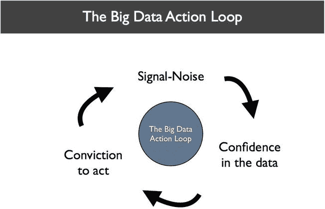
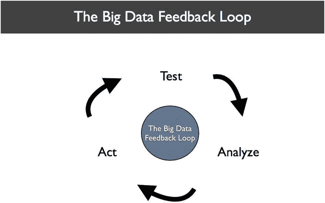
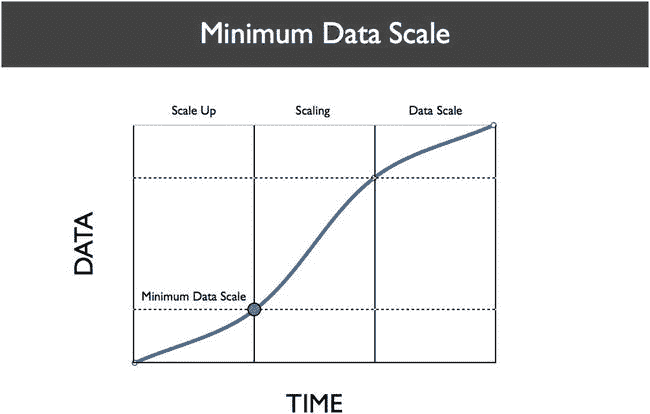

# 下一个十亿美元 IPO：大数据创业精神

## 像比利·比恩一样驾驭数据

作为奥克兰运动家队的总经理，比利·比恩面临着一个问题。比恩和奥克兰运动家队必须在没有像纽约洋基队那样的大市场预算的情况下，组建一支有竞争力的队伍。在由迈克尔·刘易斯所著的《魔球》一书及其同名电影讲述的著名故事中，比恩转向了数据和统计学。

这种方法被称为赛伯计量学，由棒球作家兼统计学家比尔·詹姆斯创造。赛伯计量学是 SABR（美国棒球研究学会）的衍生词，意为“寻求关于棒球的客观知识。”¹

当时，比恩这种数据驱动的方法受到了广泛批评。它打破了多年来依赖球探对球员进行定性观察的传统。相反，它侧重于利用薪资预算来购买足够的得分——不是来自单个球员，而是总体得分——以赢得比赛。

比恩并没有使用传统意义上定义的大数据——即处理比传统数据库能处理的数据量更大的数据。但他确实以一种新颖的方式应用了数据，产生了强大的影响。

比恩并非完全基于定性信息做决策，而是采用了数据驱动的方法。更具体地说，正如奈特·西尔弗在其畅销书《信号与噪声：为何大多数预测会失败，而有些却不会》中指出的那样，比恩严格地使用那些重要的统计数据，如上垒率，而不是那些不重要的数据。²

西尔弗开发了`PECOTA`系统，该系统是`球员经验比较与优化测试算法`的缩写，是一种广泛用于预测美国职业棒球大联盟球员表现的赛伯计量系统。`PECOTA`系统利用了一个包含自二战以来约 20,000 名大联盟击球手以及 15,000 名小联盟击球手的数据库。³

如今，那些希望在自己的组织中采用数据驱动方法的人，常常面临与比恩相同的挑战。采用数据驱动的方法来做决策并不容易。但正如比利·比恩所证明的那样，它确实能产生成果。

组织深知自身需要向数据驱动型转型，但要实现这一目标，必须大幅降低转型难度。大数据应用是实现这种转型的关键突破之一，这也是其有望孕育科技领域下一个十亿美元级 IPO 的重要原因。

## 为何数据驱动如此困难

亚马逊、谷歌、IBM 和甲骨文——仅举几例全球最具价值的数据相关公司——已经展示了利用大数据的价值。亚马逊处理数十亿笔电商交易，谷歌处理数十亿次搜索，而 IBM 和甲骨文提供的数据库软件和应用则专为存储和处理海量数据而设计。大数据意味着大收益。

然而，棒球并非唯一在数据决策上挣扎的领域。大多数组织仍发现基于数据做决策并非易事。在某些情况下，组织根本没有数据可用。例如，直到最近，获取营销活动的全面数据仍很困难。弄清楚你在营销上花了多少钱是一回事，但将营销投资与实际销售关联起来又是另一回事。因此有了那句古老的营销格言："我知道一半的广告预算被浪费了，但不知道是哪一半。"

然而，如今人们正在获取对理解客户、供应链和机器性能至关重要的数据，从网络服务器到汽车、飞机，以及许多其他关键业务指标。现在的巨大挑战不再是获取数据，而是理解数据。

数十年来，理解数据一直是数据分析师、统计学家和博士们的专属领域。业务部门经理不仅要等待 IT 部门获取关键数据，还得再等分析师整合数据并得出结论。大数据应用的承诺不仅是捕获数据，更是能基于数据采取行动，而无需使用只有统计学家才能操作的复杂工具。通过让数据更易获取，大数据应用将使组织能够逐步实现业务线的数据驱动化。

然而，即使你拥有数据和行动工具，行动依然困难。发表观点很容易，但坚定信念却很难。

正如沃伦·巴菲特曾有名言："在别人贪婪时恐惧，在别人恐惧时贪婪。"⁴巴菲特以其数据驱动的投资方法著称。然而，尽管历史证据表明追涨杀跌是糟糕策略，投资者仍不断在好消息时买入、坏消息时卖出。经济学家长期假设人们基于逻辑规则做决策，但现实中并非如此。⁵

诺贝尔奖得主、心理学家丹尼尔·卡尼曼及其同事阿莫斯·特沃斯基得出结论：人们的行为往往不合逻辑。他们对损失的重视程度高于收益，而生动的例子往往比数据对决策的影响更大，即便数据更为准确。

要做到数据驱动，你不仅需要拥有数据并找出哪些数据相关，还必须基于这些数据做决策。为此，你必须具备信心和信念：对数据的信心，以及基于数据做决策的信念，即使在舆论相反时也要坚持。这被称为大数据行动循环（参见图 8-1）。

图 8-1。大数据行动循环展示了大数据决策的关键要素

## 听见信号，忽略噪音

数据驱动在文化层面和实施层面都如此困难，这正是大数据应用将在未来发挥重要作用的根本原因之一。历史上，数据难以获取和运用。关键在于，数据常常分散在不同地方。公司内部数据遍布于各种不同的数据库、数据存储和文件服务器中。外部数据则存在于市场报告、网络和其他难以访问的来源。

大数据的威力与挑战在于，它常将所有这些数据汇集到一处。这意味着有可能从更大数量、更相关的数据中获得更深刻的洞察——工程师称之为`信号`——但也意味着更多的`噪音`，即与洞察无关甚至可能得出错误结论的数据。

如果计算机或人类无法理解这些数据，仅仅将数据集中在一处并无意义。这正是大数据应用的威力所在。大数据应用能帮助从噪音中提取信号。通过这样做，它们能让你对自己处理的数据更有信心，从而更坚定地基于这些数据采取行动——无论是手动还是自动化操作。

## 大数据反馈循环：基于数据行动

当你第一次摸到热炉子被烫伤、将手指插入电源插座被电击、或超速驾驶被开罚单时，你体验到了反馈循环。无论是否有意识，你进行了一次测试，分析了结果，并在未来采取了不同的行动。这被称为大数据反馈循环（参见图 8-2），也是构建成功大数据应用的关键。

图 8-2。大数据反馈循环

通过测试，你发现摸热炉子或被电击很痛。你发现超速驾驶会导致昂贵的罚单或车祸。或者，如果你侥幸逃脱，你可能得出结论：超速很有趣。

无论结果如何，所有这些活动都给了你反馈。你将反馈纳入自己的"数据库"，并基于数据改变未来的行动。如果尽管被开罚单，但超速体验让你觉得有趣，你可能会选择继续超速。如果与炉子相关的经历很糟糕，你可能会学会下次检查炉子是否烫手之后再触碰。

这样的反馈循环对大数据至关重要。仅收集和分析数据是不够的。你必须能从数据中得出一套结论，并获取对这些结论的反馈，以判断它们是否正确。你能输入模型的相关数据越多，对假设获取的反馈次数越多，你的洞察就越有价值。

历史上，运行这样的反馈循环既缓慢又耗时。例如，汽车公司收集销售数据，试图得出关于哪些定价模式或产品功能能促使人们购买更多汽车的结论。他们调整价格、修改功能，然后再次进行实验。问题在于，当他们完成分析并修订定价和产品时，环境已经改变了。动力强劲但耗油量大的汽车被淘汰，而节能汽车成为主流。MySpace 流失用户，而 Facebook 却用户增长。这样的例子不胜枚举。

大数据的好处在于，在许多情况下，你现在可以更快地运行反馈循环。在广告领域，大数据应用可以通过实时投放大量不同广告，然后仅显示那些效果好的广告，来确定哪些广告转化率最高。它们甚至能进行细分——确定哪些广告对哪些人群转化效果最好。这种 A/B 测试（展示不同广告以观察效果优劣）如果由人类操作，绝不可能足够快地完成以实现应用。

计算机可以大规模运行此类测试，不仅能在不同广告之间进行选择，还能实际修改广告本身。它们可以展示不同的字体、颜色、尺寸和图片，以找出最有效的组合。这种实时反馈循环——不仅能够收集海量数据，还能快速测试并执行多种不同方法——是大数据最强大的方面之一。

### 实现最小数据规模

随着人们在大数据领域的深入，问题已从如何收集和存储数据，转变为如何利用数据。一个高性能的反馈循环需要一个足够大的测试集才能发挥作用，例如访问网站的客户、打电话给潜在客户的销售人员，或观看广告的消费者。

这个测试集被称为最小数据规模（`MDS`；见图 8-3）。`MDS`是运行大数据反馈循环并从中获得有意义的洞察所需的最少数据量。

图 8-3. 最小数据规模是从数据中得出有意义结论所需的最少数据量。

`MDS`意味着公司拥有足够多的网站访客、广告观看者或潜在客户，从而能够从数据中得出有意义的结论并做出决策。当一家公司的数据点多到足以达到`MDS`时，它就可以利用大数据应用（`BDA`）来告知销售人员接下来该给谁打电话，决定投放哪条广告以获得最高转化率，或者推荐合适的电影或书籍。

当这个数据集变得足够大，以至于成为竞争优势的来源时，就意味着这家公司已经达到了早期 PayPal 和 LinkedIn 分析大师 Mike Greenfield 所说的`数据规模`。⁶ 像 Amazon、Facebook、Google、PayPal、LinkedIn 等公司都已经达到了数据规模。

### 创建大数据应用

成功的大数据应用运行大数据反馈循环的一部分或全部。例如，强大的分析和可视化应用会将数据集中到一处并使其可查看，以便人类决定下一步行动。另一些应用则会自动测试新方法并决定下一步行动，例如在广告投放或网站优化中。

当今的大数据应用无法在实现全局最优上提供显著帮助。例如，它们无法发明下一款 iPhone 或打造下一个 Facebook。但它们可以充分优化局部最优。它们可以投放正确的广告、优化网页、告诉销售人员该给谁打电话，甚至指导销售人员每次通话该说什么。

正是数据规模与应用（即大数据应用）的结合，将推动未来价值数十亿美元的首次公开募股（`IPO`）。

### 大数据资产的崛起：大数据初创公司的核心

公司收集的大量数据就是该公司的大数据资产。善于利用这项资产的公司将变得比不善于利用的公司更有价值。它们将能够收取更高费用、支付更低成本、优先处理某个潜在客户、转化更多客户，并最终留住更多客户。

这有两个主要含义。首先，对于初创公司而言，这是一个巨大的机会，可以构建开箱即用的应用，使这种竞争优势成为可能。企业无需自行构建这些能力；它们将以立即可用的应用程序形式获得这些能力。

其次，无论是初创公司还是行业巨头，那些将数据及基于数据采取行动的能力视为核心资产的公司，将比那些不这样做的公司拥有显著的竞争优势。

例如，PayPal 和 Square 正在激烈竞争，以颠覆传统的支付领域。胜者将能更好地理解客户，并更高效地触达他们。两家公司都能获取海量的交易数据。哪家公司能更有效地利用这些数据采取行动，谁就将胜出。

 **提示** 你想打造一家价值十亿美元的公司吗？那就高度关注大数据资产的创建和培育。它是吸引投资者和买家的闪亮特征。

### 打造一家十亿美元公司需要什么

面对大数据领域的各种机遇，决定一家公司是成长为小公司还是大公司的关键因素是什么？

正如风险投资公司`Ignition Partners`的创始合伙人 Cameron Myhrvold 告诉我的那样，打造一家十亿美元的公司不仅仅意味着选择一个巨大的市场。这意味着要选对市场。中国的快餐市场很大，但这并不意味着它是一个好市场。它竞争激烈，且难以攻破。

打造一家十亿美元公司意味着要乘上一波大浪。大数据、云计算、移动和社交之所以成为陈词滥调，是有原因的——因为它们是巨浪。乘风破浪的公司比那些没有这样做的公司更有可能成功。当然，这不仅仅如此。还要构建与这些浪潮相契合的具体产品，为客户提供不可或缺的价值。

在过去几年中，涌现了大量的网络公司。其中一些最成功的公司，如 Facebook 和 Twitter，实际上是伪装成消费者公司的大数据公司。它们存储着海量数据。它们维护着庞大的社交图谱，描绘了我们彼此之间以及我们与品牌等其他实体之间的联系。这些公司拥有内置系统，可以优化向每位用户展示的内容和广告。

现在，有多个价值数十亿美元的机会，可以通过大数据应用的形式，将这些能力作为开箱即用的解决方案提供给企业。

对于企业而言，从历史上看，要实现这种数据精细度，需要购买硬件和软件，并在此基础上进行定制开发。企业软件产品是此类实施的基础。但它们也带来了耗时的集成和昂贵的咨询，以便让最终用户能够使用复杂的数据分析能力。即便如此，也只有经验丰富的分析师才能使用公司开发的系统来生成报告、可视化和洞察。

如今，这些能力可以通过现成的大数据应用获得。`IT`基础设施的运营智能不再需要自定义脚本——像`Splunk`（目前市值超过 60 亿美元）这样的公司提供的应用，使这种功能随时可用。数据可视化不再需要用`R`等语言进行复杂的编程。相反，业务用户可以使用`Tableau Software`（估值近 50 亿美元）等公司的产品创建交互式可视化。这两家大数据公司都在过去几年刚刚上市。

更多大数据公司正准备很快上市。大数据公司`AppDynamics`和`New Relic`每月处理数十亿个事件，预计将在 2014 年提交上市申请。数据分析公司`Palantir`最近以 90 亿美元的估值融资，有估计表明该公司年收入可能高达 10 亿美元。

面对所有这些机遇，对于任何能够取得有意义进展的初创公司来说，达到十亿美元估值或许最大的挑战，就是被收购的高可能性。

谈到企业级领域的巨头，如今潜在的收购方有很多。有传统的超大型公司，市值接近或超过 1000 亿美元：`Cisco`、`IBM`、`Intel`、`Microsoft`、`Oracle`和`SAP`，它们提供硬件和软件组合产品。