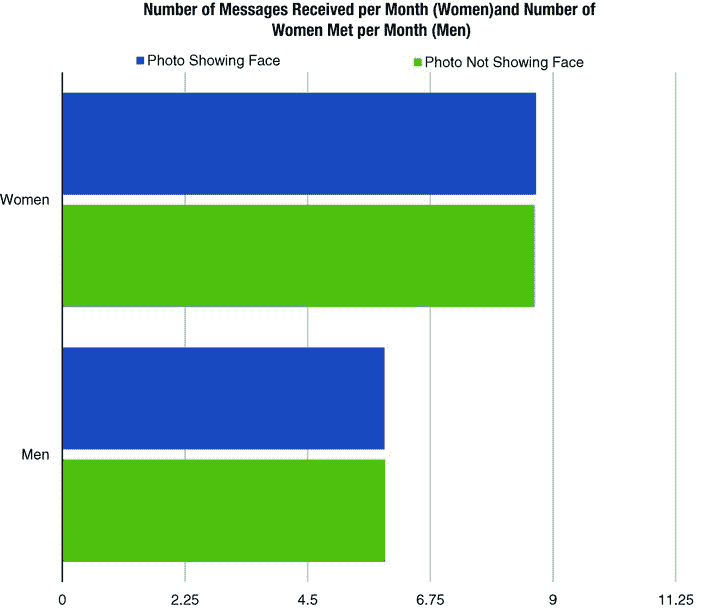

# 顶石案例研究：大数据邂逅爱情

## 产品、服务与爱情：大数据如何影响现实世界

在开发帮助人们相识、联系与互动的新应用方面，机会是无限的。你可以将有趣的新数据源（比如人们对音乐、电影、旅行或餐馆的兴趣）与移动应用等新技术结合起来。例如，你可以构建一个应用，聚合和分析人们的兴趣数据，然后在彼此靠近时发出提醒，以便他们可以线下见面。或者，你也可以构建一个应用，监测人们的活动水平（如睡眠时间表、活跃程度以及参加会议的数量），并在压力水平上升时发出警告——因为这可能对他们的个人关系产生负面影响。

基于日历的应用可以利用数据来判断你是否忽视了与朋友相处的时间，而新的社交网络应用则能使你在旅途中更方便地与关心的人联系。

许多公司正利用数据和移动技术，帮助我们建立更紧密的联系，并保持用户的更高参与度。社交网站`Facebook`利用大数据来决定显示什么内容、展示哪些广告，以及你应该与谁成为在线好友。婚恋网站`Match.com`存储了约`70TB`的会员数据。¹ 最近兴起的移动婚恋应用`Tinder`和`Hinge`则利用大数据，根据用户的`Facebook`资料来匹配用户。²

于 2011 年被`Match.com`收购的在线交友网站`OkCupid`开展了一系列关于什么能造就最成功在线交友档案的研究。在一篇题为“头像照片的四大谬误”的帖子中，`OkCupid`的研究人员描述了分析超过 7000 张头像照片的结果，以找出哪些照片能带来最佳效果——这一效果通过每位用户收到的消息数量来衡量。³

当然，收到更多消息并不一定就是好事。质量往往比数量更重要。但在探讨这个问题之前，我们先来看看研究人员的发现。

研究人员将照片分为三类：调情、微笑和不微笑。

研究人员发现，对于女性而言，在线交友头像中的眼神交流至关重要。那些带有调情表情的女性每月收到的消息略多于没有调情表情的女性，并且远多于被归类为不微笑的女性。

如果没有眼神交流，结果会显著变差。无论面部表情如何，那些没有进行眼神交流的人，整体收到的消息都比有眼神交流的人少。

与女性相反，男性在使用不看镜头、也不微笑的头像照片时，结识女性的成功率最高。然而，使用显示他们不看镜头且带有调情表情照片的男性，在结识女性方面成功率最低。因此，无论男女，不看镜头并带有调情表情都会产生最差的效果。

研究人员还发现，对于男性来说，照片中穿着“普通衣服”或“盛装打扮”在结识潜在伴侣方面没有太大区别。

或许在他们最有趣的发现之一中，研究人员发现，一个人的脸是否出现在照片中，对其收到的消息数量没有太大影响。

那些穿着潜水装备、穿越沙漠的照片，或者完全看不到脸的照片，与那些露脸的照片相比，在帮助网站用户引起兴趣方面效果几乎相同。使用露脸照片的女性平均每月收到`8.69`次联系，而不露脸的女性每月收到`8.66`次消息。使用露脸照片的男性每发出`10`次尝试，能结识`5.91`位女性，而不露脸的男性每`10`次尝试能结识`5.92`位女性。如图`Figure 12-1`所示的这一惊人数据，打破了你应该确保在网上交友头像中露出脸部的迷思。

图 12-1. 打破你应该确保在网上交友照片中露出脸部的迷思

研究人员的结论是什么？那就是，照片承担了所有工作——它们“激发浏览者的好奇心，并充分说明了‘主角’是谁（或想成为谁）。”值得注意的是，正如研究作者所说，“我们不建议你在没有看到对方完整照片之前就与他们线下见面。”

这一切意味着，大数据不仅仅是商业工具。只要拥有正确的数据源，它也能让我们洞察如何最好地展现自己，从而找到合适的伴侣。另一个经验教训当然是，你不应低估基于数据选择正确照片的重要性。

## 大数据如何戳穿谎言、该死的谎言和统计数据

当然，众所周知，人们在网上交友时会夸大事实。在另一项研究中，`OkCupid`联合创始人克里斯蒂安·鲁德研究了该交友网站约`151`万活跃用户的数据。

在《人们在网上交友中撒下的大谎》⁴一文中，鲁德发现，在身高方面，“几乎所有男性都喜欢给自己增加几英寸”。事实上，当男性“接近六英尺时”，他们比平时“凑整”得更多，“努力达到那个令人垂涎的心理基准线”。女性也会夸大自己的身高，“尽管没有向某个基准身高冲刺的趋势”。

`注意` 人们在社交媒体网站上经常夸大事实，身高和收入是用户喜欢夸张的属性。很快，精明的产品和服务开发者就会找到方法来验证这些声明的真实性，至少偶尔能让寻找爱情的人免于心碎。

那么收入呢？那些声称年收入`10`万美元或更多的人真的能赚那么多吗？关于网上交友，鲁德发现人们的收入比他们声称的要少`20%`。随着我们年龄的增长，我们倾向于更夸张，`40`多岁和`50`多岁的人会夸张`30%`或更多。人们不仅会虚报收入，还会上传过时的照片。鲁德的研究发现，“照片越有吸引力，它就越有可能是过时的。”

那么，交友网站如何决定向谁推荐可能匹配的对象呢？

拥有约`180`万付费订阅用户的`Match.com`推出了一套代号为`Synapse`的新算法，根据《金融时报》一篇题为“揭秘`Match.com`”⁵的文章介绍，该算法用于“分析多种因素以推荐可能的伴侣”。

我们嘴上说想要找的，并不总是我们实际在找的。尽管算法会考虑用户声明的偏好，但它也会将用户实际浏览的档案类型作为因素纳入考虑。例如，如果用户声明偏好某个年龄段，但却浏览了该年龄段之外的潜在伴侣，那么算法会考虑到这一点，并在未来的搜索结果中包含该年龄段之外的人。

预测偏好的挑战之所以更加复杂，是因为与电影或图书推荐不同，匹配人类的算法必须考虑双方的相互偏好。据报道，`Match.com`分析主管阿玛纳斯·汤姆布雷曾引述称：“即使你喜欢《教父》，《教父》也未必会喜欢你。”

此类算法的挑战在于，尽管`Match.com`拥有自`1995`年成立以来注册的`7500`万用户数据，但它缺乏关于哪些约会成功、哪些失败的数据。这种无法形成反馈闭环的缺失，是创建终极匹配算法时一个重要的缺失环节。

这就是为什么当人们取消订阅时，约会网站常会询问原因是他们对在线约会体验不满意，还是已经遇到了心仪对象。这类数据不仅对营销有用，还可以纳入预测算法的考量因素。

## 利用大数据寻找缺失的数据

但正是这种数据的缺失，可能导致机器匹配算法失效。与所有大数据分析和预测引擎一样，此类算法的优劣完全取决于工程师用于开发它们的数据以及它们所接收的数据。如果关键数据缺失，预测算法就无法奏效。

西北大学的伊莱·`J`·芬克尔和加州大学洛杉矶分校的本杰明·`R`·卡尼合著了一项研究，发表于期刊《公共利益心理学》。他们在研究及相应的《纽约时报》评论文章中指出，真正重要的是人们线下见面时如何互动，而非他们在网上说了什么。⁶

“沟通模式、解决问题倾向以及性兼容性等因素，对于预测恋爱关系的成败至关重要，”两位教授表示。

他们还指出，“情侣讨论并试图解决分歧的方式，能够预测他们未来的满意度以及关系是否可能破裂。”然而，这些并非在线约会网站环境中容易评估的特质。此外，约会网站并未考虑关系所处的环境，包括诸如“失业、经济压力、不孕不育和疾病”等压力因素。

作者们还指出，虽然约会网站可能会收集大量信息，但在判断什么能让两个人长期良好匹配时，这些信息只是冰山一角。尽管许多网站声称基于共同兴趣匹配用户，但一项对`313`项其他研究的`2008`年元分析发现，“已建立关系中的性格特质和态度相似性对关系幸福感没有影响。”

一项`2010`年对超过`23000`对已婚夫妇的研究表明，拥有共同的重大性格特征，如神经质、冲动性和外向性，仅能解释婚姻满意度的`0.5%`，这意味着`99.5%`取决于其他因素。

这些研究作者的结论是什么？在线约会并不比其他结识潜在伴侣的方式更好或更差。虽然在线约会网站使用的算法可能有助于市场营销，但最终这些算法可能只是帮助网站用户开启在线约会体验的一种方式，并在像纽约这样人口稠密的地区提供一个可管理的潜在伴侣库。

从大数据的角度来看，这类研究真正指出的是拥有完整数据的重要性。无论是尝试推荐电影、告诉销售人员接下来该给哪位客户打电话，还是推荐潜在伴侣，算法的优劣完全取决于数据。如果没有足够的数据，也没有办法通过了解算法是否做出了正确预测来形成闭环，就难以创建精确的算法。就像往飞镖盘上扔飞镖，如果所有飞镖都扎在一个区域，但这个区域不是靶心，那也没用。因此，捕获完整数据——并且能够对哪些有效、哪些无效形成反馈闭环——才是关键。

## 用大数据预测婚姻成功

在预测方面，有一位科学家能够以惊人的准确率预测哪些匹配可能成功。心理学教授约翰·戈特曼博士因在华盛顿大学运营一个被称为“爱情实验室”的生理学实验室而闻名。

戈特曼在`14`年的时间里研究了超过`650`对夫妇。基于他的研究，戈特曼仅凭对新婚夫妇半小时的访谈，就能以超过`90%`的准确率预测他们的婚姻能否长久。⁷

戈特曼将所谓的“心理地图绘制”视为浪漫的基础。在亲密关系中，“心理地图绘制”是了解伴侣的过程。戈特曼提供的一个简单例子是，男性对妻子某一天要做什么感兴趣。

一个积极绘制心理地图的人，不仅会收集信息，还会在白天思考这些信息，并在之后跟进。这意味着要询问配偶的会议、午餐，或者他们早上提到过的一个活动。

值得注意的是，收集数据、思考数据并跟进数据这个过程，不仅在计算领域有用，在维持健康的关系中也同样有效。

戈特曼和他的同事詹姆斯·默里教授更进一步，开发了生物学研究的大数据模型。他们创建了人类行为的数学模型，用于分析和预测婚姻成功。这两位教授与其他几位研究者甚至合著了一本书，名为《婚姻的数学：动态非线性模型》。

戈特曼和他的合著者认为，“婚姻的发展由微分方程支配，或者至少可以用微分方程来描述。”⁸ 戈特曼和他的同事们能够利用微积分数学来描述一段婚姻，并模拟夫妻在各种情况下的行为。

戈特曼的研究发现了四种频繁预示离婚的负面行为：对伴侣人格的批评、轻蔑、防御性，以及情感退缩。⁹ 戈特曼特别将轻蔑描述为“爱情的硫酸”。

通过将对夫妻回答各种问题的评估与通过数学模型进行的肢体语言和生理数据分析相结合，戈特曼不仅能预测一段婚姻是否可能成功，还能在偏离轨道时建议立即进行纠正性调整。

考虑到所有这些关于数学和微分方程的讨论，戈特曼似乎正在祛除浪漫的魔力。但正如戈特曼所言，科学家和研究者需要有一个客观的模型来衡量人际关系，这一点至关重要。而从这类大数据模型中收集到的信息，可以帮助维持牢固的关系。