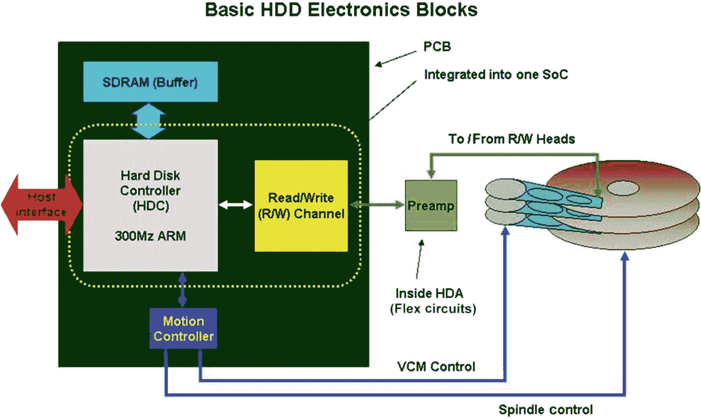
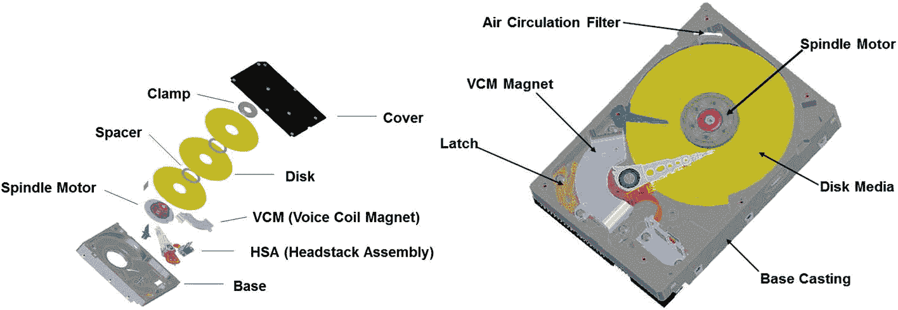
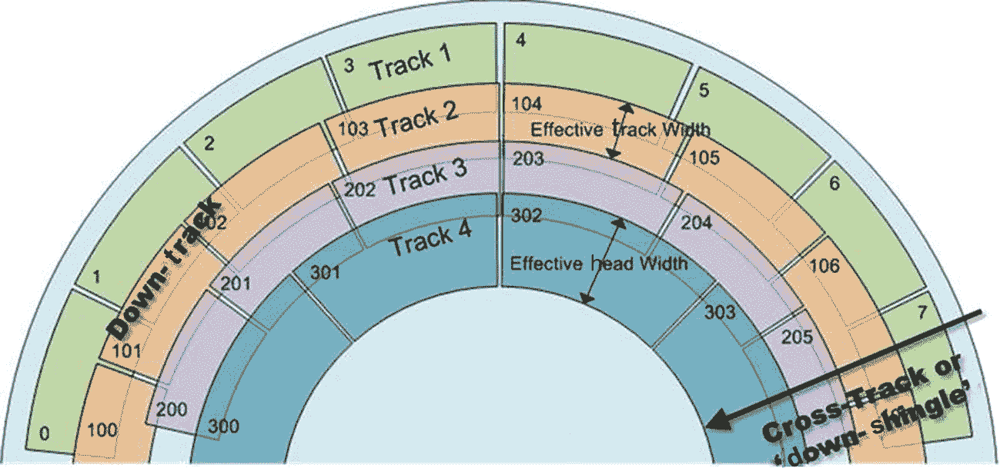
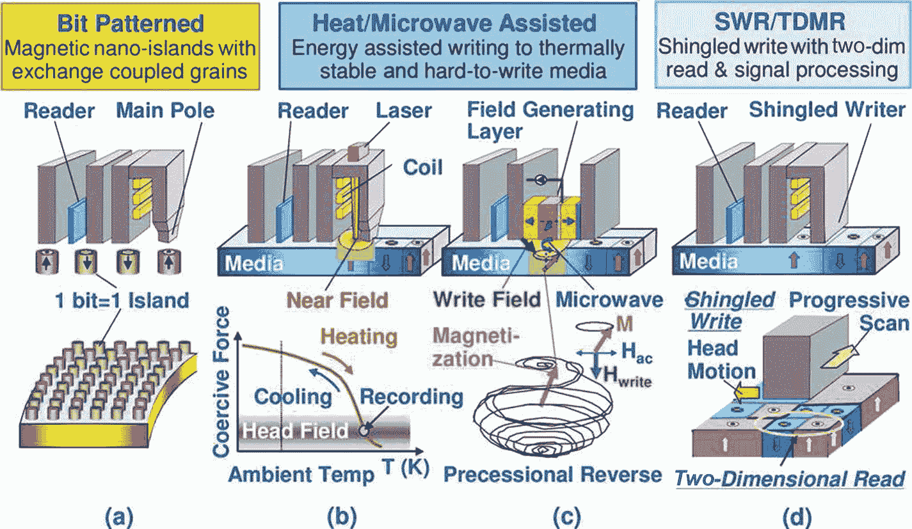
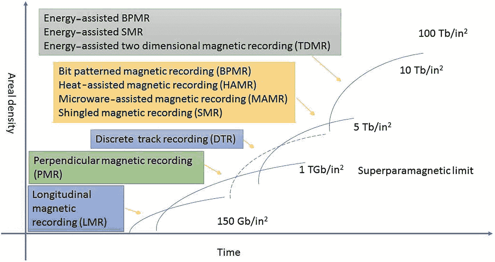
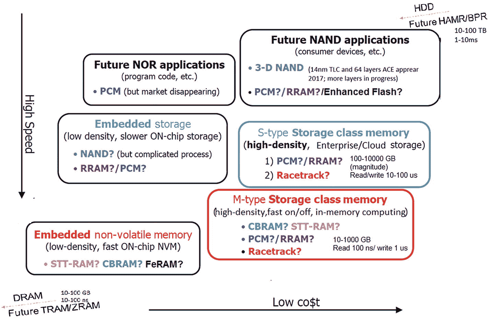

# 1. 引言

本章将介绍数据存储系统及通用踪迹分析的背景知识。我将说明块存储设备的广泛应用如何推动了对各种块级工作负载特性的深入研究。同时，本章还将列出本书的研究目标与贡献。

## 存储基础

在这个信息丰富的世界中，数据存储设备和系统是信息保存的基础。市场上有多种不同类型的存储设备，例如磁带、光盘驱动器、硬盘驱动器（`HDD`）、固态驱动器（`SSD`）、闪存等。历史上甚至还有更多类型，如双绞线存储器和磁鼓存储器。为聚焦主题，本书仅涵盖现代计算机存储/内存设备。它们大致可分为两类 [1]。

- 易失性
    - 常用类型：如 `DRAM`（动态 `RAM`）、`SRAM`（静态 `RAM`）等。
    - 研发中类型：`T-RAM`（晶闸管 `RAM`）、`Z-RAM`（零电容 `RAM`）等。
- 非易失性
    - `ROM`（只读存储器），如 `EPROM`（可擦除可编程 `ROM`）、`EEPROM`（电可擦除 `PROM`）、`MROM`（掩模 `ROM`）等。
    - `NVRAM`，如闪存、`PCM`（相变存储器）、`ReRAM`/`RRAM`（阻变式 `RAM`）、`MRAM`（磁阻式 `RAM`）、`FeRAM`（铁电式 `RAM`）等。
    - 机械设备，如 `HDD`、磁带、光盘驱动器

在选择存储设备或系统时，需根据应用场景仔细考量诸多因素，例如价格、性能、容量、能效、可靠性、数据完整性、耐用性、外形尺寸、工作温度、连接类型等。然而，设备性能是本书的主要探讨主题。

## 存储设备

本节将讨论几种非易失性存储设备，因为某些易失性设备（如 `RAM`）会作为缓存用于这些非易失性设备内部。

### HDD

`HDD` 于 1956 年由 IBM 首次推出，很快便成为通用计算机的主流辅助存储设备。时至今日，它仍是主流存储设备，尤其在数据中心领域。尽管磁盘驱动器如今已是大众化产品，但它实际上是一种极其复杂的机电系统，凝聚了数十年来在众多不同学科领域精雕细琢的研究与开发成果——尽管现代 `HDD` 的主要组件在过去 30 年间基本保持不变。图 1-1^(¹) 展示了组装后的组件，图 1-2 则展示了基本电子模块。

图 1-2 基本 `HDD` 电子模块

图 1-1 `HDD` 的基本组件

特别值得一提的是，伺服系统是世界上最精密的机械系统之一。用于读写介质的磁盘磁头距离盘片表面仅几纳米，这相当于一架波音 737 飞机在离地几米的高度飞行。`HSA`（磁头堆栈组件）通过向其后端环绕的线圈施加电流来移动，该线圈构成一个电磁铁。伺服电子系统计算所需的电流量。通过改变电流，可以精确编程控制加速和减速，从而提高 IO 性能及伺服磁头定位精度。

`HDD` 可分为消费级和企业级两类。消费级 `HDD` 主要用于台式机和笔记本电脑等移动设备。消费电子类 `HDD` 常嵌入数字录像机、智能电视和汽车中。企业级 `HDD` 通常比消费级 `HDD` 具有更高的可靠性，对介质和磁头的质量要求也更高。

磁盘驱动器具有不同的转速（每分钟转数，`RPM`）。例如，台式机 `HDD` 通常为 3.5 英寸规格，转速 7200 `RPM`；而移动 `HDD` 为 2.5 英寸规格，转速 5400 `RPM`。每个盘片表面被划分为不同的同心区域。内圈区域（`ID`）物理空间较小，包含的扇区少于外圈区域（`OD`）。由于转速相同，`OD` 的数据传输速度通常快于 `ID`。对于典型的 3.5 英寸台式机 `HDD`，`OD` 的顺序读取速度可能是 `ID` 的 1.5 到 2 倍。

对于典型的 `HDD`，平均访问时间（*T*[*a*]）由以下公式计算 [2, 3]：

*T*[*a*] *= T*[*s*] *+ T*[*l*] *+ T*[*t*] *+ T*[*o*] (1.1)

其中

- 寻道时间 *T*[*s*]：将磁头移动到所需距离所需的时间。通常指定为盘片半径的 1/3。稳定时间通常包含在此部分中。
- 旋转延迟 *T*[*l*]：驱动器必须等待数据到达读/写磁头下方的时间量。
- 传输时间 *T*[*t*]：向主机传输数据或从主机接收数据所需的时间量。
- 控制器开销 *T*[*o*]：驱动器解码主机命令所需的时间。

请注意，读取磁头通常与写入磁头不同，且内部固件对读取和写入的处理流程也不同。因此，读取和写入的寻道时间会略有差异。通常，写入访问耗时更长，因为写入需要更长的稳定时间，这是由 `PES`（位置误差信号）要求导致的——这意味着写入访问对 `PES` 的要求比读取访问更严格。根据设计，由于延迟和寻道时间更短，转速更高的驱动器通常具有更快的平均访问时间。

响应时间（*T*[*res*]）是与访问时间不同的概念。实际上，由于传统磁盘驱动器一次只能处理一个请求，一些传入的请求必须在队列中等待。例如，某些写入请求可能首先被缓冲在 `DRAM` 写入缓存中，并必须等待前一个请求完成。请注意，尽管每个驱动器有多个磁臂和磁头，但由于通常只有一个 `VCM`（音圈电机）驱动它们，磁臂必须一起移动。因此，

*T*[*res*] = *T*[*a*] + *T*[*w*] (1.2)

其中 *T*[*w*] 是请求进入队列后、实际执行前的等待或排队时间。

由于命令队列的影响，缓存对读写性能均有很大影响。因此，`HDD` 内部的大部分 `DRAM` 被用作缓存。读取缓存和写入缓存通常共享同一空间，因此必要时部分写入缓存段可转换为读取缓存段。然而，某些 `HDD` 可能针对不同用途设有专用的读取或写入缓存。在第 4 章中，我将展示更多细节。

传统磁记录（`CMR`）是一个相对概念。在 21 世纪初，纵向磁记录（`LMR`）`HDD` 相对于垂直磁记录（`PMR`）`HDD` 而言是传统概念。如今，`PMR` 是主流结构，且仍在演进中。例如，`SMR`（叠瓦式磁记录）是市场上已有的一种新型 `PMR`，而 `HAMR`（热辅助磁记录）和 `MAMR`（微波辅助磁记录）正在兴起。

### SMR 硬盘

SMR 是一种新兴技术，旨在无需对硬盘机械结构进行重大改动的情况下，提高硬盘的面密度 [4, 5, 6, 7, 8]。由于其叠瓦式特性，SMR 倾向于支持大型顺序写入而非随机写入。在本背景部分，我将对 SMR 的特性进行一般性介绍。

SMR 硬盘最显著的特征是其因叠瓦式磁道而产生的顺序写入特性。如图 1-3 所示，所有物理扇区都沿径向特定方向顺序写入，并且只有在环绕一圈后才能被重写。重写一个先前已写入的 LBA 会导致先前的写入被标记为无效，并且该 LBA 将被写入下一个连续的物理扇区。

图 1-3 SMR 示意图

由于这种类似日志结构的顺序写入特性（有利于写入性能），传统的 LBA 到 PBA 映射（直接/静态映射）可能效果不佳，因为对某个块的任何更改都会导致对其同一区域中所有连续块进行读取-修改-写入操作，这可能会造成性能损失。因此，通常采用间接/动态映射。当发生更新时，不会进行原地重写，而是执行一次异地“新”写入，这会导致写入影响；换句话说，先前位置的数据变成垃圾，而新写入会占用额外的空间。为了重用这些垃圾块，必须实施垃圾回收（GC）程序。

异地更新的另一个担忧是对顺序读取性能的潜在损害。如果某些 LBA 连续的请求被写入几个不同的物理区域，那么后续在同一 LBA 范围内的 LBA 连续读取请求就无法真正受益于“逻辑顺序”读取。相应的数据管理方案可以在三个层面实施：驱动器端、中间件端或主机端。尽管少数学术研究通过特殊的数据布局设计引入了原地更新，但异地策略仍然是主要方法。

通常，SMR 硬盘期望工作负载是顺序读写，并且对数据的更新不频繁。此外，由于垃圾数据通常会在某些时刻出现（除非数据从未被删除或修改），空闲时间应足够长，以便 GC 能够定期运行，而不会影响外部/用户 IO 性能。因此，一次写入多次读取（WORM）工作负载（归档）是 SMR 硬盘特性的自然延伸。文献 [9] 中还提供了一些近期关于 SMR 优化的其他建议，例如混合策略、并行访问和大尺寸规格。

### 其他硬盘

近年来，PMR 技术已达到了传统设计的理论面密度极限（1TB/in²）。限制因素是超顺磁极限的出现，因为研究人员致力于更小颗粒的记录介质。这需要在信噪比（SNR）与小颗粒介质的热稳定性以及窄磁道磁头的可写性之间进行权衡，从而限制了将 CMR 技术扩展到更高面密度的能力 [10]。

为了突破极限提高面密度，人们探索了几种有前景的替代技术，例如二维磁记录（TDMR）、热辅助磁记录、微波辅助磁记录 [10] 和位图案磁记录（BPMR）。表 1-1 提供了简要分类，图 1-5 显示了这些技术的趋势。

表 1-1 提高面密度的新技术

| 方法 | 减小晶粒尺寸并使晶粒更难翻转 | 减小位宽和/或位长 | 提高面密度/尺寸，增加磁头和盘片 |
| --- | --- | --- | --- |
| 解决方案 | HAMR, MAMR | SMR, HAMR, TDMR | 氦气硬盘，先进机械设计，外形尺寸优化 |

在 BPMR 技术中，每个记录位都存储在一个约 10 nm 的制造磁性岛中。如图 1-4 (a) 所示，它被提议作为扩展当前颗粒介质超顺磁极限的一种手段。BPMR 的记录物理原理与传统的 PMR 有根本不同，因为写入和读取方案必须完全重建。一个主要缺点是写入同步要求，即写入场必须定时与图案化岛的位置重合。写入过程中的总翻转场分布（包括各种干扰场）必须小于位长与磁头场梯度的乘积，才能在理论上达到高达 5 TB/in² 的高面密度。

图 1-4 硬盘的未来选择 [10]

HAMR 和 MAMR 是能量辅助磁记录（EAMR）的两种实现方式。HAMR 被提出来克服磁头可写性问题。所提出的 HAMR 和 MAMR 技术的核心组件分别是激光器和自旋扭矩驱动的微波振荡器。在 HAMR 中，介质必须在更小的晶粒尺寸下保持稳定，同时在适当升高的温度下可写。HAMR 和 BPMR 的集成使得这两种技术得以扩展，根据已知磁性材料的热稳定性，预计面密度可达约 100 Tb/in² [10]。WDC 和 Seagate 都宣布了他们的 EAMR 路线图。Seagate 声称其基于 HAMR 的硬盘将于 2018 年底推出，^(²) 而 WDC 则宣称其 MAMR 技术将在 2025 年前在单个硬盘上存储 40TB 数据。^(³)

TDMR 仍然使用相对传统的垂直介质和磁头，同时结合叠瓦式写入记录（SWR）和/或二维回读及信号处理，以期获得特别大的增益。在 BPM 上使用能量辅助记录或二维信号处理将使面密度超过约 5 Tb/in²。然而，到目前为止，还没有明确的无问题解决方案。

请注意，对于 HAMR/MAMR 硬盘，其顺序访问特性可能与 SMR/TDMR 类似。由于加热器启动/冷却需要时间，因此首选顺序访问以减少状态变化。

近期提高单个设备容量的其他技术之一是体积密度缩放，例如在一个氦气填充硬盘中添加更多盘片（更少的湍流、更薄的盘片和更高的容量），以及设计大尺寸规格的外壳 [9]。为了进一步提高单个硬盘的容量，人们提出了一些有趣的设计。例如，双主轴设计可以用两个磁臂访问两个磁盘簇 [11]。在这个方向上，更多的磁臂和盘片也是可能的，例如六个磁臂和六个磁盘主轴。磁盘库和盒式磁带设计使磁盘介质可更换，类似于光盘。

图 1-5 未来技术的预测密度 [10]

### 固态硬盘

固态硬盘/磁盘（`SSD`）是一种利用集成电路组件作为存储器、实现数据持久化存储的固态存储设备[12]。传统上与机械硬盘兼容的电子接口（如`SAS`和`SATA`）主要应用于`SSD`技术。近年来，由于带宽需求增加，`PCIe`、`SATA express`和`M.2`接口变得更为普及。

`SSD`的内部存储芯片可采用`NOR 闪存`、`NAND 闪存`或其他新兴的`NVM`（非易失性存储器）。截至 2017 年，大多数固态硬盘已开始采用基于`3D TLC`（三层单元）`NAND`的闪存。

`SSD`正在改变存储行业。虽然机械硬盘的最大面密度仅为 1.5 Tbit/英寸，但截至 2016 年，实验室演示中`SSD`所用闪存的最大面密度已达 2.8 Tbit/英寸。此外，`SSD`闪存的面密度年增长率超过 40%，远高于机械硬盘的 10-20%。同时，`SSD`的价格下降速度（每 GB 成本）也快于机械硬盘。

表 1-2 对`SSD`与`HDD`进行了对比，其中`SSD`主要指基于`NAND`闪存的设备，而`HDD`则为传统`PMR`设备。^(⁴)

**表 1-2**  
HDD 与 SSD 对比

| 属性 | SSD | HDD |
| --- | --- | --- |
| 启动时间 | 几乎无延迟，因为无需准备机械部件（从几个`μ`s 到毫秒）。从自动省电模式切换通常只需几毫秒。 | 磁盘旋转启动最多需要几秒钟。从空闲模式唤醒最多需要几亿秒。 |
| 随机访问时间 | 通常小于 0.1 毫秒，通常不会成为重大性能瓶颈。 | 通常为 2.5 毫秒（高端服务器/企业级硬盘）到 12 毫秒（笔记本电脑/移动硬盘），主要受寻道时间和旋转延迟影响。 |
| 读取延迟时间 | 由于可从任意位置直接访问数据，通常较低。对于受限于 HDD 定位时间的应用，SSD 在更快的启动和应用加载时间方面没有问题（参见阿姆达尔定律）。干净的 Windows 操作系统启动时间可能少于 6 秒。 | 通常远大于 SSD。由于数据在介质上的位置和当前读磁头位置不同，每次寻道的时间也不同。^(⁵) 干净的 Windows 操作系统启动时间可能超过 1 分钟。 |
| 数据传输速率 | 对于相对顺序的 IO，IO 速度相对稳定。当随机小块比例较大时，性能会下降。消费级产品的典型值范围约为 300MB/s 至 2500MB/s（2017 年常见速度约为 500MB/s）。企业级产品可达每秒数 GB。 | 严重依赖于转速，通常在 3,600 至 15,000 RPM 之间（也存在 20,000 RPM）。3.5 英寸 7200 RPM 硬盘的典型传输速度约为 200 MBps。一些高端硬盘可能更快，可达 300 MBps。TPI 和 SPI 也是影响因素。 |
| 读取性能 | 通常与 SSD 中的数据位置无关。在少数情况下，顺序访问可能受到碎片化的影响。 | 随机寻道代价高昂。碎片化文件会导致数据分布在盘片的不同区域；因此，对碎片的多次寻道会增加响应时间。 |
| 写入性能 | 可能发生写入放大。^(⁶) 采用磨损均衡技术来缓解此影响。然而，由于 SSD 的特性，驱动器可能会以可观察到的速度不可避免地降级。 | CMR 没有写入放大的问题。然而，SMR 可能因异地更新而出现问题，也需要垃圾回收。 |
| 文件系统碎片化的影响 | 顺序读取数据的收益相对有限，因此碎片化对 SSD 影响不大。碎片整理会因额外写入而造成磨损。^(⁷) | 如果频繁更新，许多文件系统会随时间产生碎片。需要定期进行碎片整理以维持最佳性能，不过由于节点设计和后台垃圾回收，现代文件系统可能不存在此问题。 |
| 噪音（声学）和振动 | SSD 基本无噪音，因为没有活动部件。有时，高压发生器（用于擦除块）可能会产生音调噪音。通常对振动不敏感。 | 活动部件（如磁头、执行器和主轴电机）会发出特有的嗡嗡声和咔嗒声。不同型号的噪音水平差异很大，可能较大。^(⁸) 移动硬盘由于机械设计更优，相对安静。通常对振动敏感。^(⁹) |
| 数据分层 | 热数据可能从慢速设备迁移到快速设备。通常与 HDD 配合使用，但在某些实现中，也会混合使用快速和慢速 SSD。 | HDD 通常在混合系统中用作慢速层。某些条带化磁盘阵列可能提供与 SSD 相当的顺序访问性能。 |
| 重量和尺寸 | 由于内部结构，通常小巧轻便。它们通常具有与 HDD 相同的形状因数（例如 2.5 英寸），但更薄，并采用塑料外壳。M.2（下一代外形规格）格式使其更小。 | HDD 通常比 SSD 重，因为其外壳通常由金属制成。2.5 英寸硬盘通常重约 200 克，而 3.5 英寸硬盘重超过 600 克（取决于外壳材料、电机、磁盘磁铁/数量等）。某些用于移动设备的纤薄设计厚度可能小于 6 毫米。 |
| 可靠性和寿命 | 无机械故障。然而，每个块的有限写入周期可能导致数据丢失。^(¹⁰) 控制器故障可能导致 SSD 无法使用。不同制造商、工艺和型号的可靠性差异很大。^(¹¹) | 因磨损和撕裂可能导致潜在的机械故障。存储介质本身（磁盘盘片）基本上不会因读写访问而退化。^(¹²) |
| 每容量成本^(¹³) | 消费级 SSD 的 NAND 芯片价格已迅速下降：2013 年 4 月为每 GB 0.60 美元，2014 年 4 月、2015 年 2 月和 2016 年 9 月分别为每 GB 0.45 美元、0.37 美元和 0.24 美元。自 2016 年底以来，降价速度有所放缓。3D NAND 普及后价格可能会变化。^(¹⁴) | 2017 年 5 月，消费级 3.5 英寸和 2.5 英寸硬盘每 GB 成本分别约为 0.032 美元和 0.042 美元。企业级硬盘的价格通常是消费级的 1.5 倍以上。2017 年相对稳定的价格可能在 MAMR/HAMR 发布后被打破。 |
| 存储容量 | 截至 2016 年，希捷已提供高达 60TB 的容量。120 至 512GB 的型号更为常见且价格较低。 | 2015 年和 2016 年分别提供了高达 10TB 和 12TB 的 HDD。 |
| 读写性能对称性 | 成本较低的 SSD 的写入速度通常显著低于读取速度（通常`≤`1/3）。高端 SSD 的读写速度预计相近。 | 由于较长的稳定时间，大多数 HDD 的写入寻道时间略长/更差。 |
| 空闲块可用性与 TRIM 命令 | 写入性能受空闲可编程块的可用性显著影响。TRIM 命令可以回收不再使用的旧数据块；然而，即使使用 TRIM，空闲块较少也会导致性能下降。 | CMR HDD 不会从 TRIM 中受益，因为它们不受空闲块影响。然而，SMR 的性能也受空闲区域可用性的限制。脏区域有时需要 TRIM。 |
| 功耗 | 基于闪存的高性能 SSD 通常需要 HDD 功耗的 1/2 到 1/3。新兴技术如 PCM/RRAM 更加节能。^(¹⁵) | 2.5 英寸硬盘通常消耗 2 至 5 瓦，而一些最高性能的 3.5 英寸硬盘平均功耗约为 12 瓦，最高可达约 20 瓦。一些针对绿色数据中心设计的特殊硬盘会在必要时使磁盘进入空闲/睡眠状态。1.8 英寸规格的低功耗 HDD 在空闲模式下功耗可能低至 0.35 瓦。^(¹⁶) |

## 总结：NAND SSD 的 SWOT 分析

- **优势**
    - 一项成熟的技术，被工业界广泛采用
    - 大容量/高密度，适用于 3D 技术
    - 与 NOR 相比，每个器件组只需要一个漏极接触点
    - 每 GB 成本相对低于其他新兴 NVM 类型
- **劣势**
    - 非对称性能（写入速度慢于读取速度）
    - 编程/擦除周期（基于块，不支持原地写入）
    - 数据保持能力（随着闪存尺寸缩小，保持能力变差）
    - 耐久性（与 HDD 和其他新兴 NVM 相比，写入周期有限）比 DRAM 慢 100-1000 倍
    - 比 PCM 和 FeRAM 慢 10-1000 倍
    - 通常，容量越高，性能越低。
- **机会**
    - 扩展仅专注于密度；密度普遍高于磁性 HDD。
    - 成本降低，在不久的将来将与 HDD 相当。
    - 尽管复杂，但存在 3D 方案。
    - 结合精细调整的磨损均衡算法，耐用性得到一定程度的提升。
    - 在数据中心中作为主流选择替代 HDD（特别是全闪存阵列），尽管混合基础设施仍将存在数年。
- **威胁**
    - 与 NAND 配置相比，NOR 架构中使用的额外连接提供了一些额外的灵活性。
    - MRAM/ReRAM 的积极发展可能会动摇 NAND 闪存的主导地位。

真正的问题是这两种技术的市场份额。如何衡量市场份额很重要。按金额计算与按比特计算会得到截然不同的答案。在金额方面，SSD 将在不久的将来迅速超过 HDD 的支出，而按比特计算，HDD 仍将在未来几年占据主导地位。

还有一些其他使用闪存的存储设备。闪存盘与 SSD 类似，但速度慢得多，通常用于移动应用。金士顿数字公司在 2017 年初发布了容量为 1TB、采用 USB 3.0 接口（数据传输速度高达 240 MB/s 读取和 160 MB/s 写入）的驱动器，并在 2017 年底发布了 2TB 驱动器（高达 300 MB/s 读取和 200 MB/s 写入），其速度与 HDD 相似。

小型存储卡也广泛用于电子设备，例如智能手机、平板电脑、相机等。一些常见的格式包括 `CompactFlash`、`Memory Stick`、`SD/MicroSD/MiniSD` 和 `xD`。闪迪公司于 2016 年 9 月推出了容量高达 1TB 的 `Extreme Pro` 系列 SD 产品，并于 2017 年 8 月推出了容量高达 400GB 的 `MicroSD`。

## 混合硬盘

混合硬盘是一种逻辑或物理存储设备，它将快速存储介质（如 NAND/NOR 闪存 SSD）集成到慢速介质（如 HDD）中 [15]。混合硬盘中的快速设备既可以充当 HDD 上存储数据的缓存，也可以充当与 HDD 对等的层。通常，其目的是通过在更快的组件上保留最常用数据（热数据）的副本来提高整体性能。早在 2000 年代中期，三星和希捷等一些硬盘制造商就提出了通过 SSD 在 HDD 内部提升性能的理论。2007 年，三星和希捷推出了第一款混合硬盘，分别采用了希捷 `Momentus PSD` 和三星 `SpinPoint MH80` 产品。

通常有两种类型的混合磁盘。一种是双驱动器结构（分层结构），其中 SSD 是快速层，HDD 是慢速层。通常，操作系统会将设备识别为两个子存储设备。西部数据 2013 年推出的 `Black2` 产品和 2015 年底推出的 `TarDisk` 的 `TarDisk Pear` 是双驱动器设备的两个例子。另一种是集成结构（固态混合硬盘，SSHD），其中 SSD 充当缓存 [16]。用户或操作系统可能只看到一个存储设备，而无需进行特定操作。

混合磁盘驱动器可以在自优化（自学习）模式或主机优化模式下运行。在自优化操作模式下，SSHD 独立于主机操作系统工作，因此设备驱动器决定与 HDD 和 SSD 之间的数据识别和迁移相关的所有操作。此模式使驱动器对主机系统而言，其外观和操作方式与传统的驱动器完全相同。典型的驱动器是希捷的 `Mobile` 和 `Laptop SSHD`。主机优化模式也称为主机提示模式，因此主机通过 SATA 接口（自 SATA 3.2 版本起）决定 HDD 和 SSD 中的数据分配。此模式通常需要操作系统的软件/驱动程序支持。微软从 Windows 8.1 开始支持主机提示操作（8 版本有补丁可用），而针对 Linux 内核的补丁自 2014 年 10 月起已开发。西部数据的第一代 SSHD 属于此类。

由于一些固有的局限性，混合磁盘驱动器的市场可能很狭窄：

- 性能通常严重依赖于应用程序/工作负载。但驱动器可能不够智能，以至于受到其资源的限制。
- 由于关于工作负载的信息较少，块级优化并不比文件/对象级优化更好或更差。因此，不建议在驱动器级别优化工作负载。
- 由于混合磁盘的配置相对静态，它不太适合数据中心基础设施的通用目的。

对于写入路径，一些高端 SSD 使用一些保持电容器来模拟 SCM（参见本章“存储设备”部分）与 DRAM 配合使用。这基本上解决了回写问题。对于读取路径，客户通常更倾向于自己管理不同的存储速度层。他们非常关心访问延迟的变化，而混合系统在这方面表现很差。在超大规模或公共云基础设施中，几乎没有采用基础设施管理的混合存储。混合结构的部署很多。它只是在更高的层次上进行管理，而不是在基础设施本身。表 1-3 提供了更多细节。

**表 1-3** 一些 NVM 的比较

| | STT-MRAM | PCMS 3D Xpoint | ReRAM | Flash NAND |
| :--- | :--- | :--- | :--- | :--- |
| 读取延迟 | < 10ns | < 100ns | < 10ns | 10–100us |
| 写入延迟 | 5ns | > 150ns | 50ns | > 100us |
| 功耗 | 中等 | 中等 | 中等 | 高 |
| 价格 (2016) | 200*−*3000*/* Gb | *≤* 0*.*5/Gb | 100/Gb | *≤* 0*.*05/Gb |
| 耐久性 (Nb 周期) | 10¹² 至 无限 | 10⁸*−*10⁹ | 10⁵−10¹⁰ | 10⁵*−*10⁶ |

## 磁带与光盘

磁带于 1951 年首次用于记录计算机数据。它通常仅能与某些特定的磁带驱动器配合使用。尽管速度较慢，但它仍被广泛用于冷数据归档。`IBM`和`FujiFilm`在 2015 年展示了一款原型`BaFe 磁带`，其面密度达到 123 `Gb/in²`，单盒容量为 220TB。`Sony`和`IBM`在 2017 年进一步将这一数字提升至 201 `Gb/in²`，并在一个微型磁带盒中实现了 330TB 的容量。^(¹⁷) 与在传统磁带表面涂覆磁性材料不同，`Sony`采用“溅射”方法，在磁带上涂覆多层磁性金属薄膜，这种薄膜更薄，晶粒更窄，并采用垂直比特记录。请注意，磁带和硬盘驱动器在伺服控制方面有许多相似之处，例如伺服模式和纳米级精度。

光盘是一种扁平的、通常为圆形的盘片，以凹坑的形式编码二进制数据（比特）。早期的光盘系统可以追溯到 1935 年。此后，共经历了四代（第一代约 700MB 的 CD，第二代约 4.7GB 的 DVD，第三代约 25GB 的标准蓝光光盘，以及第四代容量超过 1TB 的光盘）。

磁带和光盘通常只能顺序访问。一些最新的发展利用机械臂来自动更换磁带或光盘。预计磁带和光盘在未来几年内仍将在市场上保持活跃。特别是，由于每 GB 价格远低于其他介质，磁带在极冷存储领域似乎拥有巨大的潜在市场。

## 新兴非易失性存储器

还有许多类型的新兴非易失性存储器正在走向成熟或处于早期开发阶段 [17, 10]：

-   相变存储器（PCM），例如 3D X-point
-   磁阻随机存取存储器（MRAM），例如 STTRAM 和赛道存储器
-   阻变式随机存取存储器（RRAM/ReRAM），例如忆阻器、导电桥接随机存取存储器（CBRAM）、Oxy-ReRAM
-   铁电随机存取存储器（FeRAM），例如 FeFET
-   其他类型，例如导电金属氧化物（CMOx）、固态电解质、NRAM（纳米随机存取存储器）、ZRAM（零电容随机存取存储器）、量子点随机存取存储器、碳纳米管、聚合物印刷存储器等。

`STT-MRAM` [18]（自旋转移矩 MRAM）利用电子自旋引起的磁矩变化，可以替代低密度的 SRAM 和 DRAM，尤其适用于移动和存储设备。相变存储器（PCM）通过在非晶态和晶态之间进行热诱导的物理相变，能够实现多个不同的中间状态，从而在单个单元中存储多个比特。`Intel`和`Micron`于 2015 年发布的`PCMS 3D Xpoint`，基于体材料电阻的更快变化，且比传统 PCM 材料更稳定。`ReRAM/CBRAM`（导电桥接 RAM）利用电解质中金属细丝的形成来存储数据，而`FeRAM`则使用铁电层代替介电层来实现非易失性 [1]。表 1-3 展示了它们与 NAND 的简单比较。其中少数几种可能会在未来几年内实现量产 [19]，尽管现在断言哪种 NVM 技术能在竞争中胜出可能还为时过早，因为它们各有优缺点。例如，我们以 PCM 为例进行 SWOT 分析。

-   优势
    -   与其他新兴 NVM 相比，相对成熟（已有大规模演示和产品）
    -   业界对材料（如`GeSbTe`或`GST`）已达成共识
    -   电阻对比度大，可实现用于 MLC 的模拟状态
    -   耐久性远高于 NAND 闪存
    -   可扩展性高（在超小尺寸下仍能工作）且与后道工艺兼容
    -   潜在的超高速度（取决于材料和掺杂）
-   劣势
    -   重置到高电阻状态需要熔化 -> 功耗高且存在热串扰？
    -   为降低开关功耗 -> 需要亚光刻特征尺寸和高电流访问器件
    -   填充小特征尺寸 -> 需要原子层沉积或化学气相沉积技术 -> 目前难以用更好的材料替代`GST`
    -   MLC 受非晶相弛豫影响严重 -> 电阻漂移
    -   高温下 10 年数据保持（电阻随时间漂移）可能是个问题 -> 再结晶
    -   由于元素偏析，器件特性随时间变化 -> 器件失效
    -   小特征尺寸下的变异性会加宽电阻分布
-   机会
    -   领先于`FeRAM`、`MRAM`等一个数量级
    -   替代 NOR 的产品现已出货 -> 如果良率学习成功且 MLC（尽管 2016 年存在 R 漂移现象，但在 PCM 技术中成功实现了每单元 3-4 比特）
    -   适用于 SoC、神经形态计算的嵌入式 NVM
    -   漂移缓解和/或 3D 访问器件可提供高密度（即低成本），这意味着有机会替代 NAND。最终是 S 型，随后可能是 M 型 SCM。
    -   预计到 2021 年将达到 15 亿美元，复合年增长率高达近 84%
-   威胁
    -   实际达到的速度远慢于理论速度；类似 NOR 的慢速接口
    -   当前的 PCM SSD 仅比 SLC SSD 快几倍，远低于预期。
    -   由于根本的耐久性限制，替代 DRAM/SRAM 可能具有挑战性。
    -   PCM 作为 DRAM 细分市场在 2016 年占据了主要份额并主导了市场，这意味着 S-SCM 还有很长的路要走。
    -   一个关键挑战是降低重置（写入）电流；接触尺寸缩放会有所帮助，但会减缓进展。
    -   工程工艺

NAND 技术也在积极发展中，尤其是 3D NAND。与这些新兴 NVM 相比，NAND 相对成熟、密度高且便宜。然而，它可能比 PCM 和 ReRAM 慢得多。同时，其耐久性通常可能显著低于 PCM、MRAM 和 FeRAM。

基于这些 NVM，引入了一种称为 SCM（存储级内存）的特殊类别，以填补 SSD 和 DRAM 之间的 IO 差距（尽管最初是为了填补 IBM 提出的 HDD 和 DRAM 之间的差距）。根据其速度是微秒级还是纳秒级，它进一步分为存储型 SCM 和内存型 SCM。采用 3D 技术改进的闪存、PCM、MRAM、RRAM 和 FeRAM 是应用于 SCM 的一些主要技术。SCM 在计算机/网络系统和物联网系统中的广泛部署将重塑当前的架构。在不久的将来，我们将看到 SCM 对内存计算（例如，在认知计算中的应用）、超融合基础设施、混合存储/云基础设施（具有远程直接内存访问）等的影响。图 1-6 展示了这些 NVM 的简要展望，该图根据 IBM 的预测进行了修改。^(¹⁸) 事实上，`Intel`于 2017 年 11 月发布的采用类似 3D PCM 技术的商用版`Optane P4800X`，容量为 750GB，IOPS 为 550K，读写吞吐量为 2.4/2.0 GB/ps；而`Samsung`于 2018 年 1 月发布的 3D NAND 变体`Z-NAND`，容量为 800GB，读写 IOPS 为 750K/150K，吞吐量为 3.2 GB/ps。

图 1-6

新兴 NVM 的竞争前景

根据 Yole Development 最近的估计，^(¹⁹) 新兴 NVM 市场到 2021 年将达到 46 亿美元，年增长率高达+110%，尽管 2015 年的市场规模仅为 5300 万美元。到 2021 年，SCM 将成为新兴 NVM 明确的市场方向。`Marketsandmarkets`^(²⁰) 也预测，全球非易失性存储器市场预计到 2022 年将达到 820.3 亿美元，2017 年至 2022 年间的复合年增长率为 9.50%。

