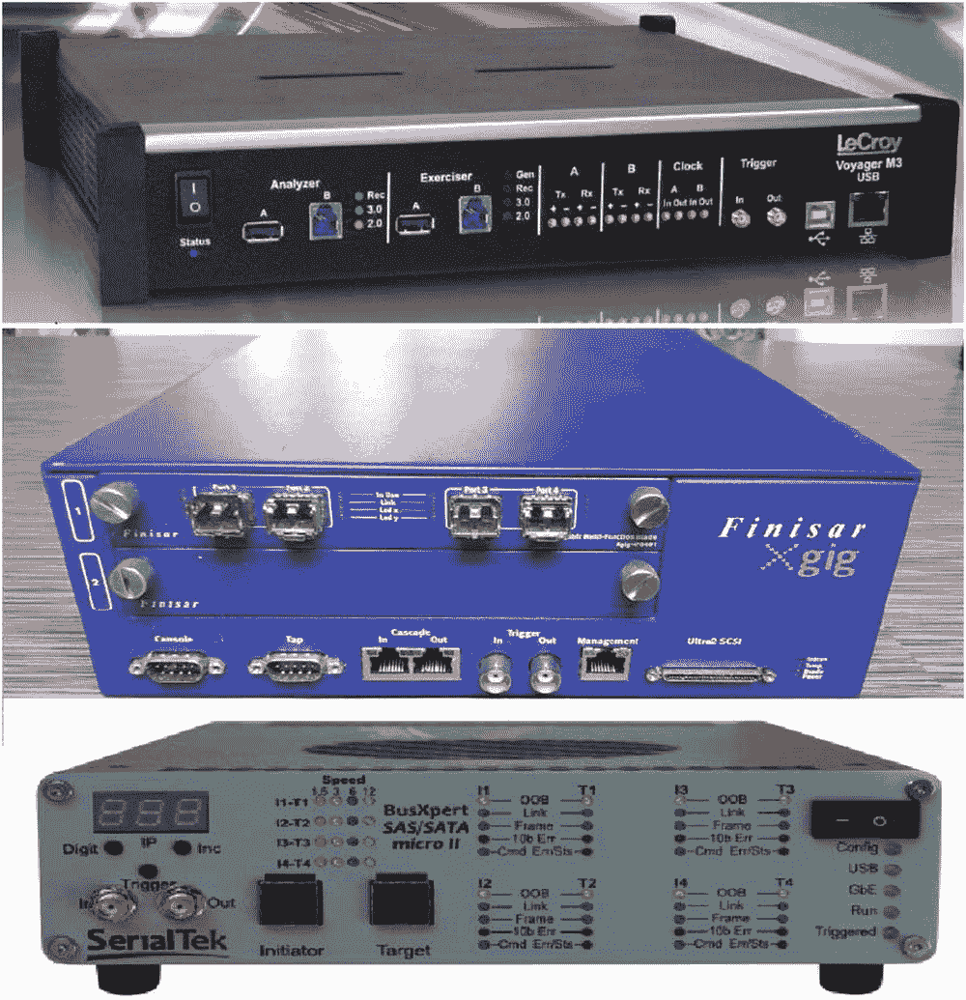
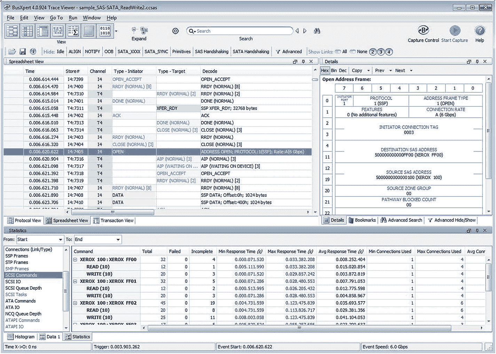
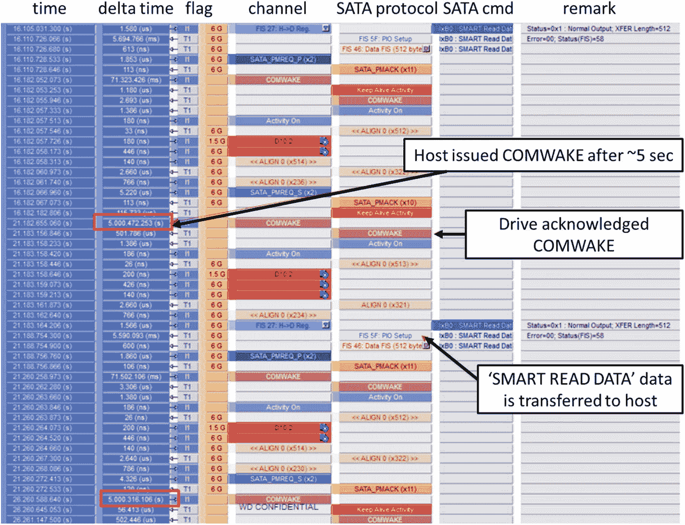

# 3. 采集技术

目前已提出多种技术来监控和捕获系统或组件的踪迹。通常有以下四种技术：

- **基于硬件的监控**需要对测试平台硬件进行改造，以便在程序执行时创建所有指令和/或数据地址的记录。
- **基于软件的追踪**可以在一定程度上实现与硬件类似的目标，但并非修改系统硬件，而是修改或插入软件。
- **基于模拟的追踪**在宿主机与待评估操作系统之间构建一个抽象层，例如`QEMU`^(³⁶)和`SimOS`^(³⁷)。该抽象层仅模拟足以让操作系统正常运行所需的组件。虽然该系统为采集依赖于操作系统的踪迹提供了灵活的接口，但所捕获踪迹的准确性有时存疑。由于执行了模拟，程序的执行会受到干扰。
- **基于微码的追踪**利用微码修改来捕获踪迹信息，引入的开销极小，例如`PALcode`（特权架构库代码）^(³⁸)。

然而，由于复杂度过高且准确性存疑，第三和第四种技术并不常用。因此，本章仅讨论基于硬件和基于软件的技术。

## 硬件踪迹采集

我们将硬件方法定义为使用特定硬件设备/系统来捕获目标存储设备之外的输入输出（IO）的踪迹采集方法，尽管可能仍需要一些软件来管理这些踪迹[38, 45]。有多种类型的硬件可用于采集块级踪迹。最常见的设备之一是总线分析仪，但其应用范围并不局限于磁盘驱动器的块级输入输出，还可用于网络流量、DDR/CPU 缓存/停顿/延迟/吞吐量等。一些产品能够捕获相当准确的踪迹，例如来自 Viavi solutions 的`Xgig 6G SAS/SATA 分析仪`、来自 SerialTek 的`BusXpert Micro II 系列 SAS/SATA 分析仪`、来自 TI 的`Trace and analyzer`、来自 LeCroy 的`协议分析仪`、来自 Arium 的`Eumulator XL-100`以及来自 Green Hills Software 的`SuperTrace Probe`。

总线分析仪通常为用户提供多种通信接口。以图 3-1 中的设备为例，它们提供 USB、以太网、SCSI 等接口。这些设备通常通过多种机制实现可靠且准确的连接，具有比基于软件的工具更高的分辨率（例如时间精度和捕获频率），并能捕获更多信息。

图 3-1

来自 LeCroy、XGIG 和 SerialTek 的总线分析仪

图 3-2 展示了`BusXpert`中 SAS IO 访问的示例，该工具提供了几乎所有与 SAS 协议相关的基本信息。用户可以从详细的日志中轻松追踪命令状态，例如响应时间、连接等。

图 3-2

来自 BusXpert 的丰富协议信息

图 3-3 提供了另一个 SATA 命令分析的示例。您可以看到主机在大约 5 秒后发出了`COMWAKE`命令。驱动器几乎立即确认了`COMWAKE`。在 5.59 秒时，`SMART READ DATA`被传输到主机。

图 3-3

SATA 命令分析

尽管捕获几乎所有关键协议信息并不困难，但用于分析踪迹的软件中并未包含 IO 属性的高级指标。

## 软件踪迹采集

在准确性方面，软件踪迹采集器可能不如硬件设备。特别是对于时间精度要求达到纳秒或更低的应用程序，软件可能无法很好地工作。例如，与 SAS/SATA 协议相关的磁盘特性调试可能适用于总线分析仪，因为它可能涉及磁盘驱动器的 SoC 时钟问题。然而，对于磁盘驱动器的 IO 性能，其操作通常处于毫秒级别（精度），这通常在普通服务器或工作站中现代处理器和操作系统的能力范围之内。

有许多可用的 IO 工具[45, 35]：

- **Linux/Unix**：`Dtrace`[46]、`LTTng`、`BCC`^(³⁹)、`iostat`、`dstat`、`tracefs`^(⁴⁰)、`iotop`、`hdparm`、`ionice`、`Ctrace`^(⁴¹)、`iogrind`、`POSIX Test Suite`、`ioprofile`、`SystemTap`、`IOR`、`PCP`和`swtrace`
- **Windows**：`Xperf`^(⁴²)、`TraceWPP`/`TraceView`/`Tracelog`/`Logman`^(⁴³)、`Vtrace`、`Oracle trace collector`、`Bus analyzer module`^(⁴⁴)和`PatchWrx`^(⁴⁵)

然而，并非所有这些工具都能提供事件细节。事实上，像`iostat`和`iotop`这样的通用监控工具无法提供基于单个 IO 的详细信息。

这些工具可分为两类：静态工具和动态工具。静态工具将程序的二进制映像视为一个永不修改的黑盒。而动态工具则依赖于二进制级别的修改，以便于从应用程序中收集统计数据。例如，所有 Windows 工具以及`iotop`/`iostat`/`dstat`/`hdparm`/`ionice`/`iogrind`/`ioprofile`都是静态工具，而`SystemTap`、`Dtrace`和`LTTng`是动态工具。特别是，`Dtrace`和`LTTng`使用一种称为探测（probing）的机制，能够选择性地激活嵌入在软件各抽象层中的检测例程，从而不仅可以从应用程序，还可以从其执行所涉及的各种库和内核例程中获取与性能相关的统计数据。

### Blktrace

`Blktrace`是一个静态工具，自 Linux 内核版本 2.617-rc1 起已嵌入其中。该工具轻量且易于使用。它仅考虑操作系统/文件系统缓存之后的设备访问。当 IO 进入块 IO 层（请求队列）时，每个 CPU 的中继通道会发出事件，然后`blktrace`从这些通道捕获事件。更多细节可参见附录 B。

### Dtrace、SystemTap 与 LTTng

如前所述，动态追踪工具将追踪代码嵌入正在运行的用户程序或内核中，无需重新编译或重启。由于任何处理器指令都可能被修补，因此它几乎可以访问任何位置所需的任何信息。接下来我将讨论几种动态追踪工具。

`DTrace` [47] 起源于 Solaris。^(⁴⁶) 其开发始于 1999 年，并成为 Solaris 10 版本的一部分。如今，`DTrace` 已作为 OpenSolaris 的一部分开源，但由于许可证不兼容，尚未合并到 Linux 内核中。存在一些缺乏适当支持的移植版本。B. Gregg 开发了一个基于 `DTrace` 的工具包以简化使用。^(⁴⁷) 但其根本限制已得到解决。一些尝试催生了另一个名为 `DProbes` 的 `DTrace` 克隆，但似乎并不成功。

因此，三大 Linux 厂商——Red Hat、Hitachi 和 IBM——为 Linux 提出了另一个动态追踪系统，名为 `SystemTap`。^(⁴⁸) `SystemTap` 是迄今为止最强大的追踪器之一。然而，它必须为每个运行的脚本生成一个原生模块，这会导致巨大的性能开销。`Ktap`^(⁴⁹) 被进一步开发，通过内部使用 Lua 和 LuaJIT 来减少开销。另一个类似的实现是 `sysdig`，^(⁵⁰) 它无需脚本。

`LTTng`^(⁵¹) 也是一个广泛使用的 Linux 开源追踪框架。在 2.0 版本之前，它使用静态追踪并需要重新编译内核；目前它利用 Linux 内核中的 `ftrace` 和 `kprobe` 子系统。它使用户能够理解多个系统组件（如 Linux 内核）之间的交互，无论是使用现有的还是用户定义的检测点、C/C++ 应用程序、Java 应用程序、Python 应用程序，或任何其他使用 `LTTng` 记录器的用户空间应用程序。由于它优化了事件收集，性能可能优于其他追踪器。它还支持多种事件类型，包括 `USDT`（用户级静态定义追踪）。

当识别整体系统性能而不仅仅是存储 IO 时，这些工具将发挥重要作用。在第 9 章中，您将以 Ceph 为例，从整体系统视角找出性能瓶颈。

## 追踪仓库

主要用于研究目的，网上有一些真实/合成的追踪数据可供下载。以下是一些示例：

- SNIA 位于[`http://iotta.snia.org`](http://iotta.snia.org)。它提供块 IO 追踪（例如，虚拟桌面基础设施和 Microsoft 生产服务器上的块追踪）、NFS 追踪、系统调用追踪等。
- Sandia 国家实验室位于[`www.cs.sandia.gov/Scalable_IO/SNL_Trace_Data/`](http://www.cs.sandia.gov/Scalable_IO/SNL_Trace_Data/)。`S3d` I/O 内核追踪数据是在 Redstorm 的 6400 个客户端上运行期间收集的。
- 洛斯阿拉莫斯国家实验室位于[`http://institute.lanl.gov/data/`](http://institute.lanl.gov/data/)。一些追踪数据，如 MPI/HPC，已被分类。
- Google 位于[`https://github.com/google/cluster-data`](https://github.com/google/cluster-data)。它提供 Google 计算单元上的集群工作负载追踪。
- Facebook 位于[`https://github.com/SWIMProjectUCB/SWIM/wiki/Workloads-repository`](https://github.com/SWIMProjectUCB/SWIM/wiki/Workloads-repository)。作为加州大学伯克利分校 AMP 实验室 SWIM 项目的一部分，发布了来自 Facebook Hadoop 追踪的多个 1 小时片段。
- 达特茅斯大学位于[`www.cs.dartmouth.edu/dfk/nils/workload.html`](http://www.cs.dartmouth.edu/dfk/nils/workload.html)。它提供来自并行文件系统（例如，Intel 的 CFS、Thinking Machines SFS）的一些追踪数据。^(⁵²)
- 哈佛大学位于[`www.eecs.harvard.edu/sos/traces.html`](http://www.eecs.harvard.edu/sos/traces.html)。它提供一些 NFS 追踪数据。
- 马萨诸塞大学阿默斯特分校位于[`http://traces.cs.umass.edu/index.php/Main/Traces`](http://traces.cs.umass.edu/index.php/Main/Traces)。存档了 OLTP 和搜索引擎追踪数据。
- 希伯来大学位于[`www.cs.huji.ac.il/labs/parallel/workload/index.html`](http://www.cs.huji.ac.il/labs/parallel/workload/index.html)。收集了多个并行工作负载。
- OpenCloud 位于[`http://ftp.pdl.cmu.edu/pub/datasets/hla`](http://ftp.pdl.cmu.edu/pub/datasets/hla)。这些追踪数据来自 CMU 并行数据实验室管理的 Hadoop 集群。它们提供了对用于科学工作负载的集群在 20 个月期间内工作负载的非常详细的洞察，包括时间戳、槽位计数等。

连同分析工具的源代码，我还在 GitHub 上提供了追踪样本数据。

本章讨论了用于追踪收集的硬件和软件工具。请注意，前者通常比后者提供更高的精度和更多的信息，尽管它们更昂贵。然而，在许多场景中，精度仅需达到毫秒级别。因此，纯软件工具在工业界和学术界都得到了广泛应用。请注意，存在各种用于不同目的的工具。为了识别整体系统性能，您应使用多种工具或一些集成工具集。

