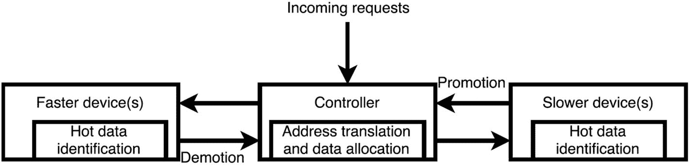
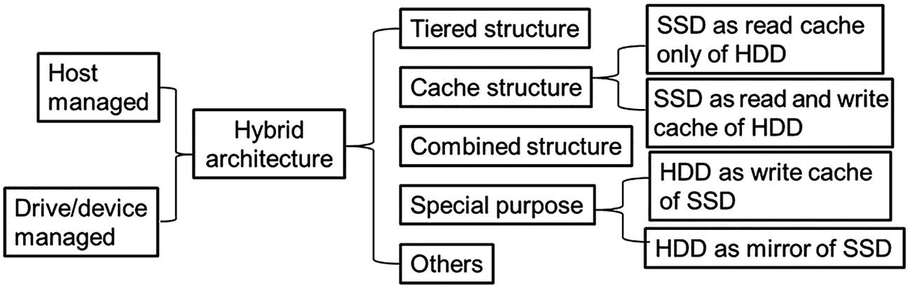
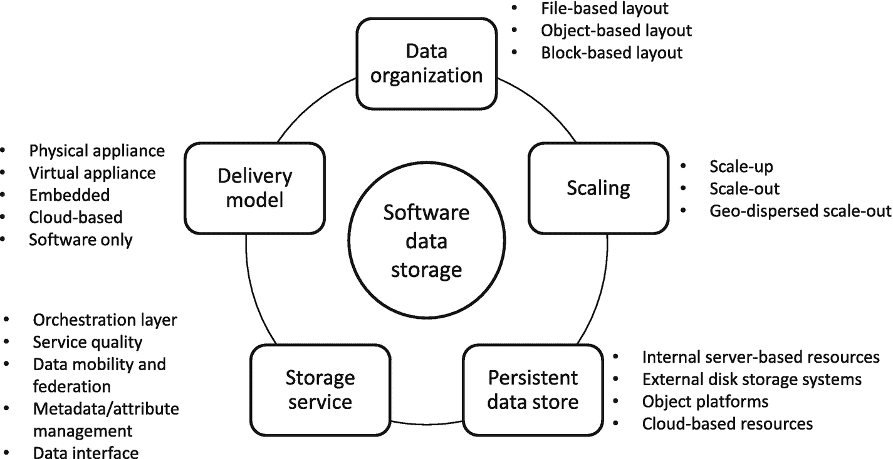
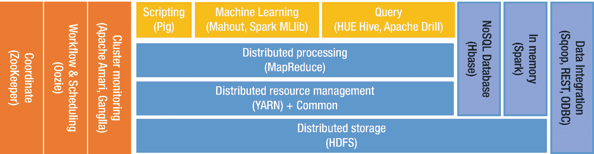
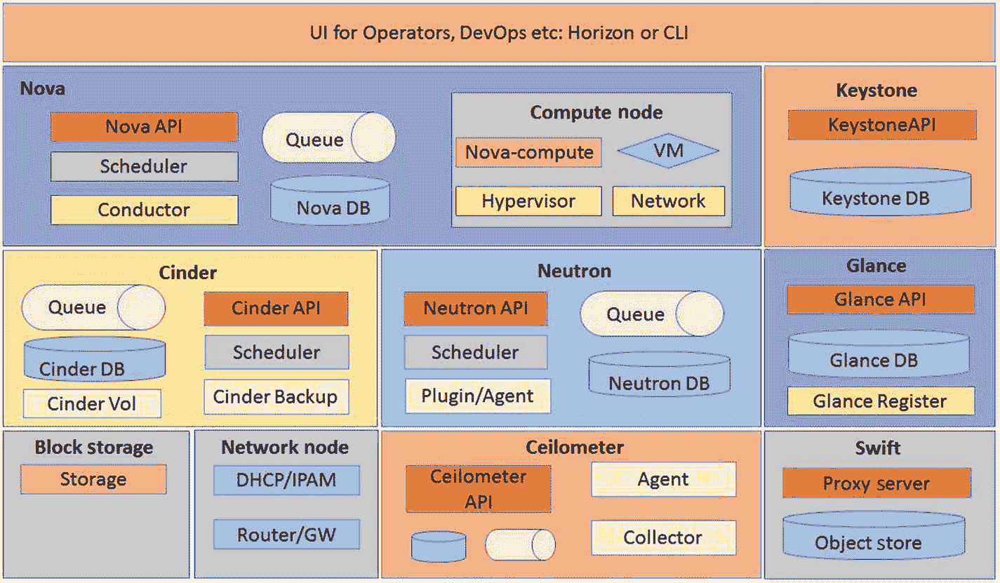
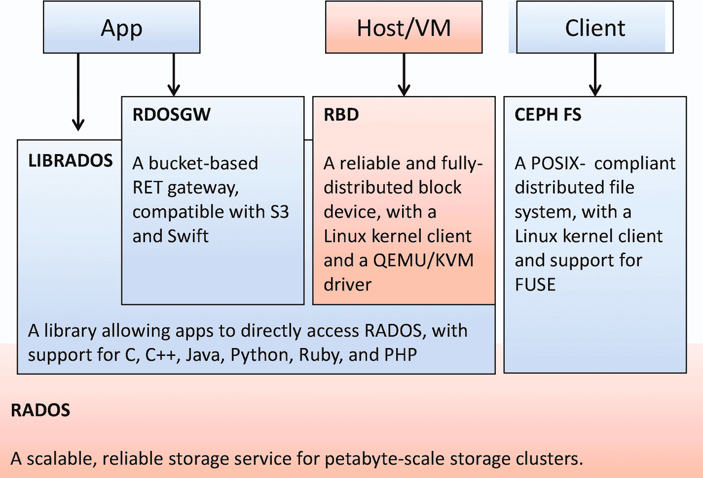

# 存储系统

本章讨论系统级存储基础设施与实现。`RAID`（独立/廉价磁盘冗余阵列）和`EC`（纠删码）系统主要用于容错。混合存储系统旨在以低成本实现相对较高的性能。微服务器和以太网驱动器已被应用于某些对象存储系统中。软件定义系统将数据流与控制流分离。此外，还介绍了一些大规模存储系统的实现，如`Hadoop/Spark`、`OpenStack`、`Ceph`。

## 基础设施：RAID 与 EC

`RAID`作为一种数据存储虚拟化技术，将多个物理磁盘组件组合成一个逻辑单元或池，以实现数据冗余、性能提升或两者兼得[20]。存储网络行业协会（SNIA）对从`RAID 0`到`RAID 6`的`RAID`级别及其相关数据格式进行了标准化：“`RAID 0`由条带化组成，无镜像或奇偶校验。`RAID 1`由数据镜像组成，无奇偶校验或条带化。`RAID 2`由位级条带化与专用汉明码奇偶校验组成。`RAID 3`由字节级条带化与专用奇偶校验组成。`RAID 4`由块级条带化与专用奇偶校验组成。`RAID 5`由块级条带化与分布式奇偶校验组成。`RAID 6`由块级条带化与双重分布式奇偶校验组成。”`RAID 2-4`通常不用于实际应用。`RAID`级别可以嵌套，例如混合`RAID`。例如，`RAID 10`和`RAID 50`，它们分别是基于`RAID 0`的`RAID 1`和`RAID 5`。

`RAID`可以通过硬件或软件实现。硬件`RAID`控制器价格昂贵且具有专有性，通常用于企业环境。基于软件的实现近年来越来越受欢迎。一些现代操作系统和文件系统（如`Linux`、`ZFS`、`GPFS`和`Btrfs`）提供了`RAID`软件。硬件辅助的`RAID`软件在标准磁盘控制器芯片中实现`RAID`机制，该芯片带有嵌入式专有固件和驱动程序。

如今，`RAID`系统广泛应用于中小企业。即使在部分数据中心，`RAID`仍被用作数据保护的基础架构。然而，`RAID`受限于其数据可靠性级别，`RAID 6`最多只能容忍两个磁盘故障，这对于某些关键应用来说不够安全。因此，纠删码方案作为`RAID`的替代方案应运而生。在`EC`中，数据被分割成片段，这些片段被扩展并使用可配置数量的冗余块进行编码，然后存储在不同的位置，如磁盘、存储节点或地理位置。理论上，`EC`可以容忍任意数量的磁盘故障，但在实际应用中，一个组内最多使用四个。`EC`也可能遇到一些性能问题，尤其是在系统以降级或恢复模式运行时。

## 混合系统

尽管全闪存阵列越来越受欢迎，但由于成本、可靠性和性能之间的权衡，混合结构仍然是数据中心的主流。早期，混合存储系统包含作为快速层的`HDD`和作为备份层的磁带[21][22]。后来，快速访问速度的`HDD`（如`15kRPM`和`10kRPM`）充当性能层，而慢速`HDD`（如`7200RPM`和`5400RPM`）充当容量层[23]。随着非易失性存储器（`NVM`）技术（如`NAND Flash`[24]、`PCM`[25]、`STTMRAM`[18]和`RRAM`[19]）的发展，`NVM`的性能成本比正在提高。表 1-3 列出了一些知名`NVM`的性能和价格比较。这些具有快速访问速度的`NVM`可以在现代混合系统中用作性能层[17][26]或缓存[27][28][29][30]。如今，`SSD`是性能层的首选，而高容量叠瓦式磁记录（`SMR`）驱动器通常用作备份层[31]。

在设计混合存储系统时，分层和缓存存储架构的算法略有不同，尽管总体框架相似（见图 1-7）。从根本上说，分层存储架构将数据移动到快速存储区域，而不是像缓存存储架构那样复制数据。但两者都需要完成四个重要步骤。首先，需要数据分配策略来控制不同设备之间的数据流。其次，`SSD`缓存地址与主存储地址之间应有高效的地址映射机制。第三，由于与主存储`HDD`相比，`SSD`缓存大小有限，只有频繁访问和最近访问的数据（称为热数据）才能存储在`SSD`缓存/层中，以提高系统效率。因此，应应用合适的热数据识别算法来识别热/冷数据。当检测到热数据时，需要在必要时提升该数据。因此，需要一种数据迁移算法来控制热/冷数据流，以提高未来的访问效率。最后，采用缓存调度算法来处理排队行为，例如队列大小、同步、执行顺序。

图 1-7

混合存储系统的通用算法

**数据分配：** 数据分配由主机或设备控制器执行，将传入的数据分配到最合适的存储位置，例如热数据到`SSD`或冷数据到`HDD`。除了数据的属性外，分配过程中还会考虑设备的状态，例如队列长度、容量使用率、带宽等。

**地址映射：** 混合存储系统需要地址映射，因为快速设备和慢速设备的容量不同。由于地址范围不同，当数据被分配到不同设备时，传入数据的访问位置需要转换为实际地址。需要一个地址转换表来保存所有这些转换条目。如果地址范围很大，转换表的内存消耗会很大，转换速度也会降低，这可能会影响系统性能。

**数据迁移（提升/降级）：** 数据提升是将数据从慢速设备迁移到快速设备，数据降级是将数据从快速设备迁移到慢速设备。这称为数据迁移。数据迁移通常在慢速设备中的数据被识别为热数据或快速设备中的数据被识别为冷数据时进行。在一些研究中，数据迁移也用于平衡快速设备和慢速设备之间的`IOPS`。

**热数据识别：** 热数据识别对于数据迁移选择合适的数据进行提升和降级非常重要。它利用历史数据的属性将传入数据分类为热数据或冷数据。分类通过检查数据的访问频率和时间来完成。最频繁访问和最近访问的数据被识别为热数据。

混合存储架构大致可分为四类，如图 1-8 所示：(1) `SSD`作为`HDD`的缓存（缓存方法），(2) `SSD`作为`HDD`的（高）层（分层方法），(3) `SSD`作为层和缓存的组合，以及(4) 具有特殊用途的`HDD`，例如`HDD`用作`SSD`的缓存。还有一些混合存储系统将其他类型的`NVM`纳入设计考虑。

图 1-8

混合存储架构的总体分类

## 微服务器与以太网硬盘

微服务器是一种基于片上系统（SoC）架构的服务器级计算机。其目标是将大部分服务器主板功能集成到单个微芯片上，但 DRAM、启动闪存和电源电路除外。以太网硬盘是其多种形态之一。

2013 年 10 月，希捷科技推出了其 Kinetic 开放存储平台，声称该技术将使应用程序能够直接与存储设备通信，并消除传统的存储服务器层。该公司于 2014 年底出货了首批近线 Kinetic 硬盘。Kinetic 硬盘被描述为一个具有双以太网端口、支持对象存储基本`put`、`get`和`delete`语义（而非块存储的读写结构）的键值服务器。客户端通过 Kinetic API 访问硬盘，该 API 提供键值访问、第三方对象访问以及集群、硬盘和安全管理的功能。

东芝于 2015 年 5 月推出的 KVDrive 采用了希捷开源的键值 API，而非另起炉灶。`Ceph`或`Gluster`可以直接在东芝的 KVDrive 上运行。

西部数据/HGST 基于其开放以太网架构的融合微服务器支持任何 Linux 实现。理论上，任何网络操作系统都可以直接在此类微服务器中运行。`Ceph`和`OpenStack 对象存储`系统已与红帽服务器一起进行了演示。例如，在 2016 年初，西部数据展示了一个拥有 504 个硬盘和 4PB 存储容量的大规模`Ceph`分布式存储系统。^(²¹)

## 软件定义存储

软件定义存储是一个仍在演进中的新兴概念。不同组织对其有多种定义，例如：

- **TechTarget**：^(²²) SDS 是一种数据存储方法，其中控制存储相关任务的程序与物理存储硬件分离（这强调存储相关服务而非存储硬件）。

- **Webopedia**：^(²³) SDS 是由智能软件而非存储硬件本身管理和自动化的存储基础设施。通过这种方式，SDS 环境中池化的存储基础设施资源（可在广泛的服务器硬件组件上提供诸如去重、复制、精简配置、快照以及其他备份和恢复功能）可以自动且高效地用于匹配企业的应用需求。

- **维基百科**：^(²⁴) SDS 是一种计算机数据存储软件，用于管理与硬件无关的、基于策略的数据存储供应和管理。软件定义存储的定义通常包含一种存储虚拟化形式，以将存储硬件与管理存储基础设施的软件分离。支持软件定义存储环境的软件还可以为功能选项（如去重、复制、精简配置、快照和备份）提供策略管理。

- **VMware**：^(²⁵) SDS 是存储服务（如快照、克隆、远程复制、去重、缓存、分层、加密、归档、合规、搜索、智能逻辑）的动态组合，这些服务以应用边界为对齐，并由策略驱动。

尽管存在这些不同观点，但仍有一些共同因素和特征，总结于表 1-4 和图 1-9 中。表 1-4 实际上展示了 SDS 的三个步骤。首先，硬件应与软件解耦，例如将逻辑存储服务与能力从底层物理存储系统中抽象出来。其次，存储资源被虚拟化，例如跨多个实现进行池化。第三，创建自动化机制，通过基于服务级别协议（取代技术细节）的策略驱动存储供应来实现。典型的 SDS 产品包括`GlusterFS`、`Ceph`和`VMware Virtual SAN`。图 1-9 进一步从五个方面给出了特征：数据组织、扩展、持久化数据存储、存储服务和交付模型。

**图 1-9** SDS 的总体特征

**表 1-4** SDS 的共同特征

| 层级 | 步骤 | 结果 |
| --- | --- | --- |
| 数据平面，控制平面 | 抽象（解耦/标准化，池化/虚拟化），自动化（策略驱动） | 更快、更高效、更简单 |

SDS 也引出了其他一些概念，例如软件定义数据中心（SDDC）。根据 IDC 和 IBM 的报告，^(²⁶) SDDC 是一个松散耦合的软件组件集合，旨在虚拟化和联合数据中心范围内的硬件资源，如计算、存储和网络资源。SDDC 的目标是使数据中心以集成服务的形式可用。请注意，SDS 和 SDDC 的实现可能无法脱离另一个软件定义概念（如软件定义网络（SDN））的支持，后者为网络基础设施带来了根本性变革。

### 实现

在本节中，我将重点介绍一些用于具有分布式存储组件的大规模系统的最新软件实现。

### Hadoop

Apache Hadoop，一个源自 Google 的开源 MapReduce 实现，提供了一个用于分布式存储和处理大数据集的软件框架。它由基于商用硬件构建的计算机集群组成。Hadoop 中的所有模块都是在硬件故障频繁发生且应由框架自动处理这一基本假设下设计的。

基础 Apache Hadoop 框架由以下四个主要模块组成：

- **Hadoop Common** 包含其他 Hadoop 模块所需的基本库和实用程序。
- **Hadoop 分布式文件系统（HDFS）** 是一个用 Java 编写的分布式文件系统，它将数据存储在商用机器上，在集群中提供非常高的总带宽。
- **Hadoop YARN** 是一个资源管理平台，负责管理集群中的计算资源，并用于调度用户应用程序。
- **Hadoop MapReduce** 作为 MapReduce 编程模型的实现，处理大规模数据。

HDFS 将大文件（通常在千兆字节到兆兆字节范围内）存储在多个机器上。它通过复制机制实现可靠性，例如跨多个主机复制数据，因此理论上不需要主机上的 RAID 存储（某些 RAID 配置仍然有用，如 RAID 0）。数据存储在三个节点上，默认复制值为 3。数据节点可以相互通信以重新平衡数据、移动副本并保持数据的高复制率。HDFS 不完全符合 POSIX 标准，因为 POSIX 文件系统的要求与 Hadoop 应用程序的目标不同。不完全合规的权衡是提高了数据吞吐量的性能，并支持诸如 `Append` 之类的非 POSIX 操作。尽管 HDFS 是默认的分布式文件系统，但它可以被其他文件系统替代，例如 FTP 文件系统、Ceph、Amazon S3、Windows Azure 存储 Blob（WASB）等。

如今，Hadoop 是一个拥有数十个不同组件的大型生态系统。图 1-10 展示了一个简化且正在积极扩展的 Hadoop 生态系统。2014 年，一个名为 Spark 的内存数据处理引擎被发布，以加速 MapReduce 处理。这两个项目共享许多通用组件。

图 1-10 Hadoop 生态系统

### OpenStack

OpenStack 是一个用于云计算的开源免费软件平台，主要作为基础设施即服务（IaaS）部署。它由相互关联的组件组成，这些组件控制数据中心内多样化的、多供应商的计算、存储和网络资源硬件池。因此，这些组件基本上可以分为计算、存储、网络和接口几类。例如，`Nova` 是云计算结构控制器，作为 IaaS 系统的主要组件。`Neutron` 是用于管理网络和 IP 地址的组件。图 1-11 展示了整体架构 [32]。

图 1-11 OpenStack 架构 [32]

OpenStack 包含名为 `Cinder` 的块存储组件和名为 `Swift` 的对象存储组件。`Cinder` 系统管理块设备到服务器的创建、挂载和卸载。块存储卷完全集成到 `Nova` 和 Horizon 仪表板中，允许云用户管理自己的存储需求。块存储适用于本地服务器存储和存储平台（例如 Ceph、GlusterFS、GPFS 等）中对性能敏感的场景。`Swift` 是一个可扩展的冗余存储系统。

### Ceph

Ceph 是一个开源免费的分布式存储平台，为对象级、块级和文件级存储提供统一接口 [33, 34]。Ceph 最初由 Sage Weil 为其博士论文创建。2012 年，Weil 创立了 Inktank Storage，为 Ceph 提供专业服务和支持。

Ceph 应用复制和纠删码来实现容错，使用商用硬件且无需特定硬件支持。因此，该系统具有自愈和自管理能力，旨在最大限度地减少管理时间和其他成本。图 1-12 展示了一个通用架构。可靠的自主分布式对象存储（RADOS）为统一存储提供了基础。Ceph 分布式对象存储的软件库为客户端应用程序提供了对 RADOS 系统的直接访问。Ceph 的 RADOS 块设备（RBD）自动在集群中条带化和复制数据，并与基于内核的虚拟机（KVM）集成。Ceph 文件系统（CephFS）运行在 `LIBRADOS`/`RADOS` 之上，提供对象存储和块设备接口。

图 1-12 Ceph 架构

