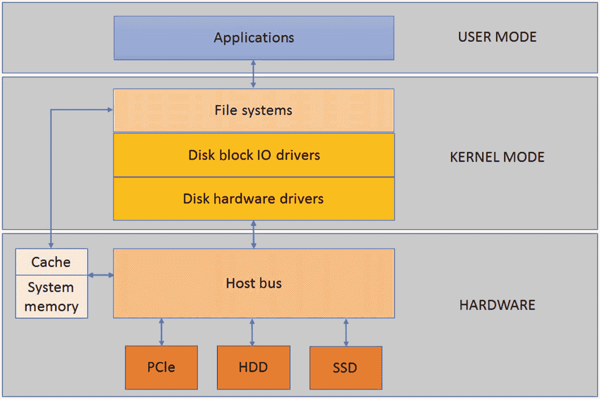

# 系统性能评估

许多指标用于表示存储设备或系统的规格，既有静态的也有动态的。表 1-5 列出了一些常用指标。在讨论性能时，我们通常指的是动态规格。其中，IO 性能是最重要的指标之一。

**表 1-5** 存储设备的常用指标

| 指标 | 单位 |
| --- | --- |
| 容量 | GB |
| 面密度 (TPI, SPT) | GB/英寸 |
| 体积密度 | TB/升 |
| 写入/读取耐久性 | 次数/年 |
| 数据保留时间 | 年 |
| 速度 (IO 访问延迟；随机) | 毫秒 |
| 速度 (IO 访问带宽；顺序) | MB/秒 |
| 功耗 | 瓦特 |
| 可靠性 (MTBF) | 小时 |
| 开机/关机转换时间 | 秒 |
| 冲击与振动 | G 力 |
| 耐温性 | *°*C |
| 抗辐射性 | Rad |

性能评估是实验计算机科学的基本要素。它可以用于调整系统参数、评估组装生产用系统时的容量需求、比较不同设计方案的优劣，并为新开发提供指导。如文献 [35] 所述，影响计算机系统性能的三个主要因素是：

- 系统的设计
- 系统的实现
- 系统的工作负载

这三个因素相互影响、相互作用。一个系统在一种工作负载下表现良好，但在另一种工作负载下却表现不佳，这是很常见的。对于给定的存储系统，其硬件设计通常是固定的。然而，它可能提供一些可调参数。如果参数在某个场景下也是固定的，那么对于特定的应用程序，其性能通常是“可预测的”。通过运行足够的实验，有可能获得与应用程序通用工作负载属性相关的参数模式。然后你可以进一步调整参数。有时，由于设计限制，可调参数的范围可能过于狭窄。这时你就必须重新设计系统。

三个最重要的基本性能指标是每秒输入/输出操作次数 (IOPS)、吞吐量 (TP) 和响应时间 (RT) [12]。

- **吞吐量**，也称为带宽，与数据传输速率相关，是指在单位时间内传输到存储设备或从存储设备传输的数据量。吞吐量通常以 KB/秒、MB/秒 或 GB/秒 来衡量。对于磁盘驱动器，它通常指的是顺序访问性能。
- **IOPS** 指的是设备的 IO 操作传输速率，或在单位时间内可以发生的事务数量。对于磁盘驱动器，它通常指的是随机访问性能。
- **响应时间**，也称为延迟，是指从主机向存储设备发送命令到命令返回主机所花费的时间，因此它是一个 IO 请求往返所花费的时间。它以毫秒 (ms) 或微秒 (*μ*s) 为单位，通常以平均 (AVE) 或最大 (MAX) 响应时间的形式给出。在 HDD 规格中，通常会提供平均寻道时间和切换时间。

三个最重要的访问模式是：

- **块大小**，即数据传输长度
- **读/写比率**，即读操作和写操作的混合比例
- **随机/顺序比率**，即数据地址请求的随机性或顺序性

此外，在考虑消费级/客户端或企业级设备/系统时，关注点可能有所不同。例如，在某些客户端用例中，只要响应时间不是过慢，对于 HDD/SSD 设备而言，IOPS 和带宽可能比响应时间更为关键，因为典型的客户端用户通常不会注意到单个 IO 花费了很长时间（除非操作系统或软件应用程序正在等待单个特定的响应）。虽然客户端 SSD 用例可能主要关注平均响应时间，但企业级用例通常更关心最大响应时间以及这些时间的频率和分布 [12]。

## 性能 vs. 工作负载

工作负载可以通过多种方式进行分类。从领域角度来看，工作负载可以施加给 CPU、内存、总线、网络等。工作负载表征所需的细节级别取决于评估的目标。它可以是计算机组件级别，也可以是系统应用级别。从应用的角度来看，工作负载可以从数据库、电子邮件、Web 服务、桌面等中提取。

工作负载类型的一个重要区别在于其速率 [35]，这决定了工作负载是静态的还是动态的。静态工作负载是指具有固定工作量的负载；当工作完成时，任务即告结束。通常，该任务是由给定应用程序的若干小集合组合而成。另一方面，在动态工作负载中，工作会持续不断地到达；它永远不会结束。这需要识别所有可能的任务。

从实践角度来看，工作负载分为三类：文件级、对象级和块级。在本书中，我重点关注块级，因为大多数底层存储设备实际上是块设备，并且应用于块级分析的技术也可以用于文件级和对象级分析。

## 踪迹收集与分析

工作负载踪迹可以使用软件和硬件工具，以主动或被动的方式收集。某些系统内置的日志记录机制（通常作为后台活动运行）是被动踪迹来源之一。主动地，你可能需要特定的硬件（例如，数据采集卡、总线分析仪等）和软件（例如，`dtrace`、`iperf`、`blktrace` 等）来有目的地收集踪迹。这些踪迹可能具有不同的精度和详细程度。有时，当真实应用的环境不可用或不方便获取时，你可能还需要借助基准测试工具。第 5 章将对此进行详细讨论。

### 系统优化

轨迹分析的主要目的之一，是在不同层面（例如，组件与系统、用户态与内核态与硬件等）识别系统性能瓶颈，进而优化整个系统 [36]。

以一个简单的 IO 栈为例（图 1-13）。^(³²) 软件应用生成的访问模式必须遍历 IO 栈，才能从用户空间到达存储设备并返回。这一过程表明，IO 在 IO 栈中上下传递时，会受到文件系统和各种驱动程序的影响，例如将小的 IO 数据传输合并为更少但更大的 IO 数据传输，将大的顺序 IO 数据传输拆分为多个并发的随机 IO 数据传输，以及在使用更快的文件系统缓存的同时，将 IO 提交延迟到 SSD。

图 1-13

IO 栈

在本书中，我将提供一些实际示例，范围从单个设备到复杂系统，以展示如何将工作负载分析应用于系统优化和设计。

脚注 1 2 3 4 5 6 7 8 9 10 11 12 13 14 15 16 17 18 19 20 21 22 23 24 25 26 27 28 29 30 31 32

