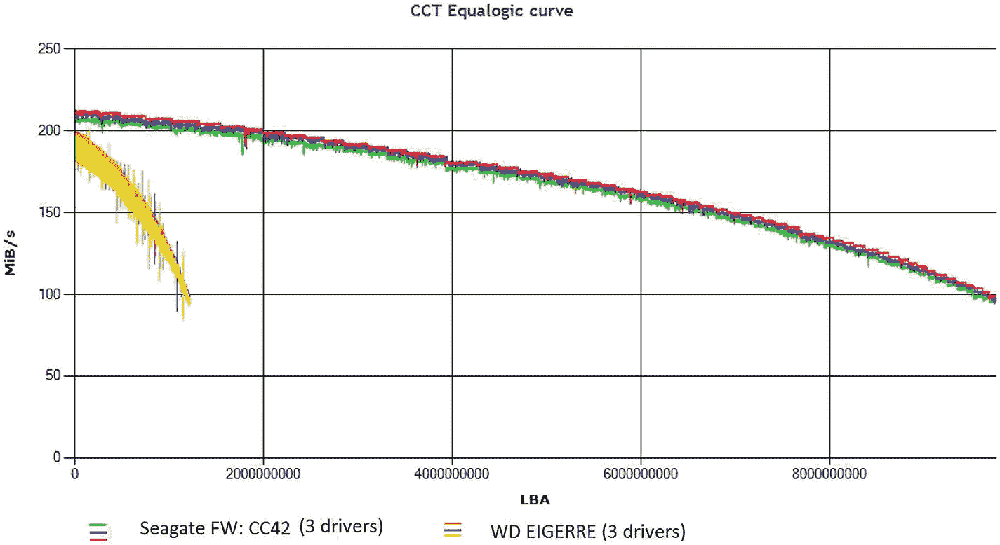
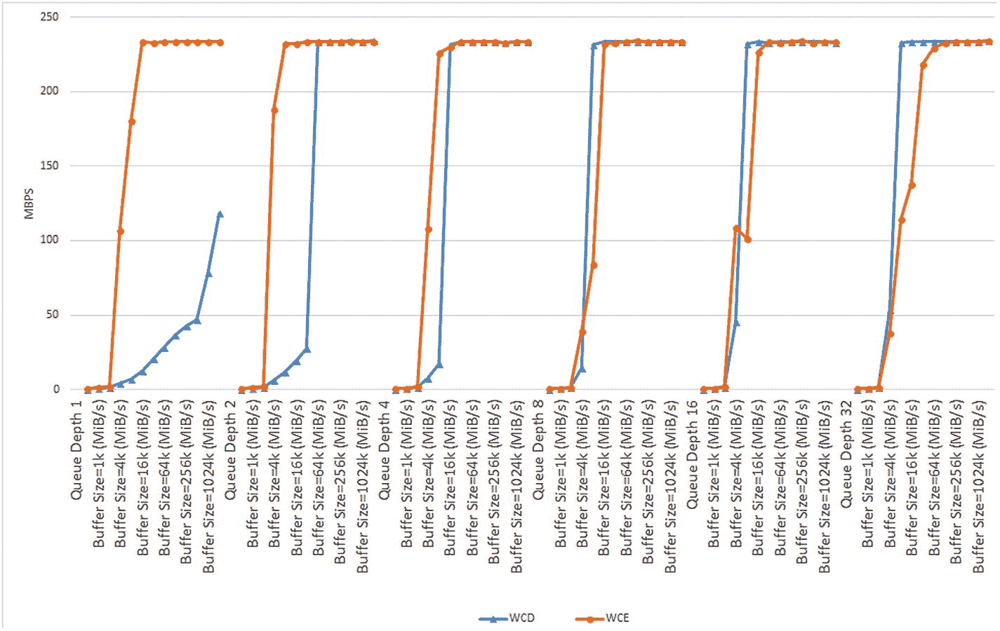
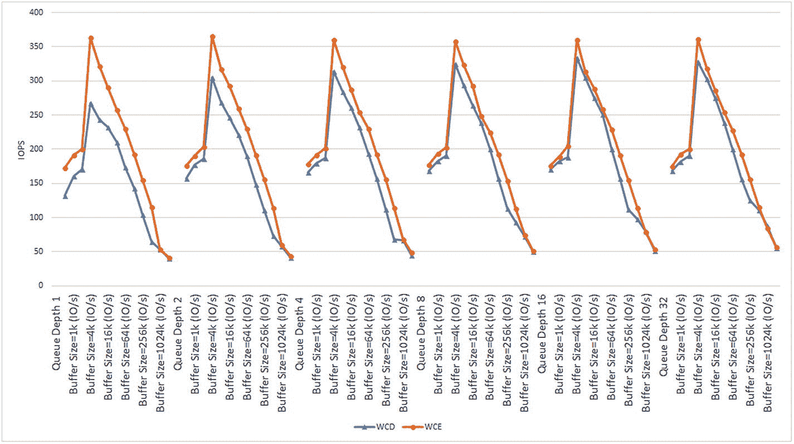
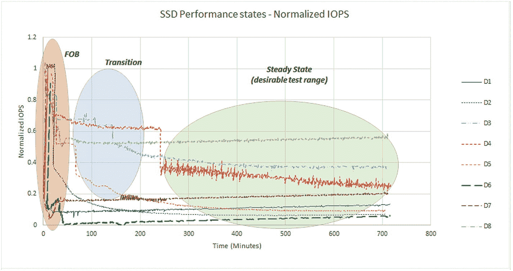
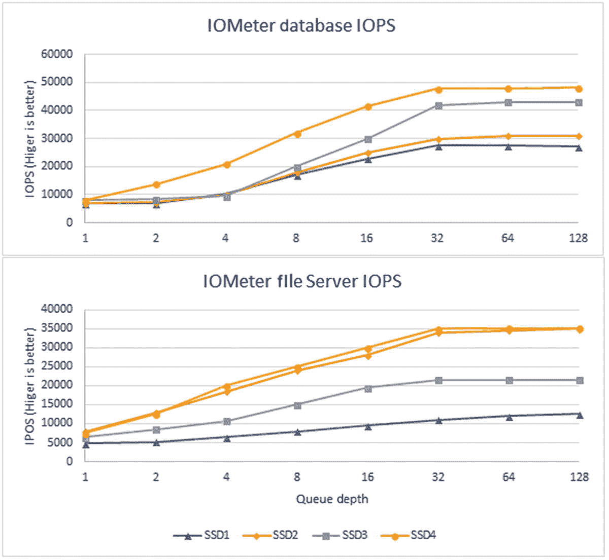
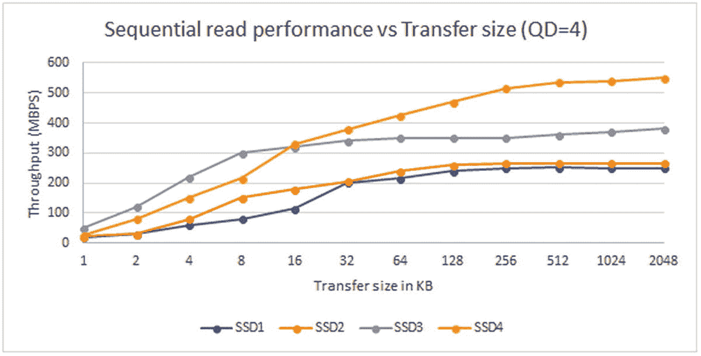

# 4. 追踪分析

追踪分析提供了对工作负载属性和 IO 模式的洞察，这对于存储系统调优和优化至关重要。本章讨论工作负载如何与系统组件、算法、结构和应用程序交互。

## 与组件的交互

如第 1 章所述，不同的存储设备可能具有截然不同的属性。此外，它们的内部结构和算法也对最终性能有显著影响。例如，HDD 的写入缓存可以从数据局部性中获益：

- 写入缓存命中可以避免一些磁盘机械写入；相反，DRAM 缓存中的脏块会被覆盖。这是时间局部性的好处。
- 更大的缓存空间意味着更长的写入队列：物理上连续的脏块可以组合成单个 IO 操作。这是空间局部性的好处。
- 先进的替换策略通过探索空间和时间局部性，有效地将冷数据放置到磁盘上，同时将热数据保留在缓存中。
- 缓存可以暂时吸收写入突发，并随时间均匀分布写入负载，以最小化对并发 IO 的影响。

对于具有 `MBC` 的 HDD，写入缓存可以为写入突发提供日志访问，从而为分组 I/O 访问提供更好的安排。在本节中，我主要讨论影响性能的 HDD 和 SSD 因素。

### HDD 影响因素

对于 HDD，其性能会因磁盘驱动器的特性（例如 `RPM`、`TPI`/`SPT`、位置 [`OD`、`MD` 或 `ID`]、磁头质量、伺服控制机制、缓存结构/算法、队列长度等）和工作负载属性（例如顺序性、请求大小、队列深度等）而异。

首先，来看驱动器的特性。例如，HDD 外圈（`OD`）的吞吐量可能是内圈（`ID`）的两倍，如图 4-1 所示。一个 `10K RPM` 的企业级驱动器可能比 `5400 RPM` 的台式机驱动器快两倍以上。高 `RPM` 的驱动器通常比低 `RPM` 的驱动器响应时间更短。

图 4-1 HDD 不同位置的吞吐量差异

其次，考虑工作负载属性。图 4-2 提供了一个示例，展示了在启用写缓存（`WCE`）或禁用写缓存（`WCD`）的情况下，`IOPS` 如何随请求大小（0.5、1、2、...、2014KB）和队列深度（1、2、4、8、16、32）而变化。可以看到，在没有缓存/缓冲区的情况下，`WCD` 在相同请求大小下，不同队列深度的性能表现相似。然而，当启用写缓存时，队列深度为 1 的性能与队列深度为 16 的性能存在显著差异。图 4-2 和 4-3 展示了在 `WCE` 和 `WCD` 下，性能随缓冲区大小的变化。

图 4-3 `WCE` 和 `WCD` 下吞吐量随缓冲区大小的差异（通过 `IOMeter` 进行顺序写入）

图 4-2 `WCE` 和 `WCD` 下 `IOPS` 随队列深度和请求大小的差异（通过 `IOMeter` 进行随机写入）

### SSD 影响因素

对于 SSD，其性能同样会因磁盘驱动器的特性（例如芯片数量、块大小、并行访问、闪存管理算法（磨损均衡）、地址映射策略、修剪条件、缓存结构/算法、队列长度、IO 驱动接口等）和工作负载属性（例如碎片化、顺序/随机性、写入更新、读写比、请求大小、队列深度、请求强度/节流等）而异。

与 HDD 不同，消费级 NAND SSD 在初始测量期间可能会暂时表现出人为的、不可持续的高性能。在不良条件下，它也可能表现出不可接受的性能。因此，为了展示持续的固态性能，我需要为 SSD 设定一个合适的条件。众所周知的起点是全新的 SSD 或经过低级格式化的 SSD（以擦除内容并恢复到原始状态）。根据 SSD 的容量，运行一段时间的随机写入。然后，SSD 就进入了“已使用”状态。当性能水平稳定到一个可持续的速率时，我们就得到了真实的性能值。图 4-4 说明了这一现象，其中 `D1-D6` 是 `MLC`，`D7-D8` 是 `SLC`。^(⁵³) 请注意，自 2017 年以来，这种情况已有所缓解。

图 4-4 SSD 性能状态 [12]

NAND SSD 通常使用虚拟地址映射方案，出于某些原因 [12]，`LBA` 被映射到 `PBA`。例如，磨损均衡算法会将更新后的数据分配到新的存储单元位置，以促进存储单元上的磨损均匀分布，从而提高存储单元的寿命或耐久性。因此，SSD 必须跟踪 `LBA-PBA` 的对应关系。与 HDD 类似，当物理位置上的数据碎片化程度较低时，顺序操作也可能比随机访问更快。

与 HDD 类似，队列深度（即未完成的 IO 数量）对 `IOPS` 性能有深远影响。图 4-5 展示了四种不同型号的 SSD 在两种应用（数据库和文件服务器）下的 `IOPS` 趋势。可以看到，产生的 `IOPS` 差异很大。此外，`SSD2` 在数据库中的性能优于 `SSD3`，但在文件服务器中则较差。这表明 SSD 的内部架构和算法对应用很敏感。

图 4-5 SSD `IOPS` 与队列深度的关系

块对齐也是一个性能问题。当块与 NAND 闪存单元边界对齐时，它们可以更高效地存储在 SSD 中。例如，一个 `8KB` 的块将恰好适合一个 `8KB` 的 NAND 页大小。如果其他条件相同，在给定的时间段内，可以访问的小块 IO 数量多于大块 IO，尽管数据量可能相同，例如 64 个 `8KB` 数据传输长度的 IO 对比 4 个 `128KB` 数据传输长度的 IO。无论如何，访问 NAND 闪存的最小粒度取决于底层 NAND 闪存的设计。图 4-6 展示了在不同大小的顺序请求下的吞吐量。可以看到，当大小小于 `32KB` 时，传输速度受大小影响显著。然而，当大小大于 `128KB` 时，吞吐量相对稳定。

图 4-6 SSD 顺序吞吐量与请求大小的关系

## 读写比例对固态硬盘与机械硬盘的影响

读写比例对固态硬盘的影响大于对传统磁记录机械硬盘的影响。首先，“新”写入操作通常比读取操作需要更多时间，因此写入操作的步骤比读取操作更多。其次，对于原地更新写入，需要执行“擦除”访问。因此，写入步骤的数量取决于硬盘的占用程度，以及固态硬盘控制器在写入新数据前是否需要擦除目标单元（甚至通过执行更耗时的`RMW`访问来迁移部分数据）。

尽管顺序访问与随机访问的性能比不如机械硬盘那么高，但顺序性仍然很重要，因为它有助于通过按块分组写入请求来最小化擦除操作，从而通过减少擦除次数来优化寿命和 I/O 性能。

总之，除了第 1 章汇总表中列出的差异外，固态硬盘与机械硬盘之间还有许多主要区别。在此，我进一步将其扩展到通用非易失性存储器：

- **访问位置**：对于机械硬盘，由于寻道时间，访问位置至关重要；而对于非易失性存储器，虽然访问顺序有影响，但通常不决定延迟。
- **访问大小**：大块顺序请求明显快于小块随机请求。然而，这对非易失性存储器的影响较小。事实上，由于内部结构，较大的 I/O 可能会产生额外开销，尽管在非易失性存储器中顺序访问通常仍比随机访问快。
- **访问类型**：机械硬盘通常基于块或文件。一些基于对象的设备仍使用块与对象之间的内部映射。然而，某些非易失性存储器可以支持字节级访问。对象级映射也比机械硬盘更自然。在许多非易失性存储器中，读取和写入性能可能不同。
- **内容**：某些技术（如压缩和去重）依赖于内容。对于机械硬盘，这些技术并非必需，因为额外的计算和 I/O 资源消耗可能会大幅降低机械硬盘性能。与节省的空间相比，它们可能得不偿失。然而，对于非易失性存储器，这些技术可以降低成本并提高存储效率。
- **时序**：机械硬盘通常上限为 `300 IOPS`，而某些非易失性存储器设备可能快 100 到 10000 倍。因此，缓存调度器存在巨大差异。

有许多测试和基准测试工具，其测量条件各不相同。人们可能会被这些不同工具的结果所困惑。`SNIA` 开发了名为`SSSI参考测试平台(RTP)`和`性能测试规范(PTS)`的标准测试工具。^(⁵⁴)

## 与算法的交互

当硬件固定时，混合存储系统中使用的算法和策略实际上决定了整个存储系统的性能。本节将调研最重要的算法，如数据分配、热数据识别、数据迁移和调度算法。为便于表示，我在表 4-1 和 4-2 中列出了这些算法考虑的一些主要因素，其中访问频率和间隔是热数据识别和数据迁移算法中最重要的两个因素。

**表 4-2 其他性能因素**

| 项目 | 描述 |
| --- | --- |
| 数据大小 | 通常，只有小尺寸的热数据需要迁移到更高层级。小尺寸的程度取决于固态硬盘和机械硬盘的读写速度比，以及它们之间的迁移速度等。 |
| 缓存总大小/剩余大小 设备总带宽/剩余带宽 | 缓存大小决定了可在缓存中存储多少热数据。因此，它决定了热度的阈值。 带宽决定了当前时间迁移是否合适。可以构建一个近似函数，根据读写比、I/O 强度等预测剩余带宽。 |
| 读写比 | 由于读写访问时间和模式不同，该比例会产生不同的性能（例如，写放大）。 |
| 读写粒度与 I/O 强度 | 该值表示与一次读写 I/O 相关的数据量与固定大小数据块的数据量之比。平均读写粒度是预定义时间间隔内所有 I/O 的平均比值。通常，该值越大，数据对用户越重要。 |
| 数据相关性 | 一个数据可能与另一个数据相关，因此一个数据块中的 I/O 操作在预定义时间段内具有某些特征，而另一个数据块可能具有相似属性，因此它们相关联。该值可用于 I/O 预测。 |
| I/O 范围/数量/分布 | I/O 分布表示统计访问信息，例如给定访问周期内的访问地址范围和访问频率。 |
| 粒度大小 | 每个页面/块被替换/迁移的最小尺寸 |
| 层级对比/补偿（设备价值） | 它衡量两个不同存储层级/缓存之间用于直接数据迁移的差异，包括设备状态、访问速度等。 |
| 其他 | 数据丢失/错误等。 |

**表 4-1 两个最重要的因素**

| 项目 | 描述 | 典型算法 |
| --- | --- | --- |
| 访问频率（读/写）（`F`）， 访问间隔（`T`） | 给定时间段内的访问时间。由于读写性能不同，我们也可以分别考虑它们。 有人认为最近最少使用的数据在近期被重新访问的概率更高；也有人否认这一点；目前一个可接受的折衷是，这取决于 I/O 模式/工作负载。 | `LFU`（最不经常使用）[48]，`GDSF`（贪婪双倍大小频率）[49] `LRU`（最近最少使用），`MRU`（最近最常使用），`LFUDA`（带动态老化的 LFU）[48]，`LRU-K`（最近最少使用 K 次）[50]，`GDS` [51] |

## 与结构的交互

存储设备或系统的基本结构也对系统性能有很大影响。例如，基于 `RAID` 和 `EC` 的系统具有数据保护功能。然而，由于额外的校验数据，它增加了磁盘的内部 I/O 负担。特别是在从关键磁盘故障中恢复系统时，内部工作负载会占用大量磁盘带宽，因此对外部用户的整体系统性能会显著下降。第 7 章将分析 `RAID` 结构对 I/O 模式的影响。

对于混合存储系统，虽然它有潜力提升热数据的性能，但内部数据迁移也可能占用一些额外资源。不恰当的 I/O 调度器和数据迁移算法肯定会降低整体性能。此外，所谓的缓存结构和分层结构在数据分配和 I/O 调度上可能存在很大差异，这导致在不同场景下性能各异。第 6 章将以一个小型混合设备为例进行说明。此外，互连结构（如总线和桥接器）在某些情况下也可能成为性能瓶颈。

## 与应用程序的交互

如第 2 章所述，不同应用程序的指标可能存在巨大差异[35]。表 4-3 对一些常见应用的典型需求进行了简单比较。^(⁵⁵) 由于不同应用的需求差异显著，这对存储系统提出了不同的要求。第 8 章将阐述一个用于大数据应用的、采用`HDFS`的 Hadoop 系统的 IO 模式，而第 9 章将讨论最流行的分布式存储系统之一`Ceph`。

**表 4-3 部分应用的典型需求**

| | 高性能计算数据存储 | 云存储 | `HDFS`/混合存储 | 归档/备份 | 高性能计算检查点数据 | 数据库 |
| --- | --- | --- | --- | --- | --- | --- |
| 属性 | 近期数据存储：顺序、高吞吐量 `WORM` 操作 | 传统批处理 IO 顺序读/写 | 传统批处理 IO 顺序读/写 | 一次写入，极少读取 | 检查点操作：突发性、高吞吐量操作 | 事务性：小 IO 读取、修改、写入 |
| 延迟 | 与云存储需求相似。通常为以太网，有时为 `IB`。 | 10 至 100 毫秒之间 | 10 至 100 毫秒之间 | 预期高延迟（>=10 秒）；`Amazon Glacier` 为 3-5 小时 | 1-2 毫秒；对于>1kb 的数据传输可达 45 微秒 | 越快越好，0-10 毫秒，但在出现问题前可达 90 毫秒 |
| `IOPS`/吞吐量 | 提供多种不同产品。供应商特定的存储规格各不相同。 | 根据实例大小，`IOPS` 从数百到 1 万不等 | 取决于磁盘性能，几乎没有明显的开销阻碍硬件性能 | `LTO4` 磁带为 `120MB/s`，延迟 22 秒 | 通常每 `4U` 单元系统性能为 1 万+ `IOPS`； | 通常为 `1K-30K IOPS`，最高可达 1-1 千万+级别；实现方式因平台而异； |
| 其他 | 通常用于科学数据分析，而非超级计算机检查点存储。 | 高可用性（4/5 个 9）；高数据持久性（9/11 个 9） | 原地数据分析能力 | 期望高数据持久性，但数据访问频率低 | 通过专用 `IB` 通信，每机架 `84.8TB` | 支持 `ACID` 语义 |

脚注 1 2 3

# 案例研究：基准测试工具

基准测试工具有助于为具有特定需求的存储系统提供一些“标准”性能指标。本章展示了如何识别基准测试结果的访问模式。第一个工具是来自存储性能委员会（SPC）的`SPC-1C`。在捕获模式后，我开发了一个合成仿真器来匹配真实轨迹。第二个工具是来自 FutureMark 的`PCMark`。我阐述了如何使用盈亏分析来提高缓存算法效率。

存储性能基准测试通过运行一系列标准测试和试验，借助一个工具或一组程序（无论是否支持特定硬件设备），来评估存储系统的相对性能。以下是一些常用于主动轨迹收集的基准测试工具：
-   **合成轨迹**。
    -   用户可以指定队列深度、请求大小、传输速率、顺序等测试场景。这对于确定边界情况行为很有帮助。
    -   示例：`IOMeter`、`VDBench`、`fio`、`IOzone`、`iorate`、`sqlio`、`diskspd`^(⁵⁶)
-   **基于应用的轨迹**。
    -   用户可以选择具有预定义工作负载模式的特定应用程序。这对于说明真实世界案例很有帮助。
    -   示例：`SysMark`、^(⁵⁷) `PCMark`、`SPC`（存储性能委员会，例如`SPC-1`、`SPC-2`）、`TPC`（事务处理性能委员会，例如`TPC-A/B/C/D/H/W`）、^(⁵⁸) `SPEC`（标准性能评估公司，例如`HPC/SFS/JVM/SDM`）、^(⁵⁹) `Jetstress`、^(⁶⁰) `COSbench`^(⁶¹)
-   **真实轨迹**。
    -   用户可以直接输入真实世界的轨迹。当用户尝试在不同系统中测试类似应用程序时，这非常有用。
    -   示例：`AnandTech Storage Bench`^(⁶²)

表 5-1 对一些常用工具进行了简单比较，其中操作系统列中的字母 W、L 和 U 分别表示 Windows、Linux 和 Unix。

**表 5-1** 一些常见基准测试工具的比较
| | 块 | 文件 | Posix | 操作系统 | 单机/客户端 | 开源 | 最新版本 |
| --- | --- | --- | --- | --- | --- | --- | --- |
| `Iometer` | 是 | - | - | WLU | 单机/客户端 | 是 | 1.1.0/2014 |
| `IOzone` | 是 | 是 | 是 | WLU | 单机 | 是 | 2006 |
| `Bonnie++` | 是 | | | LU | 单机 | 是 (GPL2) | 1.0.1 |
| `dbench` | 是 | 是 | 是 | LU | 单机/客户端 | 是 (GNU) | 2008 |
| `Filebench` | 是 | 是 | 是 | LU | 单机 | 是 | 2011 |

对于大规模系统，传统工具可能不够用（例如，缺乏测量指标）或不够方便（例如，没有集成用户界面）。因此，提出了一些专用工具，例如用于大数据基准测试的`HiBench`、^(⁶³) `Berkely BDB`、^(⁶⁴) `BigDataBench`^(⁶⁵) 和 `BigBench`^(⁶⁶)，特别是针对 Hadoop/Spark 系统。

通用的基准测试流程如表 5-2 [52]所示。请注意，还存在其他分类方法。例如，三种类型分别命名为：底层系统操作中的微基准测试（例如，在现代集群上评估`HDFS`操作）、高级功能中的功能/组件基准测试（例如，`Terasort`、基本 SQL）、应用级基准测试（例如，针对给定应用场景的整体系统性能）。更多详情，请参考[41, 35]。

**表 5-2** 通用基准测试的五个步骤
| 步骤 | 备注 |
| --- | --- |
| 选择合适的配置。 | 选择正确的基准测试类型，例如宏基准测试（对整个系统进行全面测试）、微基准测试（通过少量操作检查局部变更）或基于轨迹的基准测试。 |
| 选择正确的环境。 | 一致的硬件和软件设置，以及一些因素，例如缓存状态、硬盘分区恒角速度、文件系统老化、非必要进程等。 |
| 运行基准测试。 | 为可重复性进行相同运行，为准确性进行多轮运行（具有较小的标准差或较高的置信水平），为稳态提供足够的运行时间，通过合适的脚本自动运行。 |
| 呈现结果。 | 具有较小置信区间且接近正态分布的统计结果。 |
| 验证结果。 | 重现/确认结果，或与其他类似结果进行比较。 |

