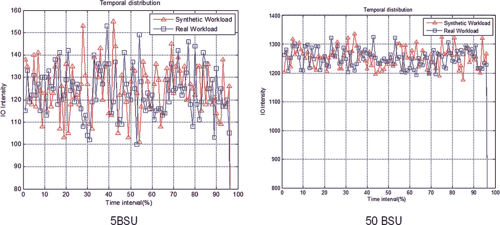
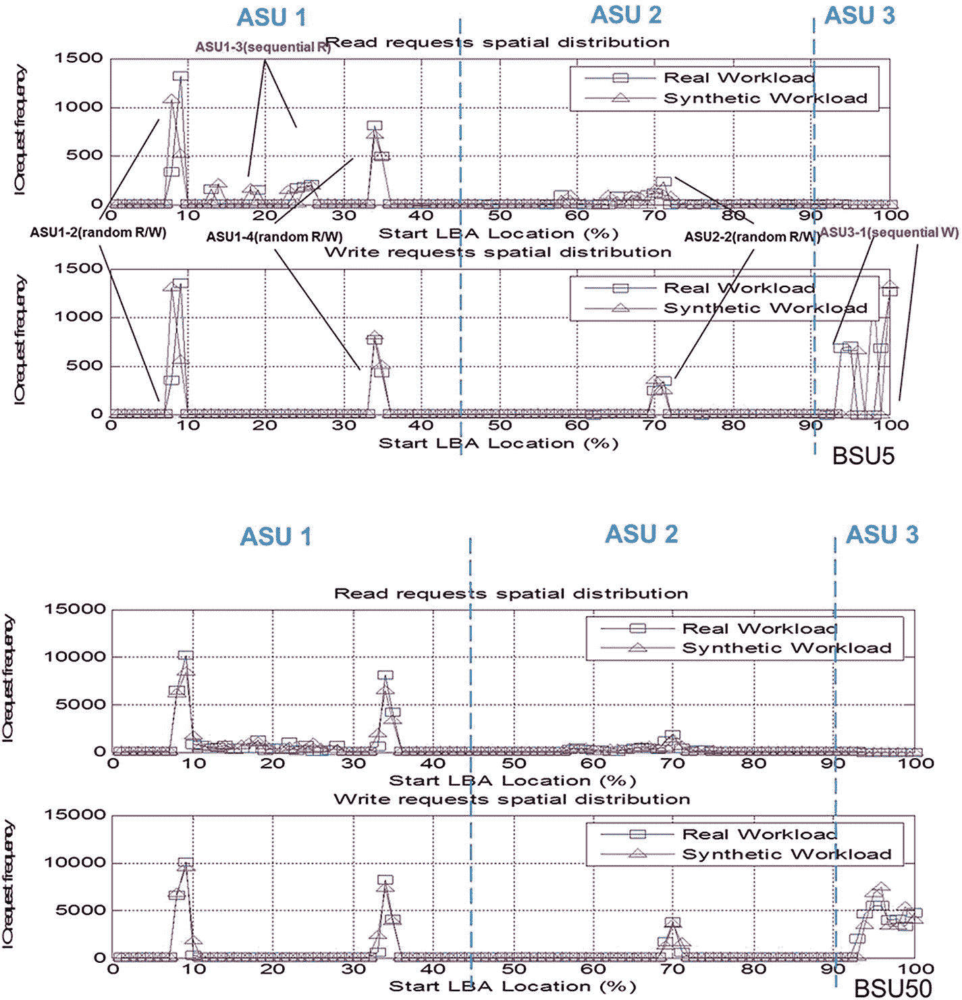
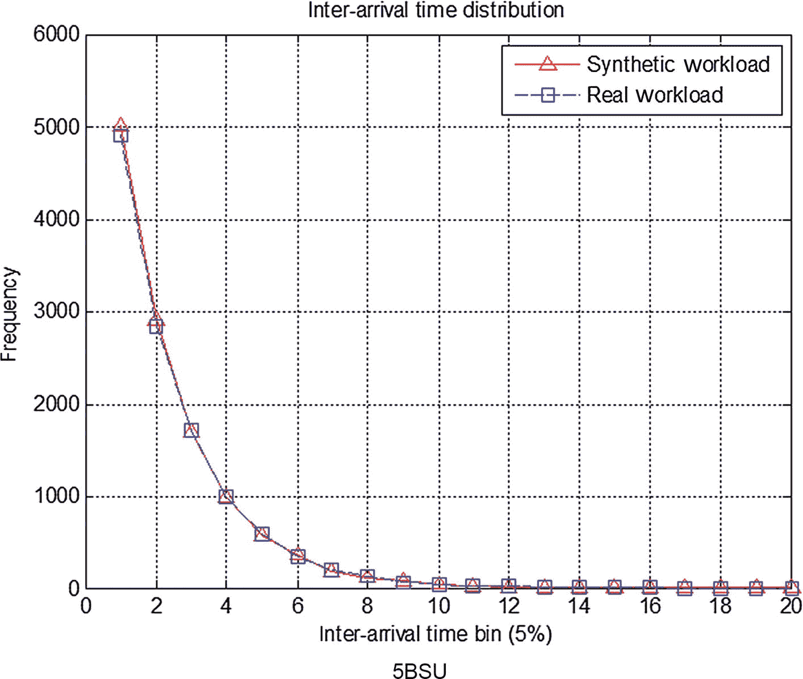
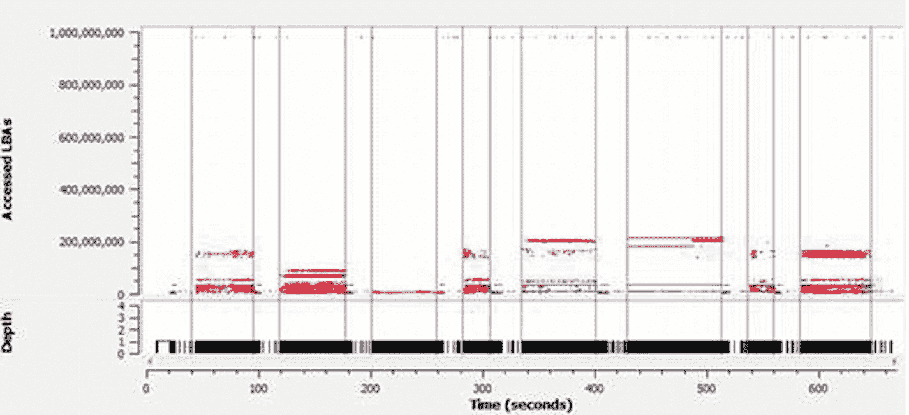
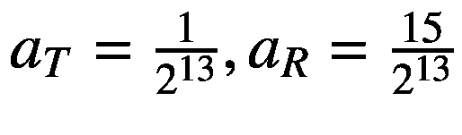
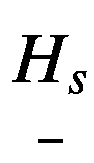
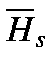
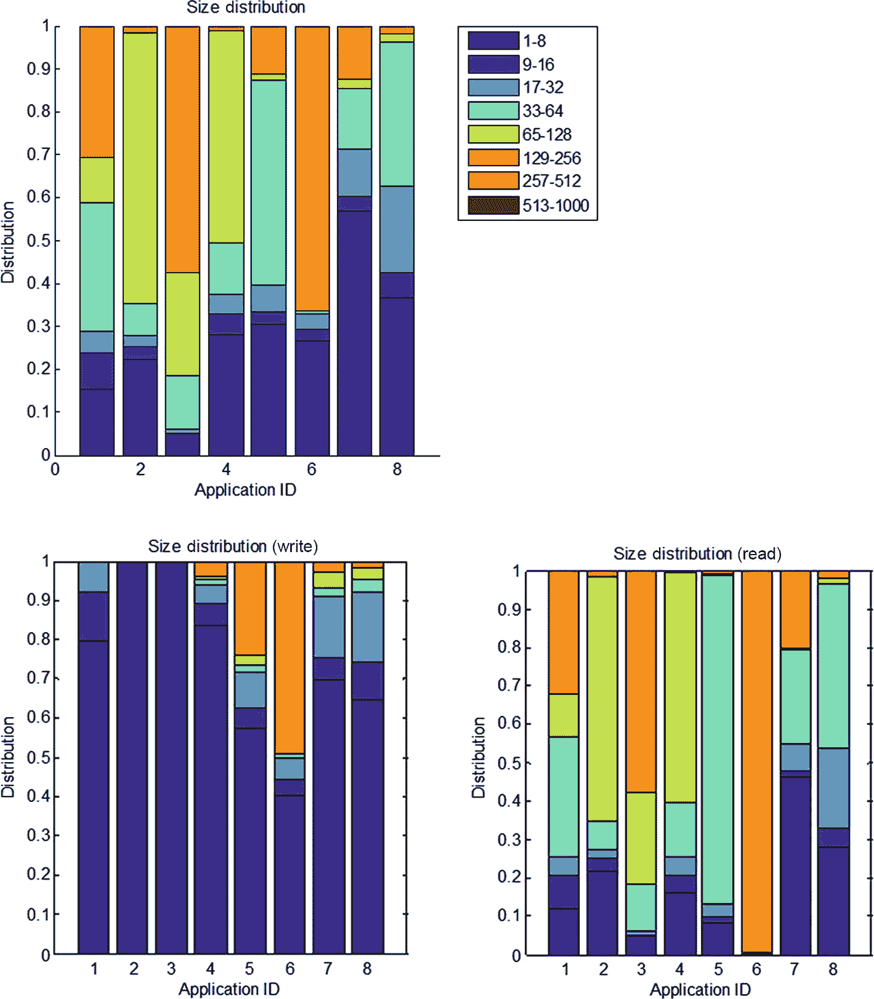
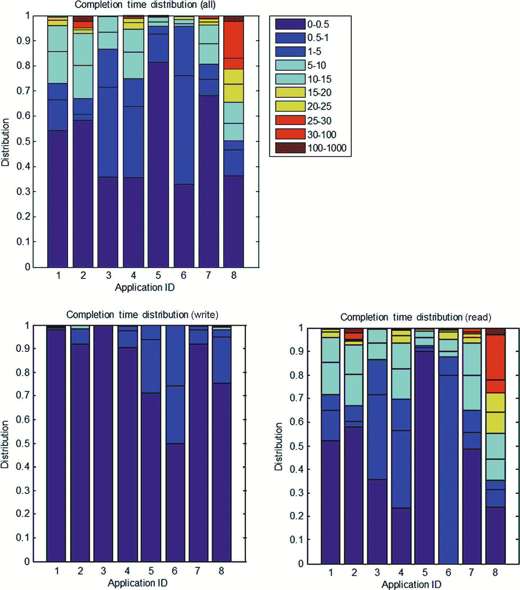
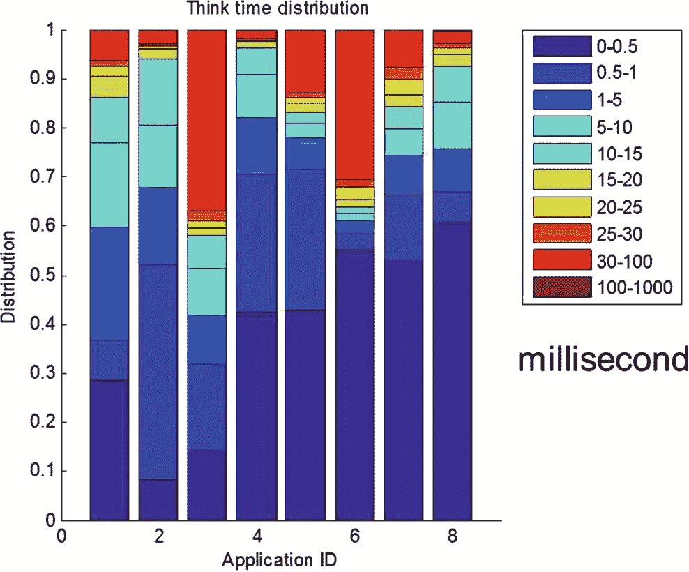

## 5. SPC-1C

存储性能委员会（SPC）提供了多个不同级别的基准测试工具。`SPC-1C` [53] 被设计为与供应商/平台无关，适用于广泛的存储组件产品，例如磁盘驱动器、主机总线适配器（HBA）、智能机箱以及诸如逻辑卷管理器之类的存储软件。

## 工作负载属性

与工作负载强度相关的两个重要概念是`BSU`（业务扩展单元）和`ASU`（应用存储单元）。每个`BSU`由三个`ASU`组成：`ASU1`用于数据存储，权重为 45%；`ASU2`用于用户存储，权重为 45%；`ASU3`用于日志，权重为 10%。这总共对应每个`ASU`五个 IOPS。

访问模式有三种类型：随机（均匀分布）、顺序和（`随机游走`访问）模式。详细信息见表 5-3，并在表 5-4 中进一步总结。表 5-5 表明，小尺寸请求（8 和 16 个块）占比超过 85%。`随机游走`是马尔可夫链的一个重要模型。表 5-6 展示了该模型的主要特征。

**表 5-6** `SPC-1C` `随机游走`模式
| ASU | 1-1 | 1-2 | 1-3 | 1-4 | 2-1 | 2-2 | 2-3 | 3-1 | 总和 |
| --- | --- | --- | --- | --- | --- | --- | --- | --- | --- |
| **读** | 0 | 0.1405 | 0 | 0.105 | 0 | 0.021 | 0 | 0 | 0.2665 |
| **写** | 0 | 0.1405 | 0 | 0.105 | 0 | 0.049 | 0 | 0 | 0.2945 |

**表 5-5** 尺寸分布
| 尺寸分布 | 概率 | 尺寸分布 | 概率 |
| --- | --- | --- | --- |
| 8 | 0.7684 | 64 | 0.03088 |
| 16 | 0.09264 | 128 | 0.03088 |
| 32 | 0.0772 | | |

**表 5-4** `SPC-1C` 工作负载比例
| 工作负载比例 | `ASU1` | `ASU2` | `ASU3` |
| --- | --- | --- | --- |
| `ASU i`/总计 | 0.596 | 0.123 | 0.281 |
| `ASU i` 中随机读 | 0.02936 | 0.0439 | 0 |
| `ASU i` 中顺序读 | 0.11745 | 0.28455 | 0 |
| `ASU i` 中模式读 | 0.41191 | 0.17073 | 0 |
| `ASU i` 中随机写 | 0.02936 | 0.10244 | 0 |
| `ASU i` 中顺序写 | 0 | 0 | 1 |
| `ASU i` 中模式写 | 0.41191 | 0.39837 | 0 |

**表 5-3** `SPC-1C` 工作负载分解
| ASU | 1-1 | 1-2 | 1-3 | 1-4 | 2-1 | 2-2 | 2-3 | 3-1 |
| --- | --- | --- | --- | --- | --- | --- | --- | --- |
| 强度 | 0.035 | 0.281 | 0.07 | 0.21 | 0.018 | 0.07 | 0.035 | 0.281 |
| 读/写 | 0.5 | 0.5 | 1 | 0.5 | 0.3 | 0.3 | 1 | 0 |
| 随机 | 1 | 0 | 0 | 0 | 1 | 0 | 0 | 0 |
| 模式 | 0 | 1 | 0 | 1 | 0 | 1 | 0 | 0 |
| 顺序 | 0 | 0 | 1 | 0 | 0 | 0 | 1 | 1 |
| 比例 | 1-1 | 1-2 | 1-3 | 1-4 | 2-1 | 2-2 | 2-3 | 3-1 |
| 随机读 | 0.0175 | 0 | 0 | 0 | 0.0054 | 0 | 0 | 0 |
| 顺序读 | 0 | 0 | 0.07 | 0 | 0 | 0 | 0.035 | 0 |
| 模式读 | 0 | 0.1405 | 0 | 0.105 | 0 | 0.021 | 0 | 0 |
| 随机写 | 0.0175 | 0 | 0 | 0 | 0.0126 | 0 | 0 | 0 |
| 顺序写 | 0 | 0 | 0 | 0 | 0 | 0 | 0 | 0.281 |
| 模式写 | 0 | 0.1405 | 0 | 0.105 | 0 | 0.049 | 0 | 0 |

从表 5-7 中还可以发现，写访问和模式访问占主导地位，这显示了自相似性和写缓存在基准测试中的重要性。

**表 5-7** 基本 IO 模式分布
| 读/写 | 比例 | 模式 | 比例 |
| --- | --- | --- | --- |
| 读 | 0.3944 | `随机` | 0.053 |
| 写 | 0.6056 | `顺序` | 0.386 |
| | | `模式` | 0.561 |

### 合成轨迹

利用所有这些参数，你实际上可以编写自己的合成轨迹生成器。因此，它提供了更大的灵活性，可以更改你感兴趣的任何参数，例如磁盘大小、`BSU`、模拟时间，甚至 `SPC-1C` 的配置，如`ASU`、每个`BSU`的 IOPS、分布模式等。例如，你可以将`ASU`与`BSU`分离，以观察不同应用（数据存储、用户存储和日志/顺序写入）而非混合工作负载的影响，并更改分布（例如，到达间隔时间、请求大小等）以满足更具体的要求。此外，你可以将生成器作为合成生成器组件集成到其他工具包中，例如`Disksim` [54] 和`IOMeter`。图 5-1、5-2 和 5-3 展示了由总线分析器捕获的真实轨迹与基于`MATLAB`的工具（见附录 A）生成的合成轨迹之间的对比。

**图 5-3** `SPC-1C` 轨迹时间分布

**图 5-2** `SPC-1C` 空间分布

**图 5-1** 到达间隔时间直方图

从图 5-1 中，你可以看到到达间隔时间近似于指数分布。如你所知，工作负载由来自三个`ASU`的八种不同类型的 IO 流混合而成。在图 5-2 的空间分布中，可以看到一些高强度流。通常，生成的随机读/写 IO 流与真实工作负载一致，但在轻负载下，顺序 IO 流并不十分接近。一个可能的原因是，真实工作负载并非由与`随机游走`模型完全相同的参数生成。事实上，很难使时间分布完全对齐。然而，图 5-3 中的结果是相当可接受的。

# PCMark

`PCMark Vantage` [55] 是一款广泛使用的基准测试工具，其功能不仅限于磁盘性能。它可以提供八个类别的应用级追踪，如表 5-8 所示，其中每个特定追踪被分解为写入和读取命令的数量。图 5-4 进一步以 `LBA` 随时间变化的图表形式展示了这些追踪。^(⁶⁷)

**图 5-4** `PCMark`中的八个应用程序

**表 5-8** `PCMark`中的八个应用程序

| 序号 | 八个应用 | 总命令数 | 写入 | 读取 |
| --- | --- | --- | --- | --- |
| 1 | Windows Defender | 6755 | 300 | 6455 |
| 2 | 游戏 | 11040 | 62 | 10978 |
| 3 | 导入图片 | 2806 | 4 | 2802 |
| 4 | Vista 启动 | 7418 | 1327 | 6091 |
| 5 | 视频编辑 | 8204 | 3711 | 4493 |
| 6 | Windows Media Center | 5011 | 3309 | 1702 |
| 7 | 添加音乐 | 3336 | 1506 | 1830 |
| 8 | 应用加载 | 11155 | 2660 | 8495 |

现在，你可以将此追踪作为读取缓存性能分析的示例。一些早期研究表明，驱动器之间常见的区别在于读取缓存命中率，并伴有合理的前读和/或后读数据。为便于表述，我将预取操作定义为同时包含前读和后读请求，如图 5-5 所示。一种常见情况是，如果追踪具有很强的局部性，某些后续读取请求会因预取数据而命中缓存中的数据。通常使用三种类型的预取访问：始终预取（`PA`）、未命中时预取（`PoM`）、命中时预取（`PoH`）。

**图 5-5** 缓存预取

如前所述，对于近顺序流，请求之间允许存在间隙。这个间隙可能成为预取数据中的一个“空洞”，这对整体性能有害。如图 5-6 所示，存在三种类型的空洞：

**图 5-6** 空洞类型

*   **后空洞：** 传入命令的第一个`LBA`与缓存中排队命令的最后一个`LBA`之间的距离（`> 0`）在某个阈值之内。
*   **前空洞：** 传入命令的最后一个`LBA`与缓存中排队命令的第一个`LBA`之间的距离在某个阈值之内。
*   **前后空洞：** 同时存在后空洞和前空洞。

为了正式定义空洞，考虑以下两种情况：

*   **恒定：** 如果缓存中两个邻近区域之间的范围小于恒定值`Hs`个块，则该范围被视为一个空洞。
*   **自适应：** 空洞大小与`DRAM`和`SSD`缓存相关（很可能随总/剩余缓存大小单调递增）。

其中`S[T]`和`S[R]`分别是总缓存大小和剩余缓存大小，`a[T]`和`a[R]`是`S[T]`和`S[R]`的系数。一个针对 64MB `DRAM`缓存的示例如下定义：

其中 。实际的  和  由追踪决定，例如时间窗口内请求的中位数大小。更具体地说，需要考虑空洞是否位于同一磁道/柱面内。

应实现一个后台任务来监控缓存中的`LBA`区域以及这些区域上的命中密度。该进程还负责查找具有一定命中密度的数据区域中的间隙，并生成自诱导读取命令，用主存储器中的数据填充这些空洞。

为了将缓存算法与追踪属性联系起来，使用以下假设：

*   如果某个时间范围内两个特定范围的区域具有足够高的相关性，那么它们之间的间隙很可能被访问。
*   预取不应过多影响整体性能，因此从额外缓存命中率中获得的收益应大于预取带来的额外成本。
*   待填充空洞大小的上限由多种因素决定，例如总/剩余缓存大小、工作负载大小、缓存类型、访问时间等。

现在我们有一些问题需要回答。

*   空洞填充策略能带来什么好处？关键在于获取增加的缓存命中率（采用空洞填充时的命中率与未采用空洞填充时的命中率对比）。
*   空洞填充策略会带来什么额外成本？关键在于找出为填充空洞生成了多少自诱导命令。必须考虑用户工作负载的时间。
*   由于空洞填充与预取策略之间存在相似性，是否有可能将空洞填充合并到预取策略中（集成）？关键在于找出两种策略之间重叠的缓存命中；如果重叠率很高，预取可能将空洞填充作为其一部分。
*   何时何地应用这两种策略（或集成策略）才能平衡收益与成本？关键在于减少额外的机械访问成本和缓存污染。

# 工作负载属性

首先，我们来看思考时间和完成时间，分别如图 5-7 和图 5-8 所示。可以看到不同应用在这两项指标分布上的巨大差异。表 5-9 进一步给出了平均值、标准差以及 `IOPS` 的值。图 5-9 和表 5-10 提供了大小分布情况。你还可以发现大小与完成时间之间的关系。

**表 5-10** PCMark：大小分布（块）

| 应用 | 平均值-全部 | 标准差 | 平均值-读取 | 标准差 | 平均值-写入 | 标准差 |
| --- | --- | --- | --- | --- | --- | --- |
| 1 | 98.67 | 87.55 | 102.78 | 87.4 | 10.22 | 7.3 |
| 2 | 86.92 | 56.39 | 87.36 | 56.24 | 8 | 0 |
| 3 | 175.09 | 82.28 | 175.33 | 82.1 | 8 | 0 |
| 4 | 71.92 | 54.86 | 83.12 | 49.32 | 20.48 | 49.35 |
| 5 | 60.77 | 63.68 | 59.18 | 25.42 | 62.69 | 90.43 |
| 6 | 173.36 | 115.82 | 255.16 | 13.43 | 131.29 | 122.52 |
| 7 | 43.01 | 61.43 | 60.39 | 70.63 | 21.89 | 38.54 |
| 8 | 36.23 | 37.58 | 41.31 | 37.47 | 20.04 | 33.11 |

**图 5-9** PCMark：大小分布

**表 5-9** PCMark：思考/完成时间（毫秒）和 `IOPS`

| 应用 | `IOPS` | 思考时间平均值 | 标准差 | 完成时间平均值（块） | 标准差 |
| --- | --- | --- | --- | --- | --- |
| 1 | 120.57 | 8.29 | 46.04 | 3.43 | 5.49 |
| 2 | 189.29 | 5.28 | 9.20 | 10.24 | 47.4 |
| 3 | 48.70 | 20.54 | 21.25 | 1.99 | 3.44 |
| 4 | 311.30 | 3.21 | 8.25 | 3.59 | 5.84 |
| 5 | 122.47 | 8.17 | 16.68 | 0.76 | 2.64 |
| 6 | 59.56 | 16.79 | 22.58 | 1.2 | 3.22 |
| 7 | 145.65 | 6.87 | 14.87 | 2.78 | 5.86 |
| 8 | 204.29 | 4.90 | 16.37 | 16.41 | 29.87 |

**图 5-8** PCMark：完成时间

**图 5-7** PCMark：思考时间分布

基于顺序流，通常可以观察到一些明显的序列。导入图片的序列最多，而应用加载的序列较少。除了应用加载（混合流）之外，队列深度为 10 足以检测到大多数流。应用加载具有相对更多的混合顺序流。另请注意，对于只读情况，大多数流只有两个命令。在应用 2、3 和 4 中，平均流长度比其他应用更长，这为无限读取模式提供了更多机会。

## 得失分析

采用预取策略时，收益来自于缓存策略（例如，空洞填充、预取）带来的命中率提升，而损失则来自于缓存策略导致的额外磁盘访问（例如，附加在用户命令前后的预读/后读；以及自引发的非附加命令）。

有两种方法可用于分析得失。一种简单的方法仅考虑频率，因此它统计命中频率和额外磁盘访问频率的次数。自引发命令的成本通常小于非附加命令。如果命中率的提升是由于自引发命令引起的，则收益较大；否则收益较小。这种方法可以提供粗略的估计。另一种方法是所谓的混合仿真与建模方法；它使用仿真来获取命中率和额外命令频率，同时使用分析模型来获取平均响应时间，这种方法相对复杂且是定量的。我们只考虑第一种方法。

让我们定量地定义得失：

*   **收益：** 获得的额外缓存命中（`a[2]`）= 空洞长度为 x 时的缓存命中率（`a[3]`）- 无空洞填充时的缓存命中率（`a[0]`）
*   **损失：** 额外自引发命令的发生次数 / 总读取命令数（`a[1]`）
*   **得失比** `a` **=** `a[2]` **/** `a[1]` **：** 该值越高，越有利于评估 `a`，但有几个基本考虑因素：
    *   **缓存中的队列深度**（`Q[d]`）：这对 `LRU` 算法有显著影响。通过观察最大的 `a` 与 `Q[d]` 的关系，你将看到最优的 `Q[d]`。不同应用的 `Q[d]` 可能不同。
    *   **命令之间的时间间隔**（`d[T]`）：只有当间隔大于某个值时，系统才有机会处理自引发命令，例如找出不同 `d[T]` 下的比值 `a`。
    *   **每个空洞的命中频率：** 当使用关联方法选择要填充的空洞时，命中频率必须大于 1。如果命中频率通常大于 1，则此方法有意义；否则，它毫无意义。

让我们开始验证自引发的空洞填充策略是否有利。请执行以下步骤：

1.  检查所有读取命令（写入命令也会填充缓存）的 `a[1]`、`a[2]` 和 `a`。
2.  如果 `a[1]` 远大于 `a[2]`（例如，`a < 0.2`），则空洞填充不经济；然后检查 `a[2]` 是否太小而不值得。否则，空洞填充是有用的；并根据工作负载检查选择性的自引发命令。
3.  如果两个命令之间的时间间隔足够大（例如，`> 15ms`），则自引发命令可能不会消耗额外资源。如果是这样，任何增加的缓存命中率都是有益的。重复步骤 1-2。

表 5-11 提供了结果，其中 `Q[d]` = 队列深度，`f[s]` = 填充空洞大小。可以看出，应用 2 的空洞填充效果最显著，而应用 6 的效果最不显著。空洞填充通常适用于应用 2、3、5 和 8。如果只考虑思考时间大于 `10ms` 的命令，则会得到表 5-12 中列出的结果。可以看出，总体趋势与无时间间隔约束的情况相似。对于 `f[s] = 128`，应用 5 的空洞填充效果最显著；对于 `f[s] = 256`，应用 3 的效果最显著；而应用 6 的效果较不显著。总之，对于短队列深度，`a` 通常小于 1。当空洞大小非常小时，`a` 非常小（`<< 1`）。当队列长度和空洞大小都较小时，空洞填充策略通常无用。基于 `a` 的值，可以说该策略对于应用 6 通常无用，而对于应用 2、5 和 8 可能有用。在与预取策略进行比较后，应得出进一步的结论。

**表 5-12** 空洞填充的得失分析（受限）

| `Qd` =128;`fs` =128 |
|---|---|---|---|---|---|---|---|---|
| | 1 | 2 | 3 | 4 | 5 | 6 | 7 | 8 |
| `a`2 | 0.015 | 0.023 | 0.006 | 0.001 | 0.023 | 0.000 | 0.031 | 0.058 |
| `a`1 | 0.205 | 0.043 | 0.016 | 0.025 | 0.028 | 0.009 | 0.174 | 0.146 |
| `a` | 0.073 | 0.548 | 0.364 | 0.026 | 0.811 | 0.000 | 0.176 | 0.396 |
| **`Qd` =128;`fs` =256** | | | | | | | | |
| | 1 | 2 | 3 | 4 | 5 | 6 | 7 | 8 |
| `a`2 | 0.026 | 0.035 | 0.015 | 0.002 | 0.034 | 0.000 | 0.050 | 0.094 |
| `a`1 | 0.252 | 0.045 | 0.006 | 0.041 | 0.037 | 0.014 | 0.196 | 0.184 |
| `a` | 0.105 | 0.778 | 2.389 | 0.060 | 0.923 | 0.000 | 0.253 | 0.512 |
| **`Qd` =256;`fs` =128** | | | | | | | | |
| | 1 | 2 | 3 | 4 | 5 | 6 | 7 | 8 |
| `a`2 | 0.018 | 0.033 | 0.006 | 0.001 | 0.023 | 0.000 | 0.031 | 0.080 |
| `a`1 | 0.209 | 0.047 | 0.016 | 0.027 | 0.029 | 0.019 | 0.189 | 0.162 |
| `a` | 0.088 | 0.697 | 0.364 | 0.025 | 0.773 | 0.000 | 0.162 | 0.495 |
| **`Qd` =256;`fs` =256** | | | | | | | | |
| | 1 | 2 | 3 | 4 | 5 | 6 | 7 | 8 |
| `a`2 | 0.031 | 0.049 | 0.015 | 0.002 | 0.035 | 0.000 | 0.050 | 0.127 |
| `a`1 | 0.259 | 0.048 | 0.006 | 0.042 | 0.039 | 0.025 | 0.211 | 0.196 |
| `a` | 0.119 | 1.028 | 2.389 | 0.058 | 0.908 | 0.000 | 0.235 | 0.648 |

**表 5-11** 孔洞填充的增益-损失分析

| `Qd` =128;`fs` =128 |
|---|---|---|---|---|---|---|---|---|
| | 1 | 2 | 3 | 4 | 5 | 6 | 7 | 8 |
| `a`2 | 0.026 | 0.024 | 0.007 | 0.001 | 0.049 | 0.000 | 0.051 | 0.079 |
| `a`1 | 0.328 | 0.060 | 0.041 | 0.183 | 0.099 | 0.020 | 0.293 | 0.192 |
| `a` | 0.078 | 0.399 | 0.165 | 0.007 | 0.494 | 0.000 | 0.175 | 0.413 |
| **`Qd` =128;`fs`=256** | | | | | | | | |
| | 1 | 2 | 3 | 4 | 5 | 6 | 7 | 8 |
| `a`2 | 0.045 | 0.044 | 0.017 | 0.003 | 0.061 | 0.000 | 0.109 | 0.118 |
| `a`1 | 0.362 | 0.058 | 0.028 | 0.225 | 0.106 | 0.026 | 0.265 | 0.235 |
| `a` | 0.124 | 0.760 | 0.620 | 0.015 | 0.580 | 0.000 | 0.412 | 0.505 |
| **`Qd` =256;`fs` =128** | | | | | | | | |
| | 1 | 2 | 3 | 4 | 5 | 6 | 7 | 8 |
| `a`2 | 0.029 | 0.034 | 0.007 | 0.003 | 0.048 | 0.000 | 0.051 | 0.102 |
| `a`1 | 0.338 | 0.065 | 0.042 | 0.183 | 0.099 | 0.031 | 0.295 | 0.206 |
| `a` | 0.084 | 0.520 | 0.160 | 0.014 | 0.490 | 0.000 | 0.174 | 0.493 |
| **`Qd` =256;`fs` =256** | | | | | | | | |
| | 1 | 2 | 3 | 4 | 5 | 6 | 7 | 8 |
| `a`2 | 0.048 | 0.057 | 0.017 | 0.006 | 0.062 | 0.000 | 0.110 | 0.154 |
| `a`1 | 0.375 | 0.061 | 0.030 | 0.225 | 0.104 | 0.042 | 0.282 | 0.242 |
| `a` | 0.128 | 0.930 | 0.590 | 0.027 | 0.593 | 0.000 | 0.390 | 0.637 |

接下来，我们考虑预取策略的增益与损失。先定义以下术语：

*   **预取：** 包括后读和前读。后读是指在最后一个 LBA 上附加额外大小；前读是指在第一个 LBA 上附加额外大小。例如，假设原始命令是读取 LBA 10-20，前读大小为 8，则扩展后的命令是读取 LBA 2-20。
*   **增益：** 获得的额外缓存命中数（`b[2]`）= 取指长度 x 下的缓存命中率（`b[3]`）- 无预取时的缓存命中率（`b[0]`）
*   **损失：** 预取命令发生次数 / 总读取命令数（`b[1]`）
*   **增益-损失比** `b` = `b[2]/b[1]`：该值越高越好

针对此案例，除了队列深度和时间间隔外，我们还需要考虑顺序流的数量以及每个流的长度。其过程与前一案例类似。表 5-13 展示了结果。可以看出，应用 5 在后读方面效果最显著；而应用 6 效果则不太显著。在短队列深度下，`b` 通常小于 1。当预取大小非常小（< 64）时，`b` 非常小（<< 1）。当队列长度和孔洞长度较长时，预取策略通常是有用的。根据 `b` 的值，可以认为该策略对应用 6 基本无效，对应用 5 的后读效果最显著，对应用 2、4、7 和 8 可能有用。

**表 5-13** 预取策略的增益-损失分析

| `Qd` =128;`fs` =128 |
|---|---|---|---|---|---|---|---|---|
| | 1 | 2 | 3 | 4 | 5 | 6 | 7 | 8 |
| `b`2 | 0.179 | 0.140 | 0.063 | 0.119 | 0.462 | 0.000 | 0.220 | 0.224 |
| `b`1 | 0.818 | 0.859 | 0.937 | 0.880 | 0.528 | 1.000 | 0.769 | 0.764 |
| `b` | 0.219 | 0.163 | 0.067 | 0.136 | 0.875 | 0.000 | 0.286 | 0.294 |
| **`Qd` =128;`fs` =256** | | | | | | | | |
| | 1 | 2 | 3 | 4 | 5 | 6 | 7 | 8 |
| `b`2 | 0.307 | 0.417 | 0.197 | 0.383 | 0.607 | 0.000 | 0.398 | 0.321 |
| `b`1 | 0.690 | 0.582 | 0.803 | 0.616 | 0.382 | 1.000 | 0.591 | 0.668 |
| `b` | 0.444 | 0.717 | 0.245 | 0.621 | 1.589 | 0.000 | 0.674 | 0.480 |
| **`Qd` =256;`fs` =128** | | | | | | | | |
| | 1 | 2 | 3 | 4 | 5 | 6 | 7 | 8 |
| `b`2 | 0.183 | 0.147 | 0.063 | 0.120 | 0.461 | 0.000 | 0.220 | 0.239 |
| `b`1 | 0.814 | 0.851 | 0.937 | 0.879 | 0.527 | 1.000 | 0.769 | 0.748 |
| `b` | 0.225 | 0.173 | 0.067 | 0.137 | 0.875 | 0.000 | 0.286 | 0.319 |
| **`Qd` =256;`fs` =256** | | | | | | | | |
| | 1 | 2 | 3 | 4 | 5 | 6 | 7 | 8 |
| `b`2 | 0.310 | 0.427 | 0.197 | 0.384 | 0.607 | 0.000 | 0.398 | 0.342 |
| `b`1 | 0.687 | 0.572 | 0.803 | 0.615 | 0.381 | 1.000 | 0.591 | 0.645 |
| `b` | 0.452 | 0.746 | 0.245 | 0.625 | 1.593 | 0.000 | 0.674 | 0.530 |

你还可以通过统计以下指标来分析后读与顺序流之间的关系：1) 流数量（`c`）及比率 `c[1]` = `c`/总读取数；2) 每个流的命中频率 `c[2]`；3) 缓存命中数 `b[2]`（仅考虑后读，重新定义 `b[2]`）。此测试有助于检查无限序列读取是否生效，例如，仅当序列长度足够长时，缓存才进入无限模式。在无限模式下，后读是自动进行的。然而，如果未处于无限模式，在检测到两个命令的顺序流后，仍需考虑后读的收益，例如该流可能附加三个或更多命令。

你可以通过定义以下指标进一步探究预取与孔洞填充之间的关系：

*   **增益：** 获得的额外缓存命中数（`d[2]`）= 取指长度 x 且孔洞长度 y 下的缓存命中率（`d[3]`）- 无预取和孔洞填充时的缓存命中率（`d[0]`）
*   **损失：** 额外命令发生次数 / 总读取命令数（`d[1]`）
*   **增益-损失比** `d` = `d[2]/d[1]`：该值越高越好

这里采用两种比较方法：

*   两个队列，一个用于预取（`Q[1]`），另一个用于孔洞填充（`Q[2]`），均采用 `LRU` 算法。考虑重叠命中率，即如果一个命令在 `Q[1]` 中命中，则也在 `Q[2]` 中命中，反之亦然。
*   两个队列，一个用于预取（`Q[1]`），另一个用于孔洞填充 + 预取（`Q[3]`），均采用 `LRU` 算法。考虑 `Q[3]` 相对于 `Q[1]` 的额外命中率。

定义 `x[0]` 为无预取和孔洞填充策略时的命中数，`x̄[1]` = `x[1]` + `x[0]` 为采用预取时的命中数，`x̄[2]` = `x[2]` + `x[0]` 为采用孔洞填充时的命中数，`x̄[3]` 为同时采用预取和孔洞填充时的命中数。如果 `x[0]` 远大于 `x[1]` 和 `x[2]`，则表明预取和孔洞填充之间差异不大；否则，检查 `x[1]` 和 `x[2]` 之间的差异。如果 `x[1]` 远大于 `x[2]`，则表明取指的收益远大于孔洞填充；否则，进行孔洞填充比预取更合理。如果 `x[3] − x[0]` 远大于 `x[1]`，则表明孔洞填充从重取中获益；否则，预取并无益处。

在不考虑读取后预取的情况下，可以观察到 `x̄[1]` 通常高于 `x̄[2]`，且 `x[1]` 和 `x[0]` 通常大于 `x[2]`。除了应用 5 和 6，`x[2]` 通常小于 1%（当队列长度和预取大小为 256 时，应用 4 和 8 约为 1%）。这意味着，如果读取后预取生效，那么空洞填充的影响非常小。两种策略（仅后预取）的重叠部分远高于 `x[1]` 和 `x[1] + x[2]`；当预取大小超过 128 时（不同预取大小；固定空洞填充大小为 256），`x[0] /(x[1] + x[2])` 通常大于 10。现在关键问题在于，为了额外 2%（队列长度 =128，预取大小 =256/128）的缓存命中率而进行空洞填充，是否值得以增加额外的自诱导访问（~ 10%）为代价。

观察到 `b[1]` 通常大于 `a[1]`。然而，每次预取的成本通常小于一次自诱导空洞填充命令的成本。请注意，这种直接比较可能不公平。一种间接方法是估算预取策略和空洞填充策略（`WCD`）的平均服务时间，因此，对于预取，定义响应时间为写入比率 ∗ 写入访问时间 + 读取比率 ∗(`b[3]` ∗缓存访问时间 + (1–`b[3]`)∗ 读取访问时间)；对于空洞填充，定义响应时间为写入比率 ∗ 写入访问时间 + 读取比率 ∗(`a[3]` ∗缓存访问时间 + (1–`a[3]`)∗ 读取访问时间)。不过，此处省略了细节。

总之，你可以看到，空洞填充策略可以通过引入自诱导后台填充命令来提高缓存命中率。

*   如果填充一定距离内的任何空洞，则（后）空洞填充的收益（增加的命中频率）与成本（额外的自诱导命令）之比通常小于 1；平均值为 0.47（队列深度 = 256；空洞大小 = 256 块）。
*   如果以一定的预取大小预取任何未命中的命令，则预取（读取后）的收益与成本之比通常小于 1；平均值为 0.68（队列深度 = 256；预取大小 = 256 块），这优于（后）空洞填充策略，考虑到某些空洞填充命令可能比预取命令需要更多资源。
*   如果进一步将（后）空洞填充策略应用于预取策略，则额外的收益/成本比通常小于 0.2（队列深度 = 256；预取大小 = 256 块，空洞大小 = 256 块）。除非应用精心设计的空洞填充策略（例如，基于数据相关性），否则它对整体性能提升作用不大。

由于空洞填充和预取的相似性，数据相关性方法可能同时适用于空洞填充和预取；因此，这两种策略可能会合并。

脚注 1   2   3   4   5   6   7   8   9   10   11   12

