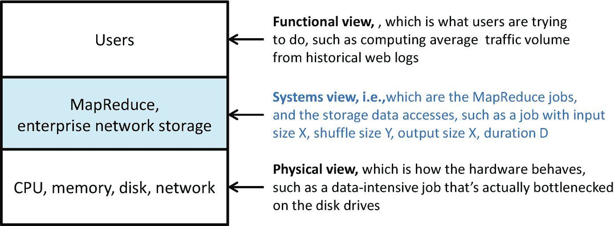
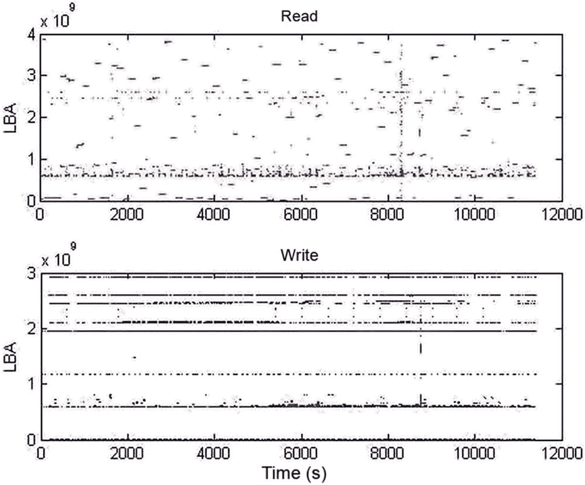
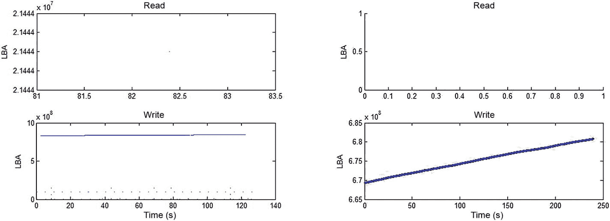
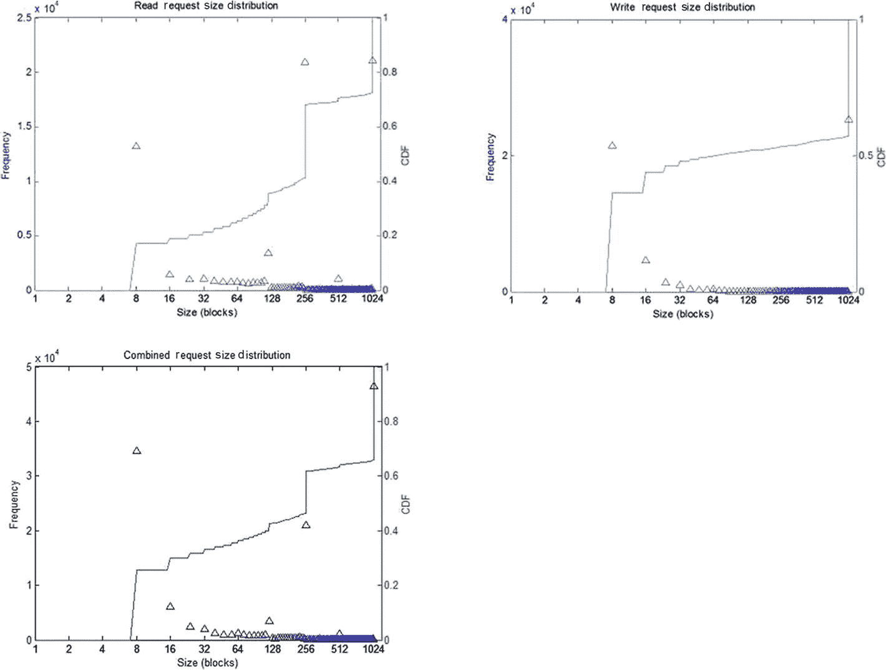
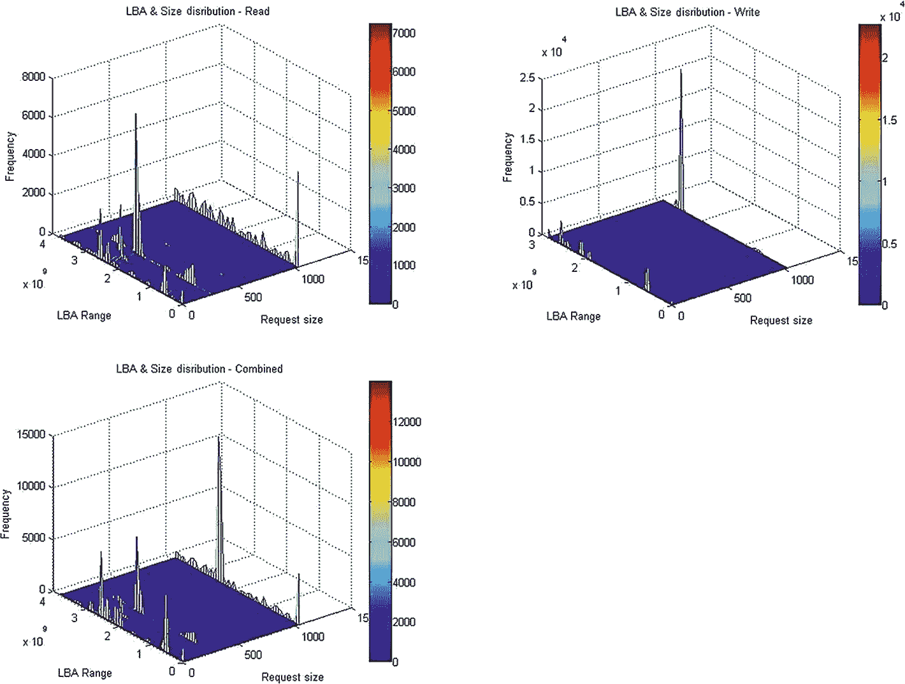
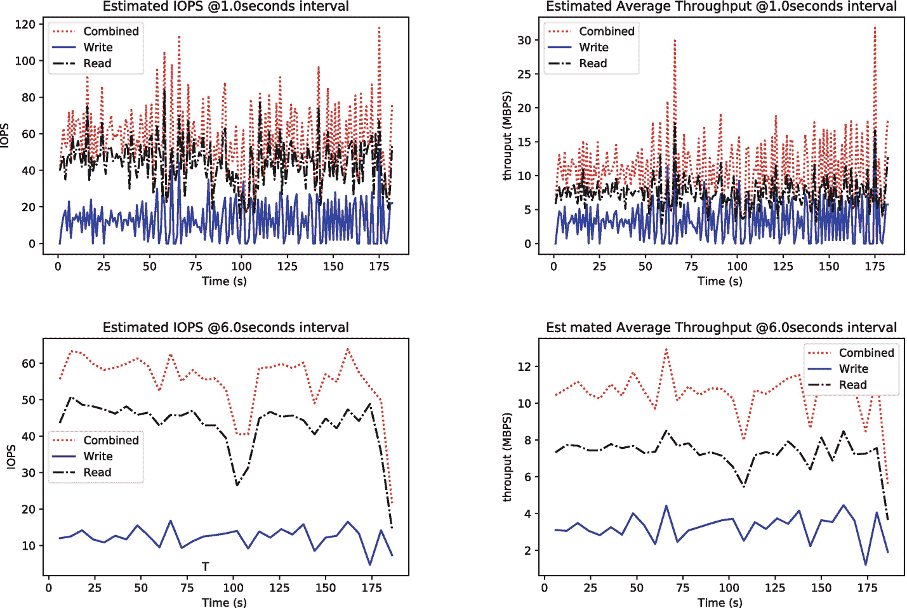
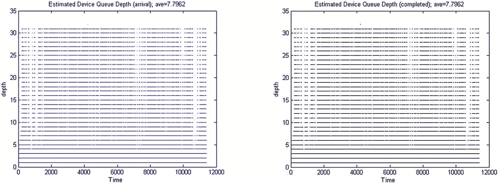
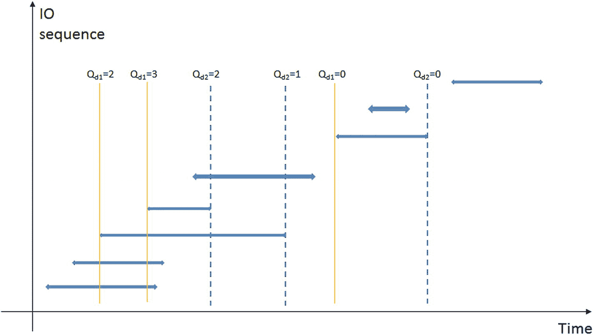
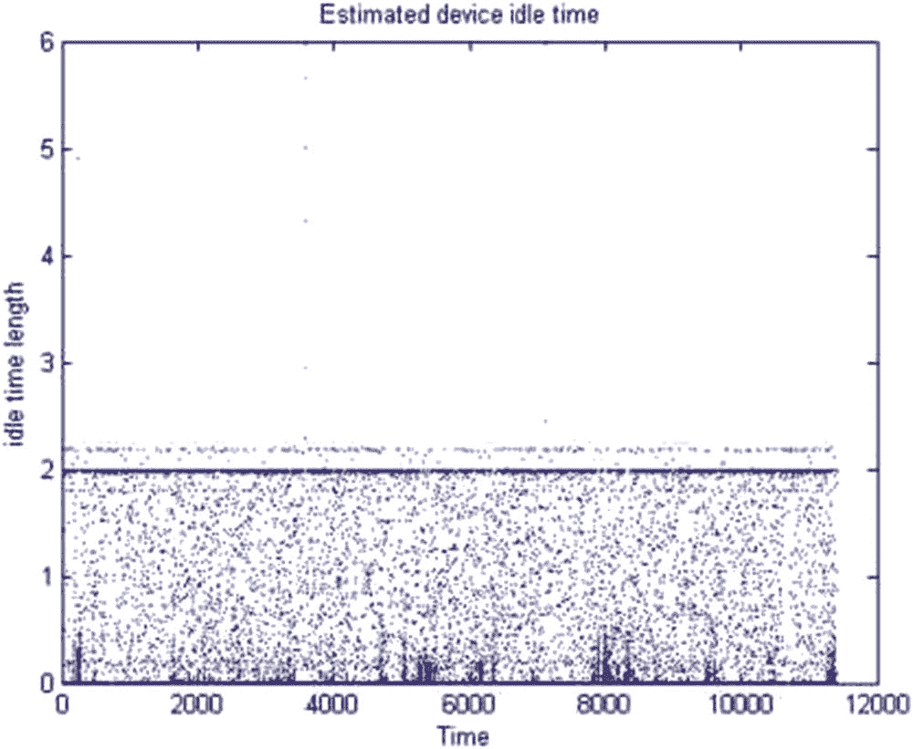
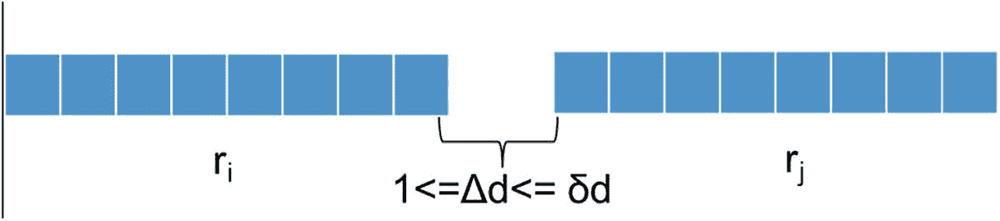

# 2. 轨迹特征

轨迹通常分为三个层级：块级、文件级和对象级。它们共享许多通用指标，尽管每个层级都有其独特的属性。在本章中，我将详细讨论块级轨迹指标，因为块级轨迹提供的存储系统基础信息比其他两个层级更多。为简化表述，我将这些指标分为两类：基础指标和高级指标。这些指标的含义及其对性能的影响将详细解释。

## 工作负载属性

工作负载可以在不同的抽象层级进行收集和查看。通常，存在三个不同的层级，如图 2-1 [37] 所示。功能视图表示用户行为，旨在便于比较，例如，服务于某些企业数据仓库管理工作负载等效功能目标的关系数据库系统和 `MapReduce` 系统。它使得大量等效系统之间能够进行比较。但它缺乏对大规模、以数据为中心的系统的追踪能力。系统视图在我们当前能够追踪的大规模数据密集型系统中，以最高抽象层级捕获工作负载行为。例如，在 `MapReduce` 中，这转化为作业流和作业特征。对于企业网络存储，这指的是应用层、会话层、文件层和目录层的数据访问流。物理视图根据硬件组件行为来描述工作负载，例如工作负载执行期间的 `CPU`、内存、磁盘和网络活动。它依赖于硬件、软件甚至配置的变更。

`图 2-1` 典型的工作负载抽象层级

基础工作负载指标通常是显式的，易于直接观察或通过非常简单的公式计算。表 2-1 列出了一些示例。然而，高级指标是隐式的，并以相对复杂的形式/规则表述。请参见表 2-2 了解一些高级指标。更多细节将在本章接下来的两节中描述。

`表 2-2` 高级指标示例

| 高级指标 |
| --- |
| 空间局部性 | 时间局部性 | 读/写依赖 | 优先级相关指标 |
| 两个请求之间的距离很小，意味着在引用 `r[i]` 之后不久，你会引用到附近的地址 `r[j]` | 经过 `d` 步后，同一地址被再次引用。与时间局部性密切相关的概念是流行度。 | 三类：真依赖（写后读）、输出依赖（写后写）和反依赖（读后写） | 请求优先级决定了执行顺序；它还包括同步与异步的属性。 |
| 在大多数情况下，应包含与缓存、集群和/或网络相关的指标。 |

`表 2-1` 基础指标示例

| 基础指标 |
| --- |
| 读写比 | 请求大小分布 | `LBA` 范围/随机性 | 到达间隔时间 |
| 读操作与写操作在命令数量或总大小上的比率 | 请求大小，通常进一步统计总数、读和写 | 在虚拟卷中，`LBA` 可用于表示空间上的随机性。否则，需指定设备编号。 | 请求到达率、空闲时间、忙碌时间 |
| 结合系统级信息，还可以包括队列深度、平均响应时间、总线时间等。 |

请注意，`HDD` 和 `SSD` 中“块”的含义不同。然而，此处使用 `HDD` 中将一个扇区定义为一个块的定义。此外，扇区存在一些不同格式，例如 512、512e、4k、4kn 等。若无特别说明，为简化表示，假设一个扇区等于 512 字节。

块级轨迹通常包含一些公共字段，例如到达时间、完成时间、`LBA`（第一个或最后一个 `LBA`）、请求大小、操作模式（读或写、同步或异步）等。其他一些字段，如总线时间和合并时间，则取决于轨迹收集工具。表 2-3 给出了一个轨迹示例。对于第 `i` 个请求 `r[i]`，将其到达和完成动作时间分别记为 `D[i]` 和 `C[i]`。通常，我们按 `D[i]` 的顺序排列所有 `N` 个请求，即 (`r[1]`, ..., `r[i]`, ..., `r[n]`)。

`表 2-3` 块级轨迹示例

| 序号 | 到达时间 (秒) | 完成时间 (秒) | 起始 `LBA` | 大小 | 模式 |
| --- | --- | --- | --- | --- | --- |
| 1 | 0.026216 | 0.027506 | 902553856 | 1024 | 0 |
| 2 | 0.026790 | 0.027719 | 197306368 | 8 | 0 |
| 3 | 0.036680 | 0.039502 | 902554880 | 1024 | 0 |
| 4 | 0.039618 | 0.044770 | 197306368 | 16 | 1 |
| 5 | 0.039654 | 15.079936 | 197306368 | 16 | 1 |
| 6 | 0.044542 | 0.046394 | 902555904 | 1024 | 0 |
| 7 | 0.044865 | 0.046513 | 197306376 | 8 | 0 |
| 8 | 0.054996 | 0.055265 | 2657576 | 8 | 0 |
| 9 | 0.059638 | 0.059905 | 197306376 | 16 | 0 |
| 10 | 0.081950 | 0.083162 | 902556928 | 1024 | 0 |
| 11 | 0.089740 | 0.089960 | 197306384 | 8 | 1 |
| 12 | 0.092741 | 0.093955 | 902558976 | 1024 | 0 |
| 13 | 0.093261 | 0.095268 | 902557952 | 1024 | 0 |
| 14 | 0.112958 | 0.114461 | 902560000 | 1024 | 0 |
| 15 | 0.113097 | 0.115717 | 902561024 | 1024 | 0 |
| 16 | 0.114820 | 0.115926 | 197306384 | 8 | 0 |
| 17 | 0.135434 | 0.136744 | 902562048 | 1024 | 0 |
| 18 | 0.136436 | 0.136963 | 197306384 | 16 | 1 |
| 19 | 0.150173 | 0.151625 | 902563072 | 1024 | 0 |
| 20 | 0.150260 | 0.152809 | 902564096 | 1024 | 0 |

## 基本指标

基本指标通常简单且易于观察。但这并不意味着它们包含的信息少于高级指标。在某些情况下，基本指标足以解释工作负载特性。

### LBA 分布

通过 `LBA` 分布随时间变化的曲线，您可以轻松观察到 `IO` 访问的随机性/顺序性。图 2-2 给出了两个仅写请求的 `LBA` 分布示例。左侧图显示从 `LBA` 6.7 ∗ 10⁸ 到 6.8 ∗ 10⁸ 的顺序访问。右侧图混合了顺序和随机写访问。图 2-3 显示 `IO` 模式结合了随机读访问和混合写访问。很明显，写访问比读访问更具顺序性，因为写访问包含多个顺序流。请注意，有时两个连续请求之间可能存在微小间隙，尽管从图表上看可能呈现顺序性。然而，在大多数情况下，这些近乎顺序的 `IO` 模式可以按顺序访问。

`图 2-3` 来自 `Hadoop` 节点的 `LBA` 分布

`图 2-2` 来自 `Ceph` 节点的 `LBA` 分布

### 大小分布

通常，驱动器（无论是 `HDD` 还是 `SSD`）更倾向于顺序访问，因此顺序访问的吞吐量远高于随机访问，尤其是对于 `HDD`。请求大小也很重要，尤其是在磁盘队列较短时，这一点将在第 4 章的图 4-2 和图 4-3 中清晰说明。

图 2-4 绘制了请求频率和 `CDF`（累积分布函数）与请求大小的关系。对于写请求的分布，您可以看到在此案例中大小为 1024 块的请求占比接近 50%，这通常意味着 `IO` 模式以大尺寸请求为主。请注意，由于操作系统/文件系统和磁盘驱动器的限制，最大请求大小通常为 1024 块，因此即使用户请求 1MB 大小的文件，它也会在内部被分成两个 `IO` 请求（假设每块 512 字节）。

`图 2-4` 来自 `Hadoop` 节点的大小分布

如果您还需要了解相对于 `LBA` 范围的大小分布，可以绘制如图 2-5 所示的图表，从中您可以结合大小信息了解更多关于热区间的信息。由于您知道 `HDD` 中不同位置（例如内圈、中圈、外圈）的传输速度不同，`LBA` 可以结合请求大小信息大致指示相对速度。

`图 2-5` `LBA` 与大小分布的组合图

### 读/写分布

读和写访问在驱动器上可能具有不同的性能。对于 `HDD`，差异可能很小。然而，对于消费级 `SSD`，差距可能很大。此外，读和写访问可能相互依赖。例如，当一次新的写入刚刚完成时，数据可能仍在缓存中。随后的读取可能直接从缓存访问数据，而不是进行介质操作。因此，分布时间的可视化可以直观地展示这种依赖关系。您可以将数据绘制在单个图中或两个单独的图中，如图 2-3 所示。

`表 2-4` 指标计算所需字段

|   | 到达时间 | 完成时间 | `LBA` | 请求大小 | 操作模式 |
| --- | --- | --- | --- | --- | --- |
| `LBA` 分布 | 是 (或) | 是 (或) | 是 |   |   |
| 大小分布 |   |   |   | 是 |   |
| `IOPS` | 是 | 是 (或) |   |   |   |
| 吞吐量 | 是 | 是 (或) |   | 是 |   |
| 队列长度/深度 | 是 (或) | 是 (或) |   |   |   |
| 忙/闲时间 | 是 | 是 |   |   |   |
| 读/写分布 | 是 (或) | 是 (或) |   |   | 是 |
| 到达间隔时间分布 | 是 |   |   |   |   |
| 完成间隔时间分布 |   | 是 |   |   |   |

### 到达间隔时间与完成间隔时间

到达间隔时间定义为两个顺序到达请求之间的时间间隔：`δt[i] = D[i] − D[i−1]`。类似地，完成间隔时间定义为 `δt¯[i] = C¯[i] − C¯[i−1]`，其中 `C¯[i]` 是基于完成时间序列重新排序后的 `C[i]`。`δt[i]` 是工作负载突发性 [38] 的直接指标，与预期的请求平均完成时间相关。当平均 `δt[i]` 远小于 `δt¯[i]` 时，通常意味着系统处于高负载工作状态，可能超出了存储设备的能力。从某种意义上说，这两个指标与 `IOPS` 密切相关。

### IOPS 与吞吐量

`IOPS` 通常定义为每单位时间 ∆*t* 秒内的 `IO` 数量 ∆*n*，例如 `IOPS = Δn / Δt`。单位时间由用户预设，通常为 1 秒。类似地，吞吐量是每单位时间内的请求大小 ∆*S*，因此 `TP = Δs / Δt`。请注意，它们在某种意义上是在给定单位时间/时间窗口内的平均值。对于不同的 ∆*t*，`IOPS` 和吞吐量可能具有不同的值。通常，较大的 ∆*t* 会得到更平滑的曲线。图 2-6 展示了一个从 `Ceph` 集群的 `HDD` 节点收集数据的示例。你可以看到，在 ∆*t*=1 秒的图中，`IOPS` 范围从 60 到 160，而当 ∆*t*=6 秒时，范围是 80–120。特别是，当工作负载包含许多突发时，不同 ∆*t* 下的最大和最小 `IOPS` 值可能会有很大差异。

`图 2-6` 不同时间窗口下的平均 `IOPS` 与吞吐量

这两个指标随时间变化的曲线可用于直观地观察工作负载的突发情况。但是，请谨慎选择 ∆*t*。过大的 ∆*t* 可能会使曲线平滑，但会消除 `IO` 突发。一个实用的选择与平均到达间隔时间有关，因此 ∆*t* 可以是平均到达间隔时间的几倍，但不宜过大。

或者，你可以固定 ∆*n*。例如，你可以设置 ∆*n*=20，并让 ∆*t* 变化。

一种更复杂的设置是让 ∆*t* 和 ∆*n* 都变化。例如，将 ∆*n*≤ 10 且 ∆*t* = 1 秒作为约束条件。如果在 ∆*t* = 1 秒内，∆*n* 在此范围内，则计算平均值。否则，如果 ∆*n >* 10，则选择一个使得 ∆*n* = 10 的时间窗口，然后计算平均值。

绘制曲线时的另一个琐碎问题是时间点，即平均值发生在 ∆*t* 的开始、中间还是结束。例如，如果你选择 ∆*t* 的结束点，你可能会得到以下公式：
- `IO(t[j])` = 基于 `D[i]` 计算的范围内的 `IO` 总数，即 `IO(D[i])`，其中 `D[i]` 位于区间 `[t[j−1] t[j]]` 内
- `R(t[j])` = `IO(D[i])` 的请求大小总和
- `t[j]` 处的平均 `IOPS` = `IO(t[j−1])/Δt`
- `t[j]` 处的平均请求大小 = `R(t[j−1])/IO(t[j−1])`
- `t[j]` 处的平均吞吐量 = `R(t[j−1])/Δt`

你也可以在此处应用移动平均技术；两个连续的“平均”指标之间存在重叠。

### 响应时间

响应时间通常由等待（或排队）时间 `T[w]` 和访问（或服务）时间 `T[a]` 组成，即 `T[res] = T[a] + T[w]`。服务时间是服务过程中花费的时间，例如磁盘访问时间。排队时间是请求在发送到实际执行之前在队列中等待所花费的时间。当从外部总线（`IO` 驱动程序）收集跟踪时，例如 `SATA/SAS`，`r[i]` 的响应时间通过 `C[i] − D[i]` 计算。

### 队列长度/深度

`HDD` 中至少有两个队列。一个与 `IO` 驱动程序一起存在，受操作系统和文件系统的影响，因此操作系统和/或文件系统可能会根据某些调度程序更改发送到磁盘驱动器的 `IO` 顺序。其长度通常最多为某个值。仅从外部收集的跟踪只能反映 `IO` 驱动程序中的队列长度。你可以根据请求的到达时间或完成时间来估计队列深度。它们可能略有差异。让我们按顺序将一个队列的 `D` 和 `C` 表示为 `D[i]` 和 `C[i]`。
- 命令到达前的 `IO` 驱动程序队列深度 (`Q[d1]`)
    - `D[i]` 之前的队列深度（瞬时队列深度 `Q(D[i])`）= 满足 `C` 时间 `>= D[i]` 且 `D` 时间 `< D[i]` 的请求数量
- 命令完成后的 `IO` 驱动程序队列深度 (`Q[d2]`)
    - `C[i]` 之后的队列深度（瞬时队列深度 `Q(C[i])`）= 满足 `C` 时间 `>= C[i]` 且 `D` 时间 `< C[i]` 的请求数量
- 平均队列深度
    - 非空闲期间估计的平均队列深度：`Σi/2 ∗ (D[i] − C[i]))/Σi`
    - 时间间隔内的有效平均队列深度：以 `Δt` 秒为间隔进行采样

图 2-7 展示了 `Q[d1]` 和 `Q[d2]` 的示意图，其中带箭头的蓝色标记按时间顺序显示了 `IO` 请求。它还展示了这些请求的几个 `Q[d1]` 和 `Q[d2]` 值。表 2-5 进一步给出了一个示例，说明如何基于 `Q[d1]` 计算队列深度。图 2-8 显示了从 `Hadoop` 节点估计的队列深度。看起来平均队列深度相当高，这意味着工作负载很高。但是，放大图表以检查队列之间的间隔。在此示例中，x 轴的比例是 100 而不是 12000，以显示更多信息。

`图 2-8` 使用来自 `Hadoop` 节点的到达和完成时间计算的队列深度

`表 2-5` 估计的队列深度和空闲时间

| 到达时间 | 完成时间 | 队列深度 | 空闲时间 |
| --- | --- | --- | --- |
| 0.00007 | 0.00036 | 0 | - |
| 0.01130 | 0.01157 | 0 | 1.09E–02 |
| 0.01134 | 0.01288 | 1 | 0 |
| 0.02622 | 0.02751 | 0 | 1.33E–02 |
| 0.02679 | 0.02772 | 1 | 0 |
| 0.03668 | 0.03950 | 0 | 8.96E–03 |
| 0.03962 | 0.04477 | 0 | 1.17E–04 |
| 0.03965 | 15.07994 | 1 | 0 |
| 0.04454 | 0.04639 | 2 | 0 |
| 0.04486 | 0.04651 | 2 | 0 |
| 0.05500 | 0.05526 | 1 | 0 |

`图 2-7` 队列长度示意图

另一个是用于机械部件实际执行的 `HDD` 内部队列。这里应用了一些调度算法，例如 `SCAN` 和 `RPO`（旋转定位优化），以尝试最小化给定的操作时间。可以使用供应商特殊命令（`VSC`）来收集内部队列信息。`RPO` 试图最小化队列中请求的寻道时间和旋转延迟的总和。理论上，更长的队列意味着调度程序有更多事件可供选择，并且可以进一步减少总操作时间（对于纯随机访问）。然而，在实践中，当队列长度达到一定水平时，性能不会增加，如图 4-2 和 4-3 所示。如果没有 `VSC`，我们可能只能使用外部 `IO` 队列状态来近似内部队列状态。这在某种意义上是合理的，因为 `HDD` 一次只能处理一个请求。^(³³) 然而，对于 `SSD`，由于并行处理，情况要复杂得多。

## 忙/闲时间

当磁盘正在进行 IO 操作（包括前台和后台活动）时，磁盘处于忙碌状态；否则，它处于空闲模式。当你打算为磁盘设计一些后台操作（如碎片整理、地址重映射、扇区扫描等）时，这两个指标非常有用。由于其中一些操作需要超过一百毫秒才能完成，因此会估算忙或闲时间，以显示后台操作是否会影响性能。

然而，如果没有 VSC 来提取驱动器内部跟踪日志，你可能无法直接获得忙/闲时间。因此，在内部跟踪不可用时，我们只能从外部跟踪近似估算时间。基本思路是比较队列中请求的完成时间与新请求的到达时间。如果完成时间晚于新到达时间，则意味着驱动器在该到达时刻仍处于忙碌状态。否则，它被计为空闲时间（尽管磁盘驱动器内部可能有一些后台活动；但你可以假设用户/外部请求的优先级高于后台活动）。换句话说，空闲时间的计算与队列深度密切相关，因此只有当队列深度为零时，才可能存在空闲间隔。

让我们考虑表 2-3 中的跟踪数据。第一个请求的完成时间 `0.027506s` 晚于第二个请求的到达时间 `0.026790s`，因此磁盘在 `0.026790s` 时处于忙碌状态。然而，第二个请求的完成时间 `0.027719s` 早于第三个请求的到达时间 `0.036680s`，你可以估算出驱动器的空闲时间为 `0.036680 – 0.027719 = 0.009s`。表 2-5 显示了结果。

图 2-9 与图 2-8 具有相同的数据集。尽管图 2-8 中的队列深度很高，你仍然可以观察到磁盘的许多空闲间隔。

图 2-9 从 Hadoop 节点估算的空闲时间

## 高级指标

来自真实世界的工作负载通常很复杂。即使对于那些声称是顺序工作负载（例如 Hadoop HDFS 写入或 Ceph Bluestore 写入）的情况，块级别的实际 IO 模式也是顺序与随机、读取与写入的混合。高级指标旨在提供对这些跟踪数据的深入洞察。

### 顺序与随机

在某些工程师看来，工作负载的顺序性和随机性有些主观，因为当工作负载混合时，很难明确说明它是更偏向顺序还是随机。此外，在不同情况下，对“顺序感”的认知也不同。例如，一些请求之间间隙非常小，也可能被视为（接近）顺序。

在我看来，可以在不同场景下对其进行量化，例如调度器算法、队列长度等。这意味着当所有条件固定时，该属性是客观的。例如，考虑一个在较小 LBA 范围内写入请求的突发工作负载。其中一些请求在 LBA 上是连续的，尽管它们并非按顺序到达。如果应用 FIFO 调度策略，则该工作负载是随机的，因为磁盘必须为每个请求寻道到不同位置。当应用简单的 SCAN 或 RPO 调度算法时，如果队列足够长，请求将被重新排序，其中一些将变为顺序。假设有 `N` 个请求。因此最多有 `N−1` 次寻道（严格定义下，如果在 LBA 方面存在寻道，则该请求被视为随机请求）。设随机访问次数为 `N[r]`，顺序访问次数为 `N[s]`，那么对于固定场景下的给定工作负载，你可以获得随机与顺序的比率。

#### 顺序流与近顺序流

该指标直接指示工作负载的顺序程度。通常，当一个命令跟在另一个类似命令之后，且该命令请求的块 LBA 恰好位于新命令之前时，该命令是顺序的。因此，顺序读取跟随读取命令，顺序写入跟随写入命令；但该定义存在一些细微差别。*(严格）顺序流*意味着当前命令和先前命令属于同一类型（读/写），并且新命令的起始 LBA 紧跟在先前命令之后。*近顺序流*意味着必须存在一个较早的相同类型（读或写）命令，其 LBA 范围位于新命令起始位置之前且靠近它。对于顺序流，多个流可能相互交错。存在用户设置来影响这些细微差别，使我们能够描述顺序命令情况的变化。

**排队顺序流：** 在按时间排序的请求流中，有些请求彼此相邻（可能在时间窗口内），使得 `last LBA(r[i]) + 1 = first_LBA(r[j])`，其中 `i < j`，`D[j] – D[i] < δt`，且 `δt > 0` 是一个老化时间。

这样，由于交错顺序流的存在，`j ≥ i + 1` 是可能的。然而在实践中，需要一个队列长度为 `N` 的命令队列来识别顺序，而不是仅检查其中恰好相邻的请求。一旦新请求进入队列，它会搜索队列以检查顺序匹配。如果找到匹配项，则将其合并到队列中；否则，它会向队列添加一个新条目。如果队列已满，它会使用替换规则（例如 FIFO 或 LRU）移除条目。

通常，`N` 越大，在每个流中检测到的顺序请求数量（`M[2]`）就越多，而顺序流的数量（`M[1]`）就越少。关键在于找到一个足够大的 `N`，使得检测到的顺序流数量保持稳定。

**带约束的排队顺序流：** 在实践中，一个大块请求 `S`（例如 `S ≥ 1024`）也被计为顺序请求。因此，考虑流 `i` 的另一种方法是确定流 `S[i]` 的总大小以及 `M[2]`，因此如果 `S[i] ≥ S` 且 `M[2] ≥ M`，则 `i` 被视为顺序流，其中 `S` 和 `M` 是阈值。

**排队近顺序流：** 最后，LBA 请求之间可能存在小间隙，使得在按时间排序的请求流中，某些请求在时间窗口内彼此接近。一旦新请求被认为与先前请求接近顺序，该流的最后一个 LBA 将更新为新请求的最后一个 LBA（为简单起见，间隙被填充），因此 `last LBA(r[i]) + 1 ≤ first LBA(r[j])` 且 `last LBA(r[i]) + δd ≥ first LBA(r[j])`，其中 `i < j` 且 `0 < D[j] – D[i] < δt`。`δd > 0` 是一个以块为单位的小整数，例如 `64`。需要一个命令队列来检测交错流，并且大小约束也适用于近顺序流。参见图 2-10。

图 2-10 近顺序流示例

让我们来看表 2-6 中的示例。假设这些请求在一个 `t` 秒的时间窗口内到达。通过比较 FIFO 顺序中前一个请求的最后一个 LBA 和当前请求的第一个 LBA，可以明显看出所有请求都是随机的。在这种情况下，有七次寻道，且 `N[r] = 8`，`N[s] = 0`。从这个意义上说，工作负载是随机的，因为没有顺序流。然而，如果你借助队列按 LBA 对请求重新排序，使得请求顺序为 `< 263158(7)4 >`，那么根据（严格）顺序流，你将得到 `N[r] = 3` 和 `N[s] = 4`。请注意，在重新排序过程中，请求编号 7 被请求编号 8 吸收了。因此，对于（严格）顺序流，`M[2] = 2`（`< 2631 >` 和 `< 58(7) >`）。在 `S = 1024` 和 `M[2] = 2` 这两个约束条件下，你得到（`< 58(7) >` 和 `< 4 >`）。流 `< 2631 >` 因大小不足而被移除。

当考虑 `Δd = 64` 和 `512` 的近顺序流时，在严格顺序流下，你分别得到 `M[2] = 3`（`< 2631 >`、`< 58(7) >` 和 `< 4 >`）和 `1`（`< 263158(7)4 >`）。

**表 2-6** LBA 序列与随机性示例

| 顺序 | 第一个 LBA | 最后一个 LBA | 顺序 | 第一个 LBA | 最后一个 LBA |
| --- | --- | --- | --- | --- | --- |
| 1 | 128 | 135 | 5 | 256 | 511 |
| 2 | 0 | 7 | 6 | 8 | 63 |
| 3 | 64 | 127 | 7 | 640 | 647 |
| 4 | 1536 | 2047 | 8 | 512 | 1279 |

从这个示例中，可以得到以下变量：

*   `N[s1]`：具有顺序访问的请求数量
*   `N[s2]`：具有近顺序访问和 LBA 间隙的请求数量
*   `N[r]`：剩余请求的数量

这些变量与下一节中定义的逻辑寻道有很强的关联。

在实际应用中，实际的间隙大小 `Δd` 通常由系统性能容限决定。通常，它最多为几个磁道大小。例如，如果可接受的容限是 `5ms`，那么基于 `10K RPM` 磁盘模型（磁道/磁头切换时间为 `1ms`，平均磁道大小为 `1.5MB`），`Δd` 最多可达 `1536` 个块。对于随机访问，平均旋转延迟为 `3ms`。假设新请求有 `50%` 的概率在同一磁道，`50%` 的概率在下一磁道（实际概率与 `Δd` 相关）。那么你还有 `5 - (3 + 1) * 50% = 3ms` 用于进一步旋转，这大约是半个磁道大小，即 `1536` 个块。^(³⁴)

**顺序比率：** 由于对顺序性的看法不同，顺序比率的定义也有所不同。下面列出几个示例。

*   DEF1：使用 `S` 和 `M[2]` 阈值检测到的顺序命令总和 / 总命令数
*   DEF2：（使用 `S` 和 `M[2]` 阈值检测到的顺序命令总和 - 总顺序流数）/ 总命令数
*   DEF3：使用 `S` 和 `M[2]` 阈值检测到的顺序命令的请求大小总和 / 所有命令的总请求大小
*   DEF4：（使用 `S` 和 `M[2]` 阈值检测到的顺序命令的请求大小总和 - 顺序流中第一个命令的大小总和）/ 所有命令的总请求大小

如果移除大小约束 `S`，你将得到另外四个定义。

#### 空间局部性与逻辑寻道距离

局部性，作为变量在短到中等范围内与自身相关性的特例，可以可视化为一个二维概率曲面 `p(s, d)`，它显示了距离 `s` 字节的地址首次被引用恰好发生在 `d` 个周期内的概率。通常有两种类型的局部性：空间局部性和时间局部性。对于空间局部性，如果距离 `s = |x[i] - x[j]|` 很小，这意味着在引用地址 `x[i]` 后不久，你将发现对相邻地址 `x[j]` 的引用。时间局部性将在下一小节讨论。

请注意，大多数跟踪中只提供了 LBA，而不是物理块地址（PBA）。因为不同的 HDD 可能具有不完全相同的数据布局（例如蛇形布局），不同 HDD 之间相同的 LBA 布局可能导致不同的 PBA。然而，如果它们的数据布局相似，差异通常非常小。因此，分析逻辑距离也是有意义的。

下面我将讨论两种距离，分别指示空间局部性和时间局部性 [35]。

##### 逻辑寻道距离

该指标是空间局部性的一个指示器。它定义了“连续”设备接收的 IO 之间的逻辑块/LBA 距离。

*   非排队下一个：最简单的情况，计算两个完全连续的 IO 之间的距离。
*   非排队最近：绝对最近距离 = `min(||last_LBA(r[j-1]) - first_LBA(r[j])||, ||last_LBA(r[j]) - first_LBA(r[j+1])||)`，其中 `r[j]` 是当前 IO。最近距离是绝对最近距离的有符号值，其中 `||·||` 表示绝对值。
*   排队下一个：模拟一个具有特定规则的队列，使得绝对最近距离 = `min(||last_LBA(r[i]) - first_LBA(r[j])||)`，`i = 1, ..., n[i] ≤ N`，其中 `n[i] ≤ N` 是当前队列长度，`r[i]` 是队列中的 IO。
*   排队最近：模拟一个队列，使得绝对最近距离 = `min(||last_LBA(r[i]) - first_LBA(r[j])||[i=1,...,ni], ||last_LBA(r[j]) - first_LBA(r[j]+1)||)`。

一般来说，`||排队最近|| ≤ ||非排队最近|| ≤ ||非排队下一个||`。对于距离，你可以进一步定义三个值：均值、中位数、众数。众数表示出现最频繁的数字，众数 = 0 的计数器越大，表示顺序性越好。

### 时间局部性与逻辑栈距离

时间局部性意味着相同的地址在 `d` 步之后被再次引用。流行度是一个与时间局部性密切相关的术语。

#### 逻辑栈距离

如果 `r[i]` 中的某个 LBA 在一段时间后被另一个请求 `r[j]` 再次引用，则这两个请求之间的命令距离被定义为（简化后的）逻辑栈距离，这是一个重要的时间局部性指标。以写请求为例。如果距离足够小（例如，小于 HDD 的 DRAM 缓存队列大小），则可能在 DRAM 缓存中命中；否则，写操作需要更新磁盘。如果某个距离范围内的写操作频率很高，则意味着更新频率很高。

与 [35] 中的情况不同，我们更感兴趣的是考虑缓存的排队栈距离。因此，让我们也研究一下读/写依赖关系。具体细节将在本章后面讨论。

##### 突发性与自相似性

I/O 请求几乎从不单独出现，而是倾向于成组到达，因为如果存在没有请求到达的长间隔，那么就会存在请求到达数量远超平均份额的间隔。它们通常与队列深度、请求到达率和到达间隔时间相关。这种现象通常被称为长程依赖性，并且通常被解释为（随机）自相似性，因为这是唯一能避免非平稳性的解释。自相似性现象描述了对象的某个属性在空间和/或时间尺度上缩放时如何保持不变。换句话说，除了长程依赖性属性外，尺度不变性属性在任何不同的时间尺度上都成立，就像分形形状一样。

### 统计属性可视化与评估

除了前几节提到的统计属性外，感兴趣属性的边缘概率分布和联合概率分布还有其他几个属性，这些属性可能对系统行为的定量分析产生强烈影响 [35]：

- **正态性：** 一个概率分布可以用正态分布精确近似。尽管现实中完美的正态分布很少见，但它常被用作参考模型。
- **非平稳性：** 在平稳过程中，输出（作业大小、到达间隔时间）会变化，但产生这些输出的随机过程不会变化。
- **长尾性与幂律：** 概率分布中远离均值或中位数的某些区域，例如概率分布尾部的极端值，被赋予了相对较高的概率，遵循次指数或多项式定律，这与正态分布族的情况相反，后者的尾部呈指数衰减。
- **重尾性：** 分布的长尾呈多项式衰减，并且满足自相似性。
- **周期行为与季节性变化：** 它们是非平稳工作负载的迹象，必须单独处理。
- **自相关、互相关与短程依赖性：** 自相关也称为序列相关或短期/短程记忆，其中短时间尺度上的自相关显著；长程依赖性也称为长期记忆，其中长时间尺度上的自相关显著。

这些属性可以通过图形绘制进行可视化。经验累积分布函数（EDF）和互补经验累积分布函数（CEDF）常用于观察样本分布。特别地，对数-对数 EDF 和对数-对数 CEDF 图通常分别用于比较样本概率分布的主体和尾部。类似地，Q-Q 图（第一个数据集的**分位数**与第二个数据集的**分位数**的对比图）可用于评估经验概率分布与另一个参考概率分布（无论是理论分布还是经验分布）之间的可能差异，尤其是在尾部。

质量-计数差异图和洛伦兹曲线可用于寻找幂律属性的证据。质量-计数差异图将“质量”概率分布（由质量单位属于小于预定义 `x` 的项目的概率给出）与“计数”概率分布（由 CDF 给出）进行对比，以显示这两个概率分布之间可能存在的差异。洛伦兹曲线是说明“计数”分布与“质量”分布之间关系的另一种方式；它通过配对对应相同值的百分位数生成（即曲线上的点 (`p[c]`, `p[m]`) 满足 `p_m = F_m(x) = F_m(F_c^{-1}(p_c))`，其中 `F_m(·)` 和 `F_c(·)` 分别是“质量”分布和“计数”分布的累积分布函数，`F_c^{-1}(·)` 是 `F_c(·)` 的反函数）。

运行序列图和自相关图用于研究短程和长程依赖性以及周期模式和趋势。运行序列图按时间序列显示观测数据；它通过根据数据出现的时间顺序绘制感兴趣（单变量）属性的值来构建；该图对于发现位置和尺度的变化、定位异常值以及总体上了解观测数据的趋势特别有用。自相关图（也称为相关图）是样本自相关函数（ACF）的图，即随时间滞后增加时的样本自相关；它用于检查同一属性观测序列的随机性。如果是随机的，这些自相关在任何时间滞后间隔下都应接近 `0`；反之，如果不是随机的，则一个或多个自相关将显著不同于 `0`。

一些假设检验技术可用于对这些属性进行定量评估，例如 F 检验、T 检验、K-S（Kolmogorov-Smirnov）检验、Mann-Whitney U 检验和 H 检验。这些检验可以比较两个经验分布函数/样本之间的差异。皮尔逊 `r` 和斯皮尔曼 `ρ` 相关系数分别用于发现感兴趣属性之间的线性相关和一般相关。两个系数的范围都在 [–1, +1] 之间，其中 +1 表示强正相关，–1 表示强负相关，0 表示无显著相关。更多细节将在第 9 章中描述。

### 读/写依赖关系

依赖关系通常分为四类 [39]：

- 写后读（`ROW`），或读后写（`RAW`），或真依赖
- 写后写（`WOW`），或写后写（`WAW`），或写更新，或输出依赖
- 读后写（`WOR`），或读后写（`WAR`），或反依赖
- 读后读（`ROR`），或读缓存命中，或输入依赖

在特定的时间窗口内，`ROR` 和 `ROW` 与缓存替换算法和读命中性能直接相关，而 `WOR` 和 `WOW` 与缓存更新策略相关。两个操作之间存在 `ROW` 关系取决于以下情况：如果第一个操作写入了一个块，该块随后被另一个操作读取，并且该块上没有中间操作。`WOW` 和 `WOR` 的定义类似。`ROR` 是检查读缓存效率的一个非常常见的属性。`ROW` 可以检查所谓的“一次写入多次读取（`WORM`）”是否可能，这对于 `SMR` 来说是一个重要的价值（越高越好）。

#### 写更新（写入时写入）

较高的 `WOW` 比率通常意味着较高的块更新比率。因此，当存在副本块时，如果 `WOW` 比率在短时间内相当高，出于 IO 性能考虑，更新其中一个副本并使其余副本失效可能比更新所有副本更好。通过比较 `ROW` 和 `WOW`，你可以推断出块被更新与被读取的可能性。`SMR` 通常期望较少的写更新，从而产生较小的写放大。如果对写更新采用异地更新策略，则可以期待更好的空间效率。

为了更清晰地了解 `WOW`，我在下面定义了三种不同类型的更新比率。它们的不同用途如表 2-7 所示。

**表 2-7** 写更新比率对比

| | 频繁型 | 定时/有序型 | 堆叠型 |
| --- | --- | --- | --- |
| 总更新块/命令 | 是 | 是 | 是 |
| 时序问题 | 否 | 是 | 否 |
| 更新频率 | 是 | 否 | 否 |
| 内存堆栈 | 否 | 否 | 是 |

**频繁更新比率：** 在一段时间内，记录每个 `LBA` 的更新频率。任何写命中都会被计数。如果其频率大于 1，则表明该 `LBA` 在观察期内被重写。因此，你可以提供一个 x 轴与 y 轴的曲线图，其中：

- x 是最大更新频率（≤1 表示未重写；否则表示已重写）
- y 是更新块的比例（在指定频率值下更新的块数 / 写命令的总更新块数）或其累积分布函数（`CDF`）。

这个过程可以快速、粗略地分析在传统 `PMR` 驱动器的工作负载中 `LBA` 是如何被更新的。然而，它可能无法反映 `SMR` 驱动器的实际比率。事实上，由于 `SMR` 的间接映射和日志特性，它遗漏了实际的写更新；例如，采用异地更新的重写操作对于 `SMR` 驱动器来说实际上是“新”写入。

**定时/有序更新比率：** 在一段时间内，记录更新写请求的总块数（无论是否重复）。更新是指在观察期内重写先前已写入块的操作。你可以提供一个曲线图，其中 x = 时间或命令 ID，y = 更新块的总大小或更新块的比例（在频率 x 下更新的块数 / 命令的总块数），因此感知结果是总块中被更新的百分比。请注意，[4, 40]中给出了与频繁更新比率和定时/有序更新比率类似的定义。

**堆叠更新比率：** 在一段时间内，记录每个写命令的更新频率（部分命中或完全命中）。一旦发生重写，它就被计为一条新命令（更新频率始终≤1）。你可以提供一个曲线图，其中 x = 逻辑堆栈距离，y = 更新写命令的比例（更新写命令数 / 总命令数），或者 x = 逻辑堆栈距离，y = 更新写大小的比例（更新写大小 / 总命令大小）。它显示了实际的更新大小/命令，并说明了在 `SSD`/`DRAM` 缓存中进行更新是否必要。请注意，堆栈距离也可以用时间间隔来代替。

#### 读更新（写入时读取）

此指标用于检查“一次写入多次读取（`WORM`）”是否可能。通常，`ROW` 比率越高，工作负载的 `WORM` 特性越好。

**频繁 `ROW` 比率：** 在一段时间内，记录每个 `LBA` 在写命令之后的读命中频率。然后你可以绘制一个曲线图，其中 x = 最大命中次数或频率（<1 表示未更新，否则表示已更新），y = 命中的块或命令的比例（在频率 x 下更新的块数 / `HDD` 总块数）。

**定时 `ROW` 比率：** 在一段时间内，记录自上次写入以来每个读命令的命中块。你可以提供一个曲线图，其中 x = 时间或命令 ID，y = 读命中命令的块或命令的比例（命中读命令的块数 / 总命令块数）。

**堆叠 `ROW` 比率：** 在一段时间内，记录自上次写入以来每个读命令的命中频率（部分命中或完全命中）。你可以提供一个曲线图，其中 x = 逻辑堆栈距离，y = 读命中命令的比例（命中读命令数 / 总读命令数）或 y = 读命中命令的块比例。

除了此处介绍的内容之外，其他特性，如自相似性（针对突发 IO）和节点间的工作负载依赖性（即任务如何在节点间分布）[35, 39]，也是值得进一步研究的有趣指标。为简洁起见，我在此仅针对性地介绍工作负载指标，省略了这些分析。

### 优先级相关指标

请求在执行时具有优先级。通常，前台活动的优先级高于后台活动。在某些情况下，例如 `RAID5`/`6` 和 `EC` 操作中的同步，这些被标记为同步的请求可能由于超时策略而具有更高的优先级。

其他指标可能与集群、多线程、网络等相关[41]。例如，网络因素（I/O 带宽分布、信道利用率、指令、数据包大小、数据包的源或目标、页面引用模式、各种形式的延迟如传输时间和排队延迟等）也会影响最终设备的性能。