# 8. 案例研究：Hadoop

Hadoop 是全球最流行的分布式大数据平台之一。除了计算能力，其存储子系统的性能也是影响整体表现的关键因素。特别是，MapReduce 过程中存在大量的中间文件交换。本章通过考虑一些特定指标，展示了 Hadoop 集群的块级工作负载特征。所呈现的分析技术可以帮助您理解 Hadoop 在生产环境中的性能和驱动特性。此外，本章还探讨了 SMR 驱动器是否适用于 Hadoop 工作负载。

大型系统的用户必须应对爆炸式增长的数据生成，这些数据通常来自多种不同的来源和格式。从这些通常是非结构化的海量数据中观察和提取潜在价值，给数据存储、管理和处理带来了巨大挑战，同时也带来了机遇。从数据存储的角度来看，预计容量（字节）将大幅增长，尽管 SSD 和 NVM 也广泛用于对时间敏感的场景（性能工作负载），但在可预见的未来，HDD 仍将提供大部分容量工作负载。必须充分理解 HDD 与这些容量工作负载的交互方式，以便优化这些设备的算法。

从数据管理和处理的角度来看，大数据已成为一种流行技术，而 Hadoop 则成为领先的解决方案。开源 Hadoop 源自谷歌的 GFS 和 MapReduce 框架，因其高可用性、可扩展性和良好的规模经济性而广受欢迎。在许多案例中，Hadoop 在批处理 MapReduce 任务上的性能已得到验证 [66, 67]，尽管在 Hadoop 框架体系内的其他应用仍在探索之中。

为了最好地理解 Hadoop 的性能，一种常见的方法是工作负载分析 [66, 67, 68, 69, 70]。可以在不同的抽象级别收集和查看工作负载。参考文献 [37, 35] 提出了三种分类：功能级、系统级和物理级（参见第 2 章的图 2-1）。然而，该领域的大多数工作负载分析研究都是从系统视角进行的。

Kavulya 等人 [71] 分析了来自 Yahoo! M45 集群的 10 个月 MapReduce 日志，应用学习技术从历史数据预测作业完成时间，并识别出其数据集中的潜在性能问题。Abda 等人 [72] 分析了来自 Yahoo! 两个大型 Hadoop 集群的六个月跟踪数据，描述了工作负载的文件流行度、时间局部性和到达模式，而 Ren 等人 [66] 则对淘宝电子商务生产环境中 2000 多个节点的 MapReduce 工作负载进行了分析。Wang 等人 [67] 评估了 Hadoop 作业调度器，量化了共享存储对 Hadoop 系统性能的影响，并据此综合了真实的云工作负载。Shafer 等人 [70] 调查了性能瓶颈的根本原因，以评估 Hadoop 中通过不同工作负载在可移植性和性能之间的权衡。Ren 等人 [73] 分析了三个不同的 Hadoop 集群，以探索应用模式和用户行为中的新问题，并理解与 IO 和负载均衡相关的关键性能挑战。此外，还有许多其他值得注意的例子 [69, 68, 37]。

虽然主要侧重于系统层面，但一些工作提供了功能视图 [69, 70, 73]，讨论了来自历史 Web 日志的平均流量。还提出了一些模拟器和合成工作负载生成器，例如 Ankus [66]、MRPerf [74] 及其增强版 [67]。

然而，据我所知，目前还没有针对 Hadoop 系统在块级别的直接分析工作。块级分析是及时的，并且现在更有价值，因为设备制造商面临着开发/改进产品以满足容量或性能需求的压力，例如新兴的混合或叠瓦式磁记录（SMR）驱动器 [5, 40, 4]。当考虑数据密度远高于传统驱动器的 SMR 驱动器（以及即将到来的能量/热辅助磁记录（EAMR/HAMR）驱动器）时，由于它们与传统驱动器具有显著不同的特性，这种分析是必不可少的。例如，SMR 驱动器引入了叠瓦式磁道等特性，这使得设备更倾向于顺序写入而非随机写入，同时还引入了间接块地址映射、垃圾回收等机制，这些都改变了这些设备与用户工作负载的交互方式。设备层面的一个大问题是：块级 Hadoop 工作负载是否适用于 SMR 驱动器。

在本章中，我将在块设备级别分析 Hadoop 工作负载，并回答这个重大问题。借助 `blktrace`，我清晰地展示了 Hadoop 在存储设备中的行为 [75, 76]。主要贡献体现在以下几个方面：

-   定义了一些新的块级工作负载指标，例如堆叠写入更新、堆叠 ROW 和排队寻道距离，以满足磁盘特性的特定要求
-   识别了一个大型组织内部 Hadoop 集群的一些特征，并将其与其他已发表的 Hadoop 集群的发现进行关联，指出异同点
-   提供了一些关于从驱动器层面支持来提升 Hadoop 性能的建议
-   分析了 SMR 驱动器在 Hadoop 工作负载中的适用性

本章将首先介绍 SMR 驱动器、Hadoop 集群以及跟踪收集过程的整体背景。然后，将介绍基于这些指标的分析结果。

## Hadoop 集群

从用户视角到系统/框架层面的分析，已有大量针对不同层级的工作负载研究。这些分析大多仅能捕捉系统的某些特征。Harter 等人更进一步，从系统视角获取追踪数据，并应用简单模拟器来提供工作负载的物理视图[77]。然而，将系统的物理视图完全交由模拟处理，可能会遗漏对理解工作负载至关重要的细节。因此，在考虑性能时，分析真实工作负载通常更为合理。

Hadoop 集群的工作流程是将来自全球制造工厂的大型非结构化数据集导入`HDFS`。数据导入后，经过处理，再通过`MapReduce`应用组织成更结构化的数据。最后，这些数据被提供给`HBase`，用于对先前非结构化数据进行实时分析。部分结构化数据会保留在`HDFS`上（或移至其他存储位置），而非结构化数据则每日删除，为接收新的制造数据做准备。

该 Hadoop 集群用于存储制造信息，例如公司每年产生的 2 亿台设备的数据。以第一阶段制造（洁净室组装）为例，在组装驱动器组件时，每个驱动器的每个构建步骤都会由各种传感器捕获数据。从制造角度来看，每季度生产 5000 万至 6000 万台设备会产生 PB 级的信息，这些信息必须在组织内收集、存储并分发，以满足不同需求。一些用户场景包括查询特定型号、汇总某批次的质量、计算某型号的平均介质密度等。

`PIG`/`Hive`被间接用于`MapReduce`，实际上`PIG`/`Hive`会将类似 SQL 的代码转换为 Java 代码来运行`MapReduce`。然后，`MapReduce`执行类似 SQL 的语句来处理原始测试数据，为产品工程研发和故障分析生成下钻数据和仪表盘。不过，该集群主要用于分析：`MapReduce`用例约占 80%，此外还有部分`Hbase`在线搜索用例（约 20%）。

WD 集群配置如表 8-1 所示。通用数据流如图 8-1 所示，其中`HDFS`具有原生的可配置日志结构，而`datanode`需要借助`blktrace`。客户端从`namenode`获取元数据信息的读取请求，随后`namenode`向设备发送块操作指令。因此，客户端从`datanodes`获取相应数据。写入请求会同时更改`datanodes`中的数据以及`namenodes`中的元数据。

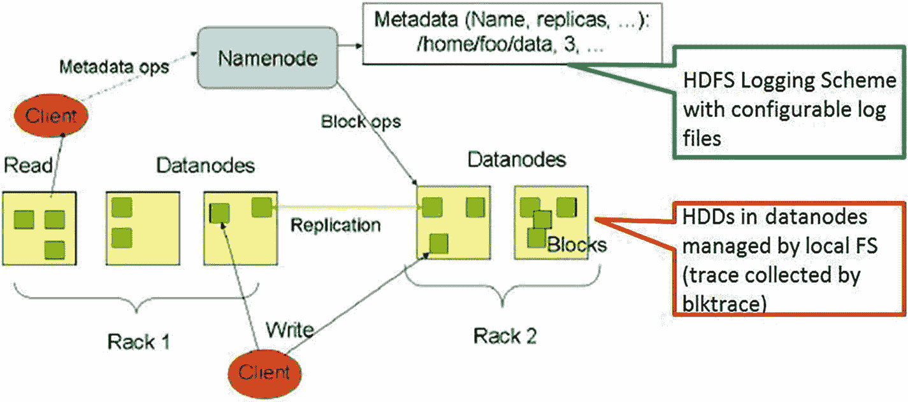

图 8-1

Hadoop 系统中的数据流

表 8-1

WD-HDP1 集群配置

| WD-HDP1：100 台服务器 |
| --- |
| CPU | Intel Xeon E3-1240v2，4 核 |
| 内存 | 32 GB DDR3 |
| 操作系统硬盘 | WDC WD3000BLFS 10kRPM 300GB |
| Hadoop 硬盘 | WDC WD2000FYYX 7.2kRPM 2-4TB |
| Hadoop 版本 | 1.2.x |

数据收集结构如图 8-2 所示。任务跟踪器运行在本地文件系统之上。作业最终会转换为对每个`datanode`中本地设备的块级访问。工具`blktrace`实际上是从本地设备的块 IO 层收集数据（详见附录 B）。我在四个`datanode`上反复运行`blktrace`（有时结合`iostat`和/或`iotop`），这些节点具有不同的文件系统和写入缓存设置，共进行了数十批次的测试。其中两个节点使用`XFS`作为本地文件系统，另外两个使用`EXT4`。每次运行持续数小时到数天不等。我收集了数百 GB 的追踪数据（100 多个片段），代表了从 2014 年 5 月到 2015 年 1 月总计 1500 多小时的集群运行时间^(⁷⁰)。我通过开关写入缓存来收集不同情况下的数据。根据 Ganglia 的网络输入/输出指标，除少数片段外，这四个节点的工作负载相对稳定。特别地，本书重点关注 2015 年 1 月收集的、批次 ID 为 16 至 25 的追踪数据。这些均为持续一天的追踪数据，其设置如表 8-2 所示。

表 8-2

文件系统与写入缓存设置

| 节点 ID | 文件系统 | 写入缓存 |
| --- | --- | --- |
| 147 | `XFS` | 16:21 禁用；22:25 启用 |
| 148 | `EXT4` | 16:21 禁用；22:25 启用 |
| 149 | `EXT4` | 16:21 启用；22:25 禁用 |
| 150 | `XFS` | 16:21 启用；22:25 禁用 |

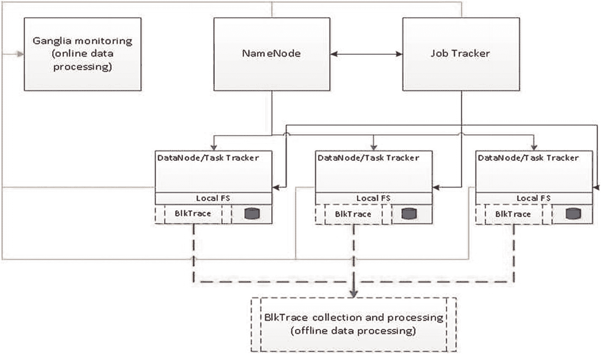

图 8-2

使用 Ganglia 和 Blktrace 进行追踪数据收集

## 工作负载指标评估

在本节中，我将讨论从 Hadoop 集群内部分节点样本中观察到的磁盘活动情况。然后，我将解释这些观察结果与上一节讨论的指标之间的关系。最后，我将总结从系统层面得出的观察结果，并就如何解决根据我的记录观察可能出现的性能问题提出建议。

### 块级分析

存在一些用于解析和分析原始块追踪数据的工具。例如，`seekwatcher` [78] 可根据`blktrace`运行结果生成图表，帮助可视化 IO 模式和性能。`Iowatcher` [79] 可将`blktrace`运行结果绘制成图表。然而，这些工具无法捕获第 2 章中定义的高级指标。因此，你可以应用之前介绍的基于 Matlab 的工具来获取这些高级属性。

### 总体视图

图 8-3 展示了请求大小、IOPS 和吞吐量的一些平均值。从图中可以观察到，写入大小和 IOPS 与文件系统类型的关系更为密切，因为 EXT4 和 XFS 之间的差异很明显。然而，读取大小和 IOPS 似乎与批次的关系更大，因为不同的批次可能有不同的读取大小。请注意，每个批次的总体吞吐量相似，这意味着每个节点的工作负载几乎均衡。^(⁷¹) 通过去除最大值和最小值，您可以查看图 8-4 中的平均值和标准差。图中清晰地展示了不同文件系统类型的写入大小模式。图 8-5 进一步显示，写入请求的主要大小范围是 [1–127] 个块和 1024 个块。这两个范围的比例之和几乎等于 1，这导致了在 0.475 附近近乎对称的曲线。

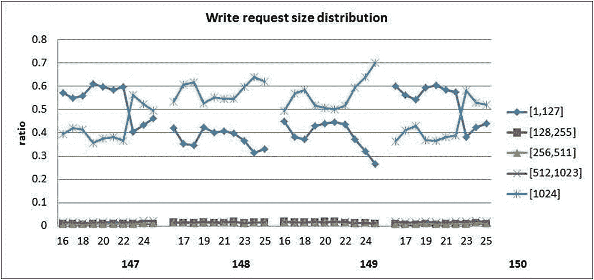

图 8-5
不同范围内的写入请求大小分布

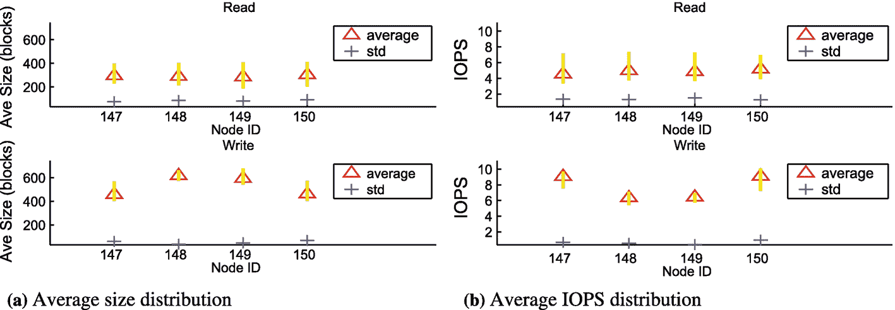

图 8-4
平均大小和 IOPS

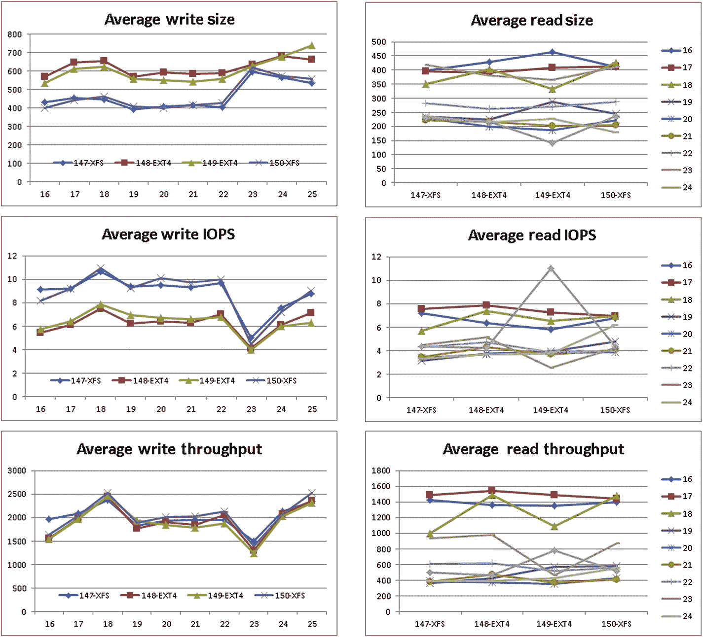

图 8-3
不同文件系统工作负载的平均值

为了更深入地了解该跟踪记录，让我们选择一个典型的跟踪片段（节点 148 和批次 21），其基本 IO 属性接近前面描述的平均值。表 8-4 给出了该工作负载的基本信息。接下来，我将从几个方面深入讨论这个跟踪记录，这些方面总结在表 8-3 中。

表 8-4
跟踪记录 148-21 (EXT4-WCD) 的基本统计信息

| | 总计 | 读取 | 写入 |
| --- | --- | --- | --- |
| 块数量 | 917942 | 373424 | 544518 |
| 平均大小（块） | 435.7 | 216.5 | 586.0 |
| 读取 IOPS (r/s) | 4.322 |
| 写入 IOPS (w/s) | 6.302 |
| 每秒读取块数 | 935.802 |
| 每秒写入块数 | 3693.157 |

表 8-3
观察结果与启示总结

| SMR 特性 | Hadoop 观察结果 |
| --- | --- |
| 一次写入多次读取 | 40% 读取和 60% 写入 相对较低的写入更新比率 35.4% 的堆叠 ROW 比率 |
| 顺序读取到随机写入 | 相对较小的随机写入比率 ROW 比率约 60% 且大小较小，因此影响不大 |
| 异地更新 | 堆叠 WOW：70% 发生在前 10 分钟内 大容量 SSD/DRAM/AZR 缓存对性能提升的有用性（缓存中的写入更新） |
| 顺序写入 | 大尺寸写入请求（`S >= 1024`块）> 64% 模式比率：写入 65% 和读取 70% 顺序比率（`S >= 1024`）：写入 74%（66%）和读取 82%（7%） 近顺序比率（`S >= 1024`）：写入 87%（65%）和读取 95%（85%） |
| 垃圾回收 (GC) | 频繁的短空闲时间和周期性的长空闲时间 低设备利用率 相对较短的队列长度 相对较低的写入更新比率 116.3% 频繁的 WOW 小写入放大 8.5% 写入更新命令的小重写比率 主要的局部 WOW 命中主要是大尺寸请求，而完全命中则是小尺寸请求 |

### 大小与 LBA 分布

总体请求 LBA 分布如图 8-6a 所示。图 8-6b 进一步展示了大小分布曲线，从中可以看出最小请求为 8 个块，而最大大小为 1024 个块。对于写入请求，8 块和 1024 块请求的总比例接近 90%。大尺寸写入请求（>=1024 块）的比例大于 55%，因此写入请求更具顺序性。对于读取，大小 <=256 的请求比例约为 50%，并且大小分布更加多样化。因此，读取请求通常比写入请求更随机。LBA 与大小分布图进一步证实了这一观察结果。事实上，对于写入，您可以看到大多数大尺寸请求密集地分布在少数几个范围内；中等尺寸的请求非常少，而对于读取，大小分布则更加多样化。

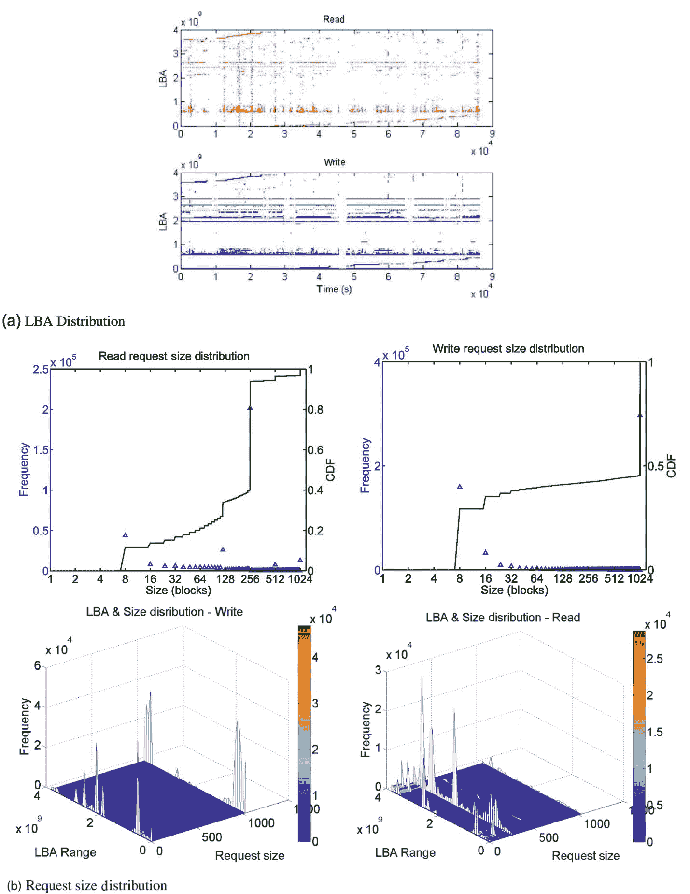

图 8-6
LBA 和大小分布

这些发现为 Hadoop 系统的“常识性”顺序访问提供了不同的视角 [70]。诚然，在 HDFS 级别，对于大尺寸文件（块大小的设置为 128MB）会生成顺序读取和写入，因此大尺寸文件被分割成 128MB 的块，然后存储到 HDFS 中，最小访问单元通常为 128MB。然而，当这些访问与本地文件系统（如 EXT4 和 XFS）交互时，情况变得复杂得多。

### IOPS 与吞吐量

这两个指标的平均值取决于统计时间窗口/间隔。例如，在此跟踪记录中非常常见突发性，这导致小时间间隔内出现相对陡峭的曲线和较高的最大 IOPS，而大时间间隔内则出现相对平滑的曲线和较低的最大 IOPS。读取的 IOPS 通常高于写入；然而，读取的吞吐量通常低于写入。比较图 8-7 中显示的 600 秒间隔平均值与 6 秒间隔平均值，平均值存在很大差异。请注意，6 秒间隔图中的读取 IOPS 高于 400，这并非“错误”。原因是前面描述的近顺序行为。为了验证该工具，我将解析后的曲线与通过 `iostat` 和 `iotop` 收集的曲线进行了比较，并得到了一致的结果。

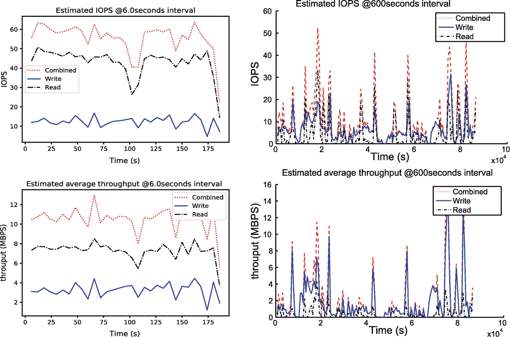

图 8-7
IOPS 和吞吐量

## 利用率与队列深度

设备工作负载（平均 15%）和 CPU 工作负载（平均 20%）都很低。HDD 的平均队列深度（平均值 `<`0.3）进一步表明此工作负载的设备利用率较低。由于总体工作负载通常较低，并且“周期性”的谷底-峰值曲线具有说明性，因此系统可以利用空闲时间来获得最大的潜在收益（例如，为提高空间效率而进行的垃圾回收和碎片整理，甚至块重组）以提升性能。然而，大多数空闲时间不足以执行大型后台任务。如何充分利用这些空闲时间是未来探索的一个有趣课题。

### 请求序列

现在，我们来考察读写请求的 IO 顺序模式。第 2 章介绍了一些相关概念。

对于排队的下一个寻道距离，可以观察到众数（最频繁出现的值）等于 0，并且在 `N=64`（`N=1`）时，读和写的众数比率分别为 70.2%（61.6%）和 65.4%（61.3%）。这表明工作负载具有高度顺序性（数值越高越好）。平均绝对值随着队列长度增加而迅速下降，这意味着存在许多交错的序列流。因此，磁盘驱动器中用于序列检测的队列长度应设置得足够大，才能观察到设备更好的性能。

图 8-8 展示了不同 `N` 值下的序列流，从 2 开始（并翻倍至 256）。`N=1` 和 `N=128` 的具体数值见表 8-5（“w/”和“w/o”分别表示有和没有大小约束的情况）。可以看出，仅包含两个请求的流占主导地位，而请求数量较多的流则相对较少。当施加大小约束（`S = 1024` 个块）时，读操作的主导 `N` 值变为 ≥3。

**表 8-5** 序列流与命令检测

| `M` 2 ≥ 2 | 总流数 | 总命令数 |
| --- | --- | --- |
| `N=1` | w/o | w/ | w/o | w/ |
| **读** | 52827 | 19987 | 282911 | 210081 |
| **写** | 25633 | 12412 | 359668 | 324007 |
| `N=128` | w/o | w/ | w/o | w/ |
| **读** | 43682 | 3579 | 308149 | 217373 |
| **写** | 27303 | 9209 | 393962 | 354384 |

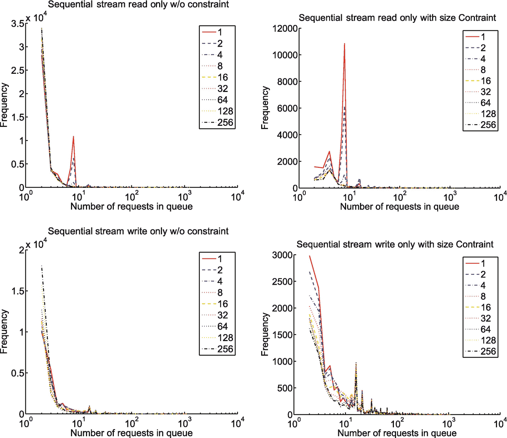

**图 8-8** 不同 `N` 值下的序列流

然而，对于写操作，`N` 的值仍然是 2。这种变化表明，在顺序流中，读请求的大小通常小于写请求。表 8-6 中显示的平均请求大小进一步证实了这一点，因此写操作的序列流/命令的大小远大于读操作。因此，读/写操作在有大小约束（`S = 1024` 个块）和无大小约束请求之间的差异是显著的。值得注意的是，随着队列长度 `N` 的增加，总流数通常会减少，而平均流大小会增加，平均命令大小则会减少。

**表 8-6** 序列流与命令的平均大小

| 操作 (`N`) | 无约束平均命令大小 (块) | 有约束平均命令大小 (块) | 有约束平均流大小 (块) |
| --- | --- | --- | --- |
| 读 (1) | 259.5 | 308.9 | 3247.3 |
| 写 (1) | 952.0 | 910.3 | 24851.7 |
| 读 (128) | 245.4 | 307.9 | 18700.5 |
| 写 (128) | 797.7 | 882.2 | 31685.2 |

检测到的总序列流如图 8-9 所示。该图显示，写请求的顺序性远高于读请求（考虑比率）。请注意，对于此图，“combined”并非“read”和“write”的简单相加；它是根据 FIFO 规则对所有命令进行检测得到的。表 8-5 中显示的值与排队下一个寻道距离的众数计数器一致。事实上，你可以很容易地计算出，众数的频率等于流的总命令数减去总流数。

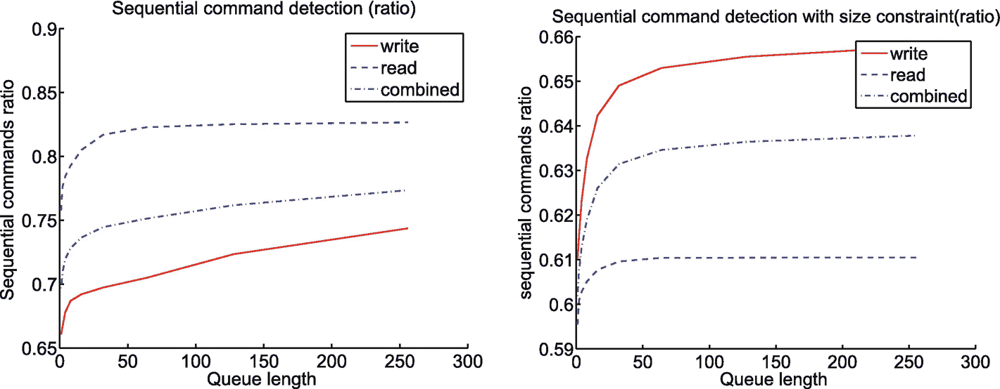

**图 8-9** `S=1024` 时的序列比率

因此，可以看到，在没有大小约束的情况下，“顺序”读/写的总比率分别超过 82% 和 74%（`N=256`）（检测到的顺序读/写命令数 / 总写/读命令数）。在施加大小约束（`S = 1024`）后，该比率分别降至 76% 和 65.5%，这更能合理地指示序列比率。

随着 `S` 的增加，顺序读/写命令的比率略有下降，如图 8-10 所示。这表明写操作的顺序性相当强，因为顺序流通常很大，所以当 `S` 从 1024 变为 4096 和 8196 时，写操作的比率分别从 82% 降至 62% 和 58%。

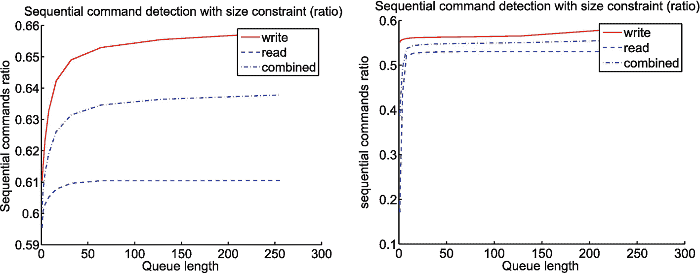

**图 8-10** `S=4096` 和 `8192` 时的序列比率

如图 8-11 所示，读操作的近顺序性非常强。在不考虑大小约束的情况下，写和读的总比率分别超过 87% 和 95%（检测到的顺序写或读命令数 / 总写或读命令数）。在施加大小约束后，该比率分别降至 65% 和 85%，这更能合理地指示读操作的序列比率高于写操作。随着 `S` 的增加，近顺序读/写命令的比率略有下降，这与序列比率的情况类似。请注意，距离通常大于 8 个块；当 `δd` ≥ 16 时，增量显著。

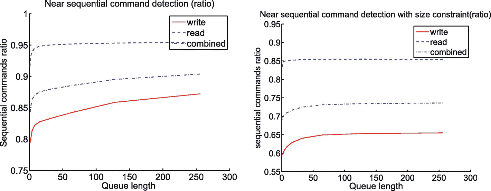

**图 8-11** `S=1024` 时的近序列比率

上述讨论的所有（近）序列信息为磁盘驱动器的预取策略设计提供了良好的参考。例如，在设计序列检测算法时，间隙是一个重要参数。在设计热数据识别算法时，对于这些近序列流，命中频率的定义可能需要稍作调整。例如，可以将某个区域内发生的 LBA 命中计为一个热区域，以便执行后读操作。这些观察结果还表明，交错流的数量不大，一个较小的队列可能就足以检测到序列（例如，`N≥16`，与非缓存情况相比，`N=50` 可以将序列检测率提高约 5%）。

## 写入更新

对于频繁的写入更新，86% 的访问块（可能重复）仅被写入一次。被多次写入的块所占比例逐渐降低，这意味着只有一小部分热块被重写。如果所有重写数据都放置到新位置，写入放大率大约为 116.3%。

对于定时写入更新，总写入块占全部访问块（读取和写入）的 80%，而更新块（至少写入两次）仅占 6.8%。总写入命令占总命令的 59%，更新命令占 22.5%。写入命令的平均大小约为 586 个块，更新命令的重叠块平均大小为 73.3。

在查看堆叠写入更新之前，请先检查堆叠距离。你会发现，与小尺寸请求相比，大尺寸请求（因为命中大小远小于平均大小）完全命中的概率较低。实际上，部分命中（仅部分块相同）和完全命中（两个请求相同）的平均重叠大小分别为 139.4 和 55.1 个块。通过使用表 8-4 和 8-7 中的数据，你可以得出结论：对于大尺寸请求，部分命中更可能发生。

**表 8-7** 逻辑堆叠距离 (LSD) 统计

| | `LSD≤1000` | `LSD≤2000` | `LSD≤4000` | 总体 |
| --- | --- | --- | --- | --- |
| 部分命中, 完全命中 | 2.8%, 14.9% | 3.5%, 17.6% | 4.4%, 19.9% | 7.5%, 27.3% |

通过参考图 8-12（命中频率与 LBA 和大小关系图），分别考虑完全命中和部分命中，可以进一步验证。这证实了大尺寸请求以部分命中为主，而小尺寸请求以完全命中为主。中等大小（64-1023 个块）请求的命中次数要少得多。

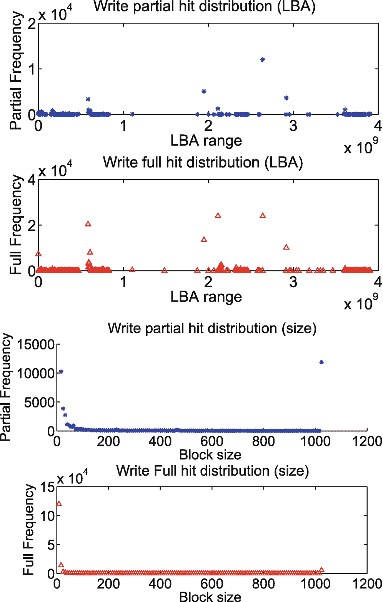

**图 8-12** 写入更新 LBA 和大小分布

现在让我们检查堆叠写入更新比率。基于写入 IOPS，距离 4000 大约相当于 10 分钟。在此期间，你可以看到命令的完全写入命中率为 72.9%，部分写入命中率为 58.7%。根据缓存大小和结构的知识，你可以估算命中率。由于堆叠距离通常长于 DRAM 缓存长度，因此磁盘上的更新无法避免。因此，在介质上设置一个“缓存/缓冲”位置是必要的，因此更大容量的 SSD 缓存对于性能提升是必要的。

图 8-13 中的第三个图显示，对于部分/完全命中，超过 65% 的重叠请求大小发生在总时间的前 1% 内，这进一步证实了大容量 SSD 缓存的必要性。由于传统磁盘驱动器没有提供如此大的缓存，通过混合驱动器（SSD+HDD）或在系统更高级别（例如阵列控制器或聚合控制器）实现此缓存可能是有益的。对于 SMR 驱动器，一种便捷的方法是允许常规区域与叠瓦式区域共存，以支持随机写入访问。^(⁷²) 在 [5, 4] 中，这也被称为随机访问区域 (RAZ)。

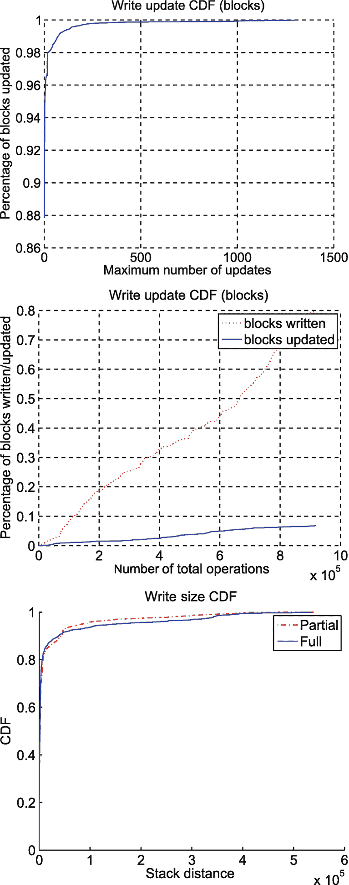

**图 8-13** 频繁、定时和堆叠写入更新（从上到下）

## 写后读 (ROW)

`ROW` 比率主要用于检查“一次写入多次读取 (WORM)”是否可能。你会发现总的 `ROW` 比率仅为 35.4% 左右，这意味着写入的数据不太可能被多次读取（即比率远大于 1）。你可以进一步检查命中是否仅针对小尺寸请求。图 8-14 和 8-15 显示，在大多数情况下，写入的数据不太可能被立即读回，其原因与前面章节解释的类似。

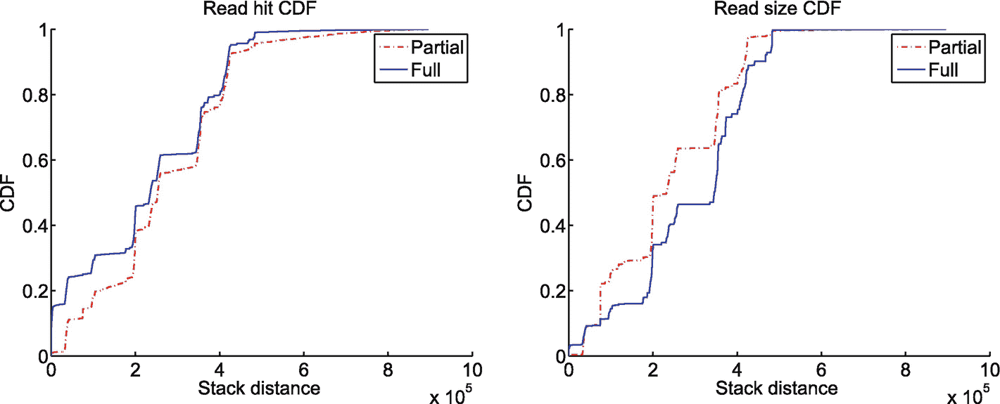

**图 8-15** ROW 命中与大小分布

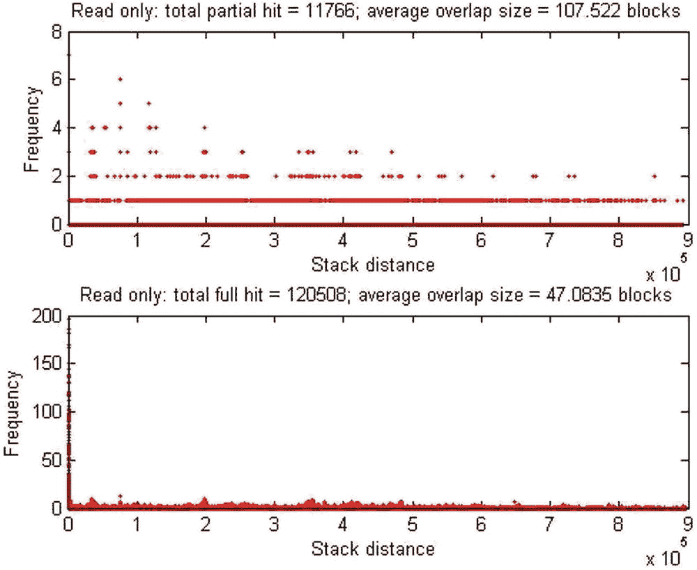

**图 8-14** ROW 比率

## 启用写入缓存与禁用写入缓存

写入缓存是 HDD 的一项重要功能。许多研究表明，由于回写策略，启用写入缓存 (`WCE`) 的性能可以比禁用写入缓存 (`WCD`) 显著提高，特别是对于某些小尺寸随机写入工作负载。然而，数据可靠性问题（例如，电源故障导致 DRAM 写入缓存中的脏数据丢失）导致大多数数据中心禁用此功能。

这里我们比较四个跟踪记录（148-21、148-22、149-21 和 149-22），因为节点 148 和 149 始终使用不同的写入缓存设置，并且在批次 ID 21 和 22 之间设置发生了变化（参见表 8-2）。你可以看到，如表 8-8 所示，写入 IOPS、吞吐量和平均大小没有本质区别。同时，大写入请求（例如，1024 个块）的比率几乎保持不变。然而，你可以观察到，对于读取和写入，`WCD` 的（近）顺序比率略小于 `WCE`（绝对值相差 1%）。这些因素表明，即使本地文件系统可能对其做出响应，HDFS 也不会根据 HDD 的写入缓存设置改变其行为。然而，由于工作负载远未达到驱动器的极限能力，这种响应并不显著。

**表 8-8** WCD 与 WCE 的基本 IO 指标

| 平均值 | IOPS | 吞吐量 KBPS | 大小（块） |
| --- | --- | --- | --- |
| | 21 | 22 | 21 | 22 | 21 | 22 |
| 148 | 6.3 | 7.0 | 1846.6 | 2064.4 | 586.0 | 589.5 |
| 149 | 6.6 | 6.8 | 1782.2 | 1881.9 | 541.8 | 556.6 |

在繁重的工作负载情况下，一些交错的顺序流将被视为“随机”而非顺序，导致随机写入比率增加，这对整体磁盘性能有害。因此，可能需要应用一些非易失性内存或 DRAM 保护技术来启用写入缓存，这对于繁重的工作负载来说是必要的。此外，对于数据中心中瓶颈不在 HDD（至少在正常负载下）的绿色环境，`WCE` 的另一个好处是由于减少了 HDD 的机械访问而节省能源。

## 系统级视角

在本节中，我将简要分析上一节中观察到的块级随机 I/O 如何有助于更好地分析 Hadoop 集群的 I/O 模式。首先，让我们看一下从 HDFS 日志中收集的工作负载特征，如表 8-9 所示。回顾前面提到的系统级分析；我捕获了数据生成和删除速率、作业创建速率及其特征等，而底层 I/O 对我们来说是模糊的。可以说，这正是高级框架应有的行为方式——完全或大部分与底层硬件设备隔离。然而，那些必须维护完整运维栈的人必须了解整个系统，而不仅仅是用户级框架。下面，我将从三个方面分析随机性：Hadoop 框架、MapReduce 策略和 HDFS 机制^(⁷³)。

**表 8-9** 从 HDFS 日志收集的基本信息

| 名称 | 持续时间 | 总 I/O 请求数 | 平均 I/O 大小(MB) |
| --- | --- | --- | --- |
| | 平均 | 最大 | 最小 | 总计 | 读取 | 写入 | |
| `wdc-x1` | 68 天 | 0.627 | 5.476 | 0.125 | 60.96 | 3.14 | 99.75 | |
| `wdc-x2` | 98 天 | 0.396 | 5.661 | 0.107 | 47.83 | 3.09 | 93.2 | |
| 读写比 | IOPS 10⁵ | 吞吐量 (MB/S) |
| 平均 | 最大 | 最小 | 总计 | 读取 | 写入 | 总计 | 读取 | 写入 |
| 0.0348 | 0.125 | 0.0054 | 0.726 | 0.536 | 0.19 | 18.48 | 0.632 | 17.85 |
| 0.0383 | 0.33 | 0.007 | 0.458 | 0.325 | 0.133 | 12.11 | 0.442 | 11.67 |

请注意，Hadoop 框架内的所有守护进程在一天中都会记录其运行时的日志。根据配置，这些日志可以写入 HDFS 或本地文件系统。如果日志写入本地文件系统，它们会产生一些对 HDD 的随机 I/O。位于 Hadoop 核心框架之上的其他框架守护进程可能会在设备级别产生更多随机 I/O。HBase 也有来自其区域服务器的类似日志需要写入。HBase 是为实时数据处理而创建的，它会生成小型 MapReduce 作业，这些作业可能访问少量数据，从而在 HDFS 实例中引起随机读取 I/O。像 Hive 和其他位于 Hadoop 之上的 KV 存储这样的框架，具有类似的日志记录结构，可能会在设备级别导致随机 I/O 放大。

基于 Java 的（Apache）MapReduce 在 MapReduce 作业期间必须将临时中间文件写入磁盘，其中一些文件具有重复的进程 ID（PID），而另一些则具有单一或极少使用的 PID。这些中间文件可以转储到 HDFS 中的位置（如果可能，HDFS 会尝试序列化 I/O）或本地文件系统，后者将是一个随机 I/O 事件。这可以通过调整参数`mapreduce.task.tmp.dir`进行配置。

在查阅 Hadoop XML 配置文件后，我注意到一件事：所有 HDFS 和 MapReduce 工作负载的临时/中间空间都被配置为将其输出数据存储到 HDFS 数据驱动器。由于 Hadoop 框架是用 Java 编写的，它必须应对 Java 虚拟机（JVM）的特性，这意味着内存地址在不同 JVM 之间没有意义。因此，当一个 MapReduce 任务将数据传递给另一个 MapReduce 任务时，它首先将数据写入一个临时文件，供另一个 JVM 任务读取。此外，当启动一个 MapReduce 作业时，它必须将配置参数和可执行 jar 文件发送给`TaskTracker`，以便它们能够正确地生成 map 和 reduce 任务。这些数据也被存储到配置的本地临时空间中。

将这种 I/O 与集群每天运行近 5500 个 MapReduce 作业（其中许多是小型任务计数作业，因为用户执行了 20%的 HBase 分析）这一观察结果结合起来，这些 HDD 上产生的随机 I/O 量变得非常大。然而，这种 I/O 是可以缓解的，并且并非完全导致块级跟踪中观察到的高水平随机 I/O 的原因。HDFS 本身也对这些跟踪中观察到的随机 I/O 量有所贡献。

从如图 8-16 所示的系统日志中，您可以看到系统每天创建和删除的数据块数量相当高。每次 HDFS 向文件系统提交一个数据块时，它还会创建一个元数据文件。这个元数据文件的大小与提交到本地文件系统的 HDFS 数据块大小成正比，因此一个 128MB 的数据块将对应创建一个约 1.2MB 的元数据文件，而较小的数据块将对应较小的元数据文件。因此，对于所观察的工作负载，由于 HDFS 上每天生成数万个新数据块，会产生大量的小型随机 I/O。然而，与 MapReduce 框架中可配置临时文件存储位置的随机 I/O 不同，这些 HDFS 元数据文件的存储位置不是一个可配置的属性，因此不能委托给另一类存储或存储位置。在考虑较新的 HDD 技术时，其中随机 I/O（尤其是随机写入）会极大地影响性能，理解像这样的工作负载特征至关重要。如果没有对工作负载进行设备级分析，这些特征就不会被如此清晰地识别出来。

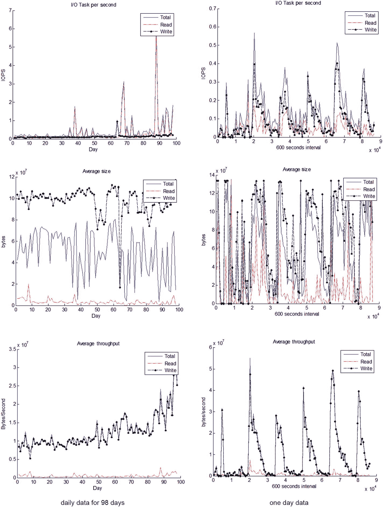

**图 8-16** 来自 HDFS 日志的基本曲线

## 进一步讨论

在本章中，我通过考虑一些特定指标，展示了 Hadoop 集群的块级工作负载特征。所呈现的分析技术可帮助他人在其生产环境中理解 Hadoop 的性能与驱动特性。通过 `blktrace` 收集的日志，我对这些日志进行了全面分析，识别出了一些具有意外行为的新工作负载模式。我指出，虽然顺序和近顺序请求占据了 IO 工作负载的大部分，但在 Hadoop 工作负载中仍存在不可忽视的随机 IO 请求。此外，驱动器上的写更新比率并不高，这表明如果采用异地写入策略，可能会产生较小的写放大效应。同时还需注意，ROW 比率很小，这意味着 WORM 通常不适用于该集群的工作负载。所有这些发现都表明，空间局部性相对较高，而时间局部性低于预期，这说明 Hadoop 通常是适用于 SMR 驱动器的应用。然而，Hadoop 和驱动器两端都需要进一步改进。

从批判性角度审视 Hadoop 系统的配置，可以对观察到的部分（而非全部）随机 IO 进行微调并最小化。导致这种随机 IO 的因素包括几种类型的框架日志记录、MapReduce 和 HBase 工作负载生成的中间文件，以及 HDFS 数据块的元数据文件。可以降低 Hadoop 守护进程日志文件的详细程度以减少生成的数据量，并且这些日志文件以及临时的 MapReduce 输出可以写入一个不会影响 HDFS 数据块 IO 操作的存储位置。这些位置可以是 HDFS 本身（而非本地存储），这将尝试使 IO 更加顺序化，也可以是另一个更适合随机块 IO 的物理/逻辑块设备（同时保持数据本地性）。图 8-16 展示了从 HDFS 日志中推导出的一些基本曲线。

然而，观察到的随机 IO 的最后一部分是 HDFS 写入/更新机制的结果，并且不易缓解，因为它目前必须与已提交的 HDFS 数据块一起驻留在 HDFS 数据驱动器上。由数据块元数据引起的小型 IO 必须由一个容量块存储设备来处理，该设备要么能够理解如何将这些小型随机 IO 转换为更大的顺序访问模式，要么就是一个专门为处理随机 IO 而设计的设备。如果没有设备级的视角，这种开销可能会被误认为是系统中其他地方的问题，而不是 HDD 设备级的问题，而其中一些问题在获得正确洞察后是非常容易纠正的。例如，对于随机读取访问的场景，大容量 DRAM 缓冲区将非常有用；而对于随机写入访问，非易失性存储器（例如 NAND 和传统区域）则很有帮助。

因此，有必要研究 HDFS 与本地文件系统的集成，同时考虑设备属性，例如采用全局视角的设计，以避免对 HDFS 中顺序写入的本地元数据产生“误解”。并且，元数据和“非关键”的中间/临时数据应被分配到合适的磁盘位置。因此，HDFS 可以承担 DataNode 中文件/块访问的责任，这可能会使驱动器操作更高效。设备中的元数据位置也应精心设计。

此外，考虑到 Java 的机制，驱动级缓存和系统级缓存可以统一起来，这样一些临时数据可能被统一的缓存/缓冲区吸收，而无需进行磁盘机械访问。由于当前 HDFS 的缓存设计简单且 JVM 与驱动器之间缺乏直接接口，这种统一可能很困难。然而，驱动器制造商提供这种面向应用的通信接口是可能的。

此外，某种智能机制可能有助于驱动器理解访问的性质（例如，随机或顺序、访问依赖性），从而使驱动器能够立即切换到最优算法/行为以获得更好的性能。一种在主机和驱动器之间进行交互的应用级提示方案，或者驱动器内部的自学习算法，可能会有所帮助。

总之，对内部 Hadoop 集群的设备级分析为理解 Hadoop 如何与底层文件系统交互以及如何处理其低级 IO 提供了新的见解。这些新见解激励我继续研究大数据框架的工作负载特征和应用调优如何能够在我们所处的当前数据驱动环境中帮助提升存储设备的性能。这项研究也大致适用于 Spark（一种内存型 MapReduce 系统）。例如，详细的工作负载分析可以为 Spark 系统的 SCM 应用提供一些见解，这将有助于设计出成本高效的混合 SCM-DRAM 结构。

脚注 1 2 3 4

