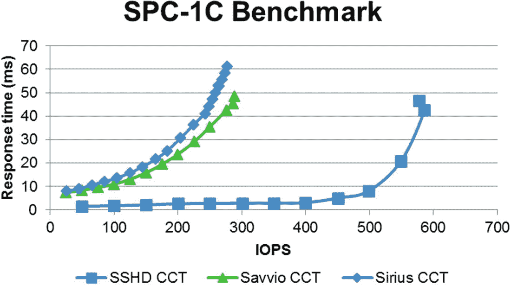
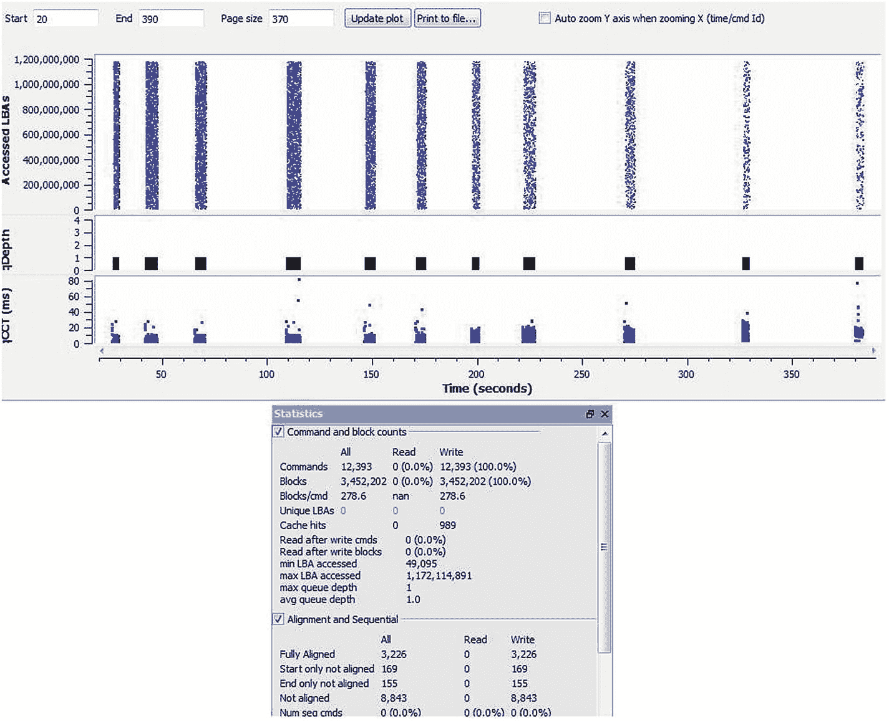
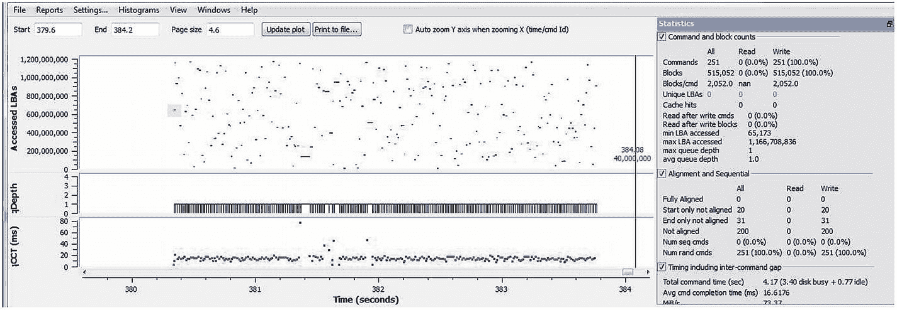
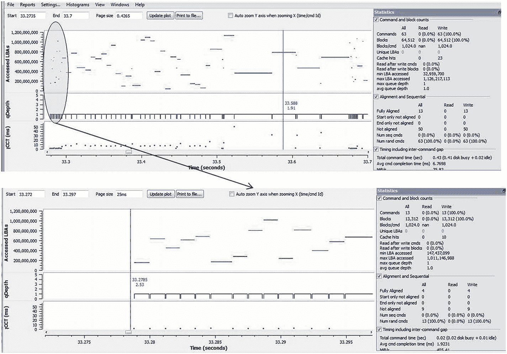
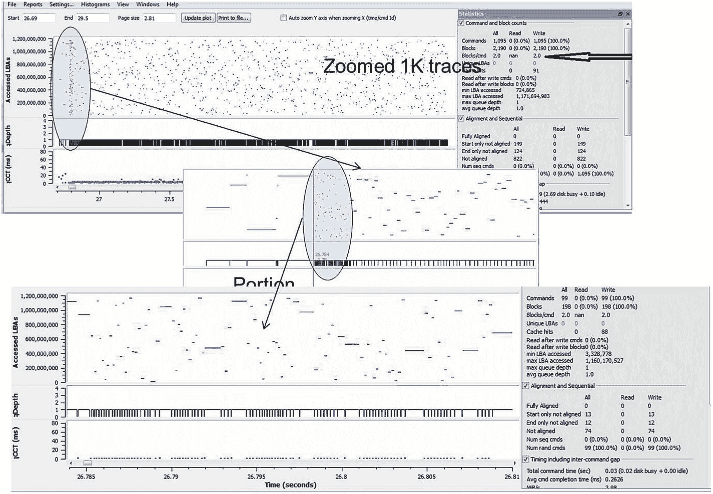
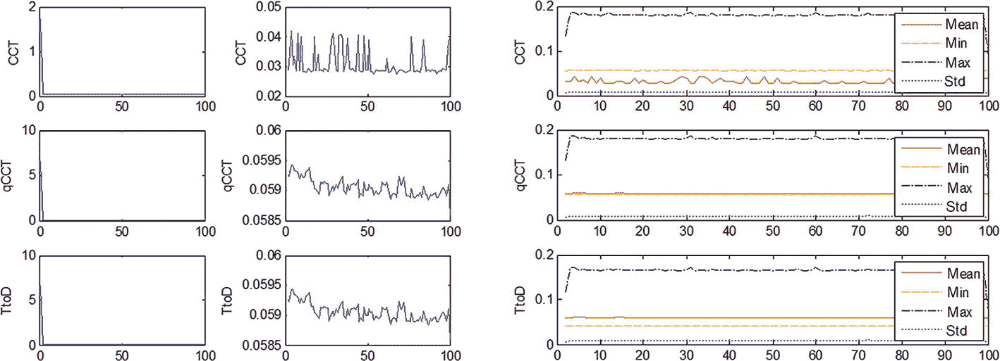
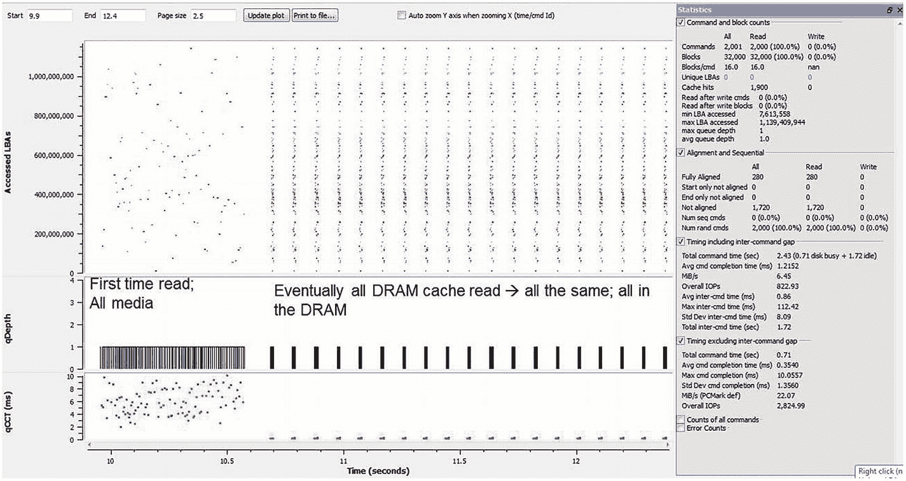
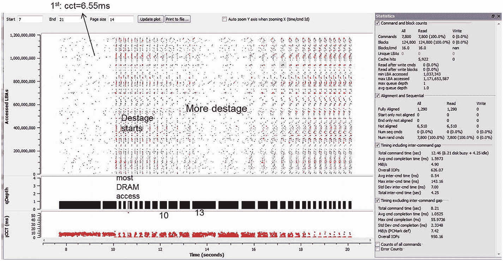
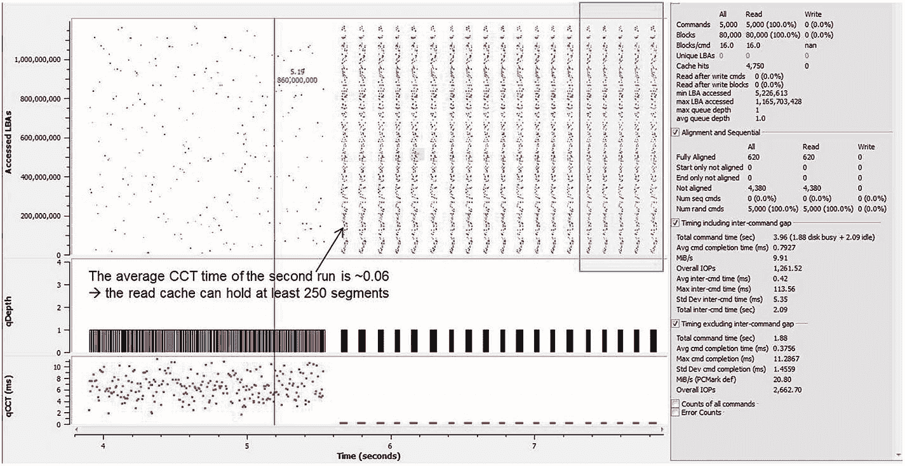
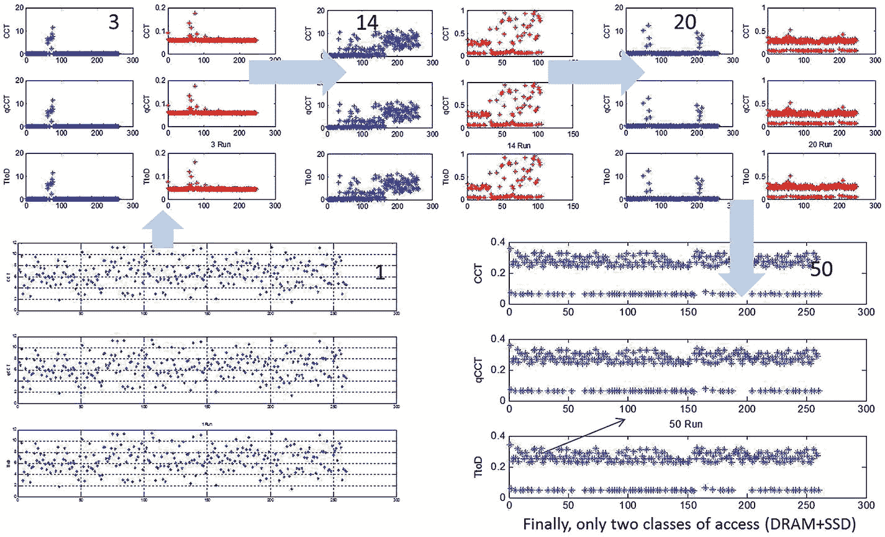

# 6. 案例研究：现代磁盘

现代磁盘实现了许多不同的特性，例如基于介质的缓存（例如，使用部分磁盘空间来记录一些随机写入访问）、`DRAM` 保护（例如，在断电期间使用小容量 `NVM` 临时存储 `DRAM` 缓存中的一些数据，以便写入缓存可以始终启用）、混合结构（例如，将热数据迁移到高速设备，将冷数据迁移到低速设备，从而减少总体访问时间）等。混合磁盘（例如 `SSHD`）是混合结构的一种，在数据热度显著的某些场景下具有优势。一些新兴和未来的技术，如 `SMR`、`HAMR` 和 `BPR`，倾向于顺序访问，以减少垃圾回收、降低能耗和/或提高设备寿命。本章通过两个示例（`SSHD` 和 `SMR` 驱动器）展示了踪迹分析如何通过工作负载属性分析来帮助识别这些机制。

## SSHD

在本节中，让我们探索 `SSHD` 在 `WCD` 下 `SPC-1C` [53] 性能提升背后的奥秘：`SSD`/`DRAM` 缓存和自学习算法 [56, 57, 16]。我从 `XGIG` 总线分析仪收集数据，并监控 `LeCroy` 示波器的响应，工作负载由 `SPC-1C` 工具生成。分析中应用了模式识别、曲线拟合和排队论等技术。

从图 6-1 中，你可以看到，对于 `WCD`，`IOPS` 跃升至传统 `HDD` 的两倍，因此 `SSHD` 的 `IOPS` 约为 `570`，而传统 `HDD`（两种型号：一种是希捷的 `Savvio`，另一种是西部数据的 `Sirius`）在响应时间小于或等于 `30ms` 时只能达到约 `200 IOPS`。这里的任务是通过踪迹分析找出混合结构性能提升的原因。基本思想是比较几个具有一定相似度的驱动器：向相似的驱动器注入相同的工作负载，隔离相似性，并比较差异。例如，表 6-1 中选择了相似的 `CMR` 型号。

**表 6-1** 选择的用于比较的相似型号

| | SSHD | CMR A | CMR B | CMR C |
| --- | --- | --- | --- | --- |
| 容量 (`GB`) | `600` | `900` | `600` | `900` |
| 转速 (`RPM`) | `10.5K` | `10.5K` | `10K` | `10.5K` |
| 每扇区字节数 | `512, 520, 524, 528` | `512` | `512` | `512` |
| 盘片数 | `2` | `3` | `2` | `3` |
| 平均延迟 (`ms`) | `2.9` | `2.9` | `3` | `2.9` |
| `DRAM` 缓存 | `128MB` | `64MB` | `32MB` | `64MB` |
| `NAND` | `16GB eMLC` | 无 | 无 | 无 |
| 接口 | `6Gbps SAS` | `6Gb/s SAS` | `6Gb/s SAS` | `6Gb/s SAS` |

图 6-1 `SSHD` 与传统 `HDD` 的性能比较

从前一章可知，写入（随机）访问在 `SPC-1C` 中主导 `IO` 请求，这意味着写入缓存实际上扮演着重要角色。然而，对于 `WCD`，写入缓存应该被禁用。对于这款 `SSHD` 来说，情况是否如此？为了验证这一点，你可以做一个简单的测试：向 `SSHD` 注入随机写入请求，并计算 `CCT/qCCT/TtoD` 时间。如果写入缓存确实被禁用，所有请求将直接写入介质，这大约需要 `10ms` 的响应时间。然而，从踪迹中，你可以观察到在开始时有许多响应时间小于 `1ms` 的请求。因此，即使对于 `WCD` 设置，写入缓存实际上也是激活的。这得益于 `NAND` 支持的 `DRAM` 缓存保护技术，因此部分缓存数据可以在系统断电后立即写入 `NAND`。

现在，让我们开始分析两个基本问题：缓存大小和访问隔离。

### 缓存大小

我们首先探讨“`WCD` 期间有多少 `DRAM` 被用作写入缓存？”这个问题。首先，确保测试是可重复的（或结果是一致的）。为了验证这一点，请执行以下步骤。

1.  将 `SSHD` 连接到 `XGIG` 总线分析仪，然后关闭/打开 `SSHD` 电源。
2.  使用 `IOMeter` 或其他工具向 `SSHD` 发送 `100` 个随机的 `8K` 写入请求，并重复相同的请求 `10` 次。
3.  使用相同的请求，重复步骤 `1-2` 共 `4` 次。
4.  通过轨迹分析工具比较并找出 `XGIG` 轨迹的访问模式。
5.  将请求数量改为 `200` 和 `400`，重复步骤 `1-4`。
6.  在另一块具有相同 `IO` 模式的 `SSHD` 上进行相同的测试。

在步骤 `4` 中，应观察到相似的访问模式（`LBA` 与 `CCT`）。请注意，此处检查的是 `DRAM` 写入缓存，因此仅使用随机写入请求。要进行完整的缓存检查，您也可以尝试随机读取、混合读写以及混合随机/顺序模式。如果观察到相似的模式，则可以得出结论：结果是一致的，并且有助于识别一些内部信息。否则，您需要找出原因。原因之一是 `SSD`/`DRAM` 缓存在新测试前未被清理。因此，您需要使用一些缓存刷新命令或磁盘初始化命令来强制清空缓存。另请注意：

*   读/写 `DRAM` 缓存可能共享同一空间。
*   `SSD` 映射表可能与读/写 `DRAM` 缓存共享同一空间（理想情况：`SSD` 映射表使用专用的 `DRAM` 空间）。
*   `SSD` 重启自学习过程可能会占用 `DRAM` 空间。

其次，执行以下步骤以确保每次测试都从干净的缓存开始：

1.  关闭/打开 `SSHD` 电源（确保 `DRAM` 写入缓存已清除）。
2.  使用 `IOMeter`，以队列深度=`1` 向 `SSHD` 发送 `1000` 个随机的 `8K` 写入请求。
3.  使用不同的请求大小（如 `16K`、`32K`、`64K`、`128K`、...、`2048K`）重复步骤 `1-2` 各 `10` 次。

捕获轨迹后，需要进行一些后处理：

1.  通过将 `DRAM` 访问与其他访问区分开来（`DRAM CCT/qCCT` 通常远小于其他访问），统计每次运行中总访问量初始部分的 `DRAM` 写入命中次数。
2.  选择每次计数的最大值。
3.  计算命中次数及对应的实际缓存大小。
4.  找到转折点，该点可提示簇大小。
5.  通过缩小范围来细化转折点。例如，如果转折点在[`256K-512K`]范围内，则可以使用更多点，如 `300K`、`400K` 和 `500K`。

请注意，此型号的 `SSHD` 仅具有只读缓存 `SSD`，因此 `DRAM` 访问不会与 `SSD` 写入访问混合，这简化了图 6-2 至 6-5 中的分析。图 6-2 显示了来自 `IOMeter` 随机写入测试（请求大小从 `1K` 到 `1M`）的轨迹。假设写入缓存为空。^(⁶⁸) 那么每次运行的初始部分可能是 `DRAM` 写入缓存命中。

图 6-2 `SSHD` 的 `IOMeter` 轨迹

放大系统以找出命中点。图 6-3、6-4 和 6-5 给出了三个示例，其请求大小分别为 `1KB`、`512KB` 和 `1MB`。在图 6-3 和 6-4 中，您可以观察到明显的写入缓存命中，并且由于缓存大小有限，`1KB` 的总命中次数远大于 `512KB`。然而，当大小增加到 `1MB` 时，未观察到明显的写入缓存，这意味着在 `512K` 和 `1M` 之间设置了一个阈值，作为不同大小请求的转折点。这也表明大尺寸请求将直接发送到介质。通过相同的步骤，您实际上可以获得 `WCD` 和 `WCE` 所需的数值，如表 6-2 和 6-3 所示。

表 6-3 `SSHD` 在 `WCD` 下的两种情况

| SSHD (WCD) | test1 |   | test2 |   |
| --- | --- | --- | --- | --- |
| 大小 | 计数次数 | 大小 | 计数次数 | 大小 |
| --- | --- | --- | --- | --- |
| `1K` | `98` | `0.1M` | `101` | `101K` |
| `4k` | `100` | `0.4M` | `100` | `400K` |
| `16K` | `99` | `1.5K` | `100` | `1600K` |
| `64K` | `101` | `6.3K` | `101` | `6464K` |
| `128K` | `54` | `6.75M` | `54` | `6.75M` |
| `256K` | `26` | `6.5M` | `26` | `6.5M` |
| `512K` | `12` | `6.0M` | `13` | `6.5M` |
| `520K` | - | - | `12` | `6.1M` |

表 6-2 `WCE` 下的比较

| SSHD | CMR A |
| --- | --- |
| 大小 | 计数次数 | 大小 | 大小 | 计数次数 | 大小 |   |
| --- | --- | --- | --- | --- | --- | --- |
| `1K` | `98` | `0.1M` | `1K` | `98` | `0.1M` |   |
| `4k` | `98` | `0.4M` | `4k` | `98` | `0.4M` |   |
| `16K` | `97` | `1.5M` | `16K` | `99` | `1.5M` |   |
| `64K` | `102` | `6.4M` | `64K` | `102` | `6.4M` | `2` |
| `128K` | `103` | `12.9M` | `128K` | `104` | `12.9M` |   |
| `256K` | `111` | `27.8M` | `256K` | `110` | `27.8M` |   |
| `512K` | `115` | `57.5M` | `512K` | `66` | `33M` |   |
| `520K` | - | - | `880K` | `35` | `30M` |   |
| `900K` | - | - | `900K` | `42` | `36.9M` |   |
| `1024K` | `N.A.` | - | `1000K` | `36` | `36M` |   |

图 6-5 `1024K` 请求轨迹详情

图 6-4 `512K` 请求轨迹详情

图 6-3 `1K` 请求轨迹详情

从转折点，您还可以推测缓存簇/段的大小。例如，`SSHD` 在 `WCD` 期间写入的簇大小约为 `64K`，而 `CMR A` 约为 `256KB`。`SSHD` 在 `WCE` 时最多使用 `60MB` `DRAM` 空间作为写入缓存，而在 `WCD` 时仅使用约 `8MB`，包含约 `100` 个段。

### 访问隔离

在前一章中，您已经了解到 `SPC-1C` 有大量的本地访问。这一特性使得某些数据可以被缓存到 `DRAM` 或 `SSD` 中，并在之后被快速访问成为可能。那么第二个问题是：“实际上有多少访问是直接指向 `DRAM` 或 `SSD` 的？”这通常是一项困难的任务。然而，由于 `DRAM`、`SSD` 和 `HDD` 的访问时间差异显著，您可以粗略地将可能的命令隔离到不同的位置。基本思路是观察不同访问的行为，然后应用数据分类和模式识别方法来发现访问模式，并进行重复的随机读取测试，最终找到转折点。虽然流程与之前的案例类似，但在本例中，您需要更改发送到 `SSHD` 的请求数量：

1.  向 `SSHD` 发送 `100/200/256/257` 等数量的 `8K` 请求，每个数量重复 `20-100` 次，并根据访问模式调整要发送的命令数量。

2.  假设转折点为 `X`。向 `SSHD` 发送 `X` 个大小为 `16K`、`32K`、……、`1024K` 的随机读取命令，并根据转折点找出簇大小。

为了验证重复次数是否足够高，请检查响应时间的稳定状态。图 6-6 提供了一个运行了 `100` 轮的示例。您可以看到，从第三轮开始，响应时间的平均值和标准差几乎保持不变。因此，在这种情况下，重复 `10` 次应该就足够了。

图 6-6 响应时间的稳定状态

图 6-7 展示了一个案例，其中向 `SSHD` 发送了 `100` 个 `8KB` 大小的随机读取请求，重复了 `20` 次。在第一轮中，所有读取都指向介质。经过几轮后，读取请求变得“热”起来，并最终全部缓存在 `DRAM` 中。缓慢增加请求数量，以检查 `DRAM` 读取缓存能够容纳多少个请求。

图 6-7 `100` 个 `8K` 随机读取，重复 `20` 次

图 6-8 展示了 `250` 个请求重复执行的结果。您可以看到 `DRAM` 缓存完全可以容纳至少 `250` 个段。然而，当您将其略微增加到 `257` 时，降级写入（`destage`）就开始了。当进一步增加到 `260` 时，`DRAM` 到 `SSD` 的降级写入会以相对较高的速度明显发生，如图 6-9 所示。降级写入具有一定的自适应步骤，因此当数据的命中次数（访问频率）增加时，降级写入变得更加频繁。

图 6-9 `260` 个 `8K` 随机读取，重复 `100` 次

图 6-8 `250` 个 `8K` 随机读取，重复 `100` 次

因此，您可能会猜测 `256` 可能是最大的读取段数量，因为只要不超过这个最大段数，就不会发生降级写入。请注意，您可以通过不同的时间间隔和大小来发现降级写入模式。

这里我留下一个关于设备上请求访问识别的问题。请看图 6-10，其中向 `SSHD` 发送了 `260` 个 `8KB` 读取请求，重复了 `100` 次。由于数量超过了 `DRAM` 的容量，一些请求将指向 `SSD`。图中显示了第 `1`、`3`、`14`、`20` 和 `50` 次运行的响应时间。您可以看到，第一次运行时所有请求都指向了磁盘。从第二轮开始，一些请求指向了 `DRAM`，一些指向了介质。在第 `20` 轮中，指向 `DRAM`、`SSD` 和介质的访问都存在。然而，在大约 `50` 轮时，大多数请求都指向了 `DRAM` 和 `SSD`。事实上，您可以看到这些读取请求的响应时间存在明显的差距。基本上，您可以认为那些低于 `0.1ms` 的是 `DRAM` 访问，而高于 `0.2ms` 的大部分来自 `SSD`。现在，您可以获得 `SSD` 和 `DRAM` 响应时间的统计值（在估算意义上），如表 6-4 所示。

**表 6-4** 响应时间统计（基于第 `40-90` 轮）

| 260 | 平均值 | CCT | qCCT | TtoD |
| --- | --- | --- | --- | --- |
| 总体 | 均值 | `0.227` | `0.227` | `0.212` |
|   | 标准差 | `0.096` | `0.096` | `0.096` |
| SSD | 均值 | `0.279` | `0.279` | `0.264` |
|   | 标准差 | `0.031` | `0.031` | `0.032` |
| DRAM | 均值 | `0.063` | `0.063` | `0.048` |
|   | 标准差 | `0.001` | `0.001` | `0.001` |

图 6-10 多轮重复下的读取响应时间模式

## SMR

本节将讨论 SMR [4, 5] 的主要特性以及这些特性与特定工作负载之间的相互作用。业界通常有两种处理 SMR 的方法：

* 驱动器管理所有数据访问，数据管理复杂，类似于 SSD 的 FTL（闪存转换层），因此元数据管理、GC（垃圾回收）、预留空间、性能变化等都在驱动器内部进行。但是，主机端无需更改，因此该驱动器可作为普通驱动器使用。目前，市场上所有主要的 SMR 驱动器都属于这一类。

* 主机通过类似闪存文件系统的 SMR 专用文件系统来管理大多数与数据相关的访问。数据管理很复杂，但可以利用成熟的、顺序写入的文件系统。几个例子包括 SFS [58]、HiSMRfs [59] 和 Shingledfs [5]。虽然混合驱动器-主机管理也是可能的，但非常罕见。

SMR 驱动器考虑了许多特定的设计问题，例如数据布局管理（布局、数据放置、碎片整理、GC、指向 band 的指针）、混合区域（在同一磁盘中组合叠瓦式和非叠瓦式部分）、SMR 算法以及针对特定应用的结构等。表 6-5 列出了 SMR 的一些主要预期工作负载特性，以便那些具有设计指标的应用能够在 SMR 驱动器上完美运行。

### 表 6-5
SMR 特性与工作负载指标对比

| SMR 特性 | SMR 预期 | 工作负载指标 | SMR 影响 |
| --- | --- | --- | --- |
| 顺序写入 | 适用于大尺寸顺序写入请求 | 平均写入请求大小和分布、寻道距离（LBA）、顺序流和近顺序流 | 尺寸越大越好；寻道距离越小，顺序性越强；流越多，顺序性越强 |
| 一次写入多次读取 | 适用于较少更新和较多读取 | 读/写比率、读时写（ROW）命中率、写更新比率 | 读/写比率（ROW 比率）越高越好；写更新比率越小越好 |
| 垃圾回收（GC） | 较小的写放大和较少的 GC | 设备利用率、设备空闲时间分布、队列长度、IOPS、吞吐量、频繁/定时/堆叠的写更新比率（WUR）、写时写（WOW）命中分布和比率 | 长时间且频繁的空闲时间用于 GC；低写更新比率表明需要的 GC 较少 |
| 顺序读取到随机写入 | 由于间接映射（例如，随机物理地址中的顺序 LBA 读取请求）导致的读取性能影响较小 | 读时写（ROW）命中/大小分布和比率 | 小（大）读取与小（大）写入的比率越高越好 |
| 原地或非原地更新 | 频繁和最近的更新需要随机访问区域（RAZ）/SSD/大容量 DRAM 缓冲区来保存写入数据 | 堆叠写更新比率 | 在较短堆叠中比率越高，就越需要原地更新缓冲区 |

脚注 1