# 7. 案例研究：RAID

RAID 是当今世界应用最广泛的数据保护策略之一 [23, 60, 61, 62, 63]。与单磁盘访问相比，它具有独特的特性，例如文件同步、恢复等。因此，它产生了一些与其他方式不同的独特 IO 模式。本章基于两个应用场景中的 RAID 5 示例进行分析。两个跟踪记录之间观察到了巨大差异。本章还分析了这些工作负载是否适用于 SMR 驱动器。此外，还提供了一些建议以提升系统性能。

RAID 的概念于 1987 年被引入，旨在利用商用硬盘的潜力。Patterson 等人 [64] 于 1988 年正式确立了 RAID 分类法。RAID 通过将一组低容量磁盘暴露为一个虚拟的单个大型昂贵磁盘（SLED），克服了商用磁盘的容量限制。

RAID 技术通常需要通过数据条带将数据分布到多个磁盘上。条带代表阵列中最小的保护单元，因此条带内任何丢失的数据都可以仅使用该条带内幸存的数据进行恢复。早期，由于客户端通过串行访问通道连接到 RAID，因此并未明确支持多客户端的并行访问。然而，随着许多先进排队调度程序的发展，为了充分利用多磁盘的优势，并行性现在已广泛应用于 RAID 系统中。

RAID 系统中存在一些常见的性能问题 [20, 62, 63]，例如小写问题、同步问题、降级（恢复和重建）期间的性能损失等。

小写问题存在于许多关键应用中，例如在线事务处理（OLTP）系统。这些应用通常包含许多读-修改-写（RMW）访问。这给 RAID 系统带来了一些问题。首先，在条带化阵列中进行写入操作，需要在写入新数据和新校验块之前，同时读取数据块和校验块，并计算新的校验块，这比单磁盘访问多出四倍的访问次数。其次，这些小访问仅更改特定条带内的几个块，但在更新期间，整个条带的校验盘不可用。这通过减少可能的并行性，极大地降低了阵列的性能。

同步问题源于数据完整性要求；只有当条带阵列中的所有驱动器都完成操作时，系统才会返回完成信号。由于某些磁盘可能比其他磁盘更早完成访问，因此较快的磁盘必须等待较慢的磁盘。在某些情况下，例如非关键应用、受保护的 DRAM 等，此要求可能会放宽。在恢复期间，由于后台恢复访问，前台用户请求可能会受到很大影响 [65]。

类似的问题也适用于使用纠删码（EC）的磁盘阵列。并且在某些情况下，由于 EC 比传统 RAID 的复杂性更高，问题可能更为关键。

## 工作负载分析

你将研究来自两个不同供应商、应用于视频监控场景的两个 RAID 5 示例。将首先给出系统设置，然后分析两个不同的跟踪记录：读密集型案例和写密集型案例。

### 系统设置

在第一个示例中，有 10 个 7200RPM 的 HDD，每个容量为 4TB。该系统施加了 24 个写入流和 6 个读取流。第二个示例有 36 个类似的 HDD，带有 90 个视频通道。跟踪记录的长度分别为 620 秒和 110 秒。一些基本指标列于表 7-1 和 7-2 中。

**表 7-2** RAID 跟踪记录 2：写密集型

| 指标 | 总计 | 读取 | 写入 |
| --- | --- | --- | --- |
| `Cmd` 数量 | 21449 | 8535 | 12914 |
| 总块大小 | 2528514 | 357824 | 2170690 |
| 平均块大小 | 210.012 | 41.924 | 168.088 |
| 平均 IOPS | 193.152 | 76.859 | 116.293 |
| 平均吞吐量 (MBps) | 11.118 | 1.573 | 9.545 |

**表 7-1** RAID 跟踪记录 1：读密集型

|  | 总计 | 读取 | 写入 |
| --- | --- | --- | --- |
| 命令数量 | 7821 | 5493 (70.2%) | 2328 (29.8%) |
| 块数量 | 5284520 | 3231312 (61.1%) | 2053208 (38.9%) |
| 平均大小 (块) | 675.7 | 588.3 | 882 |
| `r/s` `w/s` `rsec/s` `wsec/s` `rkB/s` `wkB/s` `IOPS` `TP(MBPS)` |
| 8.86 3.75 5211.8 3311.6 2605.9 1655.8 12.61 4.23 |

### 读密集型追踪

此追踪中的请求 LBA 分布接近顺序访问，如图 7-1 所示。对于读请求，存在两个区域。一个与当前写入区域相同，另一个则接近之前的写入区域（即回放）。读请求的大小多为 512 或 1024 个块。然而，1024 个块的读请求比例低于写请求，如图 7-2 所示。

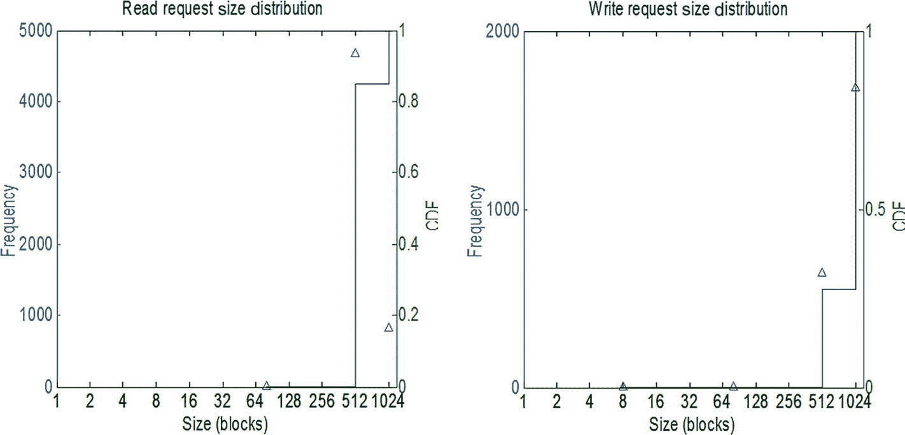

**图 7-2** RAID 追踪 1 的大小分布

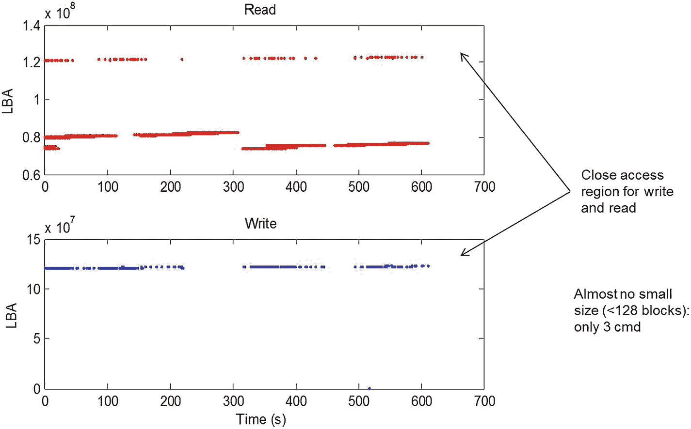

**图 7-1** RAID 追踪 1 的 LBA 分布

总体而言，此追踪包含大量空闲时间，占总时间的 83.4%。空闲时间的平均总和随时间大致均匀分布，但较长的空闲间隔并非如此，如图 7-3 所示。间隔`>200ms`和`>500ms`分别占 8%和 1.7%，但分别占据了总空闲时间的 71.6%和 34%。实际上，65%（94%）的空闲频率小于 10ms（1s），而 2%（70%）的空闲时间小于 10ms（1s），如图 7-4 所示。因此，我们可以得出结论：总空闲时间对于基于小 IO 的后台活动来说足够长，但单个长空闲间隔可能不足，这意味着 GC 访问必须以小步骤完成。

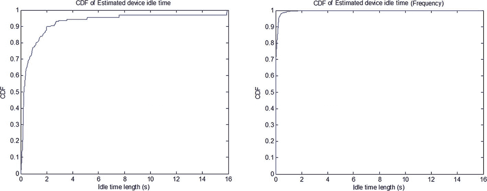

**图 7-4** RAID 追踪 1 的空闲时间 CDF

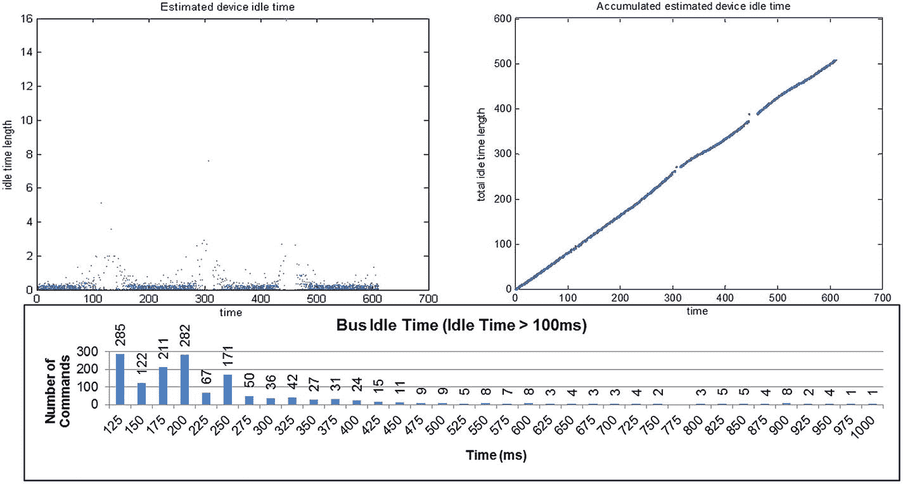

**图 7-3** RAID 追踪 1 的空闲时间分布

除了大量的空闲时间外，请注意某些请求存在异常大的响应时间（`> 200ms`）。如您所知，即使在最坏情况下，一个 1024 块请求的访问时间也不应超过 60ms。因此，对于表 7-3 中列出的两种情况，等待时间过长：1) `CMD 529`连续到`530`，但写访问耗时超过 430ms；2) `CMD 1015`接近`1024`，但耗时 390ms。这可能是由以下原因造成的：1) 后台磁盘活动，如日志写入、元数据更新、区域切换等；或 2) RAID 同步事件。一种可能的解决方案是均匀分配任务，并主动为后台任务提供空闲时间。

**表 7-3** RAID 追踪 1 的一个片段

| 开始(秒) | 结束 | ID | 结束 | 命令 | ICT(毫秒) | LBA | 长度 |
| --- | --- | --- | --- | --- | --- | --- | --- |
| 27.51865 | 27.53302 | 529 | 529 | W | 0.109105 | 1.21e+08 | 1024 |
| 27.5331 | 27.96851 | 530 | 530 | W | 0.078425 | 1.21e+08 | 512 |
| 27.9686 | 27.98473 | 531 | 531 | R | 0.086485 | 80135168 | 1024 |
| 27.98483 | 27.987 | 532 | 532 | R | 0.10257 | 80351232 | 512 |
| ... |   |   |   |   |   |   |   |
| 52.73206 | 52.7429 | 1014 | 1014 | R | 0.466475 | 80690688 | 512 |
| 53.46918 | 53.85766 | 1015 | 1015 | R | 726.2745 | 80875520 | 512 |
| 53.85778 | 53.86006 | 1016 | 1016 | R | 0.112894 | 80876032 | 512 |
| 53.86014 | 53.87545 | 1017 | 1017 | R | 0.083455 | 80881664 | 1024 |

对于图 7-5 中显示的频繁写入更新，您可以看到 94.2%的访问块（可能重复）仅被写入一次，5.8%的块至少被访问两次，而`<0.1%`的块被写入三次。这意味着重写率非常低。因此，您需要确定是大型请求还是小型请求被重写最多。被多次写入的块所占百分比不断下降，这意味着热块的比例很小。

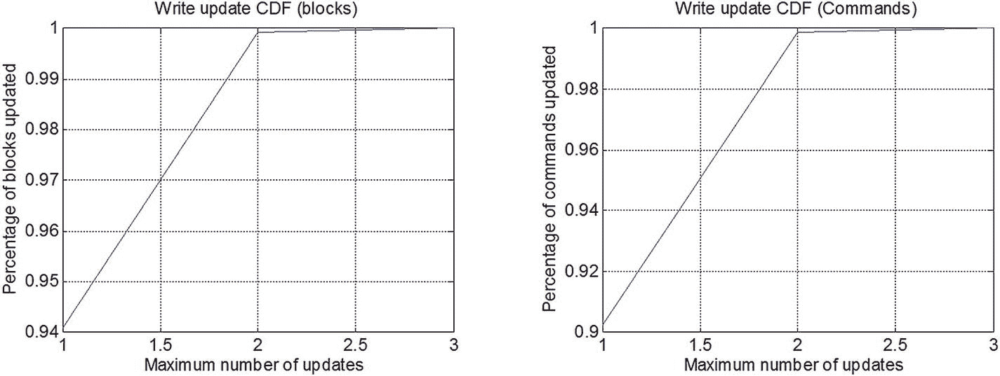

**图 7-5** RAID 追踪 1 的频繁更新

对于图 7-6 中显示的定时写入更新，总写入块占全部访问块（读和写）的 35%，而更新块（至少写入两次）仅占 1%（1/35=2.9%的重写块）。总写入命令占总命令的 30%，更新命令占 1.5%。请注意，定时写入更新率与频繁写入更新率密切相关；换句话说，`sum(hit*(update freq-1))/total blocks = updated blocks/total write blocks`。

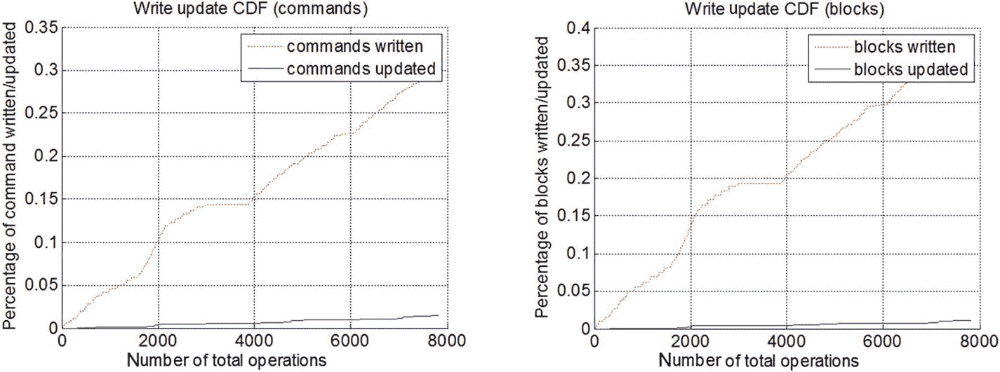

**图 7-6** RAID 追踪 1 的定时更新

通过进一步考虑图 7-7 中的写入栈距离，您可以看到命中率很低，没有必要使用内联写入缓存来长时间保存这些写入数据。基于 IOPS，要达到栈距离 100，大约需要 26.6 秒。在此期间，仅观察到 10%的完全写入命中率和 20%的部分写入命中率，而总体命中率仅为 5%。平均更新大小约为 43MB。因此，不值得为如此小的命中率进行补偿。请注意，写入命中分布在写入范围内。在此追踪中，完全命中仅针对 512 块请求，而部分命中则针对 1024 块请求。详情见图 7-8。

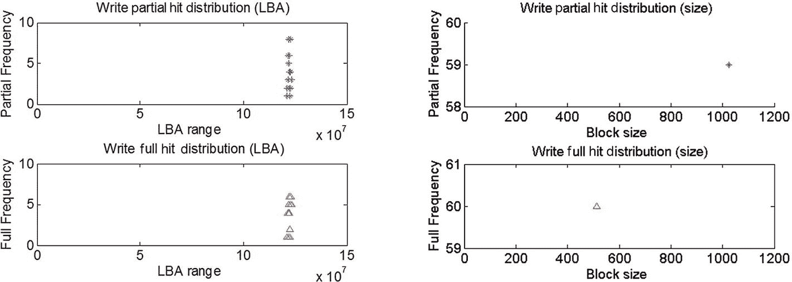

**图 7-8** RAID 追踪 1 的写入命中分布

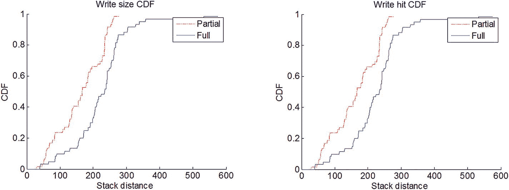

**图 7-7** RAID 追踪 1 的栈更新

当您考虑 SMR 驱动器时，如第 6 章所述，您会得到表 7-4 中总结的主要特征。您可以结合第 6 章介绍的 SMR 属性来理解此表。尽管这是一个读密集型追踪，但它不具备 WORM 属性。

**表 7-4** 追踪 1 针对 SMR 的主要特征

| SMR 特性 | 观察结果 |
| --- | --- |
| 顺序写入 | 大型写入请求（`>=512`个块）> 99.9% 模式比率：读写各占 50%（`Q=1`） 顺序命令比率（`M>=2` & `S>=1024`）：写入 85% & 读取 90%（`Q>=50`） |
| 一次写入多次读取 | `R/W`：命令 70:30；块 61:39 栈 ROW 比率：< 1% 总写入块占全部访问块的 2.9% |
| 垃圾回收（GC） | 频繁的小空闲时间；短队列长度 5.8%的频繁 WUR 中，更新块（至少写入两次）仅占全部访问块的 1%和写入块的 2.9%，因此写入更新率非常小，写入放大率为 103%（考虑到追踪持续时间短） |
| 顺序读取到随机写入 | ROW 比率为 1.2，因此读取比率非常小，写入的数据不太可能被立即读回 |
| 原地或非原地更新 | 更新率非常小；无需应用大容量 SSD/DRAM/AZR 缓存来提升性能（缓存中的写入更新） |

### 写密集型负载

该负载来自视频监控应用，在读写比、`LBA`分布、大小分布、写更新比等多个方面与之前的负载存在显著差异。因此，对于不同场景下的不同供应商，即使采用相同的存储结构，实际工作负载也可能大相径庭。

图 7-9 展示了`LBA`分布，其中仅有一个跨越 30GB 的主区域，用于对接近`LBA`起始位置的读写操作（因为该负载是在`RAID`几乎为空时收集的）。如果进一步观察`LBA`与时间的关系图，可以发现写请求比读请求更具顺序性。图 7-10 表明，写和读具有相似的大小分布，以 8 块请求为主，且 8-128 块分布的形态接近。此外，大小分布范围远大于之前的负载。

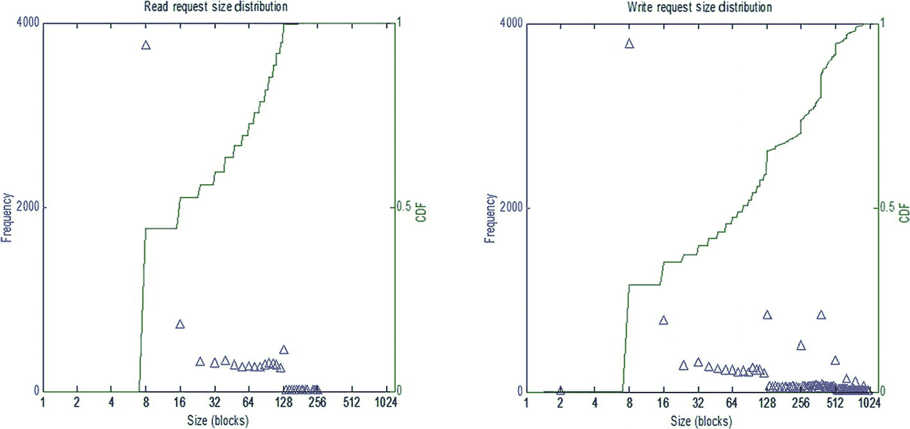

图 7-10  
`RAID`负载 2 的大小分布

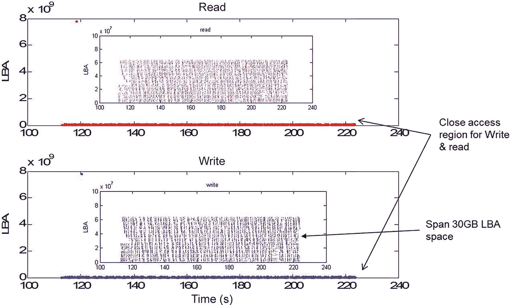

图 7-9  
`RAID`负载 2 的`LBA`分布

由于这是写密集型负载，我们应更关注写更新。图 7-11 展示了写请求的堆栈距离。这证实了定时写更新，即较小的重叠大小（可能由于数据块附带了元数据块）。从图 7-12 可以看出，基于`IOPS`，堆栈距离 250 大约相当于 2.1 秒。在此期间，在总体 52%的写命令命中中，接近 60%为全写命中，60%为部分写命中。这意味着某些部分在持续更新。因此，磁盘或系统可能需要一个随机访问区域或`NVM`来处理这一小部分更新数据。

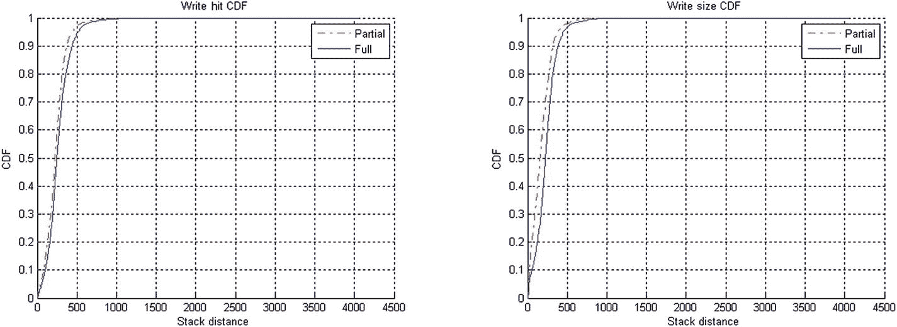

图 7-12  
`RAID`负载 2 的堆栈更新

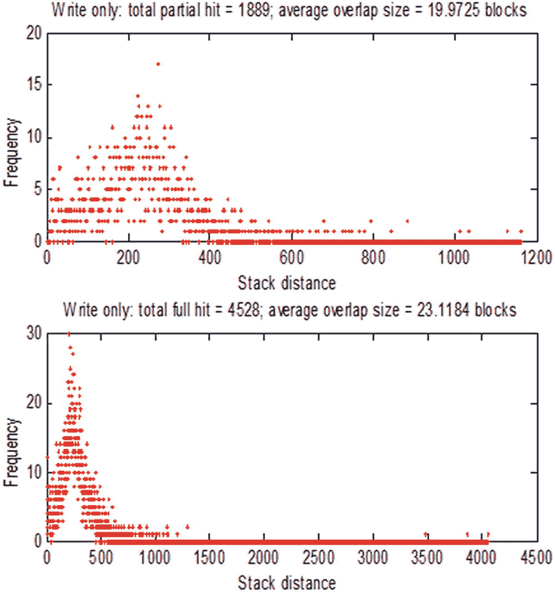

图 7-11  
`RAID`负载 2 的写堆栈距离

总之，数十个混合流导致了一种非完全顺序的`IO`模式，这表明需要一个带有长队列的合适流检测算法。特殊的元数据和奇偶校验结构导致了相对较高的`LBA`更新大小和较大的更新命令比例，这意味着可能需要大容量的`DRAM`/`NVM`/`RAZ`缓存来避免频繁更新。此外，可以得出结论，在之前读密集型的负载中，写缓存的影响非常有限。注意频繁的小空闲但低效的空闲间隔，这表明可能需要调整`GC`策略以适应这种情况。

对`SMR`驱动器的影响总结于表 7-5。本质上，由于相对较高的更新比例，对正常写访问的影响不容忽视。高更新命令比例可能导致相对较高的碎片整理需求。监控系统的元数据管理方案和/或`SMR`驱动器可能需要进行更改。由于有效的空闲间隔微乎其微，驱动器可能没有足够的空闲时间用于受`GC`策略约束的后台`GC`。

表 7-5  
负载 2 相对于`SMR`的主要特征

| `SMR`特征 | Hadoop 观察结果 |
| --- | --- |
| 顺序写入 | 大尺寸写请求（>=128 块）：35% 模式比例：当`Q=1`（`Q=128`）时，写操作为 18%（27%） 顺序命令比例（`M>=2`）：在`QL=1`时为写 35%，在`Q=256`时为 60% |
| 一次写入多次读取 | `R/W`：命令比 1:1.5；块比 1:6.1 高堆叠`ROW`比例 总写入块占全部访问块的 85.9% |
| 垃圾回收（`GC`） | 更新块（至少写入两次）占写入块的 13.4%，因此写更新比例和写放大率相对较高，为 115.5%（考虑到负载持续时间较短） 更新命令比例>50%，重叠较小，可能由于附带的元数据 主机端频繁但小尺寸的空闲时间不利于后台`GC` |
| 原地更新或异地更新 | 更新比例相对较高，因此有必要应用大容量`SSD`/`DRAM`/`AZR`缓存来提升性能（在缓存中进行写更新） |

此负载比之前的负载繁忙得多。总有效空闲时间（`空闲间隔 > 0.1 秒`）为 14.40 秒，总空闲时间为 98.6 秒。总有效空闲频率（`空闲间隔 > 0.1 秒`）仅为 33 次，而总空闲频率为 6244 次。现在的问题是，（有效）空闲时间是否足以进行后台活动。由于视频监控工作负载以及数据/元数据结构的相对一致性，每个`SMR`数据区域的垃圾比例相似。假设区域大小为 1GB，每磁道 3MB。此负载的总写入工作负载约为 1GB。那么，是否有可能在有效空闲时间内将 1GB 数据迁移到新位置？分析如下：

- 完成顺序读取 1GB 和顺序写入 887MB（假设垃圾比例为 13.4%）对于 7200RPM 的磁盘大约需要 5.3 秒。
- `GC`的平均有效空闲时间为`14.4/33 − 0.1 = 0.34`秒。假设`R/W`的定位时间为 6ms。`（0.34 − 0.006 * 2）`秒可以在`GC`区域内处理多达 64.4MB 的数据。^(⁶⁹) 总共 33 个空闲间隔可以处理约 2GB 数据，大于 1GB。
- 此外，旧视频数据会定期被新数据替换，这通常不会显著改变垃圾比例。

理想情况下，空闲时间似乎足以处理`GC`活动，前提是：

- 有效空闲时间应被充分利用，并且`GC`大小动态调整。
- 空闲时间算法在较低的空闲检测阈值下运行良好，例如从 100ms 降至 50ms，以增加`GC`活动。
- 其他后台活动不会占用太多时间。

然而，在现实中，可能需要大得多的空闲时间。特别是，碎片整理可能会显著增加写放大比例。

脚注 1

