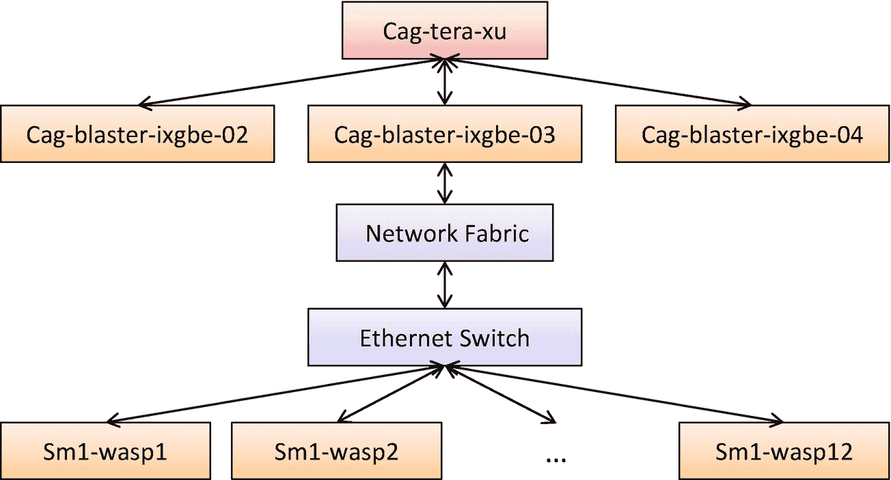
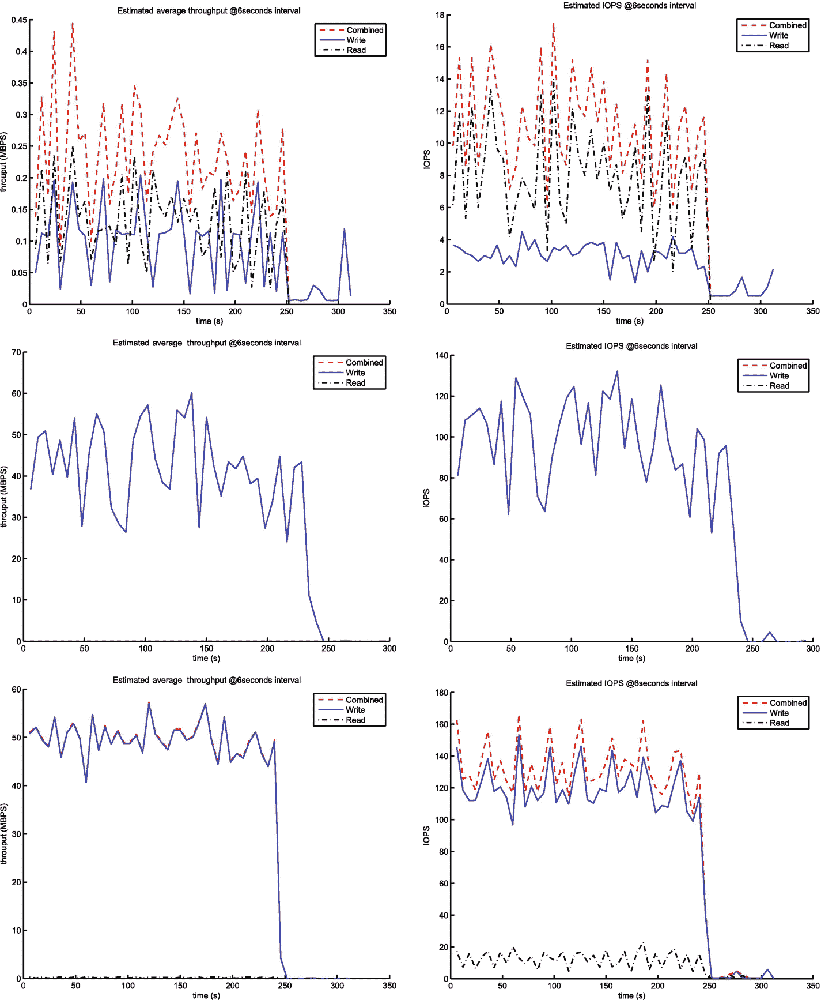
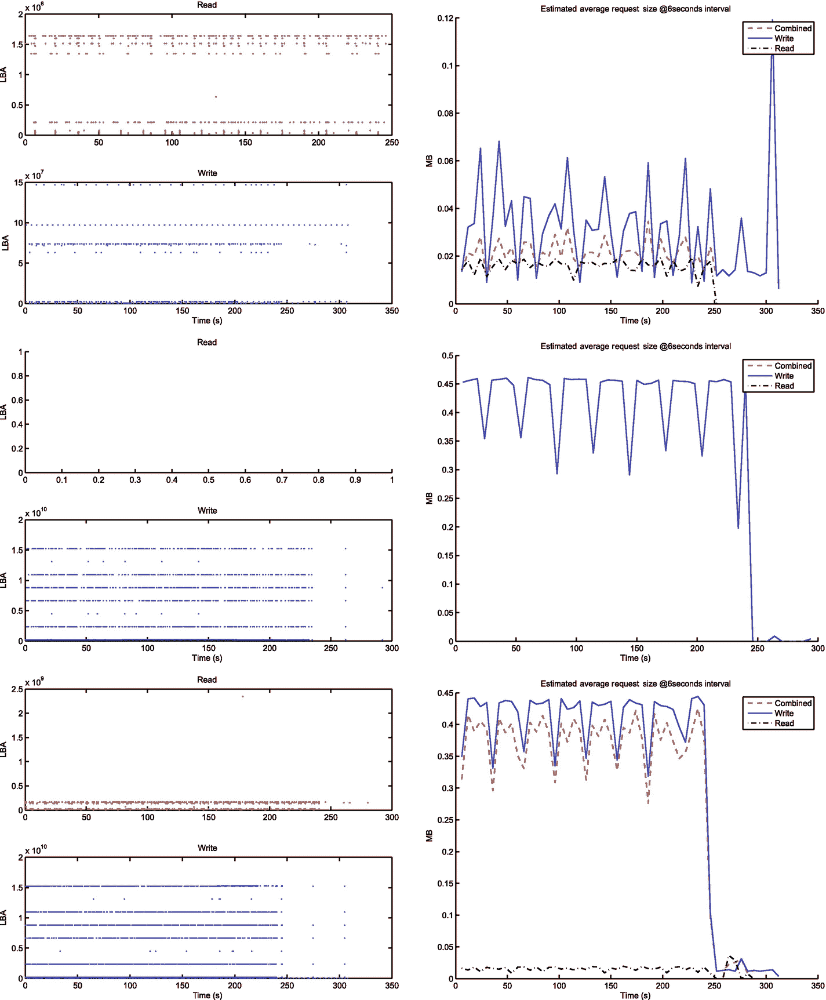
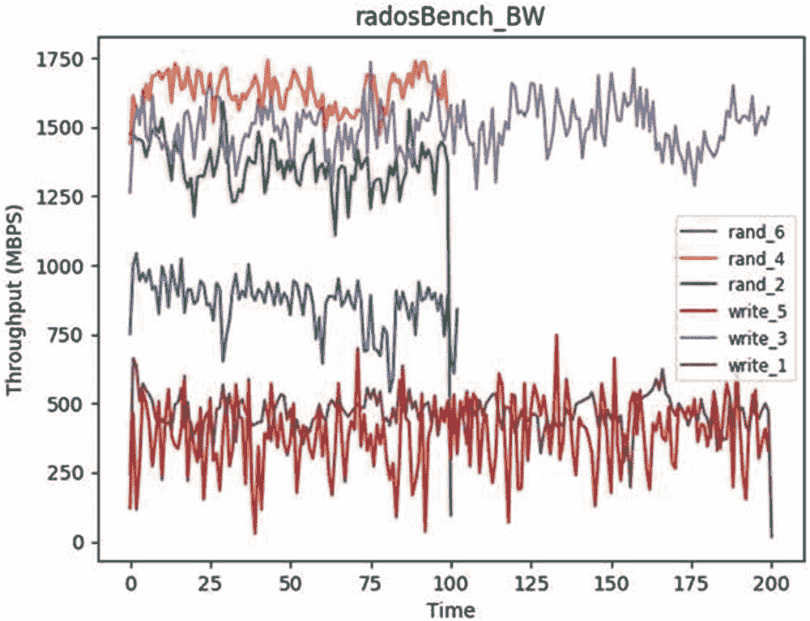
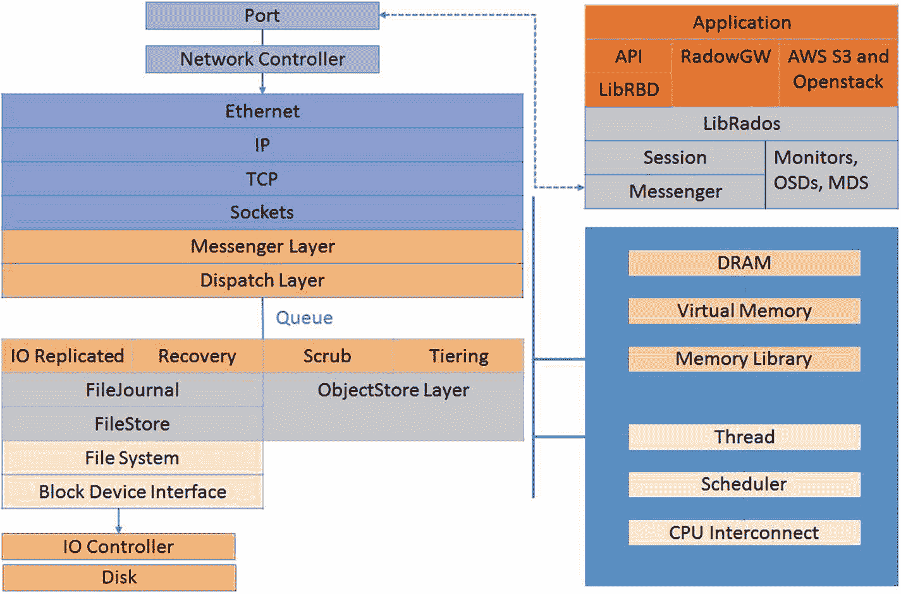
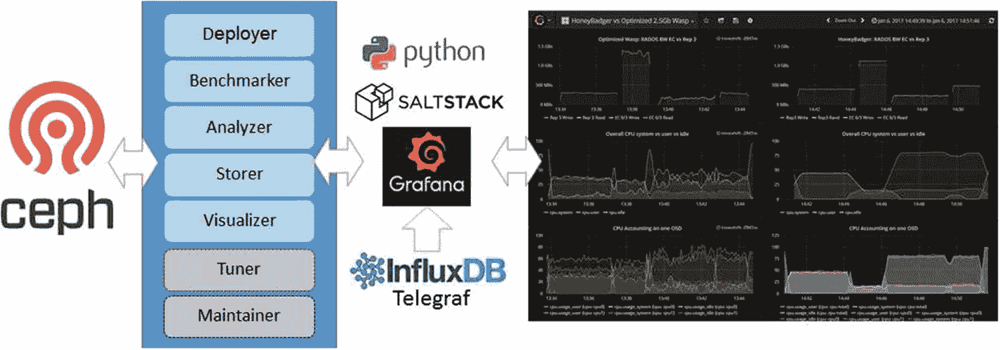

# 9. 案例研究：Ceph

Ceph 是一个开源分布式存储平台，为对象、块和文件级别的存储提供统一接口 [33, 80, 34, 81]。本章介绍基于 WD WASP/EPIC 微服务器的 Ceph 集群的块级工作负载特征。所呈现的分析技术可以帮助您理解 Ceph 在生产环境中的性能和驱动器特征。此外，我还将确定 SMR、混合磁盘和 SSD 驱动器是否适用于 Ceph 工作负载。

Ceph 的基本架构在第 1 章中已有描述。Ceph 的核心 RADOS 是一个完全分布式、可靠且自主的对象存储，它使用 CRUSH（可扩展哈希下的受控复制）算法。Ceph 的构建块被称为 OSD（对象存储守护进程）。OSD 负责在本地文件系统（例如 EXT4 和 XFS）上存储对象，并协作复制数据、检测和恢复故障，或在 OSD 加入或离开集群时迁移数据。Ceph 的设计源于一个前提：故障在大规模存储系统中很常见。基于此，Ceph 旨在通过利用 OSD 的智能来保证可靠性和可扩展性。每个 OSD 使用一个日志来加速写操作，方法是将小写入合并，并在日志满时异步刷新到后端文件系统。该日志可以是一个不同的文件，也可以位于另一个设备或分区中 [82, 83, 84]。

这些测试基于一个“独特”的平台。生产环境使用的是所谓的微服务器结构，而非传统工作站。在该系统中，每个微服务器拥有独立的操作系统和一个硬盘驱动器。这几乎是 IO 设备的最小粒度，本质上满足了 Ceph 之父 Sage Weil 的原始设计要求 [80, 33]。实际上，这种架构将故障域最小化到单个磁盘单元，而不是像多磁盘架构那样，一个服务器中的多个磁盘同时变得不可访问。存储集群通过机架顶部的以太网交换机连接微服务器来实现横向扩展。

一个包含 12 个节点（命名为 `sm1-wasp1` 到 `sm1-wasp12`）的基于微服务器的集群如图 9-1 所示。三个虚拟机（VM）作为客户端生成 IO 请求（命名为 `Cag-blaster-ixgbe-02` 到 `Cag-blasterixgbe-04`）。所有测试均在 Ceph Jewel 版本中完成。在这种基于微服务器的 filestore 配置中，每个节点/驱动器被划分为四个分区。`/dev/sda1` 安装操作系统（Ubuntu），`/dev/sda3` 被保留。`/dev/sda2` 用于元数据，`/dev/sda4` 用于用户数据。

图 9-1

Ceph 集群拓扑

## Filestore IO 模式

三个虚拟机作为客户端，向一个复制池（名为 `rep1`，副本数为 1）发送基准测试写入请求，持续 250 秒，并使用 `blktrace` 收集跟踪数据 310 秒，因此每个客户端执行 `rados bench -p rep1 250 write`，每个节点执行 `blktrace /dev/sdax -w 310`。由于 `blktrace` 的限制（它无法收集同一驱动器中的单个分区），`sda2`/`sda4` 和整个 `sda` 的跟踪数据是分开收集的。还使用了一个总线分析器来验证跟踪数据。

12 个节点的共同属性列于表 9-1 中。您可以观察到基本属性大体相似。其中一个 IO 模式曲线如图 9-2 和 9-3 所示，其中三行分别代表 `sda2`、`sda4` 和 `sda`。请注意，所有 wasp 节点都启用了写缓存。命令 `"ceph tell osd.* bench 41943040 4194304"` 给出了大约 100MBPS（缓存后）。因此，这意味着三个客户端（每个 32 个线程）几乎完全占用了磁盘带宽。原因将在后面解释。

您还可以看到，不同节点的 IO 模式可能仍然存在差异；例如，某些节点的读写比率较高，而其他节点则较低，并且空闲时间分布也有所不同。根据读写比率，我们可以将 IO 模式大致分为两类：一类是读主导，另一类是写主导。当读主导时，读的平均大小会变小。

图 9-3

不同分区中的 IO 模式：吞吐量和 IOPS

图 9-2

不同分区中的 IO 模式：LBA 和大小分布

表 9-1

Ceph 节点的共同属性

| 属性 | 元数据 | 数据 |
| --- | --- | --- |
| 读写 | 混合读写 | 无读请求 |
| 大小 | 相对较小的请求（8 块请求占主导）；写入大小变化很大；读写比率变化很大。 | 1024 块请求占主导，其次是小块 |
| 顺序性 | 模式 = 8（非常小）；在较小范围内相对随机。近顺序比率远高于严格顺序比率（50% 的请求存在小间隙） | 模式 = 0；高顺序比率。近顺序比率更高（5% 的写入请求存在小间隙） |
| 写入更新 | 高更新比率（>50% 的写入请求被更新） | 低更新比率（更新块 <1%，更多是部分更新） |
| 写入堆栈距离 | 达到高命中率所需的距离相对较小；平均重叠大小较小（8 块）；写缓存是必要的。 | 达到高命中率所需的距离相对较大；平均重叠大小较小；写缓存是不必要的。 |

表 9-2 显示了不同场景下不同节点的总空闲时间。基本上，空闲时间分布不均，这意味着每个节点的工作负载实际上是不均衡的。换句话说，某些节点非常繁忙，例如“3-8”（3 个客户端，8 个线程）情况下的 `wasp12`，而某些节点则非常“懒惰”，例如“3-8”情况下的 `wasp8`。这部分是由于负责 PG（放置组）分配的 CRUSH 算法所致。尽管合理数量的客户端和线程可能会缓解不均衡分布，但可能无法从根本上解决这个问题。因此，应实施一些改进策略，例如异步、主动反馈、可调整 PG 等。

表 9-2

前 240 秒内的总空闲时间

| 客户端-线程数 | wasp4 | wasp5 | wasp6 | wasp7 | wasp8 | wasp9 | wasp10 | wasp11 | wasp12 | 平均值 | 标准差 |  |  |
| --- | --- | --- | --- | --- | --- | --- | --- | --- | --- | --- | --- | --- | --- |
| 3–8 | 52.48 | 17.77 | 55.34 | 44.65 | 114.21 | 9.1 | 48.49 | 21.13 | 0.7 | 40.43 | 34.17 | 0.85 | 162.2 |
| 3–16 | 107.78 | 0.15 | 76.31 | 113.58 | 0.85 | 39.87 | 5.91 | 22.52 | 61.66 | 47.63 | 44.53 | 0.93 | 746.81 |
| 3–32 | 48.09 | 63.42 | 35.93 | 4.19 | 8.45 | 0.01 | 25.61 | 0 | 4.87 | 21.17 | 23.34 | 1.1 | 895803 |
| 3–64 | 69.69 | 37.38 | 79.85 | 33.21 | 32.67 | 30.81 | 29.85 | 31.31 | 30.2 | 41.66 | 19.07 | 0.46 | 2.68 |
| 1–8 | 150.49 | 15.65 | 130.66 | 0.31 | 7.65 | 5.34 | 127.56 | 1.01 | 5.18 | 49.32 | 65.63 | 1.33 | 488.16 |
| 1–16 | 21.65 | 5.19 | 48.3 | 151.41 | 39.05 | 2.13 | 19.54 | 37.68 | 17.54 | 38.05 | 45.22 | 1.19 | 71.03 |
| 1–32 | 8.13 | 5.59 | 95.29 | 32.94 | 6.36 | 9.03 | 78.46 | 102.52 | 42.2 | 42.28 | 39.91 | 0.94 | 18.34 |
| 1–64 | 17.03 | 114.01 | 58.21 | 1.23 | 32.77 | 17.55 | 9.72 | 6.1 | 36.54 | 32.57 | 35.32 | 1.08 | 92.77 |

## 性能一致性验证

性能一致性是企业存储系统的一项基本要求，它保证了在相同条件下性能的可重复性。有多种方法可以对此进行检查。表 9-3 对此进行了总结。

表 9-3

三种方法的比较

| 指标 | 优点 | 缺点 |
| --- | --- | --- |
| 假设检验 | 全局视角，信息相对完整；严格意义上的一致性。 | 难以满足 |
| 仅平均值 | 简单且相对容易满足 | 仅关注平均值，信息有限，视角片面 |
| 范围容差 | 工程师的实践视角；易于检查。 | 视角片面；通常依赖于实验。 |

第一种是假设检验方法，实际上可用于检验两个或多个样本在统计意义上是否具有相同的均值（和方差）、中位数或分布。一个简单的流程如下：

1.  检查所有轮次的测试是否都处于稳态。
2.  将每轮测试的稳态数据作为一个样本向量，进行整体一致性检验或两两（配对）检验。
3.  根据不同的需求/假设，选择合适的假设检验方法。

一些常见的假设检验方法应用于不同场景：

-   **F 检验：** 要求每个样本向量服从正态分布；如果最终的 `p-value` 小于预设的显著性水平（默认为 0.05），则拒绝这些样本具有相同均值的假设。
-   **H 检验：** 要求每个样本向量服从连续分布（条件较弱）；如果最终的 `p-value` 小于预设的显著性水平（默认为 0.05），则拒绝这些样本具有相同中位数的假设。
-   **T 检验：** 仅适用于配对独立检验；如果最终的 `p-value` 小于预设的显著性水平（默认为 0.05），则拒绝这些样本具有相同分布的假设。

这种方法实际上给出了一个相对严格意义上的结果。然而，在大多数情况下，你可能允许存在一些差异。

第二种方法使用简化的统计方法，仅关注平均值而不考虑整体趋势，通常仅用于粗略估计：

1.  获取每次测试（可能处于稳态）中关注指标的平均值。
2.  用所有轮次的平均值构成一个样本向量。
3.  检验该向量是否服从具有可接受方差的正态分布（或其他实验性分布，如均匀分布）。

第三种是范围容差方法，它检查性能是否处于我们实验上可以容忍/允许的某个区域内：

1.  检查每次运行的值是否在该次运行均值或预期实验值的某个范围内。有两种情况：一种要求所有数据点（如延迟）都在范围内，另一种仅要求几乎所有数据点（如吞吐量）都在范围内。
2.  检查每次运行的平均值是否在所有运行均值的某个范围内。

这种方法通常需要专家设定合适的阈值，以构建一个合理的范围。

让我们看一个例子，该例子在相同环境下进行了七轮测试，如表 9-4 所示。每轮测试包含三次随机读取和三次顺序写入访问。由于 `F-test` 要求正态性，你首先对每轮测试进行正态性检验。在某些情况下，如果无法捕获足够的数据，你可以简单地将其标记为无效。在此示例中，你可以看到，对于名为 `rand_6` 的测试，七轮中只有两轮通过了正态性检验，并且这两轮可能具有相同的均值。总体而言，结果表明性能并非严格一致。

表 9-4

假设检验方法示例

| 值 | `rand_6` | `rand_4` | `rand_2` | `write_5` | `write_3` | `write_1` |
| --- | --- | --- | --- | --- | --- | --- |
| 正态 | 2 | 3 | 2 | 6 | 0 | 2 |
| 非正态 | 5 | 3 | 5 | 1 | 7 | 5 |
| 无效 | 0 | 1 | 0 | 0 | 0 | 0 |
| `F-value` | 3.114 | 60.405 | 3.261 | 24.002 | 24.002 | 57.901 |
| `P-value` | 0.079 | 0 | 0.073 | 0 | –1 | 0 |
| 结果 | 1 | 0 | 1 | 0 | –1 | 0 |

如果你改用仅平均值和范围容差方法，你可能会在宽松的意义上得到另一种观察结果，如表 9-5 和 9-6 所示。表 9-5 显示了每轮测试的平均吞吐量（以 MBPS 为单位），以及总体均值和标准差。表 9-6 显示了每轮测试与总体平均值之间的差异比率。你可以看到大多数比率都在 10% 以内。如果客户允许 20% 的范围，你可以说系统满足性能一致性要求。请注意，每轮测试的曲线也应在“连续”意义上满足某些范围要求。图 9-4 展示了六项测试的一个示例。表 9-7 给出了落在均值 ± 20% 或 ± 10% 范围内的数值总数占比。如果设定 20% 的范围，你可以看到只有名为 `write_5` 的测试不满足要求。

表 9-7

给定均值范围内数值的比率

| 比率 | `rand_6` | `rand_4` | `rand_2` | `write_5` | `write_3` | `write_1` |
| --- | --- | --- | --- | --- | --- | --- |
| ± 0.2 | 0.91 | 1 | 0.99 | 0.44 | 1 | 0.9 |
| ± 0.1 | 0.73 | 0.99 | 0.89 | 0.2 | 0.91 | 0.6 |

图 9-4

一轮测试中六项测试的带宽

表 9-6

通过范围容差方法进行比较

| 差异比率 | `rand_6` | `rand_4` | `rand_2` | `write_5` | `write_3` | `write_1` |
| --- | --- | --- | --- | --- | --- | --- |
| R0 | –0.160 | 0.043 | 0.146 | –0.137 | 0.006 | 0.033 |
| R1 | –0.129 | 0.014 | 0.028 | –0.090 | 0.016 | –0.016 |
| R2 | 0.007 | 0.046 | 0.069 | 0.045 | 0.054 | 0.127 |
| R3 | 0.122 | –0.005 | 0.087 | 0.056 | –0.023 | 0.004 |
| R4 | 0.102 | –0.023 | –0.006 | 0.077 | –0.043 | –0.081 |
| R5 | 0.115 | –0.043 | –0.151 | 0.098 | 0.045 | 0.076 |
| R6 | –0.058 | –0.032 | –0.173 | –0.048 | –0.054 | –0.143 |
| 最大值 | 0.122 | 0.046 | 0.146 | 0.098 | 0.054 | 0.127 |
| 最小值 | –0.129 | –0.043 | –0.173 | –0.137 | –0.054 | –0.143 |

表 9-5

Rados Bench 带宽汇总

| 均值 | `rand_6` | `rand_4` | `rand_2` | `write_5` | `write_3` | `write_1` |
| --- | --- | --- | --- | --- | --- | --- |
| R0 | 679.72 | 1642.15 | 1613.56 | 327.86 | 1261.88 | 405.87 |
| R1 | 704.20 | 1596.64 | 1446.77 | 345.57 | 1275.05 | 386.54 |
| R2 | 814.66 | 1646.67 | 1503.92 | 397.04 | 1322.19 | 442.87 |
| R3 | 907.08 | 1566.22 | 1529.88 | 401.05 | 1225.51 | 394.28 |
| R4 | 891.53 | 1539.09 | 1399.01 | 409.12 | 1200.37 | 360.88 |
| R5 | 902.05 | 1507.67 | 1194.60 | 416.98 | 1310.67 | 422.73 |
| R6 | 762.12 | 1524.56 | 1164.23 | 361.48 | 1186.59 | 336.50 |
| 总体均值 | 808.77 | 1574.71 | 1407.42 | 379.87 | 1254.61 | 392.81 |
| 标准差 | 88.65 | 51.49 | 157.14 | 32.06 | 48.69 | 33.39 |
| 标准差/均值 | 0.11 | 0.03 | 0.11 | 0.08 | 0.04 | 0.09 |

## 瓶颈识别

Ceph 是一个相当复杂的系统，其性能由硬件和软件共同决定 [41]。从硬件角度来看，CPU、内存、磁盘和网络是四个主要组成部分。表 9-8 和 9-9 提供了一些总体观点。从软件方面来看，影响因素更多，例如文件系统、Linux 操作系统设置、内存分配器等。此外，Ceph 系统配置提供了数百个参数，其中许多参数会影响整体性能。因此，通常很难识别整个系统的性能瓶颈。

**表 9-9** 磁盘的影响

| 变量 | 选项 | 备注 |
| --- | --- | --- |
| 驱动器类型 | HDD、SSD、NVM 等 | 需考虑价格与性能之间的平衡；通常 SSD 用作缓存和日志；不平衡的结构可能导致性能损失；一个故障驱动器可能影响整个存储池的性能（`ceph osd perf`）。 |
| 驱动器数量 | 每台服务器的驱动器数，每个 OSD 的驱动器数 | 更多驱动器可提高每台服务器的吞吐量，但会降低每个 OSD 的吞吐量；每个盘片/驱动器对应一个 OSD。 |
| 驱动器控制器 | SAS/ SATA/ PCIe HBA 等 | 更多/更好的 HBA 可提高吞吐量。硬件 RAID 可能提高 IOPS。每 6-8 个 SAS 驱动器配备一个 HBA 时性能最佳，但使用 SAS 扩展器让一个 HBA 控制 24 个（或更多）驱动器成本更低。为实现最大吞吐量，可使用更多 HBA 和更少的扩展器；当不需要全驱动器吞吐量时，可应用 SAS 扩展器以最小化成本。 |
| RAID 控制器 | 启用/禁用；缓存 | Red Hat、Supermicro 和 Seagate 的最新测试也表明，带有板载回写缓存的优质 RAID 控制器可以加速面向 IOPS 的写入性能。虽然 Ceph 不使用 RAID（因为它同时支持简单复制和纠删码），但合适的 RAID 控制器缓存仍可通过板载缓存提高写入性能。 |
| 驱动器缓存 | 启用或禁用写入缓存 | 缓存对小写入性能有重大影响 |

**表 9-8** CPU、内存和网络的影响

| 变量 | 选项 | 备注 |
| --- | --- | --- |
| CPU | 核心数、速度、架构、指令集等 | 常见建议是每个 OSD 至少有一个（虚拟）核心。更快的 CPU 核心通常有助于性能提升，尽管 CPU 架构也很重要（例如，Intel 与 ARM、内部架构/版本），以及实际的每 GB 性能、每美元性能等。关闭节能模式有帮助。 |
| 内存 | 每台服务器的 RAM，每个 OSD 的 RAM 等 | 常见建议是每 1TB OSD 至少 1GB 内存，每个 OSD 最好有 2GB。实际值取决于工作负载。 |
| BIOS | HT 模式、节能、NUMA 等 | HT 影响虚拟核心数（启用）。需权衡节能带来的低功耗与分配的计算资源减少。 |
| 网络交换机/NIC | 带宽和延迟；以太网、光纤、InfiniBand 等 | 更高的带宽在一定程度上带来更高的吞吐量；更低的延迟有利于更多小 IO。对于高质量网络，尝试设置 `ms crc data = false` 和 `ms crc header = false`。对于少于 20 个机械盘或 2 个 SSD 的集群，考虑升级到 25GbE 或 40GbE。 |

从这个意义上说，您应该监控系统的所有必要组件，以便得出结论。以图 9-5 中的 Ceph 软件栈为例。您可以将相应的系统监控工具 ^(⁷⁴) 部署到感兴趣的栈点以收集数据，从而捕获所有可能的软件故障、错误、性能下降等位置，以及所有潜在的软件性能调优点。事实上，Ceph 有一些内置的监控工具，例如 `LTTng`。

**图 9-5** Ceph 软件栈

已经开发了用于 Ceph 部署、监控和管理的专用工具，例如 `CeTune`（Intel）、^(⁷⁵) `VSM`（Intel）、^(⁷⁶) `OpenATTIC`^(⁷⁷) 和 `InkScope`。^(⁷⁸)

借助一些集成工具，例如 `SaltStack`，^(⁷⁹) 您可以设计自己的全能工具。图 9-6 展示了一种可能的设计，旨在集成 Ceph 系统的配置、部署、基准测试和测量分析功能。它可以使用“胶水”编程语言 `Python` 以及一些 `Bash` 脚本来开发。

**图 9-6** Ceph 性能工具的功能

如图 9-6 的整体结构所示，该工具集成了一些组件，例如用于 Ceph 管理的 `SaltStack`、用于性能数据收集和存储的 `InfluxDB`^(⁸⁰) 与 `Telegraf`^(⁸¹)，以及用于数据可视化的 `Grafana`。^(⁸²) 所有这些工具都是开源的，并采用免费许可证（`InfluxDB`/`Telegraf` 采用 MIT 许可证，`Grafana`/`salt-stack` 采用 Apache v2 许可证）。

`SaltStack` 平台或 `Salt` 是一个用 `Python` 编写的开源配置管理软件和远程执行引擎。它本质上具有服务器-客户端结构。您可以使用 `Salt` 来管理 Ceph 节点并分发执行命令。`InfluxDB` 是一个从头开始构建的时间序列数据库，用于处理高写入和查询负载。`Telegraf` 由 `Go`^(⁸³) 开发，是一个指标收集守护进程，可以从广泛的输入中收集指标，并将其写入广泛的输出组中。它采用插件驱动的方式进行数据收集和输出，便于扩展。它是一个编译好的独立二进制文件，可以在任何系统上执行，无需外部依赖；不需要 `npm`/`pip`/`gem` 或其他包管理工具。一旦 `Telegraf` 守护进程运行，数据将自动保存到 `influxDB`。`Grafana` 提供了一种强大而精致的方式来创建、探索和共享仪表板和信息，与您的团队和世界分享。数据库设置完成后，您可以配置 `Grafana` 的数据源，从这些 `influxDB` 中获取数据。

使用此工具，您可以轻松获取所有必要信息。请查看文件存储 IO 模式部分提供的示例。从表 9-2 中，您可以清楚地观察到某些驱动器的 IO 带宽已被耗尽。然而，同时 CPU、内存和网络的使用率都低于 50%。因此，您可以得出结论：驱动器是性能瓶颈。

脚注 1 2 3 4 5 6 7 8 9 10

