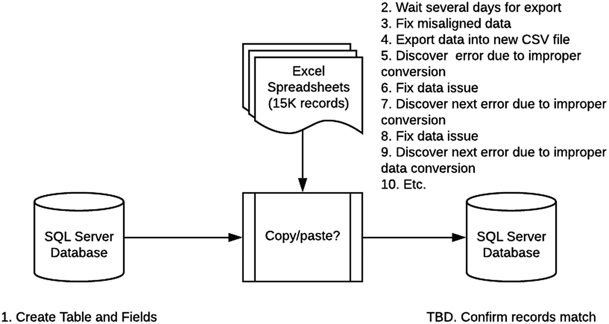
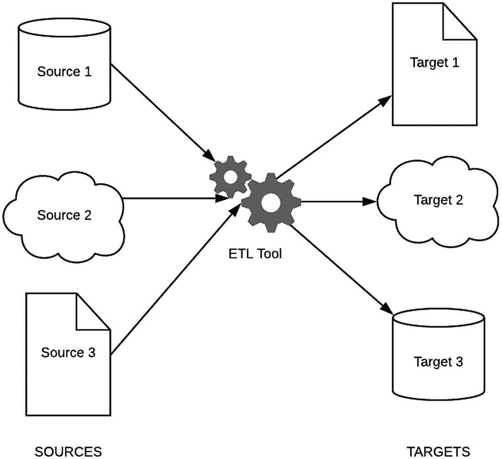

# 我的故事

我刚走出校门，对数据集成世界还相对陌生，就经历了项目管理的第一堂硬课：“没有什么事会像工作说明书（`SOW`）声称的那么容易。”当时，我是一个五人咨询团队的成员，负责构建一个网页应用程序。我们的角色明确：一名项目经理（`PM`）、一名业务分析师（`BA`）、两名网页开发人员，以及一名数据集成专家。我就是那个数据集成专家，并且对这个头衔感到自豪，尽管我对自己将要做什么并不太了解。我也不知道，作为新人，我是可以被牺牲的。这个项目将是一次火炼般的经历，因为数据集成是该公司提供的一项相对较新的服务，他们意识到把我直接扔进火里也没什么损失。

根据这本厚重精装工作说明书中仅有的两页内容，我的主要目标是将大约 15,000 个地址从 Excel 电子表格导入到 SQL Server 7.0 数据库中。换句话说，我们的客户会提供我们所需的所有字段。我有三项基本任务（参见图 1）：

![][我的第一次集成图]

**图 1** 我的第一次集成（表面视图）

1.  在 SQL Server 数据库中创建相关的表和字段。
2.  从电子表格中导入地址。
3.  确保 Excel 电子表格和数据库中的 15,000 条记录匹配。

是的，在纸面上看起来非常简单，即使对我来说也是如此——迄今为止我做的最复杂的集成不过是将本科《心理学 101》的成绩从记事本复制粘贴到 Lotus 数据库中。尽管如此简单，当我们的开发人员意识到网页应用在投入生产前还需要稍作调整时，我并没有担心。是的，这是一个阻碍，但我们仍有充足的时间。见鬼，如果情况真的变得最糟糕，我总可以做出难以想象的事：周五晚上加班（记住，我对咨询这行还是个新手）。只要我们能在截止日期前加载好示例数据，一切就会顺利解决。这不过是复制粘贴，可能只是多按几个按钮而已。

在 SQL Server 中创建表和字段很容易。但获取导入文件却没有那么容易。文件终于在周四早上通过一个 USB 驱动器送到了。加载它时，我逐渐意识到出了问题。字段本身看起来，嗯，不太寻常。经过某种奇怪的逗号分隔转换后，本应是“州”的字段跑到了“国家”字段里。我们遇到了空白的电话号码，有些只是“0”（我们是在呼叫接线员吗？），甚至还有像“N/A”这样人类能接受的值，而这些值在读取到数字开放表字段时会导致崩溃。犹豫片刻后，我终于不得不承认，我无法处理这些数据。

在花费了周四和周五的大部分时间与我们的客户一起手动清理这 15,000 条记录之后，第二步开始了。现在是时候从电子表格中导入地址了，这原本应该只是 Windows 应用程序之间的复制粘贴。实际上，它涉及的内容要多得多（参见图 2）。首先，Excel 的专有驱动程序没有正确安装到数据库中，我立即收到了“文件未找到”的错误。好吧，这有点沟通失误，但只要我将 Excel 文件导出为一个新的逗号分隔文件，就能很快解决。

嗯，其实并非如此。只有当联系人恰好来自新泽西州、马萨诸塞州或任何其他美国邮政编码以“0”开头的城镇时，导入才会出现问题。Excel 有一个有趣的功能：如果某个字段未正确定义为特定格式，以“0”开头的字段在导出时会自动被移除（我们称之为“**前导零**”，你可以在此处了解更多解决方法——[*https://support.office.com/en-us/article/format-numbers-to-keep-leading-zeros-in-excel-online-633401e5-f2ad-4ac7-afef-05ed58b1c9a1*](https://support.office.com/en-us/article/format-numbers-to-keep-leading-zeros-in-excel-online-633401e5-f2ad-4ac7-afef-05ed58b1c9a1)）。^(²) 因此，在我们导入 15,000 条记录时，几乎立刻就在 `ZIPCODE` 字段上遇到了 `INVALID LENGTH` 错误。我们期望该字段至少包含五个字符，但在这种情况下，只收到了四个字符。于是，我排查错误、修复问题，然后从头开始重新导入，直到遇到下一个字段错误。接着是下一个，再下一个，如此循环往复。

**图 2** 我的第一次集成（实际视图）

麻烦远不止于此。那个漫长周末的数据转换过程仿佛没有尽头。关于数据迁移，我积累了足够多惨痛的教训（多到足以写一本书，咳咳）。有太多方面需要考虑，有太多事情我本以为理所当然，若能早点知道，本可以做得更好。但正如那句老话所说：“将伤痛化为智慧。” 我就先说到这里吧。

那次经历让我感到震惊和疲惫。我害怕随后与团队的那场对话。我以“我们无法部署，因为我还没准备好数据……”开始了谈话。

我认为，虽然我的数据加载工作不算出色，但也取得了一些进展。连续三个晚上每晚只睡两个小时，难免会这样。但综合考虑，这个项目本身称不上成功，而其中只有一部分问题与数据相关。令我惊讶的是，并没有人互相指责，也没有人说出显而易见的事实：作为一名数据集成人员，我完全力不从心。

恰恰相反，我的经理因我的坚持不懈而表扬了我的表现。也许是因为这个，但更有可能是因为我幸存了下来，得以再战。无论如何，人事安排又让我参与了另一个数据迁移项目。这一次，我发誓要从错误中吸取教训。那次事情进展得顺利了一些。不算完美，但更顺畅了。

很快，我成了数据集成方面的核心人物。这个角色一直伴随着我。但达到这个位置并不容易。你不仅要努力让数据符合标准，还要与技术和非技术团队成员沟通，确保他们理解一项任务的细节和关键——这项任务至少在架构图上看起来很简单，就像按几个按钮进行复制/粘贴一样简单。你必须适应项目中集成部分此消彼长的节奏，通过建立一种在开发工作开始前很久就已存在的结构和模式来应对，甚至可能早在团队提出用户需求之前。简而言之，你需要从一开始就打好基础，并且需要有一个准备好并愿意提供支持的团队。

这就引出了我写这本书的原因。主要有两点。第一，正如我希望已经阐明的那样，数据迁移看起来非常简单，因为你只需将数据从 A 点移动到 B 点，但它很可能在没有预警的情况下迅速变得非常混乱。糟糕规划的典型后果就是错过截止日期、产生未预见的开销，而且常常伴随着最后时刻孤注一掷的英勇行为，并带有一种奇怪的乐观口吻（“我做到了，而且过去两天只睡了三个小时！”）。当然，我想我们都更希望避免这些后果，我希望这本书能帮助你从一开始就规划和协调集成团队的工作。

写这本书的第二个原因，是为了向项目中所有相关方——从项目经理到开发人员，再到利益相关者——强调，数据迁移是项目计划中最关键的部分之一，甚至 *就是* 最关键的部分。我见过太多次迁移计划被搁置到开发阶段的末尾，几乎成了对占据中心舞台的软件工作版本的“事后想法”。我认为这是个错误，因为无论一个软件产品看起来多么光鲜，无论你增加了多少功能和规范，如果数据不正确——例如，如果你最重要的收据丢失或客户数据损坏——那么这个软件就是有缺陷的。仅此而已。

然而，如果尽早并正确地完成迁移，你会发现，没有什么比听到客户告诉你，他们的生活因数据问题不复存在而变得轻松多了更令人有成就感。是的，一开始可能需要付出艰苦的努力和漫长的时间，但最终一切都是值得的。

在我们开始讨论主要话题之前，让我们先澄清一个误解——因为我在本书中会交替使用这两个术语。我们来讨论一下数据迁移和数据集成之间的区别。

## 数据迁移与数据集成之间的区别

我们将迁移定义为“从一个地方移动到另一个地方”。^(³) 你可能会立刻联想到角马和长颈鹿穿越塞伦盖蒂的不同区域，或者帝王蝶向南迁徙，而鲑鱼则逆流而上，返回它们的出生地。在数据的语境下，情况也有些类似。我们指的是信息从一台服务器（源，即*来源*）移动到另一台服务器（目标，即*目的*）的过程。迁移通常发生在特定数据库产品的生命周期中出现一次或两次，例如从旧版数据库迁移到更现代的实用应用程序时。

图 3

集成模型

如图 3 所示，迁移不仅限于数据库。例如，Excel 电子表格可以作为源系统或目标系统。在某个时刻，也许在手动输入了几个月的人力资源（HR）问卷调查结果之后，我们可能希望将数据迁移到更高效的存储机制中。这种迁移可以在一个周末内一次性完成（在某些组织里称为“大爆炸”），或者跨多个周末、数周甚至数月完成（称为增量迁移）。关键在于，数据最初并不存在于目标系统中，迁移发生后，数据才可供使用。

另一方面，集成被定义为“将各部分结合成一个整体的行为”。^(⁴) 从技术上讲，它意味着针对*已经*存在的数据添加或更新新数据。换句话说，数据集成是在初始数据加载完成且系统投入运行之后，再引入新的或更新的数据。这个术语主要适用于那些在凌晨或全天非高峰时段，甚至每时每刻到达的数据加载（这有时被称为“实时”，或者按照纯粹主义者的偏好，称为“近实时”，因为源输入与目标输出之间存在轻微的处理延迟）。

在项目计划中，区分数据迁移和数据集成至关重要，因为前者通常比后者需要更多的规划和时间投入。数据迁移需要对系统架构、数据存储和业务需求进行全面的分析，而数据集成通常是在已有系统上进行的，该系统已提供了明确的指令和文档（至少在理论上是这样）。因此，在集成项目中，发现和开发数据加载所需的时间通常更快，尽管它也有其独特之处。项目团队常常模糊这两类任务的界限，假设更复杂的数据迁移方法也能像即插即用的数据集成一样简单。正如我之前提到的，当现实情况显现时，这往往会是个巨大的意外，尤其是在那些将迁移和集成组件随意合并到`SOW`中的单一操作的情况下。

考虑到这一区别，本书的书名以《构建一个数据集成团队》开头。我本来也可以将其命名为《构建一个数据迁移团队》，或者更准确地说，《构建一个数据迁移与数据集成团队》。在迁移领域，“集成”常常是描述这两种操作的实际用语。大多数职位招聘要求的是“集成工程师”而非“迁移工程师”。我想前者更短，读起来也更顺口。大多数人——即使是那些认识到这两项活动区别的人——会假设这个角色需要具备迁移能力以及构建集成流程的能力。

由于迁移和集成需要不同的方法论，我都会涉及，但我会用“数据集成”这个术语来同时指代迁移和集成。通过本书的学习，我的目标是让你掌握这两个主题的知识，并清楚了解它们之间的细微差别。

## 技术细节：何必费心？

在这一点上，你可能想知道我为什么要用所有这些技术细节来打扰你。毕竟，大多数现实项目都会限制需要迁移的记录数量。很少有项目拥有数百万条记录，有些甚至比我职业生涯早期不得不面对的那 15,000 条还要少。如果你的项目只有几百条记录，并且你才刚刚开始使用一个全新的应用程序，那么直接插入数据然后继续前进岂不是更简单？

对此，我给出一个强烈的*是*的答复。在这种情况下，最简单的解决方案可能就是最好的。如果可以避免实施一个详细的数据迁移项目，你很可能应该这样做。过去我多次通过解释以下观点来捍卫这一立场：花一周时间手动输入数据，可能比尝试编写一个涉及方法论、规则以及项目交付中所有其他人工制品的完整源到目标解决方案要好。这种澄清通常会让寻求快速交付的客户感到高兴，让设定费用的客户经理团队感到沮丧，并让项目经理感到困惑，因为他们突然必须将注意力从集成细节转回到软件开发上。

正如我之前讨论过的，迁移的问题不在于简单的解决方案，而在于那些看似简单的方案；这些情况表面之下隐藏着更多问题。当然，可能“仅仅”是几百条记录，但有多少列呢？5 列？10 列？100 列？数据越多，涉及的复杂性就越大。那么数据结构呢？这些列存储的是容易表示的字段，比如称呼、名和姓，还是像项目代码、冗长的 ID 或几乎不可能手工输入的二进制附件（如 PDF）这样的大型字符串？即使采用了最佳的设计策略，也可能有一两个“陷阱”只有在团队审查源后才会浮出水面。因此，至关重要的是，无论一个迁移项目看起来多么简单，务必对其进行分析，因为你最初的印象可能并不正确。请尽快这样做，因为项目一旦启动，期望就已经被设定了。

