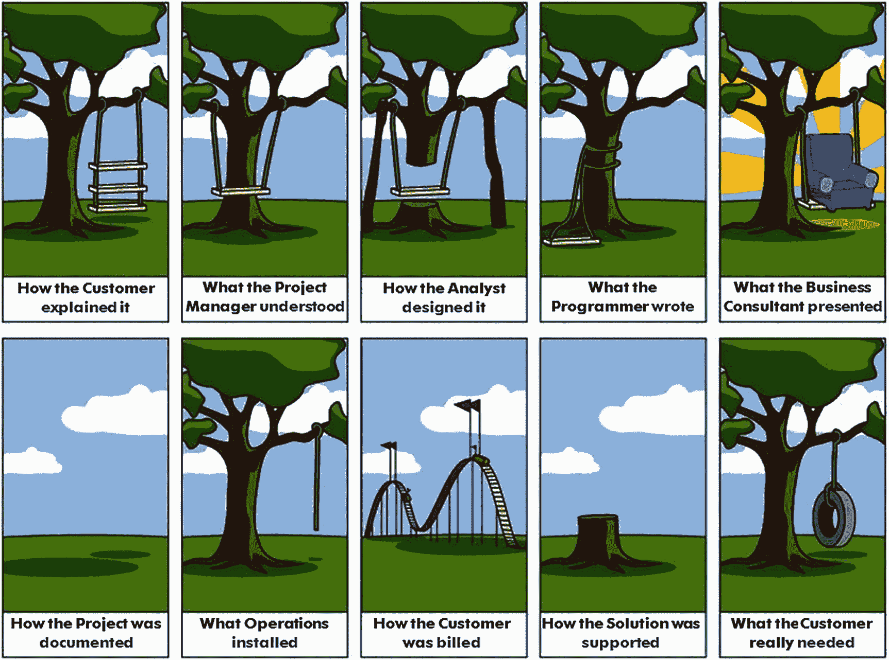

# 4. 明确目标：项目交付物

> *品质之物，无惧时间。*
> ——佚名

## 引言

现在你的集成团队已经就位，实际项目可以开始了。当然，目标是完成一系列任务，确保数据成功地从一处移动到另一处，无论是单次、每日还是每天多次。你可以通过多种不同的方式来衡量这项工作的成功与否：是否满足了客户的业务需求？数据是否在“合理”的时间内流动（你知道“合理”的数值是多少）？集成是否按预期运行，或者是否存在必须处理的异常情况？如果有，由谁负责解决？流程和代码的文档是否清晰完整？面对所有这些成功因素，你无疑会遗漏某些关键细节，而某个地方的某人将会感到不满。这就引出了本章的主题：通过项目交付物来确保你的成功。

定义明确的交付物只是保持头脑清醒的捷径。在集成工作中，过度设计很容易发生，主要是因为现在和未来都充满了可用数据，利益相关者永远不确定该在何处划定界限；总是有更多的数据需要移动，总是有遗留数据库中的某个晦涩异常，人们希望将其嵌入新系统。因此，没有人真正愿意签字确认“够了就是够了”。我参与过许多项目，当被问到“我们应该迁移哪些数据”时，得到的答案是非常不具体的“所有数据”。并非巧合的是，这些需求往往与项目发起人期望集成工作仅需一个漫长周末就能完成的项目是同一个。

考虑到这一点，记录并分享计划，让他人了解从始至终应期待哪些功能，是最好的方法。否则，利益相关者可能会提出反对意见，声称他们绝对需要比在规定时间内可能交付的更多内容。有了正确的文档，你就可以创建一个稳固的框架，让每个人都充满信心且保持一致。更重要的是，它能帮助你按时上床睡觉。

## 项目管理阶段

无论采用瀑布式还是敏捷模型，文档都会在整个项目生命周期中生成和交付。这些材料的类型相对相同，只是在敏捷框架下以更紧凑、更快的速度出现。然而，在我们讨论每个交付物的具体细节之前，让我们先从项目管理的各个阶段开始，以及它们如何直接映射到你的集成流程。

一些文章强调了项目管理流程的六个阶段，有些描述了四个阶段，而权威指南`PMBOK`则断言有五个阶段。根据我的经验，团队通常遵循组织自身传统上所遵循的任何划分。无论如何，我们姑且认为“多比少好”，并讨论这六个阶段。你可以根据自己项目的感知复杂度或简单度，酌情省略你认为不必要的部分，并确定如何构建集成团队的框架。

项目管理的阶段如下：
- 启动
- 定义
- 设计
- 开发
- 实施
- 维护

### 启动阶段

启动阶段是项目的开端，在此阶段，团队规划者首先会对构想进行初步审核，并评估项目的可行性。他们会就由谁执行项目、涉及哪些团队以及该项目对整个组织的重要性做出决策。

正是在这个阶段，需要撰写提案以获得高管层的资金支持。这也是风险最高的阶段，因为开发者认为他们正在交付的是一个原型，而利益相关者期望的却是一个可运行的模型，误解可能由此产生。明确沟通是关键。

### 定义阶段

定义阶段有时也被称为发现阶段，在此阶段，与项目成果相关的需求会被尽可能明确地指定出来（即“被发现”）。该阶段通过建立功能性与非功能性衡量标准，重新确认所有团队成员对最终产品的期望。^(⁶⁸) 针对这一阶段可以列出一长串问题，而在这诸多问题中，迁移/集成的需求也将被最终敲定。根据技术复杂程度的不同，收集这些特定需求的责任应由业务分析师或专注于理解业务需求的集成负责人来承担。

### 设计阶段

设计阶段是下一步骤，在此阶段，开发团队利用定义阶段的需求来做出设计决策，推动项目走向成功。为此，团队会检查并考量各种模型，包括立体模型、草图、流程图、站点结构图、HTML 屏幕设计、原型、图片效果图以及 UML 架构图。^(⁶⁹) 一旦最终设计被选定，就可以开始实施工作了。

### 开发阶段

开发阶段是这样一个阶段，它是否正式化取决于项目的规模——换言之，较小的项目会将“开发”与实施阶段合并，统称为“执行”。尽管如此，由于它偶尔对实施项目具有重要性，仍然值得一谈。

从项目管理的角度来看，开发阶段负责筹备项目实施所需的一切。规划者会引入供应商和承包商，制定时间表，订购软件和设备，并向人员提供额外的指导。在某个时间点，团队将准备就绪开始实施，并结束开发阶段。

### 实施阶段

实施阶段是实际项目构建发生的阶段。开发者编写代码，团队召开状态会议，实际的构建工作正在进行。外部人员会意识到变化正在发生，甚至可能参与演示和概念验证原型。正是在这里，工作得以开展，团队忙于协作、测试，并最终部署他们的产品。

评估实施阶段成功与否的最重要衡量标准，是确定产品在多大程度上满足了定义阶段的需求期望，以及业务所面临的问题是否得到了解决。设计也扮演着重要角色；如果代码由于系统复杂性而只是偶尔能正常工作，那么模型可能存在缺陷，或许需要一些重新设计。关键在于，“成功”是一个高度主观的视角，只有回答了“我们现在是否比以前更好？”这个问题，才能做出自信的宣告。

这种看法并不能否定这样一个事实：即使我们尽了最大努力，最终产品也可能无法满足项目需求。失败可能由多种原因造成：需求从定义阶段到实施阶段发生了变化；因期望过高而产生了沟通误解；或者团队错误地假设他们能在特定时间内完成工作，从而低估了所需的工作量。更有可能的是，存在多个罪魁祸首，并且它们会被经理、开发者和利益相关者急切地进一步详细剖析，通常是在喝酒时私下讨论。我认为著名的“秋千图”，如图 4-1 所示，最能体现这些期望。


图 4-1
IT 项目的真实运作方式^(⁷⁰)

我们可以通过多种方式将这种失败的可能性降到最低。例如，敏捷宣言就包含了旨在实现这一目标的 12 条原则。^(⁷¹) 但将这些理论付诸实践并不总是那么容易，有时事后总结似乎是最好的老师，尽管可能是个严师。

在本章稍后的部分，我们将讨论如何利用适当的文档来最小化集成计划中的错误。

### 维护阶段

一旦团队部署了产品，维护阶段就开始了。在此阶段，需要安排好结束项目并保持系统运行所需的一切事务。^(⁷²) 该阶段的活动示例包括编写手册和用户指南、举办培训班、建立帮助台支持、监控结果，以及将产品正式交付给最终所有者。

尽管这些活动听起来很简单，但很难知道项目何时真正结束，因为总会有更多需要修复和重新考虑的问题。就集成项目而言，正如我们将要看到的，随着团队和用户发现新的异常逻辑，生产环境的变更可能而且经常超出维护的范围。出于这个原因，我喜欢将这个阶段称为运维阶段，与常规软件开发相比，它的范围更广，边界也更不清晰。

该模型的主要意图是让其成员能够规划、行动，然后评估。无论是通过瀑布式方法论（规划、行动、一次性评估）还是通过敏捷方法论（规划、行动、评估，再规划、行动、评估，根据需要重复），每个阶段的产出应该是相同的：从头到尾产生关键的里程碑事件。^(⁷³)

## 集成里程碑

在项目的集成部分，最关键的是架构师、设计师和利益相关者之间的沟通。一个被遗漏的需求或不准确的转换不仅会延迟系统完成，而且——如果数据传输失败——可能会造成巨大损害，不仅限于局部，甚至可能达到全局层面。一个著名的事件是 1987 年的“黑色星期一”股市崩盘，据称那次大规模的数据交换导致了级联效应，迫使股市中的所有竞标同时消失。据一些专家称，计算机系统当时并未经过测试，以处理崩盘期间的市价订单。^(⁷⁴) 仅基于这一事件，理解集成过程及其潜在陷阱对所有人来说都应是重中之重。

但是，正如我们讨论过的，情况并非总是如此。在项目管理阶段，规划者常常将集成任务视为软件开发的另一部分。一个功能需求，例如“系统应将联系人的名字、姓氏、邮政编码和电话号码从数据库 `X` 移动到数据库 `Y`”，从三万英尺的高空俯瞰固然不错，但它不一定能涵盖当电话号码或邮政编码值使用不同格式时发生的不可接受的情况（参见第 5 章）。如果在项目阶段早期没有遇到并处理这些问题，集成——进而整个系统本身——将会失败。

这便将我们带到了集成里程碑。这些里程碑与软件交付阶段并行发生，但需要不同的产出。表 4-1 总结了不同的项目阶段、阶段关口可交付成果以及简要说明。

**表 4-1** 项目阶段与迁移文档

| 项目阶段 | 阶段关口可交付成果 | 描述 |
| --- | --- | --- |
| 启动 | 团队代表 | 包含一名或多名集成团队代表，以确认或否定与交付项目提案相关的任何假设。 |
| 定义 | 数据迁移计划 | 记录项目背景和目的、迁移与集成方法、假设、约束、风险，以及当前和目标状态架构。 |
| 设计 | 数据概况分析 | 审查源数据、结构、内容和关系，以评估其内容与质量。 |
| 设计 | 问题日志 | 记录并跟踪与数据质量和数据迁移相关的任何问题或疑问。 |
| 设计 | 源到目标映射 | 记录从源到目标的映射，包括数据类型和转换规则。 |
| 设计 | 数据迁移流程设计 | 记录迁移流程的详细设计，包括操作顺序。 |
| 开发 | ETL 脚本 | 记录与抽取、转换和加载相关的前端和后端代码；应随后进行同行评审会议。 |
| 实施 | 迁移结果报告 | 按对象记录迁移结果、明细、错误影响、行动项和风险。该报告在每次迁移（包括模拟/测试迁移）后创建。 |
| 实施 | 上线/部署计划 | 记录执行迁移的详细的、分步骤的、从头到尾的计划，包括各种依赖关系。 |

我们将深入讨论这些可交付成果中的每一项。现在，我想强调，这种交付模式并非强制性的。它只是实现任何协作努力中固有目标的一种方式；也就是说，它能够削弱（甚至避免）当利益相关者意识到他们得到的餐点与他们认为他们点的餐点不同时所带来的影响。它还能让开发团队的工作更轻松，因为大多数问题从一开始就得到了处理，而不是在最后一刻，当工作量突然变得比“仅仅周末按按按钮”大得多时才发现。

### 启动

了解集成复杂性的秘诀在于从一开始就参与其中，这意味着在项目启动的最早阶段就应有代表参与。对于传统管理者来说，在商业提案中包含纯粹的技术代表可能看起来很奇怪，但错误的假设和误解时有发生，从而扭曲了对范围和工作量的理解。一方面，组织倾向于重复使用过去对他们有效的提案模板。从可重复性的角度来看，这是有道理的——类似产品的交付过程应该是相同的。但如果我们记住集成应该是独特的，那么我们就意识到确保我们在此流程中涵盖所有基础是多么重要。也就是说，仅仅因为某个特定的源到目标架构过去有效，并不意味着它能同样适用于类似类型的项目。为某个客户存储在数据库 `A` 中的数据，不等同于为另一个客户存储在数据库 `B` 中的相同数据。定制化、触发器、值以及所有其他需要迁移的内容都需要进行全面的概况分析，并且在考虑我们的产品时必须将此纳入考量。

应征求集成团队代表对特定迁移工作的可行性、预期时间和工作量的可靠意见。虽然此时我们不应该讨论技术解决方案，但至少，“这会有多复杂？”和“你需要多少人手？”这类问题应该成为提案讨论的一部分。如果技术问题的答案仍然大多未知，那么就应如实说明。关键在于，提案应该反映这些未知因素，而不是基于过去的项目做出完全冒险（或不准确！）的假设。

简而言之，在提案中纳入集成代表可以制定准确的计划，并确保有时间限制的解决方案是可行的。它还能建立信心，使项目无需因未公开的期望而引发过多突发问题即可实现。

### 定义

集成需求往往是高度具体的（例如，“我们只希望导入这三个字段，除非用户来自财务部门，在这种情况下，我们只应使用另外这三个字段”）或者不够具体（例如，“我们想要一切”）。因此，为了避免在第一次迭代中可能出现的铺天盖地的请求洪流，建立一份功能性和非功能性需求的检查清单至关重要，这些需求应作为名为`数据迁移计划`的文档的一部分。该文档在一定程度上详细说明了项目背景和目的、迁移与集成方法、假设、约束、风险，以及当前和目标状态架构。

#### 数据迁移计划

附录包含一份数据迁移计划模板，以及应包含的示例章节定义。与所有模板一样，您可以根据自身组织的需求调整模型结构，但需牢记其目的应保持一致。您正在传达一个解决方案，就您的假设正确性达成共识，并设定团队最终交付成果的预期。

数据迁移计划涵盖以下主题：
- **概述**：项目背景，通常从提案或其他项目管理计划中复制。本节还应至少包含一两段内容，说明当前迁移/集成任务的目标，以及这些任务如何满足整体业务目标。
- **假设、约束、风险与缺口**：本节设定当前项目范围的预期，以防止出现我们在前一章中提到的“想要一切”综合症。在此，我们定义了团队能做什么和不能做什么（假设）、技术或时间限制（约束）、可能出现的潜在问题（风险），以及实施过程中仍存在争议的领域（缺口）。这些细节在整个项目中高度相关，尤其是在产出属于或不属于我们影响范围的结果时。
- **架构**：本节包含两大结构——当前状态与未来状态。当前状态代表“现有”系统，即数据当前所在位置、所涉及的数据系统、存储的记录数量，以及其他有助于团队成员熟悉现有数据模型的细节。未来状态则是“目标”系统——项目完成后数据将存在的最终快照。其子类别将包括与当前状态平行的主题，但更多带有假设性色彩（数据将存放位置、将涉及的数据系统、预期数量等）。由于未来状态在项目启动时大多未知，它更像是一个理想世界，存在一些缺口，您将在持续收集需求的过程中逐步填补。

> **注意**
> 开发工具也应给予特别关注。这些将是我们用于构建的技术（例如 Python、Java、.NET），以及与构建、DevOps 和 ETL 相关的专用软件。

- **数据迁移方法**：本节涵盖集成的总体方法，例如范围、团队成员的角色和职责；迁移前、迁移中和迁移后应执行的操作；以及当整个系统崩溃时的应急计划。这些要求应被视为更大蓝图中的可能性笔触。真正的细节将在设计阶段后期，当现实情况显现时得到强调。目前，您应专注于能够实现且最能满足用户期望的工作。如果在此过程中遇到阻碍，您始终可以回溯或寻找替代路径来实现相同目标。
- **测试与验证**：测试与验证是迁移中最重要的主题之一，但也是关注度最低的。原因之一可能是编写代码的开发者并不擅长测试。^(⁷⁵) 尽管如此，我们仍需建立一个可靠的框架来测试集成，并将其记录在数据迁移计划中。我们应包括计划进行的测试类型（单元测试、联合集成测试、验证测试等）。同时，还应描述用于测试的环境类型，以及哪些团队将执行测试。与数据迁移方法一样，我们不会有全部答案，但可以尽可能多地填补空白，以获得合理的估算。

#### 发现过程：技巧与窍门

就实际的发现过程而言，可描述的内容远多于本文所能涵盖。如果您想要一本关于敏捷需求收集的好书，请参考 Jeff Patton 所著的《用户故事地图》（2014 年）^(⁷⁶)。在集成映射方面，以下是一些能让您的讨论会更高效的技巧。

##### 了解架构

由于您可能需要在多个系统和孤岛之间工作，尽快了解当前架构是必要的。为此，您必须联系最了解后端数据的人员。查找并审阅您遇到的任何实体关系图（ERD）。了解业务的性质以及未来模型应是什么样子。提出好的问题（可以访问`http://www.etlsolutions.com/data-migration-planning-checklist/`作为起点，该网站提供了一个流程驱动且具有战术性的检查清单）。

##### 保持小组规模小

与我合作过的项目主管的观点相反，我常常发现小组规模越小，协作效果越好。我认为，平均而言，一次持续两小时的一对一需求收集会议所覆盖的范围，往往超过整个团队半天的讨论会。这在很大程度上与*专注*有关。在这些会议中，很容易偏离主题——一个人提出一个需求，另一个人不同意，第三个人纠正前两个人，如此循环。到会议结束时，会出现十几个未解决的问题，几乎没有相应的解决方案。

进行单人访谈时，很少出现同样的结果。用已故美国总统罗纳德·里根的话来说，采用这种方法的主要建议是“信任但核实”。^(⁷⁷) 将所陈述的需求记录下来，添加到您的数据迁移计划中，然后在阶段评审期间与其他利益相关者分享。如果是明显的错误，有强烈意见的人会纠正它。如果不是，总有可能会有人在后续阶段指出这一点。关键在于，纠正已陈述的文字流远比较容易的。

##### 尽早获取系统访问权限

您将需要访问各种系统，可能包括服务器、数据库、文件、隐藏目录等。请尽快获得使用这些系统的权限。在发现讨论期间能够访问这些系统，有助于说明讨论对象试图表达的观点。当您证明本应是合格客户名单的文件实际上是一份获奖苹果派食谱清单时，这也有助于更快地结束争论（我没开玩笑，这确实发生在我的一次任务中）。

### 设计

完成第一轮需求收集后，现在该进入设计阶段了。这个阶段代表技术团队从业务层面抽身，开始编写解决方案代码，通过数据分析、同行评审和程序调试来识别问题。因此，这也是产出最多文档（即书面沟通）的阶段。与前一阶段的数据迁移计划一样，附录中也提供了设计模板。

接下来，我们将逐一讨论每份文档，以阐述基本框架。

#### 数据概况分析

我们有权访问源系统，并获得了供我们审查的完整数据集。但我们所使用的数据有多干净、有效和可靠？为了回答这个问题，我们首先必须进行`数据概况分析`，即审查源数据、理解其结构、内容和相互关系，然后识别它们对数据项目的潜力的过程。^(⁷⁸)

我们在这里关注的是，我们正在分析的源数据能否干净地迁移到目标系统中。例如，假设你要迁移 20,000 条联系人记录。其中只有 25%（即 5,000 条）包含街道地址。然而，新系统要求插入时必须包含此街道地址。换句话说，如果不做任何处理，你将会有 15,000 条记录被新系统遗漏。你该怎么办？

你大概可以想出几种解决方案：

1. 在源系统中，将空白街道地址设置为默认值“N/A”。
2. 允许目标系统临时接受`NULL`值，并在初始迁移完成后重新启用约束。
3. 告知业务方，必须有人在源系统中填充这些记录。

上述每个选项都需要付出特定程度的努力，你必须在执行任何迁移之前与团队协作做出决定。暴露这些问题及其解决方法是`数据概况分析`的主要目的。

我见过许多有才华的分析师在交付这件工作时功亏一篑。哪些数据基本要素重要，哪些应该省略？一个建议是包含以下主题：

- 收集描述性统计信息，如`最小值`、`最大值`、`计数`和`总和`
- 收集数据类型、长度和重复模式
- 使用关键词、描述或类别标记数据
- 执行数据质量评估，评估对数据执行连接操作的风险
- 发现元数据并评估其准确性
- 识别分布、候选键、外键候选项、函数依赖和嵌入式值依赖，并执行表间分析

对于新手来说，这看起来很复杂，事实也确实如此。幸运的是，我们无需从头开始，因为有多种开源和第三方工具可供使用。^(⁷⁹) 我多年来推荐的工具之一是 Don McMunn 的免费数据概况分析工具包，网址为 [http://www.ipcdesigns.com/data_profiling/](http://www.ipcdesigns.com/data_profiling/)。它为 SQL Server 和 Oracle 提供了一系列查询，用于创建数据概况分析表，你可以将其整合到你的数据集中。至少，它为你可能希望在分析中包含的标准数据概况分析字段提供了指南。

请记住，即便是分析一小部分数据集，也远比完全不审查要好。

#### 问题日志

在你的数据设计过程中，不可避免地会遇到需求收集阶段从未讨论过的情况。这可能是一个孤立的字段，或是一张适合新目标但尚未被识别出来的数据表。你会产生疑问，需要进一步澄清。为了追踪这些情况，我们建议你将评论存储在一个`问题日志`中，这是一个用于记录和跟踪与数据质量及数据迁移过程相关的问题或疑问的文档。将这份文件保存在实体笔记本、U盘文件中，或者更好的是保存在团队可以在线查看并提供即时反馈的共享文件夹中。无论你选择哪种方式存储信息，都要确保将正确的问题交给正确的团队成员，并且更重要的是，获得你需要的答案。

#### 源到目标映射

如果本书有一样东西你能够铭记于心，那便是正确维护一份`源到目标映射`（`STTM`）电子表格的重要性。这份文档是集成的终极要义，因此也是过程中必不可少的一部分。没有任何借口可以跳过这一部分，请反复阅读本节，直至烂熟于心。

由于`STTM`是一个如此关键的组成部分，我将在其目的、设计和用法上比其他部分阐述得更详细。希望阅读完本章后，你能清楚地理解为什么这项交付成果如此重要。

##### 目的

`源到目标映射`是“一组数据转换结构，用于确定如何将源系统中的数据结构与内容转换为目标系统所需的结构与内容”。^(⁸⁰) 简而言之，它就是你提取、转换并重新加载数据的需求清单。将其视为一张预期输入和输出的路线图，而中间是逐步进行的转换过程。

##### 设计

以下是你为 STTM 电子表格所需准备的*最少*信息量：

- `Source Datasystem`：作为数据源的系统的通用或正式名称，例如 `Oracle`，或者按官方组织名称填写，如 `Legacy Contact Management System`
- `Source Table`：源表的物理名称，例如 `CONTACT`
- `Source Field`：源字段/列的物理名称，例如 `"Name"`、`"Email"` 或 `"Street Address"`
- `Target Datasystem`：作为数据目标的系统的通用或正式名称，例如 `Salesforce`，或者按官方组织名称填写，如 `Payroll Management System`
- `Target Table`：目标表的物理名称，例如 `EMPLOYEE__C`
- `Target Field`：目标字段/列的物理名称，例如 `"Name__c"`、`"Email__c"` 或 `"street_address_1__c"`
- `Transformation Rule`：将数据从源字段转换到目标字段所需的业务规则，例如 `"Join contact_id on payroll__c and add rowid where address.primary_address = TRUE and address.valid=TRUE"`

附录中提供了一个说明此模式的模板。

如果觉得这种设计相对简单，请三思。我遇到过许多数据库专家，他们原以为已用简单的单句转换规则映射了源和目标，但几个月后当需要参考这些信息时，却为自己的决定后悔不已。需要牢记的关键点是具体性和保持信息的时效性。如果你需要详细的说明，可以将其放在单独的文档中，或许在 `Transformation Rules` 中提供一个超链接，大意是“有关更多详细信息，请参阅文档 XXX”。最重要的是，确保文档对读者有实际意义。不要过于技术化或冗长，因为这份文档很可能在你结束项目或离开后，或者更乐观地说，在你中了彩票、在海滩上啜饮迈泰酒度过余生并将工作交付给他人后，成为你的遗产。

然而，即使提供了上述信息，你可能仍然觉得不够。当然，你迟早会修改业务需求，并且在持续分析和发现更多数据点时，可能需要添加新的表和字段。请注意，我们讨论的不是*版本控制*（即就地覆盖 STTM 并用最新版本替换），而是*追踪*（即进行更改，并说明为何进行这些更改）。考虑以下这些可以与基础 STTM 一同包含的可选字段：

- `Design Notes`：不一定属于转换规则但对历史记录至关重要的附加说明，例如“根据客户要求，将此字段从 `fullname` 更改为 `lastname`”。
- `Date Created`：将记录首次添加到模型中的日期时间（例如 `9/14/2019`）。一旦插入，该值不会更改。
- `Date Updated`：记录的任意部分被修改的日期时间。该值与 `Design Notes` 关联时，将有助于你维护历史追踪。

现在有些进展了。通过添加这三个描述符，我们可以记录对 STTM 所做的任何更改，以及创建和更新的日期。当然，这里的关键是拥有详实的设计注释，根据更改原因，这些注释可能会变得相当冗长——新的注释始终可以追加在旧注释之上，并用分号（`;`）隔开。更好的做法是，添加一个“参见文档 xxx”的引用。修改 `Date Updated` 字段看似有点麻烦，但一旦习惯，操作起来相对容易。提示：如果使用 Microsoft Excel 或 Access，选中一个单元格，按住控制键（`CTRL`）再按分号（`;`）即可插入当前日期。同样，按住控制键（`CTRL`）再按冒号（`:`）即可插入当前时间。

你可能还想在 STTM 中包含其他列，我已将它们作为模板的一部分放在附录中。其中一个我见过的列是源和目标的 `DataType`，例如 `VARCHAR(80)`、`DATETIME`、`NUMBER` 或任何其他数据类型。我通常不包含这些值，因为这更像是固定模式设计；你可以在任何实体关系图中查看它们，所以我不太明白包含它们的目的是什么。不过，如果你经常需要使用 STTM 电子表格来查找特定类型的值，例如用 `ID` 表示 `NUMBER` 类型的主键，那么你可能还是希望为源或目标包含它们。

##### 使用

如我们所见，STTM 电子表格不仅充当设计工具，还作为后期审查的参考，或许最重要的是，作为所做决策的提醒。在项目测试的紧张阶段，处理多个问题的利益相关者可能会忘记他们为什么要求某个特定字段，或者为什么三个月前从表 X 改成了表 Y。STTM 中的 `Design Notes` 和 `Date Updated` 字段能快速解决这个问题。我无法告诉你，在项目结束后的数天、数月甚至数年里，我们查阅 STTM 的频率有多高。这就是为什么保持这份交付物的可用性至关重要：使其与当前模型保持同步更新，并通过共享驱动器甚至在线数据库存储库使其对所有相关人员可访问，以便当系统开始崩溃、所有人的目光都转向集成团队寻找答案时，能够快速、便捷地查找。

#### 数据迁移流程设计

作为设计过程的一部分，本文档总结了迁移流程的详细设计，包括一次性迁移和日常更新的操作顺序。它是整体策略中其他交付物的存储库，并允许团队就实现项目成功的拟议方法进行沟通。与我们讨论过的其他交付物一样，它也是一份*活*文档，不断变化并可随时更新。

##### 操作顺序

`Order of Operations` 从高层次讨论了通用对象迁移的逐步操作。此部分将拆解为稍后描述的 `Deployment Steps` 中的更多细节。只要有可能，我喜欢包含插图，因为它们比单纯的文字更具描述性和全面性。

##### 映射逻辑

`Mapping Logic` 定义了源到目标映射电子表格背后的高层规则，主要供业务团队确认规则的准确性。请注意，这并不是对整个 STTM（参见“源到目标映射”章节）的重复，最多只是列出几个更重要的字段，以便向利益相关者和高管传达集成的要点。至少，应包含指向你的 STTM 电子表格或存储库的链接，并附上使用说明（所需的浏览器、工具等）以及在何种情况下使用。

#### 部署步骤

深入探讨操作顺序，部署步骤部分定义了迁移或集成的每项任务，通常附带与 ETL 流程相关的图表。该模式应易于遵循，并实质上成为部署周期的检查清单：

1. 从表 XXX 中选择数据：

    ```
    根据定义的业务需求转换数据
    测试样本
    将数据插入到表 YYY 中
    ```

2. 从表 XXX 中选择数据：使用 Pentaho 数据集成（PDI）应用程序，通过位于此处的 SQL Server 连接对表 XXX 运行 SQL 语句。
3. 根据定义的业务需求转换数据：使用 Python 脚本，将 Salesforce 联系人数据转换为提供的业务规则。
4. 测试样本：
    1. 将十个样本联系记录插入预生产环境，确保成功接收五到十个样本记录。
    2. 对数据执行 QA 评估。如果记录失败或不符合业务需求，则进行迭代并重新加载。
    3. 将数据插入到表 YYY 中。
    4. 测试记录通过后，从利益相关者处获得“通过/不通过”许可。
5. 使用 Talend ETL 应用程序执行整个数据集的加载：
    1. 加载完成后，通过执行后续分析确认联系人记录的加载是否成功。
    2. 如果加载失败，回滚事务并向利益相关者报告错误。
6. 重新迭代并从步骤 1 开始。

数据迁移流程文档这一部分的妙处在于，你正在为大多数可能发生的情况提前做准备。当然，你可能会遗漏一两件事，但知道这是一份可以随时修改和追加的可调整文档，会让你的生活轻松很多。如果在开发或沙盒环境中进行几次预演迁移，你就能捕捉到实际部署过程中会发生的大部分情况。这样，你就能有书面上的信心，确保自己早已清楚地知道想要做什么、如何去做，以及基于成功或失败将会出现的状况。没有人能够回头对你说他们感到意外。所以这可能需要一些前置工作，但我认为这种程度的准备和沟通是非常值得的。

#### 日志文件交付

本节描述成功日志和错误日志的存储位置。此存储位置可以在线存储，也可以作为共享文件通过电子邮件发送，但应可供有需要并有兴趣查看结果的人员使用。

#### 迁移结果

迁移结果部分描述了迁移结果报告（我们稍后将讨论）所接收的输出。实际上，在项目结束前，我通常会将该部分留空，将其用作证明数据已按预期交付的“礼品包装”。这也向团队发出信号：随着所有记录成功交付，最终签字即将到来。

#### 最终签字

并非强制要求，但我喜欢在数据迁移流程文档中包含此部分，因为它为迁移画上了句号。顾名思义，签字可以是项目发起人签署的电子邮件或附件，证明迁移已完成并满足要求。你读到最后一句话时可能会难以置信地摇头，但我向你保证，有了我们准备好的流程文档，你最终将能满足项目要求。并且在执行过程中保持条理清晰、准备充分。

### ETL 脚本

ETL 脚本是开发阶段的一部分，由于它们技术性很强，可能不是整体交付的关键部分。尽管如此，保留一份代码副本总是好的，以防备份崩溃或你的本地平台遭遇其他不幸。

你必须考虑多种可能性，来决定如何记录和交付你的功能。开发团队应频繁进行同行评审，在这些评审会议中，手头有一些棘手的脚本逻辑有助于让每个人都达成共识。此外，与更初级的 ETL 开发人员分享你的方法也会很有益，因为他们会将你的思路与自己的项目进行对照。

捕获这些信息可能只是对数据进行的简单复制粘贴，但大多数流行的 ETL 工具既使用图形界面也使用文本。在这种情况下，截图工具可能就能解决问题（我最喜欢的包括微软的截图工具、[TechSmith 的 Snagit](https://www.techsmith.com/screen-capture.html) 或 NGWIN 的 PicPick [PicPick](https://picpick.app/en/)）。在某些情况下，你可能能够通过配置文件提取 GUI 代码片段，但如何做最有效，我留给读者自行决定。需要牢记的最重要的一点是，代码就像任何其他可迭代的软件产品一样，永远在变化，你所记录的任何内容最终都需要更新。

### 迁移结果报告

这份可交付物在集成期间填充，突出显示了每个对象的集成成功和错误计数。你需要跟踪你的加载统计信息，无论是通过手写笔记、自动发送的电子邮件，还是其他类型的交付方式，跟踪每个已部署记录的 `SELECTS`、`INSERTS`、`UPDATES`、WSDL 响应等数量。详细程度取决于你——简单的计数与详细的描述性信息——但保持跟踪至关重要，主要是为了你和你的利益相关者的“理智”，因为总有人会在某个时刻无法找到在源端到目标端传输过程中丢失的记录。如果所述的记录属于错误日志的一部分，你还应包括记录计数和原因。

尽可能地在单个作业运行中包含作业的开始日期和时间以及结束日期和时间。通过这种方式，你将能够跟踪未来更新的“增量”，这不仅有助于分配你后续迁移测试所需的时间，还能让你知道何时出现了异常：一个通常需要 5 分钟执行的作业，如果某个周期花费了超过 30 分钟，则说明其在运行过程中遇到了问题。诸如 `Wireshark` 之类的网络分析工具或 `Charles` 之类的流量监控器将是开始分析的最佳选择。

### 上线/部署计划

`上线/部署计划`是集成阶段的最后一步，此时集成团队已准备就绪，可以开始有序部署，并提交一份从头到尾的逐步迁移计划，*包括各项依赖关系*。如果你已遵循本章前面的步骤，那么创建这份文档应该相对简单——`数据迁移过程流程设计`文档中已经包含了用于此目的的“操作顺序”和“部署”章节。当然，在那个文档中，只描述了集成本身。而在`上线/部署计划`中，应记录从开始到结束的整个流程，而不仅仅是与迁移部分相关的流程（因此上面重点强调了“包括依赖关系”）。

`上线/部署计划`比其初看起来更像是一种沟通工具。对于内部团队而言，这份可交付成果要求每位团队成员就部署顺序达成一致策略，如果协调得当，将带来顺畅的交付过程，团队成员能够有信心地互相沟通每一步骤，并在完成后提供签字确认，或者，如果出现任何意外问题，也能据此进行修订或回滚。

对于外部团队而言，`上线/部署计划`是一份清单，列出了部署团队在收工之前必须执行的步骤。这项活动使利益相关者和业务负责人能够准确了解需要做什么、生产环境将停机多长时间（按预估时间框架），以及哪个团队负责当前的活动。与那些认为集成功能只是“按按钮的简单活动”的组织松散型部署相比，由此带来的清晰认知更能起到稳定军心的作用。

## 部署后：维护与更新

一旦迁移项目部署到生产环境，下一步理所当然是将整套可交付成果存储在一个容易找到的位置，例如共享的公司驱动器或内容管理系统。虽然你可能认为这些文档归档后便永不见天日，但请三思。除非这是一次性的迁移，否则你的流程将随着业务需求不断发展和调整，你需要在某些时候参考这些文档，有时甚至毫无预兆。我想到的三个可能场景如下：

1.  数据异常是常态，在某个时间点，系统会报告一个错误，而目标端的某个人会感到非常烦躁、非常困惑，或者两者兼有。你需要首先找出哪个字段失败以及该转换背后的细节。`源到目标映射`是开始分析的最佳起点，其次是`迁移过程流程设计`和`ETL`脚本。
2.  利益相关者可能希望升级现有的集成流程，以包含更多字段或优化当前代码。在重新调整需求时，手头有这些文档是必要的。
3.  你希望审计那些看似与你的流程无关，但会产生上游影响的系统变更，例如源平台中数据的变化。每当你听说与你的入站记录有间接关联的系统增强时，你都应该回头查看你的文档并验证其影响。在日常集成发生之前发出警报，远比周一早上发现源表现在包含字符串值而非数值（从而导致目标表也同样如此）要好得多。

基于这种理解，团队应该认识到，这些文档代表了我们集成流程当前状态的快照，并且由于错误修复、补丁、升级或其他修改而对源平台、`ETL`平台或目标平台执行的任何更改，都应添加到相应的文档中。保持这种更新至关重要——过时的信息有时比完全没有信息更糟糕。然而，与项目管理相关的许多其他指南一样，部署后团队常常忽略这个关键步骤。为什么？原因并不总是很清楚，但我可以推测出两点：

1.  **缺乏归属感：** 执行系统部署后运维职责的人员通常与开发产品的人员不同。与将文档编写视为己任的产品团队相比，运维模式通常要求快速响应和解决问题。换句话说，对于运维团队而言，重写这些文档并非优先事项。
2.  **缺乏理解：** 修改这些可交付成果的人员可能不理解新需求，可能不知道如何用语言描述它们，或者——最有可能的是——可能忘记了在恰当的时间更新它们。

集成团队必须在项目伊始就解决这些风险，明确承认文档必须在整个项目生命周期内持续更新，并且流程负责人（例如运维团队）有直接责任在变更部署后立即存储最新版本。

## 总结

本章涵盖了大部分集成阶段，从项目启动开始，一直延伸到上线及之后。至此，你应该认识到，文档编写不是“应该”而是“必须”。这似乎有悖常理，但在初始阶段越是努力夯实基础需求和映射，团队就越有能力在后期灵活应对最后一刻的需求变更。这种灵活性之所以存在，是因为每份文档都与前一份文档紧密相关。修改一组需求会引发连锁反应，从启动阶段开始，贯穿定义、设计、开发和实施阶段。正是由于这些依赖关系，我们才能够将转换代码的每一行追溯到业务需求。如果这些需求在关键时刻偏离轨道，那么通过根文档修改`ETL`代码以使其重新同步，将是一个相对直接的修复方式。

在下一章中，我们将研究`ETL`代码的基础知识，描述构建一个简单服务所需的步骤，并讨论几种流行的`ETL`软件应用程序的优缺点。

脚注 1  2  3  4  5  6  7  8  9  10  11  12  13  14  15  16  17


