# 5. 选择 ETL 工具

> *你必须做出选择。但要明智地选择…*
> 
> ——圣杯骑士，《夺宝奇兵 3：圣战奇兵》（1989）^(⁸³)

## 引言

在前面的章节中，我们不仅讨论了迁移/集成的基础知识，还探讨了制定沟通流程和战略计划所需的各种文档。贯穿这一切的核心主题是：*细节决定成败*。而保持这种细致程度，在您的设计核心——即提取、转换和加载（ETL）中间件中，显得尤为关键。我们在第 2 章中某种程度上介绍了该组件的特性，并在第 4 章中通过配套的源到目标映射电子表格进行了说明。由于它对项目的成败有重大影响，本章将重点介绍为您提供的用于选择合适工具的各种选项，并讨论当前市场上几种最能满足您集成需求的 ETL 工具。

## ETL 与 ELT

首先，我建议您将缩写 ETL 按字面意思理解。也就是说，您正在进行直接的`提取`（`extraction`）、`转换`（`transformation`）和`加载`（`loading`）操作。在图 5-1 中，您可以看到我们之前在第 2 章中讨论过的 ETL 及其对应组件的“并非如此简单”的示意图。

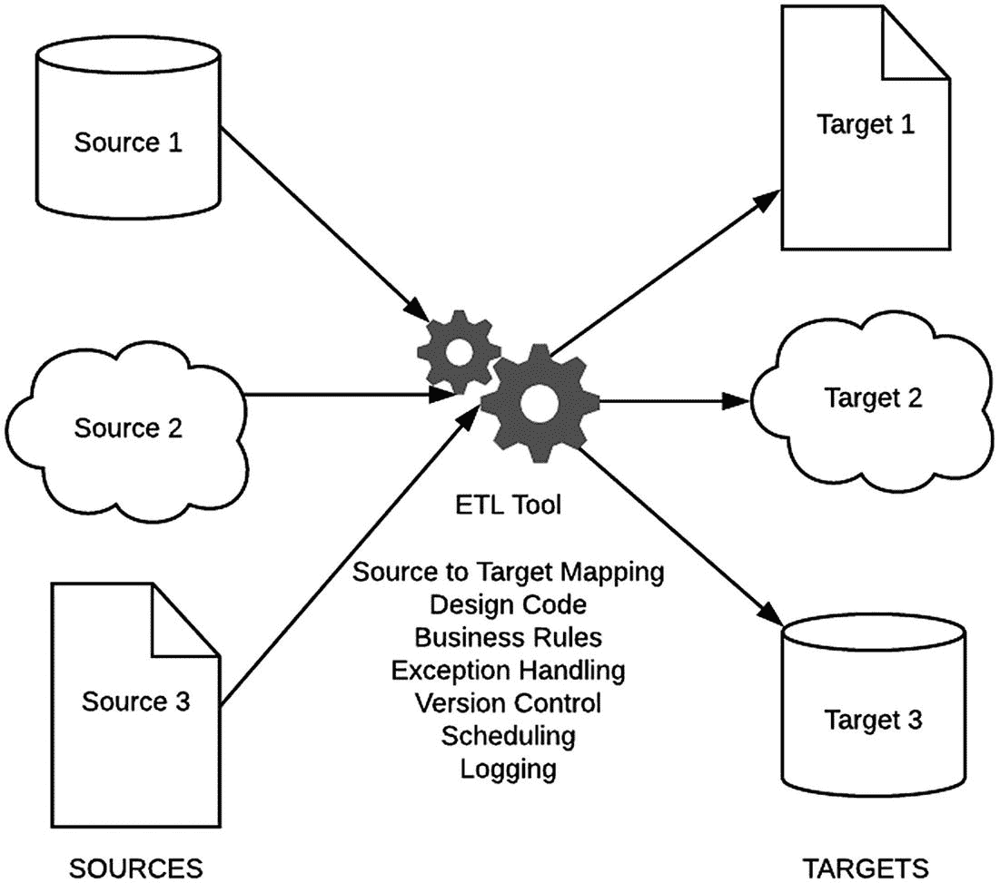

图 5-1 再看“并非如此简单”的 ETL 示意图

纯粹意义上的 ETL 意味着我们从源系统拉取数据（提取），对数据执行某些操作以改变或操纵其流向（转换），然后将数据的最新版本推送到目标系统（加载）。

也可以颠倒转换和加载的顺序，从而形成一种称为提取、加载和转换（ELT）的命名方式。在 ELT 方法中，数据被提取后，源数据值被移入一个单一的、集中式的数据仓库，该仓库可以即时计算到分析报告系统中（见图 5-2）。在过去（即十年前），由于处理能力和可扩展性问题，这颇具挑战性；但借助当今基于云的基础设施以及 Hadoop 等大数据工具，系统可以支持充足的存储和可扩展的计算能力。^(⁸⁴)

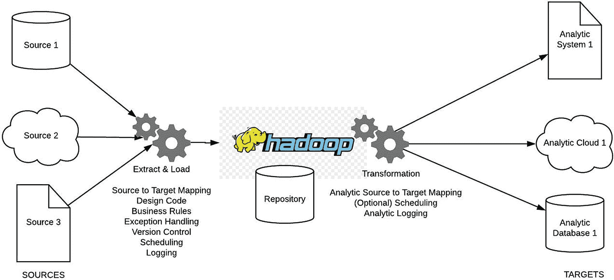

图 5-2 ELT 流程（拟议）

ELT 流程仍在不断发展中，但在近期的文档中频繁被提及，因此值得在此一提。本书剩余部分将不会深入探讨这种设计，但我建议团队时刻关注那些可能融合该模型的技术和技能组合。对完整数据集进行无限、按需访问的承诺颇具吸引力，许多高管和商业智能人员都渴望进一步探索。

## ETL 作为中间件

需要注意的是，虽然 ETL 工具通常独立于源系统和目标系统而存在，但情况并非总是如此。完全有可能存在驻留在源系统内的 ETL 流程（例如，直接将数据推送至外部端点的 Web 服务），或者驻留在目标系统内的 ETL 流程（例如，从源系统拉取数据的共享进程）。对于这类项目，简单的解决方案至关重要。但请记住，尽管您的系统可能拥有从源到目标的嵌入式钩子而无需中间件，但我们关注的是 ETL 的`概念`。您的解决方案需要能够兼顾移动的便捷性和转换的便捷性；无论您想如何设计它，ETL 的顺序将保持一致。

## ETL 的组成部分：选择合适的工具

至此，我们已经从高层次讨论了 ETL 处理。但这三个组件如何各自工作，然后又如何结合在一起形成一个完整的流程呢？将这些组件分解到各自的工作流中，将使我们能够为正确的项目类型考虑合适的产品。换句话说，在设计解决方案时，主要应寻找哪些益处？图 5-3 展示了一个示例 ETL 流程的分解。

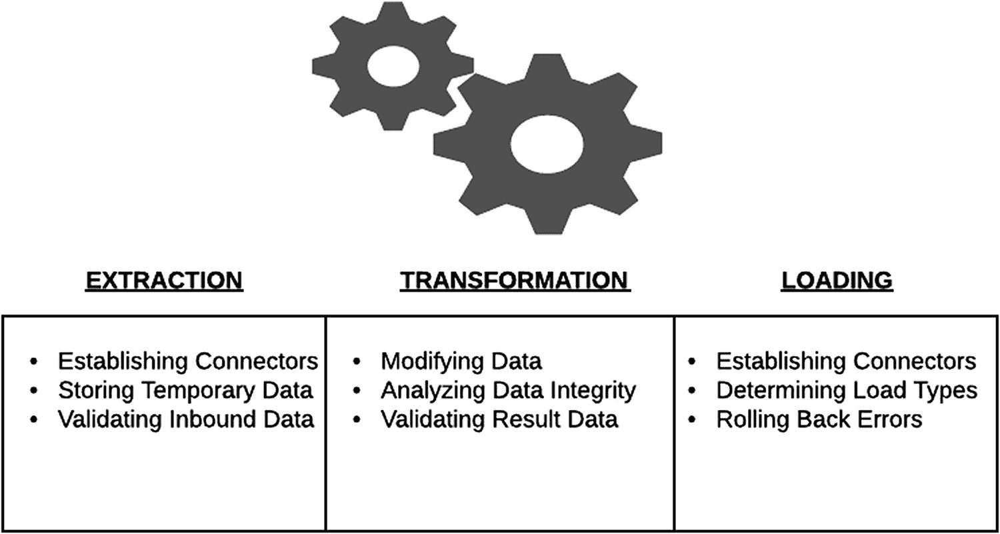

图 5-3 ETL 流程分解：选择合适的工具

### 提取

我们的流程从首次从源系统检索数据开始。与所有集成相关的事项一样，在选择合适的 ETL 工具时，需要考虑几个概念，包括建立连接器、存储临时数据和验证入站数据。

#### 建立连接器

在第一阶段，即提取阶段，数据通过连接器从源系统（云、文档、数据库）中检索出来。连接器是一种用于连接现代组织中存在的众多异构源的方式。^(⁸⁵) 通常，连接器是一种专门的转换器，允许一个系统读取通常不兼容的专有系统中存储的数据。作为转换的一部分，连接器必须提供特定于该专有系统的信息，例如 `JDBC`/`ODBC` 连接字符串、端点、端口号、数据库名称、用户名、密码等；查阅在线产品文档通常能提供编写干净连接字符串的要求。供应商通常将专有连接器与商业软件捆绑在一起，许多现成的 ETL 工具也将其作为完整软件包的一部分提供。自然，您的数据源越复杂、越异构，您希望可用的连接器就越多。

#### 存储临时数据

一旦建立连接，请求的数据就会被检索出来，并存储在我们所谓的临时暂存区中。^(⁸⁶) 在自行实施的迁移类型中，这个暂存区可以是任意数量的临时处理存储库，例如数据库表、`CSV` 文件或电子表格文件。而对于大多数第三方 ETL 工具而言，它是由 ETL 工具本身选择和维护的临时缓冲区。

在此步骤中，可能会产生一些担忧，因为临时数据（通常称为“传输中的数据”）^(⁸⁷) 可能包含与客户、账户或其他安全信息相关的个人身份信息（PII）。^(⁸⁸) 当然，安全性是整个企业都关心的问题，但在提取-存储过程中，这种级别的暴露尤其容易受到攻击。为了防止数据被窥探，请确保解决方案能够做到以下几点之一：（a）限制您存储的敏感数据量，（b）使用适当的加密技术保护传输中的数据，或（c）将临时数据存放在防火墙后的安全系统上，仅供最受信任的人员访问。然而，也要注意不要走极端，因为过度锁定数据与完全开放数据一样麻烦。所选的 ETL 解决方案应该能够帮助您找到过多与过少之间的适当平衡，因此在研究备选方案时请牢记这一点。

有关此主题的更多想法，请参考 [*https://www.helpnetsecurity.com/2016/10/25/securing-data-in-motion/*](http://www.helpnetsecurity.com/2016/10/25/securing-data-in-motion/)^(⁸⁹) 和 [*https://pulse.microsoft.com/en-ie/technology-lifestyle-en-ie/na/fa3-data-in-motion-how-to-protect-it-5-key-considerations/*](https://pulse.microsoft.com/en-ie/technology-lifestyle-en-ie/na/fa3-data-in-motion-how-to-protect-it-5-key-considerations/)。^(⁹⁰)

#### 验证入站数据

在整个提取过程中，你需要确保拉取了正确的字段，并确认源数据与存储数据之间完全匹配。这种验证在 ETL 全流程中都可以且应该进行，但在第一阶段尤为关键，因为此阶段的数据丢失将无法在后续环节追踪。你可能需要考虑的验证技术包括：确保字符串和数字等数据类型的一致性，删除重复或碎片化数据，并包含每个对象的主键。请记住，最终的数据输出质量完全取决于初始数据输入的质量。如果在提取过程中移动了无效数据，那么后续步骤中的补救将是一项巨大的挑战。

### 转换

除非你的数据源与目标系统存在直接的 1:1 映射关系，否则你必须对暂存数据进行处理，使其匹配目标系统预期的格式。这一步骤正是你所选 ETL 工具实际效能的体现。在制定转换策略时，需要考虑以下几个因素，例如数据修改和结果验证。

#### 修改数据

转换越复杂，ETL 工具所需的内置功能就越多。无需处理的数据被称为`直通`数据^(⁹¹)，我们通常会在源到目标映射的"转换规则"部分（参见第 4 章）中如此标注。

最基本的转换涉及对提取的数据应用一系列函数。这些函数如何编码和触发，可能是决定团队选择最佳工具的关键步骤。有些 ETL 产品使用 `Java` 进行转换（如 `Talend`），另一些则可能继承自微软脚本（`SSIS`）、`JavaScript`（如 `Pentaho`），或者支持多种编程语言（如 `Dell Boomi`）。当开发和支持人员需要从头学习一门全新的语言时，这很少能帮助团队快速上手。将正确的转换语法与团队的技能组合相匹配，将对初期生产力产生巨大影响。

#### 分析数据完整性

我之前提到过，源系统提供的数据将存储在临时区域中。在转换阶段，会应用程序化规则，从而产生修改后的值。为了判断转换的完整性，我们需要提出三个问题：

1.  我的数据准确吗？例如，转换后的值能否追溯到源数据？
2.  我的数据完整吗？例如，目标系统中标记为 `NOT NULL` 的字段是否填充了有效值？
3.  我的数据一致吗？例如，我们对类似的值是否应用了相同的规则？^(⁹²)

这三个问题都很重要，任何一个未满足都会在项目推进的某个环节造成障碍。我们可能会在部署时发现它，收到一条令人头痛的 `"Cannot insert NULL into NOT NULL value"`^(⁹³) 错误信息；或者在更晚的时候，当我们的报表系统巧妙地识别出四个独立的账户，分别标注为“International Business Machines”、“IBM”、“IBM Corp.”和“I.B.M.”时才发现问题。

当然，我们希望避免并修补在转换过程中发现的任何数据集成错误。考虑到项目可能涉及数百万个数据点，这说起来容易做起来难。我甚至可以说，缺乏数据完整性很可能是初次数据迁移后出现错误的最大原因。我们该如何解决这些潜在错误呢？以下是我尝试过的两点建议：

1.  **在源系统更新。**

    我们在前一章讨论过分析的概念——即审查源数据以理解其结构、内容和相互关系的流程。在分析阶段，要特别关注那些导致大多数标准数据完整性问题的特定模式：
    *   与电子邮件关联的姓名/昵称拼写不同（例如，Beth、Elizabeth 和 Liz 使用同一个电子邮件地址）
    *   机构名称拼写不同（IBM、I.B.M.、IBM Corp.）
    *   源系统中的 `NULL` 值需要在目标系统中填充
    *   字母数字字符与应为纯数字的数据混合
    *   手动输入的值（如地址或产品）存在拼写错误或不一致

2.  **分析并在转换后更新。**

    如果出于某种原因，你无法在源系统更正（或识别）数据，那么就对你的转换后数据进行调查并提供异常处理逻辑。这种方法要求你将处理过的数据存储在另一个临时存储平台中，但它能让你进行一种临时的分析，从而发现更多仅通过粗略查看加载提取数据无法发现的数据完整性错误。

虽然你可以这样做，但要警惕在源系统之外修改不规范的数据。尽管修改你能控制的数据看起来更直接，但在 ETL 或临时平台中进行更新的最大缺陷是，你正在创建需要维护的窄规则。也就是说，对一个系统的更新必然会导致对另一个系统的更新，从而产生你可能不想要的依赖关系。

例如，假设你硬编码了转换逻辑，将所有“IBM”、“I.B.M.”、“International Business Machines”等变体都转换为单个值：“IBM Corporation”。在团队控制下，这相对容易实现，并且由于无需更改源系统数据，可以节省前期时间。五个月后，源系统团队做出一个看似无害的决定，将目标值“IBM Corporation”更新为“IBM Corp.”。如果他们决定（这是个很大的"如果"）通知你的团队，你准备好仔细检查你的 ETL 代码，找到你放置硬编码逻辑的位置了吗？然后，你是否准备好测试并维护每个需要类似异常逻辑变更的生产环境变更？并且要永远持续下去？虽然听起来有些夸张，但你可以看到，将数据完整性的所有权移到源系统之外，可能会导致一些重大的路线图变动。我建议尽可能避免此类更新场景，除非在当前确实更有利，比如一次性迁移。

这就引出了第三个选项，它更像是一种默认选项。

3.  **不做任何操作。**

    如果请求源系统更新行不通，并且你认为构建异常逻辑是个坏主意，那就让数据保持原样进入目标系统。没错，这样会缺乏数据完整性，但它会在*那里*。只要你能追溯到根因（即特定的源字段），补救工作就可以转移给目标系统的清理团队。最重要的是，要避免任何不必要的意外。提前告知团队你所面临的情况，并向他们说明所有选项的利弊，包括默认的不做任何操作。在 `STTM` 电子表格的"备注"列中记录该决策，并提供一份状态报告，以便在最后关头需要做出决策时，该报告能够逐级上报。

#### 验证结果数据

任何数据转换的关键在于确保对数据所做的物理更改能够正确加载到目标系统中。验证结果数据这一环节涵盖了我们必须完成的所有转换工作，包括过滤列、合并查找值、将时间和日期等度量值转换为标准格式，以及将不一致的数据映射为单一单位（例如，用 `"1"` 代表男性，`"2"` 代表女性，`"3"` 代表双性人等）。数据验证步骤更侧重于确认数据的处理操作，而非通过数据完整性来检验其是否与源数据匹配。当然，数据验证与数据完整性是相辅相成的，有时很难将这两个概念完全区分开来。下面这个例子或许能帮助你理解：

我的团队曾参与迁移一个国际电子邮件通信数据库。其中一些通信完全由希腊字符写成，一些由俄语字符，一些由德语字符，还有一些由英语字符。这次迁移相对简单：我们只需获取特定字符集，然后将其从源系统（一个 Postgres 服务器）通过 ETL 平台（Pentaho）迁移到目标系统（Salesforce）。我们首先发现的一个问题是，无论我们怎么尝试，俄语西里尔字符显示出来都只是乱码，希腊字符也一样。但德语和英语似乎没问题。需要指出的是，在加载过程中我们没有收到任何错误信息。换句话说，一切处理流程都正常执行，只是无法正确显示希腊语和俄语特有的国际字符集。

我们在测试中发现，原因在于我们在目标系统中选择的字符集；我们使用了 ASCII 拉丁字符集，而本应选择像 `UTF-8` 这样包含国际符号的字符集（关于 `ASCII` 与其他编码集使用的精彩解释，请参考 [*https://stackoverflow.com/questions/2241348/what-is-unicode-utf-8-utf-16*](https://stackoverflow.com/questions/2241348/what-is-unicode-utf-8-utf-16)）。^(⁹⁴)

我举这个例子是为了说明数据完整性是如何按设计运作的——我们转换后数据的准确性、完整性和一致性在内容上是匹配的（至少就我们对俄语和希腊语的文字评估而言）。问题出在我们因转换操作而导致的数据验证失误上：我们处理了错误的编码特性，这是 ETL 工具本身的一个功能。解决方案要求我们同时审视数据完整性（数据本身）和数据验证结果（转换过程本身），做出正确判断，然后通过调整我们的默认字符集来推进工作。

当你选择 ETL 工具时，要确保它能兼顾数据完整性和数据验证这两个步骤。你需要测试的最关键特性包括：能够通过熟悉的编程语言利用函数快速转换临时数据、能够自动搜索转换后数据中固有的错误、以及能够通过最少的点击或编程步骤来修正这些错误。

### 加载

加载是 ETL 流程的最后阶段，通常也是我们在讨论数据迁移的“一键式”方法时大多数人会联想到的阶段。也就是说，按下一个按钮，数据就会完成全量抽取和转换，从源端移动到目标端。我们知道这不应该成为我们默认的立场，但我们仍然承认，总有一天，在某个时刻，我们的数据会接近那个最终点，届时我们需要迁移数据、设置夜间数据馈送并完成验收。我们离这个目标并不遥远（我们将在第 7 章中进一步讨论这种“一键式”操作），我总是向我的团队承诺，一旦我们攻克这个难关，我请客喝酒。

实际上，在加载过程准备收工之前，总是需要一些最终的调整和规划。在本节中，我们将讨论在选择合适的 ETL 工具时需要注意的加载过程的几个特性，例如建立连接器、确定加载类型以及回滚错误。

#### 建立连接器

我们将再次讨论连接器这个话题。我们最初在讨论构建抽取阶段时，就牢牢地记住了入站连接器这一专有数据转换器。现在，我们要反向操作：不再是拉取源数据（或为 Web 服务打开监听器），而是向目标系统插入或更新数据。然而，抽取连接器和加载连接器之间的一个巨大区别是*时间*。我们可能有多个入站事务源，但（在大多数情况下）只有一个出站目标，数据在我们的管道中不断累积，这使得出站加载的时间远比数据检索要长得多。

举个例子，假设我们有五个源系统，每个系统有 100 万条记录。每个系统的数据都可以在五周内抽取、转换并简档到我们的中间件服务器中。五周结束时，我们准备在一个晚上将 500 万条记录一次性加载到目标系统中。因此，我们花了五周时间移动 500 万条记录，但花费的时间主要用于评估，而非实际执行加载。如果我们的连接器不支持批量并行加载（比如 `Oracle SQL*Loader` 或 `SQL Server BCP`），那么我们在加载阶段就会因为*时间*不够而遇到麻烦（见图 5-4）。

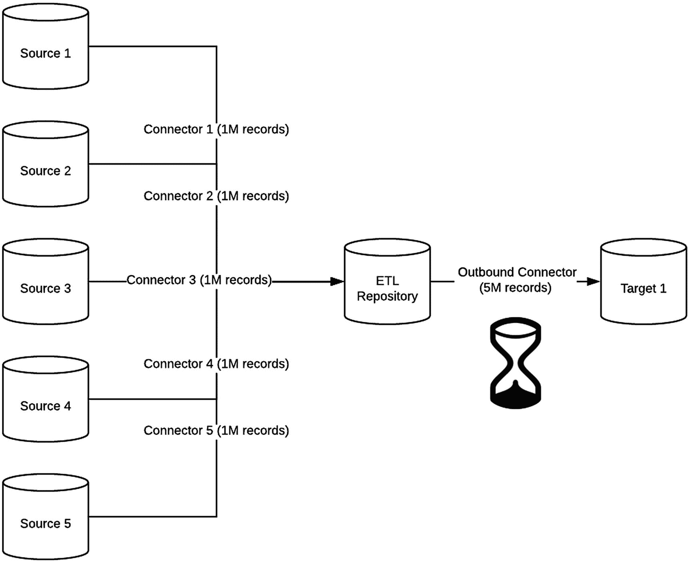
图 5-4 批量加载到目标系统

关键在于，要清楚我们需要加载多少数据，以及我们的 ETL 解决方案开箱即用能支持什么。如果我们在图 5-4 的沙漏中已经没有时间余地，我们就需要错开加载时间，或许比最初设想的更早开始加载。只要团队其他成员都同意时间因素对加载周期的影响，这种方法就无可厚非。与其因为错误的假设而导致时间不够，不如尽早开始这个阶段。

#### 确定加载类型

我们在前一章已经讨论过加载类型，这里就不再赘述。加载类型指的是我们是立即加载整个数据集（初始加载或一次性迁移），还是针对已有数据库执行迭代式的更新插入操作（增量加载）。你选择的 ETL 工具应具备有助于确定所需加载类型的功能。例如，我们曾在一个项目中使用过一个工具，它非常擅长快速创建新的一次性迁移，并在相对较短的时间内完成数据的抽取、转换和加载。然而，该 ETL 工具的调度功能存在欠缺，导致我们难以每天从源系统中准确提取出增量数据（更新）。在未能使其适应正确的调度要求后，我们不得不放弃这个工具，并寻找另一个更擅长执行夜间增量加载的新工具。利益相关方勉强同意了我们的决定，但幸运的是，他们手上已经有几个 ETL 产品在使用中，我们只需申请一个新许可证即可。而当你所在的组织，在你鼓吹某个产品的优点后，又因为发现它缺少那些事后看来可能很明显的关键特性而需要切换到另一个新产品时，他们可能会采取不同的态度。是的，这种想法上的转变确实会时不时地发生，但发生时总归是令人尴尬的。

#### 回滚错误

我知道你肯定会争辩说，有了大量的文档、性能分析、验证和测试，你的数据加载过程会顺利进行，不会出现任何错误。我也知道，你明白我写这句话时带着讽刺意味。

错误总是会发生，虽然比你希望的多，但比你以为的要少。而且，由于你在文档、性能分析、验证和测试方面所做的出色工作，你很可能准确知道它发生的时间和原因。十有八九，这是由于你无法控制的因素造成的，比如测试环境之外的一条异常记录，或者更隐蔽的问题，比如网络超时错误——老实说，你对此完全无能为力。当然，你偶尔也会遇到一些随机问题（“哎呀，我的异常逻辑漏掉了那个”），这时，只能将其归结为一个简单的失误，回滚加载，安装修复程序，然后重新部署。

你选择的 ETL 工具应具备一些与回滚相关的特性，或者至少能帮助你追踪数据错误，例如成功和失败的运行计数、记录时间和超时的日志文件，以及哪些记录失败及其原因的某种指示——大多数数据库插入错误都包含数据和问题原因。虽然 ETL 工具不一定需要具备清理目标并重置以便重新部署的功能，但考虑让团队能够及时地从错误中优雅地追踪和恢复，应该是一个重要的考量点。

### 市场上的工具

我们已经讨论了构建 ETL 流程和选择合适工具的准则。在本章的剩余部分，让我们来谈谈当今市场上几种 ETL 工具及其功能、优缺点。然而，在开始之前，我需要先说明几点注意事项，以免我写出一些会让别人感到不快、招致愤怒邮件，更重要的是，导致这本书收到差评以及对我的人身攻击（这或许是一回事）的观点：

1.  我选择列出的工具是基于我自己的经验，不代表我与任何相关供应商有关联。我曾将它们用于专业开发，并认为自己有能力对其进行评估。市场上的 ETL 工具多不胜数（Gartner Research 对云端和本地部署的工具都有详细总结，如果你在寻找一些纯粹的研究指南，可以搜索“Gartner 数据集成工具魔力象限”来查看最新信息）。要识别并复述 Gartner 已经整理好的内容，都需要花费比我所希望传达的更多的时间、篇幅和专业知识。

2.  本节的目的在于为你提供一个开始探索 ETL 工具的起点。在可能的情况下，我提供了这些公司网站的链接，以便你可以接手并自行继续评估。换句话说，在实践中学习，如果你发现了什么独特的东西，请告诉我，我会将你的发现与我的相结合。

3.  这份清单是不断变化的，我们今天所知道的，五年后无疑会有所不同。对我来说（希望对我的编辑们也是如此），这代表着一个承诺，那就是我会尽快撰写本书的下一个版本，而不是永远不写。

那么，如果我们准备好了，就开始讨论我们的第一个工具吧。

#### Jitterbit

**网站：** [`www.jitterbit.com/`](http://www.jitterbit.com/)

**评价：** Jitterbit 是我最早使用的基于云的 ETL 工具之一，体验很不错：使用其免费增值的 `Salesforce` 数据加载器，我能够在云端构建一些出色的、计划性的集成。通过一个复杂的图形用户界面（见图 5-5），对象（`Salesforce` 中相当于数据库表的概念）可以在数小时内（而非数天）完成移动。我们很清楚想把这个工具用作我们的数据库备份系统，它也确实很好地满足了这一需求。当集成变得复杂时，我们遇到了一些困难，但随着时间的推移和技术的进步，Jitterbit 在 API 自动创建和 API 管理方面提供了更多功能，对于其服务的中小型企业基础来说，前景看起来不错。如果你刚开始接触 ETL，并且设计不太复杂，绝对可以试用一下这个工具，因为该公司同时提供本地部署和云端解决方案。

**优点：** 配置和部署简单，停机时间相对较少。可以处理多种数据连接器，包括 `SAS`、`Salesforce`、数据库和 `Web` 服务。技术支持非常有用，愿意回答大部分问题。

**缺点：** 随着集成变得越来越复杂，其设置也随之变得复杂。当时的文档资料比较匮乏，而且我们对云端产品的安全性有很多疑问。

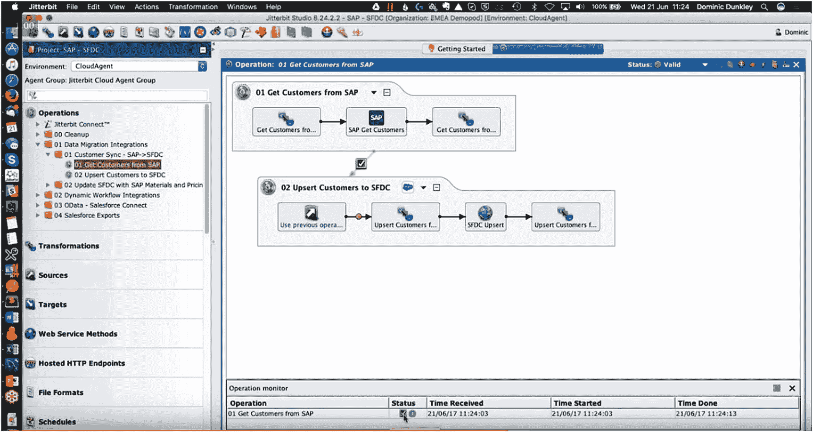
图 5-5 Jitterbit API 转换

#### Talend

**网站：** [`www.talend.com`](http://www.talend.com)

**评价：** `Talend` 生态系统包含一整套工具，包括 `Talend Open Studio`、`Talend 数据管理平台`、`Talend 数据服务平台` 和 `Talend 集成云`。其完整的数据管理和集成产品组合是 `Talend Data Fabric` 的一部分，包括数据集成、数据准备、数据目录、数据管理和 `API` 管理功能。凭借所有这些功能，`Talend` 可以应对最复杂的 ETL 场景。最棒的是，`Talend` 维护着一个开源社区，因此其 `Open Studio` 订阅中的许多工具都是免费使用的（见图 5-6）。^(⁹⁵) 我个人很喜欢这种免费使用复杂产品的理念。然而，`Talend` 支持一个 `Java Code Generator`，它利用开源的 `Java` 库。如果你不是一名 `Java` 开发人员，学习曲线可能会非常陡峭。

**优点：** 由开源社区维护的一套出色的工具集。支持你所需的大部分（即便不是全部）高级 ETL 解决方案。如果你的开发团队拥有 `Java` 技能，这将是一个很好的解决方案。

**缺点：** 如果你还不是 `Java` 爱好者，学习 `Talend` 可能会是一场艰苦的战斗。如果你所在组织的方向是极致的软件开发，那么这个工具可能适合你。否则，当你需要修补操作时，可能很难找到团队成员来支持你的集成工作。

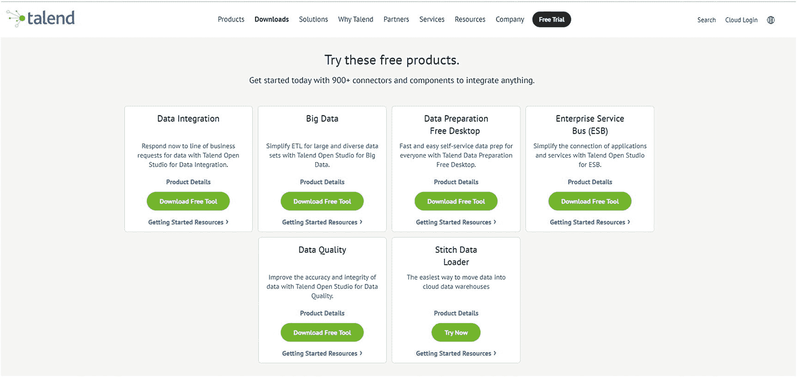
图 5-6 Talend Open Studio 免费产品

#### Dell Boomi

**网站:** [`https://boomi.com/`](https://boomi.com/)

**评价:** `Dell Boomi` 是我反复使用并似乎总会迁移（双关语）到的工具之一。如果我需要一个具备调度功能的高端 ETL 处理解决方案，我会向客户推荐 `Boomi`，并强调其拖放式 `GUI` 功能的易用性（参见图 5-7）、文档的务实风格、社区贡献，以及其代理（称为 `Atom`）能够真正远程运行的能力——无论是在防火墙后以增强安全性，还是在云端。`Boomi` 的设计确实需要一点时间来适应，尤其是在整个集成过程中持久化属性方面。但一旦你掌握了这一点，测试、部署和维护版本控制就相对容易了。对我来说，最大的缺点是定价模式：它似乎为你拥有的每个连接器、针对每个 `URL` 都收取一份许可证费用。也就是说，如果你想通过一个特定端点连接到一个数据库，你需要为一个连接器支付零售价。如果你随后想连接到同一个数据库，但通过不同的端点，你就要为另一个单独的许可证付费。虽然有变通方法，但这看起来像是一笔高昂的前期成本。如果你的 ETL 设计不需要 `Boomi` 所提供的这种高强度功能，那么这个工具可能不适合你的组织。

**优点:** 一旦你参加了适当的（在线！）课程，设置、部署和提交版本控制都非常容易。通过教程、电话支持和社区论坛，一切都为你详细说明。由于它是基于云的，应用程序的维护工作量很小，内置的 `API` 调用允许你执行一些真正的自动化 `DevOps` 事务（我们将在第 7 章讨论 `DevOps`）。

**缺点:** 如果你想获得高级功能，如单点登录、到同源产品的多个连接器以及无限客服支持，那么价格会非常高昂。此外，在其他工具中可能被认为更简单的某些 `Boomi` 功能，比如修改数据，可能并非内置，而需要用 `Groovy` 或 `JavaScript` 创建自定义脚本。确保你的开发人员具备合适的技能和一点耐心，你就能让它为你所用。

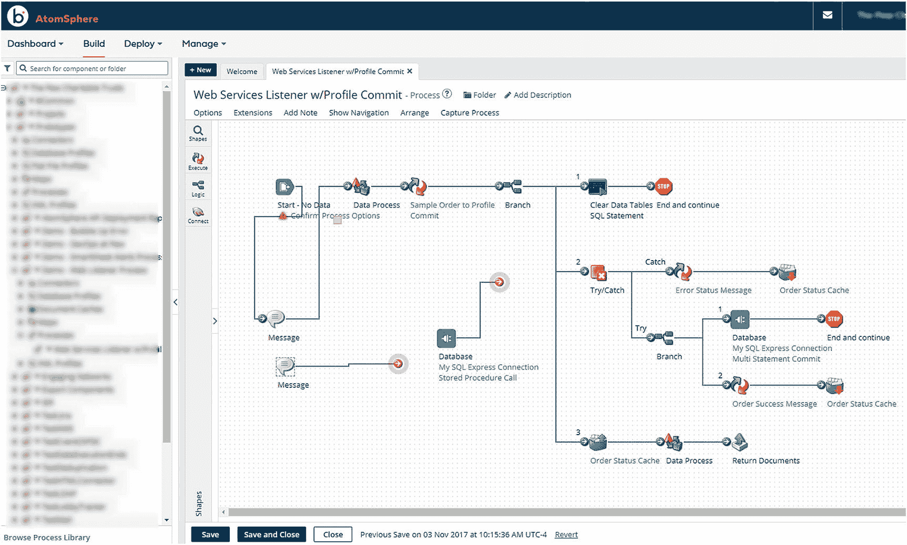
图 5-7 Dell Boomi 流程窗口

#### Pentaho 数据集成（PDI）

**网站:** [`https://community.hitachivantara.com/s/article/data-integration-kettle`](https://community.hitachivantara.com/s/article/data-integration-kettle)（社区版）
[`www.hitachivantara.com/en-us/products/data-management-analytics/pentaho-platform/pentaho-data-integration.html`](http://www.hitachivantara.com/en-us/products/data-management-analytics/pentaho-platform/pentaho-data-integration.html)（企业版）

**评价:** `Pentaho 数据集成` 创立于 21 世纪初，其设计纯粹是开源的。这种开放性意味着该系统将拥有免费、可读的元数据（`XML`）标准和开放的 `API` 标准，易于设置（大约 2 分钟），支持所有类型的数据库，并允许数据与任何格式之间进行转换^(⁹⁶)。最终诞生了一款免费产品，它几乎可以消费任何数据格式，使用开箱即用的过滤器或 `JavaScript` 过滤器进行转换，并加载到从文本文件到大数据系统的任何数据源中。2012 年，当我的同事开始称赞 `Pentaho` 的优势时，我最初是持怀疑态度的——一个能搞定所有这些事的免费工具？有什么蹊跷？

我至今还没弄明白最后这一点。我可以说，`Pentaho` 在我做过的大部分工作中都堪称救星，主要是因为它安装相对简单，而且在我看来，它的拖放式 `GUI` 功能是首屈一指的（参见图 5-8）。另外，由于其后端元数据是用文本 `XML` 编写的，其架构可以轻松地以任何格式存储，并能与版本控制紧密集成。

自从我第一次接触 `Pentaho` 以来，该公司已与巨头日立 `Vantara` 合并，但社区版仍然免费提供。据我所知，还有一个基于云的版本正在开发中，以配合本地部署的应用程序。付费版本确实提供了一些额外的好处，例如更快的支持和其他功能。但如果你正在寻找一个能让你轻松入门 ETL（而且免费！）的工具，那么 `Pentaho` 绝对值得一试。

根据我的经验，该工具最大的缺点是开发人员和市场都缺乏对其的了解。哦，你知道 `Pentaho`？太好了。你想创建多个可以涵盖整个数据系统的部署，并在几周内准备好运行？没问题。你想在你离开后找到其他能够支持这个工具的人？那就有问题了。但如果你愿意改变你的工作环境，让 `Pentaho` 成为事实上的工具，我认为你可能会从中获得很多好处。

**优点:** 因为它是我第一次真正接触到的易用的 ETL 工具，所以我对其评价颇高。正如我常说的，“`PDI` 让我的数据能够翻筋斗。”不过，你可能不这么认为，而且我也无法确切说明该工具在近期被日立 `Vantara` 收购后的表现如何。尽管如此，如果你喜欢冒险并想尝试一下，我会推荐它。社区版是免费的，所以你基本上没有任何损失。

**缺点:** `PDI` 在市场上往往被一些更知名的工具所掩盖，因此，找到理解其设计并愿意支持该工具的员工可能会是个问题。对于一次性的迁移项目，`PDI` 表现得非常好。但对于增量加载（例如，夜间集成），`PDI` 在某些功能上有所欠缺，比如优雅的错误处理。

我们将在下一章构建示例 ETL 流程时再次讨论 `Pentaho`。

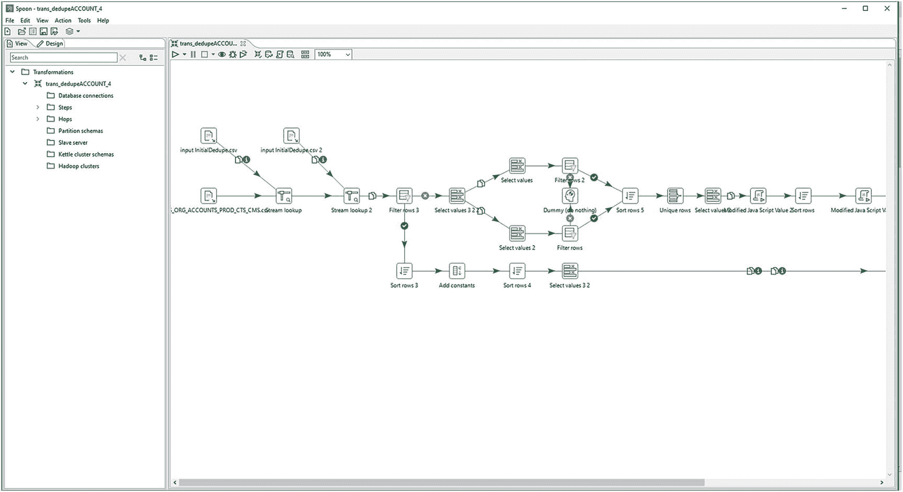
图 5-8 Pentaho 数据集成主窗口

#### Microsoft SQL Server Integration Services (SSIS)

**网站：** [`https://docs.microsoft.com/en-us/sql/integration-services/sql-server-integration-services?redirectedfrom=MSDN&view=sql-server-ver15`](https://docs.microsoft.com/en-us/sql/integration-services/sql-server-integration-services%253Fredirectedfrom%253DMSDN%2526view%253Dsql-server-ver15)

**评价：** 早在恐龙时代（2003 年），我就第一次接触到了 `SSIS` 的第一个迭代版本，当时它叫`数据转换服务`（`DTS`），用于将 `Oracle` 数据库复制到 `Microsoft SQL Server` 报表仓库。自那时起，`SSIS` 已经取得了长足的发展，并已嵌入到 `Microsoft` 产品中，既可通过 `SQL Server DBMS` 许可证在本地使用，也可通过 `Azure Data Factory` 云数据集成服务在云端使用。换句话说，当你以 `Microsoft` 为基础时，`SSIS` 几乎就是标准。从各方面来看，`SSIS` 实施快速、易于使用，并能与其它 `Microsoft SQL/Azure` 产品完全集成（见图 5-9）。主要问题出现在当你并非 `Microsoft` 技术栈环境，并且没有计划购买或使用其主要产品线时。在这种情况下，你最好选择另一个 ETL 工具。

**优点：** 较低的总拥有成本，可让你与其它 `Microsoft` 产品完全集成，且已包含在 `DBMS/Azure` 许可证中。

**缺点：** 对于非 `Microsoft` 技术栈环境，支持 `SSIS` 可能是一项挑战。我建议，如果你还在犹豫，可以下载 `SQL Server` 的评估版本^(⁹⁷)，并试用一下 `SSIS`。

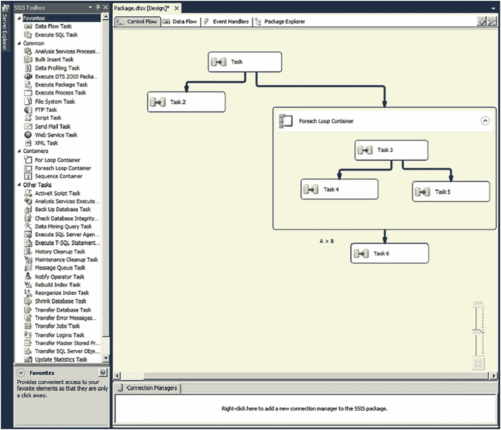
图 5-9 SSIS 控制流

### MuleSoft

**网站：** [`www.mulesoft.com/`](http://www.mulesoft.com/)

**评价：** `MuleSoft` 成立于 2006 年，并于 2018 年 5 月通过收购成为 Salesforce 旗下公司。最初，`MuleSoft` 提供企业服务总线（ESB）开源软件，并在 2013 年发布其 API 管理工具 `Anypoint Platform` 后，成为首批云原生集成供应商之一（见图 5-10）。我与 `MuleSoft` 的直接接触有限，但我通过多种渠道听说，它是一款出色的 ETL 工具，并可插入到大多数环境中。根据 Gartner 报告，`MuleSoft` 在过去几年中客户数量翻了一番，并提供了强大的 API 管理、安全支持、多云部署以及开放核心的 ESB。与其它具备这些高级功能的工具一样，你的开发人员需要比使用其它产品具备更多的技术知识。幸运的是，`MuleSoft` 提供了一些优秀的在线和课堂培训。

**优点：** 目前，`MuleSoft` 似乎在市场上占据着显著领先地位，这可能与其与 Salesforce 的关联有关，也可能是因为其现有产品线吸引了那些需要全生命周期 API 管理、混合集成以及易于上手的客户。

**缺点：** `MuleSoft` 仍保留其作为企业服务总线的根基，采用完整集成工具功能的速度非常缓慢。该产品可能并非万能解决方案，但仍值得为你的实施进行评估。

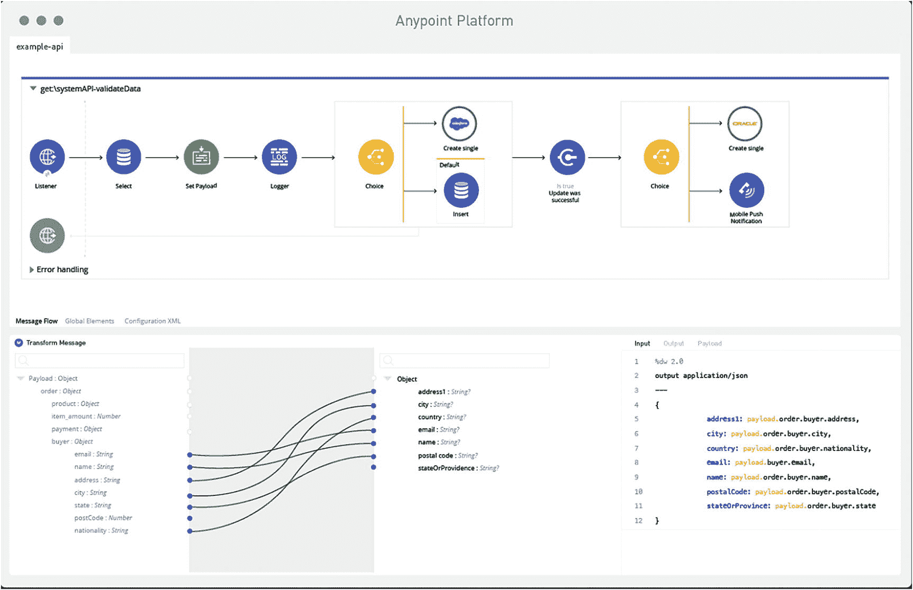

图 5-10 `MuleSoft Anypoint Platform`

### Informatica

**网站：** [`www.informatica.com`](http://www.informatica.com)

**评价：** 任何关于 ETL 的讨论都不可能忽略 `Informatica`，它是数据管理领域的首要代表。该公司自 1993 年成立以来，经历了多次迭代，从本地部署到 2007 年率先进入云端。我于 2016 年获得了 `Informatica Cloud Specialist` 认证，自那以后，该公司已演进为下一代产品，即 `Informatica Intelligent Cloud Services`（`IICS`；见图 5-11）。

我对这款产品爱恨交加。它能完成集成团队所期望的工作，并且做得非常出色，出色到它应该出现在每个人的工具候选名单上。但另一方面，它由一家根植于数据管理领域的机构运营，我发现其现有技术有时会落后于其它供应商，不过随着最新的云端实现，这种情况可能正在改变。对我来说，最大的挑战是学习使用该工具。它功能如此丰富，以至于新用户要完全掌握它，需要培训、长期战略规划和全身心的投入。

**优点：** 市场份额大。被普遍认为是 ETL 领域的巨头，支持数据迁移/集成的各个方面，例如广泛的连接器、安全性、元数据管理、灾难恢复、可管理性、标准合规性以及在线技术支持。

**缺点：** 与许多高级工具一样，`Informatica` 功能过多，而我们的时间又太少。如前所述，该产品对某些组织来说可能过于复杂。我曾与一些开发人员交流过，他们承认在较小数据集上使用 `Informatica` 就像“用锤子打蝴蝶”。如果你的组织对数据集成方法非常认真，那么我会建议你让团队全力以赴并做好研究。否则，可以考虑我之前提到的那些不那么重量级的工具。

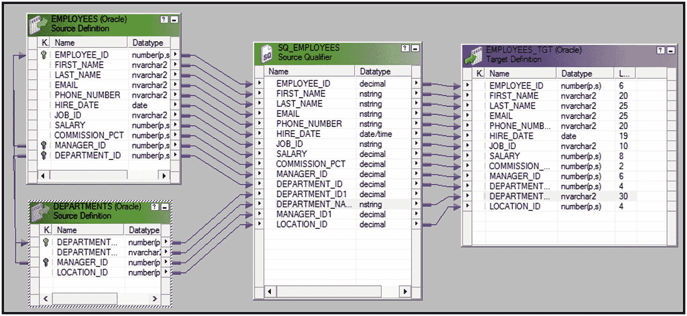

图 5-11 `Informatica` 映射（图片取自 [`www.edureka.co/blog/informatica-etl/`](http://www.edureka.co/blog/informatica-etl/)）

### 脚本语言

**网站：** 多种

**评述：** 我们列表中的最后一个 ETL 工具并非第三方供应商产品，这进一步说明了 ETL 可以以各种形式和规模存在。我曾在一些初创公司和软件公司工作过，这些公司的技术实力足够强，不需要像`SSIS`或类似`Informatica`的应用程序所提供的典型拖放功能，而是选择通过编程语言或存储在`Python`和`Perl`中的预构建库来“自行开发”ETL（见图 5-12）。^(⁹⁸) 我认为这是一种合理的方法：它消除了对应用程序的依赖，这些应用程序常常会因学习曲线和财务成本而拖慢项目进度。另一方面，这种实现方式确实要求你的团队具备足够广度和知识来监督维护工作，并且能够在出现任何错误时迅速介入。

关于脚本是否优于供应商产品，存在多种讨论（比较 [https://tombreur.wordpress.com/2017/02/19/etl-is-dying/](https://tombreur.wordpress.com/2017/02/19/etl-is-dying/)^(⁹⁹) 与 [https://www.linkedin.com/pulse/etl-its-dead-yet-jarrett-goldfedder](http://www.linkedin.com/pulse/etl-its-dead-yet-jarrett-goldfedder)^(¹⁰⁰)）。坚持使用让你感到舒适的方法即可。

**优点：** 对于有能力的人来说，脚本化是开始迁移/整合记录的一个公平方式。只需确保经常编写文档，并为将来维护系统的人提供有用的代码注释。

**缺点：** 对于可能需要管理和修改这些集成的非技术团队来说，这不是一个好策略。如果你确实决定走这条路，无论是通过外包工作还是自行构建，那么请尽可能使前端界面用户友好。通过这样做，你将大大减少那些不时必然会出现的手把手指导需求。

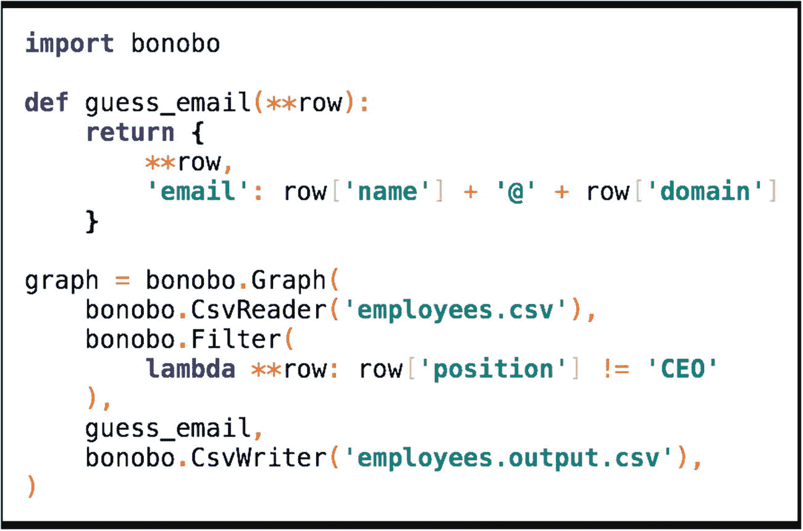

**图 5-12** Bonobo 示例（[`www.bonobo-project.org/`](http://www.bonobo-project.org/)）

## 总结

在本章中，我们涵盖了 ETL 流程的主要阶段，这些阶段将帮助你评估合适的工具，然后回顾了几款应用程序，以便你入门。正如我所指出的，这并非一个完整的清单，也不是从无偏见的视角进行选择。是的，我有自己的偏好，并且愿意与任何愿意倾听的人分享。在投入了足够的时间和精力于构建过程之后，我学会了完成迁移任务所需的知识，也了解了那些警示我避开的危险信号。然而，这种思维方式带来的问题是，过度依赖一个产品可能会让你无法考虑其他可能提供巨大价值的工具。由于一些先入为主的观念，我们选择了“安全”的路线——选择可能并非最优，但过去一直有效的工具——并因此冒着长期损失的风险。

为了避免在选择 ETL 工具时陷入分析瘫痪的陷阱，请记住，市场上有许多优质工具，同样也有一些不太好的工具。我建议你认真考虑你的项目需求，思考完成工作所需的“完美”工具，然后研究那些尽可能接近完美水平的产品。你很可能找不到你的“圣杯”。但是，正如《夺宝奇兵》电影中的圣杯骑士所告诫的那样，你至少能处于一个更好的位置去“明智地选择”。

脚注 1 2 3 4 5 6 7 8 9 10 11 12 13 14 15 16 17 18

