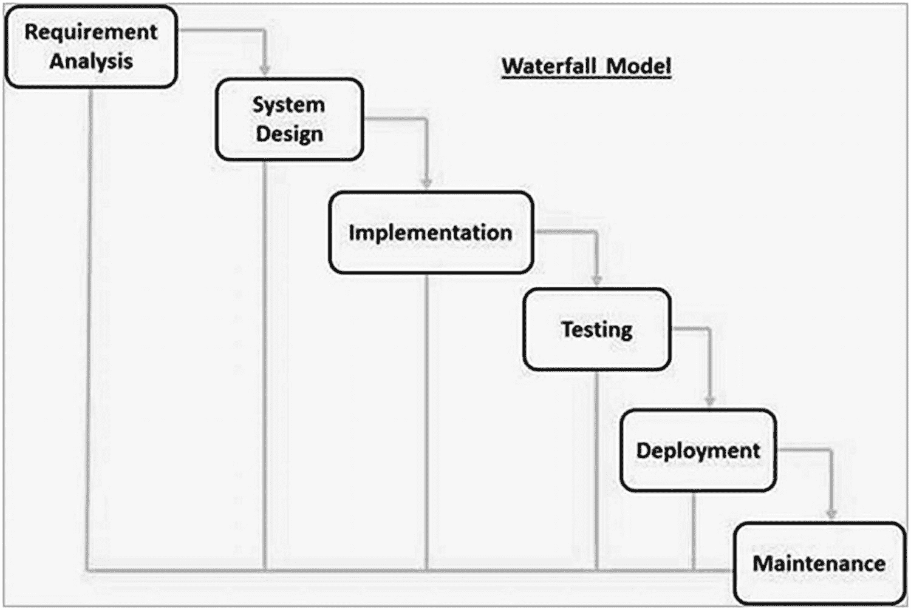
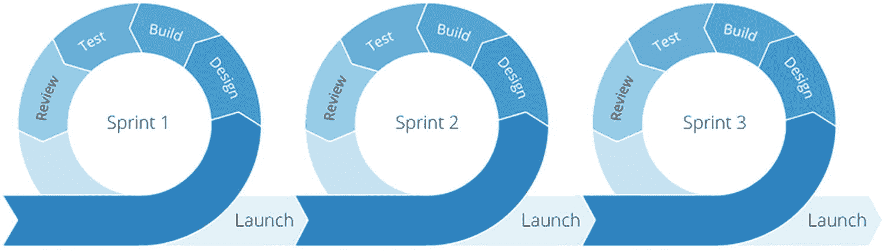
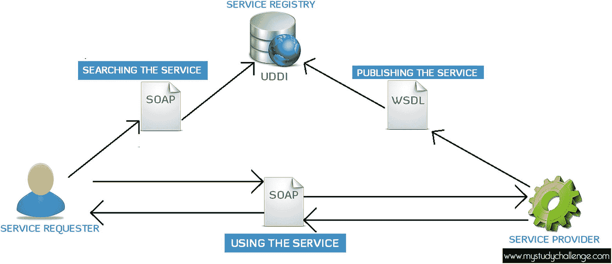

# 脚注

## 当前格局：两种截然不同的模型

随着商业模式与时俱进，组织整合数据的能力也在发生变化，其方法也呈现出新趋势。得益于高德纳公司等研究与咨询机构，流行的 ETL 软件蓬勃发展；我们将在第四章讨论一些我钟爱的产品。企业系统正逐渐将重心从本地数据仓库转向`AWS Redshift`和`Microsoft Azure`等云端仓库，开发者设计模块化解决方案的能力也随之提升。这一技术变革催生了两种主流的数据集成模型：

1.  **“静态数据”模型**：ETL 系统在此模型下收集整个企业的信息，并将记录合并为统一的视图。
2.  **“数据湖”模型**：该模型将来自多个不同数据源（包括结构化和非结构化数据）的 TB 级数据（“大数据”）相结合，并通过极速处理引擎进行分析。

这两种模型以及团队构建它们所需的技能截然不同。例如，“静态数据”模型代表了现代企业数据仓库，通常要求团队成员在数据库设计、架构设计和 ETL 开发方面拥有相当丰富的知识。这类系统往往长期存在，最终在企业中占据核心地位。

另一方面，数据湖模型因其处理的是高容量流式数据，通常更具临时性，短期存储数据并按需生成输出。该模型所需的技能更侧重于大数据技术、NoSQL 架构和数据流分析。

这两种系统可能存在重叠，例如某些“静态数据”模型可能包含非结构化数据，而某些“数据湖”也可能拥有持久化存储。我以此为例，是为了说明并非所有数据仓库的构建方式都相同：不同的配置将需要截然不同的技术技能。

## 瀑布模型与敏捷模型

将选定的数据模型付诸实施所需的时间也各不相同。就其本质而言，“静态数据”集成模型可能需要数年才能完善，而基于 Facebook 数据流的数据湖模型则不然。因此，项目团队在排定目标交付日期时，需要意识到潜在的设计问题。这一认知意味着我们应该避免“一刀切”的策略。相反，应由核心团队和利益相关者共同决定何时以及如何交付集成需求及最终产品。在实践中，我们可以采取两种方向：

1.  利益相关者是否期望分析师在项目开始时概述需求，并在项目结束时准备好可交付成果？
2.  项目是否更倾向于“边做边定义”的方法，并通过一系列迭代来确定可交付成果？

虽然这两种模式之间可能存在各种中间状态，但规划可以采用瀑布模型或敏捷方法论。理解这两种方法论如何融入集成模型非常重要，因为它们有助于建立我们将在本书中讨论的团队建设框架。

### 瀑布模型

瀑布模型，又称线性顺序生命周期模型，是最早引入现代组织的流程模型之一。在瀑布模型中，必须完成一组阶段才能进入下一阶段，并开始下一阶段的工作。各阶段之间没有重叠，流程通常是向前推进的线性过程，类似于流动的水体。如图 1-1 所示，瀑布模型与其名称如出一辙。

图 1-1

我们看到一个采用瀑布模型实施的项目（可能是软件工程、建筑，甚至是策划一场派对）会经历多个阶段：从需求收集开始，然后是系统设计、实施、测试、部署，最后是维护。这种模型非常适合对后续任务已有清晰认识的团队，因此可以根据任务和所需时间分配资源。例如，可以安排业务分析师进行为期两周的需求分析阶段，随后系统架构师进入一周以构建设计，接着程序员进行为期四周的编码实施阶段，以此类推。

瀑布模型有其优点和缺点。但作为最早成功的项目管理方法论之一，它在当今商业世界中仍备受推崇。

被引入支持瀑布型项目的集成团队通常与其余开发团队同时介入，即在实施阶段。然而，这种策略并非总是最优选择。由于集成与业务规则以及源到目标映射（`STTMs`）（我们将在后续章节讨论）的不同复杂度密切相关，更稳妥的做法是从第一次会议起就邀请集成团队的代表参与，即允许集成团队在需求分析和系统设计阶段提供意见和知识共享。这种代表可以是面向业务的开发者进行面对面交流，也可以是通过具备集成技术理解的业务分析师作为代理。无论如何，我建议从一开始就让集成团队成员参与讨论技术细节，因为这种参与将在项目设计开始后减少范围蔓延和架构建模问题。

### 敏捷模型

一种在软件工程中变得非常流行的方法论是敏捷，它可以追溯到 W. 爱德华兹·戴明以及日本制造企业为从二战经济影响中复苏而应用的精益制造原则。^(¹⁰)

敏捷与其说是一种框架，不如说是一种哲学，相较于每个阶段都有固定起止日期的瀑布模型，它鼓励更高程度的灵活性、沟通和赋权。作为区别，敏捷采取迭代、协作的姿态，具备改变方向以满足利益相关者不断变化需求的能力。它通过被称为 *冲刺* 的限时工作周期来实现这一点，在此期间，一系列持续的需求被排定优先级并得到处理，直到下一个周期/冲刺开始（见图 1-2）。

图 1-2

冲刺模型^(¹¹)

如图所示，冲刺始于基于需求（称为“用户故事”）对一组产品可交付成果进行优先级排序，并包含设计、构建、测试、评审以及最终产品发布等内置活动。这里的目标并非像瀑布方法那样创建最终的软件产品，而是迭代地交付一系列最终构成最终产品的功能。尽管最终产品可能需要数周甚至数年才能完成，但敏捷方法论确保了持续的前进动力，并且（至少在理论上）在冲刺结束时能向团队成员展示新的更新。

敏捷模型与瀑布模型的不同之处还在于，它允许团队角色灵活且动态变化，要求相同的技能集在团队可能同时“蜂拥”处理同一个故事时能够重叠。^(¹²)

取决于具体情况，由专业集成开发人员组成的团队可能无法加入这种“蜂拥”（反之亦然，因为编码团队可能不具备必要的集成背景）。虽然这似乎与敏捷理念相悖，但它比你可能预期的更有帮助。一方面，集成团队的任务被视为整个项目团队的一个子集，附带一系列用户故事，他们可以立即基于这些故事开始积压工作、协作和分享。这里的要点与瀑布模型一样，是让集成成员从一开始就成为模型的一部分，给予他们表达担忧、跟进阻碍因素以及向管理层提供可能比最初预期耗时更长的任务更新的发言机会。

## 集成流程 vs. 集成产品所有权

所选框架，无论是敏捷、瀑布还是两者的混合，都决定了团队构成。同样重要的是团队如何完成任务，以及哪些个人应负责完成这些任务。敏捷框架（在某种程度上也包括瀑布生命周期模型）的核心概念之一是产品所有权。^(¹³) *产品负责人* 是负责管理产品待办列表的角色，该列表包含了构成需求的条目以及对产品问题和解决方案的共同理解。产品负责人的主要职责是在存在多个相互竞争的需求时引导开发团队的方向。在瀑布模型中，类似角色可能是项目经理，尽管在职责上与业务分析师的角色有一定重叠。^(¹⁴)

从这个角度来看，很明显集成团队的负责人（我们将在第 3 章讨论的首席集成人员）应该同时拥有产品（例如，ETL 应用程序）和集成背后的需求。

但还有另一层所有权常常在开始设计工作之前仍不明朗：那就是 *流程* 所有权，即实现使命、愿景、策略、目标、目的和措施所需的方法，这些将确保项目中的集成部分取得成功（参见，例如 [*https://www.brcommunity.com/articles.php?id=b668*](https://www.brcommunity.com/articles.php%253Fid%253Db668)）。

围绕这个概念经常会产生混淆，因为新团队假定首席集成人员的角色将拥有项目待办列表项、拥有流程设计，并支持产品 ETL 软件。因此，这些团队期望首席集成人员能兼顾产品负责人和开发人员这两个在敏捷模型中截然不同的角色。必须注意不要使这个角色变得比实际需要更宽泛。这种产品负责人/开发人员的“双重职责”分配在实践中往往会失败，因为首席集成人员承担了运行冲刺、项目、解决方案以及管理其间所有开发工作的任务。这通常超出一个人能管理的范围。因此，我认为最好将敏捷中非流程相关的部分（如站会和待办列表梳理）分派给其他团队负责人，而让首席集成人员管理所有与运行集成流程相关的职责，如架构、设计和开发。

关于组成集成团队的其他角色的完整描述，请参考第 3 章。

## 集成方法

三个因素决定了你的团队所需的技能和职责。第一个是数据模型（“静态数据”与“数据湖”），第二个是生命周期框架（敏捷与瀑布），第三个是集成的整体 *技术复杂性*。我们已经讨论了前两个因素。最后一个因素，技术复杂性，换句话是说，集成背后的活动越复杂，我们的团队成员需要的技能就越多。但是是哪种类型的技能？我们又如何定义复杂的活动？这种区分让事情变得棘手，但一个好的起点是阐明我所说的“复杂活动”的含义。

集成复杂性的两个最重要的特征是 *频率* 和 *时间安排*。在本节中，我们将讨论以下类型的集成方法及其独特特征：

*   一次性迁移
*   夜间集成
    *   定时服务
    *   Web 服务
    *   混合方法

### 一次性迁移

一次性迁移可能是最常见的，通常也是我定义“迁移”时首先想到的。它是将现有数据源摄取并填充到目标位置的过程。源系统到目标系统的可追溯性在此是关键。尽管数据有时可以是直接的一对一转换（即，表名、字段、字段类型和数据彼此完全复制），但通常情况下，流程需要通过编程代码或脚本执行多次转换。这些转换可能很复杂，业务逻辑也可能天天变化，不可避免地会为了满足部署截止日期而熬夜加班。但如果使用正确的资源、图表和文档进行充分准备，一次性迁移可以相对顺利。

顾名思义，一次性迁移只发生 *一次*，尽管增量更改（即，当现有系统需要与新系统并行运行时发生的额外加载）也可以归入此类别。如果现有目标系统需要删除现有数据，然后替换为新数据，我们通常称之为“清除并填充”。^(¹⁵)

### 夜间集成

夜间集成是一次性迁移的补充。在初始数据加载完成后，必须继续通过单独的数据馈送将外部系统数据加载到目标系统中。这种后续处理通常是数据仓库、报表系统、数据集市或任何其他类型存储用于分析和决策数据的系统的常用方法。

已经采用集成解决方案但希望添加额外数据馈送的项目负责人，可以要求团队构建一个新的夜间集成馈送，以接入旧的馈送。与一次性迁移相比，这些项目的复杂性通常较低，因为目标系统已经建立，数据已加载，并且可能之前已经为修改和代码制定了标准。尽管如此，我还是建议要谨慎，尤其是当新源的数据未经测试或与现有架构不匹配时。没有什么比运行初始数据加载测试后，发现记录与利益相关者预期的完全不同，从而导致需要对现有目标系统的设计进行彻底修改更令人沮丧的了。因此，与一次性迁移一样，请研究你的入站数据，编写良好的文档，并做好相应规划。

夜间集成通常发生在凌晨时分，此时对业务的影响最小，但当然也可以在白天进行（在这种情况下，纯粹主义者可能会将名称改为“日间集成”）。执行频率通常为每天一次，但根据报表对时效性的要求，也可以在数据输入源系统的那一刻触发。这类系统被称为“实时”系统，或者从技术上讲，更准确地说是“近实时”系统，因为从源到目标的传输存在轻微延迟。^(¹⁶)

时机是数据加载的一个关键特性，在你需要的时候无法获得最新的信息，与信息从何处获取同样重要。我们可以将集成服务分为三大类：

*   定时服务
*   Web 服务
*   混合方法

#### 定时服务

`定时服务`是指 ETL 工具或类似应用程序在一天的特定时间从源系统检索数据、转换数据并将其加载到目标系统中的一种方式。如前所述，这个触发器可以在一天中的任何时间设置，并根据需要设置任意多次迭代。定时器本身通常是查询工具的一个组件，不过管理员也可以配置外部服务，例如 `Task Scheduler`（Windows）、`Launchd`（Mac）或 `cron`（Unix），以执行旨在实现相同功能的定制代码。

在大多数系统中，定时服务相对容易配置，并且有许多在线教程可以充分利用其灵活性（一个很好的例子是 [*https://automatetheboringstuff.com/schedulers.html*](https://automatetheboringstuff.com/schedulers.html)）。只需几分钟，你就可以设置一个夜间集成，在每个工作日的凌晨 2:00 触发，或者仅在每个月的最后一天（包括闰年的二月！）拉取报表数据。只要数据在预定的时间准备好可供检索，定时服务就应该能够满足你大部分的执行需求。

#### Web 服务

Web 服务通过使用开放标准（如 `HTML`、`XML`、`REST` 和 `SOAP`）实现各种应用程序之间的通信。^(¹⁷) 对于这种方法，会将预先格式化好的源消息“按需”发送给一个服务提供商，该提供商可以是连接到目标系统的前端 ETL 工具或 Web 服务代理（参见图 1-3）。

图 1-3

Web 服务架构^(¹⁸)

对源端的响应将包括通过代码进行的确认以及任何错误信息。这种类型的定制编码可以包含向链中各个组发送的许多自动通知，通过在你的用户注意到问题之前向技术人员发出警报，从而增强使用开发运维（`DevOps`）的团队。例如，如果系统在唯一字段上提供了重复记录，并且集成随后抛出错误，则来自 Web 服务的电子邮件通知可以直接发送给业务团队，以便立即进行修复。

与标准的执行调用相比，创建这种架构需要更多的技术技能和测试。集成团队应该既有精通面向服务架构^(¹⁹)实现的技术开发人员，也有能够深入研究业务用户希望接收的错误和警报类型的业务分析师。

### 混合方法

混合方法兼具定时服务和 Web 服务的优点。团队不仅可以按预定时间执行作业，而且还可以通过按下源端的按钮来按需启动该过程。这种方法最为复杂，需要结合多种实施技能，但在数据交付和质量方面也能提供最高的用户满意度。

这些夜间集成子类别各有取舍，并且跨单个数据集选择的技术复杂性可以是多种方法的组合。例如，一个夜间处理过程可以实现定时服务，而另一个对近实时报表更为必要的处理过程，可以提供 Web 服务侦听器。只要现有的系统保持一致且文档完善，混合搭配是完全没有问题的。请记住，有太多系统持续执行或在看似随机的时间执行，与根本没有系统同样糟糕。尽早避免这些麻烦，并明确你的哪一项实施可以归入同一个统括性方案之下。

设计项目和集成方法只是组建一个成功的集成团队的第一步。在下一章中，我们将详细阐述一些关键术语，这些术语将有助于与业务和技术团队沟通集成流程的目的和需求。

脚注 1 2 3 4 5 6 7 8 9 10 11 12 13 14 15